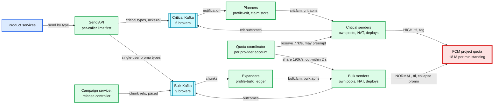
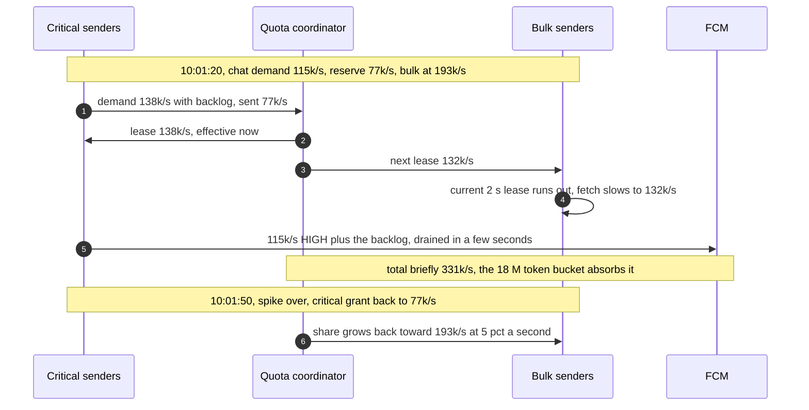

# Deep dive: priority lanes and isolation

> One-line answer: a priority field isolates nothing that matters, because the scarce things (the FCM project quota, APNs connections, broker disks, sender CPU, deploys) all sit after the queue. So the notification **type** picks a **lane**, and the two lanes share nothing we can separate: their own Kafka clusters, profile copies, Redis clusters, sender pools, connections, NAT gateways, deploy trains and outcome topics. The one thing we cannot split, the FCM project quota, is rationed by a coordinator: a critical reserve of 2x the critical peak that bulk never borrows, plus the right to **preempt** the bulk share within ~2 s when critical needs more. The simulation in §5 shows why both halves matter: with leases split by demand and no reserve a chat waits ~2.7 s behind a campaign; with a reserve but no preemption a 3x chat spike waits up to 15 s; with both, the end-to-end p99 is 0.76 s.

Zoom-in on [`../solution.md`](../solution.md) §5.2 (two lanes), §5.1 (the quota coordinator) and §7 (trade-offs). Reusable blocks: [`../../../concepts/rate-limiting-and-load-shedding.md`](../../../concepts/rate-limiting-and-load-shedding.md) (token buckets, AIMD, shedding), [`../../../concepts/fan-out-fan-in.md`](../../../concepts/fan-out-fan-in.md) (bulkheads). The same per-destination bulkhead idea, with merchants instead of providers: [`../../webhook-delivery/deep-dives/per-endpoint-isolation-and-scheduling.md`](../../webhook-delivery/deep-dives/per-endpoint-isolation-and-scheduling.md). Siblings: [`provider-egress-and-quotas.md`](provider-egress-and-quotas.md) (the coordinator and outages), [`campaign-fan-out-and-scheduling.md`](campaign-fan-out-and-scheduling.md) (how the bulk lane fills its share).

Acronyms: APNs (Apple Push Notification service), FCM (Firebase Cloud Messaging), NAT (network address translation), CDC (change data capture), AIMD (additive increase, multiplicative decrease), SLO (service level objective), AZ (availability zone), OTP (one-time password), KV (key-value store), TLS (Transport Layer Security).

---

## 1. What a campaign can take from a chat push

Walk every resource a chat push touches between the API and Apple or Google. For each one, ask what a 20M-user campaign at full speed does to it.

| Resource | If shared, the campaign... | Lane design |
|---|---|---|
| Queue | puts 20M records ahead of the chat (Kafka has no priorities) | `crit.*` topics on the critical cluster, `bulk.*` on the bulk cluster |
| Broker disks and in-sync replica fetchers | writes ~306 MB/s raw; a critical `acks=all` produce waits on the same disks | 6 critical brokers, 9 bulk brokers |
| Profile reads | 929k reads/s in multi-gets of 500 ahead of the chat's one read | `profile-crit` and `profile-bulk`, two CDC-fed copies |
| KV for dedup | 929k ledger scripts/s on the shards that hold chat claims | claim store and promo ledger on **separate** Redis clusters |
| Sender CPU and memory | 60 nodes' worth of work in the same processes | separate pools, separate deploy trains, never the same hour |
| HTTP/2 connections | "APNs ignores HTTP/2 PRIORITY frames", so a chat stream waits behind 250 bulk streams | 30 critical and 270 bulk APNs connections; ~160 (~40k streams) and ~400 to FCM |
| Egress | ~9 Gbps of bulk requests through the same NAT | NAT gateways per lane |
| Outcome topic | ~1.2M events/s of campaign outcomes in front of the status writer, and a full producer buffer if the bulk cluster is down | critical outcomes on `crit.outcomes` in the critical cluster |
| FCM project quota | spends the 1-minute bucket | reserve of 2x the critical peak, bulk never borrows, critical may preempt (§3) |

- **The outcome topic is the easy one to miss.** A critical sender that produces its `sent` outcome to a topic on the bulk cluster has a hidden dependency on that cluster. With the Kafka client defaults (`buffer.memory` 32 MB, `max.block.ms` 60 s) and ~4.6k outcomes/s per node at ~150 B each (~0.7 MB/s), a bulk cluster that is down for more than ~46 s fills the buffer, and `send()` then blocks the critical sender's loop. Critical outcomes therefore go to `crit.outcomes` on the critical cluster; the status writer reads both topics.
- **The send API is a shared entry.** Single-user promotional types (`price_drop`) enter through it and route to `bulk.requests`. A per-caller rate limit runs before anything else on the request path, so a runaway recommendation service is rejected at the door instead of filling the API's threads.
- **Shared and impossible to split:** the Firebase project, the APNs key and bundle topic (one app identity), the providers' own capacity, the preference database behind CDC, the region, and the app backend that the chat service itself runs on. The last one is why the release controller watches app headroom ([`campaign-fan-out-and-scheduling.md`](campaign-fan-out-and-scheduling.md)).

## 2. The two lanes



- **The type registry picks the lane**, not the API that was called. A "price drop on an item you viewed" is an advert under Korean law, so it takes the bulk lane with its consent, night rule and caps, even though it is a single-user send.
- **Same binary, two deployments.** Critical and bulk senders run the same code with different policies (claim and at-least-once versus offset-first and at-most-once). They ship on separate trains so a bad bulk release cannot take critical down in the same hour.
- **Cost of separation:** two Kafka clusters, two profile copies, two Redis clusters, two pools. About 20% more infrastructure than a shared design (solution §7), roughly $20k a month at the solution's prices.

## 3. The quota rule: reserve, never borrow, preempt

The standing contract is `Q = 18 M/min = 300k/s` on the one Firebase project.

| Slice | Size | Rule |
|---|---|---|
| Safety margin | 10% of Q = 30k/s | Covers the non-aligned 1-minute bucket, clock error in leases, and legacy traffic during migration |
| Critical reserve | 2x critical FCM peak = 77k/s | Critical may always use it |
| Bulk share | `Q − margin − reserve` = 193k/s | Bulk may never touch the reserve. AIMD on a 429 rate, 60 s ramp from 0 |
| Borrowing | unused bulk share | Critical may use whatever bulk leaves idle |
| **Preemption** | up to `Q − margin` = 270k/s | When critical demand (last second's arrivals plus backlog, +20%) exceeds the reserve, the coordinator cuts the bulk lease so critical gets it |

**Why preemption, not just a reserve.** A reserve sized at 2x the peak is a guess about the worst spike. A New Year's midnight, a large outage that ends at once, or a viral group chat can be 3x. Without preemption, critical is capped at 77k/s while a campaign keeps 193k/s: a promotion is delaying a chat, which is exactly the requirement we promised never to break. With preemption the critical lane has 270k/s available during any campaign: 7x its 38.5k/s peak, 3.5x the reserve.

**How fast.** Nodes report demand every 1 s. Leases last 2 s. So a cut reaches a bulk node within ~2 s. The coordinator raises the critical grant at once, without waiting for bulk to shrink. For up to 2 s the two lanes together can exceed `Q − margin` by up to the bulk share. Google's bucket holds a full minute of tokens (18M), so a 2 s overshoot of at most 193k/s spends at most ~0.4M of it. That is why immediate grant is safe, and why the margin need not cover it.



## 4. The 1 s budget, and what still blows it

| Hop | p50 | p99 | What sets it |
|---|---|---|---|
| Send API, idempotency `SET NX` | 3 ms | 15 ms | Claim store round trip |
| Produce `crit.requests`, `acks=all` | 5 ms | 30 ms | 3 replicas across AZs, small cluster |
| Planner fetch, profile read, render, produce | 13 ms | 100 ms | `fetch.max.wait.ms=10`, one cache read |
| Sender fetch, expiry check, claim | 5 ms | 50 ms | Claim store round trip |
| Token bucket, provider `200` | 120 ms | 500 ms | Korea to provider round trip [estimate] |

The p99s do not add; ~700 ms is a ceiling. What still costs the SLO, and how much:
- **A sender host dying:** its partitions wait for `session.timeout.ms = 10 s`, so ~1/12 of critical traffic is ~10 s late for one window ([`expiry-dedup-and-retries.md`](expiry-dedup-and-retries.md) §4).
- **A cold connection:** TLS adds two round trips. Pools stay warm with HTTP/2 pings.
- **A provider slowdown:** not ours to fix; the breaker and in-flight cap stop us making it worse ([`provider-egress-and-quotas.md`](provider-egress-and-quotas.md)).
- **A spike above 7x the critical peak during a campaign:** past what preemption can give. Then critical queues, and the page fires.

## 5. Simulation: a chat spike while a campaign holds its share

The campaign has been running long enough to hold its full bulk share. Critical FCM traffic runs at its evening peak, 38.5k messages/s, and spikes to 2x or 3x for 30 s. Four quota policies: one shared counter with no reserve (first come, first served); per-node leases split by reported demand with no reserve; the reserve without preemption; the reserve with preemption. "Wait" is time in our own token bucket. "e2e" adds the other hops (p50 30 ms, p99 150 ms) and the provider round trip (p50 120 ms, p99 500 ms).

```python
# Lanes and the FCM quota: a campaign sends at its full bulk share while critical
# FCM traffic spikes 2x or 3x for 30 s. Does a chat push still leave in under 1 s?
# 10 ms ticks, 90 s, rates in FCM messages per second, seeded.
import random, math
from collections import deque
random.seed(60)
TICK, T_END = 0.01, 90.0
Q = 300_000                          # standing quota, 18 M a minute
LIMIT = 0.9 * Q                      # 10% safety margin: 270k/s usable
RESERVE = 77_000                     # 2x the critical FCM peak
BULK_FLEET = 1_020_000               # what 60 bulk senders could push if allowed
CRIT = 38_500                        # critical FCM messages/s at the evening peak
SPIKE = (20.0, 50.0)                 # 30 s of extra critical demand

def lognorm(median, p99):            # sample a hop latency in seconds
    s = math.log(p99 / median) / 2.326
    return median * math.exp(random.gauss(0, s))

def run(policy, mult):
    q, waits, backlog = deque(), [], 0   # q holds [arrival_tick, count]
    granted = pending = RESERVE
    arrivals = deque([0] * 100)          # last second of arrivals
    for t in range(int(T_END / TICK)):
        now = t * TICK
        lam = CRIT * TICK * (mult if SPIKE[0] <= now < SPIKE[1] else 1)
        n_in = max(0, round(random.gauss(lam, math.sqrt(lam))))
        q.append([t, n_in]); backlog += n_in
        arrivals.append(n_in); arrivals.popleft()
        if policy == "one counter, no reserve":
            # 72 nodes hit one 270k/s counter first come first served; bulk offers
            # its whole fleet, so critical gets its share of the offered load
            cap = LIMIT * TICK * backlog / (backlog + BULK_FLEET * TICK)
        elif policy == "leases by demand, no reserve":
            if t % 100 == 0:         # every 1 s: split 270k/s by reported demand
                granted = pending
                d = 1.2 * (sum(arrivals) + backlog)
                pending = LIMIT * d / (d + BULK_FLEET)
            cap = granted * TICK
        elif policy == "reserve, never preempt":
            cap = RESERVE * TICK     # bulk uses its full share, nothing to borrow
        else:                        # reserve, bulk lease cut when critical needs more
            if t % 100 == 0:         # nodes report every 1 s; the new lease applies 1 s later
                granted = pending    # demand = last second's arrivals + backlog, +20%
                pending = min(LIMIT, max(RESERVE, 1.2 * (sum(arrivals) + backlog)))
            cap = granted * TICK
        cap = int(cap)
        while cap > 0 and q:
            a, c = q[0]
            n = min(c, cap)
            waits.append(((t - a) * TICK, n))
            cap -= n; backlog -= n
            if n == c: q.popleft()
            else: q[0][1] -= n
    # end to end = our queue wait + other hops (p50 30 ms, p99 150 ms) + provider 200 (p50 120, p99 500)
    picks = sorted(random.choices([w for w, _ in waits], weights=[n for _, n in waits], k=100_000))
    e2e = sorted(w + lognorm(0.03, 0.15) + lognorm(0.12, 0.5) for w in picks)
    return picks[50_000], picks[99_000], picks[-1], e2e[99_000], sum(x > 1 for x in e2e) / len(e2e)

print(f"{'quota policy':<30}{'spike':>6}{'wait p50':>9}{'p99':>8}{'max':>8}{'e2e p99':>9}{'over 1 s':>9}")
for policy in ("one counter, no reserve", "leases by demand, no reserve",
               "reserve, never preempt", "reserve, preempt bulk"):
    for mult in (1, 2, 3):
        p50, p99, mx, e99, over = run(policy, mult)
        print(f"{policy:<30}{mult:>5}x{p50:>8.2f}s{p99:>7.2f}s{mx:>7.1f}s{e99:>8.2f}s{over:>9.1%}")
```

Output (`python3 lanes.py`):

```text
quota policy                   spike wait p50     p99     max  e2e p99 over 1 s
one counter, no reserve           1x    0.03s   0.04s    0.0s    0.58s     0.0%
one counter, no reserve           2x    0.04s   0.05s    0.1s    0.58s     0.0%
one counter, no reserve           3x    0.05s   0.06s    0.1s    0.59s     0.1%
leases by demand, no reserve      1x    2.67s   2.68s    2.7s    3.20s    98.8%
leases by demand, no reserve      2x    3.00s   3.65s    3.8s    3.91s    99.1%
leases by demand, no reserve      3x    3.87s   5.14s    5.4s    5.33s    99.3%
reserve, never preempt            1x    0.00s   0.00s    0.0s    0.55s     0.0%
reserve, never preempt            2x    0.00s   0.02s    0.0s    0.55s     0.1%
reserve, never preempt            3x    5.61s  14.83s   15.0s   15.02s    75.5%
reserve, preempt bulk             1x    0.00s   0.00s    0.0s    0.54s     0.0%
reserve, preempt bulk             2x    0.00s   0.00s    0.0s    0.55s     0.0%
reserve, preempt bulk             3x    0.00s   0.56s    0.7s    0.76s     0.1%
```

**Reading the output.**
- **One shared counter is fair enough for latency.** Its problem is the 754k increments a second on one key and a network call per message ([D10](../diagrams.md#d10-scaling--partitioning)), not the chat's wait.
- **Leases split by demand, with no reserve, are the trap.** Bulk always reports a deep backlog (its fleet could push 1.02M/s), so critical's slice is `270k × D_c ÷ (D_c + 1.02M)`. Critical only earns its 38.5k/s once its own backlog makes its demand look big: ~2.7 s of queue, permanently. Every chat misses the SLO while any campaign runs.
- **The reserve alone holds to 2x** and fails at 3x: critical is capped at 77k/s while 115.5k/s arrive, so the queue grows by 38.5k/s for 30 s. The worst chat waits 15 s, and three quarters of chats in the spike miss 1 s. The campaign kept its 193k/s the whole time.
- **Reserve plus preemption holds at 3x** with an end-to-end p99 of 0.76 s. The cost is ~2 s of queue at the start of the spike (the lease cycle) and a campaign that slows for 30 s.
- **Not modelled:** per-node imbalance inside the critical pool (64 partitions on 12 nodes, so a node carries 5 or 6 partitions, ±10%), and FCM's own latency rising under a spike. Both argue for preemption with headroom, not against it.

## 6. What an interviewer pushes on

1. **"Just mark chat as high priority."** Provider priority decides whether a phone wakes up. It does nothing for our queues, connections or the project quota, which both priorities spend. And FCM may lower high priority to normal for an app instance whose high-priority messages showed nothing visible over 7 days.
2. **"Why two Kafka clusters? Topics are already separate."** Separate topics still share disks, replica fetchers, controller and the deploy of the brokers. At 306 MB/s of bulk writes, the critical `acks=all` produce would queue behind them.
3. **"Your reserve is idle most of the day. Waste?"** Bulk cannot borrow it, by design. 77k/s of a 300k/s contract is what we pay for "a campaign never delays a chat". Critical borrowing bulk's idle share is free.
4. **"What if critical itself spikes 5x?"** Preemption gives critical up to 270k/s, 7x its 38.5k/s peak, during a campaign. Past that, critical queues and pages. The per-caller rate limit stops one buggy caller from being that spike.
5. **"Is anything still shared?"** The Firebase project, the APNs app identity, the providers, the preference database behind CDC, the region, and the app backend. The first is the red node; the last is why the release controller reads app headroom.
6. **"Where would a promotion still sneak in?"** The outcome topic and the Redis cluster, if anyone co-locates them. Both are on the review checklist for a new topic or keyspace: which lane owns it.

## 7. Trade-offs

| Decision | Option A | Option B | Chose | Why |
|---|---|---|---|---|
| Lane key | API called | Notification type | Type | A single-user advert is still an advert |
| Isolation | Priority field | Separate resources per lane | Separate | The scarce things are after the queue |
| Quota split | Leases by demand | Reserve plus preemption | Reserve plus preemption | Demand split costs every chat ~2.7 s during a campaign; a reserve alone fails at 3x |
| Preemption delay | Wait for bulk to shrink first | Grant critical at once | At once | The 18M-token bucket absorbs a 2 s overshoot |
| Critical outcomes | Shared `outcomes` on the bulk cluster | `crit.outcomes` on the critical cluster | Own topic | A bulk cluster outage would block critical senders after ~46 s |
| KV | One Redis cluster for claims and ledger | Two clusters | Two | 929k ledger scripts/s at the peak would sit in front of chat claims |
| Refused | One queue with priorities, hedged provider requests, a bulk lane that borrows the reserve | | | Each puts a promotion in front of a chat somewhere |

## 8. Numbers to say out loud

- FCM standing contract 18 M/min = 300k/s: margin 30k, critical reserve 77k (2x the 38.5k peak), bulk 193k.
- Preemption gives critical up to 270k/s, 7x its peak; a cut reaches bulk within ~2 s; a 2 s overshoot spends ≤ 0.4M of the 18M bucket.
- Leases by demand with no reserve: ~2.7 s for every chat during a campaign. Reserve alone at a 3x spike: 15 s. Reserve plus preemption: p99 0.76 s.
- Critical lane: 6 brokers, 12 push senders, 30 APNs and ~160 FCM connections (~40k streams). Bulk: 9 brokers, 60 senders, 270 and ~400.
- Critical outcomes on the critical cluster: a 32 MB producer buffer fills in ~46 s at ~0.7 MB/s per node.
