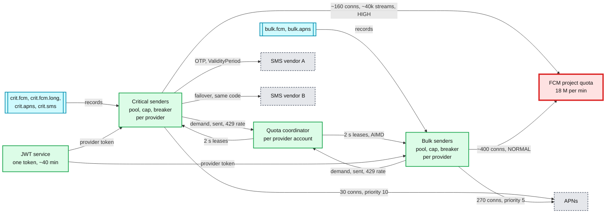

# Deep dive: provider egress and quotas

> One-line answer: provider egress is the red node, because FCM's default project quota (600k messages a minute, ~10k a second) is 75x short of 1M a second and takes a support ticket with at least 15 days' notice to change, while everything on our side scales by adding machines. A quota coordinator per provider account turns the contracted number into 2 s leases that each sender node enforces locally, with a critical reserve, a bulk share that backs off on a 429 rate, APNs concurrency instead of a quota, and two SMS vendors. Each (provider, lane) is a bulkhead with its own topic, pool, in-flight cap and breaker, so an outage leaves records in Kafka and expiry decides what is dropped. The drain simulation in §6 shows one more rule: after a 30-minute FCM outage, draining the short-lived topic first saves ~196k of the 1.16M chats still alive and cuts a new chat's wait from 53 s to 17 s.

Zoom-in on [`../solution.md`](../solution.md) §2 (per-provider numbers), §5.1 (where 1M a second binds), §5.5 (outages) and §10.4 (the outage timeline). Reusable blocks: [`../../../concepts/rate-limiting-and-load-shedding.md`](../../../concepts/rate-limiting-and-load-shedding.md), [`../../../concepts/leases-fencing-clocks.md`](../../../concepts/leases-fencing-clocks.md). The split-cursor drain after an outage is the one in [`../../webhook-delivery/deep-dives/retry-policy-and-storms.md`](../../webhook-delivery/deep-dives/retry-policy-and-storms.md). Siblings: [`priority-lanes-and-isolation.md`](priority-lanes-and-isolation.md) (reserve and preemption), [`expiry-dedup-and-retries.md`](expiry-dedup-and-retries.md) (what each provider does with a late message).

Acronyms: FCM (Firebase Cloud Messaging), APNs (Apple Push Notification service), SMS (short message service), OTP (one-time password), MPS (messages per second), JWT (JSON Web Token), AIMD (additive increase, multiplicative decrease), TLS (Transport Layer Security), UCS-2 (the 2-byte character encoding Korean SMS uses), KST (Korea Standard Time), SLO (service level objective), QPS and RPS (queries and requests per second).

---

## 1. Where 1M a second binds

| Provider | Need at the 1M/s peak | Published limit | What we do |
|---|---|---|---|
| FCM | 754k messages/s = 45 M/min | 600k/min per project by default ([FCM quotas](https://firebase.google.com/docs/cloud-messaging/throttling-and-quotas)); +25% steps, each after 80% use for 5 minutes | Standing 18 M/min (30x) via Firebase Support with a forecast; 53 M/min (~883k/s, 795k/s usable after the 10% margin, 718k/s for bulk beside the 77k/s critical reserve) for a named event, asked at least 15 days ahead |
| APNs | 324k/s, ~49k streams in flight (`324k × 0.15 s`) | No quota, and "don't assume a specific number of streams" | ~300 HTTP/2 connections at ≤ 250 streams each [estimate] |
| SMS | ~1k/s of OTP and fallback | A short code sends ~100 MPS ([Twilio](https://www.twilio.com/docs/messaging/guides/account-based-throughput-overview)) | Two vendors, each contracted for all OTP traffic alone, ≥ 1k MPS [estimate] |
| Email | ~5k/s of receipts | Account send rate, raised on request | One account; campaign email belongs to the email platform |

- **The +25% path does not reach 75x.** `1.25^19 = 69`, `1.25^20 = 87`: 20 requests, each after 5 minutes at 80% use. Even at one a week that is months. The plan is the support request.
- **Critical alone is 4x the default** (`38.5k × 60 = 2.3 M/min`). A Coupang-sized app needs the raised quota before it sends a single promotion.
- **Refused:** FCM topics (fanout "not uncommon" at 10,000 QPS per project, "not adjustable", no per-user consent or caps), multicast as a quota trick ("quota counts messages, not requests"), and many Firebase projects to multiply the quota (no documented policy, and a token belongs to one sender).

## 2. Bulkheads per (provider, lane)



**The coordinator.**
- **Unit = provider account:** the Firebase project, the APNs key and bundle topic, each SMS vendor account, the email account. The contracted `Q` is configuration.
- **Leases, not counters.** Every 1 s each node reports demand (arrivals plus backlog) and what it sent; the coordinator answers with a 2 s lease of "n messages a second", enforced by a local token bucket. ~72 calls a second instead of 754k counter increments.
- **Slices:** margin 10% of `Q`, critical reserve 2x the critical peak, bulk the rest, critical may preempt bulk ([`priority-lanes-and-isolation.md`](priority-lanes-and-isolation.md) §3).
- **AIMD on a 429 rate, not on any 429.** FCM's `QUOTA_EXCEEDED` also covers one device's message rate. One buggy loop to one phone must not halve the whole bulk lane, so the trigger is ≥ 0.5% of bulk requests in 1 s across ≥ 100 distinct tokens [estimate]. Then the share halves for 30 s and grows back 5% a second. `Retry-After` is honoured.
- **When the coordinator is down:** each critical node keeps its static slice of the reserve (77k ÷ 12 ≈ 6.4k/s, 2x its ~3.2k/s share of the critical FCM peak) indefinitely; bulk leases decay to 0 within 10 s. Chat keeps going, promotions pause.
- **Ramp.** Any lane that resumes ramps from 0 over 60 s ("ramp from 0 to the max RPS across a 60 second time-window"; front-loading creates oscillations).

**APNs.** One stream per connection "until you post a request with a valid authentication token", then many, with no number promised. Every node presents **one** ES256 JWT minted by a token service and refreshed every ~40 minutes: Apple returns `429 TooManyProviderTokenUpdates` if it changes more than once per 20 minutes, which 300 connections minting their own would cause. Traffic is spread over many connections ("avoid push bursts over selective connections"). `429 TooManyRequests` is per device token: back off that token only.

**SMS.** OTP has its own Messaging Service with `ValidityPeriod = remaining − 10 s`, so a 3-minute OTP leaves with ~170 s and dies in the vendor's queue instead of arriving 10 hours later. The breaker needs a rule that works at night: at 03:00 OTP may be ~5/s, so "≥ 200 attempts in 10 s" never fires. Add "20 consecutive failures", and fail over per message: an OTP whose vendor-A attempt times out after 2 s goes to vendor B at once with the same code.

## 3. In-flight caps: size the critical pool for a slow provider

Little's law with the **mean** latency: in flight = rate × mean latency.

| Pool | Peak rate | Normal mean latency | In flight | Cap | Saturates at mean latency |
|---|---|---|---|---|---|
| Critical FCM, 50 conns × 250 (rejected) | 38.5k/s | ~0.12 s | ~4.6k | 12.5k | ~325 ms, 2.7x normal |
| **Critical FCM, ~160 conns × 250 (chosen)** | 38.5k/s | ~0.12 s | ~4.6k | 40k | ~1 s, 8x normal |
| Bulk FCM, ~400 conns × 250 | ~200k/s | ~0.15 s | ~30k | 100k | ~0.5 s, then AIMD shrinks it |

- **Decision: size the critical FCM pool at one second of peak** (~40k streams, ~160 connections). A 3x slowdown at Google then costs latency, not a queue in front of every chat. Connections are free; a chat stuck behind a saturated pool is not.
- **The bulk pool stays small on purpose.** When FCM slows, AIMD shrinks bulk in-flight first, so we do not pile onto a struggling provider.
- **Timeouts** 2 s critical, 5 s bulk. **Breaker** per (provider, lane): opens at ≥ 50% failures of ≥ 200 attempts in 10 s (5xx, timeout, connection errors; token errors such as 410 do not count) or critical p99 over 2 s; probes 1% every 5 s; closes after 30 s clean, then ramps.

## 4. What each outage drops, on purpose

FCM down 20:00 to 20:30, evening rate ~10k critical calls/s [estimate], so `10k × 1.1 tokens × 70% Android = 7.7k` critical FCM messages/s, 13.9M in 30 minutes.

| Type, share | During the outage | At 20:30 |
|---|---|---|
| Chat, 50%, 5 min life | waits in `crit.fcm`; online users get the chat over its own socket | 5.78M already dead; 1.16M alive |
| Order and payment, 40%, 24 h | waits in `crit.fcm.long`; the inbox already shows it; `payment_failed` also emails after 60 s | 5.54M alive, all sent |
| Other, 10% | per registry | 1.39M alive |
| OTP by push | falls back to SMS after 5 s | none waiting |
| Promotions | campaigns keep releasing for APNs; Android records wait in `bulk.fcm` up to `share × time left`, then pause | drained after critical, past-expiry dropped |

**Why two critical topics per provider.** Kafka reads a partition oldest first. With one `crit.fcm`, the recovery drain spends its first ~50 s on order pushes from 20:00 that have 23 more hours to live, while chats from 20:25 die behind them. So critical provider topics are split by lifetime class: `crit.fcm` for types that live ≤ 10 minutes (chat, OTP by push) and `crit.fcm.long` for the rest, the same for APNs. On recovery the short topic drains first.

## 5. Simulation: draining after a 30-minute FCM outage

At 20:30 the critical lane gets its reserve plus the paused bulk share, ramped from 0 to 270k/s over 60 s. Expired records are dropped when read and cost no quota. New traffic keeps arriving at 7.7k/s. Three drain orders: one FIFO cursor; short topic first; and a live cursor that serves records arriving after recovery before either backlog (the webhook split cursor).

```python
# FCM is down 20:00 to 20:30. Critical FCM records wait in Kafka; expired ones are
# dropped when read. At 20:30 the critical lane gets the reserve plus the paused bulk
# share, ramped 0 to 270k/s over 60 s. Which drain order saves the most live chats?
# 0.1 s ticks. Evening rate 7.7k critical FCM messages/s: chat 50% (5 min),
# order and payment 40% (24 h), other 10% (2 h) [estimate].
from collections import deque
TICK, OUT_END, END, RATE, CAP, RAMP = 0.1, 1800.0, 2400.0, 7_700, 270_000, 60.0
LIFE = {"chat": 300, "order": 86_400, "other": 7_200}
MIX = {"chat": 0.5, "order": 0.4, "other": 0.1}

def run(order):
    # one queue per class; a bucket is [arrival_time, count]
    qs = {k: deque() for k in LIFE}
    sent_live = {k: 0 for k in LIFE}; expired = {k: 0 for k in LIFE}
    new_chat_wait, drained_at, t = [], None, 0.0
    while t < END:
        for k, share in MIX.items():
            qs[k].append([t, RATE * share * TICK])
        if t >= OUT_END:
            cap = CAP * min(1.0, (t - OUT_END + TICK) / RAMP) * TICK
            # FIFO: one cursor reads every class in arrival order.
            # Split: short-lived topic first, long-lived second (each oldest first).
            classes = {"FIFO": [["chat", "order", "other"]],
                       "split by lifetime": [["chat"], ["order", "other"]],
                       "live cursor, then split": [["new"], ["chat"], ["order", "other"]]}[order]
            for group in classes:
                if group == ["new"]:                    # records that arrived after recovery
                    for k in LIFE:
                        b = qs[k][-1] if qs[k] else None
                        if b and b[0] >= OUT_END and cap > 1e-9:
                            n = min(b[1], cap); cap -= n; b[1] -= n
                            if k == "chat": new_chat_wait.append((t - b[0], n))
                    continue
                while cap > 1e-9:
                    heads = [(qs[k][0][0], k) for k in group if qs[k] and qs[k][0][1] > 1e-9]
                    if not heads:
                        for k in group:
                            while qs[k] and qs[k][0][1] <= 1e-9: qs[k].popleft()
                        heads = [(qs[k][0][0], k) for k in group if qs[k]]
                    if not heads: break
                    a, k = min(heads)
                    b = qs[k][0]
                    if t > a + LIFE[k]:                 # dropped at dequeue, costs no quota
                        if a < OUT_END: expired[k] += b[1]
                        qs[k].popleft(); continue
                    n = min(b[1], cap); cap -= n; b[1] -= n
                    if k == "chat" and a >= OUT_END: new_chat_wait.append((t - a, n))
                    if a < OUT_END: sent_live[k] += n
                    if b[1] <= 1e-9: qs[k].popleft()
            live_backlog = sum(b[1] for k in qs for b in qs[k] if t <= b[0] + LIFE[k])
            if drained_at is None and live_backlog < RATE * 1.0:
                drained_at = t - OUT_END
        t += TICK
    for k in qs:                                        # still queued and dead by the end
        expired[k] += sum(b[1] for b in qs[k] if END > b[0] + LIFE[k] and b[0] < OUT_END)
    waits = sorted(new_chat_wait)
    tot = sum(n for _, n in waits); acc, p99 = 0.0, 0.0
    for w, n in waits:
        acc += n
        if acc >= 0.99 * tot: p99 = w; break
    return sent_live, expired, drained_at, p99

alive_at_recovery = {k: RATE * MIX[k] * min(OUT_END, LIFE[k]) for k in LIFE}
print("alive at 20:30: " + ", ".join(f"{k} {v / 1e6:.2f} M" for k, v in alive_at_recovery.items())
      + f", total {sum(alive_at_recovery.values()) / 1e6:.2f} M")
lost_in_outage = RATE * MIX["chat"] * (OUT_END - LIFE["chat"])
print(f"chats dead before recovery: {lost_in_outage / 1e6:.2f} M")
print(f"{'drain order':<26}{'old chats sent':>15}{'lost in drain':>14}{'orders sent':>12}{'drained':>9}{'new chat p99':>13}")
for order in ("FIFO", "split by lifetime", "live cursor, then split"):
    s, e, d, p99 = run(order)
    print(f"{order:<26}{s['chat'] / 1e6:>13.2f} M{(e['chat'] - lost_in_outage) / 1e3:>12,.0f} k"
          f"{s['order'] / 1e6:>10.2f} M{d:>7.0f} s{p99:>12.1f} s")
```

Output (`python3 drain.py`):

```text
alive at 20:30: chat 1.16 M, order 5.54 M, other 1.39 M, total 8.09 M
chats dead before recovery: 5.78 M
drain order                old chats sent lost in drain orders sent  drained new chat p99
FIFO                               0.96 M         198 k      5.54 M     61 s        53.2 s
split by lifetime                  1.15 M           2 k      5.54 M     62 s        16.7 s
live cursor, then split            1.15 M           8 k      5.54 M     61 s         0.0 s
```

**Reading the output.**
- **The live backlog drains in ~61 s whatever the order.** The ramp alone sends `270k × 60 ÷ 2 = 8.1M`, the whole backlog, so bulk can start its own ramp about a minute after recovery.
- **Order decides which chats live.** FIFO reaches the 20:25 chats ~50 s after recovery, so ~198k of the 1.16M that were alive at 20:30 expire in the queue (17%). Short-first loses ~2k.
- **New chats wait behind the backlog.** FIFO holds a chat sent at 20:30:05 for up to 53 s; short-first for ~17 s (behind the 1.16M older chats); a live cursor serves it at once and loses ~6k more old chats. Short-first is the simple default; the live cursor is worth it if a minute-long SLO miss after recovery matters.
- **Not modelled:** per-device FCM limits (a heavy user with 50 queued chats is under 240 a minute) and the app herd from 8.1M pushes in a minute (mostly order pushes with a small `p × k`; ~14k extra requests/s in the busiest minute at an assumed 0.3).

## 6. What an interviewer pushes on

1. **"Just ask Google for 1M a second."** The self-service path is 20 steps of +25%. The support path needs a forecast and, for an event, at least 15 days. And the app herd caps a busy 10:00 near 100k flash-sale pushes a second, so a standing 45 M/min would buy speed we must not use.
2. **"Why not use FCM topics for campaigns?"** About 10,000 QPS per project, not adjustable, and no per-user consent, night rule, caps, dedup or status.
3. **"FCM is down. Fail over to SMS?"** 13.9M messages in 30 minutes as SMS is ~$139k [estimate], and two vendors at ~1k MPS each send at most ~3.6M in 30 minutes. Only types whose registry entry says so (OTP) switch channel.
4. **"What do you drop?"** Whatever expires: ~5.8M chat pushes in a 30-minute outage, by design. Users in the app got them over the chat socket.
5. **"The coordinator is a single point of failure."** It holds soft state rebuilt from reports in 2 s. If it is gone, critical nodes keep their static reserve slices and bulk stops within 10 s.
6. **"One phone in a loop gets 429s. What happens?"** The per-token limiter (240 a minute on Android) stops us first. If FCM answers 429 for that token, only that token backs off; the bulk lane's AIMD reacts to a 429 rate across many tokens.

## 7. Trade-offs

| Decision | Option A | Option B | Chose | Why |
|---|---|---|---|---|
| FCM contract | 45 M/min standing | 18 M/min standing, 53 M/min per event | Standing plus event | The app herd caps a busy 10:00 far below 45 M/min |
| AIMD trigger | Any 429 | A 429 rate across ≥ 100 tokens | Rate | A single device's limit must not halve the lane |
| Critical FCM pool | 12.5k streams | ~40k streams | ~40k | Saturates at 325 ms mean latency versus ~1 s; connections cost nothing |
| Critical topics | One per provider | Short and long lifetime classes | Two | FIFO drain loses ~198k live chats after a 30-minute outage; short-first loses ~2k |
| Drain cursor | Short-first | Live cursor first | Short-first by default | Simple; 17 s versus 0 s for new chats, one minute per outage |
| SMS breaker | Volume rule only | Plus 20 consecutive failures, per-message failover | Both | At 5 OTP/s the volume rule never fires |
| Refused | FCM topics, multicast for quota, many Firebase projects, SMS fallback for push, promotional SMS in the burst | | | Each either breaks a rule we promised or costs more than it returns |

## 8. Numbers to say out loud

- FCM 600k/min default, ~10k/s; 1M/s needs 45 M/min, 75x; 20 steps of +25%; event quota ≥ 15 days ahead. Ask 18 M/min standing, 53 M/min (~883k/s) for a named sale: with the 10% margin and the 77k/s critical reserve, bulk's 715k/s needs `(715k + 77k) ÷ 0.9 ≈ 880k/s ≈ 52.8 M/min`.
- APNs: no quota, ~49k streams in flight at the peak, ~300 connections, one JWT every ~40 minutes, never more often than every 20.
- SMS: 100 MPS per short code; two vendors at ≥ 1k MPS each; OTP validity `remaining − 10 s` (~170 s).
- 30-minute FCM outage at 20:00: 13.9M critical messages, 5.78M chats dead by design, 8.09M alive, drained in ~61 s at up to 270k/s.
- Short-first drain: ~2k live chats lost instead of ~198k; new chat wait ~17 s instead of 53 s.
- Critical FCM pool at ~40k streams: survives a mean latency of ~1 s at peak.
