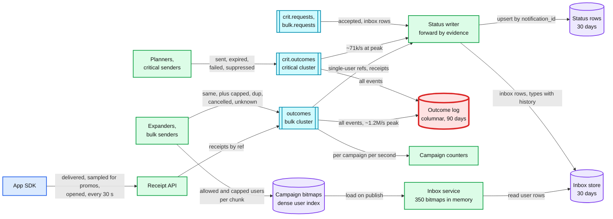

# Deep dive: status tracking and inbox

> One-line answer: status is an event stream, not a row per delivery. Every hop emits one outcome per transition; critical outcomes go to `crit.outcomes` on the critical cluster, the rest to `outcomes`. A status writer keeps point rows only for notifications a caller can ask about (critical and single-user sends, ~71k upserts/s at the peak); campaigns get a columnar log and per-second counters; delivered and opened come from our SDK, sampled at 1% of devices for promotions; and a campaign's inbox entry is one roaring bitmap on a dense user index, checked when the user opens the inbox. Rows move forward by **evidence** (opened, delivered, sent, then our own verdicts expired and failed): the simulation in §3 shows last-write-wins leaves 1.5% of rows wrong. The calculation in §5 shows the dense index is what keeps 350 live campaign bitmaps at ~1.2 GB instead of ~12 GB.

Zoom-in on [`../solution.md`](../solution.md) §4.4 (status and inbox), §7 (the write-follows-read trade-off) and §10.5 (idempotency). Reusable blocks: [`../../../concepts/fan-out-fan-in.md`](../../../concepts/fan-out-fan-in.md) (fan-out on read for the celebrity case), [`../../../concepts/columnar-db.md`](../../../concepts/columnar-db.md) (the outcome log), [`../../../concepts/stream-processing.md`](../../../concepts/stream-processing.md) (per-second counters). Siblings: [`expiry-dedup-and-retries.md`](expiry-dedup-and-retries.md) (where a late `expired` comes from), [`priority-lanes-and-isolation.md`](priority-lanes-and-isolation.md) (why critical outcomes have their own topic).

Acronyms: SDK (software development kit, our mobile library), APNs (Apple Push Notification service), FCM (Firebase Cloud Messaging), TTL (time to live), GDPR (EU General Data Protection Regulation, used here for any deletion request).

---

## 1. The pipeline



- **Writes follow reads.** Callers ask about one notification ("did the shipped push for order 991 go out?"); marketing asks about aggregates. So point rows exist only for the first, and campaigns get counters.
- **The outcome log is the bottleneck** at a campaign peak: ~1.02M sent outcomes a second plus suppressions. It is append-only, batched (one file per partition every few seconds), partitioned by day and ordered by `(ref, user_id)`. If it falls behind, the topic holds the backlog for 3 days; nothing on the send path waits for it.
- **Critical outcomes on the critical cluster.** The status writer reads ~71k/s from `crit.outcomes` instead of filtering ~1.2M/s of campaign events to find them, so a campaign cannot make a caller's status read stale.

## 2. What we write, and what we refuse

| Kind | Store | Rate at the peak | Lives |
|---|---|---|---|
| Critical notification, per channel | point row by `notification_id` | ~71k upserts/s; 610M notifications a day | 30 days, ~16.5 TB with 3 replicas |
| Single-user promotional send | point row | ~1.25k/s | 30 days |
| Campaign delivery | no row: outcome log plus counters | ~1M events/s | 90 days in the log |
| Delivered receipt | merged into the row, or the log | all critical; 1% of devices for promotions | as above |
| Inbox, types with history (orders, payments, price drops) | row per user | ~15k/s; ~238M a day | 30 days, ~6.4 TB |
| Inbox, campaigns | one bitmap per campaign | one file per campaign | until the campaign's expiry |

**Refused:** a row per campaign delivery (~1M writes/s for the minutes a campaign sends, ~30 TB more), and 20M inbox rows per campaign (~900M writes a day, almost none read).

## 3. Simulation: which merge rule leaves the row right

Outcomes arrive at least once and partly out of order: sender outcomes in milliseconds, 1% of them a minute late after a producer retry; SDK receipts batched up to 30 s; 2% replayed; 0.5% of pushes crash in the window, and 20% of those resends find the message expired and say so, although the phone already showed it. 3% of tokens are dead (410).

```python
# Status rows are upserted from an at-least-once, partly reordered outcome stream:
# sender outcomes (fast, rarely retried for a minute), SDK receipts (batched up to 30 s),
# replays, and the crash-window resend that can say "expired" after the phone showed it.
# Which merge rule leaves the row in the right state? 200k critical pushes, seeded.
import random
random.seed(60)
RANK = {"accepted": 0, "expired": 1, "failed": 1, "unknown": 1, "sent": 2, "delivered": 3, "opened": 4}

def events():
    """Return (truth, [(arrival_time, state)]) for one push."""
    ev, t0 = [], random.uniform(0, 60)
    out = lambda: random.lognormvariate(-3, 0.6) + (random.uniform(5, 60) if random.random() < 0.01 else 0)
    rcpt = lambda: random.uniform(0, 30) + random.lognormvariate(-1, 0.5)
    if random.random() < 0.03:                         # dead token: 410
        ev.append((t0 + out(), "failed")); truth = "failed"
    else:
        truth = "sent"
        if random.random() < 0.995: ev.append((t0 + out(), "sent"))   # 0.5%: crash before the outcome
        else:
            ev.append((t0 + 10 + out(), "sent" if random.random() < 0.8 else "expired"))
        if random.random() < 0.7:
            truth = "delivered"; ev.append((t0 + rcpt(), "delivered"))
            if random.random() < 0.25:
                truth = "opened"; ev.append((t0 + random.uniform(5, 600) + rcpt(), "opened"))
    ev += [(t + random.uniform(1, 120), s) for t, s in ev if random.random() < 0.02]  # replays
    return truth, sorted(ev)

def merge(rule, evs):
    state = "accepted"
    for _, s in evs:
        if rule == "last write wins": state = s
        elif rule == "terminal states win":
            if state in ("expired", "failed", "unknown"): continue
            if s in ("expired", "failed", "unknown") or RANK[s] > RANK[state]: state = s
        else:                                          # forward-only by evidence
            if RANK[s] > RANK[state]: state = s
    return state

N = 200_000
data = [events() for _ in range(N)]
print(f"{'merge rule':<26}{'wrong final state':>18}{'shows expired but phone showed it':>35}")
for rule in ("last write wins", "terminal states win", "forward-only by evidence"):
    wrong = bad_exp = 0
    for truth, evs in data:
        got = merge(rule, evs)
        wrong += got != truth
        bad_exp += got == "expired" and truth != "expired"
    print(f"{rule:<26}{wrong / N:>18.2%}{bad_exp:>35,}")
```

Output (`python3 status.py`):

```text
merge rule                 wrong final state  shows expired but phone showed it
last write wins                        1.52%                                 93
terminal states win                    0.10%                                198
forward-only by evidence               0.03%                                 64
```

**Reading the output.**
- **Last write wins is wrong for 1.5% of rows**: replays and late sender outcomes land after a receipt and move `delivered` back to `sent`.
- **"Terminal states win"** looks safe (once expired, always expired) and is wrong in exactly the case that matters to support: the phone showed the push, and the row says `expired`.
- **Forward by evidence** ranks what a provider or the phone told us (`sent`, `delivered`, `opened`) above our own verdict on a later attempt (`expired`, `failed`). What it still gets wrong (0.03%) is unknowable: a crash lost the only `sent`, the retry expired, and the phone sent no receipt.
- **Across tokens** (iPhone and iPad) the channel shows the best state of any token. Each event carries the token hash, so the row can still say which device.

## 4. Receipts

- **APNs and FCM say "accepted", not "delivered."** Delivered and opened come from our SDK, batched every 30 s or on the next app open.
- **The app must see the push to report it.** On iOS the payload sets `mutable-content: 1` so our notification service extension runs; on Android we send data messages that the app turns into a notification [design choice; platform behaviour not in the survey]. A high-priority Android message must still end in a visible notification, or FCM may lower that app instance to normal priority after 7 days.
- **Sampling for promotions is by `hash(device id)`, 1%**, so the same devices report for every campaign and trends compare. A 15.9M campaign gets ~159k receipts: the delivered rate is known to about ±0.23 points at 95% (`1.96 × √(0.7 × 0.3 ÷ 159k)`). Full receipts would be ~16M requests in a few minutes, a herd of our own.
- **A lower bound.** A force-quit app reports nothing, so `delivered` undercounts. That is said on the dashboard, next to the number.

## 5. The inbox: rows for some, bitmaps for campaigns

- **Rows** `(user_id, created_at desc)` with a 30-day TTL, for types whose registry entry says "inbox": orders, payments, price drops. The status writer writes one when it reads `accepted`, which it takes from `crit.requests` (and `bulk.requests` for single-user promotional sends) rather than from an outcome event, before any provider call, so the inbox shows an order even while FCM is down.
- **Campaign bitmaps.** The expander adds each allowed or capped user to the campaign's bitmap as it decides each chunk; the file is published when expansion completes (it lags the release by seconds). Inbox nodes hold every live bitmap in memory. A read takes the user's rows, tests the user's index in each live bitmap, merges by time and hides anything past `expires_at`. A read mark is a small row written only when the user opens the item.
- **A dense user index.** Bitmaps use a `user_seq` integer from 0 to ~30M kept in the profile, not the raw user id. Indexes of deleted users are not reused for 7 days, so an old bitmap can never show a campaign to a new user.

```python
# Memory for the live campaign bitmaps the inbox service holds. A roaring bitmap splits
# ids into 65,536-id blocks; a block with more than 4,096 members is an 8 KB bitmap,
# otherwise a sorted array of 2-byte values. The id space decides everything.
import random
random.seed(60)

def roaring_bytes(members, id_space):
    blocks = -(-id_space // 65_536)
    used = min(blocks, members)
    per = members / used
    return used * (8_192 if per > 4_096 else 2 * per + 16)

USERS = 30_000_000
mix = [(10_000, 0.4), (300_000, 0.3), (3_000_000, 0.2), (15_000_000, 0.1)]   # audience sizes [estimate]
skewed = [random.choices([a for a, _ in mix], [w for _, w in mix])[0] for _ in range(350)]
flat = [18_000_000] * 350                      # the sizing in solution section 2
print(f"{'user id space':<26}{'one 18 M campaign':>18}{'350 x 18 M':>12}{'350, skewed mix':>17}")
for label, space in (("dense index 0 to 30 M", USERS), ("sparse 32-bit ids", 2 ** 32)):
    one = roaring_bytes(18_000_000, space)
    a = sum(roaring_bytes(n, space) for n in flat)
    b = sum(roaring_bytes(n, space) for n in skewed)
    print(f"{label:<26}{one / 2**20:>15.1f} MB{a / 2**30:>9.1f} GB{b / 2**30:>14.2f} GB")
print(f"skewed mix: {sum(skewed) / 1e6:,.0f} M memberships, mean {sum(skewed) / 350 / 1e6:.1f} M per campaign")
# inbox read: one membership test per live bitmap, ~100 ns each [estimate]
reads = 20_000
print(f"bitmap checks at {reads:,} inbox reads/s: {reads * 350 / 1e6:.0f} M/s, "
      f"~{reads * 350 * 100e-9:.1f} CPU-seconds per second across the inbox fleet")
```

Output (`python3 bitmap.py`):

```text
user id space              one 18 M campaign  350 x 18 M  350, skewed mix
dense index 0 to 30 M                 3.6 MB      1.2 GB          0.41 GB
sparse 32-bit ids                    35.3 MB     12.1 GB          1.53 GB
skewed mix: 700 M memberships, mean 2.0 M per campaign
bitmap checks at 20,000 inbox reads/s: 7 M/s, ~0.7 CPU-seconds per second across the inbox fleet
```

**Reading the output.**
- **~1.2 GB for 350 campaigns of 18M holds only on a dense index.** 18M members spread over 2^32 ids put ~275 members in each of 65,536 blocks, all arrays: ~35 MB per campaign and ~12 GB for 350, on every inbox node.
- **A realistic mix is smaller.** Most campaigns are 10^4 to 10^6 users; with the skewed mix 350 bitmaps take ~0.4 GB dense.
- **Reads are cheap.** 350 tests per inbox read at ~20k reads/s is under one core across the fleet.
- **Deletion.** A deleted user's profile is a tombstone, so the inbox filters them out at read; their index is retired; bitmaps expire with their campaigns (≤ 7 days), so nothing needs rewriting.

## 6. What an interviewer pushes on

1. **"Why not one status row per delivery?"** ~4B writes a day and ~1M a second while a campaign sends, for rows almost nobody reads. Marketing wants counts; callers want one notification.
2. **"How do you answer 'did user X get campaign Y'?"** A columnar query by `(campaign, user)`: seconds, not milliseconds. Support tools accept that.
3. **"A late `expired` arrives after `delivered`."** Evidence outranks our verdict; the row stays `delivered`. A replay is the same event again and changes nothing.
4. **"Delivered is from your SDK. How good is it?"** A lower bound: a force-quit app reports nothing, and promotions are sampled at 1% by device hash, ±0.23 points on a 15.9M campaign.
5. **"20M users open the inbox after the flash sale."** It is ~20k reads/s spread over minutes, each one row-range read plus 350 in-memory bitmap tests. The campaign added zero rows.
6. **"GDPR delete?"** Profile, tokens and ledger by `user_id`; status and inbox rows expire in 30 days and are deleted by `user_id` on request; the outcome log is deleted by `user_id` in its next compaction; the dense index is retired.

## 7. Trade-offs

| Decision | Option A | Option B | Chose | Why |
|---|---|---|---|---|
| Status for campaigns | Row per delivery | Log plus counters | Log plus counters | ~1M row writes/s avoided at the peak |
| Merge rule | Last write wins | Forward by evidence | Evidence | 1.52% wrong versus 0.03% (unknowable) |
| Where `expired` ranks | Above `sent` (terminal) | Below `sent` | Below | A phone that showed the push is the truth |
| Critical outcomes | Shared `outcomes` | `crit.outcomes` | Own topic | The writer reads 71k/s, not 1.2M/s, during a campaign |
| Promo receipts | Every device | 1% by device hash | Sampled | ±0.23 points is enough; full receipts are a herd |
| Campaign inbox | 20M rows | One bitmap | Bitmap | ~900M writes a day avoided |
| Bitmap ids | Raw user ids | Dense `user_seq` | Dense | ~1.2 GB versus ~12 GB per inbox node |

## 8. Numbers to say out loud

- Status rows: ~71k upserts/s at the peak, 610M a day, 30 days, ~16.5 TB with replicas. Outcome log ~2B events a day, 90 days, ~11 TB.
- Merge by evidence: opened > delivered > sent > expired = failed = unknown > accepted. `accepted` comes from the request topics; `unknown` is the terminal state of a promotional send whose fate a bulk sender crash or an ambiguous timeout hid (~2.5k per crash, set by the campaign's drain job). Last write wins is wrong for 1.5% of rows.
- Receipts: batched every 30 s; promotions sampled 1% by device; ±0.23 points on a 15.9M campaign.
- Inbox: ~350 live campaign bitmaps; ~1.2 GB dense at 18M each, ~0.4 GB for a realistic mix, ~12 GB on sparse ids. ~20k inbox reads/s, under one core of bitmap tests.
