# Diagrams: Notification system, critical and promotional, 1M deliveries a second

> One-line answer: twelve views of one design. A **critical lane** (send API, a small Kafka cluster with `acks=all`, planners on a CDC-fed profile copy, per-provider topics, critical senders that claim each message and send it with its remaining lifetime and a collapse id) and a **bulk lane** (frozen segment chunks, a release controller that computes the rate every second, expanders that decide per user and write through Kafka transactions, bulk senders that commit before sending) share nothing we can separate except the providers. A quota coordinator per provider account reserves 2x the critical peak, lets critical preempt the rest within 2 s, and leases what is left to promotions. Status is an event stream; a campaign's inbox entry is a bitmap. Provider egress (the FCM project quota and the APNs pools) is the red box.

The D1 to D12 set from `hld/CLAUDE.md` §4, each with a one-line caption. A diagram already in [`solution.md`](solution.md) gets a heading, a caption and a link, never a second copy. Acronyms: APNs (Apple Push Notification service), FCM (Firebase Cloud Messaging), OTP (one-time password), SMS (short message service), KST (Korea Standard Time), CDC (change data capture), TTL (time to live), DLR (SMS delivery receipt), AZ (availability zone), RF (replication factor), ISR (in-sync replicas), SDK (software development kit), JWT (JSON Web Token), DR (disaster recovery).

| # | Diagram | Where it lives |
|---|---|---|
| D1 | Context | below |
| D2 | Data flow | below |
| D3 | Component architecture (final design) | [solution §6](solution.md#6-final-design-and-the-six-core-flows) |
| D4 | Happy path per FR | FR1 critical send: [solution §4.1](solution.md#41-a-service-sends-a-critical-notification-to-one-user-and-it-reaches-apple-or-google-in-under-a-second). FR2 campaign: [solution §4.2](solution.md#42-marketing-sends-a-campaign-to-103-to-2-x-107-users-inside-a-window-at-a-rate-we-choose). FR3 opt-out during a campaign: [solution §4.3](solution.md#43-every-send-obeys-the-users-preferences-quiet-hours-frequency-caps-and-the-advertising-law). FR4 status and inbox: [solution §4.4](solution.md#44-callers-can-query-each-deliverys-status-and-users-see-recent-notifications-in-an-inbox). OTP by SMS and token registration with cleanup: below |
| D5 | Failure paths | Expander crash mid-chunk, SMS vendor failover, release controller failover: below. Sender crash after APNs 200: [solution §5.4](solution.md#54-a-worker-crashes-right-after-the-provider-accepted-the-message-how-do-you-avoid-a-second-otp-or-a-second-promotion-and-what-is-the-dedup-key). FCM down 30 minutes: [solution §10.4](solution.md#104-failure-timeline) |
| D6 | Decision flow | Per-user decision at release, and one message whose provider is down: below. Expiry at every hop: [solution §5.3](solution.md#53-every-notification-expires-who-enforces-it-and-what-does-a-provider-do-with-a-late-one). Inside a sender: [solution §10.1](solution.md#101-internals-of-each-chosen-technology) |
| D7 | Entity relationship | [solution §3.3](solution.md#33-data-model) |
| D8 | State machines | Critical delivery, campaign, promotional delivery, chunk: below |
| D9 | Deployment / topology | below |
| D10 | Scaling / partitioning | below |
| D11 | Failure mode map | below, two trees |
| D12 | Rollout / migration | below |

## D1. Context (zoom-out)

Our platform as one box: product services and marketing send in, providers carry messages out, phones send preferences, receipts and inbox reads back.

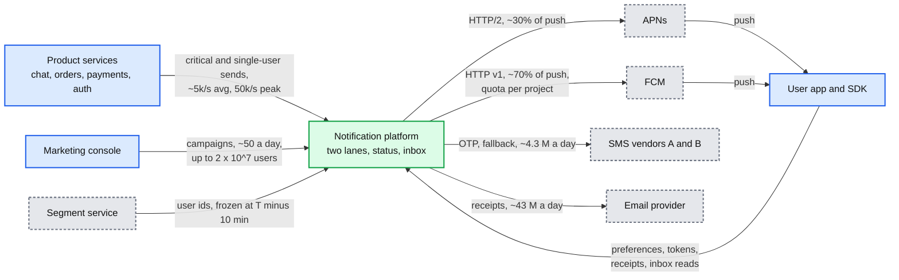

## D2. Data flow (DFD)

Inputs to outputs with format, size and rate. Peaks are the 1M a second design peak from solution §2; daily volumes in brackets.

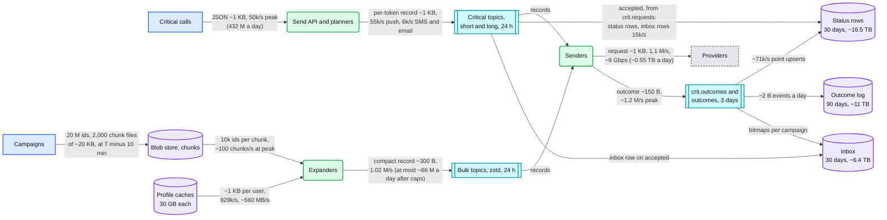

## D3. Component architecture

The final design, 15 nodes, provider egress in red: [solution §6](solution.md#6-final-design-and-the-six-core-flows).

## D4. Happy paths, one per FR

**FR1 to FR4:** links in the table above. Two more paths that every answer leans on.

**OTP by SMS, with the lifetime handed to the vendor.** The code is fixed when planned, so any resend carries the same code.

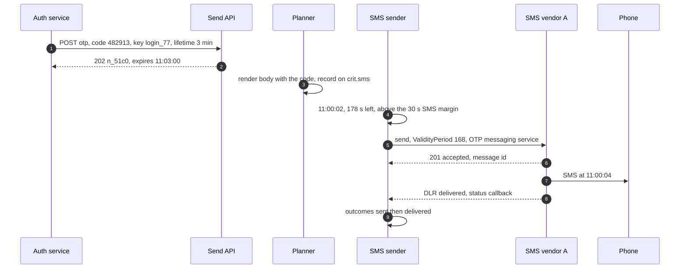

**Device token registration and cleanup on APNs 410.** A token is deleted only if it was registered before Apple's 410 timestamp, so a reinstall that re-registered the same token survives.

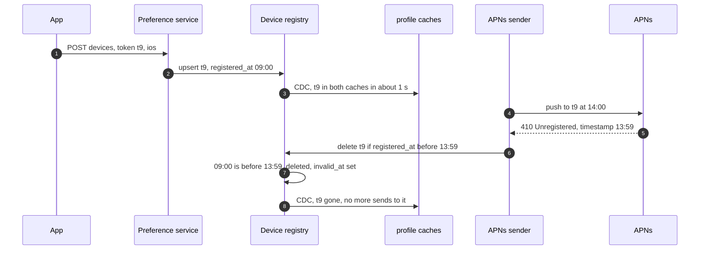

If the user had reinstalled and the app re-registered `t9` at 14:01, `registered_at` would be later than the 410's timestamp and the delete would not apply.

## D5. Failure paths

**(a) An expander dies mid-chunk.** It decides the chunk in memory and writes it last in one ~30 ms transaction, so a crash almost always lands before anything is written. The re-run finds its own ledger entries as re-entrant, so no cap is counted twice and no user gets two. A crash inside the 30 ms window leaves an open transaction that aborts after `transaction.timeout.ms` (10 s) and meanwhile holds back only the 16 partitions of its block.

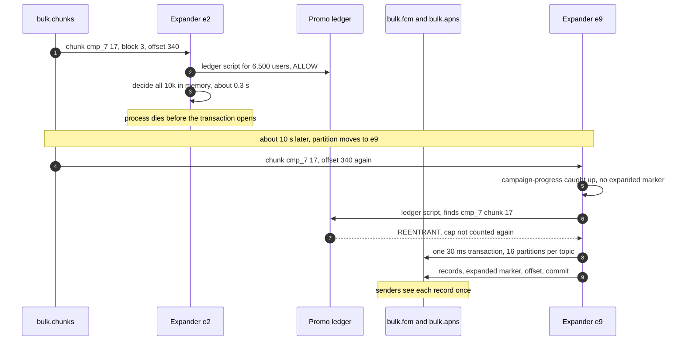

**(b) SMS vendor A goes down at 03:00, when OTP runs at ~5 a second.** The volume rule (at least 200 attempts in 10 s) never fires at that rate, so each OTP fails over by itself after one timeout, and the breaker opens after 20 consecutive failures. Codes stuck in A's queue die with their validity period.

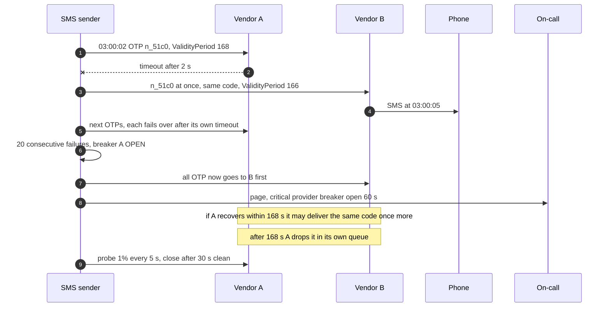

**(c) The release controller leader dies mid-campaign.** A new leader takes the lease, and Kafka's producer epoch fences the old one if it wakes up.

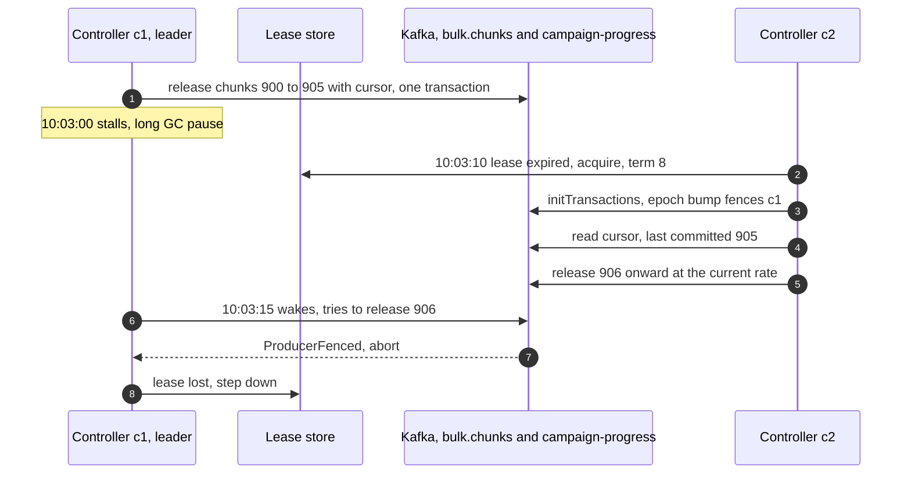

## D6. Activity / decision flow

**(a) One user, one promotional decision at release.** Cheapest checks first. The ledger script is the last and only write.

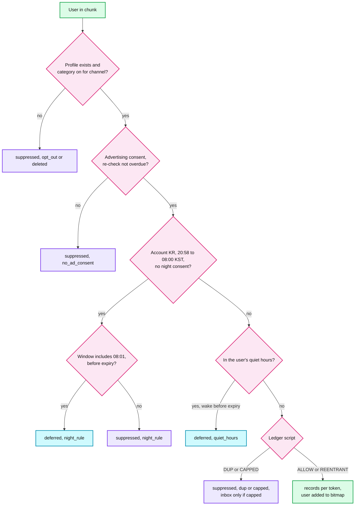

Quiet hours whose end is after the expiry fall through to `suppressed, quiet_hours` (not drawn, to stay under 15 nodes).

**(b) One message whose provider's breaker is open.** The type registry decides: drop, switch channel, wait, or pause the campaign.

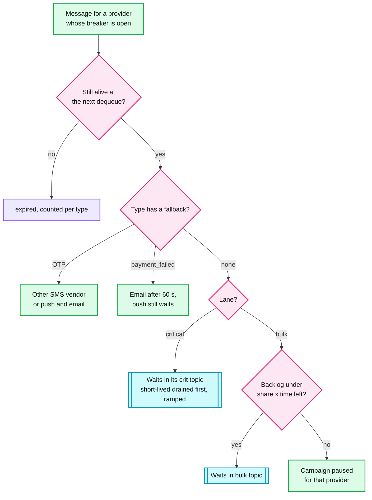

## D7. Entity relationship

Type registry, notifications, claims, profiles, ledger, campaigns, chunks, bitmaps, inbox and outcomes, with keys and TTLs: [solution §3.3](solution.md#33-data-model).

## D8. State machines

**Critical delivery (one provider message).** `SENDING` is the claim; its lease is what lets a crashed sender's message be resent. A reader that finds a live lease parks the record, unresolved, until the lease runs out; it never skips it. A reader that finds `SENT` re-publishes the `sent` outcome before committing, so a crash between marking and publishing cannot leave the row at `accepted`.

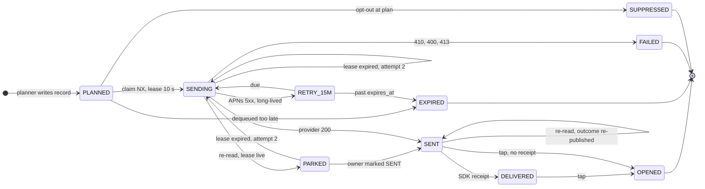

**Campaign.** Pause stops releases at the next second; records already queued (up to ~30 s of work) still go. Cancel carries a cancel epoch on the compacted `campaign-control` topic: every bulk sender drops the campaign's queued records at dequeue (`cancelled`), checks its cached control state again immediately before each provider call, and acknowledges the epoch. The campaign is `CANCELLING` until every sender has acknowledged, then `CANCELLED`; only work already handed to provider clients (~1 s per sender) still leaves. "All chunks expanded" is `DRAINING`, not done: the campaign is `COMPLETED` only when every delivery has a terminal outcome, and a drain job marks any record still without one at the expiry as `unknown`.

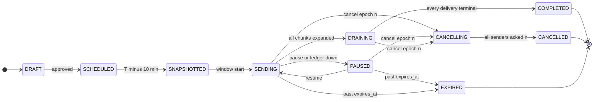

**Promotional delivery (one record on `bulk.fcm` or `bulk.apns`).** At most once: the offset is committed before the send, so a crash or an ambiguous timeout ends in `UNKNOWN`, never in a resend. `UNKNOWN` ranks with `FAILED` in the status merge.

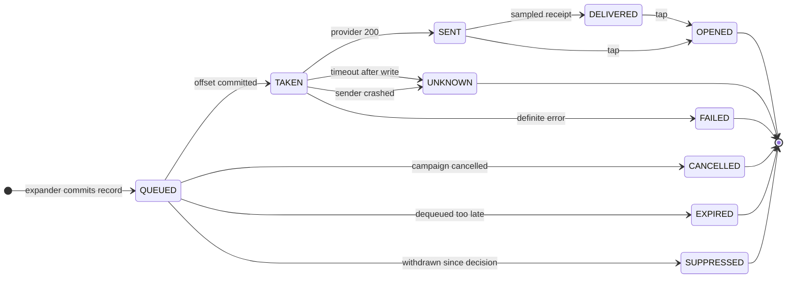

**Chunk.** The state lives on `campaign-progress` in Kafka; the campaign DB is a projection for the console.

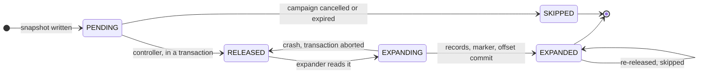

## D9. Deployment / topology

One region, three AZs. Every tier is N+1 per AZ. A warm standby region receives mirrored Kafka and CDC so it can take over critical traffic; the RPO on region loss is the mirror lag, p99 under 2 s.

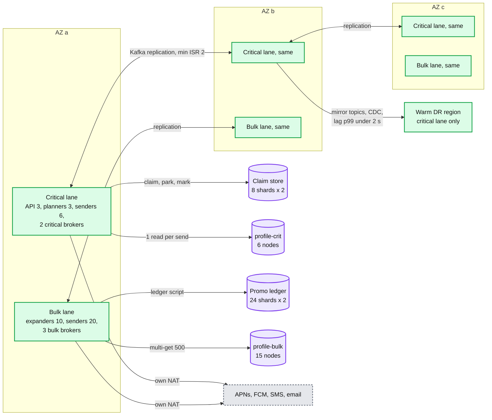

What crosses an AZ boundary: Kafka replication in both clusters, Redis replica sync, consumer reads from leaders in other AZs. The four Redis clusters are separate, each with shards and replicas spread over the AZs: the claim store (8 shards x 2) and `profile-crit` (6 nodes) serve the critical lane, the promo ledger (24 shards x 2) and `profile-bulk` (15 nodes) the bulk lane. That is the ~85 Redis nodes in the solution's cost model, and a ledger incident (which pauses campaigns) cannot take critical claims with it. Every AZ sends to the providers through its own NAT gateways, one set per lane, so ~9 Gbps of bulk egress cannot fill the critical path. Losing an AZ leaves the critical lane at 8 of 12 senders (`8 × 20k = 160k/s` against a 55k/s peak, ~3x) and the bulk lane at ~800k/s (solution §10.3).

**Losing the region.** The DR region runs the critical lane only; campaigns wait for the primary. Critical notifications accepted in the last mirror-lag window (p99 under 2 s) may be lost with the region. Callers re-send anything without a terminal status from their own outbox with the same idempotency key; the standby's claim store starts empty, so the re-sends go through, a push that had already gone out is replaced in place by its collapse id, and `expires_at` (from the caller's `created_at`) drops anything past its life.

## D10. Scaling / partitioning

Everything per user is keyed by `user_id`, so one user's tokens, ledger entry and per-device limits sit with one owner. The hot key is not a user: it is a single quota counter, if anyone builds one.

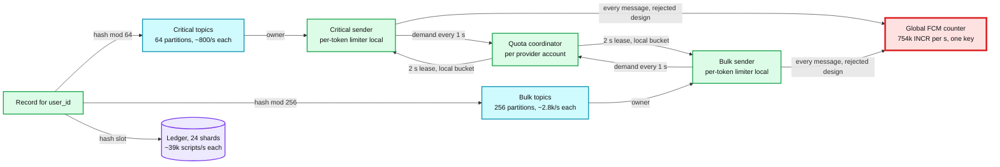

- A seller account that receives thousands of order events a minute adds ~170/s to one critical partition, against ~800/s average: the partition is fine, the phone is not (FCM allows 240 a minute per Android device). Above 1 push a second per (user, type) the sender sends a digest every 10 s instead, and the inbox keeps every row. A user cannot be hot on the bulk lane, because the ledger caps promotions at 2 a day.
- The global counter is the "Good" rung of solution §5.1. Leases give the same bound with one message per node per second: 72 sender nodes, ~72 lease calls a second instead of 754k increments.
- Chunks are keyed by `campaign_id:chunk_no` on 32 partitions, so a re-released chunk lands on the same expander as its first copy and is skipped once that expander has caught up on `campaign-progress`. The frozen audience is sorted by partition block (`(hash(user_id) mod 256) div 16`), so one chunk writes to 16 of the 256 bulk partitions per topic, and chunks are released round robin over the 16 blocks.

## D11. Failure mode map

Component, what fails, blast radius, mitigation. Two trees to stay under 15 nodes. Matches solution §8.

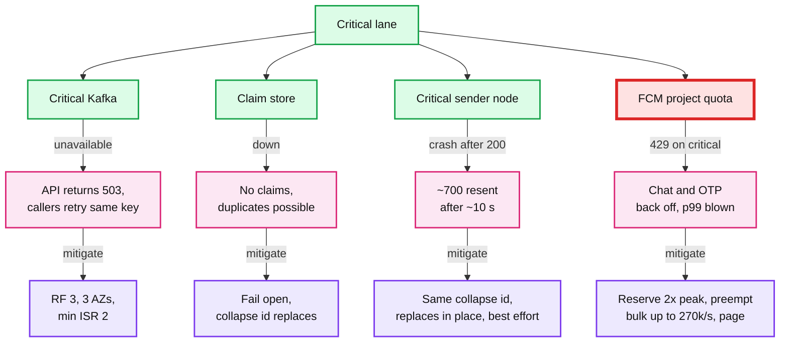

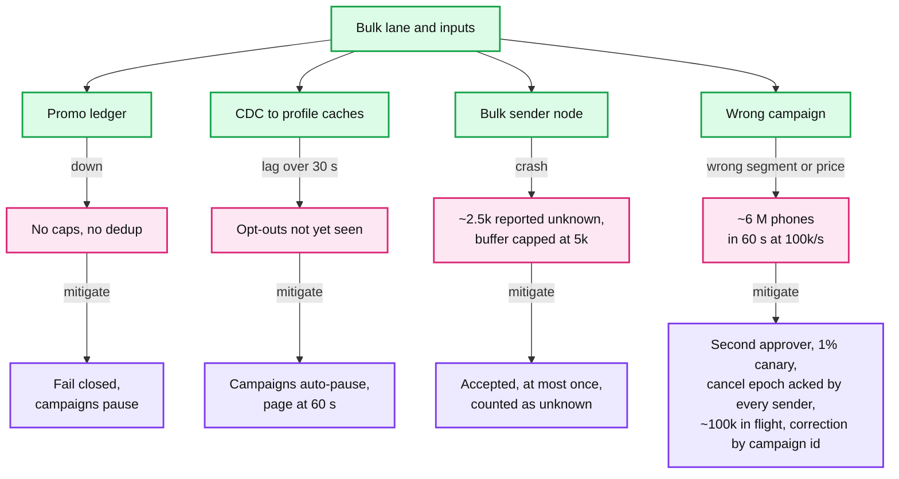

## D12. Rollout / migration

From a legacy sender (one queue, one worker pool, one Firebase project, campaigns as scripts) to the two lanes. Both systems spend the same FCM project quota until legacy is off, so legacy runs under a client-side limiter whose grant the coordinator accounts for. Each critical type has an owner flag with an `effective_from` a minute ahead; both systems compare `accepted_at` to it, so each notification has exactly one sender.

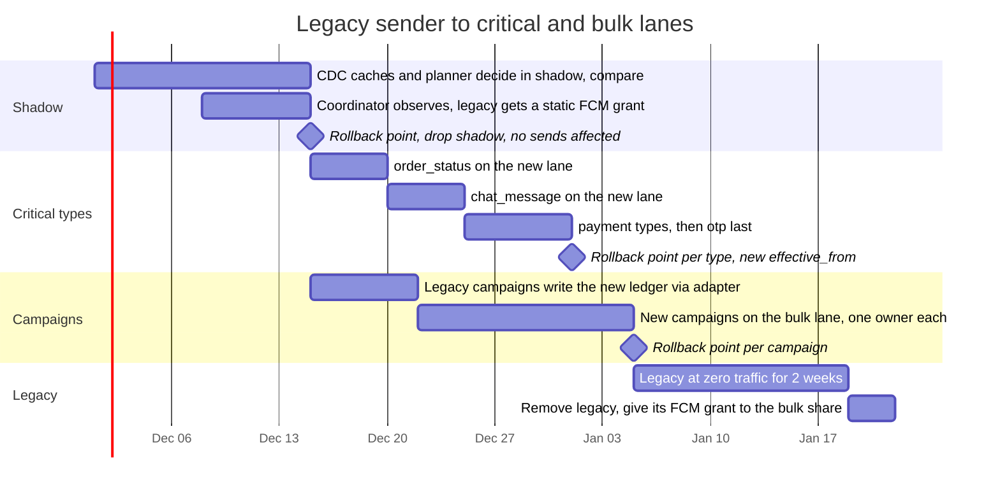

Gates between steps: decisions in shadow agree with legacy on at least 99.9% of sends (the rest are explained bugs), the critical p99 stays under 1 s, zero reconciler gaps, no FCM 429 on the critical lane, and per-type expired and failed rates within 0.5 points of legacy.
