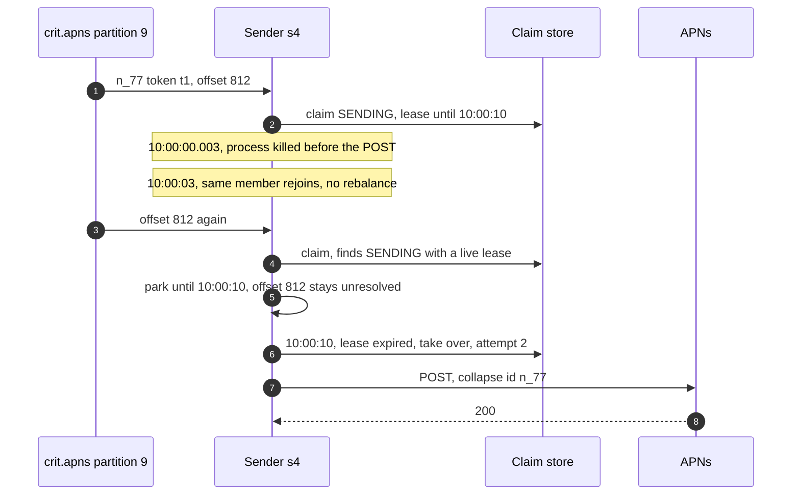
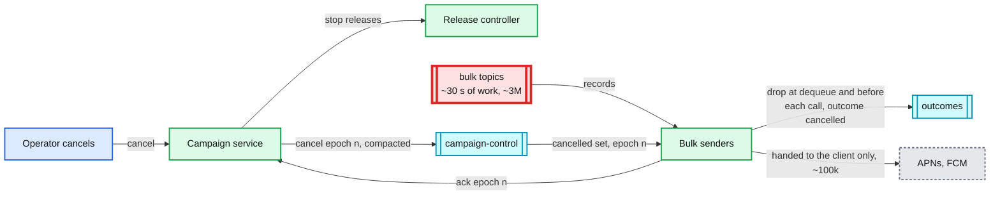

# Edge cases: Notification system, critical and promotional, 1M deliveries a second

Every entry answerable in under 60 seconds out loud. Categories: failure, consistency, scale, data, operations, security and abuse. Design reference: [`solution.md`](solution.md). An answer bullet that starts with **Decision:** goes past what solution.md states or changes it; the deep dives carry the numbers and the simulations. Acronyms: APNs (Apple Push Notification service), FCM (Firebase Cloud Messaging), OTP (one-time password), SMS (short message service), KST (Korea Standard Time), CDC (change data capture), TTL (time to live), AZ (availability zone), ISR (in-sync replicas), LSO (last stable offset), AIMD (additive increase, multiplicative decrease), JWT (JSON Web Token), SDK (software development kit, our mobile library), KV (key-value store), GDPR (EU General Data Protection Regulation, used here for any deletion request), SLO (service level objective).

---

## Failure

## Edge case: a critical sender host dies at peak
- **Trigger:** host loss on one of 12 critical push senders: ~5 of 64 partitions per topic, ~690 messages in flight.
- **Symptom:** ~1/12 of critical pushes arrive 10 to 13 s late; a lag blip; the p99 SLO misses one 1-minute window.
- **Answer:**
  - The group coordinator evicts it after `session.timeout.ms = 10 s`; cooperative-sticky moves only its partitions.
  - New owners read from the low-water mark. The 10 s claim leases have expired, so they take over as attempt 2 with the same collapse id. A record whose claim is already `SENT` (the host died between marking and publishing) gets its `sent` outcome re-published before the commit, never a silent skip.
  - ~345 of the ~690 had already reached Apple or Google; the phone replaces them in place, best effort (a user who dismissed one in those seconds sees it again). Nothing is lost ([`deep-dives/expiry-dedup-and-retries.md`](deep-dives/expiry-dedup-and-retries.md) §4).
- **Confidence:** [ ] shaky  [ ] ok  [ ] confident

## Edge case: a critical sender pod restarts in 3 s as the same static member
- **Trigger:** an out-of-memory kill or a deploy; the pod rejoins with the same `group.instance.id` before the session timeout, so there is no rebalance.
- **Symptom:** it re-reads its own partitions 3 s after the crash and finds claims in `SENDING` with **live** leases.
- **Answer:**
  - **Decision:** a live lease means "park until `lease_until`, keep the record unresolved", never "skip". Skipping loses the ~341 messages per restart whose request had not reached the provider, OTPs among them.
  - Parking costs at most the 10 s lease. The low-water mark cannot pass a parked record, so a second crash replays it again.
  - The same rule makes a cooperative rebalance safe: the old owner finishes its in-flight sends and marks `SENT` while the new owner waits.
- **Diagram:**

- **Confidence:** [ ] shaky  [ ] ok  [ ] confident

## Edge case: a bulk sender crashes mid-campaign
- **Trigger:** host loss on one of 60 bulk senders while it sends ~17k messages/s.
- **Symptom:** a few thousand promotions with no `sent` outcome.
- **Answer:**
  - Offsets were committed before sending, so nothing is resent: 0 duplicates.
  - ~1.3k had not reached the provider and ~1.2k may have; nothing can tell which, so the campaign's drain job reports all ~2.5k as terminal `unknown` (ranked with `failed` in the status merge), and the campaign stays `DRAINING` until it has. The inbox bitmap still shows the campaign to all of them.
  - **Decision:** the in-memory retry buffer is capped at 5k per node and the node stops fetching while it is full, so a crash during a 429 back-off loses ≤ ~6.3k, not everything fetched.
- **Confidence:** [ ] shaky  [ ] ok  [ ] confident

## Edge case: an expander stalls inside an open Kafka transaction
- **Trigger:** a 10 s garbage-collection pause or network stall after the expander has written some records of a chunk.
- **Symptom:** bulk senders (`read_committed`) stop seeing new records on every partition the transaction touched, including records other expanders committed.
- **Answer:**
  - `transaction.timeout.ms = 10 s` (not the 60 s default) aborts it; the chunk re-runs and the ledger recognises its own entries (re-entrant), so no cap is counted twice.
  - **Decision:** decide the chunk in memory, then write it in one ~30 ms transaction, so a stall usually lands outside any transaction.
  - **Decision:** chunks are sorted by bulk partition block, so a transaction touches 16 of 256 partitions per topic. A stall costs 160 partition-seconds instead of 2,560 ([`deep-dives/campaign-fan-out-and-scheduling.md`](deep-dives/campaign-fan-out-and-scheduling.md) §6).
- **Confidence:** [ ] shaky  [ ] ok  [ ] confident

## Edge case: a broker or a whole AZ of the critical Kafka cluster is lost
- **Trigger:** one of 6 brokers, or an AZ with a third of brokers, planners and senders.
- **Symptom:** leader elections for the affected partitions; produce and fetch stall for seconds.
- **Answer:**
  - Replication 3 across AZs, `acks=all`, `min.insync.replicas=2`, unclean election off: an acknowledged notification is on two AZs before the `202`.
  - With an AZ gone, partitions keep 2 in-sync replicas and keep accepting writes.
  - 8 of 12 critical senders carry `8 × 20k = 160k/s`, ~3x the 55k/s critical peak.
- **Confidence:** [ ] shaky  [ ] ok  [ ] confident

## Edge case: the bulk Kafka cluster is down
- **Trigger:** a bad broker upgrade or a full disk on the bulk cluster.
- **Symptom:** campaigns stop releasing and expanding; single-user promotional sends get `503` and their callers retry.
- **Answer:**
  - Critical sends do not notice. Their topics, profile copy, claim store and senders are on the critical side.
  - **Decision:** critical outcomes go to `crit.outcomes` on the critical cluster. With a shared `outcomes` topic, each critical sender's 32 MB producer buffer fills in ~46 s at ~0.7 MB/s, and `send()` then blocks the critical send loop.
  - Campaigns resume from `campaign-progress`; expired chunks are skipped.
- **Confidence:** [ ] shaky  [ ] ok  [ ] confident

## Edge case: the claim store is down
- **Trigger:** the Redis cluster holding idempotency keys and critical claims loses a shard's primary and its replica.
- **Symptom:** `SET NX` and claim scripts fail on that shard.
- **Answer:**
  - The send API falls back to the deterministic `notification_id = hash(caller, key)` and still produces. A caller retry during the outage still cannot extend a chat or OTP: `expires_at` is computed from the caller's signed `created_at`, never from accept time. What is lost is the original `202` body and the `409` on a changed body.
  - Critical senders send without a claim (fail open). They are at-least-once anyway, and the collapse id makes a repeat replace in place.
  - Pages, because duplicates on the wire rise and the changed-body check is off.
- **Confidence:** [ ] shaky  [ ] ok  [ ] confident

## Edge case: the promo ledger is down
- **Trigger:** the ledger's Redis cluster is unavailable.
- **Symptom:** expanders cannot run the cap and dedup script.
- **Answer:**
  - Fail closed: expanders stop, campaigns pause, single-user promotional types wait in `bulk.requests`. Caps and dedup are a promise to users.
  - Records already in the bulk topics (≤ 30 s of work) still go; they were decided with the ledger.
  - A long outage lets price drops (6 h) and campaigns expire, counted as `expired`. Critical types never touch the ledger.
- **Confidence:** [ ] shaky  [ ] ok  [ ] confident

## Edge case: FCM is down for 30 minutes at 20:00
- **Trigger:** FCM returns 503s and timeouts; ~7.7k critical FCM messages/s keep arriving.
- **Symptom:** both FCM breakers open in ~10 s; `crit.fcm` lag grows; one page at 20:01.
- **Answer:**
  - Records wait in Kafka. Chats older than 5 minutes are dropped at dequeue (5.78M by 20:30, by design); online users got them over the chat socket. `payment_failed` emails after 60 s; OTP by push moves to SMS after 5 s.
  - At 20:30 the critical lane gets its reserve plus the paused bulk share, ramped to 270k/s over 60 s: 8.09M live messages drain in ~61 s.
  - **Decision:** critical provider topics are split by lifetime class (`crit.fcm` for ≤ 10 minutes, `crit.fcm.long`), short first. A single FIFO topic lets ~198k still-alive chats expire behind 24-hour order pushes; short-first loses ~2k ([`deep-dives/provider-egress-and-quotas.md`](deep-dives/provider-egress-and-quotas.md) §5).
- **Confidence:** [ ] shaky  [ ] ok  [ ] confident

## Edge case: FCM is slow, not down
- **Trigger:** FCM's mean latency rises from ~120 ms to ~400 ms for 20 minutes.
- **Symptom:** in-flight requests climb; critical p99 rises.
- **Answer:**
  - At 38.5k/s a 12.5k-stream critical pool saturates at ~325 ms mean latency, and chats would queue in front of it. **Decision:** size the critical FCM pool at one second of peak, ~40k streams on ~160 connections, so a 3x slowdown costs latency only.
  - Bulk AIMD shrinks bulk in-flight first, so we do not pile onto a struggling provider.
  - If critical p99 passes 2 s, the breaker opens and records wait in Kafka. The SLO is missed and we say so; we can only refuse to make FCM worse.
- **Confidence:** [ ] shaky  [ ] ok  [ ] confident

## Edge case: SMS vendor A dies at 03:00, when OTP runs at ~5 a second
- **Trigger:** vendor A times out every request.
- **Symptom:** "≥ 50% of ≥ 200 attempts in 10 s" never fires: there are only ~50 attempts in 10 s.
- **Answer:**
  - **Decision:** the breaker also opens on 20 consecutive failures, and each OTP fails over by itself: after one 2 s timeout on A it goes to vendor B with the same code.
  - The copy stuck at A dies there when its ~168 s `ValidityPeriod` runs out. If A recovers first, the user gets the same code twice: harmless.
  - Both vendors down: the auth service offers the code by push or email.
- **Confidence:** [ ] shaky  [ ] ok  [ ] confident

## Edge case: the quota coordinator is unreachable
- **Trigger:** the coordinator's 3 replicas lose their leader, or a network partition cuts senders off.
- **Symptom:** sender nodes stop getting lease renewals.
- **Answer:**
  - Critical nodes keep their static slice of the reserve indefinitely: `77k ÷ 12 ≈ 6.4k/s` each, 2x their share of the critical FCM peak. Chat keeps going.
  - Bulk leases decay to 0 within 10 s: campaigns pause rather than risk the shared quota.
  - The coordinator's state is soft; a new leader rebuilds it from the next round of reports in ~2 s.
- **Confidence:** [ ] shaky  [ ] ok  [ ] confident

## Edge case: the primary region is lost
- **Trigger:** a regional outage.
- **Symptom:** the warm standby takes over critical traffic with mirrored Kafka and translated offsets.
- **Answer:**
  - Inside a region an accepted critical notification is never lost. Across regions the **RPO is the mirror lag, p99 under 2 s**: notifications accepted in that window (~10k at the 5k/s average, ~100k at the 50k/s peak) may be gone with the region.
  - Recovery is the callers' contract: each caller keeps its sends in its own outbox and re-sends anything without a terminal status with the same idempotency key. The standby's claim store starts empty (the dedup records were in the lost region too), so the re-sends go through; a push that had already gone out is replaced in place by its collapse id, and `expires_at`, computed from the caller's `created_at`, drops anything past its life.
  - Translated offsets land slightly behind, so minutes of critical sends are repeated, also with the same collapse ids. The standby runs the critical lane only; campaigns wait for the primary.
- **Confidence:** [ ] shaky  [ ] ok  [ ] confident

---

## Consistency

## Edge case: the chat service retries a send an hour after its timeout
- **Trigger:** the caller timed out at 20:00 and retries `m_991` at 21:00.
- **Symptom:** without care, a fresh 5-minute clock and a chat push an hour late.
- **Answer:**
  - The idempotency record `(caller, key)` holds the body hash, the original `expires_at` and `PENDING` or `ACCEPTED`, for 24 h.
  - `ACCEPTED`: return the original `202`, produce nothing. `PENDING` (the produce may have failed): produce again with the original `expires_at`, which is already past, so the planner drops it as `expired`.
  - Same key with a different body: `409`.
  - Even with no idempotency record at all, the retry carries the same `created_at` (set and signed by the chat service), and `expires_at` is computed from it, so the 21:00 retry is past its 20:05 expiry and is dropped as `expired`.
- **Confidence:** [ ] shaky  [ ] ok  [ ] confident

## Edge case: a user opts out at 10:00:01 while a campaign is sending
- **Trigger:** "deals push off" during the 10:00 flash sale; her chunk is released at 10:07.
- **Symptom:** she must not get it.
- **Answer:**
  - The preference write returns the new profile (read-your-writes in the app). CDC reaches both profile copies in ~1 s at p99.
  - The expander decides at release, so at 10:07 it reads `deals/push = off`: `suppressed opt_out`, left out of the inbox bitmap too.
  - Campaigns auto-pause if CDC lag passes 30 s.
- **Confidence:** [ ] shaky  [ ] ok  [ ] confident

## Edge case: a user opts out while her advert waits behind an FCM outage
- **Trigger:** decided at 20:05, FCM down until 20:30, opt-out at 20:10.
- **Symptom:** the record in `bulk.fcm` carries a decision 25 minutes older than her opt-out.
- **Answer:**
  - **Decision:** the bulk sender checks every record older than 30 s against a recent-withdrawals set (opt-outs and consent withdrawals of the last 24 h, fed by CDC, a few MB in memory) and drops matches as `suppressed opt_out`.
  - Normal days never need it: bulk topics hold ≤ 30 s of work.
- **Confidence:** [ ] shaky  [ ] ok  [ ] confident

## Edge case: two chat pushes for one user arrive in the wrong order
- **Trigger:** "Are you home?" then "Never mind" 200 ms apart; both on one partition, but the sender has ~700 requests in flight and the second returns first.
- **Symptom:** the lock screen shows them reversed.
- **Answer:**
  - Partition order alone is not enough with async sends.
  - **Decision:** the critical sender keeps at most one in-flight push per (user, thread). A user's rate is a few a second at most, so this costs nothing in throughput.
  - On iOS `thread-id` groups them; ordering across channels (push versus SMS) is not promised.
- **Confidence:** [ ] shaky  [ ] ok  [ ] confident

## Edge case: an `expired` outcome arrives after the phone showed the push
- **Trigger:** a sender crashed after APNs's `200` and before recording it; the retry found the chat past its expiry and emitted `expired`.
- **Symptom:** support sees `expired` for a push the user saw.
- **Answer:**
  - **Decision:** rows move forward by evidence: opened > delivered > sent > expired = failed = unknown > accepted. What a provider or the phone told us beats our own verdict on a later attempt.
  - Last write wins leaves 1.5% of rows wrong; "terminal states win" shows ~198 per 200k pushes as expired after the phone showed them ([`deep-dives/status-tracking-and-inbox.md`](deep-dives/status-tracking-and-inbox.md) §3).
- **Confidence:** [ ] shaky  [ ] ok  [ ] confident

## Edge case: an APNs 410 races a reinstall
- **Trigger:** the user reinstalls at 14:01 and re-registers the same token; a send at 14:00 gets `410 Unregistered` with timestamp 13:59.
- **Symptom:** a naive cleanup deletes the fresh registration and the user stops getting pushes.
- **Answer:**
  - Delete the token only if its `registered_at` is before the 410's timestamp. 14:01 is after 13:59, so it survives.
  - Registration needs a user session; re-registration updates `registered_at`.
- **Confidence:** [ ] shaky  [ ] ok  [ ] confident

## Edge case: a chunk is expanded twice
- **Trigger:** (a) an expander's transaction aborts and the chunk re-runs; (b) an operator re-releases chunks by hand after a bug.
- **Symptom:** the ledger already holds entries from the first run.
- **Answer:**
  - (a) The aborted records were never readable. The ledger finds "this campaign, this chunk" (re-entrant): re-produce without counting the cap again.
  - (b) The `expanded` marker on `campaign-progress` makes the expander skip it. **Decision:** the expander checks markers only after its view of `campaign-progress` has caught up to the chunk's release offset, because "re-entrant" cannot tell an aborted run from a committed one.
- **Confidence:** [ ] shaky  [ ] ok  [ ] confident

## Edge case: the claim store fails over and forgets a second of claims
- **Trigger:** a Redis primary dies; its asynchronous replica is ~1 s behind.
- **Symptom:** a record re-read after a sender crash finds no claim although it was sent.
- **Answer:**
  - It is sent again with the same collapse id; the phone replaces in place.
  - Claims are an optimisation over the collapse id, not the guarantee. `maxmemory-policy noeviction`, so a full shard fails loudly instead of forgetting.
- **Confidence:** [ ] shaky  [ ] ok  [ ] confident

---

## Scale

## Edge case: critical traffic triples while a 20M campaign holds its full share
- **Trigger:** New Year's midnight, or a big outage that ends at once: 115k critical FCM messages/s against a 77k/s reserve.
- **Symptom:** with a reserve alone, chats queue up to 15 s while the campaign keeps 193k/s.
- **Answer:**
  - **Decision:** critical may preempt the bulk share. Nodes report demand every 1 s; the coordinator grants critical up to 270k/s at once and cuts bulk leases, which land within 2 s.
  - The overshoot during those 2 s is ≤ 0.4M tokens of FCM's 18M-token minute.
  - Simulated: chat end-to-end p99 0.76 s at a 3x spike ([`deep-dives/priority-lanes-and-isolation.md`](deep-dives/priority-lanes-and-isolation.md) §5).
- **Confidence:** [ ] shaky  [ ] ok  [ ] confident

## Edge case: the flash sale's `p × k` is 3x the estimate
- **Trigger:** the sale is better than expected: each push brings 3 app requests, not 1.
- **Symptom:** a 1M/s burst would put the app at 111% for ~50 s.
- **Answer:**
  - The controller starts from 0, ramps over 60 s, and measures `p̂k̂` on this release from requests tagged with the campaign id.
  - It caps the rate at `(0.7 × 500k − 250k) ÷ p̂k̂`, ~33k pushes/s at 3x, and halves at 75% at most once per 2 minutes.
  - Simulated: peak 70%, all 15.9M sent in 7 minutes instead of 3.
- **Confidence:** [ ] shaky  [ ] ok  [ ] confident

## Edge case: two big campaigns start in the same minute
- **Trigger:** a flash sale and a newsletter both at 10:00.
- **Symptom:** twice the herd, twice the quota demand.
- **Answer:**
  - One bulk budget: the minimum of the FCM share, APNs concurrency, topic lag and app headroom. The campaigns split it by deficit round robin weighted by priority class; the flash sale goes first.
  - The headroom is shared, so the second campaign slows rather than adding a second herd.
  - Users in both hit the cap of 2 a day; the later decision ends `CAPPED`, inbox only.
- **Confidence:** [ ] shaky  [ ] ok  [ ] confident

## Edge case: one message in a 10,000-member open chat
- **Trigger:** the chat service calls us 10,000 times in a second.
- **Symptom:** a burst on the critical API.
- **Answer:**
  - 10k calls is 0.2 s of the 50k/s critical peak. Keyed by recipient `user_id`, they spread over all 64 partitions.
  - The chat caller's rate limit is sized for group fan-out bursts; a runaway loop still hits it.
  - Members in the app get the message over the chat socket; the chat service only asks us to push the offline ones.
- **Confidence:** [ ] shaky  [ ] ok  [ ] confident

## Edge case: a seller's phone gets thousands of order pushes a minute
- **Trigger:** a large seller receives ~170 order events a second on one user id.
- **Symptom:** one partition carries ~170/s extra (fine against ~800/s), but FCM allows 240 messages a minute to one Android device.
- **Answer:**
  - The per-token limiter stops us before FCM's 429.
  - **Decision:** above 1 push a second per (user, type), order events become a digest: one push every 10 s ("37 new orders") with a collapse id per type, and the inbox keeps every row.
- **Confidence:** [ ] shaky  [ ] ok  [ ] confident

## Edge case: 10x traffic tomorrow
- **Trigger:** marketing wants 10M deliveries a second.
- **Symptom:** our side scales by partitions and nodes; the providers do not.
- **Answer:**
  - FCM at 10M/s is ~7.7M messages/s, ~460 M/min: 770x the default, an order of magnitude past the event quota we ask for.
  - The app herd binds first: ~100k flash-sale pushes/s at a busy 10:00 is the real ceiling for one audience.
  - The seam is the coordinator's per-account quota; nothing else changes shape.
- **Confidence:** [ ] shaky  [ ] ok  [ ] confident

## Edge case: the night's deferred adverts all come due at 08:00
- **Trigger:** 1.4M users without night consent from a 21:30 campaign, plus deferrals from other evening campaigns.
- **Symptom:** a morning burst on top of the commute traffic.
- **Answer:**
  - Released from 08:01, spread by user hash over 30 minutes: ~780 decisions a second per 1.4M, through the same controller and headroom check.
  - Only campaigns whose send window includes the morning defer at all. For any other campaign, a recipient whose legal deferral to 08:01 falls outside the window is suppressed with `night_rule`; the console shows that split when the campaign is created and offers the morning window.
  - Each is decided again at release (caps counted then, quiet hours re-checked).
  - **Decision:** 08:01, not 08:00, so a 1 s clock skew cannot put a send at 07:59:59.
- **Confidence:** [ ] shaky  [ ] ok  [ ] confident

---

## Data

## Edge case: a template changes while a campaign is mid-send
- **Trigger:** marketing fixes a typo at 10:02.
- **Symptom:** records already in the bulk topics reference version 3.
- **Answer:**
  - Templates are immutable versions; records carry `(template_id, version)`; senders render from a cached version. In-flight records keep version 3; new releases can pin version 4 by a campaign edit.
  - A new variable needs a default, checked at approval, as are the 4 KB APNs limit (`413` is never retried) and the disclosure items for adverts.
- **Confidence:** [ ] shaky  [ ] ok  [ ] confident

## Edge case: a user deletes their account
- **Trigger:** a deletion request.
- **Symptom:** their data sits in profiles, tokens, ledger, status, inbox, outcome log and campaign bitmaps.
- **Answer:**
  - The profile becomes a tombstone via CDC within ~1 s, so no lane decides a send for them again. Tokens and ledger entries are deleted by `user_id`.
  - Status and inbox rows (30 days) are deleted by `user_id`; the outcome log drops them at its next compaction.
  - Bitmaps expire with their campaigns (≤ 7 days); the inbox filters tombstones at read; the dense index is not reused for 7 days.
- **Confidence:** [ ] shaky  [ ] ok  [ ] confident

## Edge case: the status writer had a bug for 6 hours
- **Trigger:** a release ranked `delivered` below `sent`.
- **Symptom:** status rows show `sent` for pushes that were delivered.
- **Answer:**
  - Fix, then replay. `outcomes` and `crit.outcomes` keep 3 days; older history comes from the columnar log.
  - Upserts move forward by evidence, so replaying the same events again is harmless.
- **Confidence:** [ ] shaky  [ ] ok  [ ] confident

## Edge case: dead tokens pile up over three years
- **Trigger:** reinstalls, new phones, uninstalled apps.
- **Symptom:** sends to dead tokens waste quota and inflate failure rates.
- **Answer:**
  - APNs `410` and FCM unregistered errors delete the token (timestamp rule).
  - Tokens not refreshed by the app for 270 days [estimate] are pruned; the app re-registers on every open.
  - A rise in 410s after a big campaign is a ticket, not a page.
- **Confidence:** [ ] shaky  [ ] ok  [ ] confident

## Edge case: the advertising law changes
- **Trigger:** an amendment, as on 2026-10-02.
- **Symptom:** rules in code would need a deploy timed to midnight.
- **Answer:**
  - Rules are versioned data with an effective date, owned by compliance; the platform owns the library.
  - A new version runs 24 h in shadow mode (logs what would change), then turns on at its effective time in both the planner and the expander.
- **Confidence:** [ ] shaky  [ ] ok  [ ] confident

---

## Operations

## Edge case: what pages at 3 AM
- **Trigger:** anything that breaks the critical promise.
- **Symptom:** the on-call phone.
- **Answer:**
  - Critical p99 over 1 s for 5 minutes or critical topic lag over 10 s; any FCM 429 on the critical lane above 0.1% for 2 minutes; a critical breaker open 60 s.
  - Critical `expired` above 0.5% for 5 minutes; a reconciler gap above 0; CDC lag over 60 s; the ledger down.
  - Not a page: a campaign behind schedule (ticket to marketing operations), a rise in 410s.
- **Confidence:** [ ] shaky  [ ] ok  [ ] confident

## Edge case: a wrong campaign (wrong price) is sending at 100k a second
- **Trigger:** a 20M campaign with a price error, noticed 60 s in.
- **Symptom:** ~6M phones have it; ~30 s of work, ~3M more, sits in the bulk topics.
- **Answer:**
  - **Decision:** cancel writes a cancel epoch to a compacted `campaign-control` topic that every bulk sender caches. A sender drops the campaign's queued records at dequeue (`cancelled`), checks its cached control state again immediately before each provider call, and then acknowledges the epoch. The campaign shows `CANCELLING` until every sender has acknowledged, then `CANCELLED`. What still leaves is work already handed to the provider client, ~1 s per sender (~100k), not ~3M.
  - **Decision:** campaign pushes carry `apns-collapse-id` and the Android notification `tag` set to the campaign id, so a correction replaces the wrong one on phones that still show it. `collapse_key: promo` alone only collapses what FCM is still storing.
  - Prevention: a second approver above 1M users, a 1% canary with a 5-minute hold above 5M.
- **Diagram:**

- **Confidence:** [ ] shaky  [ ] ok  [ ] confident

## Edge case: a rule change suppresses far too much, or far too little
- **Trigger:** a consent rule version with a wrong date comparison.
- **Symptom:** a campaign's `suppressed no_ad_consent` jumps from 15% to 90%, or drops to 0.
- **Answer:**
  - Shadow mode for 24 h should have caught it: the diff of decisions is reviewed before a rule turns on.
  - Too much: fix and re-run the wrongly suppressed users as a new campaign; the ledger stops repeats.
  - Too little: adverts cannot be recalled. Cancel through `campaign-control`, and report to compliance with the outcome log as the record.
- **Confidence:** [ ] shaky  [ ] ok  [ ] confident

## Edge case: rolling out a new sender version
- **Trigger:** a release of the shared sender binary.
- **Symptom:** risk to both lanes from one bad build.
- **Answer:**
  - Critical and bulk deploy on separate trains, never in the same hour. Each canaries one node for 30 minutes, then one AZ, then all.
  - Gates: critical p99, 4xx rate within 0.5 points of baseline, zero claim-store errors, no rise in `unknown`.
  - Graceful shutdown finishes in-flight sends before leaving the group; the park rule covers a kill.
- **Confidence:** [ ] shaky  [ ] ok  [ ] confident

## Edge case: migrating from a legacy sender on the same Firebase project
- **Trigger:** the old one-queue sender keeps running during the move.
- **Symptom:** two systems spend one project quota; a notification must have exactly one sender.
- **Answer:**
  - Legacy runs under a static FCM grant, enforced by a client-side limiter, inside the 10% margin and accounted for by the coordinator.
  - Critical types move one at a time by an owner flag with `effective_from` a minute ahead; both systems compare `accepted_at` to it. Order status first, OTP last.
  - Legacy campaigns write the new ledger through an adapter so caps count both. Rollback is the flag with a new `effective_from`.
- **Confidence:** [ ] shaky  [ ] ok  [ ] confident

## Edge case: chat pushes start arriving late on some Android phones
- **Trigger:** the app hides the system notification when the user is already in that chat, or the SDK drops an expired chat at render.
- **Symptom:** after ~7 days FCM lowers those app instances' high-priority messages to normal; chats wait for Doze windows.
- **Answer:**
  - FCM deprioritises high priority for an app instance whose high-priority messages produced no visible notification over 7 days.
  - **Decision:** the chat service does not ask us to push a user who is online in that conversation; the SDK shows a quiet notification rather than none when it must suppress one; a chat whose remaining life is under 10 s is dropped by us, not by the phone.
- **Confidence:** [ ] shaky  [ ] ok  [ ] confident

---

## Security and abuse

## Edge case: a product team sends an advert as `order_status`
- **Trigger:** a "your order shipped, and here is 10% off" template on a critical type.
- **Symptom:** an advert in the critical lane, skipping consent, the night rule and caps.
- **Answer:**
  - Templates are reviewed per type; a template on an informational type with price, discount or event content is rejected (Kakao's own test for "advertising" lists exactly those).
  - Callers can only send types on their allowlist; marketing cannot send `order_status` at all.
  - The type, not the API, picks the lane: a cross-sell belongs in a separate `price_drop` send.
- **Confidence:** [ ] shaky  [ ] ok  [ ] confident

## Edge case: a buggy caller loops sending pushes to one user
- **Trigger:** a retry loop in the orders service without idempotency keys.
- **Symptom:** hundreds of pushes a minute to one phone.
- **Answer:**
  - A per-caller rate limit at the API, before any work.
  - The per-token limiter (240 a minute on Android) and a per (user, type) digest above 1 a second stop it before FCM does.
  - Distinct keys mean distinct notifications, so dedup cannot help; the caller's dashboard shows the spike.
- **Confidence:** [ ] shaky  [ ] ok  [ ] confident

## Edge case: the recommendation service floods `price_drop` at 200k a second
- **Trigger:** a bad model release emits a price drop per viewed item.
- **Symptom:** a flood on the shared send API entry.
- **Answer:**
  - The per-caller limit rejects the excess with `429` before the idempotency write, so the claim store and critical callers are untouched.
  - What passes goes to `bulk.requests`, then the ledger caps each user at 2 promotions a day.
  - **Decision:** single-user promotional types use their own API instance pool behind the same hostname, so even the rejection work stays off the critical pool.
- **Confidence:** [ ] shaky  [ ] ok  [ ] confident

## Edge case: someone registers their device token on another user's account
- **Trigger:** a stolen session, or a shared family tablet.
- **Symptom:** one user's notifications reach someone else's phone.
- **Answer:**
  - Registration needs a valid user session. A token moves to the new user on re-registration, so a shared tablet follows whoever signed in last.
  - Logout deletes the binding. Chat previews obey the user's "show previews" setting, and payloads carry no secrets beyond the OTP.
- **Confidence:** [ ] shaky  [ ] ok  [ ] confident

## Edge case: an OTP code leaks through logs or the lock screen
- **Trigger:** debug logging of rendered bodies; a lock screen showing previews.
- **Symptom:** a code readable by someone other than the user.
- **Answer:**
  - Codes are never logged; the outcome log stores a hash of the body.
  - The OTP body is acceptable in a push by product decision; the code lives 3 minutes, and the SMS copy dies with its `ValidityPeriod`.
- **Confidence:** [ ] shaky  [ ] ok  [ ] confident

## Edge case: template variables carry an injection or a huge string
- **Trigger:** a product name with markup, or 10 KB of text.
- **Symptom:** a broken notification, or `413 PayloadTooLarge` from APNs on every retry.
- **Answer:**
  - Variables are escaped and truncated per field at render; the rendered payload is checked against 4 KB before the send.
  - `413` is never retried; the outcome is `failed payload_too_large`, counted per template so its owner sees it.
- **Confidence:** [ ] shaky  [ ] ok  [ ] confident
