# HLD: Notification system, critical and promotional, 1M deliveries a second

> One-line answer: the **type** of a notification picks its **lane**, and the two lanes share nothing we can separate. A critical send (chat message, order event, payment result, OTP) is one API call for one user: it is written to a small **critical Kafka cluster** with `acks=all`, a planner checks expiry and preferences and fans it out to one topic per provider, and a **critical sender pool** claims each message in a dedup store, sends it with the remaining lifetime as `apns-expiration`, FCM `ttl` or Twilio `ValidityPeriod`, and a collapse id equal to the notification id. A promotional send is a **campaign**: the segment is frozen into 10k-user chunk files, a **release controller** hands chunks out at a rate it computes every second (the campaign's pace, the promotional share of each provider's quota, and the app's measured headroom for the herd that follows a push), and **expanders** decide per user at release time (advertising consent, the Korean 21:00 to 08:00 rule, quiet hours, a per-user ledger that is both the frequency cap and the campaign dedup) before a **bulk sender pool** sends at most once. Both pools draw from one **quota coordinator** per provider that reserves 2x the critical peak, never lets promotions borrow it, and lets critical preempt the promotional share within 2 s when a spike outgrows the reserve. Status is an event stream: point rows for critical sends, a columnar log and counters for campaigns, and a campaign's inbox entry is one bitmap read on open, not 20M rows. The red node is **provider egress**: the FCM project quota (600k a minute by default, ~10k a second) and the APNs connection pool bind 1M a second long before our CPU does.

Sources: the problem and the assumptions in [`README.md`](README.md) (reported at Coupang, Hello Interview community board); the verified survey [`research/facts-survey.md`](research/facts-survey.md). Primary pages behind the numbers that carry the design: FCM [throttling and quotas](https://firebase.google.com/docs/cloud-messaging/throttling-and-quotas), [scale FCM](https://firebase.google.com/docs/cloud-messaging/scale-fcm), the [HTTP v1 message reference](https://firebase.google.com/docs/reference/fcm/rest/v1/projects.messages), [topic messaging](https://firebase.google.com/docs/cloud-messaging/topic-messaging) and [Android message priority](https://firebase.google.com/docs/cloud-messaging/android-message-priority); Apple's [sending notification requests to APNs](https://developer.apple.com/documentation/usernotifications/sending-notification-requests-to-apns) and [handling responses from APNs](https://developer.apple.com/documentation/usernotifications/handling-notification-responses-from-apns); Twilio's [message resource](https://www.twilio.com/docs/messaging/api/message-resource) and [account-based throughput](https://www.twilio.com/docs/messaging/guides/account-based-throughput-overview); Korea's [Act on Promotion of Information and Communications Network Utilization, Article 50](https://www.law.go.kr/LSW/lsLawLinkInfo.do?chrClsCd=010202&lsJoLnkSeq=1000688185&lsId=000030); [Uber's push platform](https://www.uber.com/blog/real-time-push-platform/), [LinkedIn's Air Traffic Controller](https://engineering.linkedin.com/blog/2018/03/air-traffic-controller--member-first-notifications-at-linkedin), [Airbnb's OMNI](https://medium.com/airbnb-engineering/airbnbs-promotions-and-communications-platform-6266f1ffe2bd). Coupang publishes no notification numbers, so every volume here is `[estimate]`. Reusable blocks: [`../../concepts/fan-out-fan-in.md`](../../concepts/fan-out-fan-in.md), [`../../concepts/rate-limiting-and-load-shedding.md`](../../concepts/rate-limiting-and-load-shedding.md), [`../../concepts/exactly-once.md`](../../concepts/exactly-once.md), [`../../concepts/leases-fencing-clocks.md`](../../concepts/leases-fencing-clocks.md), [`../../concepts/stream-processing.md`](../../concepts/stream-processing.md), [`../../concepts/sharding.md`](../../concepts/sharding.md). Related problems: [`../credit-score-alerts/`](../credit-score-alerts/) (the app herd after a push, dedup around the provider call), [`../email-campaign-sending/`](../email-campaign-sending/) (the email channel for campaigns), [`../webhook-delivery/`](../webhook-delivery/) (per-destination isolation and breakers), [`../slack-messaging/`](../slack-messaging/) (push for offline users), [`../distributed-job-scheduler/`](../distributed-job-scheduler/) (scheduled campaigns).

Written flow-first: §4 builds one diagram per functional requirement, §5 breaks and mutates it one probe at a time, §6 shows the final design and the six flows to rehearse.

Acronyms used throughout: APNs (Apple Push Notification service), FCM (Firebase Cloud Messaging), OTP (one-time password), SMS (short message service), TTL (time to live), KST (Korea Standard Time, UTC+9), HTTP/2 (the multiplexed version of HTTP, one connection carries many streams), JWT (JSON Web Token), MPS (messages per second), DLR (SMS delivery receipt), CDC (change data capture), SDK (software development kit, here our mobile library), CDN (content delivery network), AZ (availability zone), RF (replication factor), SLO (service level objective), KV (key-value store), DRR (deficit round robin), AIMD (additive increase, multiplicative decrease).

---

## 1. Understanding the problem

**Scoping, first 5 minutes.** The prompt gives two numbers that mean nothing until we say "of what". Ask, then state the assumption and move on:

| Question | What we assume | Why it changes the design |
|---|---|---|
| **1M a second of what?** | Delivered messages at peak. One delivery = one user on one channel. A push delivery becomes ~1.1 provider messages, one per device token [estimate] | API calls would be ~50k a second and easy. Provider messages are what hit Apple's and Google's limits |
| **80/20 of what?** | 80% of **API calls** are critical single-user sends, 20% are promotional. Most promotional calls are single-user recommendations. ~50 campaigns a day of 10^3 to 2 x 10^7 users add up to ~1 B per-user **decisions** a day, but per-user caps (2 a day, 6 a week [estimate]) let at most ~60 M promotional pushes leave a day (~26 M on average), so critical sends dominate the day. The 1M a second peak is still ~93% promotional, because it is the first big campaign of the day | The critical lane is many small calls that need 1 s. The promotional lane is few huge sends that need a rate |
| **Which channels?** | Push (APNs, FCM), SMS, email, an in-app inbox | Each has its own provider, limits and expiry knob |
| **Who calls us?** | Internal product services (chat, orders, payments, auth for OTP) and marketing. No external tenants | Auth is service identity plus a per-caller type allowlist, not public API keys |
| **Is a "price drop on an item you viewed" critical or promotional?** | Promotional. The **type** decides the lane, not which API was called. A single-user recommendation is advertising under Korean law and must obey consent, the night rule and caps | Without this, the critical lane becomes a side door for adverts |

Three facts shape every decision. Say all three in the first minute:

1. **The provider, not our fleet, binds 1M a second.** FCM's default quota is 600,000 messages a minute per project, about 10k a second, and it rises in +25% steps that each need 80% usage for 5 minutes first ([FCM quotas](https://firebase.google.com/docs/cloud-messaging/throttling-and-quotas)). At 1M deliveries a second the Android share alone is ~754k messages a second, **75x the default**. Even critical traffic alone (~38.5k a second to FCM at its peak) is ~4x the default. Our Kafka, workers and KV scale by adding machines. The quota scales by a ticket to Google with at least 15 days' notice.
2. **Isolation has to be physical, because the scarce thing is shared.** A 20M-user campaign released at 250k a second fills any shared queue for 80 s and any shared FCM token bucket in seconds. A priority field in one queue does not stop the campaign from spending the quota, the connections and the senders' CPU that the chat push needs. So the lanes get separate Kafka clusters, separate sender pools and connections, and a reserved quota slice that promotions can never borrow.
3. **Late is worse than never for most types.** A chat push after 5 minutes or an OTP after 3 minutes is noise. The providers' defaults go the other way: FCM keeps an undelivered message 4 weeks if no TTL is set ([FCM reference](https://firebase.google.com/docs/reference/fcm/rest/v1/projects.messages)) and Twilio queues an SMS for 10 hours by default ([Twilio](https://www.twilio.com/docs/messaging/api/message-resource)). Every hop checks `expires_at`, and every provider call carries the remaining lifetime.

### 1.1 Functional requirements

Core (from the README):
1. **Critical send.** A service sends a notification to one user with a type, a template, an idempotency key and an expiry. We pick channels from the type, the user's preferences and the user's devices.
2. **Promotional send.** Marketing sends a campaign to a segment or a user list (10^3 to 2 x 10^7 users), now or at a scheduled time, with a send window and an expiry. Single-user promotional types (recommendations) enter through the send API and take the same lane.
3. **Preferences and rules.** Users opt out per category and channel and set quiet hours. Every send checks them, plus frequency caps and the legal rules for advertising (Korea's Article 50: prior consent, separate consent from 21:00 to 08:00, disclosure, periodic re-check).
4. **Status and inbox.** Each delivery has a status (accepted, suppressed with a reason, sent, delivered, opened, expired, failed, unknown) that callers can query. Users see recent notifications in an in-app inbox.

Below the line (say it out loud):
- **Template authoring UI, A/B tests, rich media, marketing analytics.** We render templates by id and version; we emit events for analytics.
- **The segment engine.** We call a segment service that returns user ids, and we freeze its answer.
- **Chat delivery itself.** The chat service delivers to online users over its own socket ([`../slack-messaging/`](../slack-messaging/)). We are its push path for offline users.
- **Email campaigns at scale.** Campaign email is handed to the email platform in [`../email-campaign-sending/`](../email-campaign-sending/), which owns per-domain throttling and sender reputation. We send transactional email (receipts) ourselves.
- **Guaranteed exactly-once on the device.** Impossible across a provider we do not control. We promise at most one send per (notification, user, channel) inside the dedup window, except a resend after a sender crash, and say what that resend looks like per channel (§5.4).

### 1.2 Non-functional requirements

Ask for scale first: calls a day, the critical peak, the biggest campaign, how many campaigns overlap, channel mix, the Android and iOS split, and whether a flash sale wants everyone at the same minute. Then:

| Dimension | Target | Why it matters |
|---|---|---|
| Scale | Peak 1M deliveries a second (given). Critical calls ~5k a second average, ~50k peak. Promotional ~1 B per-user decisions a day, of which caps let at most ~60 M pushes leave [estimate] | Fact 1: 1M a second is a provider contract, not a fleet size |
| Critical latency | Accepted to provider-accepted, p99 under 1 s, also while a 20M-user campaign is sending | Chat and OTP are useless late. Device delivery after the provider's 200 is the provider's |
| Promotional latency | A campaign finishes inside its send window (default 30 min) at a rate we set. Never before the window, never after its expiry | Marketing plans around the window. The app plans around the rate |
| Expiry | Every notification has `expires_at`, computed from the caller's `created_at`, so a retry cannot extend it. Defaults: OTP 3 min, chat 5 min, order status 24 h, promotion = campaign end. We never send after `expires_at`: it is checked at every dequeue and passed to the provider, which drops late copies on a best-effort basis | Fact 3 |
| Durability | Inside a region, an accepted critical notification is never silently lost. On region loss the RPO is the cross-region mirror lag (p99 under 2 s), and callers re-send anything without a terminal status from their own outbox with the same idempotency key. A campaign survives a crash and resumes without resending; a bulk sender crash can drop up to ~2.5k in-flight promotional sends (at most once), reported as `unknown` | A lost payment-failed push is a support ticket; a resent promotion is a complaint |
| Duplicates | At most one send per (notification, user, channel) inside the type's dedup window, except a resend after a sender crash. Critical sends are at-least-once: a push resend carries the same collapse id and replaces the first (best effort; a dismissed one can reappear), an OTP SMS resend carries the same code, an email resend is a rare visible duplicate. Promotions are at most once at the send hop | OTP twice confuses; an advert twice annoys |
| Availability | Critical send API 99.99%. Campaign path 99.9% | 99.99% is 4.3 min a month: one region, 3 AZs, no single-AZ dependency |
| Isolation | A slow or failing provider slows no other channel. Promotions never delay critical sends | Fact 2 |
| Consistency | An opt-out or consent withdrawal applies to every send decided more than ~1 s later. Status reads are eventual by 1 to 5 s | Consent is a legal duty. Status is for humans and dashboards |

Below the line for NFRs: multi-region active-active (one region with 3 AZs plus a warm standby, §10.11), delivery SLAs after the provider has accepted (APNs and FCM do not report delivery; our SDK does, §4.4).

---

## 2. Back-of-envelope

Only the numbers that change the design. Every input not in the survey is `[estimate]`.

**Users and devices [estimate].** ~30 M users reachable by push, ~1.1 push tokens each (phone plus tablet), 70% Android (FCM) and 30% iOS (APNs).

**Critical.** `5k calls/s × 86,400 = 432 M calls/day`. Peak 50k/s, the 10x heuristic (evening chat plus order events). Per call [estimate]: push 1.0, inbox row 0.3 (orders and payments keep history, chat and OTP do not), email 0.1 (receipts), SMS 0.01 (OTP and fallback). So `432 M × 1.41 = 610 M` deliveries a day. At peak: 50k push (55k provider messages: 38.5k FCM, 16.5k APNs), 15k inbox rows, 5k email, 1k SMS (OTP spikes at login peaks, not 1% of 50k) = **~71k deliveries/s**.

**Promotional.** 20% of calls is `1.25k/s = 108 M calls/day`. The shape is bimodal: ~108 M single-user recommendations plus ~50 campaigns a day averaging ~18 M users (~900 M) [estimate], so ~1 B per-user **decisions** a day. Decisions are not pushes: the cap of 2 promotional pushes a day and 6 a week [estimate] over ~30 M reachable users lets **at most ~60 M** promotional pushes leave on any day, ~26 M a day on average; the later campaigns of a day mostly end `CAPPED`. So expanders and the ledger are sized for decisions (~929k/s at the peak), senders for pushes. Campaigns are push plus an inbox entry. Promotional SMS and email are not part of the burst (§5.1).

**Total.** `610 M + ~26 M ≈ 640 M` deliveries a day, `640 M ÷ 86,400 ≈ 7.4k/s` average, plus ~1 B promotional decisions. The 1M a second peak is **~135x the average**: it is the first big campaign of the day, while most users still have their caps, and it is set by how fast we release, not by users. The 10x rule does not apply to the promotional lane, which is why the release rate is a decision (§5.6), not an outcome.

**At the 1M a second design peak, per provider.**

| Channel or provider | Critical at peak | Promotional at peak | Total | Published limit | Gap |
|---|---|---|---|---|---|
| FCM messages | 38.5k/s | 929k deliveries × 1.1 × 70% = 715k/s | **754k/s = 45 M/min** | 600k/min per project, default | **75x** |
| APNs messages | 16.5k/s | 929k × 1.1 × 30% = 307k/s | 324k/s | none published | connections: ~50k streams in flight |
| SMS | 1k/s | 0 in the burst | 1k/s | a short code sends ~100 MPS ([Twilio](https://www.twilio.com/docs/messaging/guides/account-based-throughput-overview)) | 10 short codes' worth, two vendors |
| Email | 5k/s | 0 (campaign email goes to the email platform) | 5k/s | account send rate, negotiated | small |
| Inbox rows | 15k/s | 0 (one bitmap per campaign, §4.4) | 15k/s | ours | small |

**FCM quota arithmetic.** `45 M ÷ 0.6 M = 75`. The self-service path raises the quota by +25% per request: `1.25^19 = 69`, `1.25^20 = 87`, so **20 requests**, each needing at least 80% usage for 5 consecutive minutes first. Google says most requests are handled "within 2 weeks" (secondary in the survey). Twenty of those is most of a year, so it is not a plan. The plan is a Firebase Support request with a forecast, which for an event must arrive **at least 15 days** ahead (verified). Critical alone: `38.5k × 60 = 2.3 M/min`, 3.85x the default. A Coupang-sized app needs a raised quota before it sends a single promotion.

**The herd after a push [estimate].** The app's API fleet serves ~500k requests/s; a flash sale at 10:00 brings ~250k organic. Keep it at 70%: `0.7 × 500k − 250k = 100k` requests/s of headroom. Each push brings `p × k` requests, spread over the next ~5 minutes with about a third in the busiest minute: ~1.0 for a flash sale (10% open, ~10 requests each) and ~0.3 for an ordinary campaign. Released steadily at rate `R`, the extra load settles at `R × p × k`, so a busy 10:00 takes ~100k flash-sale pushes/s (~333k/s of ordinary ones) before the app, not the provider, is the limit. A 20M burst in 20 s instead puts `20 M × 1.0 ÷ 3 ÷ 60 s ≈ 111k` extra requests/s into its busiest minute: 70 to 72%, survivable if the estimate is right. The reason to pace is that `p × k` is a guess until measured: at 2x the burst reaches 90%, at 3x 111% (§5.6). This is the controller from [`../credit-score-alerts/`](../credit-score-alerts/solution.md#51-the-bureau-delivers-100-m-updated-reports-at-2-am-what-happens-at-205-and-where-exactly-is-the-herd), reused.

**What we size, and what we ask for.**

| Item | Size | Why |
|---|---|---|
| Our pipeline (Kafka, expanders, senders) | 1M deliveries/s | Linear and cheap (~$100k a month in all, §8). No reason to make our side the limit |
| FCM standing quota | Ask for **18 M/min (300k/s), 30x default** | Critical reserve 77k/s (2x its peak) + 10% safety (30k/s) + bulk 193k/s. `193k ÷ (1.1 × 0.7) ≈ 250k` promotional deliveries/s: room for ordinary campaigns (herd cap ~333k/s) and 2.5x a flash sale's ~100k/s |
| FCM event quota | Ask for **53 M/min (~883k/s)** for a named sale, at least 15 days ahead | The only way 1M/s reaches devices. The coordinator keeps a 10% margin and bulk never touches the 77k/s critical reserve, so bulk's 715k/s at the design peak needs `(715k + 77k) ÷ 0.9 = 880k/s ≈ 52.8 M/min`. 53 M leaves 795k/s usable, 718k/s for bulk. Only worth it if the app is pre-scaled too |
| APNs | ~300 HTTP/2 connections | Apple publishes no quota and no stream count. Little's law: `324k/s × 0.15 s ≈ 49k` streams in flight; at ≤ 250 per connection [estimate], ≥ 200 connections |
| SMS | Two vendors, ≥ 1k MPS contracted each [estimate] | Either one can carry all OTP traffic alone |

**Workers [estimate].** A bulk sender node (8 vCPU, async HTTP/2) does ~20k provider messages/s: `1.02 M ÷ 20k = 51`, run **60** (20 per AZ). Critical senders: sized for 3x peak, `165k ÷ 20k ≈ 8`, run **12** (4 per AZ) plus 6 for SMS and email. An expander does ~40k deliveries/s (multi-get, ledger script, rules, produce): `929k ÷ 40k = 23`, run **30**. Planners: 50k calls/s at ~15k per node, run **9**.

**Stores.** Profile caches: `30 M × ~1 KB = 30 GB`, two CDC-fed copies (`profile-crit` ~50k reads/s, `profile-bulk` ~929k reads/s at peak in multi-gets of 500). Promo ledger: `30 M × ~200 B = 6 GB`, ~929k scripts/s at peak, 24 shards in its own Redis cluster. Claim store: ~43 GB of 24 h idempotency keys plus ~19 GB of live claims (orders live 24 h), ~160k ops/s. Kafka: critical ~120 MB/s at peak on **6 brokers**; bulk records are compact (~300 B: campaign, template version, user, token, variables; rendered at the sender), `1.02 M × 300 B = 306 MB/s` before ~4x compression, on **9 brokers**. Critical status rows: `610 M/day × 300 B × 30 days × RF 3 ≈ 16.5 TB`. Outcome log: ~2 B events/day, 90 days, ~11 TB. Inbox: `238 M rows/day × 300 B`, 30 days, RF 3, ~6.4 TB; campaign entries are ~350 live bitmaps (~50 campaigns a day, visible until their expiry, ~7 days on average [estimate]), ~1.2 GB per inbox node on a dense `user_seq` index (~12 GB on sparse 32-bit ids, so the dense index is required).

**Bandwidth.** ~1 KB per provider request on the wire (JSON plus HPACK-compressed headers) [estimate]. At 1M/s: ~1.1 GB/s, **~9 Gbps of egress**. Per day: `(432 M + 26 M) × 1.1` push messages plus ~47 M SMS and email, ~550 M requests, **~0.55 TB**.

**SMS is the money.** `432 M × 0.01 = 4.3 M` SMS a day at ~$0.01 each [estimate] is ~$43k a day, ~$16 M a year. Push is free. **Every 1% of critical push that falls back to SMS doubles the SMS bill**, so fallback is a per-type budget, not a default (§5.5).

**What the numbers tell us.** CPU, Kafka and storage are ordinary. The limits, in the order they bind: the **FCM project quota** (75x short at 1M/s, 4x short for critical alone), the **app herd** (~100k flash-sale pushes/s at a busy 10:00), **APNs connections** (~49k streams in flight), and the **~929k profile reads and ledger scripts a second** at expansion. The design is a rate-allocation and isolation system with a sender attached.

---

## 3. The set-up

Product-style.

### 3.1 Core entities

- **Notification type**: the registry row that drives everything. Lane (critical or bulk), advertising flag, default and maximum expiry, channels, APNs priority, FCM priority, collapse rule, fallback channel, inbox or not. Owned by the platform, changed by review.
- **Notification**: one critical or single-user send. `notification_id = hash(caller, idempotency_key)`, so a retried call maps to the same id even if every store is down.
- **Delivery claim**: one provider message of a critical notification, keyed by `(notification_id, channel, token hash)`. State `SENDING` or `SENT`, attempt, lease. Lives `expires_at − created_at + 5 min`.
- **User profile**: a cache row per user built by CDC from the preference DB, the consent DB and the device registry: a dense `user_seq` (0 to ~30 M, the bitmap index, not reused for 7 days after a deletion), per category and channel opt-ins, advertising consent and its date, night advertising consent, quiet hours, time zone, device tokens with platform and registration time.
- **Campaign**: segment or list, template, channels, window, expiry, advertising flag, priority class, optional maximum rate, state.
- **Campaign chunk**: 10k user ids of the frozen audience, a file in the blob store, plus its state.
- **Promo ledger entry**: per user, the `(campaign, channel, sent_at, chunk)` sent in the last 7 days. It is the frequency cap and the campaign dedup in one record.
- **Outcome**: one event per transition (accepted, sent, delivered, opened, expired, failed, suppressed) with a reason.
- **Inbox item**: a per-user row for single-user sends that keep history. Campaigns appear through an **audience bitmap** per campaign, indexed by `user_seq`.

### 3.2 API

Caller-facing (internal services over mTLS; the caller's identity decides which types it may send):

| Call | Request | Response | Notes |
|---|---|---|---|
| `POST /v1/notifications` | `user_id`, `type`, `template_id`, `vars`, `idempotency_key`, `created_at` (set and signed by the calling service), `expires_at?`, `channels?` | `202 {notification_id, lane, expires_at}` | `expires_at` defaults to `created_at` + the type's lifetime and never to accept time, so a retry cannot extend it. `created_at` more than 30 s in the future: `422`. Same key, same body: same response. Same key, different body: `409`. `expires_at` in the past or above the type's maximum: `422`. Durable before `202` |
| `POST /v1/campaigns` | `audience {segment_id or list_id}`, `template_id`, `channels`, `window {start, end}`, `expires_at`, `ad: true`, `priority_class`, `max_rate?`, `idempotency_key` | `201 {campaign_id, state: SCHEDULED, audience_estimate}` | Over 1 M users needs a second approver. A window crossing 21:00 KST shows how many users lack night consent |
| `POST /v1/campaigns/{id}:pause`, `:resume`, `:cancel` | none | campaign | Pause stops releases at the next second; up to ~30 s of queued work still goes. Cancel carries a cancel epoch on the compacted `campaign-control` topic. Every bulk sender applies it (drops the campaign's queued records at dequeue as `cancelled`, and checks the campaign against its cached control state immediately before each provider call) and then acknowledges the epoch. The campaign shows `CANCELLING` until every sender has acknowledged, then `CANCELLED`. What still leaves is work already handed to the provider client, ~1 s per sender (~100k at 100k/s) |
| `GET /v1/notifications/{id}` | none | per channel: state, reason, provider id, times | Eventual by ~1 to 5 s |
| `GET /v1/campaigns/{id}/stats` | none | counts by state and reason, rate, ETA | Live counters plus the outcome log |

User-facing (the app, user session):

| Call | Request | Response | Notes |
|---|---|---|---|
| `GET /v1/me/inbox?cursor=` | none | items, newest first | Per-user rows merged with live campaign bitmaps |
| `PUT /v1/me/preferences` | `{category, channel, enabled}`, `quiet_hours`, `ad_consent`, `night_ad_consent` | profile | Written to the source DBs; CDC reaches both caches in ~1 s |
| `POST /v1/me/devices` | `token`, `platform`, `app_version` | `204` | Re-registration updates `registered_at`, which protects it from a late 410 (§10.1) |
| `POST /v1/me/receipts` | batch of `{ref, event: delivered or opened, at}` | `204` | Delivered receipts are sampled for promotions (§4.4) |

What we send to APNs for a chat push (HTTP/2, one stream):

```
:method POST
:path /3/device/<token>
apns-topic: com.example.app
apns-push-type: alert
apns-priority: 10
apns-expiration: 1795334700          (expires_at, epoch seconds)
apns-collapse-id: n_8f3a...          (notification id, at most 64 bytes)
authorization: bearer <shared provider JWT>

{"aps":{"alert":{"title":"Minji","body":"Are you home?"},"thread-id":"chat_42"},"ref":"n_8f3a..."}
```

To FCM: `android.priority: HIGH`, `android.ttl: "287s"` (remaining lifetime, never omitted), `android.notification.tag: n_8f3a...` (replaces in place). For a promotion: `NORMAL`, a `ttl` to `min(expires_at, send_by)` (`send_by` is 20:59:30 KST for a user under Korean rules without night consent, §4.3), one `collapse_key: "promo"` for every promotion, and `notification.tag` = the campaign id. On iOS a promotion carries `apns-collapse-id` = the campaign id, so a correction replaces a wrong push still on screen (§8).

Internal topics:

| Topic | Cluster | Key | Partitions | Payload |
|---|---|---|---|---|
| `crit.requests` | critical | `user_id` | 64 | the accepted notification |
| `crit.fcm`, `crit.apns` | critical | `user_id` | 64 each | one record per token, rendered, with `expires_at` and collapse id, for types that live ≤ 10 min (chat, OTP by push) |
| `crit.fcm.long`, `crit.apns.long` | critical | `user_id` | 64 each | the same for longer-lived types (orders, payments); after an outage the short topics drain first (§5.5) |
| `crit.sms`, `crit.email`, `crit.retry.15m` | critical | `user_id` | 16 each | one record per channel; the retry topic holds long-lived messages waiting out an APNs 5xx |
| `bulk.chunks` | bulk | `campaign_id:chunk_no` | 32 | a chunk reference |
| `bulk.requests` | bulk | `user_id` | 32 | single-user promotional sends |
| `bulk.fcm`, `bulk.apns` | bulk | `user_id` | 256 each | compact delivery records (~300 B), rendered at the sender |
| `campaign-progress` | bulk | `campaign_id:chunk_no` | 32, compacted | released and expanded markers, written inside Kafka transactions |
| `crit.outcomes` | critical | `ref` | 64 | every transition of a critical notification, so a campaign cannot delay a caller's status |
| `outcomes` | bulk | `ref` | 128 | every transition of promotional sends, plus receipts |
| `campaign-control` | bulk | `campaign_id` | 8, compacted | pause and cancel with a cancel epoch, cached by every bulk sender; senders acknowledge each epoch to the campaign service |

The type registry (excerpt):

| Type | Lane | Ad | Default expiry | Channels | APNs / FCM priority | When the provider is down |
|---|---|---|---|---|---|---|
| `otp` | critical | no | 3 min | SMS (push if the app asked) | 10 / HIGH | other SMS vendor |
| `chat_message` | critical | no | 5 min | push | 10 / HIGH | none; the chat socket reaches online users |
| `order_status` | critical | no | 24 h | push, inbox | 10 / HIGH | wait; the inbox has it now |
| `payment_failed` | critical | no | 24 h | push, inbox, email | 10 / HIGH | email after 60 s |
| `price_drop` | bulk | yes | 6 h | push, inbox | 5 / NORMAL | none |
| `campaign` | bulk | yes | campaign end | push, inbox bitmap | 5 / NORMAL | none; expires |

### 3.3 Data model

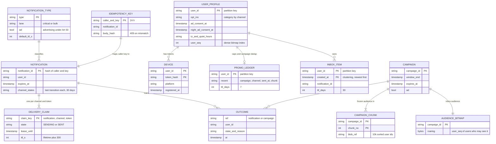

Access patterns and the key that serves each:

| Access pattern | Rate at peak | Store and key |
|---|---|---|
| Dedup a caller's retry | 50k/s | Claim store, `idem:{caller}:{key}`, `SET NX`, 24 h |
| Load a user to decide a critical send | 50k/s | `profile-crit` by `user_id` |
| Load users to decide a chunk | 929k/s | `profile-bulk`, multi-get of 500 `user_id`s |
| Claim one critical provider message | 55k/s, plus 55k marks | Claim store by `claim_key` |
| Promotional dedup and cap, atomically | 929k/s | Ledger by `user_id`, one script |
| Read a chunk | ~100/s | Blob store `campaigns/{id}/chunk-{n}` |
| Status of one notification | ~1k/s [estimate] | Wide-column by `notification_id` |
| Campaign stats | ~10/s | Live counters, plus the columnar log by `campaign_id` |
| Inbox page | ~20k/s [estimate] | Wide-column by `(user_id, created_at desc)`, plus live bitmaps in memory |
| Drop a dead token after APNs 410 | ~5k/s after a big campaign [estimate] | Device registry by `(user_id, token_hash)`, only if `registered_at` is before the 410's timestamp |

`NOTIFICATION` is written from the outcome stream, not on the send path. The send path touches Kafka, the profile cache and the claim store only. That keeps ~1.6 B decisions and deliveries a day off any database that needs a quorum write per message.

---

## 4. High-level design

One subsection per functional requirement. Each traces one request, climbs a Bad, Good, Great ladder, adds boxes to one diagram, and ends with what is still missing. §5 then breaks it.

### 4.1 A service sends a critical notification to one user, and it reaches Apple or Google in under a second

**Flow: the chat service sends `chat_message` for user `u_42` at 20:00:00.000. `u_42` has an iPhone and an iPad.**

1. `POST /v1/notifications` with `type: chat_message`, `idempotency_key: m_991` (the chat message id), `created_at: 20:00:00.000` signed by the chat service, no `expires_at`, so it is `created_at` + the type's 5 minutes: 20:05:00. A retry of the same call carries the same `created_at`, so it can never move that deadline.
2. The send API checks the caller's certificate, that `chat` may send `chat_message`, and the caller's rate limit (before any write, so a flooding caller cannot load the claim store), computes `notification_id = hash(chat, m_991) = n_8f3a`, and does `SET idem:chat:m_991 n_8f3a NX EX 86400` in the claim store: new. It produces the notification to `crit.requests` (key `u_42`, `acks=all`) and answers `202` after the broker acknowledges, ~10 ms.
3. A planner reads it, checks `now < expires_at`, reads `u_42` from `profile-crit` (chat push on, two iOS tokens), renders the template, and produces two records to `crit.apns`, one per token, each carrying `expires_at`, the collapse id `n_8f3a` and APNs priority 10.
4. The critical APNs sender that owns the partition reads the first record, checks expiry again, claims `n_8f3a:push:t1` (`SET NX`, state `SENDING`, lease 10 s), takes one token from its local critical quota grant, and sends on a warm HTTP/2 connection with `apns-expiration` set to 20:05:00.
5. APNs answers `200` at ~20:00:00.150. The sender marks the claim `SENT` (with the provider's id), emits `sent` to `crit.outcomes` on the critical cluster, and commits the offset. The status writer reads `crit.requests` too, so the row already showed `accepted` (and wrote an inbox row for types that keep history) before any provider call; it shows `sent` a second or two later.

**Bad: call APNs and FCM inside the API request.** The chat service now waits on Apple's round trip (~120 ms from Korea [estimate], seconds on a bad day), an FCM blip fails the chat service's request, the caller retries and creates a second push, and a crash after accepting loses the message. This is what a first version usually does.

**Good: one queue and one worker pool.** The API enqueues; workers read preferences from the preference DB, pick tokens, send, and retry. It works for critical traffic alone. Costs: a DB read per message (50k/s at peak on the DB that serves user writes), retries with no notion of expiry (a chat push retried for an hour), and one pool for every provider, so a slow FCM holds the workers that APNs messages needed. And it is the design that breaks first when a campaign arrives (§5.2).

**Great: durable accept on a dedicated critical Kafka cluster, a planner on cached profiles, one topic and one sender pool per provider, a claim around every provider call, and the remaining lifetime in every provider request.** The `202` means "on three brokers in three AZs". Per-provider topics and pools mean an FCM slowdown fills only `crit.fcm`. Deterministic ids (`notification_id` from the caller's key, `claim_key` from the notification and token) mean every retry, at every hop, lands on the same key. **Challenges:** one more hop (~10 to 50 ms of the 1 s budget, §5.2); two KV operations per provider message for the claim; a second Kafka cluster to run; and order. A user's records share a partition, but a sender has hundreds of requests in flight, so it keeps **at most one in-flight push per (user, thread)**: a user gets a few pushes a second at most, so it costs nothing. A re-read that finds another sender's **live** lease parks the record until the lease runs out instead of skipping it, and one that finds the claim already `SENT` re-publishes the `sent` outcome before committing, so a crash between marking and publishing cannot leave the row at `accepted` (§5.4).

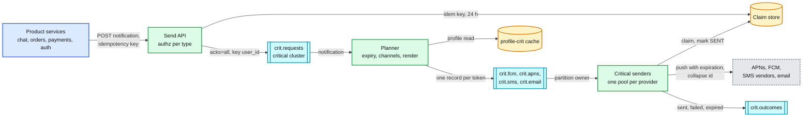

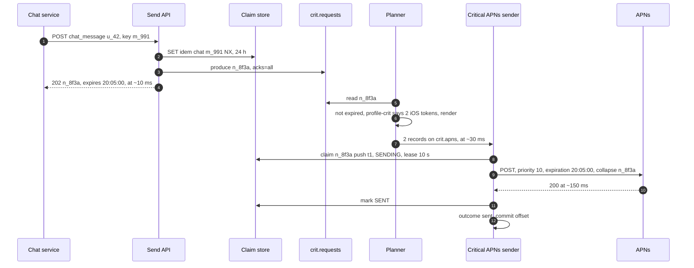

**What is still missing:** promotions. If a campaign used this path, 20M records would sit in `crit.requests` ahead of the next chat. §4.2.

### 4.2 Marketing sends a campaign to 10^3 to 2 x 10^7 users inside a window, at a rate we choose

**Flow: a flash-sale campaign to segment `seg_appliance_buyers` (20M users), window 10:00 to 10:30, expiry 12:00, `ad: true`.**

1. `POST /v1/campaigns`. The campaign service stores it in Postgres as `SCHEDULED`. A timer from the job scheduler ([`../distributed-job-scheduler/`](../distributed-job-scheduler/)) fires at 09:50, ten minutes before the window.
2. **Snapshot.** The campaign service asks the segment service for the ids, de-duplicates them, sorts them by **partition block** (`(hash(user_id) mod 256) div 16`, 16 blocks of 16 bulk partitions) and then by user, and writes **2,000 chunk files of 10k ids** (delta-encoded, ~20 KB each, ~40 MB in all) to the blob store. The audience is now frozen: a user who joins the segment at 10:05 is not in this campaign.
3. **Release.** At 10:00:00 the release controller starts the campaign at its pace: `20 M ÷ (0.5 × 30 min) = 22k/s`, so it finishes in the first half of its window and leaves the second half as slack. It ramps from 0 to that pace over 60 s (FCM: "ramp from 0 to the max RPS across a 60 second time-window"), and every second publishes the chunk references it allows to `bulk.chunks`, round robin over the 16 blocks, inside one Kafka transaction with its release cursor on `campaign-progress`.
4. **Expand.** An expander takes chunk 17, reads its 10k ids, and in sub-batches of 500 multi-gets `profile-bulk`, applies the rules (§4.3), and runs the ledger script per user, which returns `ALLOW`, `DUP` or `CAPPED`. It decides the whole chunk **in memory** first. Then, in **one Kafka transaction of ~30 ms**, it writes a ~300 B record per allowed user and token to `bulk.fcm` or `bulk.apns` (16 partitions of each, because the chunk is one block), the `expanded` marker for chunk 17 and its consumer offset.
5. **Send.** A bulk sender reads a batch of 500, **commits the offset first**, then renders from the cached template version and sends with APNs priority 5 or FCM `NORMAL`, an FCM `ttl` to `min(expires_at, send_by)`, `collapse_key: promo`, and the campaign id as `apns-collapse-id` and Android `tag`. Outcomes go to `outcomes`.
6. ~10:15: all chunks expanded, campaign `DRAINING`; ~10:16: sent. It becomes `COMPLETED` only when every delivery record has a terminal outcome; a drain job marks any record still without one at the campaign's expiry as `unknown` (a bulk sender crashed with it in flight). The console shows counts by state and reason.

**Bad: a script that calls the send API once per user.** 20M calls through the critical path, decided in the order the script runs. A crash at user 7M restarts from 0 (7M duplicates) or from a guess. The rate is whatever the script does.

**Good: a batch job enqueues 20M messages to a promotion queue at 10:00, and workers send.** A separate queue, so chat is not stuck behind it. Costs: 20M messages queued at once cannot be paused or cancelled except by purging; preferences and consent are checked at 10:00 but the message leaves at 10:20, so a 10:01 opt-out is ignored; the tail can pass its expiry in the queue; and the send rate is "as fast as workers go", which spends the shared FCM quota and creates the app herd.

**Great: freeze, chunk, release at a computed rate, decide at release, send at most once.** Nothing per user exists until the controller releases its chunk, so pause stops at the next second and cancel reaches the senders through `campaign-control` with an acknowledged epoch (§8), decisions are at most ~30 s old when the message leaves (the controller keeps each bulk topic under ~30 s of work, §5.6), and a crash re-runs one chunk, not the campaign. **Challenges:** the controller is a single brain per campaign (a leader lease, and Kafka's transactional producer fencing a zombie, §10.4); a re-run chunk must not double-claim caps (the ledger is re-entrant, §5.4); the snapshot is up to one window old, so a user deleted at 10:05 must be caught at expansion (the profile row is a tombstone, suppressed).

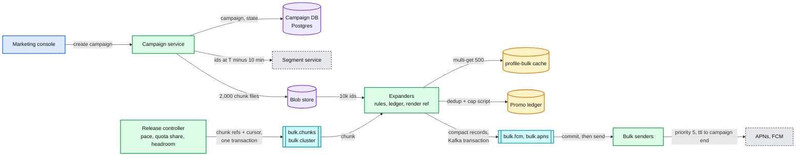

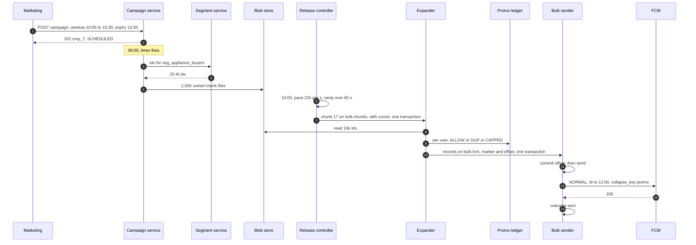

**What is still missing:** the expander "applies the rules", but nothing yet says which rules, in what order, or how fresh the data is. §4.3.

### 4.3 Every send obeys the user's preferences, quiet hours, frequency caps and the advertising law

**Flow: Jiwoo opts out of "deals" push at 10:00:01 while the 10:00 campaign is sending. Her chunk is released at 10:07.**

1. The app calls `PUT /v1/me/preferences {category: deals, channel: push, enabled: false}`. The preference service writes the preference DB (Postgres, sharded by `user_id`) and returns the new profile, so her settings screen reads its own write.
2. CDC publishes the row change. Both caches, `profile-crit` and `profile-bulk`, apply it in ~1 s at p99.
3. 10:07: the expander reads her profile from `profile-bulk`: `deals/push = off`. Outcome `suppressed, reason opt_out`. No ledger write. She is left out of the campaign's inbox bitmap too.

**The rules, cheapest first, the same library in the planner and the expander:**
1. Type allowed on this channel, and the user exists (a deleted user's profile is a tombstone).
2. User opt-in for `(category, channel)`.
3. **Advertising consent** (`ad: true` only). Article 50(1) requires the recipient's explicit prior consent for advertising sent by electronic means. We keep advertising consent separate from service consent, with its date, and treat it as missing once `consent_recheck_due` has passed, because Article 50(8) requires a periodic re-check (the period is set by decree; the survey did not verify "2 years").
4. **The night rule.** Article 50(3): advertising between 21:00 and 08:00 needs a separate prior consent. The rule is about what the **phone** shows, not when we send. A user is under Korean rules when the account country is KR, and the rule is evaluated in KST wherever the phone is [design decision; the Act's reach abroad is not in the survey]. For such a user without night consent: a 2-minute guard (night starts at 20:58 for this check); `send_by = 20:59:30 KST` on the record, which the sender treats like an expiry; the provider lifetime (FCM `ttl`, Twilio `ValidityPeriod`) computed from `min(expires_at, send_by)`, so FCM cannot hold a 20:20 advert for an offline phone and show it at 21:40; and iOS adverts stop at 20:49, because priority 5 can be grouped and delayed and `apns-expiration: 0` caps storage, not that delay (the 10 minutes is an [estimate] to replace with the measured priority-5 delay from sampled receipts). Deferred adverts release from **08:01**, spread by user hash to 08:30, so a 1 s clock skew cannot put a send at 07:59:59. A deferral must land inside the campaign's send window: if 08:01 is outside it, the recipient is suppressed with `night_rule`, unless the campaign was created with a window that includes the morning (the console offers one when it shows the night-consent split). The decree carves out e-mail (secondary in the survey), so the rule applies to push and SMS.
5. **Quiet hours** the user set, in the user's time zone. A promotion is **deferred** to the end of quiet hours if that is before its expiry, otherwise suppressed. A critical push in quiet hours is sent without sound.
6. **Frequency cap and campaign dedup**, one atomic ledger script: `DUP` if this campaign and channel are already in the user's 7-day list, `CAPPED` if the user already has 2 promotional pushes today or 6 this week [estimate], else append and `ALLOW`. Single-user recommendations count against the same cap.
7. **Expiry** with the channel's minimum remaining lifetime (§5.3).
8. **Disclosure.** An advertising template must carry the sender's name and contact and an easy way to refuse (Article 50(4)). Checked when the template is approved, not per message. The "(광고)" prefix is Kakao's channel policy, not the Act; we add it where a channel's policy requires it.

**Bad: query the preference DB in the sender for every message.** 929k reads/s at a campaign peak on the database that serves user writes.

**Good: a read-through cache with a TTL, checked when the message is enqueued.** Costs: a campaign of 20M cold users is 20M misses in a minute, all on the DB; an opt-out can be ignored for the cache TTL (say 10 minutes), which is a legal exposure for advertising; and the check happens at enqueue, not near the send.

**Great: full CDC-fed copies of every profile, one copy per lane, rules as versioned data, checked at decide time no more than ~30 s before the send, and re-checked at the sender for anything older.** After an outage a record can wait 30 minutes with a decision made before it, so bulk senders check every record older than 30 s against a **recent-withdrawals set** (opt-outs and consent withdrawals of the last 24 h, fed by the same CDC stream, a few MB in memory). A full copy has no misses (30 GB fits in memory). Two copies mean a campaign's 929k reads/s cannot slow a chat push's one read (§5.2). Rules are data with an effective date, owned by compliance, because the law changes: the amended Act took effect on 2026-10-02 ([law.go.kr](https://www.law.go.kr/LSW/lsLawLinkInfo.do?chrClsCd=010202&lsJoLnkSeq=1000688185&lsId=000030)). **Challenges:** CDC lag is a consistency window (p99 ~1 s, alert at 5 s, campaigns pause at 30 s); the cap is counted at decide time, so a promotion that then expires unsent still uses a cap slot (we accept it: undercounting would be worse); and the deferral queue is one more scheduled release to run.

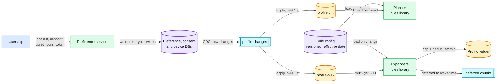

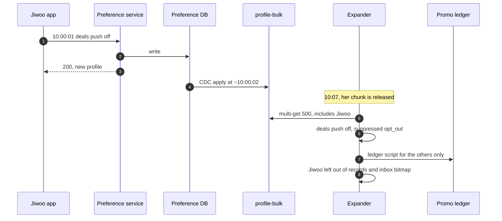

**What is still missing:** callers cannot see what happened, and users have no inbox. §4.4.

### 4.4 Callers can query each delivery's status, and users see recent notifications in an inbox

**Flow: the order service asks whether the "shipped" push for order 991 went out, and the user opens the inbox 10 minutes after the flash sale.**

1. Every sender emits an outcome per transition, critical ones to `crit.outcomes` on the critical cluster and promotional ones to `outcomes` on the bulk cluster: `sent` with the provider's id, `failed` with a reason (`unregistered`, `bad_token`, `payload_too_large`, `provider_5xx_expired`), `expired`, `cancelled` (a cancelled campaign's record dropped at dequeue), `unknown` (a promotional send whose fate a sender crash or an ambiguous timeout hid, set by the campaign's drain job), and from the expanders and planners `suppressed` with a reason. `accepted` is not an outcome event: the status writer takes it from the request topics.
2. A **status writer** reads `crit.requests` and `bulk.requests` as the source of `accepted` (which is also when it writes the inbox row for types that keep history, so the inbox shows an order even while FCM is down), plus `crit.outcomes` (~71k/s at the peak) and the single-user refs and receipts on `outcomes`, and upserts `NOTIFICATION.channel_states` in the wide-column store. States **merge by evidence**: `opened > delivered > sent > expired = failed = unknown > accepted`, and a late event of a lower rank never overwrites a higher one. So a replayed `sent` cannot undo `delivered`, and an `expired` from a retry cannot hide that the phone showed the first attempt. Last write wins would leave ~1.5% of rows wrong ([`deep-dives/status-tracking-and-inbox.md`](deep-dives/status-tracking-and-inbox.md)).
3. An **outcome sink** writes every event to a columnar log (partitioned by day, ordered by `(ref, user_id)`), and a stream aggregator keeps per-campaign counters per second for the console.
4. **Receipts.** APNs and FCM answer "accepted", not "delivered". Our SDK reports `delivered` when the push reaches the app's notification extension and `opened` on tap, batched every 30 s or on the next app open. For promotions, `delivered` is **sampled at 1% of devices**; otherwise 20M receipts in a minute would be a herd of our own.
5. `GET /v1/notifications/n_77` reads one row: `push: sent 09:12:03, delivered 09:12:04`.
6. **Inbox.** `GET /v1/me/inbox` reads the user's rows from the inbox store (`(user_id, created_at desc)`, 30-day TTL) and checks the user's dense `user_seq` against every **live campaign bitmap** held in memory (~350 roaring bitmaps, ~1.2 GB at 18 M members each; on sparse 32-bit user ids the same set would be ~12 GB per node), merges by time, and hides anything past `expires_at`. A read mark on a campaign item is a small row written only when the user opens it.

**Bad: one row per delivery in a relational DB, updated per transition.** ~640 M deliveries a day at ~2.5 transitions each is ~1.6 B writes a day, plus a row for each of ~1 B promotional decisions, and ~1M writes/s for the minutes a campaign is sending.

**Good: wide-column status rows for every delivery, and an inbox row per recipient.** It scales, at a price: ~1M writes/s at the campaign peak, ~30 TB more storage, and 20M inbox writes per campaign (~900M a day) that almost nobody reads.

**Great: point rows only where someone asks about one notification, events and counters for campaigns, sampled receipts for promotions, and campaign inbox entries by bitmap (fan-out on read).** The write volume follows the read pattern: callers query single notifications, marketing queries aggregates. A campaign is one bitmap in the inbox, the classic celebrity case of fan-out on read ([`../../concepts/fan-out-fan-in.md`](../../concepts/fan-out-fan-in.md)). **Challenges:** "delivered" is only as good as our SDK (a force-quit app reports nothing); "did user X get campaign Y" is a columnar query that takes seconds, not a point read; the bitmap is built from expander output, so it lags the release by seconds.

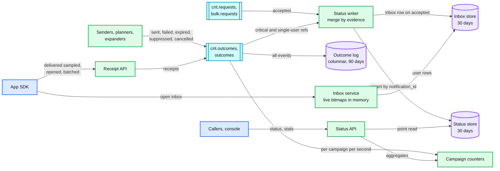

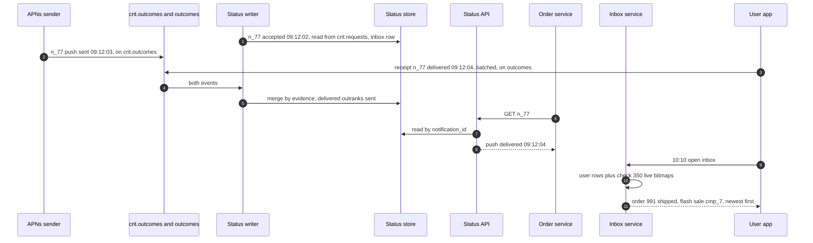

**What is still missing:** the §4 design works on a quiet day. It has not met 1M a second, a campaign during a chat, a 30-minute provider outage, a crash around the provider call, or a 20M push at 10:00 sharp. §5.

---

## 5. Deep dives

One per non-functional requirement or probe, phrased as the interviewer's question. Each names what breaks in the §4 design with a number, climbs the ladder, and lists what changed.

### 5.1 "1M a second of what, and where exactly does it bind?"

**Walk the path at 1M deliveries a second and name each limit in order.**

| Hop | Load at 1M/s | Limit | Binds? |
|---|---|---|---|
| Send API | 50k critical calls/s + 1.25k single-user promotional | ~15k per node, 9 nodes | No |
| Kafka | critical ~120 MB/s, bulk ~306 MB/s raw | 6 + 9 brokers | No, **because records are compact** (rendered payloads inline would be ~1 GB/s) |
| Expansion reads | 929k profile reads/s, 929k ledger scripts/s | 15 cache nodes, 24 ledger shards | Close, at the peak only. Ours to add |
| **FCM project quota** | **754k messages/s = 45 M/min** | **600k/min default** | **Yes, 75x short. Takes weeks to change** |
| APNs | 324k/s, ~49k streams in flight | no published quota or stream count | Connections, ours to add |
| Per-device FCM limits | normal use is ~2 promotions a day; a busy seller can get ~170 order events a second | 240/min and 5,000/hour per Android device; collapsible burst of 20, then 1 per 3 min | For a loop, or a seller. Above 1 push a second per (user, type) we send a digest every 10 s ("37 new orders"), and the inbox keeps every row |
| The app after the push | `R × p × k` requests/s | ~100k requests/s of headroom at a busy 10:00 | At ~100k flash-sale pushes/s (`p × k` 1.0), ~333k ordinary (0.3). Ours to pace (§5.6) |

**Bad: scale our fleet to 1M/s and call it done.** We would build 1M/s of pipeline and get `429 QUOTA_EXCEEDED` at 10k/s. Worse, the 429s land on chat pushes too, because both lanes share one Firebase project.

**Good: negotiate one big FCM number and enforce it with one global counter that every sender increments.** Costs: one Redis key taking 754k increments a second (the hot key in [D10](diagrams.md#d10-scaling--partitioning)); no reservation, so a campaign can spend FCM's one-minute bucket and leave chat with 429s; and Google warns that front-loading quota creates oscillations.

**Great: a quota coordinator per provider account, with a reserved critical slice, a bulk slice that never borrows, and per-node leases.**
- **Per provider account** (the FCM project, the APNs key and bundle topic, each SMS vendor account, the email account): the contracted quota `Q` is configuration, changed when the contract changes.
- **Critical reserve = 2x the critical lane's peak** on that provider. FCM: `2 × 38.5k = 77k/s`. Critical senders may use the reserve and borrow anything bulk leaves unused. Bulk may never touch the reserve.
- **Critical preempts bulk.** A reserve of 2x is a guess about the worst spike; New Year's midnight or a viral group chat can be 3x. When critical demand (last second's arrivals plus backlog, +20%) exceeds the reserve, the coordinator grants critical up to `Q − margin = 270k/s` at once and cuts the bulk leases, which lands within 2 s (one lease). For those 2 s the lanes together can overshoot by up to the bulk share: at most ~0.4M tokens of FCM's 18M-token minute, which the bucket absorbs. Simulated in [`deep-dives/priority-lanes-and-isolation.md`](deep-dives/priority-lanes-and-isolation.md): a 3x chat spike while a campaign holds its full share gives chat a p99 of **14.8 s with the reserve alone and 0.76 s with preemption**.
- **Safety margin 10% of Q**: FCM's minute is a token bucket that is not clock-aligned, and during migration the legacy system sends on the same project (§8).
- **Bulk share = Q − reserve − margin**, split across bulk sender nodes by their reported demand. At the standing ask of 18 M/min: `300k − 77k − 30k = 193k/s`.
- **Leases, not counters.** Every second each sender node reports demand and sent; the coordinator grants a 2 s lease of "n messages per second"; the node enforces it with a local token bucket. No network call per message, no hot key.
- **If the coordinator is unreachable**, critical nodes keep their static share of the reserve indefinitely, and bulk leases decay to 0 within 10 s. Promotions pause; chat keeps going.
- **AIMD on a 429 rate, not on any 429.** FCM's `QUOTA_EXCEEDED` also covers one device's message rate, so one buggy loop to one phone must not halve the lane. The trigger is at least 0.5% of bulk requests in 1 s across at least 100 distinct tokens [estimate]; then the bulk share halves for 30 s and grows back 5% a second. The reserve does not move. Bulk always ramps from 0 over 60 s.
- **APNs has no published quota**, so the coordinator manages concurrency instead: ≤ 250 streams in flight per connection [estimate], 30 connections for critical and 270 for bulk, spread over sender nodes, because Apple says to avoid "push bursts over selective connections". All nodes present one provider JWT minted centrally (§10.1). FCM gets the same treatment: the critical FCM pool is sized at about one second of its peak, ~40k streams on ~160 connections (§5.5), the bulk pool ~400 connections.

**What we negotiate, and what we refuse.**

| Provider | Need at 1M/s | Standing contract | For a named event | Refuse |
|---|---|---|---|---|
| FCM | 45 M/min | **18 M/min (30x)**, Firebase Support with a forecast | **53 M/min** (795k/s usable after the 10% margin, 718k/s for bulk), at least 15 days ahead, only with the app pre-scaled | Relying on many Firebase projects to multiply the quota: tokens belong to a sender, and the survey found no documented policy |
| APNs | ~49k streams | ~300 connections | ~400 | Pretending a stream count: Apple says "don't assume a specific number" |
| SMS | 1k/s critical | two vendors, ≥ 1k MPS each [estimate] | none | **Promotional SMS in the burst.** 20M Korean messages of 140 characters are 2 UCS-2 segments each (70 characters per single segment, 67 per part, secondary): 40M segments, ~5.5 h at 2k MPS and ~$400k [estimate]. It runs on its own vendor account, at its own rate, in its own window |
| Email | 5k/s receipts | account send rate, raised on request | none | Campaign email here: the email platform owns it ([`../email-campaign-sending/`](../email-campaign-sending/)) |

**Push back on the textbook answer.** "Use FCM topics, or multicast, to send the campaign in one call." Topic fanout runs at about 10,000 QPS per project, "not a guarantee", and "this fanout rate quota is not adjustable" ([FCM topics](https://firebase.google.com/docs/cloud-messaging/topic-messaging)), with at most 1,000 concurrent fanouts. A topic message also carries no per-user consent, night rule, cap, dedup or status. Multicast (500 tokens a call) saves requests, not quota: "quota counts messages, not requests".

**What changed.** New: the quota coordinator, per-lane slices, critical preemption, lease-based node budgets, AIMD on a 429 rate, per-(user, type) digests, the negotiated contracts as configuration.

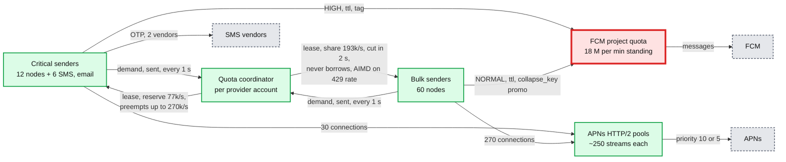

Long form: [`deep-dives/provider-egress-and-quotas.md`](deep-dives/provider-egress-and-quotas.md).

### 5.2 "A 20M-user campaign is mid-send. How does a chat push still reach Apple or Google in under a second?"

**What breaks if anything is shared.** At 10:01 the flash sale is sending at 100k/s and `u_42`'s chat push arrives.
1. **One queue, even with a priority field.** Kafka has no priorities. A broker with priorities (RabbitMQ) orders inside the broker only. Everything after it is still shared.
2. **One FCM token bucket.** If bulk may use the whole 18 M/min, a front-loaded release spends the minute's bucket early and chat gets `429` and backs off: seconds to minutes.
3. **One connection pool.** "APNs ignores HTTP/2 PRIORITY frames" (Apple), so a chat stream on a connection with 250 bulk streams in flight waits its turn.
4. **One profile cache.** 929k reads/s at the peak puts the chat's one read behind multi-gets of 500.
5. **One Kafka cluster.** Bulk writes ~306 MB/s plus replication; a critical `acks=all` produce waits on the same disks and ISR fetchers.
6. **One deployment.** A bad bulk-sender release takes critical sends down with it.

**Bad: a priority field in one queue.** Fixes point 1 only.

**Good: separate topics in one cluster, and one worker pool that always drains critical first.** Fixes 1 and part of 4. Still shares the quota (2), the connections (3), the brokers (5) and the deploys (6).

**Great: two lanes that share nothing we can separate.**

| Resource | Critical lane | Bulk lane |
|---|---|---|
| Entry | Send API (routes by type), per-caller limit before any write | Campaign service, and a separate send API pool (same hostname) for single-user promotional types |
| Kafka | critical cluster, 6 brokers | bulk cluster, 9 brokers |
| Decide | planners, `profile-crit`, claim store | expanders, `profile-bulk`, promo ledger |
| Send | 12 nodes (+6 SMS, email), own deploy train | 60 nodes, own deploy train |
| Connections | 30 APNs, ~160 FCM (~40k streams) | 270 APNs, ~400 FCM |
| FCM quota | reserve 77k/s, may borrow, preempts bulk up to 270k/s | share 193k/s, never borrows, cut within 2 s |
| Egress | own NAT gateways | own NAT gateways (~9 Gbps at 1M/s must not fill the critical path) |

The reserve alone is not enough: at a 3x chat spike during a campaign it caps critical at 77k/s and the worst chat waits ~15 s; preemption takes chat's p99 to 0.76 s at the cost of a campaign that slows for the spike (§5.1).

Shared, and impossible to split: the Firebase project and the APNs key (one app identity), the providers' own capacity, the source-of-truth preference DB (behind CDC), and the region. The red node is the first of those.

**The 1 s budget, chat push, during a campaign.** Accept to the provider's 200, warm connection:

| Hop | p50 | p99 | What sets it |
|---|---|---|---|
| Send API: auth, `SET NX` idempotency | 3 ms | 15 ms | Claim store round trip |
| Produce `crit.requests`, `acks=all` | 5 ms | 30 ms | ISR of 3 across AZs, small cluster |
| Planner fetch | 5 ms | 50 ms | `fetch.max.wait.ms=10` |
| Profile read, rules, render, produce per token | 8 ms | 50 ms | One cache read, one produce |
| Sender fetch, expiry check, claim | 5 ms | 50 ms | Claim store round trip |
| Local token bucket, send, APNs or FCM 200 | 120 ms | 500 ms | Korea to provider round trip [estimate] |
| **Sum** | **~150 ms** | **~700 ms** (a ceiling, p99s do not add) | |

What blows it: a consumer-group rebalance (10 to 30 s with eager assignment; we use cooperative-sticky with static membership, §10.2), a cold connection (TLS adds 2 round trips; pools stay warm with HTTP/2 pings), and an FCM 429 (the reserve exists so that never happens to critical).

**Push back on the textbook answer.** "Mark chat as high priority at the provider and promotions as normal." Provider priority decides whether a device wakes up. It does nothing for our queues, our connections or the project quota, which both priorities spend. And FCM may lower high priority to normal for an app instance whose high-priority messages did not show a visible notification over 7 days, so a chat push must always end in a visible notification: the SDK shows a quiet notification rather than none, and the chat service does not ask us to push a user who is online in that conversation.

**What changed.** Two Kafka clusters, two profile caches, two Redis clusters (claim store, promo ledger), separate sender deployments, connection pools and NAT, critical outcomes on `crit.outcomes`, and the quota slices with preemption from §5.1.

```mermaid
%% 5.2: two lanes, separate at every resource we control. The one shared box is the FCM project quota, red: a promotion can only hurt chat there, and the reserved slice is what prevents it.
flowchart LR
    CHAT[Chat push, 1 user] -->|"202 in 10 ms"| CK[[Critical Kafka<br/>6 brokers]]
    CAMP[Flash sale, 20 M users] -->|"chunks, 100k/s"| BK[[Bulk Kafka<br/>9 brokers]]
    CK -->|"1 read"| PL[Planners<br/>profile-crit]
    BK -->|"multi-get 500"| EX[Expanders<br/>profile-bulk, ledger]
    PL -->|"crit.apns, crit.fcm"| CSN[Critical senders<br/>own pools, own NAT]
    EX -->|"bulk.apns, bulk.fcm"| BSN[Bulk senders<br/>own pools, own NAT]
    CSN -->|"reserve 77k/s, preempts"| Q[FCM project quota<br/>and APNs app identity]
    BSN -->|"share 193k/s, cut in 2 s"| Q
    Q -->|"under 1 s p99"| DEV[Devices]

    class CHAT,CAMP client
    class PL,EX,CSN,BSN service
    class CK,BK queue
    class Q critical
    class DEV external

    classDef client   fill:#dbeafe,stroke:#2563eb,stroke-width:2px,color:#111
    classDef service  fill:#dcfce7,stroke:#16a34a,stroke-width:2px,color:#111
    classDef queue    fill:#cffafe,stroke:#0891b2,stroke-width:2px,color:#111
    classDef critical fill:#fee2e2,stroke:#dc2626,stroke-width:4px,color:#111
    classDef external fill:#e5e7eb,stroke:#6b7280,stroke-width:2px,color:#111,stroke-dasharray:4 3
```

Long form: [`deep-dives/priority-lanes-and-isolation.md`](deep-dives/priority-lanes-and-isolation.md).

### 5.3 "Every notification expires. Who enforces it, and what does a provider do with a late one?"

**What breaks in the current design.** §4 checks expiry in our hops but never tells the provider. A chat push that reaches FCM at 20:04:59 for an offline phone is kept by FCM for **4 weeks** (the default when `ttl` is unset). An OTP stuck behind an SMS vendor's queue can leave **10 hours** later (Twilio's default `ValidityPeriod` is 36,000 s, and its queue holds messages up to 10 hours).

**Bad: check `expires_at` once, at the API.** Everything that waits after that (a provider outage, a backlog) is sent late.

**Good: check at every dequeue.** Nothing we send is late. Whatever the provider holds can still be.

**Great: check at every dequeue, and hand the provider the remaining lifetime in its own unit.**
- **Our hops.** The API rejects `expires_at` in the past or above the type's maximum. The planner, the expander and the sender each drop a message when `now + min_remaining(channel) ≥ expires_at`, with outcome `expired`. `min_remaining` [estimate]: push 1 s, but **chat 10 s** (a chat that would land in its last seconds is dropped by us, not hidden by the phone, which would teach FCM that our high-priority messages show nothing), SMS 30 s (the carrier hop), email 5 min. For an advert to a user without night consent, `send_by` (20:59:30 KST) acts as the expiry at every hop (§4.3).
- **APNs**: `apns-expiration` = `expires_at` in epoch seconds. Nonzero means "APNs stores the notification and tries to deliver it at least once ... until the specified date", on a best-effort basis.
- **FCM**: `android.ttl` = remaining seconds, computed at send time. Never omitted.
- **Twilio**: `ValidityPeriod = remaining − 10 s`, clamped to 6 to 36,000 (Twilio recommends more than 5); the 30 s SMS margin means it is always at least 20. A 3-minute OTP leaves with ~170. OTP and promotional SMS use separate Messaging Services, each with its own validity, as Twilio's own example does.
- **Email**: SMTP has no expiry. We drop at dequeue only; the email types are 24 h anyway.
- **Clocks.** FCM and Twilio take relative values computed on our NTP-synced hosts; APNs takes an absolute UTC time. Skew budget 1 s.

**The APNs storage trap, and why iOS promotions use `apns-expiration: 0`.** For an offline device "APNs stores only one notification per bundle ID", in most cases the latest. A promotion sent at 10:01 to an iPhone in a tunnel replaces the order-shipped push stored at 09:55. So iOS promotions go out with expiration `0`: "APNs attempts to deliver the notification only once and doesn't store it". Online phones get it now; offline phones never get it later, and their stored critical push survives. Cost: iOS promotional reach drops by the share of iOS devices offline at send time, ~5 to 10% [estimate]; the inbox still shows the campaign. On Android every promotion shares one `collapse_key: promo`, so an offline device gets at most the newest promotion on reconnect, and critical messages are sent non-collapsible. That FCM stores the two kinds apart, so a promotion cannot displace a stored chat, is from FCM's docs and not in our survey: verify before quoting it.

| Type | Lifetime | Our drop rule | APNs | FCM | Twilio | Dedup TTL |
|---|---|---|---|---|---|---|
| OTP | 3 min | push 1 s, SMS 30 s before | `expires_at` | ttl remaining | remaining − 10 s | 8 min |
| Chat | 5 min | 10 s before | `expires_at` | ttl remaining | n/a | 10 min |
| Order status | 24 h | 1 s before | `expires_at` | ttl remaining | n/a | 24 h 5 min |
| Promotion | campaign end | 1 s before | **0**, collapse id = campaign | ttl to campaign end, collapse `promo`, tag = campaign | own service | ledger, 7 days |
| Advert, user under Korean rules without night consent | min(campaign end, `send_by` 20:59:30 KST) | 1 s before that; iOS sends stop at 20:49 | **0** | ttl to `min(expires_at, send_by)` | to `send_by` | ledger, 7 days |

**Challenges.** Expiry turns an outage into lost messages on purpose; we count them per type (a critical expiry rate above 0.5% for 5 minutes pages, §8). The promise is precise: **we never send after `expires_at`; provider expiry and render-time dropping are best effort.** Provider expiry is "without any guarantee", so the device can still show something slightly late; our SDK drops a push whose `expires_at` (in the payload) has passed when it renders, where the platform lets it.

**Push back on the textbook answer.** "Set `apns-expiration: 0` for chat so it is never late." Zero means "deliver once, do not store", not "drop if late": a push can still arrive late, and an offline phone never gets it. For chat we want storage, for 5 minutes. Folklore in reverse is just as wrong (survey conflict 12).

**What changed.** Expiry checks in every hop with a per-channel margin (10 s for chat), the provider fields in every request, `send_by` as an expiry for adverts at night, iOS promotions at expiration 0, one FCM collapse key for promotions, separate Twilio services per lane.

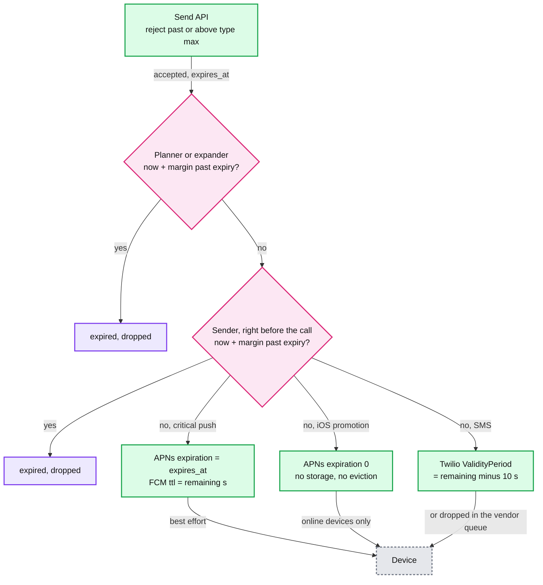

Long form: [`deep-dives/expiry-dedup-and-retries.md`](deep-dives/expiry-dedup-and-retries.md).

### 5.4 "A worker crashes right after the provider accepted the message. How do you avoid a second OTP or a second promotion, and what is the dedup key?"

**Where duplicates enter.**
1. The caller retries after a timeout. Same idempotency key, so the same `notification_id`. The idempotency record holds the body hash, the original `expires_at` and a state: `SET NX` as `PENDING`, produce, then `ACCEPTED`. A retry that finds `ACCEPTED` gets the original `202` and nothing is produced. One that finds `PENDING` (the produce may have failed) produces again with the original `expires_at`. Either way an hour-late retry cannot restart a chat's 5-minute clock, because `expires_at` comes from the caller's signed `created_at`, which the retry repeats; a double produce is harmless because every later key derives from `notification_id`.
2. A planner crashes after producing per-token records but before committing its offset. It re-plans: same claim keys.
3. **A sender crashes between the provider's 200 and recording it.** The real window.
4. An expander crashes mid-chunk. Its Kafka transaction aborts; the chunk re-runs.
5. A chunk is released twice (by hand after a bug, or a controller failover). The `expanded` marker on `campaign-progress` makes the expander skip it, but only once the expander's view of `campaign-progress` has caught up to the chunk's release offset: "re-entrant" in the ledger cannot tell an aborted run from a committed one.

**Bad: no dedup, at-least-once everywhere.** Every crash, rebalance and caller retry becomes a second push.

**Good: one dedup store, one `SET NX` per provider message, for both lanes.** Works. At the 1M/s peak it is ~2M extra KV operations a second, and it still leaves the window in point 3: a claim that says `SENDING` with an expired lease does not say whether Apple got it.

**Great: decide the crash-window policy per lane, and use the device's own dedup.**
- **Critical: at-least-once with an idempotent effect.** Claim `(notification_id, channel, token hash)` as `SENDING` with a 10 s lease, send, mark `SENT`, then commit the offset. If the sender dies after the 200, the record is re-read ~10 s later (static membership session timeout), the lease has expired, and we **send again with the same collapse id**. If the re-read finds the claim `SENT`, the sender died between marking and publishing, so it **re-publishes** the `sent` outcome (the claim keeps the provider's id; the status merge is idempotent) and then commits; it never resolves a `SENT` claim silently. If the re-read finds a **live** lease, the reader **parks** the record until `lease_until`, keeps it unresolved (so the low-water mark cannot pass it), then retries the claim. It never skips: after a fast restart under static membership (the same member back in ~3 s) a live lease usually belongs to an attempt that died before reaching the provider, and skipping lost ~341 messages per restart in the simulation in [`deep-dives/expiry-dedup-and-retries.md`](deep-dives/expiry-dedup-and-retries.md), OTPs among them. Parking costs at most the 10 s lease. APNs `apns-collapse-id` and the FCM `tag` make the device replace, not add, on a best-effort basis: a user who dismissed the first one can see it again. The OTP code was fixed when the notification was planned, so a second SMS carries the same code. A second receipt email is accepted as the price. Bound: ~`55k/s × 0.15 s ÷ 12 ≈ 700` messages in flight per node.
- **Promotional: at most once at the send hop.** The bulk sender **commits the offset of a batch before sending it**. Nothing is ever resent. Definite failures (429, a connection refused before the request was written, a 5xx) are retried from an in-memory buffer **capped at 5k per node**; fetching pauses while it is full. An ambiguous one (a timeout after the request was written) is not retried; outcome `unknown`. Per crash: ~1.3k lost and ~1.2k ambiguous, ~2.5k at risk (up to ~6k if the crash lands in a 429 back-off); the campaign's drain job reports every one of them as terminal `unknown`, because nothing can tell which reached the provider. At ~2 sender crashes a day across 60 nodes [estimate: one per node per month], ~5k promotions are at risk a day against up to ~60 M sent: under 0.01%.
- **Why the split:** a lost OTP blocks a login and a duplicate costs nothing; a duplicate promotion is a complaint and a lost one costs nothing. And the ledger already did the per-user dedup at decide time, so a sender claim would buy nothing for ~1.9M KV operations a second.
- **Re-entrant ledger.** The ledger entry stores the chunk number. A re-run of the same chunk (only possible if its transaction aborted) finds "this campaign, this chunk": ours, re-produce, do not count the cap again. "This campaign, another chunk" is a real duplicate: `DUP`.
- **Fail open and fail closed.** Claim store down: critical senders send without a claim (they are at-least-once anyway, and the collapse id absorbs it), and the send API falls back to the deterministic `notification_id`. A retry during that outage still cannot extend a chat or OTP, because `expires_at` comes from the caller's `created_at`. What is lost is the original `202` body and the `409` on a changed body, and duplicates on the wire rise, so it pages. Ledger down: campaigns pause, because caps and consent are a promise to users. The claim store and the ledger are separate Redis clusters, so one can fail without the other.

| Layer | Key | Lives | Why that long |
|---|---|---|---|
| API idempotency | `(caller, idempotency_key)` → `notification_id` | 24 h | Callers retry for hours after an incident |
| Critical claim | `(notification_id, channel, token hash)` | lifetime + 5 min: OTP 8 min, chat 10 min, order 24 h 5 min | No hop sends after `expires_at`, so the claim only has to outlive the last possible attempt plus skew |
| Device | `apns-collapse-id`, FCM `tag` = `notification_id` | provider side | Makes the crash-window resend replace the first, best effort |
| Promotion | ledger `user_id` → `(campaign, channel, sent_at, chunk)` | 7 days | Covers the weekly cap and any campaign's lifetime |
| Chunk | `campaign-progress` `(campaign, chunk)` | campaign lifetime, compacted | Skip a re-released chunk, read after catching up to its release offset |

**Never silently lost, inside a region.** The `202` is sent only after `acks=all` with `min.insync.replicas=2` and RF 3 across three AZs. A region loss is different: the warm standby has what the cross-region mirror had copied, so the **RPO is the mirror lag, p99 under 2 s**. The dedup records in the lost region are gone too, so recovery is the caller's job by contract: every caller keeps its sends in its own outbox and re-sends anything without a terminal status with the same idempotency key, and the re-send goes through. It cannot revive a dead chat, because `expires_at` comes from the caller's `created_at`; a push that did go out before the loss is replaced in place by its collapse id. Planners and critical senders commit an offset only when every record before it is resolved: sent, expired, failed, or written to `crit.retry.15m`. A reconciler joins each minute's `crit.requests` ids with terminal outcomes per channel at `minute + type lifetime + 10 min`; any gap is re-driven if still alive and pages if more than 0.

**Push back on the textbook answer.** "Use Kafka exactly-once." It covers Kafka-to-Kafka hops, and we use it for exactly one (the expander). The provider call is outside any transaction we can run, so the last hop is at-least-once or at-most-once by choice, never exactly-once. [`../../concepts/exactly-once.md`](../../concepts/exactly-once.md). The same crash, worked for a credit alert, is in [`../credit-score-alerts/`](../credit-score-alerts/).

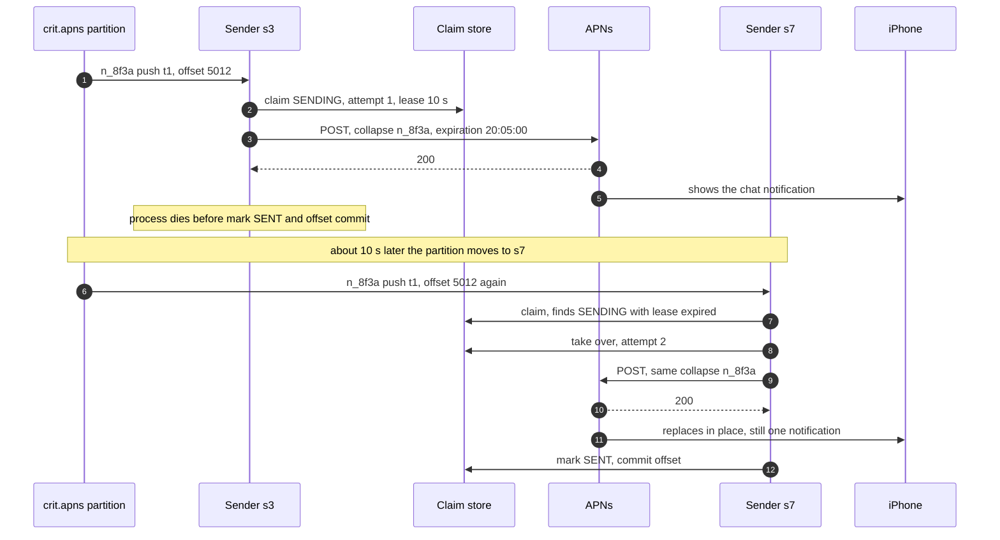

The residual duplicate: if the user dismissed the first notification within those ~10 s, the replacement shows once more. Long form: [`deep-dives/expiry-dedup-and-retries.md`](deep-dives/expiry-dedup-and-retries.md).

### 5.5 "FCM or the SMS vendor is slow or down for 30 minutes. What queues, what expires, what fails over, and what is dropped?"

**Bulkheads first.** Each (provider, lane) has its own topic, consumer group, connection pool with a cap on in-flight requests, breaker and quota lease. A hung FCM can hold the critical FCM pool's ~40k streams (~160 connections × 250) and nothing of APNs's. Timeouts: 2 s critical, 5 s bulk.

**Breaker per (provider, lane)** [estimate thresholds]: opens when at least 50% of at least 200 attempts in 10 s fail with 5xx, timeout or connection errors (token errors like 410 do not count), or when critical p99 passes 2 s, or after 20 consecutive failures (the volume rule never fires at night, when OTP runs at ~5 a second). Open: stop consuming that topic, so records wait in Kafka, not in memory. Probe 1% every 5 s. Close after 30 s clean, then ramp over 60 s.

**FCM down 20:00 to 20:30, evening rate ~10k critical calls/s [estimate].** FCM critical messages in 30 min: `10k × 1.1 × 0.7 × 1,800 = 13.9 M`.

| Type (share) | During | At 20:30 | Count |
|---|---|---|---|
| Chat (50%) | waits in `crit.fcm` (the short-lived topic); the chat service's own socket still reaches users who are in the app | the last 5 min are alive, the rest **expired** | ~5.8 M expired; of ~1.16 M alive, ~1.15 M sent late but in time, ~2k expire in the queue |
| Order and payment (40%) | waits in `crit.fcm.long`; the inbox already shows it; `payment_failed` also sends email after 60 s | **sent**, after the short topic | ~5.5 M |
| OTP by push (rare) | falls back to SMS after 5 s | n/a | small |
| Other (10%) | per registry | per registry | ~1.4 M |
| Promotions | each campaign keeps releasing for APNs; Android records wait in `bulk.fcm` up to `normal FCM share × time left to expiry`, then the campaign pauses; at the drain the sender re-checks each record against the recent-withdrawals set, so a 20:10 opt-out stops a 20:05 decision | drained after the critical backlog, oldest first, past-expiry dropped | per campaign |

Recovery: ~8.1 M critical messages still alive. The reserve plus everything bulk would use (bulk waits) is ~270k/s, and the 60 s ramp alone sends `270k × 60 ÷ 2 = 8.1 M`, so the whole backlog drains in **~61 s including the ramp**, then bulk resumes on its own ramp. **Order decides which chats live.** Kafka reads a partition oldest first: with one `crit.fcm` topic the drain would spend its first ~50 s on order pushes that have 23 more hours to live, and ~198k of the chats alive at 20:30 would expire behind them (the simulation in [`deep-dives/provider-egress-and-quotas.md`](deep-dives/provider-egress-and-quotas.md)). So critical provider topics are split by lifetime class (`crit.fcm` for ≤ 10 minutes, `crit.fcm.long` for the rest, the same for APNs) and the short topic drains first: ~2k chats lost instead of ~198k, and a new chat at 20:30:05 waits ~17 s instead of ~53 s.

**SMS vendor A down.** Each OTP fails over by itself: after one 2 s timeout at A it goes to vendor B at once, with the same code. The breaker opens on the volume rule or 20 consecutive failures, and then all OTP goes to B (separate account and numbers; each is contracted to carry all OTP alone). OTPs stuck inside A die there when their ~170 s `ValidityPeriod` passes. If A recovers sooner, the user may get the same code twice: harmless. Both vendors down: the auth service offers the code by push or email.

**Slow, not down.** Size pools with Little's law on the **mean** latency, not the p99. At the critical peak of 38.5k/s and a normal mean of ~0.12 s, ~4.6k requests are in flight. A pool of 12.5k streams would saturate at a mean of ~325 ms (2.7x normal); the ~40k-stream pool saturates at a mean of ~1 s (8x normal), so a slower FCM costs chat latency, not a queue in front of every chat. Connections are free. The bulk pool stays small on purpose: AIMD shrinks bulk in-flight on rising latency, so we do not pile onto a struggling provider; the breaker's p99 rule opens if it lasts. The SLO is missed and we say so: we cannot make FCM faster, only refuse to make it worse.

**Retries per provider.** FCM 5xx and 429: exponential backoff with jitter, within expiry (Google's guidance). APNs 5xx: Apple says such payloads can be retried "after 15 minutes", so short-lived types (chat, OTP) are not retried on a 5xx and take their fallback, and long-lived types go to `crit.retry.15m`. APNs 429 `TooManyRequests` is per device token: back off that token. 410: delete the token if it was registered before the 410's timestamp. 413: never retry.

**Bad: retry everything with exponential backoff until it works.** Chat retried for 30 minutes arrives 25 minutes late, and 30 minutes of backlog lands on FCM the second it recovers.

**Good: breakers per provider and a dead-letter queue.** Isolation works, but nothing distinguishes a chat (drop) from an order (wait) from an OTP (switch vendor).

**Great: bulkheads per (provider, lane), breakers that leave records in Kafka, per-type expiry and fallback from the registry, and a ramped drain that puts critical first.** **Challenges:** a 30-minute FCM outage drops ~5.8 M chat pushes by design; fallbacks cost money (below); and the drain must respect the provider's ramp guidance or we cause the next incident.

**Push back on the textbook answer.** "Fail over push to SMS." 13.9 M messages in 30 minutes as SMS is ~$139k for one outage [estimate], and two vendors at ~1k MPS each send at most ~3.6 M in 30 minutes anyway. SMS fallback is only for types whose registry entry says so (OTP), and never for promotions.


The per-message decision is drawn in [D6](diagrams.md#d6-activity--decision-flow), the second-by-second timeline in §10.4. Long form: [`deep-dives/provider-egress-and-quotas.md`](deep-dives/provider-egress-and-quotas.md).

### 5.6 "A flash-sale push goes to 20M users at 10:00. Release rate, quiet hours, the Korean night rule, caps, and the app two minutes later?"

**What breaks if we just send.** At 1M/s the 20M go out in 20 s. Their ~20M requests (`p × k` = 1.0 for a flash sale) arrive over ~5 minutes, a third in the busiest minute: ~111k extra requests/s on an app already carrying ~250k, **70 to 72% of its 500k**. If the estimate is right, that is survivable. **The reason to pace is that the estimate can be wrong, and a push cannot be recalled.** The simulation ([`deep-dives/campaign-fan-out-and-scheduling.md`](deep-dives/campaign-fan-out-and-scheduling.md)): the 1M/s burst peaks at 70% if `p × k` is right, 90% if it is 2x, and **111%** (~50 s over capacity, before the app's own retries) if it is 3x; the controller below stays at or under 70% in all three cases and takes 3 to 7 minutes instead of 16 seconds. Sustained 1M/s would add ~1M requests/s to a 500k app. Autoscaling takes minutes to add a server and the stores behind it do not scale in minutes at all, as worked in [`../credit-score-alerts/`](../credit-score-alerts/solution.md#51-the-bureau-delivers-100-m-updated-reports-at-2-am-what-happens-at-205-and-where-exactly-is-the-herd).

**Bad: release everything at 10:00:00 "so it is fair".** The herd above, plus a front-loaded FCM bucket.

**Good: a fixed rate per campaign.** Safe for the app if the number is right, but nobody knows the right number: it depends on organic load at that minute, on other campaigns, and on this audience's open rate.

**Great: a release controller that computes the rate every second, and an expander that decides per user at release.**
- **Pace.** `audience ÷ (0.5 × window)`. Window 10:00 to 10:05: `20 M ÷ 150 s = 133k/s`.
- **Caps on the pace, every second:** the bulk FCM share (193k/s, ~250k deliveries/s), the bulk APNs concurrency (270 connections × 250 streams ÷ 0.15 s ≈ 450k/s), each bulk topic's lag under ~30 s of work, the campaign's `max_rate`, and **app headroom**: `(0.7 × C − B(t)) ÷ p×k`, with `C` the app's capacity, `B(t)` its organic load, and `p×k` measured live from deep links tagged with the campaign id. At 10:00: `(350k − 250k) ÷ 1.0 = 100k/s`, below the 133k/s pace, so the controller releases at 100k/s: 20 M in ~200 s plus the 60 s ramp, done ~10:04, inside the window.
- **Slow start and back-off.** Ramp from 0 over 60 s. If the app passes 75% or its p99 SLO, halve and hold for 2 minutes, because the metric lags 30 to 60 s. This is the controller from [`../credit-score-alerts/deep-dives/fan-out-and-herd-control.md`](../credit-score-alerts/deep-dives/fan-out-and-herd-control.md), reused.
- **Concurrent campaigns** share the bulk budget by DRR weighted by priority class (flash sale, then recommendations, then newsletters).
- **Order.** Chunks are released round robin over the 16 partition blocks (so bulk partitions fill evenly), and in `hash(campaign, chunk)` order inside a block, so the same users are not always last.
- **Promotions use APNs priority 5 and FCM `NORMAL`.** Apple: priority 5 notifications "might get grouped and delivered in bursts". The OS smears the herd a little more for free.
- **Pre-warm.** The flash-sale landing page is the same for everyone, so the CDN has it before 10:00. The herd that remains is personalized calls (cart, login refresh, recommendations), which is the `p × k` we measure.

**Per user, at release (the §4.3 rules), for this campaign [estimate counts]:** 20 M frozen; 3.0 M without advertising consent, suppressed; 0.6 M opted out of deals push; 0.4 M already had 2 promotions today, `CAPPED` (inbox only); 0.1 M in their own quiet hours, deferred to their wake time because that is before 12:00; **~15.9 M pushed**, by ~10:04.

**The night rule.** The same campaign at 21:30 KST goes now only to users with the separate night consent. The rest are deferred to 08:01 only if the campaign's window includes the morning and the expiry allows; otherwise they are suppressed with reason `night_rule`. Anything sent before 21:00 to users without night consent carries a provider lifetime ending at 20:59:30, and iOS sends to them stop at 20:49 (§4.3). We never send after `send_by`; that no phone shows it after 21:00 rests on provider expiry and the measured priority-5 delay, which are best effort. The console shows that split when the campaign is created, so nobody discovers it at 21:30.

**Checkpointing.** The unit is the chunk. Decided in memory, then one ~30 ms Kafka transaction per chunk (records, `expanded` marker, offset) touching 16 partitions per topic, and the controller's release cursor is on `campaign-progress` in its own transactions. A crash of anything re-runs at most one chunk per expander (§10.1).

**Push back on the textbook answer.** "Autoscale the app for the push." The spike peaks ~2 minutes after delivery; a new server takes about as long to start serving, and the cache and database behind it do not scale in minutes. Pacing costs nothing; capacity costs money. Pre-scale only for a sale we know is big, and only together with an FCM event quota.

```mermaid
%% 5.6: the release loop. The controller takes the minimum of pace, quota share, topic lag and app headroom every second. In this view the app API is red: at a busy 10:00 it binds at ~100k flash-sale pushes/s, before the standing FCM share.
flowchart LR
    CMP[(Campaign and chunks<br/>window, expiry, pace)] -->|"pace 133k/s"| RC[Release controller<br/>min of all inputs, ramp 60 s]
    QC[Quota coordinator] -->|"bulk share per provider"| RC
    LAG[[bulk topic lag]] -->|"under 30 s of work"| RC
    RC -->|"chunk refs, hash order"| EX[Expanders<br/>consent, night rule,<br/>quiet hours, ledger]
    EX -->|"deferred to wake time"| DEF[[deferred chunks]]
    EX -->|"allowed users"| BS[Bulk senders<br/>priority 5, NORMAL]
    BS -->|"push"| PRV[APNs, FCM]
    PRV -->|"notification"| APP[Phones]
    APP -->|"p x k = 1.0 per push,<br/>tagged with campaign id"| API[App API<br/>500k req/s capacity]
    API -->|"utilization, p99,<br/>tagged load, every 10 s"| RC
    CDN[CDN<br/>sale page pre-warmed] -->|"static page"| APP

    class CMP store
    class RC,EX,BS,QC service
    class LAG,DEF queue
    class PRV external
    class APP client
    class API critical
    class CDN cache

    classDef client   fill:#dbeafe,stroke:#2563eb,stroke-width:2px,color:#111
    classDef service  fill:#dcfce7,stroke:#16a34a,stroke-width:2px,color:#111
    classDef store    fill:#ede9fe,stroke:#7c3aed,stroke-width:2px,color:#111
    classDef cache    fill:#fef3c7,stroke:#d97706,stroke-width:2px,color:#111
    classDef queue    fill:#cffafe,stroke:#0891b2,stroke-width:2px,color:#111
    classDef critical fill:#fee2e2,stroke:#dc2626,stroke-width:4px,color:#111
    classDef external fill:#e5e7eb,stroke:#6b7280,stroke-width:2px,color:#111,stroke-dasharray:4 3
```

Long forms: [`deep-dives/campaign-fan-out-and-scheduling.md`](deep-dives/campaign-fan-out-and-scheduling.md), [`deep-dives/preferences-and-compliance.md`](deep-dives/preferences-and-compliance.md).

---

## 6. Final design and the six core flows

Everything from §5 composed. 15 nodes; zoom-ins in [`diagrams.md`](diagrams.md).

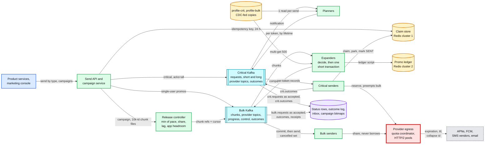

The six flows below are the ones to say from memory. Each is the final design.

### Flow 1: a chat push while the flash sale is sending, ~150 ms

1. 10:01:00.000: `POST /v1/notifications`, `chat_message`, key `m_991`. `SET NX` on the idempotency key, produce to the critical cluster with `acks=all`, `202` at ~10 ms.
2. ~30 ms: a planner reads it, one `profile-crit` read, renders, writes one record per token to `crit.apns`.
3. ~40 ms: the critical sender claims, takes a token from the critical reserve (untouched by the 100k/s campaign), sends on one of the 30 critical APNs connections with `apns-expiration` = 10:06:00 and collapse id `n_8f3a`.
4. ~150 ms: `200`. Mark `SENT`, outcome on `crit.outcomes`, offset. The campaign never touched the cluster, the cache, the connection or the quota slice this push used. Picture: [§5.2](#52-a-20m-user-campaign-is-mid-send-how-does-a-chat-push-still-reach-apple-or-google-in-under-a-second).

### Flow 2: the 20M flash sale at 10:00

1. 09:50: snapshot, 2,000 chunk files. 10:00:00: the controller computes the pace `20 M ÷ 150 s = 133k/s`, but app headroom caps it at ~100k/s (`p × k` = 1.0); the bulk FCM share (~250k deliveries/s) and the lag rule are looser. It ramps over 60 s.
2. Each chunk: 10k ids, multi-get `profile-bulk` 500 at a time, consent, night rule, quiet hours, the ledger script, records to `bulk.fcm` and `bulk.apns`, one Kafka transaction.
3. Bulk senders commit, then send at priority 5 or `NORMAL`, iOS expiration 0, FCM `ttl` to 12:00 (the earlier of the expiry and `send_by`, which at 10:00 is the expiry), `collapse_key: promo`, and the campaign id as `apns-collapse-id` and Android `tag`.
4. ~10:04: ~15.9 M pushed, ~4.1 M suppressed or deferred with reasons. The app holds near its 70% target from ~10:02 to ~10:08. Picture: [§5.6](#56-a-flash-sale-push-goes-to-20m-users-at-1000-release-rate-quiet-hours-the-korean-night-rule-caps-and-the-app-two-minutes-later).

### Flow 3: FCM is down from 20:00 to 20:30

1. 20:00:10: the critical and bulk FCM breakers open. Both FCM topics stop being consumed; records wait in Kafka. APNs, SMS and email are untouched.
2. Chat for online users still arrives over the chat service's socket. `payment_failed` sends its email after 60 s. OTP by push switches to SMS after 5 s.
3. 20:05 onward: chat pushes older than 5 minutes are dropped at dequeue as `expired` (~5.8 M by 20:30).
4. 20:30: probes succeed, half-open, ramp over 60 s. ~8.1 M live critical messages drain at up to ~270k/s in ~61 s including the ramp, the short-lived topic first: ~1.15 M chats arrive late but in time, ~2k expire in the queue. Then bulk resumes; promotions past their campaign's end are dropped. Picture: [§10.4](#104-failure-timeline).

### Flow 4: a critical sender dies right after APNs said 200

1. The claim says `SENDING`, lease 10 s. The process dies before marking `SENT` and before the offset commit.
2. ~10 s later the partition moves (static membership session timeout). The new owner reads the record, finds the lease expired, takes the claim as attempt 2, and sends with the same collapse id.
3. The phone replaces the notification in place (best effort: if the user dismissed the first in those ~10 s, it shows again). Picture: [§5.4](#54-a-worker-crashes-right-after-the-provider-accepted-the-message-how-do-you-avoid-a-second-otp-or-a-second-promotion-and-what-is-the-dedup-key).

### Flow 5: an OTP while SMS vendor A is down

1. The auth service sends `otp`, code 482913, lifetime 3 min; the planner fixes the code in the body. The SMS sender sends to vendor A with `ValidityPeriod = 168`; A times out after 2 s, so this one OTP goes to vendor B at once, same code. After 20 consecutive failures A's breaker opens and all OTP goes to B.
2. If vendor A had accepted the first attempt and recovers within 168 s, the user gets 482913 twice: same code, harmless. After 168 s vendor A drops it. Picture: [D5 in diagrams.md](diagrams.md#d5-failure-paths).

### Flow 6: a campaign at 21:30 KST

1. A recommendations campaign to 2 M users, window 21:30 to 22:00, expiry 09:00, `ad: true`. At creation the console showed that ~1.4 M lack night consent [estimate] and offered a morning window; marketing added 08:01 to 08:30. Without it, those 1.4 M would be suppressed with `night_rule`, because their legal deferral would fall outside the campaign's send window.
2. At release the expander sends now to the ~0.6 M with night consent (outside their own quiet hours) and defers the rest to the morning window, spread by user hash over 08:01 to 08:30, before the 09:00 expiry. Nobody without night consent is sent anything tonight. Caps are counted when the deferred chunk is decided in the morning.
3. Status shows `deferred night_rule`, then `sent` the next morning. Picture: [D6 in diagrams.md](diagrams.md#d6-activity--decision-flow).

---

## 7. Trade-offs

| Decision | Option A | Option B | Chose | Why |
|---|---|---|---|---|
| What picks the lane | The API that was called | The notification type | Type | A single-user advert is still an advert: consent, night rule, caps |
| Isolation | Priority field in one queue | Separate lanes at every resource we control | Lanes | APNs ignores HTTP/2 priority, Kafka has none, and the quota is shared. Cost: two Kafka clusters, two caches, two pools, ~20% more infrastructure |
| FCM quota between lanes | First come, first served, or a reserve alone | Critical reserve of 2x its peak, bulk never borrows, critical preempts bulk up to 270k/s within 2 s | Reserve plus preemption | A campaign must never 429 or queue a chat. At a 3x chat spike the reserve alone gives chat a p99 of 14.8 s; with preemption 0.76 s. Cost: up to 77k/s of quota idle most of the day, and a campaign that slows during a spike |
| Quota enforcement | One global counter | Coordinator leases, local token buckets | Leases | No 754k/s hot key; promotions fail closed, critical fails open |
| FCM contract | Ask for 45 M/min standing | 18 M/min standing, 53 M/min per named event | Standing + event | The app herd caps a busy 10:00 near ~100k flash-sale pushes/s (~333k ordinary), so a 45 M standing quota would buy speed we must not use |
| Campaign materialization | Enqueue 20M messages at start | Freeze, chunk, release at a computed rate | Chunks | Pause, cancel, fresh decisions, one-chunk re-runs |
| When to check preferences | At enqueue | At release, ≤ ~30 s before the send | Release | A 10:01 opt-out must stop a 10:20 send |
| Profile reads | DB, or read-through cache with TTL | Two full CDC-fed copies | Copies | No miss storm, opt-outs in ~1 s, campaign reads cannot slow chat reads |
| Crash window, critical | At most once | At least once, same collapse id | At least once | A lost OTP blocks a login; a duplicate replaces in place |
| Crash window, promotions | At least once with a claim per message | At most once, offset committed before send, retry buffer capped at 5k per node | At most once | A duplicate advert is a complaint; ~2.5k at risk per crash costs nothing; saves ~1.9M KV ops/s |
| Live lease on a re-read (critical) | Skip | Park until it expires | Park | Skip loses ~341 messages per fast restart, OTPs among them; parking costs ≤ 10 s |
| Critical provider topics | One per provider | Short and long lifetime classes | Two | After a 30-minute outage one FIFO topic lets ~198k live chats expire behind order pushes; short-first loses ~2k |
| Night rule for adverts | Our send time before 21:00 | What the phone shows: provider lifetime to `send_by`, iOS stop at 20:49 | The phone | With the TTL to campaign end, ~97k adverts per 2M users showed after 21:00 in simulation; capped, 0, for ~5% of reach |
| Cancel | Stop releasing | Also drop at the sender through `campaign-control`, check before each provider call, acknowledge the epoch | Both | ~3M pushes still leave after a cancel at 100k/s with 30 s queued, versus ~100k already handed to provider clients; `CANCELLED` only once every sender has acknowledged |
| Promotional dedup and caps | Two stores | One ledger script per user | One | One round trip, atomic, re-entrant per chunk |
| iOS promotions | `apns-expiration` = campaign end | `0` | 0 | APNs stores one notification per app; a promotion must not evict a stored order push. Cost: ~5 to 10% of iOS promotional reach |
| Provider down | Fail every push over to SMS | Per-type fallback from the registry | Registry | 30 minutes of FCM as SMS is ~$139k and exceeds both vendors' rate |
| Status | A row per delivery, updated per transition | Rows for single notifications, events and counters for campaigns | Split | Writes follow reads: ~1M row writes/s avoided at the peak |
| Campaign inbox | 20M rows per campaign | One bitmap, fan-out on read, on a dense `user_seq` | Bitmap | ~900M inbox writes a day avoided; ~1.2 GB of bitmaps in memory per node (~12 GB on sparse ids) |
| Delivered receipts | Every device | Sampled 1% for promotions | Sampled | 20M receipts a minute would be our own herd |
| Release rate | Fixed per campaign | Computed every second | Computed | The right number depends on organic load and live open rate |
| Build or buy | A vendor (Braze, OneSignal) | Build | Build | Vendors rate-limit per minute (Braze 10 to 500,000 a minute, secondary), do not know Korean consent records, and per-message pricing at ~640 M deliveries and ~1 B decisions a day dwarfs ~$100k a month of infrastructure [estimate]. Buying is right below ~10 M a day |
| Refused to build | Exactly-once on the device, FCM topics for campaigns, many Firebase projects to multiply quota, promotional SMS in the burst, per-recipient campaign inbox rows, a priority field as the isolation, hedged requests to providers, cross-channel ordering | | | Each costs more than it returns, or promises what the providers cannot deliver |

**Consistency model, stated once.** Caller to send API to the critical cluster: strong (durable on 2 of 3 replicas before `202`), idempotent by key. Preference write: read-your-writes in the app, eventual (~1 s p99) into both caches, so an opt-out binds every decision made ~1 s later. Critical claim: linearizable per key on one Redis primary (a failover can forget ~1 s of claims; the collapse id covers it); a live lease is waited out, never skipped. Promo ledger: atomic per user, on its own Redis cluster. Expander output: exactly-once inside Kafka. Sender to provider: at-least-once (critical), at-most-once (promotions). Status, outcome log, inbox: eventual, 1 to 5 s; critical outcomes travel on the critical cluster, and status merges by evidence. Campaign progress: exactly-once in Kafka, projected to the campaign DB within seconds.

---

## 8. Staff-level notes

- **Simplest thing that meets the requirement.** Two Kafka clusters, a stateless planner and expander, two senders that are the same binary with different policies, a quota coordinator that hands out leases, CDC-fed caches, Redis for claims and the ledger, and stock stores for status and inbox. We refused a per-delivery database row, a scheduler per message, FCM topics, a vendor, and exactly-once on the device (§7).
- **Failure modes and blast radius.**
  - A critical sender node: its partitions move in ~10 s; up to ~700 in-flight messages are resent with the same collapse ids. No loss. A fast restart as the same static member (~3 s) finds live leases and parks those records until they expire, ≤ 10 s late, none lost.
  - A bulk sender node: ~1.3k promotions lost and ~1.2k unknown (at most once), ~2.5k at risk; the retry buffer is capped at 5k so a crash in a 429 back-off loses at most ~6k. No resend.
  - An expander: its current chunk's transaction aborts and re-runs. No duplicate, no loss.
  - The release controller leader: ~10 s without new releases (lease), the topics hold ~30 s of work, so senders barely notice. A zombie leader is fenced by Kafka's producer epoch.
  - The claim store (its own Redis cluster): critical sends continue without claims (fail open), and the API falls back to the deterministic `notification_id`; a retry cannot extend `expires_at`, which comes from the caller's `created_at`, but the `409` check on a changed body is off, so it pages. The ledger (a separate cluster): campaigns pause (fail closed).
  - A profile cache: its lane stops deciding until it fails over to its replica (~10 s); the other lane is unaffected.
  - The critical Kafka cluster: the send API returns `503` and callers retry with the same key. This is the 99.99% dependency, so it is 3 AZs, RF 3, `min.insync.replicas=2`.
  - A provider: §5.5. Expired messages are dropped on purpose.
  - The region: the warm standby takes the critical lane with what the cross-region mirror had copied, so the RPO is the mirror lag (p99 under 2 s). Callers re-send everything without a terminal status from their own outbox with the same idempotency key; the standby's claim store starts empty, so those re-sends go through, the collapse id replaces any push that had already gone out, and `expires_at` from `created_at` drops anything past its life. Campaigns wait for the primary.
  - **Biggest blast radius:** a wrong campaign (wrong segment, wrong price) at 100k/s. In 60 s it reaches ~6M phones and cannot be recalled. Hence the second approver above 1M users, a 1% canary release with a 5-minute hold for campaigns over 5M (the controller releases 1% of chunks, then waits), a cancel that also reaches the senders: a cancel epoch on the compacted `campaign-control` topic, applied at dequeue and again immediately before each provider call, then acknowledged; the campaign stays `CANCELLING` until every sender has acknowledged, and only work already handed to provider clients (~1 s, ~100k) still leaves instead of ~3M, and a correction pushed with the campaign id as `apns-collapse-id` and Android `tag`, which replaces the wrong one on phones that still show it.
- **Migration from an existing system** (one queue, one worker pool, one Firebase project, campaigns as scripts):
  1. CDC-fed caches and the planner in shadow: decide every real send and compare with legacy's choice of channels and suppressions. Disagreements are bugs in one of the two.
  2. The quota coordinator in observe mode. Legacy gets a static FCM grant enforced by a client-side limiter, because both systems spend one project's quota.
  3. Critical types move one at a time by a per-type owner flag with an `effective_from` a minute ahead; both systems compare `accepted_at` to it, so each notification has exactly one sender. Order status first, chat next, OTP last.
  4. Campaigns move per campaign (one owner per campaign). Legacy writes its promotional sends into the new ledger through an adapter, so frequency caps count both systems.
  5. Legacy off after 2 weeks at 100%. Rollback at any step is the flag with a new `effective_from`. [D12](diagrams.md#d12-rollout--migration).
- **Operability.** SLOs over 28 days:
  - critical accepted to provider 200 under 1 s, p99, in 99.9% of 1-minute windows, measured separately while a provider breaker is open;
  - zero reconciler gaps on critical notifications;
  - 99% of campaigns finish inside their window when no breaker was open;
  - an opt-out reaches both caches within 5 s, p99.

  Pages at 3 AM:
  - critical p99 over 1 s for 5 minutes, or critical topic lag over 10 s;
  - any FCM 429 on the critical lane above 0.1% for 2 minutes (the reserve is breached or mis-sized);
  - a critical provider breaker open for 60 s;
  - critical `expired` above 0.5% for 5 minutes;
  - a reconciler gap above 0;
  - CDC lag to either cache over 60 s (campaigns already auto-paused at 30 s);
  - the ledger unavailable.

  Not a page: one campaign behind schedule (a ticket for marketing operations), a rise in APNs 410s (token hygiene).
- **Cost** [estimate, list prices, per month]: bulk senders ~$15k, critical, SMS and email senders ~$4.5k, expanders ~$7.5k, planners ~$2.3k, Kafka (15 brokers) ~$15k, Redis (four clusters: two profile copies, claim store, ledger; ~85 nodes with replicas) ~$25k, status store ~$15k, outcome log ~$6k, inbox ~$6k, egress (~17 TB) ~$0.9k. About **$100k a month, ~$1.2 M a year**. APNs and FCM charge nothing per message. **SMS is ~$1.3 M a month** (~4.3 M a day at ~$0.01) and transactional email ~$130k. The money decisions are the SMS fallback rules and the OTP channel, not the fleet. Team: a notification platform team of ~8.
- **Team boundaries.**
  - The notification platform team owns lanes, senders, the coordinator, status and the inbox backend.
  - Product teams own their types (registry entries by review), templates and idempotency keys.
  - Marketing technology owns the campaign console and the segment service.
  - Compliance owns the rule configuration (consent, night rule, disclosure) and the consent wording, which KISA says must name "광고성 정보 수신동의" (secondary).
  - Mobile platform owns the SDK: token registration, receipts, render-time expiry, the inbox UI.
  - App platform owns the headroom signal and pre-scaling for named events.
  - Vendor management owns FCM quota tickets and SMS contracts, from the platform team's forecast.
- **Explicit trade-off.** We accept ~5.8 M expired chat pushes in a 30-minute FCM outage, iOS promotions that skip offline phones, a few hundred resent critical pushes per sender crash, a few thousand lost promotions per bulk sender crash, and idle reserved quota. In return a campaign can never delay a chat, we never send after `expires_at` (provider expiry and render-time dropping are best effort), and a promotion is never sent twice.

---

## 9. What is expected at each level

**Mid (80/20 breadth/depth).** An API, a queue, workers per channel, a preferences table, templates, retries, a status table. Mentions APNs and FCM tokens and maybe rate limiting. Puts critical and promotional in one queue with a priority field, and treats 1M/s as a fleet size.

**Senior (60/40).** Separate queues for critical and promotional, campaign fan-out in batches, idempotency keys, dedup with a TTL, expiry checks, provider retries with backoff, per-provider workers, quiet hours and frequency caps, a token cleanup on 410. Goes deep on one of fan-out, dedup or provider failure. May not notice that the provider quota is shared, or that the app falls over after a big push.

**Staff+ (40/60).** Everything above, plus:
- asks "1M a second of what" and "80/20 of what" before drawing, and turns 1M/s into per-provider numbers (FCM 45 M/min, 75x default; APNs ~49k streams; SMS refused in the burst);
- separates the lanes at every resource including the quota, with a reserved critical slice and leases instead of a global counter;
- releases campaigns by a computed rate that includes the app's headroom, and decides per user at release;
- passes expiry to every provider in its own unit, knows FCM's 4-week and Twilio's 10-hour defaults, and why iOS promotions use expiration 0;
- picks the crash-window policy per lane (at least once with collapse ids, at most once with offset-first) and sizes the dedup TTL as lifetime plus skew;
- names the Korean advertising rules as data with an effective date;
- gives a migration that shares one Firebase project with legacy, and says what pages at 3 AM.

---

## 10. Nitty-gritty (past interview scope)

### 10.1 Internals of each chosen technology

**Kafka, two clusters.** Critical topics have 64 partitions keyed by `user_id`, RF 3 across AZs, `acks=all`, `min.insync.replicas=2`, `unclean.leader.election.enable=false`, so one broker loss loses nothing acknowledged. Consumers use the cooperative-sticky assignor with static membership (`group.instance.id`): a restarting node gets its partitions back without a group-wide pause. Planners and critical senders finish records out of order, so each commits a **low-water mark**: the lowest offset not yet resolved (the same rule as [`../webhook-delivery/`](../webhook-delivery/solution.md#101-internals-of-each-chosen-technology)). On the bulk cluster each expander is a consume-transform-produce **transaction**: a `transactional.id` per instance, a producer epoch that fences a zombie, and `sendOffsetsToTransaction` so a chunk's records, its `expanded` marker and the consumed offset commit together. Bulk senders read with `isolation.level=read_committed`, so an aborted chunk is never sent, and commit **before** sending. The trap: a read-committed consumer cannot read past the oldest open transaction on a partition (the last stable offset). If an expander produced as it decided, 30 expanders would always hold open transactions on every partition (the deep dive measured p50 0.75 s and 14% of records over 1 s with no fault at all), and one expander stuck in a GC pause would stall all 256 partitions for `transaction.timeout.ms`: 2,560 partition-seconds. Three choices make it small: **decide the chunk in memory, then write it in one ~30 ms transaction** (~10k records, ~3 MB buffered); **sort the frozen audience by partition block** (`(hash(user_id) mod 256) div 16`), so a chunk's records land on 16 partitions of each topic and the controller releases chunks round robin over the 16 blocks; and `transaction.timeout.ms = 10 s`, not the 60 s default. A hang now costs at most 160 partition-seconds, and commit markers drop from ~514 to ~34 per transaction. The release controller has one fixed `transactional.id`, so a new leader's `initTransactions` fences the old one.

**Redis, two separate clusters: the claim store (critical lane) and the promo ledger (bulk lane).** A ledger incident cannot take critical claims with it. One event loop per shard, so a Lua script is atomic for the keys it touches; 16,384 hash slots, keyed by `user_id` (the ledger) or `notification_id` (claims), so a user's or a notification's keys are on one shard. The **claim script**: `SET NX` with state `SENDING`, attempt and lease; on conflict, return `SENT` (re-publish the `sent` outcome from the provider id stored in the claim, then resolve; the status merge absorbs the repeat), `SENDING` with a live lease (**park** the record until `lease_until`, keep it unresolved so the low-water mark cannot pass it, then run the script again), or take over an expired lease with `attempt + 1`. The **ledger script**: drop entries older than 7 days; this campaign and chunk present means re-entrant, this campaign with another chunk means `DUP`; count today's and this week's promotional pushes for `CAPPED`; else append. AOF every second, one replica per shard in another AZ, `maxmemory-policy noeviction`: an evicted claim is a silent duplicate, so a full shard should fail loudly instead.

**APNs provider API.** HTTP/2 to Apple's gateway. With token auth, "APNs allows only one stream until you post a request with a valid authentication token", then multiple, with no number promised. Every sender presents **one** ES256 JWT minted by a small token service and refreshed every ~40 minutes; Apple returns `429 TooManyProviderTokenUpdates` if it changes more than once per 20 minutes, which is what 300 connections minting their own tokens would cause. (The one-hour JWT lifetime is unverified in the survey.) Responses: `410 Unregistered` carries a timestamp, and the token is deleted only if it was registered before it, so a reinstall that re-registered survives; `400 BadCollapseId` if the collapse id is over 64 bytes, so ours is a 22-character hash; `413` never retried.

**FCM HTTP v1.** One message per request, an OAuth 2.0 access token (secondary). The quota is a token bucket of 600k per minute by default, minutes not clock-aligned, and Google asks for a 60 s ramp. Per Android device: 240 a minute and 5,000 an hour, and collapsible messages burst 20 then refill one every 3 minutes. Because topics are keyed by `user_id`, all of a user's tokens are on one sender, so a per-token counter in memory enforces these with no shared state. A busy seller can receive ~170 order events a second, far over 240 a minute, so above 1 push a second per (user, type) the sender turns them into a digest every 10 s ("37 new orders") with one collapse id per type; the inbox keeps every row. The same sender keeps at most one in-flight push per (user, thread), so two chats 200 ms apart cannot arrive reversed. High priority can be lowered to normal for an app instance whose high-priority messages showed nothing for 7 days; v1 messages may be proxied through Google Play services (beta), which can cut delivery metrics by up to 15%.

**Twilio.** One Messaging Service per lane, each with its own `ValidityPeriod`. Above the account's throughput, messages queue for up to 10 hours, which is why every OTP carries its own validity. Korean text is UCS-2: 70 characters in one segment, 67 per part, billed per segment (secondary).

```mermaid
%% Inside one sender node, one provider, one lane. The local token bucket is fed by the coordinator's lease. The bucket is red: it is where provider egress is rationed, and the first thing to run dry.
flowchart LR
    T[[Provider topic<br/>partitions owned]] -->|"fetch batch"| EXP{now + margin<br/>past expiry?}
    EXP -->|"yes"| OUT1[outcome expired]
    EXP -->|"no"| CL{Lane policy}
    CL -->|"critical, claim NX"| TB[Local token bucket<br/>lease from coordinator]
    CL -->|"bulk, commit offset first"| TB
    TB -->|"permit"| DEV{Per-token limiter<br/>240 per min}
    DEV -->|"ok"| POOL[HTTP/2 pool<br/>in-flight cap, breaker]
    POOL -->|"request"| PRV[APNs or FCM]
    PRV -->|"status, reason"| CLS{Classify<br/>200, 4xx, 410, 429, 5xx}
    CLS -->|"outcome, token delete,<br/>retry or fallback"| OUT2[[outcomes,<br/>crit.retry.15m]]

    class EXP,CL,DEV,CLS decision
    class TB critical
    class POOL service
    class OUT1 store
    class T,OUT2 queue
    class PRV external

    classDef service  fill:#dcfce7,stroke:#16a34a,stroke-width:2px,color:#111
    classDef store    fill:#ede9fe,stroke:#7c3aed,stroke-width:2px,color:#111
    classDef queue    fill:#cffafe,stroke:#0891b2,stroke-width:2px,color:#111
    classDef critical fill:#fee2e2,stroke:#dc2626,stroke-width:4px,color:#111
    classDef external fill:#e5e7eb,stroke:#6b7280,stroke-width:2px,color:#111,stroke-dasharray:4 3
    classDef decision fill:#fce7f3,stroke:#db2777,stroke-width:2px,color:#111
```

The release controller and the expander's per-user decision are drawn in [D6](diagrams.md#d6-activity--decision-flow); the coordinator's hot-key fix in [D10](diagrams.md#d10-scaling--partitioning).

### 10.2 Configuration knobs that matter

| Component | Knob | Value | Why |
|---|---|---|---|
| Kafka, both | `acks`, `min.insync.replicas`, unclean election | `all`, 2, off | No acknowledged loss on one broker failure |
| Kafka, critical | partitions, retention | 64 per topic, 24 h | ~800/s per partition at peak; a day covers any outage we survive |
| Kafka, bulk | per-provider partitions, compression, retention | 256, `zstd`, 24 h | ~2.8k records/s per partition at 1M/s; compact records compress ~4x |
| Consumers | assignor, static membership, `session.timeout.ms` | cooperative-sticky, on, 10 s | Deploys without pauses; a crash is noticed in 10 s, which sets the critical resend delay |
| Critical claim | lease | 10 s | Longer than the 2 s request timeout; short enough to resend chat in time |
| Senders | timeout critical, bulk | 2 s, 5 s | §5.5 |
| Breaker | open, probe, close | ≥ 50% of ≥ 200 in 10 s, or 20 consecutive failures, or critical p99 > 2 s; 1% every 5 s; 30 s clean | §5.5 [estimate] |
| Critical FCM pool | streams, connections | ~40k, ~160 | One second of the critical peak; saturates only at a mean latency of ~1 s |
| Quota | critical reserve, margin, lease, preemption | 2x critical peak, 10%, 2 s; critical may take up to `Q − margin` when its demand +20% exceeds the reserve | §5.1 |
| Quota, bulk | ramp, back-off on 429 | 0 to share in 60 s; halve for 30 s when ≥ 0.5% of requests in 1 s across ≥ 100 tokens get 429, then +5% a second | FCM's ramp guidance; one device's 429 must not halve the lane |
| Bulk sender | retry buffer | 5k records per node, fetch paused when full | Bounds what a crash in a 429 storm can lose |
| Release controller | pace, lag cap, back-off | `audience ÷ (0.5 × window)`, 30 s of work, halve at 75% app use and hold 2 min | §5.6 |
| Expander | chunk, sub-batch, partition block | 10k ids, 500, 16 of 256 partitions | Decide in memory, then one ~30 ms transaction per chunk; one multi-get per sub-batch |
| Expander | `transaction.timeout.ms` | 10 s | A hung open transaction holds back the last stable offset for every bulk sender (§10.1) |
| Expiry | margins | push 1 s, chat 10 s, SMS 30 s, email 5 min | §5.3 |
| Night rule | guard, `send_by`, iOS stop, morning release | 20:58, 20:59:30, 20:49 [estimate], 08:01 to 08:30 KST | §4.3 |
| Redis | persistence, eviction | AOF every second, `noeviction` | An evicted claim is a silent duplicate |

### 10.3 Capacity math per component

| Component | Per unit | At the 1M/s peak | Closest to its limit? |
|---|---|---|---|
| **FCM project quota** | 600k/min default; 18 M/min standing | 754k/s needed | **Yes, by far.** 75x the default, 2.5x the standing contract. Only an event quota reaches 1M/s |
| App API (herd) | ~500k req/s, ~250k organic at a sale | `R × p × k`, 1.0 for a flash sale | **Yes, at a busy 10:00**: ~100k flash-sale pushes/s |
| APNs pools | ~250 streams per connection [estimate] | 49k streams ÷ 300 connections = 163 each | No, 65% |
| Bulk sender node | ~20k messages/s | 1.02 M ÷ 60 = 17k | 85%; losing an AZ leaves `40 × 20k = 800k/s`, so the bulk pace drops ~20%, by design |
| Critical sender node | ~20k messages/s | 55k ÷ 12 = 4.6k | No, 23%: it is sized for isolation and 3x bursts |
| Expander node | ~40k deliveries/s | 929k ÷ 30 = 31k | 77% |
| Ledger shard | ~50k scripts/s [estimate] | 929k ÷ 24 = 39k | 77% at the peak only |
| `profile-bulk` node | ~100k reads/s | 929k ÷ 15 = 62k | 62% |
| Kafka bulk broker | ~100 MB/s in | ~306 MB/s raw ÷ 4 compression × 3 replicas ÷ 9 = 26 MB/s | No |
| Claim store shard | ~100k ops/s | 160k ÷ 8 = 20k | No; memory (~65 GB) sets the shard count |
| Status writer | ~50k upserts/s per node | ~71k/s from `crit.outcomes` | No, 3 nodes |
| Critical FCM pool | ~40k streams | ~4.6k in flight at a 0.12 s mean | No; full only at a mean latency of ~1 s |
| Egress | NAT ~45 Gbps per gateway [estimate] | ~9 Gbps | No, but kept per lane |

### 10.4 Failure timeline

**(1) FCM goes down for 30 minutes at 20:00.**

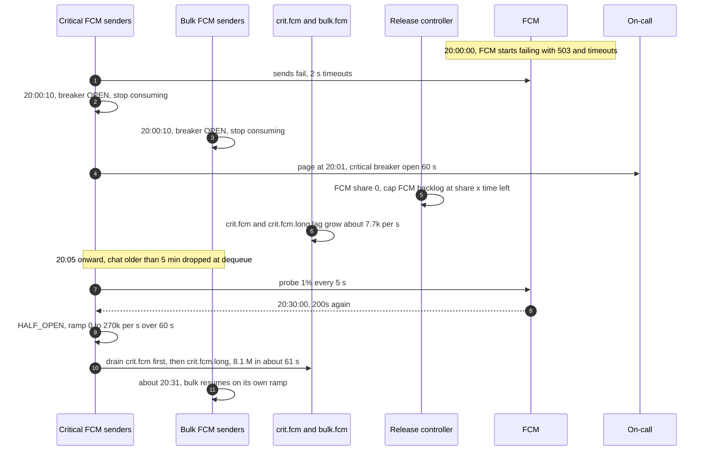

Detection ~10 s. Data at risk: none (Kafka holds 24 h). Dropped by design: ~5.8 M chat pushes already expired at 20:30, ~2k more that expire in the queue, promotions past their campaign's end. Users see: chats in the app as usual (socket), order pushes ~30 minutes late, inbox current throughout. On-call sees: one page, the breaker, then the drain.

**(2) The release controller leader dies mid-campaign.** ~10 s without releases while the lease expires, a new leader takes it, reads the cursor from `campaign-progress`, and continues; the topics hold ~30 s of work, so senders stay busy. Sequence in [D5](diagrams.md#d5-failure-paths).

**(3) A critical sender dies after APNs said 200.** §5.4.

**(4) The region is lost.** Detection by health checks and a human decision, minutes. Data at risk: critical notifications accepted in the last mirror-lag window, p99 under 2 s of traffic (~10k at the 5k/s average, ~100k at the 50k/s peak). Recovery: the standby resumes from translated offsets, re-sending minutes of critical work (same collapse ids), and callers re-send their non-terminal sends from their outboxes with the same keys. What the user sees: some pushes twice (replaced in place), none lost that is still alive. Campaigns resume when the primary returns.

### 10.5 Exactly-once and idempotency end to end

| Hop | Duplicates can enter? | Removed where | Key | Lives |
|---|---|---|---|---|
| Caller to send API | Yes, caller retries | API, and by construction | `(caller, idempotency_key)`, `notification_id = hash` of it | 24 h |
| Planner to per-token topics | Yes, planner crash before commit | Critical sender claim | `(notification_id, channel, token hash)` | lifetime + 5 min |
| Critical sender to provider | Yes, crash after 200 | Device, by collapse id | `apns-collapse-id`, FCM `tag` | provider side |
| Controller to `bulk.chunks` | No, Kafka transaction; yes after a manual re-release | Expander skips chunks with an `expanded` marker, read after catching up to the chunk's release offset | `(campaign, chunk)` | compacted |
| Expander to bulk topics | No, Kafka transaction | n/a | transactional id and epoch | n/a |
| Expander re-run after abort | Ledger re-entry | Ledger script | `(user, campaign, chunk)` | 7 days |
| Bulk sender to provider | No, offset before send (at most once) | n/a | n/a | n/a |
| Outcomes to status store | Yes, on replays | Merge by evidence: opened > delivered > sent > expired = failed = unknown > accepted | `(notification_id, channel, state)` | 30 days |

### 10.6 Consistency model per edge

| Edge (final design) | Model | Notes |
|---|---|---|
| Caller to send API to critical Kafka | Strong, then `202` | 2 of 3 replicas; idempotent by key |
| Campaign service to campaign DB | Strong | Postgres |
| Release controller to `bulk.chunks` and `campaign-progress` | Exactly-once within Kafka | One transaction; zombie fenced |
| Preference DB to both caches | Eventual, ~1 s p99 | Campaigns pause at 30 s of lag |
| Planner and expander to caches | Read from a copy | Fresh to ~1 s; decisions ≤ ~30 s before send |
| Planner to claim store | Linearizable per key | A failover can forget ~1 s; collapse ids cover it |
| Expander to ledger | Atomic per user | Script on one shard |
| Expander to bulk topics | Exactly-once within Kafka | With the chunk marker and offset |
| Critical sender to provider | At-least-once | Same collapse id |
| Bulk sender to provider | At-most-once | Offset before send |
| Critical senders to `crit.outcomes`, bulk senders to `outcomes`, then status, log, inbox | Eventual, 1 to 5 s | Merge by evidence; critical outcomes never wait behind a campaign's |
| Campaign bitmap to inbox | Eventual, seconds | Built from expander output |

### 10.7 Alternatives rejected

| Alternative | Why it looked attractive | Why rejected |
|---|---|---|
| One queue with a priority field | Simple | §5.2: the quota, connections and brokers are still shared |
| FCM topics for campaigns | One call for millions | ~10k QPS per project, not adjustable; no consent, caps, dedup or status per user (§5.1) |
| Many Firebase projects to multiply the quota | 600k a minute each | Tokens belong to a sender; no documented policy; the app would hold one token per project |
| SQS or a queue per channel (Airbnb's OMNI uses SQS) | Managed | Fine for the critical lane's volume; the bulk lane needs transactions with chunk markers and per-provider ordering by user, which Kafka gives |
| Redis global rate counter | Exact | A 754k/s hot key; leases give the same bound with local checks |
| Durable workflow per campaign (Temporal) | Retries and timers built in | One workflow is fine; the per-user work inside it is still a 1M/s data plane ([`../../concepts/temporal-durable-execution.md`](../../concepts/temporal-durable-execution.md)) |
| Claim per promotional message | Symmetric with critical | ~1.9M KV ops/s to turn a duplicate into a loss we can get by committing first |
| Inbox row per campaign recipient | Uniform reads | ~900M writes a day, almost all unread |
| Hedged provider requests for critical | Cuts tail latency | Doubles load on a provider that is already slow; collapse ids would hide duplicates but not the load |
| A vendor (Braze, OneSignal, AWS End User Messaging) | No team | Per-minute rate limits, no Korean consent model, per-message pricing at ~640 M deliveries and ~1 B decisions a day |

### 10.8 How the big companies do it

- **Uber's push platform (RAMEN):** three priority buckets, TTLs "from a few seconds to up to 30 minutes", persisted and retried until TTL; ~70k pushes/s over 600k streaming connections at first, later 250k/s over 1.5M. Same idea as our lanes plus expiry; they own the connection to the device, we rent APNs and FCM.
- **LinkedIn's Air Traffic Controller:** separates deciding from sending ("does not send the notification itself"), over a billion requests a day, member messaging under a second on high-priority Kafka topics while a daily batch of ~100M tolerates hours. That is our planner and expander versus senders, and our two lanes.
- **Airbnb's OMNI:** nearly 50 B communications a year, typically under 30 s end to end, SQS queues per channel. A latency target 30x looser than our critical lane.
- **Groupon:** almost half a billion push notifications a day, campaigns of ~60M users inside a 2-hour window. The same rate-over-a-window shape as our campaigns.
- Netflix's RENO (~150k events/s, secondary) drops stale events and merges duplicates: expiry and dedup again.

### 10.9 Operational runbook

**Dashboards, the 5 metrics.**
1. Critical accept to provider 200, p50 and p99, per provider.
2. Quota use per provider and lane: reserve used, borrowed, bulk share, 429 rate.
3. Lag per topic in seconds of work, both clusters.
4. Outcome mix per type: sent, expired, failed by reason, suppressed by reason.
5. App utilization and measured `p × k` per live campaign, next to its release rate.

**Alerts.** As in §8. Owner: the notification platform on-call; app platform for the headroom signal; vendor management for a quota ticket.

**Rollout.** Senders and planners: 1 node for 30 minutes, gated on the critical p99, 4xx rate within 0.5 points of baseline, and zero claim-store errors; then 1 AZ, then all. Critical and bulk deploy on separate trains, never the same hour. Rule configuration: shadow mode for 24 h (log what would change), then on with an effective date.

**Rollback.** Code: redeploy. A bad rule that suppressed too much: fix and re-run the affected campaigns' suppressed users as a new campaign (the ledger stops repeats). A bad rule that sent too much: cannot be recalled; send a correction with the same collapse id.

### 10.10 Security and abuse

- **Auth boundary.** mTLS service identity; a per-caller allowlist of types (chat cannot send `price_drop`, marketing cannot send `otp`); a per-caller rate limit applied before the idempotency `SET NX`, so one buggy caller cannot spend the critical reserve or load the claim store; single-user promotional types (a flood of `price_drop` from a bad model release) get their own API instance pool behind the same hostname, so even the rejections stay off the critical pool.
- **Content.** Templates are versioned and reviewed; variables are escaped; advertising templates must pass the disclosure check. Payloads pass through Apple and Google, so no secrets: an OTP body is acceptable by product decision, a chat preview obeys the user's "show previews" setting.
- **OTP.** Codes never logged; the outcome log stores a hash of the body.
- **Tokens.** Registration needs a user session; a token moves to a new user on re-registration (a shared tablet), so a 410 or a logout removes the old binding.
- **Fan-out bugs.** The per-token limiter (240 a minute on Android), the per-(user, type) digest above 1 a second, and the per-user caps stop a loop before the provider does.
- **Campaign abuse.** A second approver above 1M users, the 1% canary, and a kill switch that stops releases and reaches every bulk sender through a cancel epoch on `campaign-control`, checked before each provider call and acknowledged by every sender before the campaign shows `CANCELLED`; only work already handed to provider clients (~1 s per sender) still leaves.

### 10.11 Evolution

- **10x (~6 B deliveries a day, a 10M/s peak).** Only with provider contracts that do not exist today; our side scales by partitions and nodes. The seam is the coordinator's per-account quota.
- **Multi-region.** Today: one region, 3 AZs, warm standby with Kafka mirrored (RPO = mirror lag, p99 under 2 s, recovered by callers re-sending from their outboxes). Active-active would split users by home region; the seam is `user_id` to region at the send API.
- **New channel: Kakao AlimTalk** for order and payment messages (informational only; event or coupon content is not allowed, secondary). A sender behind the same interface, its own breaker and quota account, registry entries per type.
- **Deletion requests.** Profiles, tokens and ledger entries are keyed by `user_id`; status and inbox rows expire in 30 days, the outcome log in 90 and is deleted by `user_id`. A deleted user's profile is a tombstone, so the inbox filters them at read; their `user_seq` is retired for 7 days, longer than any live bitmap, so an old bitmap can never show a campaign to a new user.
- **Send-time optimization.** Per-user best hour as a deferral rule in the expander; the controller already handles deferred chunks.
- **More Firebase projects**, if Google documents it: the coordinator already treats a provider account as the unit.

---

## 11. Follow-up questions to expect

Ranked by how likely an interviewer asks them. Answers in [`edge-cases.md`](edge-cases.md) and the deep dives.

1. **1M a second of what, and where does it bind?** §1, §2, §5.1, [`deep-dives/provider-egress-and-quotas.md`](deep-dives/provider-egress-and-quotas.md).
2. **A campaign is mid-send. How does chat stay under 1 s?** §5.2, Flow 1, [`deep-dives/priority-lanes-and-isolation.md`](deep-dives/priority-lanes-and-isolation.md).
3. **Crash after the provider's 200: second OTP? second promotion? key and TTL?** §5.4, Flow 4, [`deep-dives/expiry-dedup-and-retries.md`](deep-dives/expiry-dedup-and-retries.md).
4. **FCM down for 30 minutes?** §5.5, §10.4, Flow 3, [`deep-dives/provider-egress-and-quotas.md`](deep-dives/provider-egress-and-quotas.md).
5. **Flash sale to 20M at 10:00: rate, herd, caps, night rule?** §5.6, Flow 2, Flow 6, [`deep-dives/campaign-fan-out-and-scheduling.md`](deep-dives/campaign-fan-out-and-scheduling.md), [`deep-dives/preferences-and-compliance.md`](deep-dives/preferences-and-compliance.md).
6. **Who enforces expiry, and what does APNs do with a late one?** §5.3, [`deep-dives/expiry-dedup-and-retries.md`](deep-dives/expiry-dedup-and-retries.md).
7. **Why not FCM topics, or a priority queue?** §5.1, §5.2, §10.7, [`deep-dives/priority-lanes-and-isolation.md`](deep-dives/priority-lanes-and-isolation.md).
8. **How do users see status and the inbox without 20M writes per campaign?** §4.4, [`deep-dives/status-tracking-and-inbox.md`](deep-dives/status-tracking-and-inbox.md).
9. **An opt-out at 10:00:01 during a campaign?** §4.3, [edge case](edge-cases.md#edge-case-a-user-opts-out-at-100001-while-a-campaign-is-sending).
10. **How do you prove an accepted OTP was not lost?** §5.4, the reconciler, and why a fast restart must park, not skip: [edge case](edge-cases.md#edge-case-a-critical-sender-pod-restarts-in-3-s-as-the-same-static-member).
11. **What does this cost, and what is the expensive part?** §8: SMS, not the fleet.
12. **How would you migrate from the legacy sender sharing one Firebase project?** §8, [D12](diagrams.md#d12-rollout--migration), [edge case](edge-cases.md#edge-case-migrating-from-a-legacy-sender-on-the-same-firebase-project).
