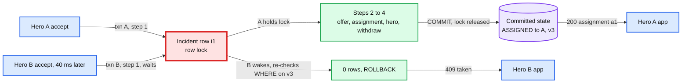
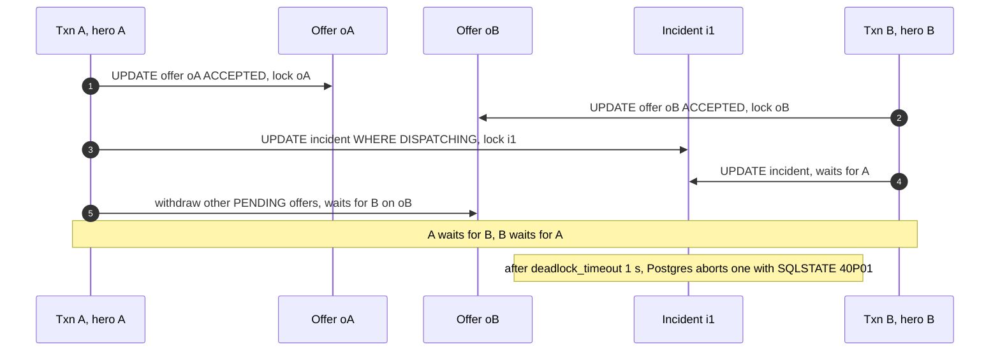

# Deep dive: the accept race and the assignment store

> One-line answer: the accept is **one Postgres transaction under READ COMMITTED that locks the incident row first** with `UPDATE incident ... WHERE state = 'DISPATCHING'`. A second hero's identical `UPDATE` waits on the row lock, re-checks its `WHERE` clause against the committed row once the first commits, finds `ASSIGNED`, and updates 0 rows. That is the whole race, with no retry loop and no SERIALIZABLE. The same transaction accepts the offer, inserts the assignment, marks the hero `BUSY`, withdraws the other offers and wakes the task row that sends "taken" notices. Two partial unique indexes (`one active assignment per incident`, `one per hero`) make a double assignment impossible even when the code is wrong. The accept is idempotent per `offer_id`, so a lost response or an in-doubt commit is handled by retrying and re-reading. DynamoDB `TransactWriteItems` can do the same job and is a correct answer too. It loses here on fit, not on correctness.

Zoom-in on [`../solution.md`](../solution.md) §4.3, §5.1 and §10.1. Reusable blocks: [`../../../concepts/mvcc-and-isolation.md`](../../../concepts/mvcc-and-isolation.md) (row versions, isolation levels), [`../../../concepts/exactly-once.md`](../../../concepts/exactly-once.md) (idempotency keys), [`../../../concepts/leases-fencing-clocks.md`](../../../concepts/leases-fencing-clocks.md) (why a lock is not the record, fencing tokens). Siblings: [`reliable-dispatch-start.md`](reliable-dispatch-start.md) (the task row that sends the notices), [`incident-state-machine-and-stuck-detection.md`](incident-state-machine-and-stuck-detection.md) (every other transition uses the same lock order).

---

## 1. What has to be true

Two invariants, not one:

| Invariant | Breaks when | Enforced by |
|---|---|---|
| At most one **active** hero per single-hero incident | Two heroes accept at once, a dispatcher assigns while a hero accepts | Guarded `UPDATE` on the incident row, plus `one_active_per_incident` |
| At most one active incident per **hero** | A hero accepts i1 while a dispatcher hand-assigns them to i2 | Guarded `UPDATE` on the hero row, plus `one_active_per_hero` |

The numbers are small. ~8.3 incidents/s at peak, ~5 offers each, and a contested accept (two taps inside the same ~50 ms) on a few percent of incidents [estimate]. So the race is rare per incident but happens many times a day. A design that is wrong 1 time in 10,000 races double-assigns an emergency every few weeks.

---

## 2. The transaction, step by step

```sql
BEGIN;  -- READ COMMITTED, the Postgres default
-- 1. lock the incident FIRST. Every writer that touches an incident starts here.
UPDATE incident SET state = 'ASSIGNED', assigned_hero_id = $hero, version = version + 1
 WHERE incident_id = $inc AND state = 'DISPATCHING'
 RETURNING version;                                   -- 0 rows: ROLLBACK, 409 taken
-- 2. this hero's offer must still be pending
UPDATE offer SET state = 'ACCEPTED', responded_at = now()
 WHERE offer_id = $offer AND hero_id = $hero AND incident_id = $inc AND state = 'PENDING';
                                                      -- 0 rows: ROLLBACK, 409 expired
-- 3. the record. Partial unique indexes reject a 2nd active row per incident or per hero.
INSERT INTO assignment (assignment_id, incident_id, hero_id, offer_id, active)
VALUES ($a, $inc, $hero, $offer, true);
UPDATE hero SET status = 'BUSY', current_assignment_id = $a
 WHERE hero_id = $hero AND status = 'AVAILABLE';       -- 0 rows: ROLLBACK, 409 busy
-- 4. close the other offers, wake the task to send "taken" notices, write history
UPDATE offer SET state = 'WITHDRAWN' WHERE incident_id = $inc AND state = 'PENDING';
UPDATE dispatch_task SET due_at = now() WHERE incident_id = $inc;
INSERT INTO incident_event (incident_id, version, from_state, to_state, actor)
VALUES ($inc, $v, 'DISPATCHING', 'ASSIGNED', $hero);
COMMIT;
```



Cost: 7 statements, one round trip each from the API pod, ~1 to 2 ms each in-AZ plus one sync-standby flush at commit. ~6 ms p50, ~40 ms p99 (solution §5.3). Lock hold time on the incident row is the whole transaction, ~5 ms. Even a 5-hero pile-up on one incident clears in ~25 ms.

---

## 3. Why READ COMMITTED is enough

The mechanism, in Postgres terms:

1. Txn A's `UPDATE` finds row i1, takes a row-level lock (it writes its transaction id into the row version's `xmax`), and writes a new version.
2. Txn B's `UPDATE` finds the same row, sees A's lock, and waits on A's transaction id.
3. A commits. B wakes. Under READ COMMITTED, B does not give up and does not use its old snapshot for this row. It fetches the **newest committed version** of i1 and re-evaluates the `WHERE` clause on it. Postgres calls this the EvalPlanQual recheck.
4. The new version says `ASSIGNED`. The predicate is false. B skips the row: `UPDATE 0`.

One caveat matters: the set of candidate rows is fixed when B's statement starts. A new row inserted after that is not seen. Our update targets one existing row by primary key, so the caveat does not apply. It would apply to a predicate like "assign me to any open incident nearby", which is why the hero never picks the incident: the incident is always named.

| Isolation | What B gets | What the API must do | Verdict |
|---|---|---|---|
| READ COMMITTED (default) | `UPDATE 0` after A commits | Return `409 taken` | **Chosen** |
| REPEATABLE READ | `ERROR: could not serialize access due to concurrent update` | Catch SQLSTATE 40001, retry, the retry sees `ASSIGNED`, return `409` | Same outcome, one extra round trip |
| SERIALIZABLE | Same 40001 error, plus possible aborts from unrelated read/write dependencies | Retry loop for every transaction, tuned and tested | Strongest, and pure cost here |

**Push back on the textbook answer.** "Use SERIALIZABLE to be safe" sounds careful. For a single named row guarded by its own state, it changes nothing about who wins and adds a retry loop that someone will get wrong. Reach for SERIALIZABLE when the invariant spans rows you do not lock, for example "no more than 3 heroes from one station busy at once". Here every invariant is either one row's state or a unique index.

---

## 4. The deadlock you get with the wrong lock order

Suppose each accept updated its own offer before the incident.



- It "works": Postgres detects the cycle after `deadlock_timeout` (1 s) and aborts one. The survivor commits. But every contested accept now costs ~1 s and an error in the logs, and the aborted hero needs a retry path to learn that they lost.
- **The fix is a convention, enforced in one place.** Every transaction that touches an incident takes locks in the order **incident, then offers, then assignment, then hero, then task**. All of them go through one `transition()` function in the Dispatch API. No other code writes `incident.state`.
- **Keep the alarm.** Alert on any `40P01` in the dispatch database. With the order respected it should never fire, so a firing means someone wrote a new code path.

---

## 5. Constraints as the backstop

```sql
CREATE UNIQUE INDEX one_active_per_incident    ON assignment (incident_id) WHERE active;
CREATE UNIQUE INDEX one_active_per_hero        ON assignment (hero_id)     WHERE active;
CREATE UNIQUE INDEX one_pending_offer_per_hero ON offer (hero_id)          WHERE state = 'PENDING';
CREATE UNIQUE INDEX offer_once                 ON offer (incident_id, hero_id);
```

- A partial index holds only rows matching its predicate. Uniqueness is checked against other live rows in that index at insert or update time. If two transactions both try to insert an active assignment for i1, the second blocks on the first's index entry and then fails with `unique_violation` (SQLSTATE 23505) when the first commits.
- **Why both layers.** The `WHERE state = 'DISPATCHING'` guard is the fast, friendly path: it gives a clean `409 taken`. The index is the guarantee: a future code path that forgets the guard (a new "dispatcher quick-assign" button, a migration script) still cannot create a second active assignment.
- **Count the backstop firing.** `unique_violation` on `one_active_*` should be 0. Any non-zero count means code attempted a double assignment and the DB refused it. That is a bug report with no customer impact, and it pages (solution §8).

---

## 6. Partial failure, one row each

| What happens | What the hero sees | Why it is safe |
|---|---|---|
| Commit succeeds, response lost | App retries `accept oA`, gets the same `200 {assignment_id}` | Idempotent per offer: step 1 updates 0 rows, then the API looks for an active assignment with `offer_id = oA` and returns it |
| API pod dies mid-transaction | Retry runs the transaction fresh | No commit, connection drop, Postgres rolls back |
| Primary dies at the moment of commit | Retry after failover gets the true answer | Sync standby (`ANY 1 (b, c)`): an acked commit is on the promoted node. An unacked one may or may not be. The retry re-reads, never assumes |
| Retry lands while the original is still in flight | Retry blocks on the incident lock, then re-reads | The "already won?" check runs **after** the guarded update returns 0, in a new statement with a fresh snapshot, so it sees the original's commit |
| Accept races offer expiry | One wins | Expiry is the worker locking the incident first and moving `PENDING -> EXPIRED`. No `now()` comparison in the accept |
| Accept races dispatcher cancel | One wins | Same lock, same rule. Loser gets `409 cancelled` |
| Hero accepts on two phones | One card, one assignment | Same `offer_id`, so the second is the retry case |
| A paused dispatch worker wakes after its lease expired | Nothing | Worker writes end with `UPDATE dispatch_task ... WHERE attempt = $mine`. 0 rows fences it and rolls back its transaction. The accept never takes the task lease, so a hero is never blocked by a worker |

**The "taken" notice path.**
1. Step 4 of the winner's transaction moves every other `PENDING` offer to `WITHDRAWN` and sets the task's `due_at = now()`.
2. After commit, the API does a best-effort immediate send to the losers (fast path, ~100 to 300 ms).
3. A worker claims the woken task and sends a "taken" notice for every `WITHDRAWN` offer with `notice_sent_at IS NULL`, then sets `notice_sent_at`. A crash in between resends, and the app ignores notices for cards it already dropped.
4. A hero app that reconnects calls `GET /hero/me/offers` and drops dead cards. Push is never the only path.

---

## 7. Try it: two psql sessions

Paste the setup into one session. It needs Postgres 13 or later (`gen_random_uuid` is built in). The `p_pause` argument exists only to hold the lock long enough to race by hand.

```sql
DROP TABLE IF EXISTS incident_event, assignment, offer, dispatch_task, incident, hero CASCADE;
CREATE TABLE hero (hero_id text PRIMARY KEY, status text NOT NULL, current_assignment_id uuid);
CREATE TABLE incident (incident_id text PRIMARY KEY, report_id uuid NOT NULL UNIQUE,
  state text NOT NULL, version int NOT NULL DEFAULT 1, assigned_hero_id text REFERENCES hero);
CREATE TABLE dispatch_task (incident_id text PRIMARY KEY REFERENCES incident,
  due_at timestamptz NOT NULL DEFAULT now(), attempt int NOT NULL DEFAULT 0);
CREATE TABLE offer (offer_id text PRIMARY KEY, incident_id text NOT NULL REFERENCES incident,
  hero_id text NOT NULL REFERENCES hero, state text NOT NULL DEFAULT 'PENDING',
  responded_at timestamptz, UNIQUE (incident_id, hero_id));
CREATE UNIQUE INDEX one_pending_offer_per_hero ON offer (hero_id) WHERE state = 'PENDING';
CREATE TABLE assignment (assignment_id uuid PRIMARY KEY DEFAULT gen_random_uuid(),
  incident_id text NOT NULL REFERENCES incident, hero_id text NOT NULL REFERENCES hero,
  offer_id text NOT NULL REFERENCES offer, active boolean NOT NULL DEFAULT true);
CREATE UNIQUE INDEX one_active_per_incident ON assignment (incident_id) WHERE active;
CREATE UNIQUE INDEX one_active_per_hero     ON assignment (hero_id)     WHERE active;
CREATE TABLE incident_event (incident_id text REFERENCES incident, version int,
  from_state text, to_state text, actor text, PRIMARY KEY (incident_id, version));

INSERT INTO hero VALUES ('hA', 'AVAILABLE', NULL), ('hB', 'AVAILABLE', NULL);
INSERT INTO incident (incident_id, report_id, state, version) VALUES ('i1', gen_random_uuid(), 'DISPATCHING', 2);
INSERT INTO dispatch_task (incident_id) VALUES ('i1');
INSERT INTO offer (offer_id, incident_id, hero_id) VALUES ('oA', 'i1', 'hA'), ('oB', 'i1', 'hB');

CREATE OR REPLACE FUNCTION accept_offer(p_offer text, p_hero text, p_pause float DEFAULT 0)
RETURNS text LANGUAGE plpgsql AS $$
DECLARE v_inc text; v_ver int; v_a uuid;
BEGIN
  SELECT incident_id INTO v_inc FROM offer WHERE offer_id = p_offer AND hero_id = p_hero;
  IF v_inc IS NULL THEN RETURN 'not your offer'; END IF;
  BEGIN
    -- 1. incident first
    UPDATE incident SET state = 'ASSIGNED', assigned_hero_id = p_hero, version = version + 1
     WHERE incident_id = v_inc AND state = 'DISPATCHING' RETURNING version INTO v_ver;
    IF NOT FOUND THEN
      -- new statement, fresh snapshot: did this hero already win with this offer?
      SELECT assignment_id INTO v_a FROM assignment WHERE offer_id = p_offer AND active;
      IF FOUND THEN RETURN 'ok (retry) ' || v_a; END IF;
      RETURN 'taken';
    END IF;
    PERFORM pg_sleep(p_pause);                       -- demo only: hold the lock
    -- 2. offer
    UPDATE offer SET state = 'ACCEPTED', responded_at = now()
     WHERE offer_id = p_offer AND state = 'PENDING';
    IF NOT FOUND THEN RAISE EXCEPTION 'expired'; END IF;
    -- 3. record and hero
    INSERT INTO assignment (incident_id, hero_id, offer_id) VALUES (v_inc, p_hero, p_offer)
      RETURNING assignment_id INTO v_a;
    UPDATE hero SET status = 'BUSY', current_assignment_id = v_a
     WHERE hero_id = p_hero AND status = 'AVAILABLE';
    IF NOT FOUND THEN RAISE EXCEPTION 'hero busy'; END IF;
    -- 4. withdraw others, wake the task, history
    UPDATE offer SET state = 'WITHDRAWN' WHERE incident_id = v_inc AND state = 'PENDING';
    UPDATE dispatch_task SET due_at = now() WHERE incident_id = v_inc;
    INSERT INTO incident_event VALUES (v_inc, v_ver, 'DISPATCHING', 'ASSIGNED', p_hero);
    RETURN 'ok ' || v_a;
  EXCEPTION
    WHEN raise_exception  THEN RETURN SQLERRM;               -- inner block rolled back
    WHEN unique_violation THEN RETURN 'constraint: ' || SQLERRM;
  END;
END $$;
```

Then:

```sql
-- session 1: hero A taps, and the function holds the incident lock for 5 s
SELECT accept_offer('oA', 'hA', 5);
-- session 2, within those 5 s: hero B taps. It blocks, then prints: taken
SELECT accept_offer('oB', 'hB');
-- session 1 prints: ok <uuid>. Now replay A's request as if the response was lost:
SELECT accept_offer('oA', 'hA');            -- ok (retry) <same uuid>
SELECT offer_id, state FROM offer;          -- oA ACCEPTED, oB WITHDRAWN
-- the backstop: bypass every guard and insert a second active assignment by hand
INSERT INTO assignment (incident_id, hero_id, offer_id) VALUES ('i1', 'hB', 'oB');
-- ERROR: duplicate key value violates unique constraint "one_active_per_incident"
```

To see the deadlock from §4, re-run the setup and type the wrong order by hand: session 1 `BEGIN; UPDATE offer SET state='ACCEPTED' WHERE offer_id='oA';`, session 2 `BEGIN; UPDATE offer SET state='ACCEPTED' WHERE offer_id='oB';`, session 1 `UPDATE incident SET state='ASSIGNED' WHERE incident_id='i1' AND state='DISPATCHING';`, session 2 the same (it blocks), session 1 `UPDATE offer SET state='WITHDRAWN' WHERE incident_id='i1' AND state='PENDING';`. About a second later one session gets `ERROR: deadlock detected`.

---

## 8. The same design in DynamoDB

`TransactWriteItems` takes up to 100 actions (4 MB in total). All succeed or none do, and a failed `ConditionExpression` on any action cancels the whole request. So the accept becomes one call:

```text
TransactWriteItems(ClientRequestToken = offer_id, TransactItems = [
  Update  pk = INCIDENT#i1
          ConditionExpression: #st = :dispatching
          UpdateExpression:    SET #st = :assigned, assigned_hero = :hA, version = version + :one
  Update  pk = OFFER#oA
          ConditionExpression: #st = :pending AND hero_id = :hA
          UpdateExpression:    SET #st = :accepted, responded_at = :now
  Update  pk = HERO#hA
          ConditionExpression: #st = :available
          UpdateExpression:    SET #st = :busy, current_assignment = :a1
  Put     pk = ASSIGNMENT#a1   {incident: i1, hero: hA, offer: oA}
          ConditionExpression: attribute_not_exists(pk)
])
```

- **The race.** Two concurrent transactions on `INCIDENT#i1` conflict. One gets `TransactionCanceledException` with a `TransactionConflict` or `ConditionalCheckFailed` reason. The loser's API then reads the incident, sees `assigned`, and returns `409`.
- **Idempotency.** `ClientRequestToken` makes a retried call with identical parameters a no-op within a short window (the API docs give 10 minutes). Outside that window the conditions still protect correctness, and the API re-reads the offer to tell "I won" from "I lost".
- **Per-hero uniqueness** is the `HERO#hA` condition. There is no partial unique index, so every code path that assigns must include that condition. The backstop is convention, not a constraint.
- **Withdrawing the other offers** cannot be "every offer where incident = i1 and state = pending" inside the transaction. Each action needs a key. Either list the wave's offer keys on the incident item and add an update per offer (with conditions that can fail and cancel the accept), or withdraw them afterwards from a stream consumer. Both are more moving parts than one `UPDATE ... WHERE`.

| | Postgres, one primary | DynamoDB transactions |
|---|---|---|
| Correct for the race | Yes, guarded `UPDATE` re-check | Yes, conditions in one transaction |
| Per-hero invariant | Partial unique index, enforced for every writer | Condition on the hero item, enforced only where included |
| "Withdraw all other offers" | One statement in the same transaction | One action per known key, or async |
| Failover gap | ~30 s promote [estimate] | None visible to the client |
| Ad hoc queries for dispatchers and reviews | SQL | Needs a second store or careful GSIs |
| Write cost | Fixed node cost, ~3% used | Transactional writes cost 2x capacity units |
| Verdict at ~8 incidents/s | **Chosen**: fits the invariants and the queries | Equally correct. The answer if the company is DynamoDB-first |

---

## 9. Trade-offs

| Decision | Option A | Option B | Chose | Why |
|---|---|---|---|---|
| Who decides the race | Redis `SET NX` lock | The incident row in the system of record | **The row** | A lock is not the record. A paused winner past the TTL makes two winners unless the DB checks a fencing token, at which point the DB does the work |
| Isolation | SERIALIZABLE | READ COMMITTED with guards | **READ COMMITTED** | Same winner, no retry loop |
| Lock order | Whatever each code path does | Incident, offers, assignment, hero, task | **Fixed order in `transition()`** | Removes the 1 s deadlock on every contested accept |
| Invariants | Application checks | Unique indexes | **Both** | Checks give clean `409`s, indexes survive bugs |
| Offer expiry | `expires_at > now()` in the accept | Worker transition | **Transition** | One lock decides accept vs expiry. A DB outage does not expire offers |
| Notices | Sent by the accept request | Task row, plus a fast path | **Task row** | Survives an API crash right after commit |

---

## 10. Interview soundbite

"The hero never claims an incident. They accept a named offer, and the accept is one transaction that starts with `UPDATE incident SET state = ASSIGNED WHERE id = ? AND state = DISPATCHING`. The second hero blocks on that row lock, and under READ COMMITTED Postgres re-checks the predicate against the committed row, so they update zero rows and get a 409. Every writer locks the incident first, which removes a deadlock. Two partial unique indexes make a second active assignment per incident or per hero impossible even if the code is wrong. Retries are idempotent per offer id, and expiry is a transition on the same lock, not a clock comparison."
