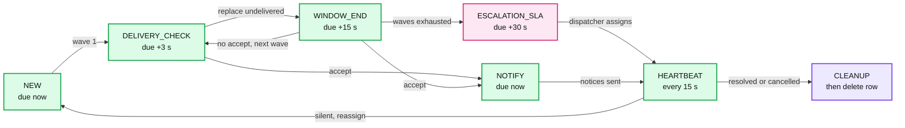
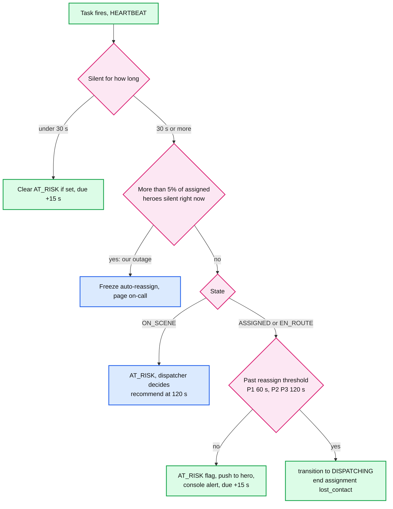
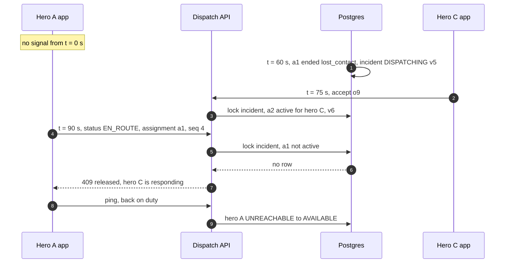

# Deep dive: the incident state machine and stuck-incident detection

> One-line answer: an incident is a small state machine on one Postgres row, and **one function, `transition()`, is the only code that changes its state**. It locks the incident row, checks the `(from, to)` pair against a table, checks the caller's guard (expected version, task attempt, or assignment id), applies side effects in a fixed lock order, bumps `version`, writes the event row and sets the task's next `due_at`, all in one transaction. The task row is the incident's **only clock**: offer windows, delivery checks, heartbeat checks and escalation SLAs are all `due_at`. Hero updates are **fenced by `assignment_id`** plus a per-assignment sequence number, so a released hero can never write again. A silent hero is flagged `AT_RISK` at 30 s and reassigned at 60 s (P1) or 120 s (P2, P3), except on scene, where a dispatcher decides. A **sweeper** checks four invariants every 10 s and repairs or pages. Multi-hero incidents (follow-up 2) add a slot number to the assignment and nothing else changes.

Zoom-in on [`../solution.md`](../solution.md) §4.4, §5.4 and §10.4 C. Reusable block: [`../../../concepts/leases-fencing-clocks.md`](../../../concepts/leases-fencing-clocks.md) (task leases, fencing tokens, why clocks are not trusted). Siblings: [`accept-race-and-assignment-store.md`](accept-race-and-assignment-store.md) (the accept transaction), [`reliable-dispatch-start.md`](reliable-dispatch-start.md) (the task row and the claim loop), [`offer-strategy-and-timeouts.md`](offer-strategy-and-timeouts.md) (waves and windows). The state diagram itself is in [`../solution.md`](../solution.md) §4.4 and is not repeated here.

---

## 1. The full transition table

Every row is one call to `transition()`, one transaction. "Next `due_at`" is what the task row is set to in the same transaction.

| # | From | To | Actor | Guard | Side effects (in lock order) | Next `due_at` |
|---|---|---|---|---|---|---|
| 1 | (none) | `REPORTED` | Civilian via API | `report_id` not seen (unique index) | Insert incident v1, event, task | now |
| 2 | `REPORTED` | `DISPATCHING` | Worker | Task `attempt` matches | Insert wave 1 offers | now + 3 s (delivery check) |
| 3 | `DISPATCHING` | `DISPATCHING` | Worker | Window ended, no accept, task attempt | Expire pending offers, insert next wave, radius up | now + 3 s |
| 4 | `DISPATCHING` | `ASSIGNED` | Hero (accept) | Offer `PENDING` and this hero's, hero `AVAILABLE`, unique indexes | Offer `ACCEPTED`, insert assignment, hero `BUSY`, other offers `WITHDRAWN` | now (send notices), then every 15 s |
| 5 | `DISPATCHING` | `ESCALATED` | Worker | Waves exhausted (3 for P1, P2. 5 for P3) | Expire pending offers, add to dispatcher queue | now + 30 s (SLA alarm) |
| 6 | `ESCALATED` | `ASSIGNED` | Dispatcher | `expected_version`, hero `AVAILABLE` | Insert assignment (`source = manual`, no offer), hero `BUSY` | every 15 s |
| 7 | `ESCALATED` | `HANDED_OFF` | Dispatcher | `expected_version`, reason code | Record the external reference | cleanup (§3) |
| 8 | `ASSIGNED` | `EN_ROUTE` | Hero | Active `assignment_id`, `seq` greater than last | none | every 15 s |
| 9 | `EN_ROUTE` | `ON_SCENE` | Hero | Same | none | every 15 s |
| 10 | `ON_SCENE` | `RESOLVED` | Hero or dispatcher | Same, or `expected_version` | End assignment (`resolved`), hero `AVAILABLE` | cleanup |
| 11 | `ASSIGNED`, `EN_ROUTE` | `DISPATCHING` | Worker (silence) or hero (`DROP`) | Silent past threshold, or active `assignment_id` | End assignment (`lost_contact` or `dropped`), hero `UNREACHABLE` or `AVAILABLE`, next wave excludes that hero | now |
| 12 | `ON_SCENE` | `DISPATCHING` | Dispatcher | `expected_version` | Same as 11 | now |
| 13 | `REPORTED`, `DISPATCHING` | `CANCELLED` | Civilian or dispatcher | Civilian owns the incident, or `expected_version` | Pending offers `WITHDRAWN` | cleanup |
| 14 | `ASSIGNED`, `EN_ROUTE` | `CANCELLED` | Dispatcher only | `expected_version`, reason code | End assignment (`cancelled`), hero `AVAILABLE`, notify hero | cleanup |

Rules the table encodes:
- **A civilian can cancel only before a hero is assigned.** After that, the civilian's "cancel" becomes a request on the dispatcher's console. A person under duress can be forced to tap cancel. A human confirms it.
- **Hero transitions only move forward**, and only on the hero's own active assignment.
- **No transition leaves a terminal state.** A "reopen" is a new incident linked by `parent_incident_id`.
- **Every row writes one `incident_event`**, so the history is exactly the list of rows taken.

---

## 2. One function writes state

```python
TERMINAL = {"RESOLVED", "CANCELLED", "HANDED_OFF"}
ALLOWED = {
    ("REPORTED", "DISPATCHING"), ("DISPATCHING", "DISPATCHING"),
    ("DISPATCHING", "ASSIGNED"), ("DISPATCHING", "ESCALATED"),
    ("ESCALATED", "ASSIGNED"), ("ESCALATED", "HANDED_OFF"),
    ("ASSIGNED", "EN_ROUTE"), ("EN_ROUTE", "ON_SCENE"), ("ON_SCENE", "RESOLVED"),
    ("ASSIGNED", "DISPATCHING"), ("EN_ROUTE", "DISPATCHING"), ("ON_SCENE", "DISPATCHING"),
    ("REPORTED", "CANCELLED"), ("DISPATCHING", "CANCELLED"),
    ("ASSIGNED", "CANCELLED"), ("EN_ROUTE", "CANCELLED"),
}

def transition(db, incident_id, to, actor, reason, *, expected_version=None,
               task_attempt=None, assignment_id=None, hero_seq=None, effects=()):
    with db.transaction():                                   # READ COMMITTED
        inc = db.one("SELECT state, version, severity FROM incident "
                     "WHERE incident_id = %s FOR UPDATE", incident_id)   # 1. incident lock first
        if (inc.state, to) not in ALLOWED:
            raise Conflict(inc)                              # includes anything after a terminal state
        if expected_version is not None and inc.version != expected_version:
            raise Conflict(inc)                              # stale screen or stale worker
        if task_attempt is not None:                         # worker fencing
            if db.execute("UPDATE dispatch_task SET lease_owner = NULL "
                          "WHERE incident_id = %s AND attempt = %s",
                          incident_id, task_attempt) == 0:
                raise Fenced()
        if assignment_id is not None:                        # hero fencing
            if db.execute("UPDATE assignment SET last_seq = %s "
                          "WHERE assignment_id = %s AND incident_id = %s "
                          "AND active AND last_seq < %s",
                          hero_seq, assignment_id, incident_id, hero_seq) == 0:
                raise ReleasedOrDuplicate(assignment_id, hero_seq)
        for effect in effects:                               # 2. offers, 3. assignment, 4. hero
            effect(db, inc)
        v = inc.version + 1
        db.execute("UPDATE incident SET state = %s, version = %s WHERE incident_id = %s",
                   to, v, incident_id)
        db.execute("INSERT INTO incident_event (incident_id, version, from_state, to_state, "
                   "actor, reason) VALUES (%s, %s, %s, %s, %s, %s)",
                   incident_id, v, inc.state, to, actor, reason)
        due, phase = next_due(to, inc.severity)
        db.execute("UPDATE dispatch_task SET due_at = %s, phase = %s WHERE incident_id = %s",
                   due, phase, incident_id)
    return v
```

- `effects` are small functions that only touch rows **after** the incident row: offers, then assignment, then hero. Code review rejects any effect that reads another incident.
- `ReleasedOrDuplicate` is two answers. If the assignment is no longer active: `409 released`. If it is active and `hero_seq` is not greater than `last_seq`: it is a retry or a reordered old update, so return `200` with no change.
- The accept (§4.3 of the solution) is `transition(..., to="ASSIGNED", effects=[accept_offer, insert_assignment, hero_busy, withdraw_others])`. It does not pass `task_attempt`, so a hero never waits on a worker's lease.

---

## 3. The task row is the only clock

| Phase | Set by | Fires to |
|---|---|---|
| `NEW` | Row 1 | Run wave 1 |
| `DELIVERY_CHECK` | Waves (rows 2, 3) | Replace undelivered offers, then set `WINDOW_END` |
| `WINDOW_END` | After the delivery check | Expire the wave, then next wave or escalate |
| `NOTIFY` | Accept (row 4) | Send "taken" notices, then set `HEARTBEAT` |
| `HEARTBEAT` | Rows 4, 6, 8, 9 | Check silence every 15 s |
| `ESCALATION_SLA` | Row 5 | Page the floor supervisor if no dispatcher picked it up |
| `CLEANUP` | Terminal rows | Send final notices for withdrawn offers and released heroes, then **delete the task row** |

- **Why a `CLEANUP` phase instead of deleting the row at the terminal transition:** a cancel withdraws offers whose heroes still need a notice. If the row were deleted in the same transaction, nothing durable would remember to send them. The row lives one more step, the notices go out, and then it is deleted.
- The sweeper's invariant is therefore "every non-terminal incident has a task row, and every terminal incident's task row is in `CLEANUP` and younger than 60 s".
- **No cron, no in-memory timer, no `expires_at > now()` check anywhere.** A clock that lives anywhere else can disagree with the state. The only time comparison in the system is `due_at <= now()` in the claim query, and being a little late there only delays a step.



---

## 4. Silence: detect, flag, reassign

**Where "silent" is measured.** Redis `last_seen` is a lossy hint, and a Redis failover would make every hero look silent at once. So for **assigned** heroes, the location service also writes `assignment.last_heartbeat_at` to Postgres every 15 s. That is ~1,000 busy heroes on average, ~67 small writes/s. The heartbeat check reads Postgres, never Redis.



- **30 s, `AT_RISK`.** A flag on the assignment, not a state. The hero gets "Are you still responding?". The console highlights the incident. Nothing is taken away.
- **60 s (P1) or 120 s (P2, P3), reassign.** Row 11 of the table. The hero becomes `UNREACHABLE`, so they get no new offers until they ping again. The new wave excludes them.
- **`ON_SCENE` never auto-reassigns.** A hero on scene who goes quiet is most likely busy saving someone. The console recommends reassignment at 120 s. A dispatcher takes row 12.
- **The mass-silence breaker.** If more than 5% of assigned heroes cross 30 s at the same moment, the cause is the gateway, the location service or the network, not 50 heroes losing their phones together. Auto-reassignment pauses and someone is paged. Without it, a gateway outage would reassign every active incident in the city.
- **An explicit `DROP`** from the hero ("I can't make it") skips the timers and takes row 11 at once.

---

## 5. Fencing: a released hero cannot write



- The **`assignment_id` is the fencing token** ([`../../../concepts/leases-fencing-clocks.md`](../../../concepts/leases-fencing-clocks.md) §3). Every hero write carries it, and `transition()` checks it under the incident lock.
- The **per-assignment `seq`** handles the other direction: the same hero's own updates arriving twice or out of order over a flaky network. `EN_ROUTE seq 3` arriving after `ON_SCENE seq 4` is ignored with `200`.
- A hero's app never trusts its local state after a reconnect. It calls `GET /v1/hero/me` and renders what the server says.

---

## 6. The record invariant vs the physical one

| Invariant | Enforced by | Can it be violated? |
|---|---|---|
| At most one **active** assignment per incident | `UNIQUE (incident_id) WHERE active`, plus `transition()` | No |
| At most one active incident per hero | `UNIQUE (hero_id) WHERE active` | No |
| At most one hero **physically** responding | Nothing can enforce it | Yes, after a lost-contact reassignment |

Say it plainly in the round: after a reassignment, hero A may still be driving to the scene with a dead phone while hero C is also on the way. We accept that on purpose. Two heroes at a fire is a small waste. Zero heroes is the failure the prompt ranks worst. The thresholds (60 s for P1, 120 s otherwise) are where we trade one against the other, and dispatch operations own them.

---

## 7. Escalation is a state with an owner

- `ESCALATED` is not "failed". It means a human owns it now. It sorts to the top of the console's queue, oldest first, P1 above P2.
- The task's `ESCALATION_SLA` phase fires at 30 s. If no dispatcher has claimed it, the floor supervisor is paged.
- A dispatcher's options are rows 6 and 7: assign by hand (the hero may have been reached by phone), or hand off to the city's 911 service with an external reference. Both go through `transition()` with `expected_version`.

---

## 8. The invariant sweeper

Runs every 10 s on the primary. Each check is an index scan over a few thousand open rows.

```sql
-- I1: an open incident without a task row (should be impossible)
SELECT i.incident_id FROM incident i
  LEFT JOIN dispatch_task t USING (incident_id)
 WHERE i.state NOT IN ('RESOLVED', 'CANCELLED', 'HANDED_OFF') AND t.incident_id IS NULL;

-- I2: an assigned-family incident without exactly one active assignment, or with a hero not BUSY
SELECT i.incident_id FROM incident i
  LEFT JOIN assignment a ON a.incident_id = i.incident_id AND a.active
  LEFT JOIN hero h ON h.hero_id = a.hero_id
 WHERE i.state IN ('ASSIGNED', 'EN_ROUTE', 'ON_SCENE')
   AND (a.assignment_id IS NULL OR h.status <> 'BUSY');

-- I3: workers are not keeping up
SELECT count(*), min(due_at) FROM dispatch_task WHERE due_at < now() - interval '30 seconds';

-- I4: an offer pending far past any window
SELECT offer_id FROM offer WHERE state = 'PENDING' AND sent_at < now() - interval '30 seconds';
```

| Check | Safe auto-repair | Page |
|---|---|---|
| I1 | Insert the task row with `due_at = now()` and phase `NEW` (the worker re-reads the state and does the right step) | Always, it means a code bug |
| I2 | None. Two plausible fixes, and a wrong guess could strand a hero | Always |
| I3 | None | If the oldest is over 30 s |
| I4 | Wake the incident's task (`due_at = now()`) | If it repeats |

The sweeper is what turns "this should never happen" into "detected within 10 s, repaired or in front of a human".

---

## 9. Extension: multi-hero incidents (prompt follow-up 2)

A building collapse needs a strength hero and a medic.

- Incident gets `slots`: `[{slot: 1, skill: strength}, {slot: 2, skill: medical}]`.
- Assignment gets a `slot` column. The per-incident index becomes `UNIQUE (incident_id, slot) WHERE active`. The per-hero index is unchanged, so no hero is double-booked across incidents or across slots.
- New state `PARTIALLY_ASSIGNED` between `DISPATCHING` and `ASSIGNED`. Waves run only for open slots, offering only heroes whose skills fit an open slot.
- The accept fills the lowest open slot matching the hero's skills. It still locks the incident first, so two medics accepting together cannot both take slot 2.
- Silence and reassignment work per slot: losing the medic reopens slot 2 only.

---

## 10. Trade-offs

| Decision | Chose | Rejected | Why |
|---|---|---|---|
| Who writes state | One `transition()` function | Each service updates `status` | One place for the lock order, the table and the guards |
| Timers | Task row phases | Cron jobs, in-memory schedulers, `expires_at` checks | One clock that commits with the state |
| Terminal cleanup | `CLEANUP` phase, then delete | Delete the task in the terminal transaction | Final notices need a durable reminder |
| Silence source | Postgres heartbeat for assigned heroes | Redis `last_seen` | A Redis failover must not look like 1,000 silent heroes |
| Reassign on silence | Automatic for P1 at 60 s, P2 P3 at 120 s, dispatcher for `ON_SCENE` | Always a human, or always automatic | Zero heroes is worse than two, but on scene silence is usually work |
| Civilian cancel after assignment | Dispatcher confirms | Immediate | A cancel can be coerced |
| Fencing | `assignment_id` plus `seq` | Hero id only | A hero id does not change when the assignment does |

---

## 11. Interview soundbite

"Every state change goes through one `transition()` function: lock the incident row, check the pair against the table, check the guard, write the event and set the task's next due time, all in one transaction. The task row is the only clock, so a window or a heartbeat check can never disagree with the state. A hero silent for 30 s is flagged, at 60 s on a P1 the assignment is ended and the next wave goes out, and the old hero's late updates carry a dead assignment id and get 409. That enforces one active assignment in the record. It cannot stop two heroes being physically there, and I choose that over zero."
