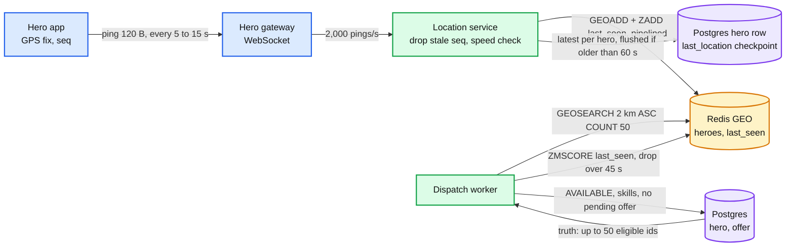
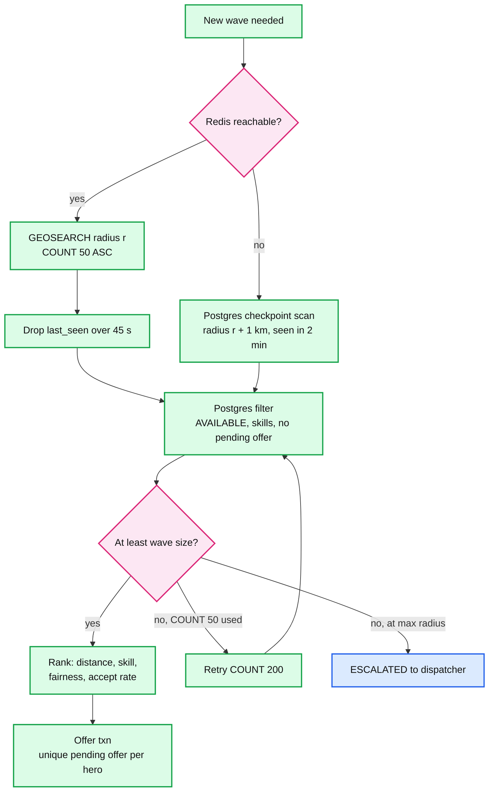

# Deep dive: the location index vs the truth

> One-line answer: live location goes into **one Redis GEO set** (~1 MB for 10,000 heroes, ~2,000 writes/s, about 2% of one core) plus a `last_seen` sorted set, and it is treated as a **hint about who to ask, never as a fact to commit on**. Dispatch asks Redis "who is within 2 km", drops anyone silent for 45 s, then asks Postgres "which of these 50 are actually available, skilled and free of offers". Only the accept transaction decides. A stale or wrong index entry can waste an offer slot. It cannot create an assignment. Redis runs with `noeviction` and no persistence, because losing it costs one ping interval (~15 s) to rebuild and a 60 s checkpoint in Postgres covers the gap. H3 cells are used for zone statistics, not for the search. Nothing is sharded. The shard key for the day there are many cities is `city_id`.

Zoom-in on [`../solution.md`](../solution.md) §4.2, §5.3 and §10.1. Reusable block: [`../../../concepts/geospatial-index.md`](../../../concepts/geospatial-index.md) (geohash, cells, the moving-points write problem). Related: [`../../../concepts/mvcc-and-isolation.md`](../../../concepts/mvcc-and-isolation.md) (why updates churn Postgres). Siblings: [`offer-strategy-and-timeouts.md`](offer-strategy-and-timeouts.md) (what dispatch does with the candidates), [`accept-race-and-assignment-store.md`](accept-race-and-assignment-store.md) (where the truth is decided).

---

## 1. Two questions, two stores

| Question | Changes | Wrong answer costs | Store |
|---|---|---|---|
| "Who is near this incident?" | Every 5 to 15 s per hero, 2,000/s | A wasted offer slot, a slightly worse pick | **Redis GEO**, lossy |
| "Who is free to take it?" | On accept, release, duty toggle: a few per second | A double assignment | **Postgres**, the only place an assignment commits |

The mistake to avoid is answering the second question from the first store. An index entry that says "available" was true up to 15 s ago at best. A hero assigned 2 s ago is still in the radius result with whatever status the index last heard.



---

## 2. The ping pipeline

1. **The app** sends `{hero_id, lat, lng, accuracy_m, heading, speed, battery, client_ts, seq}` over the socket. Every 15 s when idle, every 5 s while assigned or holding an offer. ~120 B.
2. **The gateway** stamps `server_ts` and forwards. A ping is also the hero's heartbeat (solution §5.4).
3. **The location service** checks, in memory per hero:
   - `seq` must be higher than the last one seen. Mobile networks reorder. An older ping is dropped, or it would move the hero backwards.
   - Implied speed from the previous ping must fit the hero's mobility type (ground ~200 km/h cap, flight ~1,000 km/h [estimate]). An impossible jump is dropped and counted (spoofing signal, solution §10.10).
   - `accuracy_m` over ~200 m is kept but flagged. The ranker penalizes it.
4. **Write to Redis**, pipelined in batches every ~20 ms:
   ```text
   GEOADD heroes <lng> <lat> <hero_id>
   ZADD   hero:last_seen <server_ts_ms> <hero_id>
   ```
5. **Checkpoint to Postgres.** The service keeps the latest ping per hero and, once a second, flushes the heroes whose checkpoint is older than 60 s: ~170 rows/s, one `UPDATE ... FROM (VALUES ...)` sorted by `hero_id` so two location nodes never lock heroes in opposite orders. `last_location` is not indexed, so these are HOT (heap-only tuple) updates with no index churn.

Going off duty removes the hero from both sets at once (`ZREM`), so an off-duty hero never appears even for the 45 s staleness window.

---

## 3. Redis GEO internals

- **It is a sorted set.** `GEOADD` takes longitude and latitude, interleaves their bits into a **52-bit geohash**, and stores that integer as the member's score. Points close on the map mostly have close scores. Valid latitudes stop at about ±85.05°, the Web Mercator limit. Not an issue for a city.
- **`GEOSEARCH ... BYRADIUS`** picks a geohash precision whose cells cover the circle, takes the center cell and its 8 neighbours, does a sorted-set range scan for each of the 9 score ranges, then filters each candidate by exact distance. Complexity **O(N + log M)**: N = members inside the 9 boxes, M = members in the set. With M = 10,000 and a few hundred heroes in the boxes, it returns in well under 1 ms.
- **`COUNT 50 ASC` without `ANY`.** Without `ANY`, Redis gathers every match in the area, sorts by distance, and returns the nearest 50. With `ANY`, it stops as soon as it has 50 matches, unsorted and not necessarily the nearest. The docs warn that a large area with a small `COUNT` and no `ANY` can be slow. Here the area holds hundreds of members, not millions, and nearest is the point, so no `ANY`.
- **Single-threaded command execution.** 2,000 `GEOADD` + 2,000 `ZADD` + ~25 searches a second is ~2% of one core. No cluster mode needed.
- **Replication is async.** A failover can lose up to ~1 s of pings. The next ping repairs each hero. For a hint, that is the right durability.

### Staleness filter and pruning

GEO members cannot expire one by one (a TTL applies to the whole key). So:

```text
# at search time, for the <= 50 ids returned
ZMSCORE hero:last_seen id1 id2 ... id50     -> drop ids older than now - 45 s (3 missed pings at 15 s)

# every 60 s, one Lua script so check and remove are atomic
stale = ZRANGEBYSCORE hero:last_seen -inf (now - 60 s)
ZREM heroes <stale...>
ZREM hero:last_seen <stale...>
```

The script matters: without it, a hero who pings between the range read and the removal is deleted right after a fresh ping, and disappears for up to 15 s.

**If too few survive the filters**, widen before giving up: repeat with `COUNT 200`, then the next radius in the ladder (2, 5, 10 km). In a busy area many of the 50 nearest can be `BUSY`, so "50 nearest" is not "50 candidates". If that becomes common (surge), add a second GEO set `heroes:available`, updated on status changes. It is still a hint. Postgres still decides.

### `maxmemory-policy noeviction`

An `allkeys-lru` policy would, under memory pressure, silently drop members. A dropped hero is indistinguishable from "no hero nearby", which sends the incident to a wider radius or to escalation for no reason. With `noeviction`, writes fail loudly instead and the location service alarms. At ~1 MB of data the box will not get there unless something else shares it. Do not share it.

---

## 4. How stale is stale

| Hero | Speed | Movement in 15 s (idle ping) | Movement in 5 s (assigned ping) | What we do |
|---|---|---|---|---|
| On foot | 6 km/h | 25 m | 8 m | Nothing |
| Ground vehicle | 50 km/h | ~210 m | ~70 m | Rank on raw distance. 210 m is ~10% of a 2 km radius |
| Fast ground | 120 km/h | 500 m | 170 m | Extrapolate along heading |
| Flight | 300 km/h | ~1.25 km | ~420 m | **Extrapolate** `position + heading x speed x age`, capped at 30 s of age |

- Add pipeline delay (~0.2 s) and the reorder window. Negligible next to the ping interval.
- The error that matters is ranking error, not correctness. Picking the second-nearest hero instead of the nearest costs seconds of travel. It never costs an assignment.
- Straight-line distance is itself a bigger error than staleness for ground heroes (a river, a one-way grid). Travel-time ETA for the top ~10 candidates is below the line (solution §10.11). For flyers, straight-line is close to the real path, so extrapolation is the higher-value fix.

---

## 5. Why availability is checked in Postgres

```sql
SELECT h.hero_id, h.skills, h.mobility
  FROM hero h
 WHERE h.hero_id = ANY($candidate_ids)                -- <= 50, by primary key
   AND h.status = 'AVAILABLE'
   AND h.skills && $required_skills
   AND NOT EXISTS (SELECT 1 FROM offer o WHERE o.hero_id = h.hero_id AND o.state = 'PENDING');
```

~3 ms p50, ~20 ms p99, ~25 times a second at peak. Cheap, and it removes the class of bug where the index's idea of status and the database's disagree. Even so it is a **read**, not a lock: a hero filtered as available can be assigned elsewhere 2 ms later. The offer insert (`one_pending_offer_per_hero`) and the accept (`status = 'AVAILABLE'` guard plus `one_active_per_hero`) catch that. Three layers, each cheaper than the next is strict.



(Not drawn: "no, below max radius" moves to the next radius in the ladder, 2 to 5 to 10 km, and loops back to the search.)

---

## 6. When Redis is gone

- **Detection:** search calls fail or time out at 50 ms.
- **Fallback:** the 60 s checkpoint in Postgres. 10,000 hero rows, a bounding-box filter on `last_location` plus the status filter: a sequential scan of ~10k narrow rows, ~5 ms [estimate]. The radius grows by 1 km to cover up to 60 s of movement for ground heroes. Flyers get their checkpoint extrapolated.
- **Recovery:** a replica is promoted in ~10 to 30 s [estimate]. Even an empty replacement fills itself: every on-duty hero pings within 15 s, so the index is complete one interval after writes resume. No backfill job.
- **What the user sees:** first offers a little slower and a little less precise for under a minute. No incident waits on Redis.

This is the reason Redis needs no persistence. Its only job is to be fast. Its contents are rebuilt from the source (the heroes' phones) faster than any restore.

---

## 7. Why not PostGIS on the hero table

PostGIS is a fine geo index. The objection is where it would live: on the red node, in the row the accept updates.

| | PostGIS on `hero`, every ping | Redis GEO plus 60 s checkpoint |
|---|---|---|
| Row versions written per day | `2,000 x 86,400 = ~173 M` | `170 x 86,400 = ~15 M` (checkpoint) |
| Heap written per day at ~250 B a version | ~43 GB, plus WAL | ~3.7 GB |
| Index updates | Every ping changes the indexed column, so no HOT update: the GiST index is rewritten too | None: `last_location` is not indexed |
| WAL to the sync standby, CDC slot, backups | All of it | ~10x less |
| Lock contention with the accept | Ping updates and accepts on the same rows, 2,000/s | 170/s, sorted, HOT |
| Losing the index | It is the system of record, so it is not losable | Rebuilt in 15 s |

At 10,000 heroes PostGIS would cope. The trade is putting the noisiest, least valuable stream on the one machine whose job is the most valuable writes, and getting nothing in return.

---

## 8. H3: zones, not search

H3 cell sizes from the official table:

| Resolution | Avg area | Avg edge | Used for |
|---|---|---|---|
| 6 | ~36 km² [estimate] | ~3.7 km [estimate] | Dispatcher console zones |
| 7 | 5.161 km² | 1.406 km | Surge detection and reserve per zone |
| 8 | 0.737 km² | 0.531 km | `incident.h3_r8`, duplicate clustering prefilter, supply heatmaps |
| 9 | 0.105 km² | 0.201 km | Not used. Too fine for 10,000 heroes in a metro |

- **Why not search by H3 rings?** A radius search over hexagons is "take the k-ring of cells around the incident, then filter by distance". That is the same work `GEOSEARCH` already does with 9 geohash boxes, so it adds a second index for no gain.
- **Where cells are the right tool:** counting. "Available heroes per res-7 cell vs pending incidents per cell" is the surge trigger (solution §5.5) and the reserve rule ("keep ~20% of each neighbouring zone's heroes"). Hexagons have one kind of neighbour at one distance, which makes "this zone and its ring" a clean definition. Uber built H3 for exactly this kind of pricing and dispatch aggregation.
- The location service keeps an in-memory map `res7 cell -> available hero count`, updated per ping. It is a few kilobytes.

---

## 9. No sharding, and the seam

- **The whole index is ~1 MB and ~4,000 commands/s.** Sharding it by cell would turn a 2 km search near a cell border into a scatter-gather across shards, and add a rebalancing problem, to save nothing.
- **The seam is `city_id`.** A second city gets its own Redis, its own workers, its own Postgres: a cell in the cell-based-architecture sense (solution §10.11). Heroes and incidents in different cities never meet in a query. The location service routes pings by the hero's home city. A hero who crosses a city line mid-shift is re-homed by a duty toggle, which is a rare, explicit event.
- **At 1 M heroes in one city** (100x), the GEO set is ~100 MB and ~200k writes/s: past one Redis primary. Then shard by H3 res-5 region within the city, and make the search query the incident's region plus any neighbour within the radius. The accept is untouched, because it never reads location.

---

## 10. Trade-offs

| Decision | Option A | Option B | Chose | Why |
|---|---|---|---|---|
| Live location store | PostGIS on the hero row | Redis GEO | **Redis GEO** | Keeps 173 M row versions a day off the red node. Losable by design |
| Availability | Status in the index | Postgres filter, then accept guards | **Postgres** | Only place an assignment commits |
| Stale heroes | TTL per key (one key per hero) | `last_seen` sorted set, 45 s filter, atomic prune | **`last_seen`** | One GEO set keeps the radius query one command |
| Eviction | `allkeys-lru` | `noeviction` | **`noeviction`** | A silent eviction looks like "nobody nearby" |
| Persistence | AOF every second | None | **None** | The phones rebuild it in 15 s |
| Search index | H3 k-rings | Geohash boxes via `GEOSEARCH` | **`GEOSEARCH`**, H3 for counting | One index for search, cells for zone stats |
| Sharding | By cell now | None, `city_id` later | **None** | ~1 MB, 2% of a core |

---

## 11. Interview soundbite

"Location is a hint, not a fact. Pings go into one Redis GEO set, about a megabyte, with a last-seen sorted set to drop anyone silent for 45 seconds, and noeviction so we never silently lose a hero. Dispatch asks Redis who's within two kilometres, then asks Postgres which of those fifty are actually available, and only the accept transaction decides. A stale entry can waste an offer slot, never create an assignment. If Redis dies, a 60-second checkpoint in Postgres covers us and the phones refill the index in one ping interval. I wouldn't shard any of this. The seam for many cities is city id."
