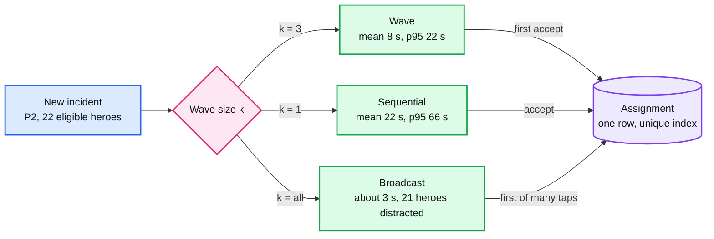
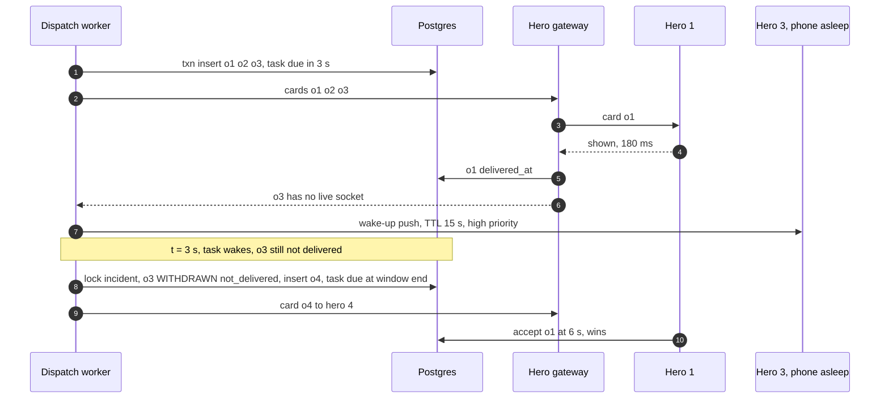
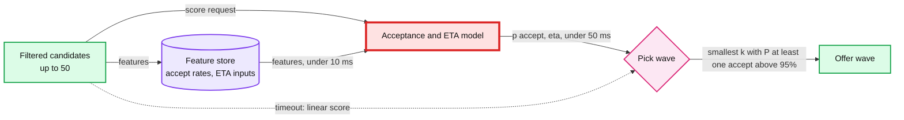

# Deep dive: offer strategy and timeouts

> One-line answer: offer each incident to a **small wave of heroes at once** (5 for P1, 3 for P2, 2 for P3), give them **15 s to decide**, but expect a **delivery ack within 3 s** and replace any hero whose phone never showed the card. If a hero accepts half the time, a wave of 3 assigns 87.5% of incidents in the first window and 98.4% within two, with a mean time to assignment of ~8 s against ~22 s for one hero at a time. Each hero holds **at most one pending offer** (a partial unique index), so two incidents never wait on the same person. Offers travel over the hero's WebSocket. Push (APNs, FCM) is only a wake-up, because a successful push send "doesn't mean that the message was already delivered". Ranking is a linear score (distance, skill, fairness, accept rate). The ML model from the prompt's follow-up 4 replaces that score later, behind a 50 ms timeout.

Zoom-in on [`../solution.md`](../solution.md) §4.2, §5.3 and §10.2. Reusable block: [`../../../concepts/geospatial-index.md`](../../../concepts/geospatial-index.md) (the candidate search). Siblings: [`location-index-vs-truth.md`](location-index-vs-truth.md) (where candidates come from), [`incident-state-machine-and-stuck-detection.md`](incident-state-machine-and-stuck-detection.md) (expiry as a transition), [`surge-and-degradation.md`](surge-and-degradation.md) (what changes when heroes are scarce).

---

## 1. Three strategies, one number that decides

The question is how many heroes see the card at once. Three answers:

| Strategy | What happens | What it costs |
|---|---|---|
| **Broadcast** to every available hero in the radius | First tap wins. ~30 heroes in a dense 2 km circle see it | 29 heroes distracted per incident. Several start moving before they lose. Hero trust in the app drops. Under surge, every hero is "reserved" by every incident |
| **Sequential**, one hero at a time | Ask the best hero. On decline or timeout, ask the next | Slow. If p = 0.5, the mean time to assignment is ~22 s and the p95 is ~66 s (table below) |
| **Waves** of k heroes | Ask the top k at once. First accept wins. If nobody accepts in the window, ask the next k with a wider radius | k - 1 "taken" notices per incident. Heroes are reserved for up to 15 s |

The number that decides is **p, the chance that one offered hero accepts within the window**. We have no data on day one, so the design assumes p = 0.5 [estimate] and sizes waves so that the answer is still acceptable at p = 0.3.



---

## 2. The sensitivity table

Model: each offered hero accepts independently with probability p. An accepting hero taps at a time uniform between 2 s and 12 s after the card arrives. A wave that gets no accept costs the full 15 s window, then the next wave goes to new heroes with the same p. "Assigned within n windows" is `1 - (1 - p)^(k x n)`. The mean, p95 and offers come from a 200,000-incident simulation with that model. Delivery-ack replacements (§4) are not in the model.

| p | k | Within 1 window | Within 2 | Within 3 | Mean time to assignment | p95 | Offers per incident |
|---|---|---|---|---|---|---|---|
| 0.3 | 1 | 30.0% | 51.0% | 65.7% | 41.9 s | 126 s | 3.3 |
| 0.3 | 2 | 51.0% | 76.0% | 88.2% | 21.1 s | 64 s | 3.9 |
| 0.3 | 3 | 65.7% | 88.2% | 96.0% | 14.3 s | 40 s | 4.6 |
| 0.3 | 5 | 83.2% | 97.2% | 99.5% | 8.9 s | 24 s | 6.0 |
| **0.5** | 1 | 50.0% | 75.0% | 87.5% | 22.0 s | 66 s | 2.0 |
| **0.5** | 2 | 75.0% | 93.8% | 98.4% | 11.5 s | 34 s | 2.7 |
| **0.5** | **3** | **87.5%** | **98.4%** | **99.8%** | **8.1 s** | **22 s** | **3.4** |
| **0.5** | 5 | 96.9% | 99.9% | ~100% | 5.6 s | 11 s | 5.2 |
| 0.7 | 1 | 70.0% | 91.0% | 97.3% | 13.4 s | 38 s | 1.4 |
| 0.7 | 2 | 91.0% | 99.2% | 99.9% | 7.6 s | 21 s | 2.2 |
| 0.7 | 3 | 97.3% | 99.9% | ~100% | 5.8 s | 11 s | 3.1 |
| 0.7 | 5 | 99.8% | ~100% | ~100% | 4.4 s | 8 s | 5.0 |

How to read it:
- **Going from 1 to 3 heroes cuts the mean by ~2.7x at every p.** Going from 3 to 5 cuts it by another ~1.4x. The first extra heroes buy the most.
- **The cost is offers, and it is small.** At p = 0.5 a wave of 3 sends 3.4 offers per incident, so ~2.4 heroes per incident get a "taken" or "expired" notice. Broadcast to ~22 eligible heroes would send ~21 losing notices.
- **Pick k from the severity and the worst plausible p, not the average.** At p = 0.3, P2 with k = 3 still assigns 96% within three windows (~50 s). That is the escalation point, so ~4% of P2 incidents reach a dispatcher in a bad hour. P1 with k = 5 keeps that under 0.5%.

**Why waves are the default, said in one breath:** at p = 0.5, a wave of 3 assigns 87.5% in one 15 s window against 50% for one hero, and distracts 2 extra heroes, not 20.

---

## 3. Wave size and radius by severity

| Severity | Wave size | Window | Radius ladder | Escalate after | Rationale |
|---|---|---|---|---|---|
| P1 (life-threatening) | 5 | 15 s | 2, 5, 10 km | 3 waves, ~55 s | p95 ~11 s at p = 0.5. Over-offering is cheap next to a death |
| P2 | 3 | 15 s | 2, 5, 10 km | 3 waves | Default. 98.4% within two windows |
| P3 | 2 | 20 s | 2, 5, 10, 15, 20 km | 5 waves | Fewer heroes distracted for minor work |

- The radius grows per wave because a hero who did not accept at 2 km is unlikely to accept on a second try, and nearer heroes are already used. Each wave excludes heroes already offered this incident (`UNIQUE (incident_id, hero_id)` on `offer`).
- These values are **config owned by dispatch operations**, versioned and audited, not code (§8 of the solution).
- In surge the wave size shrinks to 1 or 2 ([`surge-and-degradation.md`](surge-and-degradation.md) §4), because every hero in a wave is reserved for that incident for up to 15 s.

---

## 4. Two timers: the delivery ack and the decision window

A hero who never saw the card cannot accept it. Without a separate delivery timer, a dead phone wastes a full 15 s slot.

| Timer | Value | Starts | Ends early when | On expiry |
|---|---|---|---|---|
| Delivery ack | 3 s | Card sent to the gateway | The app acks "shown on screen" | Offer `WITHDRAWN` (reason `not_delivered`). The slot goes to the next candidate. Hero marked as a worse candidate for 10 min |
| Decision window | 15 s | `delivered_at` | Accept or decline | Offer `EXPIRED`. Next wave if no one in this wave accepted |

- 3 s is ~10x the p50 socket delivery time (~150 to 300 ms). A hero whose socket is alive acks in time. A hero whose socket dropped did not see the card, and waiting longer will not change that.
- Both timers are the same `dispatch_task.due_at`, set to the earliest pending deadline for the incident. There is no second clock ([`incident-state-machine-and-stuck-detection.md`](incident-state-machine-and-stuck-detection.md) §3).
- **Expiry is a transition, not a `now()` check.** The worker moves `PENDING -> EXPIRED` in a transaction that locks the incident first, the same lock the accept takes. So "accept at 14.9 s" and "expire at 15.0 s" race on one lock and exactly one wins.



---

## 5. One pending offer per hero, and the top-up

```sql
CREATE UNIQUE INDEX one_pending_offer_per_hero ON offer (hero_id) WHERE state = 'PENDING';
```

Why: two workers run waves for two nearby incidents at the same moment. Both candidate lists contain hero H. Without the index, H gets two cards, accepts one, and the other incident waited 15 s on a hero who was never going to take it.

The insert is a top-up, not a fixed list:

```sql
-- inside the wave transaction, after locking the incident
INSERT INTO offer (offer_id, incident_id, hero_id, wave, state)
SELECT gen_random_uuid(), $inc, c.hero_id, $wave, 'PENDING'
  FROM unnest($ranked_hero_ids) WITH ORDINALITY AS c(hero_id, rank)
 ORDER BY c.rank
 LIMIT $k + 3                      -- a few spares
ON CONFLICT DO NOTHING             -- hero already holds a pending offer elsewhere
RETURNING hero_id;
```

- The worker keeps the first k rows returned and withdraws any extras in the same transaction. If fewer than k come back, it repeats with the next candidates from its ranked list. In practice this loop runs once, rarely twice.
- The lost race costs the other incident nothing: its worker simply offers that hero's slot to the next one.
- This is also the surge rule: one pending offer per hero means a hero cannot be reserved by three incidents at once.

---

## 6. Ranking: a linear score

The candidate list arrives already filtered: seen in the last 45 s, `AVAILABLE` in Postgres, skills match, no pending offer. Then:

```text
score = 1.0 x (1 - distance / radius)          # 0..1, nearer is better
      + 0.4 x skill_fit                         # 1 exact skill, 0.5 adjacent, 0 generic
      + 0.2 x (1 - min(offers_last_hour, 10) / 10)   # spread work, avoid fatigue
      + 0.4 x accept_rate_30d                   # Bayesian average, prior 0.5 over 10 offers
      - 0.5 x no_live_socket                    # push-only heroes are worse candidates
```

Worked example. Fire, P2, radius 2 km, wave of 3:

| Hero | Distance | Skill | Offers last hour | Accept rate | Socket | Score | Rank |
|---|---|---|---|---|---|---|---|
| Blaze | 0.4 km | fire (1.0) | 2 | 0.70 | yes | 0.80 + 0.40 + 0.16 + 0.28 = **1.64** | 1 |
| Torch | 0.3 km | generic (0) | 0 | 0.60 | yes | 0.85 + 0 + 0.20 + 0.24 = **1.29** | 2 |
| Frost | 1.2 km | adjacent (0.5) | 1 | 0.80 | yes | 0.40 + 0.20 + 0.18 + 0.32 = **1.10** | 3 |
| Comet | 0.2 km | fire (1.0) | 6 | 0.20 | no | 0.90 + 0.40 + 0.08 + 0.08 - 0.50 = **0.96** | 4 |

- Comet is the nearest fire hero, but has no live socket and rarely accepts, so the score puts Comet fourth: first in line if any slot is not delivered.
- The weights are config. They are tuned offline against replayed incidents (§9), not by intuition in production.
- **Chronic non-responders.** The accept-rate term moves a hero down slowly. A hero with 5 undelivered or ignored offers in a row is moved to `UNREACHABLE` until they ping and confirm on duty. That protects P1 waves from slots that are guaranteed to be wasted.

---

## 7. Delivery: socket first, push as a wake-up

| Channel | Delivery receipt | Typical latency | Role |
|---|---|---|---|
| WebSocket from the hero gateway | Yes: the app acks "shown" | ~150 to 300 ms p50, ~800 ms p99 [estimate] | Primary path for cards, notices and pings |
| APNs / FCM high priority | No. FCM: success "doesn't mean that the message was already delivered to the device" | Seconds, no SLA | Wake the app so it reconnects and pulls the offer |
| SMS / voice | Provider receipts, slow | Seconds to tens of seconds | Below the line, for P1 heroes unreachable both ways |

Rules for the push path:
- **TTL 15 s, the decision window.** FCM's default TTL is 4 weeks. A card for an emergency arriving an hour late is worse than none. With a short TTL the provider drops it instead.
- **The push carries only the offer id.** The app opens, reconnects and fetches the offer over HTTPS. So a delayed push can never show a stale card: the fetch returns the offer's current state.
- **iOS interruption levels.** Critical alerts bypass Do Not Disturb and the mute switch, but need an entitlement Apple must approve. Time Sensitive needs no entitlement and does not bypass the silent switch. Apply for critical alerts for P1. Use Time Sensitive for P2 and P3.
- **Android.** High-priority FCM messages wake the device from Doze. Keep them for offers only, because the OS may demote apps that send high priority messages users do not interact with [estimate].

## 8. "Taken" and "expired" notices

- On accept, the accept transaction marks the other pending offers `WITHDRAWN` and sets the task due now. A worker sends a notice for every withdrawn or expired offer without `notice_sent_at`, then records it. The API also sends a best-effort notice right after commit, so losers usually hear in ~200 ms.
- The notice removes the card. A hero who taps accept on a card whose notice was lost gets `409 taken` and the same outcome. Correctness never depends on the notice arriving.
- On reconnect the app calls `GET /v1/hero/me/offers` and drops every card that is no longer `PENDING`.

---

## 9. The ML seam (prompt follow-up 4)

The follow-up asks for an acceptance-probability and ETA model while keeping matching within seconds.



- **Wave size becomes adaptive.** With a per-hero `p_i`, pick the smallest k such that `1 - prod(1 - p_i) >= 0.95` (P1: 0.99). Heroes with high `p_i` mean smaller waves and fewer distracted heroes.
- **Budget.** 50 candidates, one batched call, 50 ms timeout. On timeout or error, the linear score from §6 ranks and k falls back to the severity table. Matching stays well under the 2 s p99.
- **Training data** comes from the offer rows themselves: every offer has features at send time and an outcome (accepted, declined, expired, not delivered). Log the features with the offer so training never joins against values that changed later.
- **Shadow first.** Run the model alongside the linear score for a month, log both rankings, and compare predicted vs actual acceptance before letting it pick waves.

---

## 10. Trade-offs

| Decision | Chose | Rejected | Why |
|---|---|---|---|
| Offer fan-out | Waves of 2 to 5 by severity | Broadcast, sequential | 87.5% in one window at k = 3 vs 50% at k = 1, and ~2.4 losing notices instead of ~21 |
| Timers | 3 s delivery ack + 15 s window | One 15 s window | A dead phone costs 3 s, not 15 s |
| Expiry | Worker transition under the incident lock | `expires_at > now()` in the accept | One lock decides the race. DB outages do not expire offers |
| Hero reservation | One pending offer per hero, top-up on conflict | Let heroes hold many offers | Two incidents never wait on one person |
| Delivery | Socket, push as wake-up with 15 s TTL | Push only | Push has no receipt and a 4-week default TTL |
| Ranking | Linear score, config weights | ML from day one | No training data yet, and dispatchers can read a linear score |

---

## 11. Interview soundbite

"I offer to a small wave, not one hero and not everyone: at a 50% accept rate a wave of 3 assigns 87.5% in the first 15 s window and 98% within two. Every card needs a delivery ack in 3 s, because push is best effort, so a dead phone costs 3 s instead of the whole window. A hero can hold one pending offer at a time, enforced by a partial unique index. Expiry is a transition under the same incident lock as the accept, so accept-at-14.9 and expire-at-15.0 cannot both win."
