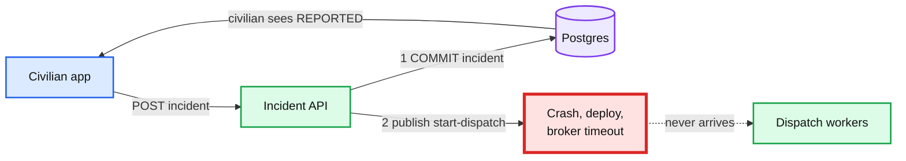
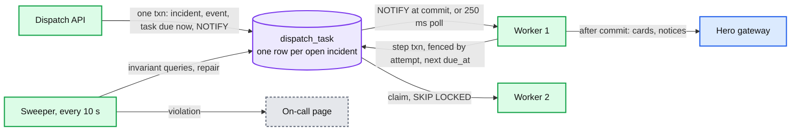
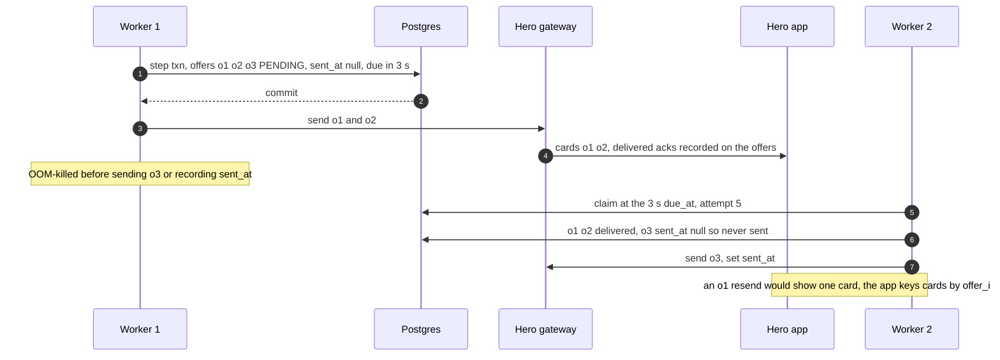
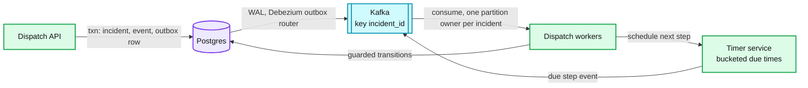

# Deep dive: reliable dispatch start, timers and the sweeper

> One-line answer: reporting an incident is **one transaction** that inserts the incident, its first event and **one `dispatch_task` row due now**. That row is the outbox, the queue and the timer at once, so there is nothing to relay and nothing to drop between "saved" and "dispatching". Workers claim due rows with `FOR UPDATE SKIP LOCKED`, and the claim pushes `due_at` 10 s forward, so a crashed worker's row simply becomes due again. A `NOTIFY` at commit wakes a worker in ~10 ms and a 250 ms poll covers a lost notification. Every step ends with a write fenced by the task's `attempt`. Side effects (offer cards, notices) happen after commit, at least once, deduped by `offer_id`. An invariant sweeper runs six cheap queries every 10 s and repairs or pages. At ~100 task steps/s this beats outbox plus Kafka plus a delay queue by having two fewer systems on the critical path. The seam for 100x is named.

Zoom-in on [`../solution.md`](../solution.md) §4.1, §4.4, §5.2 and §10.4 B. Reusable blocks: [`../../../concepts/exactly-once.md`](../../../concepts/exactly-once.md) (outbox, idempotent receivers), [`../../../concepts/leases-fencing-clocks.md`](../../../concepts/leases-fencing-clocks.md) (lease plus fencing token), [`../../../concepts/temporal-durable-execution.md`](../../../concepts/temporal-durable-execution.md) (what a workflow engine would give us). Same pattern at 500K documents a day: [`../../document-approval-system/deep-dives/no-doc-missed.md`](../../document-approval-system/deep-dives/no-doc-missed.md). Siblings: [`accept-race-and-assignment-store.md`](accept-race-and-assignment-store.md), [`incident-state-machine-and-stuck-detection.md`](incident-state-machine-and-stuck-detection.md).

---

## 1. Why write-then-publish fails



- **Commit then publish:** a pod killed between 1 and 2 leaves a saved incident and no dispatch. The civilian's screen says "reported". Nobody is coming.
- **Publish then commit:** a rolled-back insert leaves a dispatch for an incident that does not exist.
- **How often:** pods restart at least daily for deploys. At peak there are ~8 reports/s, each in the gap for ~5 ms, so ~0.04 reports are in the gap at any moment and a pod kill at peak catches one about 4% of the time. Over a year of deploys and OOM kills that is a handful of dropped emergencies. The prompt's bar is zero.

---

## 2. Three ways to share one fate

| Rung | Mechanism | Systems on the critical path | Timers | Verdict |
|---|---|---|---|---|
| Bad | Write, then publish | DB, broker | Separate | Drops on a crash in the gap |
| Good | Transactional outbox row, relay (or Debezium) into Kafka, consumers dispatch | DB, relay, Kafka | Still need a delay queue or timer table for the 3 s, 15 s and 60 s steps | Correct. Three systems for ~8 messages/s, plus a timer system anyway |
| **Great** | **Task row in the same transaction. Workers claim it directly** | **DB** | **`due_at` on the same row** | Correct, one system, timers included |

The reason Great wins here is the timers. Dispatch is not "process one message". It is a small program that sleeps: send wave 1, wait 3 s for delivery acks, wait 15 s for an accept, send wave 2, wait, escalate after ~55 s, check heartbeats every 15 s for 20 minutes. An outbox relay solves the first message and leaves the sleeping to something else. A row with `due_at` does both.



---

## 3. The report transaction

```sql
BEGIN;
INSERT INTO incident (incident_id, report_id, civilian_id, type, severity, location, h3_r8, state, version)
VALUES ($i, $report_id, $civ, 'FIRE', 2, $pt, $cell, 'REPORTED', 1)
ON CONFLICT (report_id) DO NOTHING
RETURNING incident_id;                    -- no row: a retry. ROLLBACK, SELECT by report_id, return it
INSERT INTO incident_event (incident_id, version, from_state, to_state, actor)
VALUES ($i, 1, NULL, 'REPORTED', $civ);
INSERT INTO dispatch_task (incident_id, due_at, priority, attempt)
VALUES ($i, now(), 2, 0);
NOTIFY dispatch;                          -- delivered only if this commits
COMMIT;                                   -- waits for one sync standby flush
```

- **Idempotent by `report_id`.** The civilian app makes the UUID before the first try and reuses it for every retry, for up to 60 s. A retry after a lost `201` returns the same incident.
- **One live task per incident, by construction.** `dispatch_task.incident_id` is the primary key. Rescheduling is `UPDATE due_at`. There is never a second row, so there is never a second dispatch loop.
- **`NOTIFY` is transactional and not durable.** Listening sessions get it after commit. A worker that is reconnecting misses it, which is why the poll exists. At ~8 commits/s with `NOTIFY` the global notification queue lock taken at commit is not a concern. It would be at thousands per second.

---

## 4. The claim, the lease and the fence

```sql
WITH due AS (
  SELECT incident_id FROM dispatch_task
   WHERE due_at <= now()
   ORDER BY priority, due_at
   LIMIT 10
   FOR UPDATE SKIP LOCKED)
UPDATE dispatch_task t
   SET lease_owner = $worker,
       leased_until = now() + interval '10 seconds',
       due_at       = now() + interval '10 seconds',   -- the lease IS the next due time
       attempt      = t.attempt + 1
  FROM due
 WHERE t.incident_id = due.incident_id
RETURNING t.incident_id, t.attempt;
```

- **`SKIP LOCKED`** lets 4 workers poll the same table without blocking each other. Each gets a disjoint batch.
- **Moving `due_at` to the lease end** means "due" already means "nobody owns it, or the owner's lease ran out". A crashed worker's rows become due again in 10 s with no extra predicate and no extra index.
- **`ORDER BY priority, due_at`** is what makes surge mode put P1 first (solution §5.5). Index: `(priority, due_at)`. The table holds only open incidents, a few thousand rows.
- **The fence.** Every step's transaction ends with:

```sql
UPDATE dispatch_task SET due_at = $next, lease_owner = NULL, leased_until = NULL
 WHERE incident_id = $i AND attempt = $my_attempt;     -- 0 rows: fenced, ROLLBACK the step
```

A worker that paused for 12 s (GC, a slow Redis call) finds `attempt` bumped by whoever claimed after it, updates 0 rows and rolls back everything it did in that step. The `attempt` number is the fencing token. The lease alone is a promise. The fence is what the database enforces.

---

## 5. The worker step function

Each claim runs one step for one incident. A step is one transaction plus side effects after commit.

```python
def run_step(incident_id, attempt):
    with db.transaction() as tx:
        inc = tx.lock_incident(incident_id)            # SELECT ... FOR UPDATE, incident first
        if inc.state == "REPORTED":
            plan = start_wave(tx, inc, wave=1)         # candidates, offers, DISPATCHING, due +3 s
        elif inc.state == "DISPATCHING":
            plan = check_wave(tx, inc)                 # undelivered -> replace, window over -> next wave or ESCALATED
        elif inc.state in ("ASSIGNED", "EN_ROUTE", "ON_SCENE"):
            plan = check_heartbeat(tx, inc)            # AT_RISK at 30 s, reassign at 60 or 120 s
        elif inc.state == "ESCALATED":
            plan = check_dispatcher_sla(tx, inc)       # re-page the floor after 30 s
        else:                                          # terminal: the transition deleted the task already
            return
        if not tx.fence_and_reschedule(incident_id, attempt, plan.next_due):
            tx.rollback()                              # someone else owns this incident now
            return
    send_after_commit(plan)                            # cards and notices, idempotent by offer_id
```

- **Lock order** is the same as the accept: incident, then offers, then assignment, then hero, then task (sibling [`accept-race-and-assignment-store.md`](accept-race-and-assignment-store.md) §4). The claim's lock on the task row ended when the claim committed, so taking the incident lock first here does not invert anything.
- **Reads from Redis happen inside the step** (candidate search). They are hints and take ~1 ms. A slow Redis makes a step slow, never wrong.
- **One step per claim.** A step never sleeps. Waiting is always "commit, set `due_at`, let go".

---

## 6. Side effects: at least once, deduped by key

Sending an offer card cannot be inside the transaction. So the rule is: commit the intent, then act, then record the act.



The delivery-check rule:
- `sent_at IS NULL`: never sent (a crash). Send it now and give it a fresh 3 s.
- `sent_at` set, `delivered_at IS NULL` after 3 s: sent but not seen. Withdraw it and offer the slot to the next candidate.
- `delivered_at` set: wait for the 15 s decision window.

Every receiver dedupes: the hero app by `offer_id`, notices by `notice_sent_at` on the offer, civilian pushes by `(incident_id, version)`. There is no exactly-once delivery anywhere in this system. There is at-least-once delivery with a key at every receiver (solution §10.5).

---

## 7. The invariant sweeper

Runs every 10 s on the primary. Each query is an index scan over a few thousand open rows, well under 10 ms. Needs a partial index `incident_open ON incident (state) WHERE state NOT IN ('RESOLVED','CANCELLED','HANDED_OFF')` and one on `offer (sent_at) WHERE state = 'PENDING'`.

```sql
-- 1. open incident with no task row: REPAIR (insert task due now), then page
SELECT i.incident_id FROM incident i
  LEFT JOIN dispatch_task t USING (incident_id)
 WHERE i.state NOT IN ('RESOLVED', 'CANCELLED', 'HANDED_OFF') AND t.incident_id IS NULL;

-- 2. terminal incident that still has a task row: REPAIR (delete it)
SELECT t.incident_id FROM dispatch_task t JOIN incident i USING (incident_id)
 WHERE i.state IN ('RESOLVED', 'CANCELLED', 'HANDED_OFF');

-- 3. owned incident without exactly one matching active assignment and a BUSY hero: PAGE
SELECT i.incident_id FROM incident i
  LEFT JOIN assignment a ON a.incident_id = i.incident_id AND a.active
  LEFT JOIN hero h ON h.hero_id = a.hero_id
 WHERE i.state IN ('ASSIGNED', 'EN_ROUTE', 'ON_SCENE')
   AND (a.assignment_id IS NULL OR a.hero_id <> i.assigned_hero_id OR h.status <> 'BUSY');

-- 4. BUSY hero with no active assignment (stranded hero, never offered work again): PAGE
SELECT h.hero_id FROM hero h
  LEFT JOIN assignment a ON a.hero_id = h.hero_id AND a.active
 WHERE h.status = 'BUSY' AND a.assignment_id IS NULL;

-- 5. workers not keeping up: PAGE if oldest > 30 s
SELECT count(*), max(now() - due_at) AS oldest FROM dispatch_task
 WHERE due_at < now() - interval '30 seconds';

-- 6. pending offer older than any window: PAGE
SELECT offer_id FROM offer WHERE state = 'PENDING' AND sent_at < now() - interval '30 seconds';
```

- **Only safe repairs are automatic.** A missing task row gets `INSERT ... due now ON CONFLICT DO NOTHING`, because a task that runs a step on a correct incident is harmless. A wrong assignment is never "fixed" by the sweeper. A human decides, because the hero may already be on the way.
- **A repair is still a page.** Each one means a code path broke an invariant. Repair keeps the civilian safe. The page gets the bug fixed.
- **False positives.** Queries 1 and 3 can catch a transaction mid-flight only if they read uncommitted data, which Postgres never does. Every transition is one transaction, so a committed state is always consistent or a real bug.
- **What "no drop" means operationally.** With the sweeper at 10 s and the lease at 10 s, the worst case for an incident with no owner is ~20 s, inside the 30 s SLO (solution §1.2).

---

## 8. Why not Temporal (or Cadence)

Uber built Cadence to give engineers persistence, queues and timers so they write only the business logic. Temporal is its fork. A per-incident workflow is a natural fit: `start_wave`, `sleep(3s)`, `await accept or sleep(15s)`, and so on, with retries and history built in.

| | Task row in Postgres | Temporal workflow per incident |
|---|---|---|
| Atomic with the incident insert | Yes, same transaction | No. Start the workflow after commit, so you need an outbox again, or start it first and handle orphans |
| Timers | `due_at` | Durable timers, first class |
| History and visibility | `incident_event` plus task columns | Full event history per workflow, a UI |
| New stateful systems on the critical path | 0 | 1 cluster (frontend, history, matching services and their own database) |
| Code we write | ~300 lines of step functions and the sweeper [estimate] | Workflow and activity code, determinism rules, versioning of in-flight workflows |
| Failure of the extra system | n/a | Dispatch outage |
| Verdict at ~8 incidents/s | **Chosen** | The right call if the company already runs Temporal and has on-call for it |

**Push back on the textbook answer.** "Outbox plus Kafka" and "use a workflow engine" are both good patterns. The test is how many failure points each removes. Here one table removes the gap, the relay and the timer system, and adds a sweeper you would want anyway.

---

## 9. The 100x seam

At ~10,000 steps/s Postgres-as-queue stops being free: claim queries contend, `NOTIFY` serializes commits, and the task table's churn competes with the accept path on the red node. The change is local:



- Partitioning Kafka by `incident_id` keeps "one active loop per incident" (one consumer owns a partition).
- `transition()` and its guards stay exactly as they are, so correctness does not move. Only the delivery of "it is time to run a step" moves.
- Before that, scale up: the task table is a few thousand rows, and the first 10x needs nothing.

---

## 10. Trade-offs

| Decision | Option A | Option B | Chose | Why |
|---|---|---|---|---|
| Shared fate for report and dispatch | Outbox relayed to Kafka | Task row claimed directly | **Task row** | One system. Timers included |
| Lease bookkeeping | `leased_until` predicate on every claim | Claim moves `due_at` to the lease end | **Move `due_at`** | One predicate, one index. Expired leases are just due rows |
| Wake-up | Poll only (latency) | `NOTIFY` only (lossy) | **Both** | ~10 ms typical, 250 ms worst |
| Fencing | Trust the lease | `attempt` checked in the step's last write | **Fence** | A paused worker cannot overwrite the new owner |
| Side effects | Inside the transaction (impossible) or fire and forget | Commit intent, send, record, resend on crash | **At least once with keys** | Every receiver dedupes |
| Stuck incidents | Trust the code | Sweeper with repair and page | **Sweeper** | Turns "never happens" into "detected in 10 s" |

---

## 11. Interview soundbite

"The report is one transaction: the incident, its first event and a dispatch task row due now. That row is the outbox, the work queue and the incident's clock, so there is no relay and no separate timer system. Workers claim due rows with SKIP LOCKED, and the claim pushes due_at ten seconds out, so a dead worker's row comes back by itself. Each step ends with a write fenced by the task's attempt number. Sends happen after commit, at least once, and every receiver dedupes by offer id. A sweeper checks six invariants every ten seconds. At a hundred times the load I'd move delivery to an outbox relay and Kafka, and the transitions wouldn't change."
