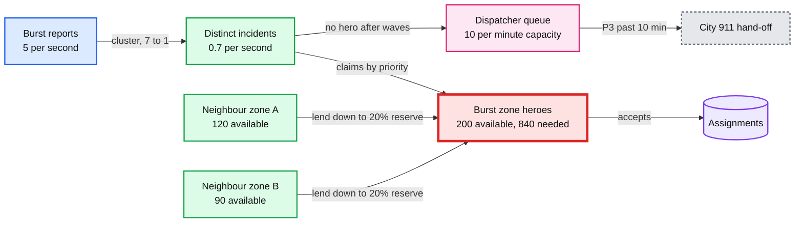
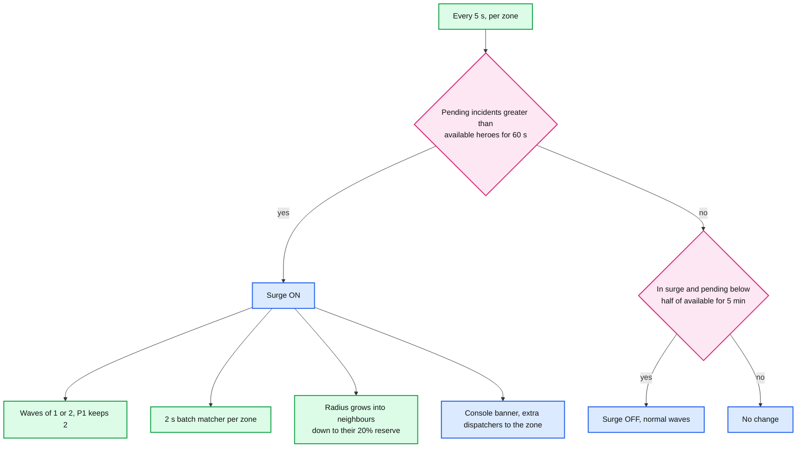
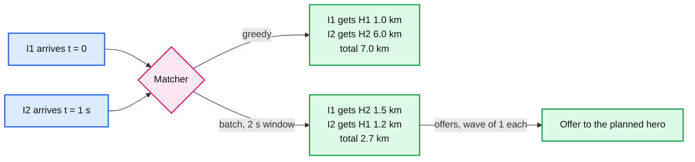

# Deep dive: surge and graceful degradation

> One-line answer: a 50x burst into one neighbourhood does not break any component. Postgres, Redis, the gateway and the workers all keep 10x or more headroom. What runs out is **heroes within reach**, then **dispatcher attention**. Little's law says why: at ~20 minutes per incident, the metro's average 0.83 incidents/s keeps ~1,000 heroes busy, and the 8.3/s peak sustained for 20 minutes would need all 10,000. So the design spends its effort on allocating scarce heroes well: **collapse duplicate reports** (same type, within 150 m and 10 minutes, never across type or up in severity), **claim by priority**, switch a zone into **surge mode** when pending incidents exceed available heroes (waves of 1 or 2, then **2 s batch matching** that beats greedy), **pull heroes from neighbouring zones while keeping a ~20% reserve**, and escalate to dispatchers and the city's 911 in severity order. Autoscaling is the wrong reflex: more workers cannot create heroes.

Zoom-in on [`../solution.md`](../solution.md) §5.5 and §10.3. Reusable block: [`../../../concepts/rate-limiting-and-load-shedding.md`](../../../concepts/rate-limiting-and-load-shedding.md) (shedding by priority, hysteresis). Siblings: [`offer-strategy-and-timeouts.md`](offer-strategy-and-timeouts.md) (wave sizes, one pending offer per hero), [`incident-state-machine-and-stuck-detection.md`](incident-state-machine-and-stuck-detection.md) (`ESCALATED`, `HANDED_OFF`), [`location-index-vs-truth.md`](location-index-vs-truth.md) (zone counts from the index).

---

## 1. The scenario, with numbers

A gas explosion in a dense neighbourhood. Assumptions [estimate]:

| Quantity | Normal peak hour | During the burst |
|---|---|---|
| Reports from the neighbourhood | ~0.1/s | **~5/s** (50x), for ~10 minutes |
| Distinct incidents after clustering | ~0.1/s | ~0.7/s (most reports are the same fires and collapses), **~400 in 10 minutes** |
| On-duty heroes within 5 km | ~390 | ~390 |
| Of those, available | ~200 | ~200 at the start, falling fast |
| Time per incident (offer to resolved) | ~20 min | ~20 min or longer |
| Metro-wide reports | ~8.3/s | ~13/s |

Little's law for the neighbourhood: heroes needed at once = incident rate x time per incident = `0.7/s x 1,200 s = ~840`. Available nearby: ~200. **The neighbourhood is short ~640 heroes for as long as the burst lasts.** No software fixes that. Software decides who waits.

---

## 2. Walk the path: what breaks first

| Component | Load during the burst | Capacity | Breaks? |
|---|---|---|---|
| Dispatch API and Postgres | ~13 reports/s metro-wide, ~150 to 200 commits/s. Budget for 40/s worst case: ~500 commits/s | Several thousand commits/s | No. Still ~10x headroom |
| Dispatch workers | ~3x the normal task steps | 4 pods, ~800 steps/s | No |
| Redis GEO | Same 2,000 pings/s, ~3x searches | ~100k ops/s | No |
| Hero gateway and push | ~200 messages/s | Thousands per node | No |
| **Available heroes within 5 km** | ~400 incidents in 10 min vs ~200 heroes | ~200, each busy ~20 min | **Yes, first, at minute ~5** |
| Dispatchers covering the zone | Escalations at ~20 to 40 a minute | ~10 dispatchers x ~1 a minute | **Yes, second** |

---

## 3. Step 1: collapse duplicate reports

A burning building gets 50 reports in 2 minutes. Without clustering, 50 incidents run waves of 3 and reserve 150 heroes for one fire.

**The rule.** A new report attaches to an open incident as a **linked report** when all of these hold:
- same incident type;
- within 150 m of the open incident's location;
- the open incident was created within the last 10 minutes;
- the new report's severity is **not higher** than the open incident's.

Otherwise it becomes its own incident. A linked report still gets a `report_id`, a row, and a reply: "Help is already on the way to an incident reported nearby. Tap if this is a different emergency." Tapping splits it into its own incident immediately.

**The false-merge risk, and why the rule is shaped this way.**

| Error | Example | Cost | Guard |
|---|---|---|---|
| False merge | A heart attack 100 m from a car fire, both typed "medical" | A real emergency waits on someone else's hero | Never merge up in severity. The civilian's one-tap split. The dispatcher sees linked reports and splits in one click |
| False split | The same fire reported as "fire" and "explosion" | Two heroes to one scene | Cheap. A dispatcher merges. Waste, not harm |

The asymmetry decides the rule: a false merge can cost a life, a false split costs a hero. So the rule is narrow (same type, small radius, never upward), and anything it misses becomes a separate incident.

- The check is one indexed query: open incidents in the report's `h3_r8` cell and its ring of neighbours (~530 m edge), filtered by type, distance and age. It runs inside the report transaction, so two reports of the same fire arriving together do not both become new incidents (the second waits on the first's insert through a short advisory lock on the cell, ~1 ms).

---

## 4. Step 2: priority, then surge mode

**Priority claims.** Workers already claim `ORDER BY priority, due_at`. In a burst that means every P1 step runs before any P3 step. P3 incidents wait in `DISPATCHING` with longer windows (20 s) and do not compete for the same heroes until P1 and P2 are served.

**Surge mode, per zone.** A zone is an H3 resolution-7 cell (~5.2 km², ~1.4 km edge) with its ring of neighbours.

- **Hysteresis** (on after 60 s over, off after 5 minutes well under) stops a zone flapping between modes every few seconds.
- **Smaller waves.** Every hero in a wave is reserved for that incident for up to 15 s. With 3 heroes per wave and 400 incidents, ~1,200 hero reservations chase ~200 heroes. Waves of 1 to 2 halve or third that, at the cost of a slower assignment per incident. The one-pending-offer-per-hero index already guarantees no hero is reserved twice.

---

## 5. Step 3: batch matching beats greedy when heroes are scarce

Greedy takes incidents one at a time and gives each the best hero available at that moment. When heroes are plentiful, the "best" hero for one incident does not matter to the next. When they are scarce, it does.

**A tiny example.** Two incidents arrive 1 s apart. Two heroes are available.

| | Incident I1 (first) | Incident I2 (1 s later) |
|---|---|---|
| Hero H1 | 1.0 km | 1.2 km |
| Hero H2 | 1.5 km | 6.0 km |

- **Greedy:** I1 takes its nearest, H1 (1.0 km). I2 gets H2 (6.0 km). Total 7.0 km, and I2 waits for a hero 6 km away.
- **Batch over 2 s:** the matcher sees both and minimizes total distance: H2 to I1 (1.5 km), H1 to I2 (1.2 km). Total 2.7 km, worst 1.5 km.

How it runs:
- One matcher job per surge zone, holding a lease on the zone (same lease pattern as the task rows). Every 2 s it reads pending incidents and available heroes in the zone, builds a cost matrix (distance, divided by a severity weight: P1 x 3, P2 x 2, P3 x 1, so P1 incidents look "closer"), and solves the assignment problem. At ~50 x 100 it takes well under 10 ms with the Hungarian algorithm.
- The output is a **plan**, not an assignment: one offer per incident to its planned hero, sent through the normal wave transaction. The accept is the same guarded transaction. If the planned hero declines, the next round re-plans.
- Lyft reports that a greedy approach raised combined rider wait plus driver travel from 8 to 12 minutes (50%) against its batched matching. That is the size of prize when supply is tight.
- **Why it is off in normal mode:** it adds up to 2 s to every incident, and when heroes are plentiful greedy is already near optimal.

---

## 6. Step 4: borrow heroes, keep a reserve

- In surge, the radius ladder extends into neighbouring zones (5 km, then 10 km) as usual.
- Each neighbouring zone has a **reserve floor**: at least ~20% of its on-duty heroes [estimate], and never fewer than 5, must stay available for incidents in that zone. Candidate filtering drops a neighbouring hero if taking them would breach the floor. The floor is counted from Postgres `AVAILABLE` heroes in the zone, cached for 5 s.
- Without the floor, the disaster drains the city. The next zone's cardiac arrest, 6 km away, finds nobody.
- Dispatch operations can change floors per zone during a declared disaster. That is a config change with an audit entry, not a deploy.

---

## 7. Step 5: escalate in severity order

When waves run out:

| Severity | After | Goes to |
|---|---|---|
| P1 | 3 waves (~55 s) | `ESCALATED`, top of the zone's dispatcher queue, 30 s SLA |
| P2 | 3 waves | `ESCALATED`, after all P1 |
| P3 | 5 waves, or 10 min in `ESCALATED` | Suggested `HANDED_OFF` to the city's 911 service. A dispatcher confirms in bulk |

**Dispatcher attention is the second bottleneck.** ~10 dispatchers on the zone handle ~1 escalation a minute each by phone, ~10 a minute. A burst can escalate 20 to 40 a minute. What the console does about it:
- **Sort, don't scroll:** P1 oldest first, then P2. P3 collapses into one "bulk hand-off" row.
- **Borrow dispatchers:** zone coverage is config. The floor supervisor moves dispatchers from quiet zones with one action.
- **Cluster view:** linked reports and nearby incidents of the same type show as one group, so one dispatcher can assign one hero team to a cluster.
- **City hand-off is a first-class exit, not a failure.** Real dispatch centres keep a manual fallback. Houston's CAD crashed in March 2024 and fire dispatch ran on paper for ~4.5 hours. Our equivalent is the hand-off to the city's own system.

---

## 8. What not to do

| Reflex | Why it is wrong here |
|---|---|
| Autoscale the dispatch workers | They were at ~30% load. More workers send the same scarce heroes more offers, faster |
| Shed load by rejecting reports | A report is the one input we must never drop. Clustering and triage reduce work without refusing anyone |
| Broadcast to every hero in 10 km "to be safe" | Every hero is reserved by every incident at once. Assignment gets slower, not faster, and the losers all got distracted |
| Merge aggressively to save heroes | A false merge can leave a separate emergency with no one |
| Drain neighbouring zones | Moves the outage to the next neighbourhood |

The load-shedding we do is by **priority, not by refusal**: P3 waits longer and may be handed off, P1 never waits behind P3 ([`../../../concepts/rate-limiting-and-load-shedding.md`](../../../concepts/rate-limiting-and-load-shedding.md)).

---

## 9. What the on-call and the floor see

- **Signal:** the "available heroes vs pending incidents per zone" panel goes red for the burst zone. Surge mode turns on within ~60 s.
- **Not an engineering page.** Every engineering SLO (time to first offer, overdue tasks, sweeper) stays green, because the machinery is fine. The floor supervisor is paged by the escalation-queue age.
- **Metrics that tell whether the policy worked:** P1 time to assignment during the burst; heroes borrowed vs reserve floors held; false-merge splits (civilian taps "different emergency"); hand-offs by severity.

---

## 10. Trade-offs

| Decision | Chose | Rejected | Why |
|---|---|---|---|
| Duplicate reports | Narrow auto-attach, never across type or up in severity, one-tap split | No clustering, or broad merging | 50 reports must not reserve 150 heroes, and a false merge is worse than a false split |
| Who goes first | Priority claims, P1 before P3 | First come, first served | The prompt ranks a missed emergency worst |
| Matching | Greedy normally, 2 s batch in surge | Batch always | Batch costs 2 s, and only pays when heroes are scarce |
| Wave size in surge | 1 to 2 | Keep 3 to 5 | Fewer reservations per incident when every hero counts |
| Neighbours | Borrow down to a ~20% reserve | Unlimited borrowing, or none | Do not move the outage, do not waste idle heroes nearby |
| Overflow | Escalate by severity, bulk hand-off for P3 | Keep retrying waves forever | A human or the city owns what we cannot staff |

---

## 11. Interview soundbite

"Nothing in the machinery breaks: at 50x in one neighbourhood Postgres is still at a few hundred commits a second. Heroes break. At 20 minutes per incident the burst needs ~840 heroes nearby and there are ~200. So I cluster duplicate reports narrowly, claim by priority, and switch the zone to surge mode: waves of 1 or 2, a 2 s batch matcher that beats greedy, borrowing from neighbours down to a 20% reserve, then escalation by severity with P3 handed to the city. Autoscaling is the wrong answer, because more workers can't create heroes."
