# Diagrams: superhero dispatch

The D1 to D12 set from `hld/CLAUDE.md` §4. Diagrams already in [`solution.md`](solution.md) are listed with a pointer, not pasted twice. Every diagram below adds a zoom-in or a path that `solution.md` does not draw. Numbers match `solution.md`. Durations that are new here are marked [estimate] in the caption.

| # | Diagram | Where |
|---|---|---|
| D1 | Context | below |
| D2 | Data flow | below |
| D3 | Component architecture | Zoom-out: `solution.md` §6 (Postgres primary in red). Zoom-ins below: [D3a dispatch core](#d3a-dispatch-core-zoom-in), [D3b hero connectivity](#d3b-hero-connectivity-zoom-in) |
| D4 | Happy path per FR | Already in `solution.md`: FR1 report §4.1, FR2 offers §4.2, FR3 two-hero race §4.3, FR4 window expiry §4.4, FR5 stale override §4.5. Below: [D4a](#d4a-fr1-report-with-a-retried-request) to [D4e](#d4e-fr5-dispatcher-cancels-an-assigned-incident) |
| D5 | Failure paths | Primary failover during an accept: §10.4 A. Below: [D5a](#d5a-accept-commits-the-response-is-lost-the-hero-retries) to [D5d](#d5d-the-cdc-slot-stalls) |
| D6 | Decision flow | Below: [D6a worker step function](#d6a-dispatch-worker-step-function), [D6b accept transaction](#d6b-accept-transaction-guards) |
| D7 | Entity relationship | System-of-record schema: §3.3. Below: [D7a retention and partitions](#d7a-retention-partitions-and-lifetimes), [D7b Redis keys](#d7b-redis-keys) |
| D8 | State machines | Incident lifecycle: §4.4. Below: [D8a offer](#d8a-offer-lifecycle), [D8b hero duty status](#d8b-hero-duty-status), [D8c assignment](#d8c-assignment-and-the-fencing-token) |
| D9 | Deployment / topology | below |
| D10 | Scaling / partitioning | below |
| D11 | Failure mode map | below, D11a and D11b |
| D12 | Rollout / migration | below |

---

## D1. Context (zoom-out)

The dispatch platform as one box. Three kinds of people use it. Two outside systems carry its messages. One outside system takes what it cannot handle.

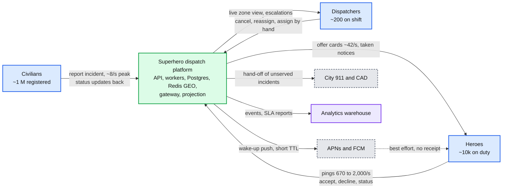

---

## D2. Data flow (DFD)

Inputs to outputs with format, size and peak rate. Two streams never touch: the location stream (big, losable) and the incident stream (small, must not lose).

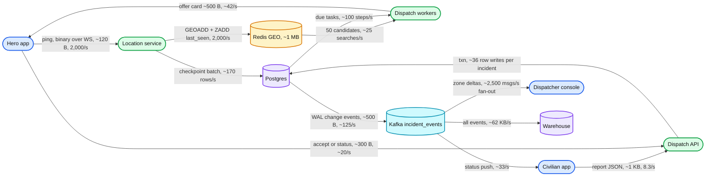

---

## D3. Component architecture

The zoom-out is the final design in [`solution.md` §6](solution.md#6-final-design-and-the-core-flows). It is not repeated here. The two zoom-ins below show what sits inside the boxes.

### D3a. Dispatch core zoom-in

Everything that can change an incident's state goes through one function. Red = the primary, the single place all of it commits.

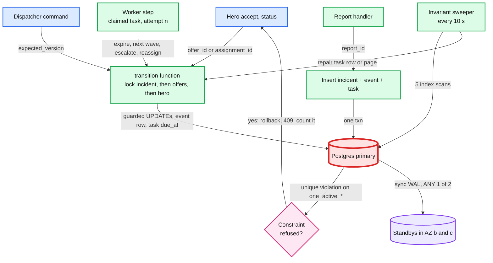

### D3b. Hero connectivity zoom-in

How an offer finds a hero. The socket is the primary path. Push only wakes the app so it can open a socket and pull.

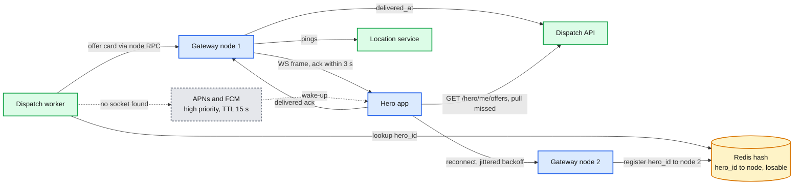

---

## D4. Happy paths, one per FR

`solution.md` §4 already draws one sequence per FR. These five are the companion paths: each FR with the detail §4 leaves out.

### D4a. FR1: report with a retried request

The civilian's phone drops the first response. The retry with the same `report_id` returns the same incident. No second incident, no second dispatch.

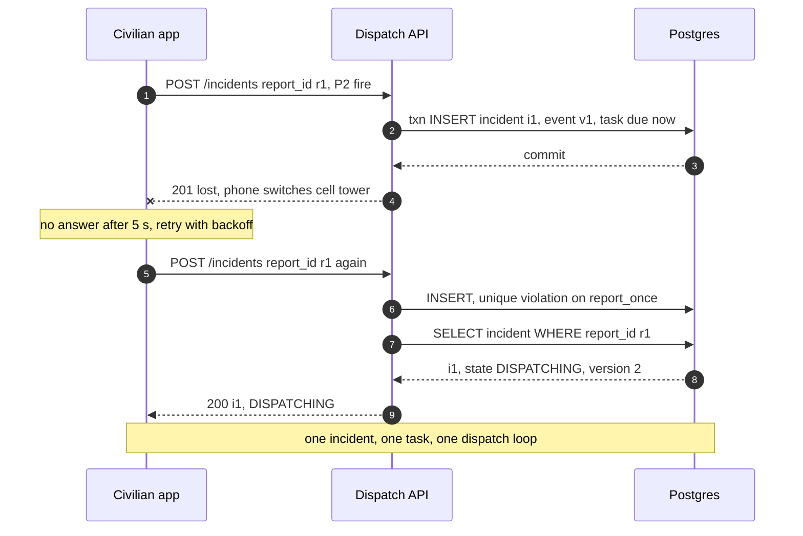

### D4b. FR2: wave with one undelivered offer

A P2 wave of 3. Two cards are acked in ~300 ms. The third is not, so its slot moves to the 4th candidate at 3 s instead of waiting 15 s.

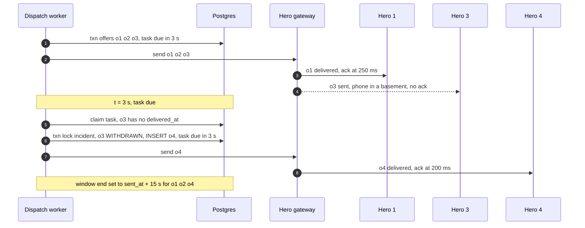

### D4c. FR3: the winner's accept and the losers' notices

The guaranteed notice path is the task row, woken in the accept transaction. The fast path is a best-effort send from the API right after commit.

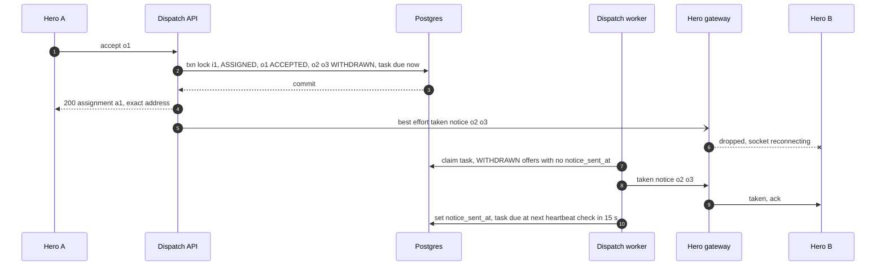

### D4d. FR4: from assigned to resolved

Every hero status update carries the assignment id. The task row turns into a heartbeat checker while the hero is assigned.

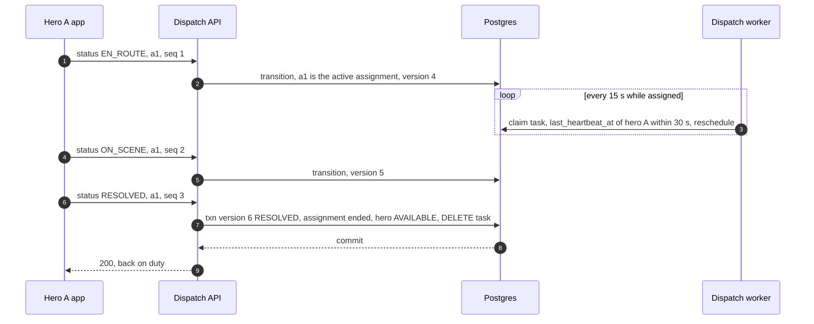

### D4e. FR5: dispatcher cancels an assigned incident

The cancel goes through the same `transition()`. The hero is released in the same transaction and hears about it through the task path.

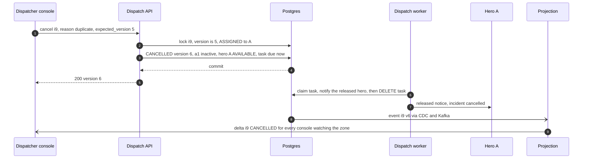

---

## D5. Failure paths

The primary failover during an accept is in [`solution.md` §10.4 A](solution.md#104-failure-timeline). Four more below.

### D5a. Accept commits, the response is lost, the hero retries

The accept is idempotent per `offer_id`. No key store. The offer row is the record.

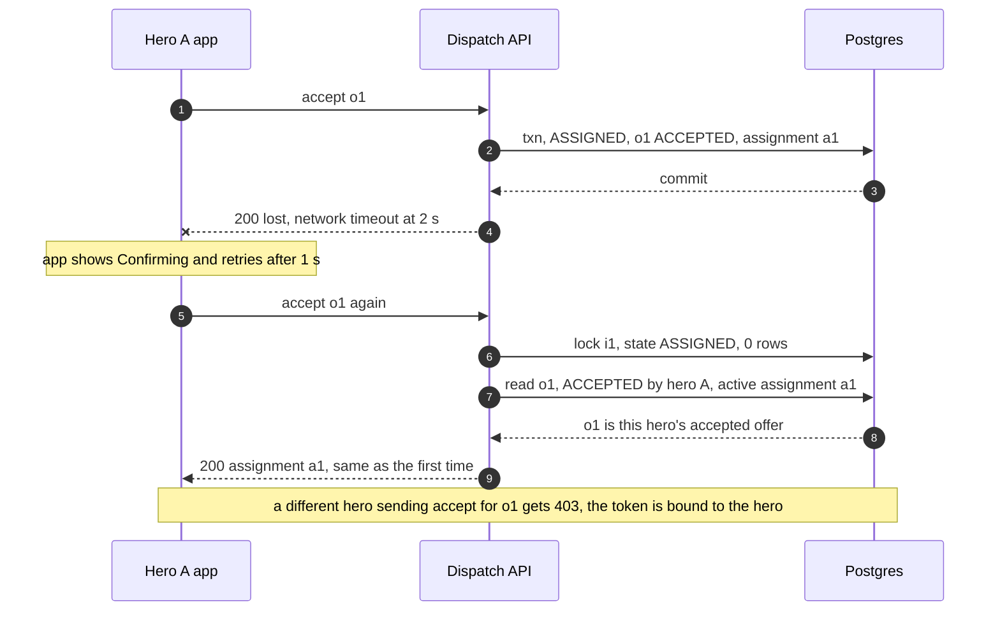

### D5b. Redis GEO primary lost, fallback to the 60 s checkpoint

The location index is losable by design. For ~15 s, candidates come from Postgres's 60 s checkpoint with a wider radius.

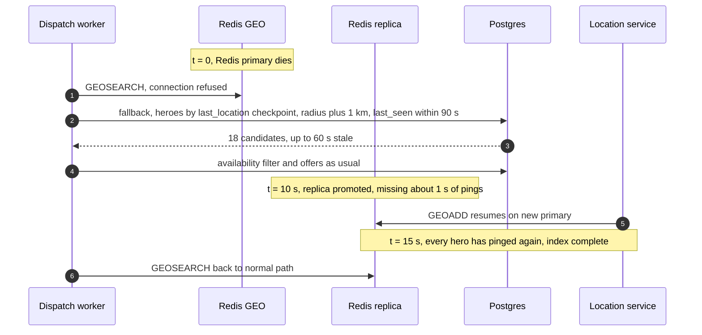

### D5c. Dispatcher cancel races a hero accept

Both writers lock the incident row first. Whoever gets the lock decides. The other gets a clear `409`.

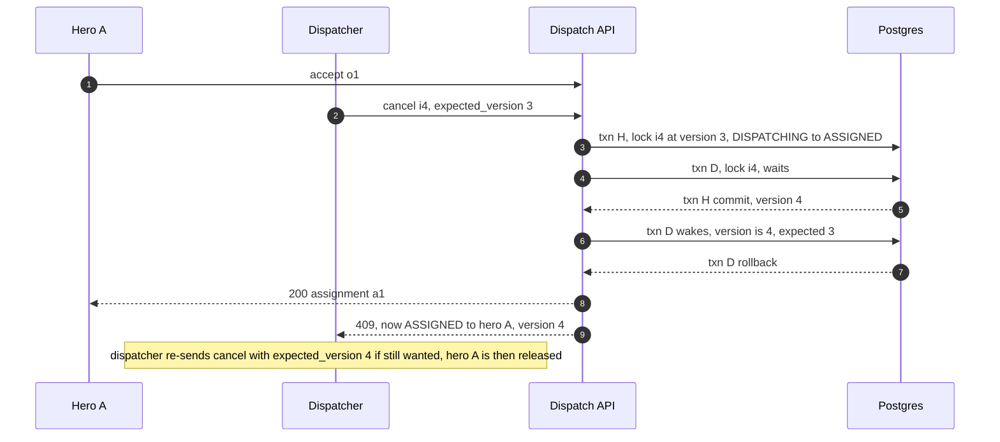

### D5d. The CDC slot stalls

The read side may never hurt the write side. A dead Debezium connector pins WAL on the primary until the cap drops the slot.

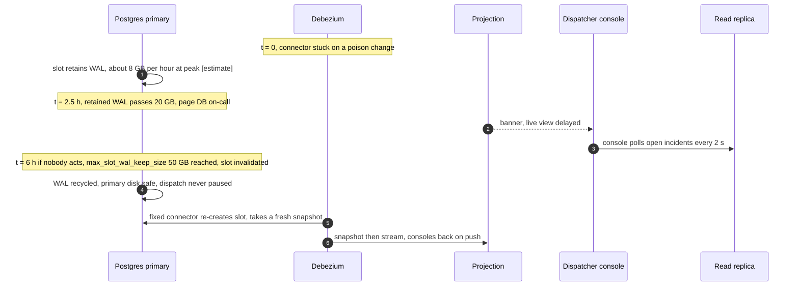

---

## D6. Decision flows

### D6a. Dispatch worker step function

One claimed task, one step. The branch is the incident's state. Every exit sets the next `due_at` or deletes the task, inside the same transaction as the state change.

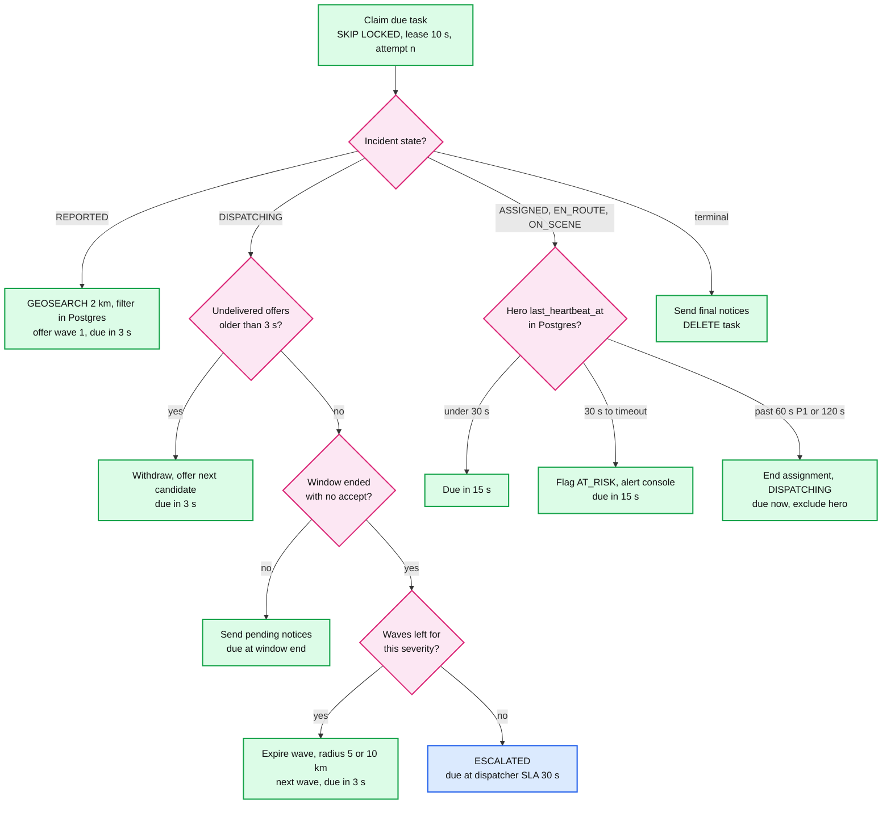

`ESCALATED` is blue because it hands the incident to a human on the dispatcher console. It is not red: nothing in this flow is the first thing to break. From `ON_SCENE`, the reassign branch only recommends. A dispatcher confirms (`solution.md` §5.4). Every write ends with `UPDATE dispatch_task ... WHERE attempt = n`, so a fenced worker rolls back.

### D6b. Accept transaction guards

The order of checks inside the accept, and the response each failure maps to.

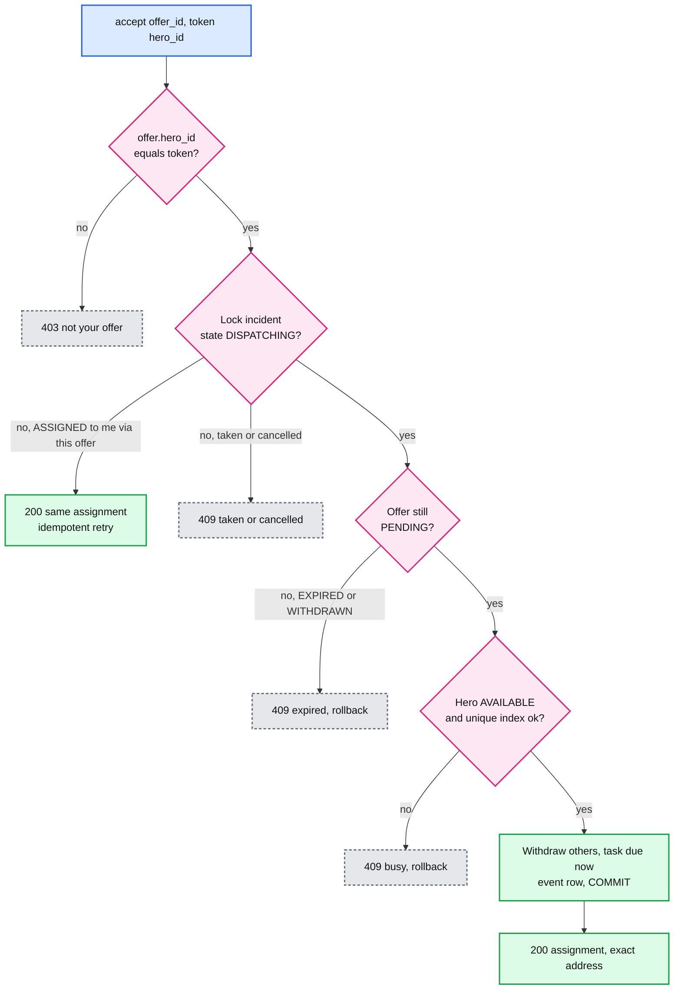

The ownership check is a read before the lock. It touches no shared row, so it does not break the incident-first lock order.

---

## D7. Entity relationship

The system-of-record schema with PKs, FKs and unique indexes is in [`solution.md` §3.3](solution.md#33-data-model). The two diagrams below add what the ERD leaves out: how long each thing lives, and the losable keys in Redis.

### D7a. Retention, partitions and lifetimes

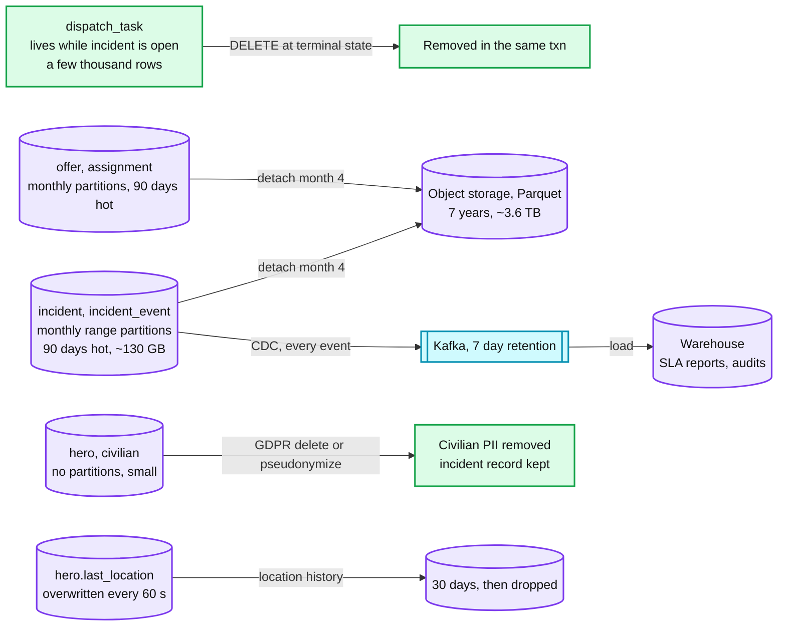

### D7b. Redis keys

Everything in Redis can be lost and rebuilt within one ping interval (15 s). Nothing in Redis is read at commit time.

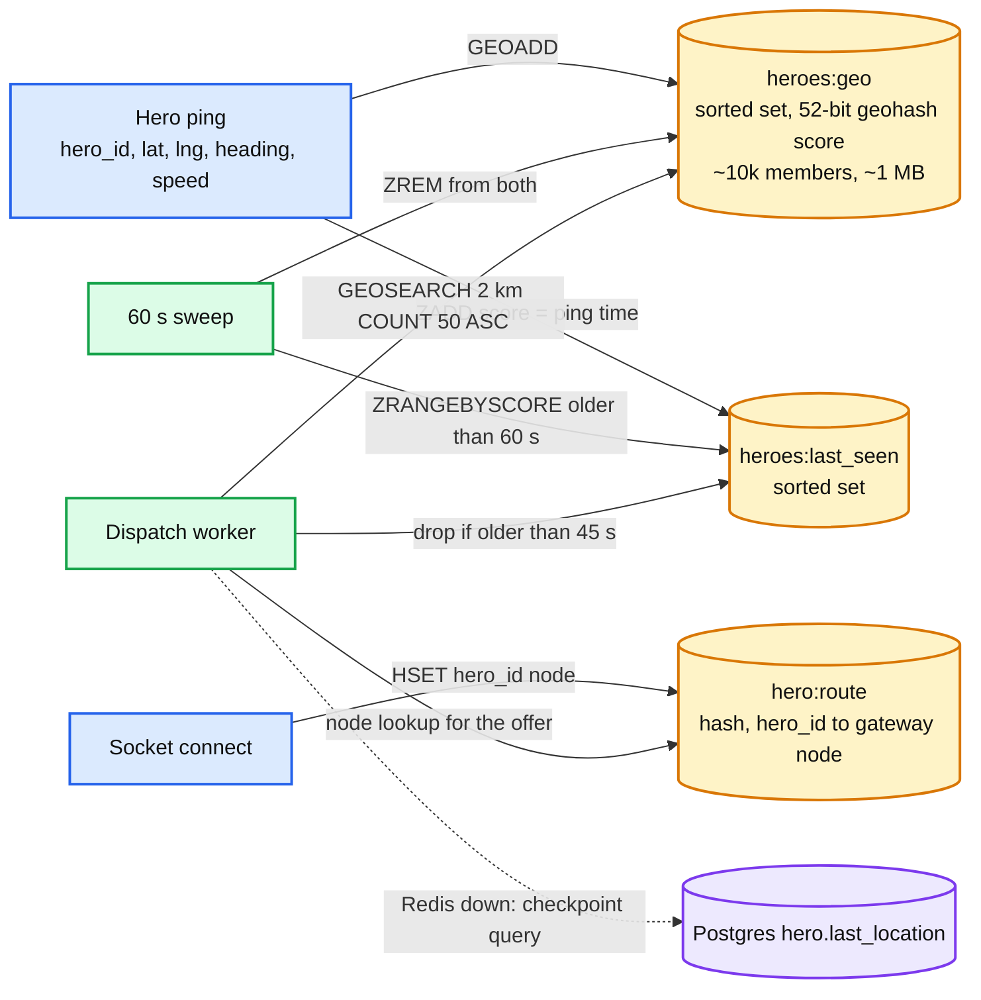

`maxmemory-policy noeviction`: eviction would silently remove heroes and look like "nobody nearby".

---

## D8. State machines

The incident lifecycle is in [`solution.md` §4.4](solution.md#44-lifecycle-a-validated-state-machine-with-one-clock). The three below are the other entities with a lifecycle.

### D8a. Offer lifecycle

Every arrow out of `PENDING` is a transition that first locks the incident row, so accept, expiry and withdrawal cannot both happen.

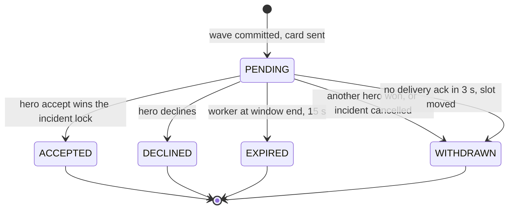

`one_pending_offer_per_hero` means a hero is in `PENDING` for at most one incident at a time.

### D8b. Hero duty status

`BUSY` holds exactly when the hero has an active assignment. `UNREACHABLE` keeps a hero who went silent out of new waves until they ping again.

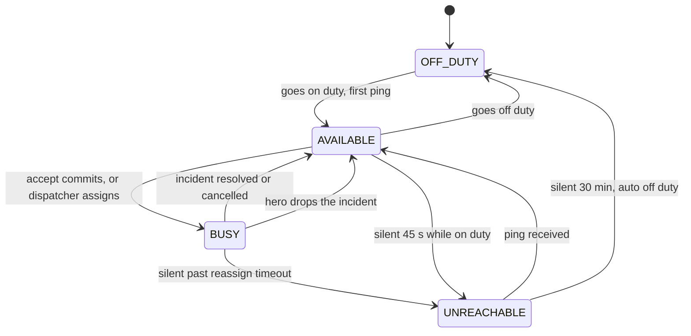

### D8c. Assignment and the fencing token

The assignment id is checked on every hero status update. Once inactive, it can never become active again, so a released hero's late updates are refused forever.

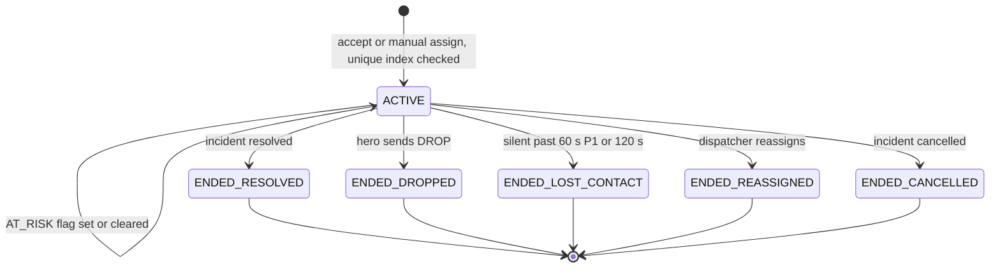

---

## D9. Deployment / topology

One region, three AZs. The primary is red: the one box whose loss pauses writes (~30 s [estimate]). Only the async DR stream crosses the region boundary.

```mermaid
%% D9: deployment. Sync replication inside the region, async to DR. Stateless tiers in every AZ.
flowchart LR
    subgraph AZA[AZ a]
        PGP[(Postgres primary)]
        SA[API, workers, gateway<br/>1/3 of pods]
        RDP[(Redis GEO primary)]
    end
    subgraph AZB[AZ b]
        PGB[(Standby b, sync)]
        SB[API, workers, gateway<br/>1/3 of pods]
        RDR[(Redis replica)]
    end
    subgraph AZC[AZ c]
        PGC[(Standby c, sync)]
        SC[API, workers, gateway<br/>1/3 of pods]
        KF[[Kafka, 3 brokers<br/>one per AZ]]
    end
    subgraph DR[DR region]
        PGD[(Async replica<br/>RPO under 5 s)]
    end
    SA -->|"writes"| PGP
    SB -->|"writes, cross-AZ ~1 ms"| PGP
    SC -->|"writes, cross-AZ ~1 ms"| PGP
    PGP -->|"WAL, ANY 1 of b, c"| PGB
    PGP -->|"WAL, ANY 1 of b, c"| PGC
    PGP -.->|"async WAL, cross-region"| PGD
    RDP -->|"async replication"| RDR
    PGP -->|"logical slot via Debezium"| KF

    class PGP critical
    class PGB,PGC,PGD store
    class SA,SB,SC service
    class RDP,RDR cache
    class KF queue

    classDef service  fill:#dcfce7,stroke:#16a34a,stroke-width:2px,color:#111
    classDef store    fill:#ede9fe,stroke:#7c3aed,stroke-width:2px,color:#111
    classDef cache    fill:#fef3c7,stroke:#d97706,stroke-width:2px,color:#111
    classDef queue    fill:#cffafe,stroke:#0891b2,stroke-width:2px,color:#111
    classDef critical fill:#fee2e2,stroke:#dc2626,stroke-width:4px,color:#111
```

---

## D10. Scaling / partitioning

**There is no sharding today.** One Postgres primary at ~100 commits/s and one Redis node at ~2% of a core are far from any limit (`solution.md` §10.3). The partitioning that matters is people: under a surge one zone runs out of heroes. The future shard key is `city_id`, one independent cell per city. Kafka is the only component that is partitioned now, by `incident_id`, so each incident's events stay in order.

```mermaid
%% D10: today one cell per city with no shards inside. Red = the hot zone's hero supply, the first thing that runs out. Fix: clustering, priority, reserves, batch matching.
flowchart LR
    RT[Edge router<br/>city from incident location] -->|"city A"| CA[Cell: city A<br/>own Postgres, Redis, workers]
    RT -->|"city B, future"| CB[Cell: city B]
    CA -->|"incidents by zone, h3_r6"| Z1[Zone 1<br/>~200 heroes, normal]
    CA -->|"50x surge"| ZH[Zone 7<br/>~200 heroes vs ~400 incidents in 10 min]
    ZH -->|"radius grows, keep 20% reserve"| Z1
    CA -->|"surge mode"| BM[2 s batch matcher<br/>per hot zone]
    BM -->|"assignment plan"| ZH
    CA -->|"events keyed by incident_id"| KP[[Kafka, 12 partitions<br/>~10 events/s each]]

    class RT client
    class CA,CB,BM service
    class Z1 store
    class ZH critical
    class KP queue

    classDef client   fill:#dbeafe,stroke:#2563eb,stroke-width:2px,color:#111
    classDef service  fill:#dcfce7,stroke:#16a34a,stroke-width:2px,color:#111
    classDef store    fill:#ede9fe,stroke:#7c3aed,stroke-width:2px,color:#111
    classDef queue    fill:#cffafe,stroke:#0891b2,stroke-width:2px,color:#111
    classDef critical fill:#fee2e2,stroke:#dc2626,stroke-width:4px,color:#111
```

Why `city_id` and not H3 cells inside a city: an incident and its candidate heroes almost always share a city, so the accept stays single-shard. Sharding by cell inside a city would put heroes near a cell border in two shards and make the accept a cross-shard transaction.

---

## D11. Failure mode map

### D11a. Write path and state

```mermaid
%% D11a: component, then what fails, then blast radius, then mitigation. Red = the primary.
flowchart TD
    PG[Postgres primary] -->|"dies"| PG1[All writes paused ~30 s]
    PG1 -->|"mitigation"| PG2[Sync standby promoted, client retries<br/>no clock-based expiry, RPO 0]
    PG -->|"lock pile-up"| PG3[Slow accepts]
    PG3 -->|"mitigation"| PG4[lock_timeout 2 s, idle txn timeout 5 s<br/>no dashboard reads on primary]
    DW[Dispatch workers] -->|"all down"| DW1[No offers, timers stop]
    DW1 -->|"mitigation"| DW2[Overdue task alert at 30 s<br/>dispatchers assign by hand]
    DW -->|"one dies mid-step"| DW3[One incident paused up to 10 s]
    DW3 -->|"mitigation"| DW4[Lease expiry, attempt fencing<br/>resend by offer_id]
    BUG[transition code] -->|"bad deploy"| BUG1[Wrong or stuck states]
    BUG1 -->|"mitigation"| BUG2[Unique indexes still hold<br/>sweeper every 10 s, zone canary]

    class PG critical
    class DW,BUG service
    class PG1,DW1,DW3,BUG1 decision
    class PG2,PG4,DW2,DW4,BUG2 store

    classDef service  fill:#dcfce7,stroke:#16a34a,stroke-width:2px,color:#111
    classDef store    fill:#ede9fe,stroke:#7c3aed,stroke-width:2px,color:#111
    classDef critical fill:#fee2e2,stroke:#dc2626,stroke-width:4px,color:#111
    classDef decision fill:#fce7f3,stroke:#db2777,stroke-width:2px,color:#111
```

Pink here marks the blast radius, purple the mitigation.

### D11b. Read path, delivery and people

```mermaid
%% D11b: the losable and external parts. None of these can cause a double assignment. Red = hero supply, the first thing a surge exhausts.
flowchart TD
    RD[Redis GEO] -->|"primary lost"| RD1[No candidate search ~15 s]
    RD1 -->|"mitigation"| RD2[Replica promote, 60 s checkpoint<br/>radius plus 1 km]
    GW[Hero gateway node] -->|"lost"| GW1[1/3 of sockets drop]
    GW1 -->|"mitigation"| GW2[Reconnect to another node<br/>pull missed offers]
    PU[APNs and FCM] -->|"slow or down"| PU1[Socketless heroes miss offers]
    PU1 -->|"mitigation"| PU2[3 s delivery ack, slot moves on<br/>rank socket heroes higher]
    CDC[CDC and Kafka] -->|"stalled"| CDC1[Consoles stale, slot pins WAL]
    CDC1 -->|"mitigation"| CDC2[Replica polling, 50 GB WAL cap]
    SUP[Local hero supply] -->|"50x surge"| SUP1[Incidents wait, escalations pile up]
    SUP1 -->|"mitigation"| SUP2[Clustering, P1 first, smaller waves<br/>batch matching, zone reserves]

    class RD cache
    class GW client
    class PU external
    class CDC queue
    class SUP critical
    class RD1,GW1,PU1,CDC1,SUP1 decision
    class RD2,GW2,PU2,CDC2,SUP2 store

    classDef client   fill:#dbeafe,stroke:#2563eb,stroke-width:2px,color:#111
    classDef store    fill:#ede9fe,stroke:#7c3aed,stroke-width:2px,color:#111
    classDef cache    fill:#fef3c7,stroke:#d97706,stroke-width:2px,color:#111
    classDef queue    fill:#cffafe,stroke:#0891b2,stroke-width:2px,color:#111
    classDef critical fill:#fee2e2,stroke:#dc2626,stroke-width:4px,color:#111
    classDef external fill:#e5e7eb,stroke:#6b7280,stroke-width:2px,color:#111,stroke-dasharray:4 3
    classDef decision fill:#fce7f3,stroke:#db2777,stroke-width:2px,color:#111
```

---

## D12. Rollout / migration

From a human dispatch center (phones, radios, a basic CAD) to automated offers, one severity at a time. Each phase has a rollback point: a per-severity, per-zone switch back to "assisted". The manual path never goes away. Durations are [estimate].

```mermaid
%% D12: migration phases. Milestones are the go or no-go gates, each one a rollback point.
gantt
    title Human dispatch to automated offers
    dateFormat YYYY-MM-DD
    axisFormat %b %d
    section Build
    Schema, transition, workers, sweeper     :b1, 2027-01-04, 42d
    Hero app offer flow, gateway             :b2, 2027-01-04, 42d
    section Shadow
    Shadow, compute offers, send nothing     :s1, after b1, 28d
    Gate top-3 match rate and latency        :milestone, m1, after s1, 0d
    section Assisted
    Console recommends, dispatcher clicks    :a1, after m1, 28d
    Gate rollback point 1                    :milestone, m2, after a1, 0d
    section Auto
    Auto offers for P3, zone by zone         :p3, after m2, 21d
    Gate rollback point 2                    :milestone, m3, after p3, 0d
    Auto offers for P2                       :p2, after m3, 28d
    Gate 0 drops, 0 double assignments 30d   :milestone, m4, after p2, 0d
    Auto offers for P1                       :p1, after m4, 28d
    Gate rollback point 4                    :milestone, m5, after p1, 0d
    section Steady state
    Dispatchers own the escalation queue     :st, after m5, 30d
```

Gates: shadow needs the human's chosen hero in our top 3 for at least 80% of incidents [estimate] and time to first offer p99 under 2 s. Each auto phase needs a month with zero sweeper violations and zero refused double assignments in the phase before. Rollback at any gate is the per-severity setting back to "assisted", with no data to backfill, because every incident is in Postgres either way.
