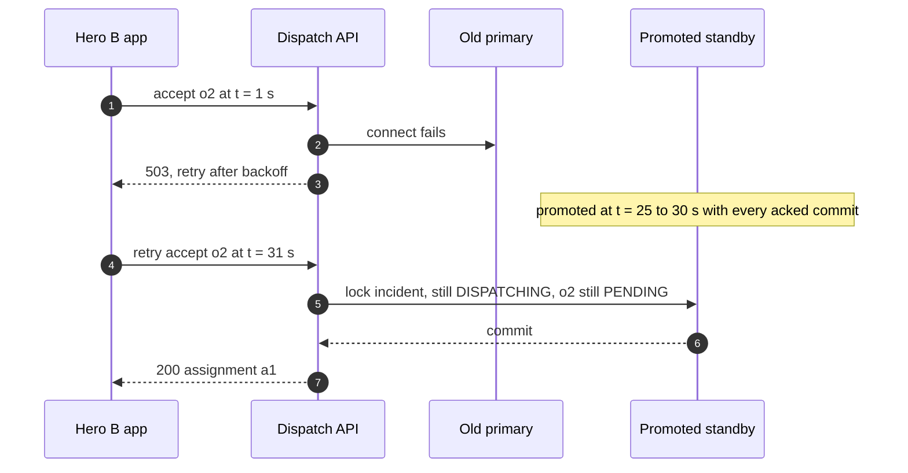
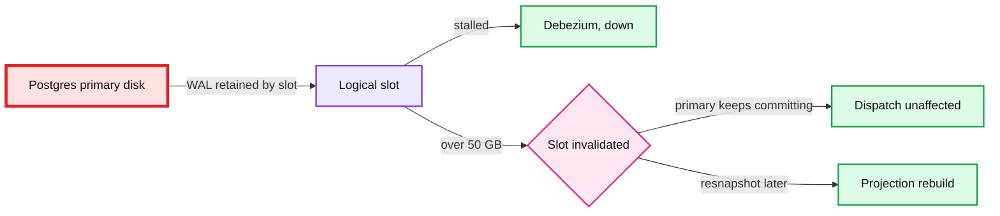
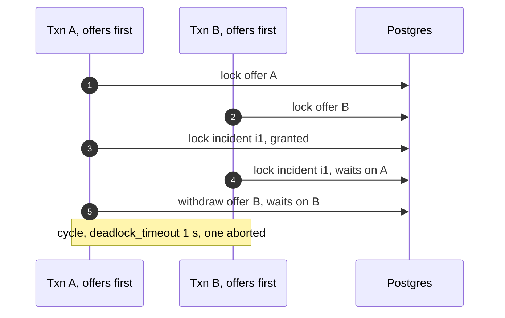
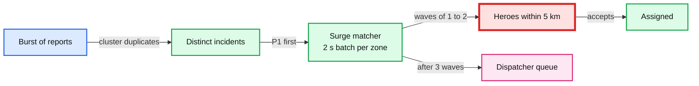

# Edge cases: superhero dispatch

Every entry is answerable in under 60 seconds out loud. Categories: failure, consistency, scale, data, operations, security. Design reference: [`solution.md`](solution.md).

The design these answers lean on, in one breath: Postgres is the system of record (one primary, two standbys, `ANY 1` synchronous commit, ~30 s failover). Redis GEO is a lossy location hint. One `dispatch_task` row per open incident is the outbox, the queue and the only clock (10 s lease, 250 ms poll, `NOTIFY` wake-up). Offers go out in waves of 5 / 3 / 2 by severity with a 3 s delivery ack and a 15 s decision window. Every state change goes through one `transition()` that locks the incident row first. Partial unique indexes make a second active assignment per incident or per hero impossible. Numbers marked [estimate] are working assumptions, not measurements.

---

## Failure

## Edge case: Postgres primary dies while a hero is accepting
- **Trigger:** the primary's host fails at t = 0. Hero B taps accept at t = 1 s, 9 s into a 15 s window.
- **Symptom:** the hero app shows a spinner. The API returns `503`. On-call gets a failover page and a ~30 s spike of `503`s.
- **Answer:**
  - The app retries the same `accept o2` with backoff for up to 60 s. A standby is promoted in ~25 to 30 s and holds every acknowledged commit (RPO 0 from `ANY 1 (b, c)`).
  - Nothing expired meanwhile. Expiry is a worker transition, and workers cannot commit during the outage either. There is no `expires_at > now()` in the accept.
  - The retry at ~31 s finds the incident `DISPATCHING` and o2 `PENDING`, commits, returns `200`. B wins, as they would have without the outage.
  - Budget: ~4 failovers a year x 30 s = ~2 min of delay, ~4% of a 99.99% budget. Delay, never loss.
- **Diagram:**

- **Confidence:** [ ] shaky  [ ] ok  [ ] confident

## Edge case: commit in doubt (primary dies at the moment of COMMIT)
- **Trigger:** the API sends `COMMIT` for an accept or a report. The primary dies before the reply.
- **Symptom:** the API cannot tell whether the transaction committed.
- **Answer:**
  - Never assume. The client retries with the same key (`offer_id` or `report_id`) and the server re-reads.
  - With a synchronous standby, a commit that was flushed on the standby is on the new primary. The retry sees offer `ACCEPTED` by this hero and returns the same `200 {assignment_id}`. If it was not flushed, it was never acknowledged, and the retry runs the transaction fresh.
  - Both endpoints are idempotent by a stored key (a unique column), not by a cache that a failover could lose.
- **Confidence:** [ ] shaky  [ ] ok  [ ] confident

## Edge case: one synchronous standby is lost
- **Trigger:** the AZ b standby dies or falls behind.
- **Symptom:** none for users. A DB on-call alert "sync standby missing" if both go.
- **Answer:**
  - `synchronous_standby_names = 'ANY 1 (b, c)'`: a commit waits for one standby, so the AZ c standby keeps commits flowing. One cross-AZ round trip, ~1 to 2 ms, as before.
  - If both standbys are gone, commits block. Page the DB on-call. The choice is to keep blocking (RPO 0) or drop to async for a bounded time. For an emergency system, prefer a human decision within minutes over a silent RPO change.
  - Rebuild the lost standby from a base backup plus WAL. No data at risk.
- **Confidence:** [ ] shaky  [ ] ok  [ ] confident

## Edge case: dispatch worker dies after sending offers, before recording them
- **Trigger:** worker W1 commits wave 1 (o1 to o3, `sent_at` null), sends o1 and o2 over sockets, then is OOM-killed.
- **Symptom:** hero 3 does not get a card for ~10 s. Nothing else visible.
- **Answer:**
  - Heroes 1 and 2 ack delivery, and the gateway records `delivered_at` on their offers through the API.
  - W1's 10 s lease expires. W2 claims the task with `attempt + 1`, finds o3 with no `delivered_at`, and sends it. It does not resend o1 or o2.
  - If W2 does resend one, the app shows one card per `offer_id`. At-least-once delivery, dedupe at the receiver.
  - If W1 wakes up later and tries to write, its transaction ends with `WHERE attempt = $mine`, matches 0 rows, and rolls back. The attempt number is the fencing token.
- **Confidence:** [ ] shaky  [ ] ok  [ ] confident

## Edge case: the NOTIFY is lost
- **Trigger:** no worker is listening at the moment the report commits (all reconnecting after a deploy), so the notification is gone. `NOTIFY` is not durable.
- **Symptom:** first offer ~250 ms later than usual.
- **Answer:**
  - Workers also poll `dispatch_task WHERE due_at <= now()` every 250 ms. The task row is durable. The notification is only a wake-up hint.
  - Worst case adds 250 ms to a p99 budget of ~1.2 s, still inside the 2 s target.
- **Confidence:** [ ] shaky  [ ] ok  [ ] confident

## Edge case: all dispatch workers are down
- **Trigger:** a bad config crashes every worker pod, or the worker deployment is scaled to 0 by mistake.
- **Symptom:** reports succeed (`201`) but no offers go out. Timers stop. The console shows incidents piling up in `REPORTED`.
- **Answer:**
  - The "oldest overdue task > 30 s" alert pages dispatch core within 30 s. The sweeper also flags pending offers older than 30 s.
  - The console shows a banner "auto-dispatch degraded". Dispatchers work the queue by hand through `transition()`, which does not need workers. This is the manual path that is never removed.
  - When workers return, they claim overdue tasks `ORDER BY priority, due_at`, so P1 incidents go first. No incident is lost because every one still has its task row.
- **Confidence:** [ ] shaky  [ ] ok  [ ] confident

## Edge case: the Redis GEO index is lost
- **Trigger:** the Redis primary dies. The replica is promoted, losing the last ~1 s of pings, or the whole index is gone.
- **Symptom:** for up to ~15 s, `GEOSEARCH` returns few or no heroes. Time to first offer rises.
- **Answer:**
  - It is a lossy hint by design. Every on-duty hero pings every 5 to 15 s, so the index refills within one ping interval.
  - Meanwhile workers fall back to the 60 s location checkpoint in Postgres (`hero.last_location`) with the radius widened by 1 km.
  - Correctness is untouched. Availability is checked in Postgres and the accept is guarded there. Redis never decides an assignment.
- **Confidence:** [ ] shaky  [ ] ok  [ ] confident

## Edge case: a hero gateway node dies
- **Trigger:** one of 3 gateway nodes crashes. ~1/3 of the 10,000 hero sockets drop.
- **Symptom:** those heroes see "reconnecting" for a few seconds. Offers in flight to them are not acked.
- **Answer:**
  - Gateways are stateless. Apps reconnect with jittered backoff to another node and re-register in the `hero_id -> node` hash.
  - On reconnect the app pulls `GET /hero/me/offers` and gets any live offer it missed.
  - An offer sent during the gap gets no delivery ack in 3 s, so its slot moves to the next candidate. Push wakes heroes whose app is in the background.
- **Confidence:** [ ] shaky  [ ] ok  [ ] confident

## Edge case: APNs or FCM is slow or drops messages
- **Trigger:** a push provider degrades. Pushes arrive after 20 s or never.
- **Symptom:** heroes with the app in the background miss offers.
- **Answer:**
  - Push is a wake-up, not the offer channel. The card goes over the socket. FCM's own docs say acceptance by FCM "doesn't mean that the message was already delivered".
  - The 3 s delivery ack catches it: no ack, slot to the next candidate. Socket-connected heroes rank higher.
  - Offer pushes carry a 15 s TTL, so a late push never shows a card for a dead offer.
- **Confidence:** [ ] shaky  [ ] ok  [ ] confident

## Edge case: the CDC replication slot is stuck and WAL piles up on the primary
- **Trigger:** Debezium crashes or Kafka is unreachable for hours. The logical slot keeps every WAL segment since its last confirmed position.
- **Symptom:** primary disk usage climbs. Dashboards are stale.
- **Answer:**
  - `max_slot_wal_keep_size` ~50 GB, about 6 hours at peak WAL rate [estimate]. Past it, Postgres invalidates the slot instead of filling the disk.
  - Page at 20 GB retained, well before the cap.
  - After the slot is dropped, CDC resnapshots and the projection rebuilds. Dashboards fall back to replica polling meanwhile. The rule: the read side may never hurt the write side.
- **Diagram:**

- **Confidence:** [ ] shaky  [ ] ok  [ ] confident

## Edge case: Kafka is down
- **Trigger:** the Kafka cluster is unavailable.
- **Symptom:** consoles show "live view delayed". Civilians stop getting "hero on the way" pushes. The warehouse lags.
- **Answer:**
  - Kafka is off the critical path. Reports, offers, accepts and timers do not touch it, so dispatch is unaffected.
  - Consoles fall back to polling open incidents from a read replica every 2 s.
  - When Kafka returns, CDC resumes from the slot's position. Consumers ignore events whose `(incident_id, version)` they already have. The slot cap above bounds how long this can last.
- **Confidence:** [ ] shaky  [ ] ok  [ ] confident

## Edge case: the dashboard projection crashes
- **Trigger:** OOM or a bad deploy of the projection service.
- **Symptom:** consoles disconnect and reconnect within ~10 s.
- **Answer:**
  - The projection is disposable. It loads ~5,000 open incidents (~10 MB) from the replica, then consumes Kafka from the offset stored with that snapshot.
  - Events with a `version` not newer than what it holds are dropped, so overlap between snapshot and stream is harmless.
  - Dispatchers lose ~10 s of live view, never a write: writes go to `transition()`.
- **Confidence:** [ ] shaky  [ ] ok  [ ] confident

## Edge case: a whole region is lost
- **Trigger:** the metro's cloud region goes down.
- **Symptom:** the platform is down.
- **Answer:**
  - An async replica in a second region has RPO under 5 s. Promotion is a human decision from the runbook, because an automatic cross-region promote risks two primaries.
  - The civilian app's fallback after 10 s of failures is "call 911", with the number pre-filled. Every real dispatch center keeps a manual fallback (CenturyLink Dec 2018: ~37 hours, at least 886 911 calls not delivered).
  - After promotion, open incidents resume from their task rows. Up to ~5 s of the latest transitions may need re-entry from hero apps and dispatchers.
- **Confidence:** [ ] shaky  [ ] ok  [ ] confident

---

## Consistency

## Edge case: two heroes tap accept within 40 ms
- **Trigger:** heroes A and B both accept their offers on incident i1.
- **Symptom:** none, if it works. Both apps must not say "You're assigned".
- **Answer:**
  - Both accepts start with `UPDATE incident SET state = 'ASSIGNED' ... WHERE incident_id = i1 AND state = 'DISPATCHING'`. A takes the row lock. B blocks on it.
  - A commits (offer, assignment, hero `BUSY`, withdraw others, task due now). B wakes, Postgres re-checks the `WHERE` against the committed row under READ COMMITTED, finds `ASSIGNED`, updates 0 rows. B rolls back and gets `409 taken`.
  - The partial unique index `one_active_per_incident` is the backstop if code ever skips the check.
  - B hears from the API in ~50 ms, and the task row guarantees a "taken" notice even if the API crashed after A's commit.
- **Confidence:** [ ] shaky  [ ] ok  [ ] confident

## Edge case: the accept commits but the response is lost
- **Trigger:** hero A's phone drops signal after the server commits.
- **Symptom:** the app shows "Accepting..." and retries.
- **Answer:**
  - `accept` is idempotent per `offer_id`. The retry finds o1 `ACCEPTED` by this same hero and returns the same `200 {assignment_id a1}`.
  - No separate key store. The offer row is the dedup record and lives forever.
  - If another hero won meanwhile, A's retry gets `409 taken`, which is also the truth.
- **Confidence:** [ ] shaky  [ ] ok  [ ] confident

## Edge case: accept at 14.9 s, expiry at 15.0 s
- **Trigger:** a hero taps accept just as the window ends. The worker's expiry step runs at the same moment.
- **Symptom:** either the hero wins or gets "This incident was offered to another hero". Never both.
- **Answer:**
  - Expiry is a state transition, not a clock check. The worker moves offers `PENDING -> EXPIRED` in a transaction that locks the incident first. The accept also locks the incident first.
  - Whichever takes the lock first wins. The other re-checks and finds 0 rows: the accept sees the offer not `PENDING`, or the worker sees the incident `ASSIGNED`.
  - No clock comparison means no clock skew between API pods, workers and phones can create two winners.
- **Confidence:** [ ] shaky  [ ] ok  [ ] confident

## Edge case: dispatcher cancels while a hero accepts
- **Trigger:** the civilian calls to say it was a false alarm. A dispatcher cancels i1 at the same time hero A accepts.
- **Symptom:** one of them sees `409`.
- **Answer:**
  - Both go through `transition()`, which locks the incident row first. One wins.
  - Cancel wins: A gets `409 cancelled` and sees "The incident was cancelled". Accept wins: the dispatcher's cancel (`expected_version 3`) gets `409` with the new state, and they cancel again from `ASSIGNED`, which releases the hero.
  - A P1 cancel needs a reason code, recorded in `incident_event`.
- **Confidence:** [ ] shaky  [ ] ok  [ ] confident

## Edge case: dispatcher assigns from a stale screen
- **Trigger:** the console shows i7 at version 7, `DISPATCHING`. Hero H2 accepted 300 ms ago (v8). The dispatcher assigns H9.
- **Symptom:** the dispatcher sees "already assigned to H2".
- **Answer:**
  - Every command carries `expected_version`. `transition()` finds v8, makes no change, returns `409` with the current state.
  - The CDC delta for v8 reaches the console ~400 ms after the commit anyway.
  - A stale screen costs a click, never a wrong assignment. The projection is never written to.
- **Confidence:** [ ] shaky  [ ] ok  [ ] confident

## Edge case: a hero accepts on two devices
- **Trigger:** a hero has the app on a phone and a watch and taps accept on both.
- **Symptom:** none.
- **Answer:**
  - Both requests carry the same `offer_id`. The second is the idempotent retry of the first and returns the same `200`.
  - Status updates from either device carry `assignment_id` plus a per-assignment sequence number, so out-of-order updates from two devices do not move the state backwards.
- **Confidence:** [ ] shaky  [ ] ok  [ ] confident

## Edge case: a dispatcher hand-assigns a hero who is accepting another incident
- **Trigger:** hero H accepts i1 while a dispatcher assigns H to i2.
- **Symptom:** one of the two fails.
- **Answer:**
  - The single conditional `UPDATE` on each incident would let both succeed. That is why the accept also does `UPDATE hero SET status = 'BUSY' WHERE status = 'AVAILABLE'`.
  - Both transactions lock their own incident, then the hero row. The second blocks on the hero row, re-checks, finds `BUSY`, and rolls back with `409 busy`.
  - `one_active_per_hero` (partial unique index on `assignment (hero_id) WHERE active`) is the backstop. A hero cannot be in two places in the record.
- **Confidence:** [ ] shaky  [ ] ok  [ ] confident

## Edge case: a new code path takes locks in the wrong order and deadlocks
- **Trigger:** an engineer writes a "bulk decline" path that updates offers first, then the incident.
- **Symptom:** contested accepts take ~1 s longer. Postgres logs `deadlock detected` and aborts one transaction.
- **Answer:**
  - The rule: incident, then offers, then hero. With offers first, A holds offer A and the incident, B holds offer B and waits for the incident, A waits for offer B. A cycle.
  - Postgres breaks it after `deadlock_timeout` (1 s). The aborted side retries and gets the right answer, so it is a latency bug, not a correctness bug. The constraints still hold.
  - Prevention: no code writes `incident.state` outside `transition()`, which always starts with `SELECT ... FOR UPDATE` on the incident. Alert on any deadlock, because given the lock order there should be none.
- **Diagram:**

- **Confidence:** [ ] shaky  [ ] ok  [ ] confident

## Edge case: the assigned hero goes silent mid-rescue
- **Trigger:** hero A is `EN_ROUTE` on a P1. Pings stop (tunnel, dead battery, or the hero is hurt).
- **Symptom:** the console shows the assignment `AT_RISK`.
- **Answer:**
  - The task row checks `assignment.last_heartbeat_at` in Postgres every 15 s (written by the location service every 15 s, never read from Redis). While assigned, the app pings every 5 s. If more than 5% of assigned heroes go silent together, a breaker pauses auto-reassignment, because that is our outage, not theirs.
  - 30 s silent: `AT_RISK` flag, push "Still responding?", console alert. Nothing reassigned yet.
  - 60 s for P1 (120 s for P2 and P3): one transaction ends assignment a1 with `lost_contact`, marks A `UNREACHABLE`, moves the incident to `DISPATCHING`, sets the task due now. The next wave excludes A.
  - From `ON_SCENE`, a silent hero is probably busy, so reassignment needs a dispatcher's confirmation. The system recommends it at 120 s.
- **Confidence:** [ ] shaky  [ ] ok  [ ] confident

## Edge case: a released hero sends a late ON_SCENE
- **Trigger:** hero A was released for lost contact at 60 s. Hero C was assigned at 75 s. A reconnects at 90 s and sends `ON_SCENE a1`.
- **Symptom:** A's app shows "You were released. Hero C is responding."
- **Answer:**
  - Every status update carries the `assignment_id`. `transition()` requires it to be the incident's active assignment. a1 is not, so `409 released`.
  - The assignment id is a fencing token. A released hero can never write to the incident again.
  - The honest trade-off: two heroes may now be physically on scene. The invariant we enforce is on the record (one active assignment). For an emergency, two heroes is a small waste and zero heroes is the failure the prompt ranks worst.
- **Confidence:** [ ] shaky  [ ] ok  [ ] confident

## Edge case: a hero goes off duty with a pending offer
- **Trigger:** hero H has a pending offer o5 and taps "Go off duty".
- **Symptom:** none for the civilian.
- **Answer:**
  - Going off duty is a transaction that sets `hero.status = 'OFF_DUTY'` and moves H's pending offer `PENDING -> DECLINED (off_duty)`, locking that offer's incident first, per the lock order.
  - It wakes the incident's task (`due_at = now()`), so the slot is refilled from the next candidate in ~10 ms, not at the end of the window.
  - If H has an active assignment, going off duty is refused until the assignment ends or is dropped explicitly. `DROP` triggers reassignment.
- **Confidence:** [ ] shaky  [ ] ok  [ ] confident

## Edge case: the civilian cancels while the hero is en route
- **Trigger:** "I'm fine now" from the civilian app while hero A is 2 minutes away.
- **Symptom:** hero A gets "Incident cancelled, you are released".
- **Answer:**
  - `transition(EN_ROUTE -> CANCELLED)` ends the assignment, sets A `AVAILABLE`, deletes the task row, all in one transaction.
  - For P1 incidents, a civilian cancel moves to dispatcher confirmation within 30 s instead of cancelling directly. A person in danger may be forced to cancel.
  - A's next status update carries a1, which is no longer active, so `409 released`.
- **Confidence:** [ ] shaky  [ ] ok  [ ] confident

## Edge case: a hero declines everything or never responds
- **Trigger:** a hero is on duty but ignores or declines every offer.
- **Symptom:** wave slots wasted. Time to assignment rises in their area.
- **Answer:**
  - Rank includes recent acceptance and delivery rates, so chronic non-responders move down within an hour.
  - After 5 unanswered offers in a row [estimate], the app prompts "Still on duty?". No answer in 2 minutes sets them `OFF_DUTY`.
  - Never count a non-delivered offer (no ack) against the hero. That is our channel failing, not the hero.
- **Confidence:** [ ] shaky  [ ] ok  [ ] confident

## Edge case: two real emergencies 100 m apart
- **Trigger:** a fire and, 100 m away, a medical emergency, reported within a minute.
- **Symptom:** they must stay two incidents.
- **Answer:**
  - Auto-attach as a linked report only if the type is the same, within 150 m and 10 minutes, and the new report's severity is not higher. A fire and a medical call never merge.
  - Two same-type reports that are really two incidents (two car crashes on one street) can be split by a dispatcher in one click. The linked report keeps its own location and notes, so nothing is lost by attaching it.
  - A higher-severity report is never auto-attached. It gets its own dispatch.
- **Confidence:** [ ] shaky  [ ] ok  [ ] confident

## Edge case: 50 people report the same building fire
- **Trigger:** a visible fire. 50 reports in 3 minutes.
- **Symptom:** without clustering, 50 incidents would reserve ~150 heroes (waves of 3).
- **Answer:**
  - The first report creates the incident. The next 49 match type, ≤ 150 m, ≤ 10 minutes, and attach as linked reports. Each reporter sees "Help is already on the way to an incident reported nearby".
  - Linked reports raise the incident's visibility on the console. A dispatcher can raise it to multi-hero (an extension, §10.11) if the fire is large.
  - Each report still has its own `report_id`, so retries stay idempotent.
- **Confidence:** [ ] shaky  [ ] ok  [ ] confident

---

## Scale

## Edge case: a 50x burst in one neighbourhood
- **Trigger:** a disaster. ~400 new incidents in 10 minutes in a 5 km area with ~200 available heroes.
- **Symptom:** escalations pile up. Time to assignment grows for P3.
- **Answer:**
  - Compute is fine: the metro goes from ~8 to ~13 reports/s (budget 40/s worst case, ~500 commits/s), still ~10x headroom on the primary. Local hero supply is the bottleneck, then dispatcher attention.
  - Duplicates cluster. Workers claim `ORDER BY priority, due_at`, so P1 first. In surge (pending incidents > available heroes in a zone) waves shrink to 1 to 2, and a 2 s batch matcher per zone replaces greedy matching.
  - The radius grows into neighbouring zones but each keeps ~20% of its heroes [estimate]. P3s past 10 minutes are suggested for `HANDED_OFF` to the city's 911.
  - "Autoscale the dispatch service" scales the one thing that was never short.
- **Diagram:**

- **Confidence:** [ ] shaky  [ ] ok  [ ] confident

## Edge case: every hero in the city is busy
- **Trigger:** the 8.3/s peak lasts an hour.
- **Symptom:** waves find no available heroes. Escalations climb.
- **Answer:**
  - Little's law: busy heroes = rate x time per incident. `8.3/s x 1,200 s (~20 min [estimate]) = ~10,000`, every hero on duty. The average 0.83/s keeps only ~1,000 busy.
  - So the peak rate cannot be sustained, and this is the number to say when asked what breaks first.
  - The design degrades by priority: P1 always gets the next free hero, P3 waits and is offered to the city's 911. The console shows supply vs demand per H3 res-8 cell so supervisors can call in off-duty heroes.
- **Confidence:** [ ] shaky  [ ] ok  [ ] confident

## Edge case: one hero is in every result (a hot hero)
- **Trigger:** a dense downtown block. The same nearest hero ranks first for several incidents in one second.
- **Symptom:** several workers try to offer that hero at once.
- **Answer:**
  - `one_pending_offer_per_hero` (partial unique index on `offer (hero_id) WHERE state = 'PENDING'`). The first insert wins. The others hit `ON CONFLICT DO NOTHING` and top up from their next candidate.
  - So two incidents never wait on the same hero, and a hero never sees two cards at once.
  - The cost: that hero is reserved by one incident for up to 15 s. That is intended.
- **Confidence:** [ ] shaky  [ ] ok  [ ] confident

## Edge case: a flying hero and a stale location
- **Trigger:** a flying hero at ~300 km/h pings every 15 s, so the index can be ~1.25 km off.
- **Symptom:** a flyer ranks too far or too near.
- **Answer:**
  - For flyers, extrapolate from the last ping's heading and speed, capped at 30 s. Ground heroes at 50 km/h move only ~200 m in 15 s.
  - Wrong location wastes an offer slot. It cannot create a wrong assignment, because availability and the accept are checked in Postgres.
  - Drop heroes from candidates when `last_seen` is older than 45 s (3 missed pings).
- **Confidence:** [ ] shaky  [ ] ok  [ ] confident

## Edge case: Redis evicts heroes under memory pressure
- **Trigger:** someone sets `maxmemory-policy allkeys-lru` on the shared Redis to "be safe", and a large unrelated key fills memory.
- **Symptom:** "no heroes nearby" in parts of the city with no error anywhere.
- **Answer:**
  - Use `noeviction` on the location Redis. A write failure is loud. A silent eviction looks exactly like an empty neighbourhood.
  - The index is ~1 MB for 10,000 heroes, so memory pressure means something else is in that Redis. Keep it dedicated.
  - GEO members cannot expire one by one. A `last_seen` sorted set filters heroes silent for 45 s, and a 60 s sweep removes them from both sets.
- **Confidence:** [ ] shaky  [ ] ok  [ ] confident

## Edge case: an incident at a city border
- **Trigger:** the design later runs one cell (Postgres, Redis, workers) per city. A fire is reported 300 m inside city A, and the nearest heroes are in city B.
- **Symptom:** city A's search sees only A's heroes.
- **Answer:**
  - Today there is one metro and one cell, so it does not arise.
  - With cells by `city_id`, each city's index also holds heroes within ~2 km of its border, read-only. An offer to a hero from city B is a cross-cell request handled by city B's `transition()`, so the hero's single active assignment stays enforced in one database.
  - Simpler first version: border incidents escalate to a dispatcher who can see both cities.
- **Confidence:** [ ] shaky  [ ] ok  [ ] confident

## Edge case: traffic is 10x tomorrow
- **Trigger:** a new metro joins, or the platform grows to 83 incidents/s.
- **Symptom:** none at first.
- **Answer:**
  - 83/s is ~1,000 commits/s, still inside one Postgres primary. The task-table queue still works at ~1,000 claims/s.
  - The first seam to move at 100x is the queue: outbox relay into Kafka plus a timer service. The incident model does not change.
  - More cities become separate cells keyed by `city_id`, which also caps blast radius.
- **Confidence:** [ ] shaky  [ ] ok  [ ] confident

---

## Data

## Edge case: schema change on the incident table
- **Trigger:** add `required_heroes` for multi-hero incidents.
- **Symptom:** none, if done right.
- **Answer:**
  - Expand and contract. Add the column nullable with a default (no table rewrite in Postgres 11+). Deploy code that writes it. Backfill. Then read it. Never rename in place.
  - Partitioned by month, so a backfill runs one partition at a time with small batches, outside the accept path's locks.
  - CDC consumers ignore unknown fields. The projection is redeployed before the column carries meaning.
- **Confidence:** [ ] shaky  [ ] ok  [ ] confident

## Edge case: rebuilding the projection or replaying history
- **Trigger:** a projection bug shows wrong states. It must be rebuilt.
- **Symptom:** consoles show stale or wrong data until the rebuild.
- **Answer:**
  - The truth is in Postgres. Snapshot open incidents from the replica, record the Kafka offset, consume from there. ~5,000 rows, seconds.
  - Full history replays come from `incident_event` (unique `(incident_id, version)`, no gaps or forks), not from Kafka retention.
  - Events are idempotent by version, so replay overlap is harmless.
- **Confidence:** [ ] shaky  [ ] ok  [ ] confident

## Edge case: GDPR-style deletion request from a civilian
- **Trigger:** a civilian asks for their data to be deleted.
- **Symptom:** none.
- **Answer:**
  - Personal data lives in `civilian` and in incident notes. Delete or pseudonymize those.
  - Keep the operational record (times, states, hero, location rounded) under the legal-retention exemption for emergency records.
  - Copies in the warehouse and Kafka are handled by keying personal fields to the civilian id and deleting by key. Kafka retention (days) ages the rest out.
- **Confidence:** [ ] shaky  [ ] ok  [ ] confident

## Edge case: 7 years of retention
- **Trigger:** history grows.
- **Symptom:** a larger database, slower vacuums and backups.
- **Answer:**
  - ~20 KB per incident x 26 M a year = ~520 GB a year, ~3.6 TB over 7 years.
  - Keep 90 days hot (~130 GB) in Postgres. Detach older monthly partitions to object storage and the warehouse.
  - Investigations read cold data from the warehouse. The primary only holds what dispatch needs.
- **Confidence:** [ ] shaky  [ ] ok  [ ] confident

---

## Operations

## Edge case: what pages at 3 am
- **Trigger:** any of the core SLOs at risk.
- **Symptom:** a page.
- **Answer:**
  - Dispatch core: any sweeper violation, oldest overdue task > 30 s, time to first offer p99 > 5 s for 5 minutes.
  - DB on-call: sync standby missing, CDC slot retained WAL > 20 GB.
  - Alert, not page: `one_active_*` unique violations above 0 (the DB refused, but code tried a double assignment).
  - Escalations waiting > 30 s page the dispatch floor supervisor, not engineering.
- **Confidence:** [ ] shaky  [ ] ok  [ ] confident

## Edge case: a bad deploy of transition()
- **Trigger:** a logic bug in the one function that writes state.
- **Symptom:** stuck incidents, or `409`s where there should be none.
- **Answer:**
  - The constraints still hold: no second active assignment per incident or hero, no forked history. The bug can stall or misroute, not double-assign.
  - Canary by zone: one low-volume zone's incidents go to the new build for 30 minutes, gated on time to first offer, sweeper and conflict metrics.
  - Rollback: in-flight leases expire in 10 s and the old build re-runs those steps. Every step is re-runnable, so no backfill.
- **Confidence:** [ ] shaky  [ ] ok  [ ] confident

## Edge case: a config change to wave sizes or timeouts goes wrong
- **Trigger:** someone sets the P1 wave to 1 or the window to 60 s.
- **Symptom:** time to assignment for P1 jumps.
- **Answer:**
  - Wave sizes, radius ladders and timeouts are versioned, audited config owned by dispatch operations. Values are validated against ranges (window 10 to 20 s, P1 wave ≥ 3).
  - Roll out a config change by zone like code. Revert is a config version revert, effective on the next task step.
  - Time to assignment by severity is on the main dashboard, so the regression shows within minutes.
- **Confidence:** [ ] shaky  [ ] ok  [ ] confident

## Edge case: migrating from human dispatch
- **Trigger:** a human dispatch center with phones and radios exists today.
- **Symptom:** risk of a cutover that drops emergencies.
- **Answer:**
  - Shadow: compute the offer list for every human-entered incident, measure how often the human's hero is in our top 3.
  - Assisted: the console shows the recommendation, a click sends the wave. Then auto for P3, then P2. P1 stays assisted until a month of data shows drop and double-assignment counters at 0.
  - Rollback at every phase is a per-severity, per-zone switch back to assisted. The manual path is never removed. It is also the degraded mode when workers are down.
- **Confidence:** [ ] shaky  [ ] ok  [ ] confident

## Edge case: the sweeper finds an incident with no task row
- **Trigger:** a bug deleted the task of a `DISPATCHING` incident.
- **Symptom:** the incident would sit forever.
- **Answer:**
  - The sweeper runs every 10 s. Invariant: every non-terminal incident has exactly one task row.
  - Safe repair: re-create the task with `due_at = now()`. The next worker step re-reads state and continues.
  - It also pages, because a repair means a bug. "Should never happen" becomes "detected within 10 s".
- **Confidence:** [ ] shaky  [ ] ok  [ ] confident

---

## Security and abuse

## Edge case: swatting and false reports
- **Trigger:** a bad actor files fake P1 reports to send heroes somewhere.
- **Symptom:** heroes wasted, real incidents delayed.
- **Answer:**
  - Rate-limit reports per account, device and phone number (e.g. 5 an hour).
  - New or low-trust accounts go to a dispatcher triage queue with a 30 s SLA instead of auto-dispatch.
  - Never silently drop a report. A false positive wastes a hero. A false negative can cost a life. Triage is the compromise, and its false-negative rate is measured.
- **Confidence:** [ ] shaky  [ ] ok  [ ] confident

## Edge case: a hero spoofs their location
- **Trigger:** a hero fakes GPS to look nearer and get more offers.
- **Symptom:** offers go to a hero who is actually far away.
- **Answer:**
  - Reject pings that imply impossible speed for the hero's mobility type.
  - Compare pings with on-scene check-ins of accepted incidents. Flag repeat offenders for review.
  - Time to arrival per hero is measured. A spoofing hero has a visibly bad ratio of claimed distance to arrival time.
- **Confidence:** [ ] shaky  [ ] ok  [ ] confident

## Edge case: a hero tries to accept someone else's offer
- **Trigger:** a hero guesses or replays another hero's `offer_id`.
- **Symptom:** `409` or `403`.
- **Answer:**
  - The token is bound to the hero id and device. The accept's guarded update includes `offer.hero_id = token.hero_id`, so a foreign offer updates 0 rows.
  - Offer ids are random UUIDs, not sequential.
  - Repeated failures from one token are rate-limited and logged.
- **Confidence:** [ ] shaky  [ ] ok  [ ] confident

## Edge case: privacy of the civilian's exact address
- **Trigger:** an offer goes to 3 to 5 heroes. Only one will help.
- **Symptom:** the risk is several heroes learning where a person in distress is.
- **Answer:**
  - Before accept, the card shows type, severity and distance, with location rounded to ~200 m.
  - The exact address and the civilian's contact go to the assigned hero only, and stop being visible when the assignment ends.
  - Hero location history is kept 30 days [estimate], incident records 7 years. Every dispatcher view of an incident is in the audit log.
- **Confidence:** [ ] shaky  [ ] ok  [ ] confident

## Edge case: a bot floods the report API
- **Trigger:** thousands of reports a second from a botnet.
- **Symptom:** risk of drowning real reports and heroes.
- **Answer:**
  - Per-IP and per-account limits at the API gateway. Unverified accounts cannot auto-dispatch.
  - The flood degrades into the triage queue, not into heroes. Verified civilians keep their own lane.
  - Even at 10x the metro peak the primary has headroom, so the limit protects heroes and dispatchers, not the database.
- **Confidence:** [ ] shaky  [ ] ok  [ ] confident
