# HLD: Superhero dispatch

> One-line answer: at **~8 incidents a second** and **~2,000 location pings a second**, this is a small system where every emergency must be right, so it gets **two stores with two jobs**. Postgres is the system of record for incidents, offers and assignments. A Redis GEO index holds live location, which is fast, losable and never trusted at commit time. Reporting an incident is **one transaction** that writes the incident and its dispatch task row, so an incident cannot exist without dispatch starting. Dispatch workers claim task rows with `SKIP LOCKED` and a lease. They pull candidates from the index, check availability in Postgres, and offer the incident to a **wave of 3 heroes** for 15 s over a WebSocket, with push as the wake-up. The accept is **one transaction that locks the incident row first** and moves it `DISPATCHING -> ASSIGNED` only if it is still dispatching. Partial unique indexes make a second active assignment per incident, or per hero, impossible even if the code is wrong. Expiry, reassignment and escalation are state transitions driven by the same task row, so there is never a second clock to disagree with. Dispatchers read a projection fed by change data capture and write back through the same conditional transitions. The Postgres primary is the one place every accept commits. It is the red node, and the design spends its effort on making its ~30 s failover a delay, never a loss.

Sources: the Stripe prompt as captured from PracHub (see [`README.md`](README.md)), Postgres, Redis, DynamoDB, FCM and APNs docs, NFPA 1710 / 1221 response-time standards, Uber's H3 and Cadence posts, Lyft and DoorDash dispatch write-ups, and the Uber (Dec 2010) and CenturyLink (Dec 2018) incident reports. Facts and URLs are in [`research/facts-survey.md`](research/facts-survey.md). The closest solved problems: [`../document-approval-system/`](../document-approval-system/) (outbox, `SKIP LOCKED` claims, fenced leases) and [`../payments-ledger/`](../payments-ledger/) (idempotency). The closest unsolved one: [`../uber-ride-hailing/`](../uber-ride-hailing/) (my attempt only). Building blocks: [`../../concepts/geospatial-index.md`](../../concepts/geospatial-index.md), [`../../concepts/leases-fencing-clocks.md`](../../concepts/leases-fencing-clocks.md), [`../../concepts/exactly-once.md`](../../concepts/exactly-once.md), [`../../concepts/mvcc-and-isolation.md`](../../concepts/mvcc-and-isolation.md).

---

## 1. Understanding the problem

Superhero dispatch is **Uber's dispatch loop with the volume turned down and the cost of a mistake turned up**. Say three facts in the first minute. They decide the design before any box is drawn:

1. **The volume is small.** ~8 incidents/s and ~2,000 pings/s fit on one Postgres primary and one Redis node with 10x headroom. So there is no sharding, no geo-partitioned dispatch cluster, and no Kafka on the critical path. The prompt's own rubric rewards "no over-engineering for ride-share scale". Say what you refuse to build.
2. **There are two kinds of data.** The assignment must be right: strong, durable, one writer at a time. Location is wrong the moment it is written: a hero 15 s stale may be 200 m away. Put them in different stores and never let the fast one decide the slow one's question.
3. **Every side effect needs one fate.** "Incident saved" and "dispatch started", "hero accepted" and "other heroes told", "offer sent" and "timer set". Every pair that can split will split once a month at this volume. Each pair becomes one transaction, or one transaction plus an idempotent retry.

The rejected L3 candidate in [`README.md`](README.md) was told their "justification for the technology choices wasn't strong enough". So every box in this answer comes with one sentence: why this technology, and why not the obvious alternative. §7 collects them.

### 1.1 Functional requirements

Core:

1. **Report.** A civilian reports an incident (type, location, notes). It is stored durably and dispatch starts. Neither happens without the other.
2. **Find and offer.** Find suitable available heroes near the incident and send them offers.
3. **Accept.** Exactly one hero accepts. Every other offered hero learns quickly that the incident is taken.
4. **Lifecycle.** The incident moves through a validated state machine to a terminal state, covering decline, timeout, cancel, hero drop-off and no hero found.
5. **Monitor and override.** Dispatchers watch every incident live and can cancel, reassign or assign a hero by hand.

Below the line (the prompt's extensions): multi-hero incidents, travel-time ETA instead of straight-line distance, an ML (machine learning) model for acceptance probability, escalation to SMS (text message) or voice calls, civilian-facing live hero tracking. §10.11 names the seam for each.

### 1.2 Non-functional requirements

Ask for scale first. The numbers come from the prompt page ("state your own numbers, but a reasonable working set is").

| Dimension | Target | Why this number |
|---|---|---|
| Incident rate | Peak ~500/min = **~8.3/s** metro-wide. Average ~0.8/s | Prompt. "Write-light but correctness-critical" |
| Location pings | ~10,000 on-duty heroes every 5 to 15 s: **~670 to 2,000/s** | Prompt |
| Time to first offer | p99 under 2 s from report commit to offer on a hero's screen. p99.9 under 5 s | Prompt says "low single-digit seconds". NFPA 1221 gives a human 911 center 60 s for 90% of call processing. We should beat a human by an order of magnitude |
| Offer window | 15 s to decide, inside the prompt's 10 to 20 s | Long enough to read the card, short enough that 3 waves fit in under a minute |
| Assignment | **At most one active hero per single-hero incident, and at most one active incident per hero**, under concurrent accepts, retries, worker crashes and DB failover | Prompt's hard invariant, plus its mirror image (a hero cannot be in two places) |
| No drop | Every committed incident reaches a terminal state or a human. 0 incidents stuck without an owner for more than 30 s | Prompt: "no incident is persisted without dispatch starting" |
| Availability | 99.99% for report and accept (~52 min/yr). A DB failover is a delay of ~30 s, never a lost report or a double assignment | Reliability over throughput |
| Consistency | Strong (linearizable per incident) for assignment and state. Eventual for location (≤ 15 s), dashboards (~1 s) and analytics | Prompt |
| Durability | RPO 0 for incidents and assignments inside the region (synchronous standby). RPO under 5 s across regions | An acknowledged report must survive a node loss |
| Retention | Full incident history kept 7 years [estimate] for audit and review | Emergency services keep records for investigations |

**Consistency model, stated once:** every incident is a small linearizable state machine on one Postgres row, and the accept is a conditional transition on that row. Location is eventual and is only a *hint* about who to ask. Dashboards and civilian status screens are eventual projections. Every write a human makes from a stale screen carries the version it saw, so a stale read can cause a `409`, never a wrong assignment.

---

## 2. Back-of-envelope

**Incidents.**
- Peak 500/min = 8.3/s. With the default peak = 10x average, average 0.83/s = **~72,000 incidents a day, ~26 M a year**.

**Offers and notifications.**
- Wave of 3 heroes at a 50% accept rate [estimate] needs ~3.4 offers per incident. Add delivery-ack replacements and P1's waves of 5: call it 5. Peak `8.3 x 5 = ~42 offers/s`.
- Each offer is sent once and most get a "taken" or "withdrawn" notice: ~80 hero-facing messages/s at peak. Civilians get ~4 status updates per incident: ~33/s.

**Location.**
- 10,000 heroes, one ping every 5 to 15 s: 670 to 2,000/s. Each ping ~120 B (hero id, lat, lng, accuracy, heading, speed, battery, client time, sequence number): **~240 KB/s at peak**.
- The whole live index: `10,000 x ~100 B = ~1 MB` in Redis. Even 1 M heroes is ~100 MB.
- A 60 s checkpoint of last location into Postgres (for fallback and audit): `10,000 / 60 = ~170 rows/s`, batched once a second per location node.

**Postgres write load.**
- Per incident: 1 incident insert, 1 task insert, ~6 task updates, 5 offer inserts, 5 offer updates, 1 assignment, 2 hero updates, ~15 event rows: **~36 row writes in ~12 transactions**.
- Peak: `8.3 x 36 = ~300 row writes/s` and `8.3 x 12 = ~100 commits/s`, plus ~170 checkpoint rows/s. A single mid-size Postgres primary sustains several thousand small commits a second [estimate], so headroom is **~30x**. Even a disaster at 10x the metro peak (83 incidents/s, ~1,000 commits/s) fits.

**Storage.**
- Per incident with offers, events and indexes: ~20 KB. `26 M x 20 KB = ~520 GB/yr`.
- Keep 90 days hot in Postgres (~130 GB). Older partitions go to object storage and the warehouse. 7 years is ~3.6 TB, cold.

**Read side.**
- ~200 dispatchers on shift [estimate]. Events: `8.3 x 15 = ~125 events/s` at peak. Each dispatcher subscribes to their zones, so fan-out is ~10 to 20x, ~2,500 WebSocket messages/s. Small.

**Connections.** ~10,000 hero sockets plus ~200 dispatcher sockets. One gateway node holds tens of thousands. Run 3 for availability.

**The read:write ratio is not the story here.** The story is that nothing is big. Every number is one to three orders of magnitude below what one node of each technology handles. So the design is judged on **correctness under failure**, and the right instinct is fewer moving parts, not more.

---

## 3. The set-up

Product-style. The prompt says the interviewer does not want endpoint design, so in the round spend one minute on §3.2 and move on.

### 3.1 Core entities

| Entity | What it is |
|---|---|
| **Civilian** | Account, verified phone, trust score (abuse control, §10.10) |
| **Hero** | Skills (fire, flight, medical, strength), mobility (ground, flight), duty status `OFF_DUTY / AVAILABLE / BUSY / UNREACHABLE` (unreachable = released for lost contact, not offered work until it pings again), `current_assignment_id`, last checkpointed location |
| **Incident** | Type, severity P1 to P3, location, `h3_r8` cell, state, `version`, `report_id` (the civilian app's idempotency key), assigned hero, optional `parent_incident_id` for merged duplicate reports |
| **Dispatch task** | Exactly one row per non-terminal incident: `due_at`, priority, lease owner, `leased_until`, `attempt`. It is both the outbox and the incident's timer |
| **Offer** | One hero, one incident, one wave: `PENDING / ACCEPTED / DECLINED / EXPIRED / WITHDRAWN`, sent, delivered, responded and `notice_sent_at` (the "taken" or "expired" notice) timestamps |
| **Assignment** | The hero who owns the incident right now. `active` flag, `at_risk` flag, `last_status_seq`, start, end, end reason. Its id is the **fencing token** for every later status update from that hero, and `last_status_seq` drops reordered updates |
| **Incident event** | Append-only: `(incident_id, version)`, from state, to state, actor, reason. The audit trail and the CDC (change data capture) source |
| **Hero location** | Redis only: GEO member per hero plus a `last_seen` score. Not a Postgres entity |

### 3.2 API

Kept short on purpose.

| Call | Who | Request | Response | Notes |
|---|---|---|---|---|
| `POST /v1/incidents` | Civilian app | `report_id` (UUID, client-made), type, lat, lng, accuracy, notes | `201 {incident_id, state}`. A retry with the same `report_id` returns the same incident | The idempotency key is a unique column, not a cache entry |
| `POST /v1/offers/{offer_id}/accept` | Hero app | (auth binds hero id) | `200 {assignment_id, incident}` or `409 {reason: taken / expired / cancelled}` | Idempotent per offer. The winner's retry returns the same `200` |
| `POST /v1/offers/{offer_id}/decline` | Hero app | optional reason | `200` | |
| `POST /v1/assignments/{assignment_id}/status` | Hero app | `EN_ROUTE / ON_SCENE / RESOLVED / DROP`, seq | `200` or `409 released` | A released hero's updates are fenced out |
| `POST /v1/incidents/{id}/commands` | Dispatcher | `{cmd: cancel / reassign / assign hero_id, expected_version}` | `200 {version}` or `409 {current}` | Same transitions as the workers, same guards |
| WebSocket `/v1/hero/stream` | Hero app | pings up, offers and notices down | | Pings every 5 to 15 s, every 5 s while assigned |
| WebSocket `/v1/dispatch/stream` | Console | zone subscription | incident snapshots and deltas | Read-only. Writes go through `commands` |

### 3.3 Data model

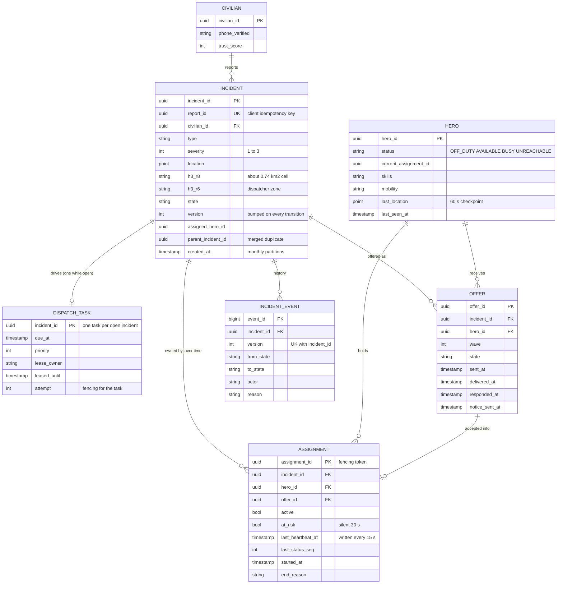

**The constraints are the design.** They make the invariants true even when the code is wrong:

```sql
-- at most one active hero per incident, and one active incident per hero
CREATE UNIQUE INDEX one_active_per_incident ON assignment (incident_id) WHERE active;
CREATE UNIQUE INDEX one_active_per_hero     ON assignment (hero_id)     WHERE active;
-- a hero holds at most one pending offer, so two incidents never wait on the same hero
CREATE UNIQUE INDEX one_pending_offer_per_hero ON offer (hero_id) WHERE state = 'PENDING';
-- never offer the same incident to the same hero twice
CREATE UNIQUE INDEX offer_once ON offer (incident_id, hero_id);
-- a civilian retry cannot create a second incident
CREATE UNIQUE INDEX report_once ON incident (report_id);
-- history has no gaps and no forks
CREATE UNIQUE INDEX event_order ON incident_event (incident_id, version);
```

Access patterns:
- Report: insert by `report_id` (unique). Accept: lock one incident row by PK, update one offer by PK.
- Workers: `dispatch_task WHERE due_at <= now() ORDER BY priority, due_at LIMIT 10 FOR UPDATE SKIP LOCKED`, and the claim moves `due_at` to the lease end (now + 10 s). So "due" already means "nobody owns it, or the owner's lease ran out", with no extra predicate. Index on `(priority, due_at)`. The table holds only open incidents, so it stays a few thousand rows.
- Candidate check: `hero WHERE hero_id = ANY($50_ids) AND status = 'AVAILABLE'` by PK.
- Console bootstrap: open incidents by dispatcher zone, `incident (h3_r6, state) WHERE state NOT IN terminal` (`h3_r6` is derived from `h3_r8` and stored so the index is direct).
- Audit: `incident_event WHERE incident_id = ? ORDER BY version`.

**Partition key: none.** One primary. `incident` and `incident_event` are range-partitioned by month only so old months can be detached and archived. If this ever needs to shard (many cities), the key is `city_id` (§10.11), because an incident never needs a hero from another city's table.

---

## 4. High-level design

One diagram, grown one functional requirement at a time. Each step says what is still missing.

### 4.1 Report: the incident and its dispatch task commit together

**Bad. Write the row, then call dispatch (or publish to Kafka) after the commit.**

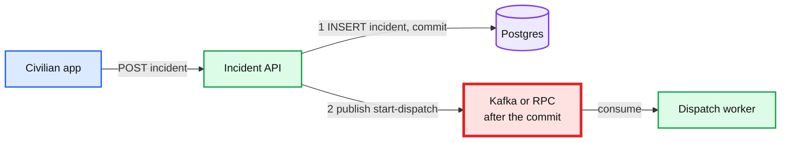

Challenges:
- A crash, deploy or broker timeout between step 1 and step 2 leaves a saved incident that nobody dispatches. The civilian sees "reported" and waits.
- Publishing first is worse: a dispatch for an incident that rolled back.
- How often? A deploy restarts every API pod about daily. With ~100 in-flight requests at the moment of a kill, a few incidents a week fall in the gap. One is too many.

**Good. Transactional outbox, relayed to Kafka.** Insert the incident and an `outbox` row in one transaction. A relay (or Debezium reading the WAL, the write-ahead log) publishes outbox rows to Kafka. Dispatch workers consume.

Challenges:
- Correct, and the standard answer ([`../../concepts/exactly-once.md`](../../concepts/exactly-once.md) §3). But it puts **three systems on the critical path** (Postgres, relay, Kafka) for 8 messages a second.
- Dispatch still needs **timers** (15 s offer windows, 3 s delivery checks, 60 s escalation). Kafka has no timers, so you add a delay queue or a timer table anyway.
- Each extra hop adds latency (~50 to 500 ms for a polling relay) and a new way to stall.

**Great. The task row is the outbox, the queue and the timer.** The same transaction inserts the incident, its first event, and one `dispatch_task` row with `due_at = now()`. Workers claim due rows with `FOR UPDATE SKIP LOCKED` and a 10 s lease. A `NOTIFY` after commit wakes a worker in ~10 ms. A 250 ms poll is the fallback if the notification is lost.

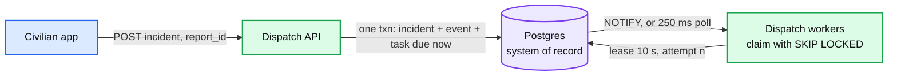

Why it holds:
- **One fate.** If the transaction commits, the task exists. If it rolls back, neither exists. There is nothing to relay.
- **One live task per incident, by construction.** `dispatch_task.incident_id` is the primary key. Rescheduling is `UPDATE due_at`, never a second row. So two workers can never run two dispatch loops for one incident.
- **Timers for free.** Every future step (offer window ends, delivery check, escalation, heartbeat check) is "set `due_at`". A crashed worker's lease expires in 10 s and another worker picks the row up.

Challenges (what Great introduces):
- **Postgres is now the queue too.** Fine at ~100 claims/s. It is not fine at 10,000/s. The seam is named in §10.11: swap the claim loop for an outbox relay into Kafka plus a timer service, without changing the incident model.
- **A worker can die after a side effect and before recording it** (sent a push, then crashed). So every side effect is idempotent and keyed (`offer_id`), and the task re-runs the step. §5.2.
- **A bug can still strand an incident** (a code path that deletes the task without reaching a terminal state). A sweeper checks the invariant every 10 s (§5.2).

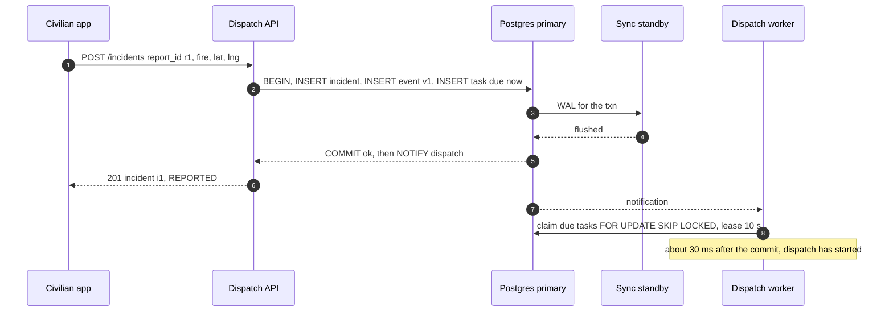

**Still missing:** who the worker offers the incident to.

### 4.2 Find and offer: candidates from a lossy index, availability from the truth

**Bad. Store location in the heroes table and query it with SQL.** Every ping is `UPDATE hero SET location = ...`, and dispatch runs a radius query with PostGIS.

Challenges:
- 2,000 updates/s is within Postgres's reach, but it is the wrong data in the wrong place. Each update writes a new row version (MVCC, multi-version concurrency control), so the `hero` table churns ~170 M dead versions a day for vacuum to clean. It inflates WAL, and so the CDC stream, the standby, and backups, all for data that is stale 15 s later.
- It couples the thing that must never be slow (the accept path touches `hero`) with the noisiest write stream in the system.

**Good. Redis GEO for location. Broadcast to every available hero in a 2 km radius. First accept wins.**

Challenges:
- **Broadcast is a stampede.** In a dense area, 30 heroes get the card, several start moving, 29 are told "taken". Hero trust in the app drops, and the ones who moved are out of position for the next incident.
- **The index's idea of "available" is stale.** A hero assigned 2 s ago is still in the radius result.
- **Push is best effort.** FCM's own docs: a successful send "doesn't mean that the message was already delivered to the device". An offer that never arrived waits the full window before anyone notices.

**Great. Index for *who is near*, Postgres for *who is free*, small waves with a delivery ack.**

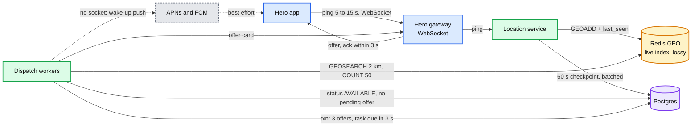

The worker's step for a new incident:
1. `GEOSEARCH heroes FROMLONLAT lng lat BYRADIUS 2 km ASC COUNT 50`. Drop any hero whose `last_seen` is older than 45 s (3 missed pings at 15 s).
2. One Postgres query for those ≤ 50 ids: `status = 'AVAILABLE'`, skills match the incident type, no pending offer. This is the authoritative filter. It costs ~3 ms.
3. Rank: distance first, then skill fit, then fairness (offers in the last hour), then recent acceptance rate. A linear score, no ML (below the line).
4. One transaction: insert offers for the top 3 (`ON CONFLICT DO NOTHING` on the one-pending-offer index, then top up from the next candidates), set the incident `DISPATCHING`, set the task `due_at = now() + 3 s`.
5. After commit, send each card over the hero's socket. If the hero has no live socket, send a high-priority push as a wake-up. The app fetches the offer over HTTPS when it opens.
6. At `due_at` (3 s): any offer not yet acked as delivered is withdrawn and replaced by the next candidate. Then `due_at = sent_at + 15 s` for the decision window.

Why each choice:
- **Redis GEO, not PostGIS.** It is a sorted set scored by a 52-bit geohash. `GEOSEARCH` is O(N + log M) and returns in under 1 ms on 10,000 members. Losing it costs one ping interval to rebuild, and Postgres holds a 60 s checkpoint for a degraded fallback (§5.3).
- **Availability from Postgres, not from the index.** The index answers "who might be near". Only Postgres knows "who is free right now", because it is the only place an assignment commits. A stale hint can waste an offer slot. It can never cause a double assignment.
- **Waves of 3, not broadcast and not one at a time.** If a hero accepts within the window half the time [estimate], one hero at a time needs ~2 tries on average, 30 s of windows, and the slowest 5% need 5+ tries. A wave of 3 assigns 87.5% in the first window and 98.4% within two. Broadcast to 30 assigns ~100% in the first window and wastes 29 heroes' attention. §5.3 has the table.
- **A delivery ack, not trust in push.** The socket gives a receipt in ~100 to 300 ms. No receipt in 3 s means the hero did not see it. That hero's slot goes to the next candidate after 3 s instead of 15.
- **Heroes do not move until they are assigned.** The card says "Accept to respond". So a losing hero lost a few seconds of attention, not a trip.

Challenges (what Great introduces):
- A hero who never opens the app keeps winning wave slots on distance. Track delivery and accept rates per hero, and move chronic non-responders down the rank.
- One pending offer per hero means that in a dense burst, heroes are "reserved" by wave 1 of one incident for up to 15 s. That is intended: §5.5 shows why it beats double-offering under surge.

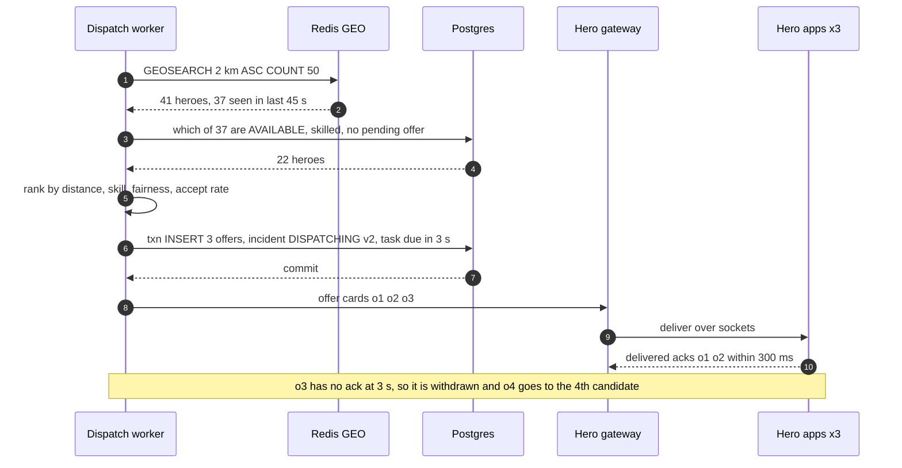

**Still missing:** what happens when two of those heroes tap accept at once.

### 4.3 Accept: exactly one hero wins, every other hero learns

**Bad. Read, check, write in the app.** `SELECT state FROM incident`. If `DISPATCHING`, `UPDATE incident SET hero = me`.

Challenges:
- Two heroes tap within 50 ms. Both reads see `DISPATCHING`. Both writes succeed. The last one overwrites the first, and both heroes' apps say "You're assigned". This is the textbook lost update, and it is the exact bug class Uber reported on 10 Dec 2010: "drivers getting dispatched to multiple Uber riders at the same time".

**Bad, the other common answer. A Redis lock (`SET incident:i1 NX PX 5000`).**

Challenges:
- The lock is not the record. The winner holds the lock, then must still write Postgres. If the winner pauses for 6 s (GC, network), the lock expires, a second hero takes it, and both write. Fixing that needs a fencing token checked by Postgres ([`../../concepts/leases-fencing-clocks.md`](../../concepts/leases-fencing-clocks.md) §3), and at that point Postgres is doing the real work and the lock is decoration.
- Redis is the losable store in this design. A failover that loses the last second of writes can lose a lock.

**Good. One conditional write on the incident row.**

```sql
UPDATE incident SET state = 'ASSIGNED', assigned_hero_id = $hero, version = version + 1
 WHERE incident_id = $inc AND state = 'DISPATCHING';     -- 1 row: you won. 0 rows: you lost
```

Under Postgres's default READ COMMITTED, the second hero's `UPDATE` waits on the first one's row lock. When the first commits, Postgres re-checks the `WHERE` clause against the new row version, finds `ASSIGNED`, and updates 0 rows. No retry loop, no SERIALIZABLE.

Challenges:
- It protects the incident, not the hero. A dispatcher hand-assigns hero H to incident i2 while H accepts i1. Each incident is fine. H is now in two places.
- The offer, the assignment row, the other heroes' offers and the "taken" notices are all separate writes that can split from this one.

**Great. One transaction, locks taken in a fixed order, unique indexes as the backstop.**

```sql
BEGIN;  -- READ COMMITTED
-- 1. lock the incident FIRST. Every writer that touches this incident starts here.
UPDATE incident SET state = 'ASSIGNED', assigned_hero_id = $hero, version = version + 1
 WHERE incident_id = $inc AND state = 'DISPATCHING'
 RETURNING version;                                   -- 0 rows -> ROLLBACK, 409 taken
-- 2. this hero's offer must still be pending
UPDATE offer SET state = 'ACCEPTED', responded_at = now()
 WHERE offer_id = $offer AND hero_id = $hero AND incident_id = $inc AND state = 'PENDING';
                                                      -- 0 rows -> ROLLBACK, 409 expired
-- 3. the record. Partial unique indexes reject a 2nd active row per incident or per hero.
INSERT INTO assignment (assignment_id, incident_id, hero_id, offer_id, active)
VALUES ($a, $inc, $hero, $offer, true);
UPDATE hero SET status = 'BUSY', current_assignment_id = $a
 WHERE hero_id = $hero AND status = 'AVAILABLE';       -- 0 rows -> ROLLBACK, 409 busy
-- 4. close the other offers, wake the task to send "taken" notices, write history
UPDATE offer SET state = 'WITHDRAWN' WHERE incident_id = $inc AND state = 'PENDING';
UPDATE dispatch_task SET due_at = now() WHERE incident_id = $inc;
INSERT INTO incident_event (incident_id, version, from_state, to_state, actor)
VALUES ($inc, $v, 'DISPATCHING', 'ASSIGNED', $hero);
COMMIT;
```

Four decisions in that block, each said out loud:
- **Lock the incident first.** Suppose each accept updated its own offer first. A locks offer A, B locks offer B. A takes the incident row. B waits for the incident row, still holding offer B. A reaches step 4 and must withdraw offer B, so it waits for B. Each waits for the other: a deadlock. Postgres breaks it after `deadlock_timeout` (1 s by default) by aborting one, so it "works", but every contested accept costs a second and a scary log line. With incident-first ordering, B waits at step 1, has locked nothing else, and gets 0 rows once A commits. Every transaction in the system that touches an incident follows the same order: incident, then offers, then hero.
- **Expiry is a state, not a clock.** There is no `AND expires_at > now()` in the accept. An offer expires only when the worker moves it `PENDING -> EXPIRED` in a transaction that also locks the incident first. So "accept at 14.9 s" and "expire at 15.0 s" are two conditional transitions on the same rows and exactly one wins. During a DB failover nothing expires, so a hero who tapped in time is not punished for our outage.
- **The indexes are the guarantee, the `WHERE` clauses are the fast path.** If a future code change forgets a check, `one_active_per_incident` and `one_active_per_hero` still raise a unique violation and the transaction rolls back. Invariants live in constraints because code changes every week and constraints rarely do.
- **Notices ride on the task, not on the accept request.** After commit the API sends "you're assigned" to the winner in its response, and does a best-effort immediate "taken" to the losers. The guaranteed path is the task row woken in step 4: a worker sends a "taken" notice for every `WITHDRAWN` offer whose notice is not yet recorded, and retries until each is acked or the hero's socket is gone. A hero app that reconnects also pulls `GET /hero/me/offers` and drops dead cards.

Why Postgres and not the obvious alternatives:
- **DynamoDB** gets the same result with `TransactWriteItems` (up to 100 actions, all or nothing, a failed `ConditionExpression` cancels the whole request) and has no failover gap. It is an equally correct answer. It loses here because there is no scale reason for it at 8 incidents/s, "one active per hero" needs extra guard items instead of one index, and dispatchers and investigators need ad hoc relational queries over the same data.
- **A consensus SQL store** (CockroachDB, Spanner) removes the ~30 s failover gap. It is the upgrade if the org already runs one. §5.6 argues why the gap is not where the risk is.

Challenges (what Great introduces):
- **Every accept, expiry and transition commits on one primary.** That is the red node of the whole design. §5.6.
- The lock order is a convention. Enforce it in one place: all transitions go through one `transition(incident_id, ...)` function in the Dispatch API that always starts with `SELECT ... FOR UPDATE` on the incident. No other code path writes `incident.state`.

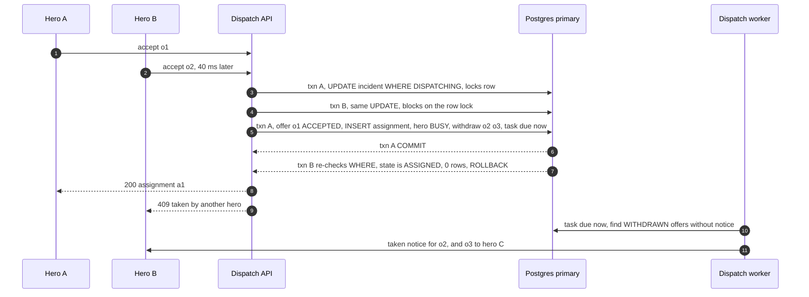

**Still missing:** everything after the accept, and every path that is not the happy one.

### 4.4 Lifecycle: a validated state machine with one clock

**Bad. A `status` string any service can write.** The hero app sets `ON_SCENE`, the dispatcher console sets `CANCELLED`, a worker sets `EXPIRED`, each with a plain `UPDATE`.

Challenges: a late `ON_SCENE` from a released hero overwrites `CANCELLED`. There is no history of who did what. Nobody can say which transitions are legal.

**Good. A transition table checked in application code.** `allowed[(from, to)]`, checked before the update.

Challenges: check-then-write races again (two writers both pass the check). Timers live somewhere else (cron, an in-memory scheduler) and drift from the state.

**Great. Every transition is a conditional write on `(state, version)`, writes its event row in the same transaction, and sets the task's next `due_at`.**

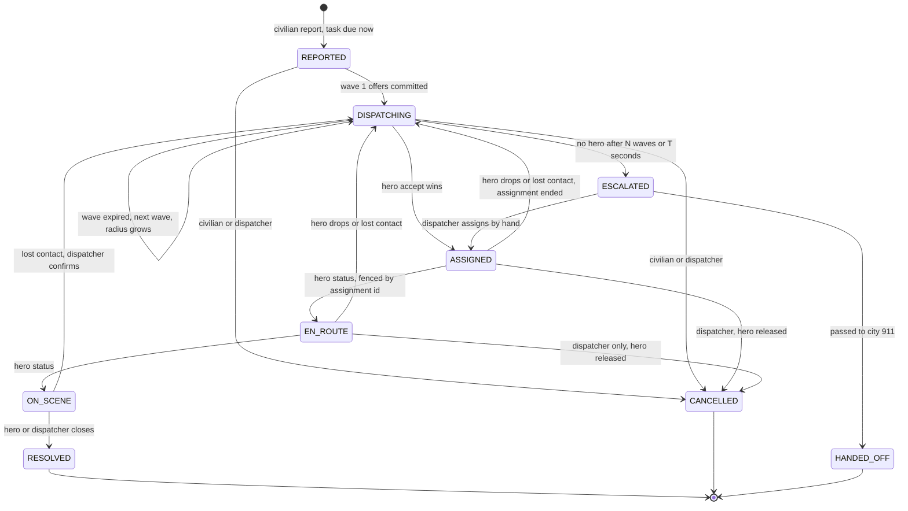

The rules:
- **One function writes state.** `transition(incident_id, expected_from, to, actor, reason)` locks the incident row, checks `(from, to)` against the table, checks the caller's `expected_version` if it has one, bumps `version`, inserts the event row, and sets or deletes the task row. Workers, the hero API and dispatcher commands all call it.
- **The task row is the only clock.** Every non-terminal state has a `due_at`: `REPORTED` now, `DISPATCHING` the next delivery check or window end, `ASSIGNED` and later the next heartbeat check (every 15 s), `ESCALATED` the dispatcher response SLA. Reaching a terminal state moves the task to a `CLEANUP` phase due now: it sends the final "withdrawn" and "released" notices, then deletes the row. Deleting it in the terminal transaction would leave nothing durable to remember those notices.
- **Hero updates are fenced.** `EN_ROUTE`, `ON_SCENE`, `RESOLVED` carry the `assignment_id`. The transition requires that assignment to be the incident's active one. A released hero's late update gets `409 released`, not a state change.
- **Escalation is a state with an owner.** No hero after 3 waves (~50 to 55 s: three 15 s windows, plus up to 3 s when an undelivered slot is replaced) for P1, or 5 waves for P3, moves the incident to `ESCALATED`. That puts it at the top of a dispatcher queue with a 30 s response SLA. "No hero found" is never a silent terminal state.

**The invariant sweeper.** Every 10 s, one query per invariant on the primary (all are index scans over a few thousand open rows):
- every non-terminal incident has exactly one task row, and every terminal incident's task row is in `CLEANUP` and under 60 s old;
- every `ASSIGNED / EN_ROUTE / ON_SCENE` incident has exactly one active assignment, and its hero is `BUSY`;
- no task has `due_at` more than 30 s in the past (workers are not keeping up);
- no `PENDING` offer older than 30 s.

A violation repairs what is safe to repair (re-create a missing task row with `due_at = now()`) and pages for the rest. The sweeper is what turns "should never happen" into "detected within 10 s".

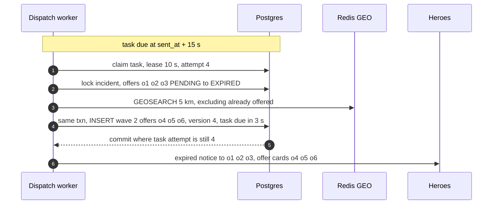

### 4.5 Monitor and override: a projection to read, the same transitions to write

**Bad. Every dispatcher console polls the primary every second.** 200 consoles x a zone query x 1/s is ~200 queries/s of scans on the box that commits every accept. A slow dashboard query holds locks and connections on the red node.

**Good. Poll a read replica.** Takes load off the primary. But polling at 1 s gives 0.5 s average staleness plus query cost that grows with consoles, and "what changed since my last poll" by sequence id is wrong: sequence ids are assigned at insert, not at commit, so a transaction that commits late is skipped by a reader that already moved past its id.

**Great. Change data capture into Kafka, a projection service, WebSocket push. Writes go back through `transition()`.**

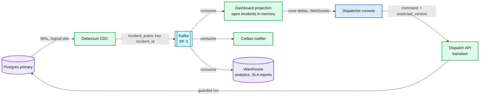

Why each choice:
- **CDC from the WAL, not dual writes.** The event row and the state change are one transaction, and the WAL is in commit order. So the stream is exactly the committed history, in order, with no extra write on the hot path.
- **Kafka, at 125 events/s.** Not for throughput. For **fan-out with independent offsets**: projection, civilian notifier, warehouse and the SLA monitor each read at their own pace, and a rebuilt projection replays from an offset. The alternative, one logical replication slot per consumer, makes each slow consumer pin WAL on the primary. One slot plus Kafka keeps the primary's exposure to one consumer.
- **The projection is disposable.** It holds ~5,000 open incidents in memory (~10 MB). On restart it loads open incidents from the replica, then consumes Kafka from the offset stored alongside that snapshot, and drops any event whose `version` is not newer than what it holds.
- **Writes never go to the projection.** A dispatcher's "reassign to hero H" is `transition(..., expected_version = 7)`. If a hero accepted 300 ms ago and the console still shows v7, the command returns `409` with the current state. A stale screen can cost a click, never a wrong assignment.

Challenge (what Great introduces):
- **A stuck replication slot fills the primary's disk.** If Debezium stops, the slot keeps WAL forever and the red node runs out of disk. Set `max_slot_wal_keep_size` (Postgres 13+) to ~50 GB, ~6 hours at peak WAL rate [estimate]. Past it, Postgres drops the slot. The dashboard degrades to replica polling and the CDC pipeline resnapshots. **The read side may never be able to hurt the write side.**

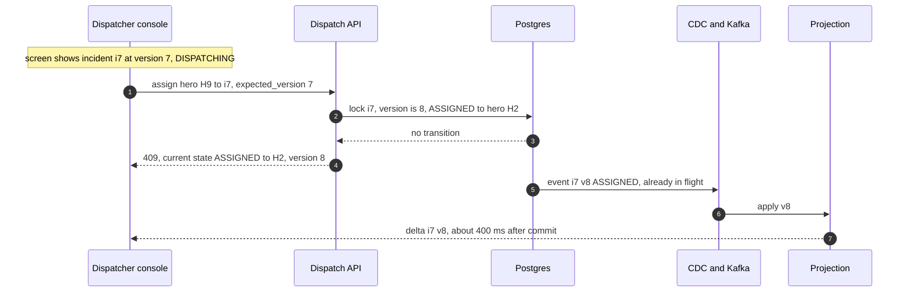

---

## 5. Deep dives

Each one is the question an interviewer asks, what breaks in the §4 design, the fix, and what changed.

### 5.1 "Two heroes tap accept at the same instant. What single operation lets one win, and what if things fail halfway?"

The happy race is §4.3. The interviewer's follow-ups are about partial failure.

| Rung | Approach | Why it breaks, or what it costs |
|---|---|---|
| Bad | Read-check-write, or a Redis lock in front of the DB | Two winners on a 50 ms race, or on a 6 s pause past the lock TTL |
| Good | One conditional `UPDATE ... WHERE state = 'DISPATCHING'` | Correct for the incident. A hero can still be double-booked across incidents. Side effects split from the write |
| **Great** | One transaction, incident locked first, partial unique indexes, notices driven by the task row, idempotent per `offer_id` | Correct under concurrency and partial failure. Every accept commits on one primary (§5.6) |

**The failure cases, one line each:**
- **The accept commits but the response is lost** (phone loses signal). The app retries `accept o1`. The API sees offer o1 `ACCEPTED` by this hero and returns the same `200 {assignment_id}`. Idempotent by offer, with no separate key store.
- **The API pod dies mid-transaction.** No commit, so no state change. The connection drops and Postgres rolls back. The hero's retry runs the transaction again.
- **The commit is in doubt** (the primary dies at the moment of commit). With a synchronous standby, either the standby has the commit and the new primary shows `ACCEPTED`, or it does not and the retry runs fresh. Either way the retry gets the true answer. Never assume, re-read.
- **Accept and expiry race.** Both lock the incident first. One wins. If expiry won, the hero gets `409 expired` and sees "This incident was offered to another hero".
- **Accept and dispatcher cancel race.** Same lock, same rule. If cancel won, `409 cancelled`.
- **A hero accepts on two phones.** Same offer id, so the second is the idempotent retry.
- **Two dispatch workers think they own the task** (a paused worker whose lease expired). The task's `attempt` is the fencing token: a worker's transaction ends with `UPDATE dispatch_task ... WHERE incident_id = $i AND attempt = $mine`. 0 rows means it was fenced, and the whole transaction rolls back. The accept itself does not take the task lease, so a hero is never blocked by a worker.

**Push back on the textbook answer.** "Use SERIALIZABLE to be safe" sounds careful. It is worse here. SERIALIZABLE aborts one of two conflicting transactions with a serialization failure, which the API must catch and retry, and the retry then sees `ASSIGNED` and returns `409`. Same outcome, an extra round trip, and a retry loop to get wrong. READ COMMITTED with a guarded `UPDATE` already gives "exactly one wins", because a blocked `UPDATE` re-checks its `WHERE` clause against the committed row. Know why your isolation level is enough instead of reaching for the strongest one. Details: [`deep-dives/accept-race-and-assignment-store.md`](deep-dives/accept-race-and-assignment-store.md), [`../../concepts/mvcc-and-isolation.md`](../../concepts/mvcc-and-isolation.md).

**What changed:** one `transition()` entry point with a fixed lock order. The accept is idempotent per offer.

### 5.2 "How do you know no incident is ever dropped?"

Walk the path and name every place an incident can stop moving.

| # | Where it can stop | Defence | Detected within |
|---|---|---|---|
| 1 | Civilian's request never reaches us | App retries with the same `report_id` for 60 s, then shows "call 911" with the number pre-filled | 10 s, on the phone |
| 2 | Commit happens, response lost | Retry with the same `report_id` returns the same incident | Immediately |
| 3 | Committed incident, no dispatch | Impossible: incident and task are one transaction | |
| 4 | `NOTIFY` lost | 250 ms poll | 250 ms |
| 5 | Worker crashes holding the task | Lease expires, another worker claims, `attempt + 1` fences the old one | 10 s |
| 6 | Worker sent offers, crashed before recording `sent_at` | Next owner resends to offers with no `delivered_at`. App dedupes by `offer_id` | 10 s |
| 7 | Offer never delivered (push lost, phone dead) | 3 s delivery ack, slot moves to the next candidate | 3 s |
| 8 | No hero accepts | Waves with growing radius, then `ESCALATED` to a human with a 30 s SLA | ~50 to 55 s for P1 |
| 9 | Assigned hero goes silent | Heartbeat checks on the task row, reassign (§5.4) | 30 to 60 s |
| 10 | A bug deletes the task or leaves a bad state | Invariant sweeper every 10 s, auto-repair or page | 10 s |
| 11 | Workers are all down or falling behind | Alert on oldest overdue task > 30 s. Dispatchers see "auto-dispatch degraded" and work the queue by hand | 30 s |

**Why not Temporal (or Cadence, which Uber built for exactly this kind of long-running flow)?** A per-incident workflow with durable timers, retries and visibility is what the task row hand-rolls. It is the better answer if the company already runs Temporal. Here it adds a second stateful cluster (Temporal's own persistence, history and matching services) on the critical path, whose failure is a dispatch outage, to save ~300 lines of state-machine code on top of a database we need anyway. At 8 incidents/s, one store is the more reliable system. See [`../../concepts/temporal-durable-execution.md`](../../concepts/temporal-durable-execution.md) §11.

**Push back on the textbook answer.** "Outbox plus Kafka" is the reflex for "save and publish atomically". It solves step 3 and leaves steps 5 to 9 to a timer system you still have to build. The task row solves step 3 and gives you the timer. Pick the pattern that removes the most failure points, not the most familiar one.

Details: [`deep-dives/reliable-dispatch-start.md`](deep-dives/reliable-dispatch-start.md).

**What changed:** the sweeper and the "oldest overdue task" alert. Both are cheap and both page.

### 5.3 "Time to first offer in low single-digit seconds. Where does the time go, and what about stale location?"

**The budget (report commit to card on screen):**

| Step | p50 | p99 | Notes |
|---|---|---|---|
| API commit, sync standby | 8 ms | 40 ms | Cross-AZ flush ~1 to 2 ms |
| Worker wake and claim | 10 ms | 260 ms | `NOTIFY`, else the 250 ms poll |
| `GEOSEARCH` 2 km, 50 results | 1 ms | 5 ms | |
| Availability query, 50 ids by PK | 3 ms | 20 ms | |
| Rank | < 1 ms | 2 ms | Linear score in memory |
| Offer transaction | 6 ms | 40 ms | |
| Socket delivery to phone | 150 ms | 800 ms | Mobile network [estimate] |
| **Total** | **~0.2 s** | **~1.2 s** | Target p99 < 2 s |

The push fallback is not in this budget, because it has no SLA. Treat a hero with no live socket as a worse candidate, not as an equal one.

**Where the real bottleneck is: hero response, not compute.** Assume each offered hero accepts within the 15 s window with probability 0.5 [estimate]:

| Strategy | Assigned in 1st window | Within 2 windows | Wasted offers per incident | Heroes reserved per incident |
|---|---|---|---|---|
| One at a time | 50% | 75% | ~1 | 1 |
| **Wave of 3** | **87.5%** | **98.4%** | ~2.4 | 3 for ≤ 15 s |
| Wave of 5 (P1) | 96.9% | 99.9% | ~4.2 | 5 |
| Broadcast to all in radius (~30) | ~100% | ~100% | ~29 | 30, all distracted |

Wave size is per severity: P1 gets 5, P2 gets 3, P3 gets 2. The radius grows per wave: 2 km, 5 km, 10 km. H3 cells are for counting, not for the search itself: resolution 8 (~0.74 km², ~530 m edge) for supply heatmaps and the duplicate-report prefilter, resolution 7 (~5.2 km², ~1.4 km edge) as the surge zone (pending incidents vs available heroes), resolution 6 as the dispatcher's console zone.

**Stale location, and why it is safe.**
- A ping is 5 to 15 s old. A ground hero at 50 km/h moves ~200 m in 15 s. A flying hero at 300 km/h moves ~1.25 km. So rank on distance, but never treat it as exact. For flyers, extrapolate with the heading and speed from the last ping, capped at 30 s.
- The index can say "available" for a hero who was assigned 2 s ago. The Postgres filter catches it. Even if a stale hero gets an offer, the accept transaction checks `hero.status = 'AVAILABLE'` and the unique index on active assignments. **Wrong location wastes an offer slot. It cannot create a wrong assignment.**
- Members of a GEO set cannot expire one by one. A second sorted set `last_seen` (score = ping time) filters heroes silent for 45 s, and a 60 s sweep removes them from both sets. `maxmemory-policy noeviction`: an LRU (least recently used) eviction policy would silently drop heroes from the index under memory pressure, which looks exactly like "no heroes nearby".

**Push back on the textbook answer.** "Shard the location index by geohash or H3 cell, like Uber" is what the Uber template says. Here the whole index is ~1 MB and 2,000 writes/s, about 2% of one Redis core. Sharding it adds a cross-shard radius query at cell borders for zero benefit. One primary plus one replica, and the shard key is named for the day there are 100 cities (`city_id`, §10.11).

Details: [`deep-dives/location-index-vs-truth.md`](deep-dives/location-index-vs-truth.md), [`deep-dives/offer-strategy-and-timeouts.md`](deep-dives/offer-strategy-and-timeouts.md), [`../../concepts/geospatial-index.md`](../../concepts/geospatial-index.md).

**What changed:** wave size and radius by severity, the delivery ack, the `last_seen` filter, `noeviction`.

### 5.4 "The assigned hero stops sending heartbeats mid-rescue. How do you reassign without double dispatch?"

**What breaks.** Two opposite mistakes:
- Reassign too fast: a hero in a tunnel loses signal for 40 s, a second hero is sent, and the first comes back to find the incident gone.
- Reassign too slow, or never: a hero whose phone died is "en route" forever while the civilian waits.

**The design.**
- While assigned, the app pings every 5 s. The location service also writes `assignment.last_heartbeat_at` to Postgres every 15 s for assigned heroes (~1,000 on average, ~67 small writes/s). The task row's `due_at` checks that column every 15 s. It never reads Redis for this: a Redis failover would make every hero look silent at once.
- **Mass-silence breaker.** If more than 5% of assigned heroes cross 30 s of silence at the same moment, the cause is our gateway, location service or network, not 50 phones dying together. Auto-reassignment pauses and dispatch core is paged. Without it, a gateway outage would reassign every active incident in the city.
- **30 s silent:** mark the assignment `AT_RISK` (a flag, not a state). Push "Are you still responding?" to the hero. Alert the dispatcher on the console. Nothing is reassigned yet.
- **60 s silent for P1, 120 s for P2 and P3, or an explicit `DROP` from the hero:** one transaction locks the incident, sets the assignment `active = false, end_reason = 'lost_contact'`, sets the hero `AVAILABLE` (or `UNREACHABLE` so they are not offered new work until they ping), moves the incident `-> DISPATCHING`, and sets the task due now. The next wave goes out with the original hero excluded.
- **The old hero comes back.** Their next status update carries `assignment_id a1`. `transition()` requires `a1` to be the active assignment. It is not, so the update returns `409 released` and the app shows "You were released from this incident. Hero X is responding." The assignment id is the **fencing token**. A released hero can never write to the incident again ([`../../concepts/leases-fencing-clocks.md`](../../concepts/leases-fencing-clocks.md) §3).
- **`ON_SCENE` is different.** A hero on scene who goes silent is probably busy, not gone. Reassignment from `ON_SCENE` needs a dispatcher's confirmation. The system recommends it at 120 s.

**The honest trade-off.** The invariant is about the **record**: at most one active assignment. Physically, a reassignment after lost contact can send a second hero to a scene the first one is still at. We choose that on purpose: for a life-threatening incident, two heroes on scene is a small waste, and zero heroes is the failure the prompt ranks worst. Say it this way in the round, because the interviewer is testing whether you know the invariant you can enforce from the one you cannot.

Details: [`deep-dives/incident-state-machine-and-stuck-detection.md`](deep-dives/incident-state-machine-and-stuck-detection.md).

**What changed:** `AT_RISK` flag, severity-based timeouts, `UNREACHABLE` hero status, fenced status updates, heartbeats in Postgres, the mass-silence breaker. A civilian's cancel after assignment needs a dispatcher to confirm it, so a mistaken tap cannot recall a hero from a real emergency.

### 5.5 "A disaster sends a 50x burst into one neighbourhood. What degrades first?"

Walk the path in order:

| Component | Load at 50x in one area | Breaks? |
|---|---|---|
| Dispatch API and Postgres | Metro total ~8 -> ~13 reports/s, ~200 commits/s. Budget for 40/s worst case: ~500 commits/s | No. ~10x headroom left even at 40/s |
| Redis GEO | Same 2,000 pings/s, more searches | No |
| Hero gateway, push | ~200 offers/s | No |
| **Heroes within 5 km** | ~200 available heroes vs ~400 new incidents in 10 minutes | **Yes. This is the bottleneck** |
| Dispatchers | Escalations arrive faster than humans work them | Next to break |

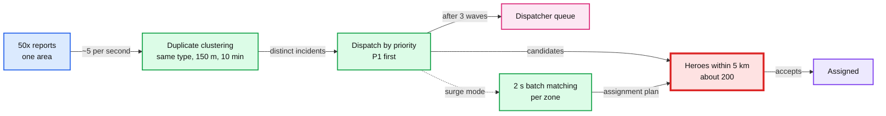

What degrades, in the order we let it:
1. **Duplicate reports collapse.** A building fire gets 50 reports. A report of the same type within 150 m and 10 minutes of an open incident attaches to it as a linked report, and the reporter sees "Help is already on the way to an incident reported nearby". A report with a higher severity, or a different type, is never auto-attached. Dispatchers can split one in one click. Without this, 50 reports would reserve 150 heroes.
2. **Priority order.** Workers claim tasks `ORDER BY priority, due_at`. P1 incidents get heroes first. P3s wait in `DISPATCHING` with longer windows.
3. **Wave size shrinks.** In surge (pending incidents in an H3 resolution-7 zone, ~5.2 km², > available heroes in it), waves drop to 1 to 2 heroes so that each hero is reserved by one incident, not three. One pending offer per hero already enforces that no hero is double-booked by offers.
4. **Batch matching turns on.** Greedy "best hero for this incident" is fine when heroes are plentiful. When they are scarce, greedy assigns the nearest hero to the first incident even if that hero is the only one who can reach a later, closer incident. In surge mode a zone-level matcher collects 2 s of pending incidents and solves a small assignment problem (min total distance, P1 weighted). Lyft reports a greedy approach raised combined rider wait plus driver travel by 50% (8 to 12 minutes) against batched matching. The cost is up to 2 s of added latency, which is why it is off in normal mode.
5. **Pull heroes in, with a reserve.** The radius grows to pull heroes from neighbouring zones, capped so each neighbouring zone keeps ~20% of its heroes [estimate]. Otherwise the disaster drains the city and the next zone's heart attack has nobody.
6. **Escalate to humans and to the city.** P3 incidents past 10 minutes go to `HANDED_OFF` suggestions for the city's own 911 system.

**Push back on the textbook answer.** "Autoscale the dispatch service" is the reflex for a 50x burst, and it scales the one thing that was never short. More workers cannot create heroes. The Staff answer names the scarce resource (heroes in the area, then dispatcher attention) and spends the design on allocating it well.

Details: [`deep-dives/surge-and-degradation.md`](deep-dives/surge-and-degradation.md).

**What changed:** duplicate clustering, priority claims, surge mode with smaller waves and a 2 s batch matcher, zone reserves.

### 5.6 "The Postgres primary dies. What happens to dispatch?"

The primary is the red node. Not for load (it runs at ~3% of capacity), but because it is the single place every report, accept and transition commits.

**Topology.** Primary in AZ a, two standbys in AZ b and c, `synchronous_standby_names = 'ANY 1 (b, c)'`: a commit waits for one standby, so a single standby loss does not block writes, and an acknowledged commit is on two machines. Automated failover (Patroni, or a managed Multi-AZ setup) promotes a standby in ~30 s [estimate]. An async replica in a second region gives disaster recovery with RPO under 5 s and a manual promote.

**What happens during the ~30 s.**
- **Reports:** the API returns `503` and the civilian app retries with the same `report_id` for up to 60 s, with exponential backoff. The screen says "Connecting to dispatch... If you are in danger now, call 911" after 10 s. No report is lost, because a report not acked is still on the phone.
- **Accepts:** the hero app retries the accept. Nothing expires during the outage, because expiry is a worker transition that cannot commit either (§4.3). So a hero who tapped at 10 s into a 15 s window wins when the database returns.
- **Workers:** claims fail. Leases written before the failover are still in the table and expire normally afterwards.
- **In-doubt commits:** a transaction whose commit was acked is on the promoted standby (RPO 0). One that was not acked is retried by its client and either finds itself committed or runs fresh.
- **Location:** unaffected. Redis keeps the index. The 60 s checkpoint just skips a beat.

**The math that says this is enough.** ~4 failovers a year x ~30 s = ~2 minutes a year of delayed (not lost) reports and accepts. Against a 99.99% target of 52 minutes, it uses 4%. The bigger budget risk is a bad deploy of our own code. That is why rollout safety (§10.9) gets as much attention as database topology.

**Push back on the textbook answer.** "Make it multi-region active-active for reliability" sounds like the reliable choice. For a single-metro service it moves the accept race across a WAN, makes every commit pay ~30 to 70 ms of cross-region consensus, and creates the double-assignment risk it was meant to remove if anyone shortcuts consensus with async replication. One region, three AZs, synchronous standby. The second region is for disasters, with a human deciding to fail over.

**If the interviewer pushes:** a consensus SQL store (CockroachDB, Spanner) across 3 AZs cuts the gap to a lease transfer of ~10 s [estimate] with no failover step. It is the right upgrade when the org already operates one. Building that operational skill for one 8-writes-a-second service is the wrong trade.

**What changed:** `ANY 1` synchronous quorum, client retry contracts, the DR replica.

### 5.7 "What fails, and what is the blast radius?"

| Component | Failure | Blast radius | What the user sees | Mitigation |
|---|---|---|---|---|
| **Postgres primary** | **Dies** | **All writes for ~30 s** | Report spinner, accept retry | Sync standby, auto failover, client retries, no clock-based expiry |
| Postgres | Slow query or lock pile-up | Accept latency | Slow accepts | `statement_timeout`, `lock_timeout`, dashboards never read the primary |
| Dispatch workers | All down | No new offers, timers stop | Incidents wait | Overdue-task alert at 30 s, dispatchers work the queue by hand |
| Redis GEO | Primary lost | No candidate search for ~15 s | Slower first offer | Replica failover. Fallback to the 60 s checkpoint in Postgres, radius +1 km |
| Hero gateway | One node lost | ~1/3 of hero sockets drop | Heroes reconnect in seconds | Stateless, clients reconnect to another node, push wakes the rest |
| APNs / FCM | Slow or down | Heroes without sockets miss offers | Fewer candidates | Socket first, delivery ack, rank socket-connected heroes higher |
| CDC / Kafka | Down | Dashboards and civilian updates stale | Console banner "live view delayed" | Replica polling fallback, `max_slot_wal_keep_size` |
| Projection | Crash | Consoles disconnect | ~10 s reload | Rebuild from replica plus Kafka offset |
| Whole AZ | Lost | Whatever ran there | ~30 s if the primary was there | Everything spans 3 AZs |
| Whole region | Lost | Everything | Outage until DR promote | Async DR replica, runbook, city 911 as the ultimate fallback |
| A bad deploy | Logic bug in `transition()` | Every incident | Wrong or stuck states | Constraints still hold. Canary by zone, sweeper alerts, fast rollback |

---

## 6. Final design and the core flows

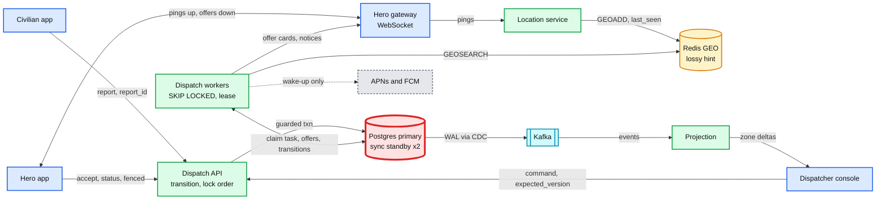

Zoom-ins for every component are in [`diagrams.md`](diagrams.md).

### Flow 1: a fire is reported and assigned (~6 s)
1. A civilian taps "Fire". The app sends `report_id r1`. One transaction writes incident i1, event v1 and its task. `201` in ~40 ms.
2. A worker wakes in ~10 ms. 37 heroes within 2 km were seen in the last 45 s, 22 are available and fire-capable. It offers to the top 3 (P2, wave of 3). Cards arrive in ~200 ms.
3. Two are acked as delivered. The third is not, so at 3 s it is replaced by the 4th candidate.
4. Hero A accepts at 5.1 s, hero B at 5.14 s. A's transaction locks i1 and commits. B's re-checks and gets 0 rows. A gets `200 a1`, B and the others get "taken" within ~1 s.

### Flow 2: nobody accepts
1. Wave 1 (2 km) expires at 15 s. One transaction expires it and offers wave 2 (5 km).
2. Wave 2 expires. Wave 3 (10 km) expires at ~50 to 55 s (a replaced undelivered slot adds up to 3 s per wave).
3. The incident moves to `ESCALATED`. A dispatcher picks it up within 30 s and hand-assigns a hero by phone, through the same `transition()`.

### Flow 3: the assigned hero goes silent
1. Hero A is `EN_ROUTE`. Pings stop.
2. At 30 s the assignment is `AT_RISK` and the dispatcher sees it. At 60 s (P1) one transaction ends assignment a1 with `lost_contact`, moves i1 to `DISPATCHING`, and the next wave goes out without A.
3. A's phone reconnects and sends `ON_SCENE a1`. It gets `409 released`.

### Flow 4: the primary fails during an accept
1. Hero A taps accept at 9 s into the window. The primary dies. The API times out.
2. The app retries for ~30 s while a standby is promoted. No offer expires meanwhile.
3. The retry commits. Hero A wins, as they would have.

### Flow 5: a dispatcher overrides from a stale screen
1. The console shows i7 v7. The dispatcher assigns H9 with `expected_version 7`.
2. H2 accepted 300 ms earlier (v8). The command returns `409` with the current state. The console refreshes. Nothing changed.

---

## 7. Trade-offs

**Every box, the technology, and why not the obvious alternative.** This is the table Stripe's rubric grades. Practise saying each row in one breath.

| Component | Chose | Obvious alternative | Why this one |
|---|---|---|---|
| System of record | **Postgres**, one primary, 2 sync standbys | DynamoDB, Cassandra, CockroachDB | Multi-row transactions and partial unique indexes make both invariants constraints, not code. ~100 commits/s is ~3% of one node. Dispatchers need relational queries. DynamoDB is equally correct with `TransactWriteItems` but buys scale we do not need |
| Live location | **Redis GEO** | PostGIS on the hero table, an in-process grid | ~1 MB, 2,000 writes/s, < 1 ms radius queries. Losable by design. Keeps 170 M dead row versions a day out of the system of record |
| Dispatch queue and timers | **Task row in Postgres**, `SKIP LOCKED`, lease | Kafka plus a delay queue, SQS, Temporal | Same transaction as the incident, so no outbox relay. Timers are `due_at`. One fewer stateful system on the critical path |
| Hero delivery | **WebSocket gateway**, push as wake-up | Push only (APNs, FCM) | Push is best effort with no delivery receipt. The socket gives a ~200 ms ack, and the ack is what lets a dead slot move on in 3 s |
| Read side | **CDC into Kafka**, in-memory projection | Consoles polling the primary or a replica | Commit-ordered history with no dual write, fan-out to 4 consumers with their own offsets, and zero read load on the red node |
| Accept concurrency | **READ COMMITTED + guarded UPDATE**, incident locked first | SERIALIZABLE, Redis lock, optimistic version check in the app | A blocked UPDATE re-checks its WHERE. No retry loop, no lock that is not the record |
| Region | **One region, 3 AZs**, async DR replica | Multi-region active-active | One metro. Active-active puts the accept race across a WAN |

**Design decisions:**

| Decision | Option A | Option B | Chose | Why |
|---|---|---|---|---|
| Offer strategy | Broadcast in radius | One hero at a time | **Waves of 2 to 5 by severity** | 87.5% assigned in one window at 3 vs 50% at 1, without distracting 30 heroes |
| Offer expiry | `expires_at > now()` in the accept | Expiry as a worker transition | **Transition** | Accept and expiry race on one lock. A DB outage does not expire offers |
| "Taken" notices | Sent by the accept request | Driven by the task row | **Task row**, plus a best-effort fast path | Survives an API crash after commit |
| Hero liveness | Socket disconnect = gone | Pings, recorded as `last_heartbeat_at` in Postgres, thresholds by severity | **Pings** | Mobile sockets drop all the time. 30 s flag, 60 to 120 s reassign |
| Reassignment on silence | Wait for the dispatcher | Automatic for P1 at 60 s | **Automatic for P1, dispatcher for ON_SCENE** | Zero heroes is worse than two |
| Duplicate reports | Separate incidents | Auto-merge | **Attach as linked reports**, never across type or up in severity | 50 reports must not reserve 150 heroes, and two real emergencies must not merge silently |
| Matching | Greedy per incident | Batch per zone | **Greedy, batch only in surge** | Batch adds up to 2 s. It only pays when heroes are scarce |
| Invariants | In application code | In database constraints | **Both**, constraints as the backstop | Code changes weekly, constraints rarely |
| Workflow engine | Temporal | Task table | **Task table** | One store at 8/s. Temporal if the org already runs it |

**Refused to build:** sharding of any kind, a geo-partitioned dispatch cluster (Uber's template), Kafka on the critical path, a distributed lock service, multi-region active-active writes, an ML ranker, travel-time ETA, a separate offer service, a separate notification service for heroes (the gateway is it).

---

## 8. Staff-level notes

**Failure modes and blast radius.** The table is §5.7. The short version: the primary is the one thing whose loss stops writes, and it is designed to turn a loss into a ~30 s delay with nothing lost. Everything on the read side can die without dispatch noticing. The scarce resource under load is heroes, then dispatchers, never compute.

**Migration from what exists.** The likely starting point is a human dispatch center: phones, radios, a spreadsheet or a basic CAD (computer-aided dispatch) system.
1. **Shadow.** The system receives every incident a human dispatcher enters and computes the offer list it would send. Dispatchers keep working by phone. Measure: how often the human's chosen hero is in our top 3, and our time to first offer vs theirs.
2. **Assisted.** The console shows our recommendation. The dispatcher clicks "Offer" to send our wave. Heroes start using the app for P3 only.
3. **Auto for P3, then P2.** Offers go out without a click. Dispatchers watch and override. P1 stays assisted until a month of P2 data shows the drop and double-assignment counters at 0.
4. **Auto for P1.** Dispatchers become the escalation queue.
5. **Rollback** at every phase is a per-severity, per-zone setting back to "assisted". The manual path (dispatcher assigns by hand through `transition()`) is never removed. It is also the degraded mode when workers are down.

**Operability.**
- **SLOs:** time to first offer p99 < 2 s; time to assignment p95 < 20 s for P1; 0 double assignments (from the constraint violation counter, which should only ever count attempts the DB refused); 0 incidents without an owner for more than 30 s; report API availability 99.99%.
- **What pages at 3 am:** (1) any sweeper invariant violation; (2) oldest overdue task more than 30 s; (3) time to first offer p99 above 5 s for 5 minutes; (4) unique-violation rate on `one_active_*` above 0 (code is attempting double assignments, even though the DB refused them); (5) Postgres replication: sync standby missing, or the CDC slot's retained WAL above 20 GB.
- Escalations waiting more than 30 s page the **dispatch floor supervisor**, not engineering.

**Cost.**
- **Infrastructure** is small: 3 Postgres nodes plus a DR replica, 2 Redis nodes, 3 gateway nodes, ~4 worker and API pods, a small Kafka cluster (or a managed one), a projection service. Low thousands of dollars a month [estimate].
- **Engineering:** the state machine, `transition()`, the sweeper, the hero app's offer flow and the console. ~4 to 6 engineers for the first year [estimate]. The hero and civilian apps are the larger cost.
- **Buy vs build:** commercial CAD systems exist for human dispatch centers. Buying one is the right call for the console and records side. The automated offer loop is the part worth building.

**Team boundaries.**
- **Dispatch core** owns the API, `transition()`, workers, schema and sweeper. The invariants are theirs.
- **Mobile** owns the hero and civilian apps, including the retry and dedupe contracts (`report_id`, `offer_id`, reconnect pull).
- **Real-time platform** owns the gateway and location service.
- **Dispatch operations** (the humans) own escalation policy: wave sizes, radius ladders, timeouts by severity. These are config, not code, and changes are audited.

---

## 9. What is expected at each level

**Mid (breadth 80, depth 20).** Services for incidents, matching, notification and location. A geo index for nearby heroes. A database for incidents. "Use a lock or a transaction so only one hero accepts." Probably publishes "start dispatch" after the commit without noticing the gap, sends push notifications and trusts them, and puts Kafka and Redis in because Uber has them.

**Senior (60 / 40).** Separates location from assignment and says why. The accept is a conditional write, with a clear answer to "how does the loser find out". Uses an outbox for report and dispatch start. Has an incident state machine with timeouts and a "no hero found" path. Names a consistency level per data type. Handles retries with idempotency keys.

**Staff+ (40 / 60).** Starts from "everything here is small" and **refuses** the ride-hailing template out loud: no sharding, no geo-partitioned cluster, no broker on the critical path. Justifies each technology in one sentence against its alternative. Puts both invariants (per incident and per hero) into constraints. Knows why READ COMMITTED is enough and where the deadlock hides. Makes expiry a transition, not a clock check. Treats push as best effort and adds a delivery ack. Separates the invariant on the record from what can happen physically on reassignment. Names hero supply as the bottleneck under surge. Brings migration through shadow and assisted modes, and a manual path that never goes away.

---

## 10. Nitty-gritty (past interview scope)

### 10.1 Internals of each chosen technology

**Postgres: what makes the accept safe.**

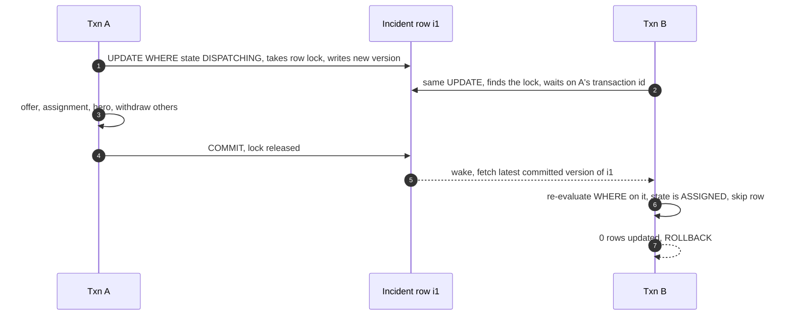

- **Row locks and the re-check.** An `UPDATE` takes a row-level lock on the tuple it changes. A second `UPDATE` of the same row waits for the first transaction to finish. Under READ COMMITTED, when it wakes it re-evaluates its `WHERE` clause against the newest committed version of that row (Postgres calls this the EvalPlanQual recheck). The set of target rows was fixed when the statement started, so this works for a single row by primary key, which is exactly our case.
- **MVCC.** Every update writes a new row version. Old versions stay until vacuum removes them. This is why high-frequency location updates do not belong in the system of record ([`../../concepts/mvcc-and-isolation.md`](../../concepts/mvcc-and-isolation.md)).
- **Partial unique indexes.** `CREATE UNIQUE INDEX ... WHERE active` indexes only rows matching the predicate. Uniqueness is checked at insert or update time against other live rows in the index, so a second active assignment fails with `unique_violation` even if both transactions passed every application check.
- **`FOR UPDATE SKIP LOCKED`.** A worker's claim query locks the rows it returns and skips rows other transactions already locked. Ten workers can pull from one table without blocking each other. The lease column handles the time after the claim transaction commits.
- **`LISTEN / NOTIFY`.** A notification is delivered to listening sessions only after the sending transaction commits. It is not durable: a worker that is not connected misses it. Hence the 250 ms poll.
- **Synchronous replication.** With `synchronous_commit = on` and `ANY 1 (b, c)`, a commit returns only after one standby has flushed the WAL record. Cost: one cross-AZ round trip, ~1 to 2 ms.
- **Logical decoding.** Debezium reads committed changes from a replication slot in commit order. The slot pins WAL until the consumer confirms it. Hence `max_slot_wal_keep_size`.

**Redis GEO.**
- A GEO set is a sorted set. `GEOADD` interleaves latitude and longitude bits into a 52-bit geohash and stores it as the member's score. `GEOSEARCH BYRADIUS` computes the geohash boxes that cover the circle, does range scans on the sorted set for each, then filters by exact distance. Complexity O(N + log M), N = elements in the covering boxes, M = members.
- `COUNT 50 ASC` sorts the matches before cutting. With `ANY`, Redis returns as soon as it has enough, unsorted. We want the nearest, so no `ANY`. At 10,000 members that is still well under 1 ms.
- Redis is single-threaded for commands, so 2,000 `GEOADD`/s plus a few searches is ~2% of one core.
- Replication is async. A failover can lose the last ~1 s of pings. For a lossy hint that is fine, and the next ping fixes it.

**Kafka (read side only).** One topic `incident_events`, 12 partitions, keyed by `incident_id`, so each incident's events stay in order. `acks=all` with `min.insync.replicas=2` on RF 3 survives one broker loss without losing an acked event. Consumers commit offsets after applying. The projection stores its offset alongside its snapshot so a restart is exact.

**WebSocket gateway.** Each node holds sockets and a local map `hero_id -> socket`. A small Redis hash `hero_id -> node` (losable, rebuilt on reconnect) lets a worker route an offer to the right node. Heartbeats every 25 s detect dead sockets on the server side. The client reconnects with jittered backoff and pulls missed offers over HTTPS.

**APNs and FCM.** Both are best effort. FCM's docs say acceptance by FCM "doesn't mean that the message was already delivered". Offers use high priority and a short TTL (15 s) so a card never arrives after its window. iOS critical alerts bypass Do Not Disturb but need an Apple-approved entitlement. Time Sensitive notifications need no entitlement and do not bypass the silent switch. Apply for the critical-alert entitlement for P1 offers.

### 10.2 Configuration knobs that matter

| Component | Knob | Value | Why |
|---|---|---|---|
| Postgres | `synchronous_standby_names` | `ANY 1 (b, c)` | RPO 0 without a single standby blocking commits |
| Postgres | isolation | READ COMMITTED (default) | Guarded UPDATE is enough (§5.1) |
| Postgres | `lock_timeout` on accept and transitions | 2 s | A stuck lock holder becomes a fast `503` and a retry, not a hung hero app |
| Postgres | `statement_timeout` for API roles | 3 s | No runaway query on the red node |
| Postgres | `idle_in_transaction_session_timeout` | 5 s | A pod that hangs mid-transaction cannot hold an incident lock |
| Postgres | `max_slot_wal_keep_size` | ~50 GB | A dead CDC consumer cannot fill the primary's disk |
| Postgres | `deadlock_timeout` | 1 s (default) | Should never fire, given the lock order. Alert if it does |
| Redis | `maxmemory-policy` | `noeviction` | Evicting heroes looks like "nobody nearby" |
| Redis | persistence | none, or RDB hourly | Rebuilt from pings in 15 s. Persistence buys nothing |
| Kafka | `acks`, `min.insync.replicas`, RF | `all`, 2, 3 | Survive one broker |
| Dispatch | task lease | 10 s | Longer than a slow step (~1 s), short enough to keep "no owner" under the 30 s SLO |
| Dispatch | poll interval | 250 ms | Bounds the cost of a lost `NOTIFY` |
| Offers | delivery ack timeout | 3 s | ~10x the p50 socket delivery time |
| Offers | decision window | 15 s | Inside the prompt's 10 to 20 s |
| Offers | wave size P1 / P2 / P3 | 5 / 3 / 2 | §5.3 table |
| Offers | radius ladder | 2, 5, 10 km | Then escalate |
| Liveness | stale hero in the index | 45 s (3 missed pings) | |
| Liveness | `AT_RISK` / reassign | 30 s / 60 s P1, 120 s P2-P3 | §5.4 |
| Escalation | dispatcher SLA | 30 s | Beats NFPA's 60 s call-processing target for humans |

### 10.3 Capacity math per component

| Component | Peak load | Capacity (one node) | Headroom |
|---|---|---|---|
| Postgres primary | ~100 commits/s, ~470 row writes/s incl. checkpoints | several thousand small commits/s [estimate] | ~30x. The closest to a limit, and still far |
| Postgres storage | ~1.4 GB/day, 130 GB hot | TBs | Large |
| Redis GEO | 2,000 writes/s + ~25 searches/s | ~100k ops/s | ~50x |
| Dispatch workers | ~100 task steps/s, ~5 ms DB work each | ~200 steps/s per pod [estimate] | 2 pods suffice, run 4 |
| Hero gateway | 10k sockets, 2k pings/s, ~100 sends/s | tens of thousands of sockets per node | Run 3 for AZ spread |
| Kafka | ~125 events/s x 500 B = 62 KB/s | MB/s per partition | Idle |
| Projection | ~5,000 open incidents, ~10 MB | One process | Idle |
| Push providers | ~40/s | Provider limits far above | Idle |
| **Heroes** | ~8.3 new incidents/s at peak, ~20 min each | 10,000 on duty | **None at a sustained peak. See below** |

**Heroes are the real capacity.** Little's law: busy heroes = incident rate x time per incident. At the average 0.83/s and ~20 minutes per incident [estimate], `0.83 x 1,200 s = ~1,000 heroes busy` on average, 10% of the 10,000. At the 8.3/s peak sustained for an hour, `8.3 x 1,200 = ~10,000`: **every hero busy**. So the peak rate cannot be sustained for long, and the burst in §5.5 runs out of heroes before it runs out of anything else. This is the number to say when asked "what breaks first".

### 10.4 Failure timeline

**A: Primary dies between two accepts.**

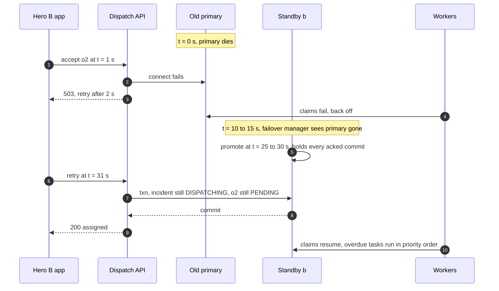

What the on-call sees: a failover page, a spike in `503`s for ~30 s, a short burst of overdue tasks, no sweeper violations. Data at risk: none acked.

**B: Worker dies after sending offers, before recording them.**
- t = 0: worker W1 commits wave 1 (o1 to o3, `sent_at` null), sends o1 and o2 over sockets, then is OOM-killed before marking them sent and before sending o3.
- t = 0.3 s: heroes 1 and 2 see the card and ack delivery. The gateway records `delivered_at` directly on the offer through the API.
- t = 3 s: the step's commit had already set `due_at` to +3 s for the delivery check, so W2 claims the task then with `attempt = 5`. The rule per offer: `sent_at` null means never sent, so send it now with a fresh 3 s. Sent but no delivery ack after 3 s means withdraw it and offer the next candidate. o3 has `sent_at` null, so W2 sends it. o1 and o2 are delivered, so it does nothing to them.
- If a resend did reach a hero who already had the card, the app would see the same `offer_id` twice and show one card. Cost of the crash: hero 3 got the offer ~3 s late. Data at risk: none.

**C: Hero goes silent while en route (P1).**
- t = 0: last ping from hero A.
- t = 30 s: heartbeat check marks `AT_RISK`. Console alert. Push "Still responding?".
- t = 60 s: one transaction ends a1 (`lost_contact`), hero A `UNREACHABLE`, incident `DISPATCHING`, task due now. Wave goes out at t = 60.2 s.
- t = 75 s: hero C accepts. Incident `ASSIGNED` to C, version 6.
- t = 90 s: A reconnects and sends `EN_ROUTE a1`. `409 released`. A's app shows "Hero C is responding". A pings, so A becomes `AVAILABLE` again.

### 10.5 Exactly-once and idempotency end to end

| Hop | Duplicate or loss risk | Defence | Dedup key and lifetime |
|---|---|---|---|
| Civilian to API | Retry after timeout, double tap | Unique `report_id` | Forever (column) |
| API to Postgres | Commit in doubt | Retry re-reads by `report_id` or `offer_id` | |
| Postgres to worker | Two workers on one task | PK on task, lease, `attempt` fencing | Per step |
| Worker to hero (offer) | Resend after crash | `offer_id`. App shows one card per id | Life of the offer |
| Hero to API (accept) | Retry, two devices | Idempotent per `offer_id`: same hero, already accepted, return `200` | Forever (offer row) |
| Hero to API (status) | Late update from a released hero, retries | `assignment_id` fencing plus a per-assignment sequence number | Life of the assignment |
| Worker to loser (notice) | Repeated "taken" | `notice_sent_at` on the offer. App ignores notices for dead cards | |
| Postgres to Kafka | CDC redelivery after restart | Events carry `(incident_id, version)`. Consumers ignore versions they have | Consumer state |
| Kafka to civilian notifier | Duplicate push "hero on the way" | Keyed by `(incident_id, version)`, short dedupe window | 10 min |
| Dispatcher to API | Double click, stale screen | `expected_version` | |

There is no exactly-once delivery anywhere. There is at-least-once delivery everywhere, with a key at every receiver.

### 10.6 Consistency model per edge

| Edge | Model |
|---|---|
| Civilian to Dispatch API to Postgres | Linearizable per incident. Read-your-writes: the `201` carries the committed state |
| Hero accept | Linearizable on the incident row. The winner's response is the committed assignment |
| Dispatch workers to Postgres | Linearizable per incident, fenced per task attempt |
| Hero gateway to location service to Redis | Eventual, ≤ 15 s plus up to ~1 s lost on a Redis failover |
| Workers reading Redis | Stale hint. Corrected by the Postgres availability filter and the accept's guards |
| Postgres to Kafka to projection | Eventual, ~0.3 to 1 s. Per-incident order kept (partition key) |
| Projection to console | Eventual. Commands carry `expected_version`, so writes from stale reads are refused |
| Hero app state | Eventual. The server is the truth. The app reconciles on reconnect |
| Primary to DR region | Async, RPO under 5 s |

### 10.7 Alternatives rejected

| Alternative | Why it looked attractive | Why it lost here |
|---|---|---|
| Uber-style geo-sharded dispatch (cells mapped to workers by consistent hashing) | It is what ride-hailing does at millions of trips | Solves a throughput problem we do not have, and creates cross-shard races at cell borders for the accept |
| DynamoDB with conditional writes | No failover, managed, conditional writes are a perfect fit for the race | Equally correct. No scale reason. Per-hero uniqueness needs guard items. Investigations need SQL |
| Redis as the assignment store (`SETNX`, Lua) | Fast, atomic scripts | Async replication can lose an acked assignment on failover. The losable store would hold the must-not-lose data |
| Kafka as the source of truth (log first, DB as a view) | Durable intake that keeps accepting during a DB failover | Two sources of truth. The accept still needs a linearizable store. Intake availability is already covered by client retries |
| Temporal or Cadence workflows | Durable timers, retries, visibility built in. Uber built Cadence for long-running flows like this | A second stateful cluster on the critical path to save ~300 lines. The right call if the org already runs it |
| Push notifications only | Simplest, no gateway to run | No delivery receipt. A lost offer costs a whole 15 s window |
| SERIALIZABLE isolation | "Strongest is safest" | Same outcome as a guarded UPDATE plus a retry loop |
| PostGIS on the hero table | One store, real geo queries | Puts the noisiest stream on the red node (§4.2) |
| Multi-region active-active | "More reliable" | One metro. Moves the race across a WAN |
| ML ranking from day one | Better acceptance prediction | No data yet. A linear score is explainable to dispatchers. The seam is the rank function (§10.11) |

### 10.8 How the big companies do it

- **Uber.** Built H3, a hexagonal grid, for "efficiently optimizing ride pricing and dispatch". Its dispatch splits supply (drivers) and demand (riders) and partitions by geography to handle millions of trips. Uber also built Cadence (later forked as Temporal) to give engineers persistence, queues and timers for long-running flows. Our design takes the geography split as a hint index and the timer idea as a task row, and leaves the partitioning behind. Uber's 10 Dec 2010 outage was "a bug that resulted in drivers getting dispatched to multiple Uber riders at the same time", the exact failure our constraints exist to prevent.
- **Lyft.** Matches in batches regenerated every few seconds rather than greedily. Its paper reports greedy matching raised combined rider wait plus driver travel from 8 to 12 minutes (50%). That is why batch matching appears here, but only in surge, when heroes are scarce.
- **DoorDash.** Dispatch weighs Dasher proximity to the store first, then timing, then batching, and pairs ML prediction with mixed-integer optimization. Their scale and objective (cost per delivery) justify the optimizer. Ours (one emergency, nearest capable hero) does not, yet.
- **Human 911 dispatch (CAD).** Computer-aided dispatch systems recommend the closest available unit from AVL (automatic vehicle location) and track unit status (available, dispatched, en route, on scene), much like our hero and incident states. NFPA 1221 asks for call processing within 60 s for 90% of calls, and NFPA 1710 for turnout within 60 s (EMS) and 80 s (fire). Their outages are instructive: CenturyLink's Dec 2018 outage lasted ~37 hours and at least 886 911 calls were not delivered. Houston's CAD crashed during electrical work in March 2024 and fire dispatch ran on paper for ~4.5 hours. Every real dispatch center keeps a manual fallback. So does ours (§8 migration step 5).

Sources and spot-checks: [`research/facts-survey.md`](research/facts-survey.md).

### 10.9 Operational runbook

- **Dashboards (the 5 metrics):** time to first offer p50 and p99; time to assignment by severity; open incidents by state with the oldest age per state; overdue tasks and the oldest overdue age; available heroes per zone vs pending incidents per zone (the surge indicator).
- **Alerts:** sweeper violation, page dispatch core; overdue task > 30 s, page; time to first offer p99 > 5 s for 5 min, page; `one_active_*` unique violations > 0, ticket and alert (the DB refused, but code tried); sync standby missing, page DB on-call; CDC slot WAL > 20 GB, page; escalations waiting > 30 s, page the floor supervisor.
- **Rollout:** dispatch core deploys by **zone canary**. One low-volume zone's incidents are routed to the new worker version for 30 minutes, gated on time to first offer, sweeper and conflict metrics. Then 25%, then all. Schema changes are expand and contract, never a rename in place.
- **Rollback:** a bad worker build is rolled back like any deploy. Its in-flight tasks are leased and expire in 10 s, and the old build picks them up. No data needs backfill, because the state is in Postgres and every step is re-runnable. A bad rule config (wave sizes, timeouts) is a versioned config revert.
- **Game days:** kill the primary monthly in staging and quarterly in production during low traffic. Kill a worker mid-wave. Drop the Redis index. Each one has a pass condition: no sweeper violation, no lost report.

### 10.10 Security and abuse

- **Auth boundary.** Civilians, heroes and dispatchers are separate roles with separate token audiences. A hero's token is bound to the hero id and device. The accept checks `offer.hero_id = token.hero_id`, so a hero cannot accept someone else's offer by guessing an id.
- **False reports and swatting.** Rate-limit reports per account, device and phone number (e.g. 5 an hour). New or low-trust accounts' reports go to a dispatcher triage queue with a 30 s SLA instead of auto-dispatch. **Never silently drop a report**: a false positive wastes a hero, a false negative can cost a life. Triage is the compromise, and it is measured.
- **Location spoofing by heroes** (to get more offers or to look nearer): reject pings that imply impossible speed for the hero's mobility type. Compare with the location in their accepted incidents' on-scene check-ins. Flag repeat offenders.
- **Privacy.** Before accept, an offer card shows the incident type, severity and distance, with the location rounded to ~200 m. The exact address and the civilian's contact go to the assigned hero only, and stop being visible when the assignment ends. Location history is retained 30 days for heroes [estimate], incident records 7 years.
- **Dispatcher actions** are all `transition()` calls with the dispatcher's id as actor, so every override is in `incident_event`. A cancel of a P1 needs a reason code.
- **Abuse of the system by load.** Reports go through the API gateway with per-IP and per-account limits. A bot flood degrades into the triage queue, not into heroes.

### 10.11 Evolution

- **Multi-hero incidents** (prompt follow-up 2). Add `required_heroes` and `skills_needed` to the incident and a `slot` to the assignment. The invariant becomes "one active assignment per `(incident_id, slot)`" (`UNIQUE (incident_id, slot) WHERE active`) plus the unchanged one per hero. An accept fills the lowest open slot that matches the hero's skills. The incident is `ASSIGNED` when every slot is filled and `PARTIALLY_ASSIGNED` until then, with waves for the open slots only. The seam: the accept transaction already locks the incident first, so filling slot 2 cannot race with filling slot 2 again.
- **ML for acceptance probability and ETA** (follow-up 4). The rank function is the seam. A model scores `(hero, incident)` pairs in ~10 ms for 50 candidates, served from a feature store fed by the warehouse. Wave size can then target "P(at least one accept) ≥ 95%" directly instead of a fixed 3. Keep the linear score as the fallback when the model times out at 50 ms, so matching stays in seconds.
- **Travel-time ETA.** Replace straight-line distance with a routing call for the top ~10 candidates only (ground heroes). Flyers keep straight-line.
- **SMS and voice escalation.** For heroes without a socket and with no push delivery after 3 s, an SMS or call through a telephony provider. Same `offer_id`, a short code to accept.
- **Many cities, 10x heroes.** Each city is an independent **cell**: its own Postgres, Redis, workers. Incidents and heroes never cross cells except a hero assigned near a border, which is a dispatcher action. The partition key is `city_id`. Nothing in the incident model changes. This is also the blast-radius win: a bad deploy canaried to one city hurts one city.
- **100x incidents in one city.** The first thing to move is the task queue off Postgres (outbox relay into Kafka plus a timer service). Next is the incident store, sharded by `h3_r5` region within the city, with the accept still single-shard because an incident lives in exactly one region.
- **Civilian live tracking of the hero.** Read from the location service, not Postgres. The civilian sees the assigned hero only while the assignment is active, with ~5 s staleness.
- **GDPR-style deletion.** Civilian personal data lives in `civilian` and in incident notes. Delete or pseudonymize those. Keep the incident's operational record (times, states, hero) under the legal-retention exemption.

---

## 11. Follow-up questions to expect

Ranked by how likely an interviewer is to ask them.

1. "Two heroes accept at the same time." The guarded UPDATE, the lock order, the unique indexes, how the loser hears. §4.3, §5.1, [`deep-dives/accept-race-and-assignment-store.md`](deep-dives/accept-race-and-assignment-store.md).
2. "Why Postgres? Why Redis? Why not Kafka?" The §7 technology table, one sentence each.
3. "The incident saves but dispatch never starts." Task row in the same transaction, sweeper. §4.1, §5.2, [`deep-dives/reliable-dispatch-start.md`](deep-dives/reliable-dispatch-start.md).
4. "The assigned hero goes silent." `AT_RISK`, reassign by severity, fencing by assignment id, the physical vs record invariant. §5.4, [`deep-dives/incident-state-machine-and-stuck-detection.md`](deep-dives/incident-state-machine-and-stuck-detection.md).
5. "50x burst in one neighbourhood." Heroes are the bottleneck. Clustering, priority, smaller waves, batch matching, reserves. §5.5, [`deep-dives/surge-and-degradation.md`](deep-dives/surge-and-degradation.md).
6. "Where does location live, and why don't you trust it?" §4.2, §5.3, [`deep-dives/location-index-vs-truth.md`](deep-dives/location-index-vs-truth.md).
7. "How many heroes do you offer at once, and for how long?" §5.3, [`deep-dives/offer-strategy-and-timeouts.md`](deep-dives/offer-strategy-and-timeouts.md).
8. "The database fails over." §5.6, timeline 10.4 A.
9. "Multi-hero incidents?" Slots with a unique index per slot. §10.11.
10. "Add an ML model for acceptance and ETA." The rank function seam, timeout to the linear score. §10.11.

---

## 12. Running it in Stripe's design round

Reported rounds were ~45 to 60 minutes with no API design. One way to spend 50:

| Minutes | What to do | What it signals |
|---|---|---|
| 0 to 5 | Requirements, then the numbers: 8 incidents/s, 2,000 pings/s, both invariants. Say "everything here is small, so I'll optimise for correctness under failure, and I'll refuse to shard" | You design from the numbers, not the Uber template |
| 5 to 12 | Two stores, two jobs: Postgres for truth, Redis GEO for hints. One sentence of justification each, with the rejected alternative | The exact thing the L3 candidate was dinged on |
| 12 to 22 | The accept: guarded UPDATE, incident locked first, unique indexes, how the loser hears. Draw the two-hero sequence | The core correctness answer |
| 22 to 30 | Report and dispatch start in one transaction: the task row. Waves of 3, delivery ack, expiry as a transition | Shared fate, timers, push is best effort |
| 30 to 38 | State machine, silent hero, fencing by assignment id, record vs physical invariant | Failure thinking |
| 38 to 45 | The interviewer's pick: 50x burst (heroes are the bottleneck) or primary failover (delay, not loss) | Depth on demand |
| 45 to 50 | Migration through shadow and assisted modes, what pages at 3 am, what you refused to build | Staff scope |

Before the round, practise the §7 technology table out loud until each row is one breath. Stripe's reported feedback on this exact prompt was "my justification for the technology choices wasn't strong enough".
