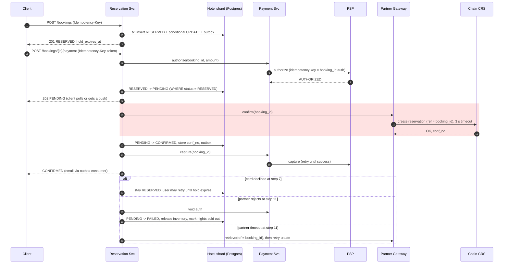
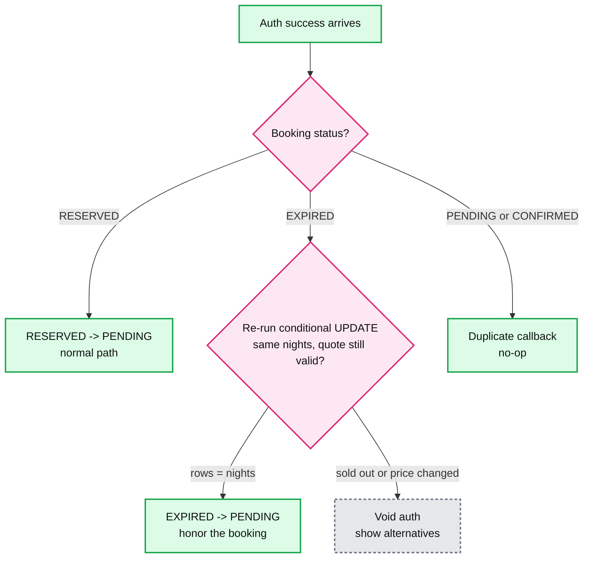

# Deep dive: Booking saga and payment

> One-line answer: an orchestrated saga run by Reservation Svc: hold inventory (local tx) → authorize the card → get partner confirmation (the **pivot**) → capture → notify. Every step is idempotent. Before the pivot each step has a cheap undo (release, void). After it each step is retried until it succeeds.

Back to [solution](../solution.md). Background: [distributed transactions](../../../concepts/distributed-transactions.md).

## 1. Happy path and failure branches

- The red block is the pivot and the only step that leaves our trust boundary with side effects at the hotel.
- The client gets `202 PENDING` before the partner call. A slow CRS never holds a user's HTTP request open.

## 2. Saga steps

| # | Step | Undo (compensation) | Type | Idempotency |
|---|---|---|---|---|
| 1 | Hold inventory | Release: `reserved - qty` | Compensatable | `(user_id, Idempotency-Key)` unique |
| 2 | Authorize card | Void (free, instant) | Compensatable | PSP idempotency key `booking_id:auth` |
| 3 | Partner confirm | Cancel at CRS (may cost a penalty) | **Pivot** | Partner reference = `booking_id` |
| 4 | Capture | none, retry | Retriable | PSP key `booking_id:capture` |
| 5 | Notify, update "my bookings" view | none, retry | Retriable | outbox `event_id` |

### Why the pivot is partner confirmation, not the charge

- A common answer makes "charge the card" the pivot. That means taking money **before** we know the hotel accepts.
- If the partner then rejects, the undo is a refund: PSP fees often not returned, 5-10 days to reach the card, a support ticket, sometimes a chargeback.
- Auth first, capture after: the undo before the pivot is a void. Free, instant, and the user sees a pending hold disappear.
- The charge **is** the pivot only when the payment method cannot authorize separately (some wallets and bank transfers capture immediately). Then: confirm with the partner first if possible, and keep an automatic refund as the compensation.
- For ALLOTMENT hotels the pivot is our own `PENDING → CONFIRMED` commit. Still before capture.

## 3. Orchestration: how steps actually run

```mermaid
%% Saga driver: state lives in the booking row, side effects are driven from the outbox
flowchart LR
    API["Reservation API<br/>writes state + outbox in one tx"]
    DB[("booking + outbox<br/>hotel shard")]
    CDC["CDC (Debezium)"]
    K[["Kafka booking.events"]]
    W["Saga workers<br/>one step per event"]
    PAY["Payment Svc"]
    PG["Partner Gateway"]
    T["Timeout scanner<br/>stuck PENDING > 15 min"]

    API -->|tx| DB
    DB -->|WAL| CDC
    CDC -->|events| K
    K -->|BOOKING_PENDING| W
    W -->|confirm| PG
    W -->|capture, void| PAY
    W -->|next state, conditional| DB
    T -->|re-drive or alert| W

    class API,W,T service
    class DB store
    class CDC,K queue
    class PAY service
    class PG critical

    classDef client   fill:#dbeafe,stroke:#2563eb,stroke-width:2px,color:#111
    classDef service  fill:#dcfce7,stroke:#16a34a,stroke-width:2px,color:#111
    classDef store    fill:#ede9fe,stroke:#7c3aed,stroke-width:2px,color:#111
    classDef cache    fill:#fef3c7,stroke:#d97706,stroke-width:2px,color:#111
    classDef queue    fill:#cffafe,stroke:#0891b2,stroke-width:2px,color:#111
    classDef critical fill:#fee2e2,stroke:#dc2626,stroke-width:4px,color:#111
    classDef external fill:#e5e7eb,stroke:#6b7280,stroke-width:2px,color:#111,stroke-dasharray:4 3
    classDef decision fill:#fce7f3,stroke:#db2777,stroke-width:2px,color:#111
```

- **State lives in the booking row.** Workers are stateless. A crashed worker means the event is redelivered, and the conditional state update makes the second run a no-op.
- **Outbox, not dual write.** Writing the DB and then publishing to Kafka can lose the event between the two. The outbox row commits with the state change.
- **Red: Partner Gateway.** It is the step with third-party latency and unknown outcomes on timeout.
- **Timeout scanner.** Any booking in `PENDING` > 15 min is re-driven. After 24 h it goes to a human queue.
- Alternative: a workflow engine (Temporal). Gives visibility and timers for free. Worth it if the company already runs it. Not worth adding a new stateful system for ~60 bookings/s.

## 4. Payment succeeds after the hold expired

Rule chosen: **re-check and honor if the room and price are still there, else void.** Because we only authorized, the failure path costs nothing.

- Why not always refund: the user already paid and the room is often still free. Throwing away a conversion to keep a rule simple is a bad trade.
- Why not always honor: the room may be gone. Honoring would be an oversell we created ourselves.
- Immediate-capture methods take the same path, but "void" becomes "automatic refund".
- Make it rare: 2 min server grace after the 10 min client timer, and the payment page times out before the hold.

## 5. Idempotency, end to end

| Boundary | Key | Stored where | Protects against |
|---|---|---|---|
| Client → create booking | `Idempotency-Key` header (UUID per checkout) | `UNIQUE (user_id, idempotency_key)` on booking | Double click, mobile retry → two holds |
| Client → pay | `Idempotency-Key` header | Payment Svc `idempotency` table, response cached 24 h | Double charge on retry |
| Us → PSP | `booking_id:auth`, `booking_id:capture` | PSP side | Network retry → two auths |
| Us → partner | `booking_id` as reservation reference | Partner side, plus our `partner_conf_no` | Timeout retry → two rooms at the hotel |
| CDC → consumers | outbox `event_id` | Consumer dedupe table or idempotent upsert | Kafka redelivery → two emails |

## 6. Cancellation

- `CONFIRMED → CANCELLED` in one tx: release inventory for future nights + outbox.
- Saga: cancel at partner (retry until ack) → refund per rate plan policy (free until 48 h before, else first night).
- Partner-initiated cancel (hotel closed, overbooked): same path, full refund, walk policy if within 7 days of arrival.

## 7. Hold-then-pay vs pay-then-confirm

| | Hold, then pay (chosen) | Pay, then confirm |
|---|---|---|
| User experience | "Your room is held for 10 min" | "Payment taken, confirming..." then maybe "sorry" |
| Inventory | Blocked by abandoners for 12 min | Never blocked |
| Failure after payment | Rare (only late payment) | Common on last rooms: void or refund |
| Abuse | Hold hoarding by bots | Card testing |
| When to flip | | Flash sales with extreme contention, where holds would lock everything |

Hold-hoarding limits: login required, ≤ 3 live holds per user, device and card BIN, CAPTCHA on burst.

## 8. Security on the payment path
- PSP-hosted card fields. Card numbers never reach our servers. PCI DSS scope shrinks to the simplest self-assessment level.
- 3DS2 / SCA (strong customer authentication, required in the EU) adds a redirect that can take 1-2 min. The hold TTL budget accounts for it.
- Amount and currency are taken from the server-side booking row, never from the client.
- Fraud score before authorize (velocity per card, mismatch of card country vs IP vs hotel country).

## 9. Trade-offs

| Decision | Chose | Gave up |
|---|---|---|
| Orchestration over choreography | One place shows a booking's whole state | Reservation Svc is coupled to every step |
| DB state machine over Temporal | No new stateful infra | Hand-built timers and re-drive |
| Auth then capture | Free undo before the pivot | Auth can expire (typically ~7 days), so capture must not lag |
| Partner confirm as pivot | No refunds for partner rejects | Booking stays PENDING for seconds to minutes |
| Honor late payments when possible | Keeps the conversion | One more branch to test |

## 10. Follow-ups
- "Capture fails after the partner confirmed." → retry with backoff. Auth is valid for days. Alert after 6 h. The booking stays CONFIRMED. The hotel has the guest.
- "PSP is down." → second PSP behind the same Payment Svc interface. Extend live holds by 5 min.
- "The user's 3DS challenge takes 9 minutes." → payment page shows the timer. At expiry the late-payment rule applies.
- "Pay at hotel." → skip steps 2 and 4. Store a card token as a guarantee only.
