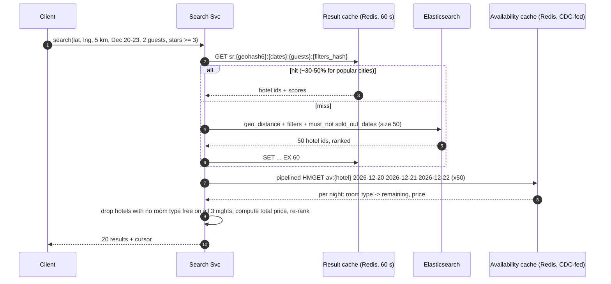

# Deep dive: Geo search and availability

> One-line answer: Elasticsearch finds hotels within the radius that pass filters and are not sold out on any night (a coarse signal, up to ~2 min stale). Then a CDC-fed Redis cache gives exact remaining count and price per night for the top 50 (seconds stale). The booking re-checks against the inventory primary, so staleness costs a retry, never an oversell.

Back to [solution](../solution.md).

## 1. Request path



- The result cache stores ids, not prices. Prices always come from the availability cache, so a 60 s cache never shows a 60 s old price.
- 50 candidates for 20 results: the precise check removes some, and we still fill the page.

## 2. Elasticsearch document and query

```json
PUT hotels
{
  "settings": { "number_of_shards": 1, "number_of_replicas": 5 },
  "mappings": {
    "properties": {
      "hotel_id":       { "type": "long" },
      "name":           { "type": "text" },
      "location":       { "type": "geo_point" },
      "city_id":        { "type": "keyword" },
      "stars":          { "type": "byte" },
      "review_score":   { "type": "half_float" },
      "amenities":      { "type": "keyword" },
      "max_occupancy":  { "type": "byte" },
      "min_price_30d":  { "type": "scaled_float", "scaling_factor": 100 },
      "sold_out_dates": { "type": "date", "format": "yyyy-MM-dd" },
      "partner_score":  { "type": "half_float" }
    }
  }
}
```

```json
GET hotels/_search
{
  "size": 50,
  "query": {
    "function_score": {
      "query": {
        "bool": {
          "filter": [
            { "geo_distance": { "distance": "5km", "location": { "lat": 48.8566, "lon": 2.3522 } } },
            { "range": { "stars": { "gte": 3 } } },
            { "range": { "max_occupancy": { "gte": 2 } } },
            { "term": { "amenities": "wifi" } }
          ],
          "must_not": [
            { "range": { "sold_out_dates": { "gte": "2026-12-20", "lt": "2026-12-23" } } }
          ]
        }
      },
      "functions": [
        { "gauss": { "location": { "origin": { "lat": 48.8566, "lon": 2.3522 }, "scale": "2km" } } },
        { "field_value_factor": { "field": "review_score", "missing": 7 } },
        { "field_value_factor": { "field": "partner_score", "missing": 1 } }
      ],
      "score_mode": "multiply"
    }
  }
}
```

- `sold_out_dates` holds the nights where **every** room type is sold out. A range query on a multi-valued field matches if any value is in range. So `must_not` drops a hotel sold out on any night of the stay.
- Filters go in `filter` (cached, no scoring). Distance, reviews and partner quality go in `function_score`.
- Map view uses `geo_bounding_box` on the viewport instead of `geo_distance`.
- City search uses `city_id`. "Near the Eiffel Tower" is a geocode (out of scope) then `geo_distance`.

### What "coarse" means

| Case | ES says | Truth | Who fixes it |
|---|---|---|---|
| Room type A free night 1 only, B free night 2 only | available | no single room type for the stay | Precise check (Redis) drops it |
| Sold out 30 s ago | available | sold out | Precise check, else the booking |
| Became free 30 s ago | hidden | available | Nobody until reindex. Lost sale, small. |

False positives are cheap (we drop them). False negatives cost revenue but last ≤ 2 min.

## 3. Availability cache layout

```
Key:    av:{hotel_id}                  (Redis hash, one per hotel)
Field:  2026-12-20                     (one per night, 365 per hotel)
Value:  msgpack { 7: [3, 18900], 9: [0, 25900] }
        room_type_id -> [remaining = total - reserved - buffer, best price_minor]
```

- Memory: 100k hotels x 365 fields x ~120 B ≈ **~4.4 GB**. Plus replicas, ~10 GB.
- Load: 6k searches/s x 50 hotels = **300k `HMGET`/s** peak. Pipelined, ~50-80k ops/s per node → ~6 primary nodes.
- Writes: a CDC consumer reads inventory and rate changes from Kafka and updates the field. It drops any event whose `version` is older than the one stored (stored alongside the value), so reordering cannot roll the cache back.
- Lag: p99 < 5 s from DB commit to cache.
- Losable: on a cold start, rebuild from a replica scan (~180M rows, ~10 min) while search falls back to ES only.

## 4. Freshness tiers

```mermaid
%% Where each freshness level is acceptable, and the cost of staleness at each
flowchart LR
    ES[("ES: sold_out_dates<br/>≤ 2 min stale")]
    AC[/"Redis: remaining + price<br/>≤ 5 s stale"/]
    DB[("Inventory primary<br/>exact")]
    CRS["Partner CRS<br/>exact for chains"]

    ES -->|top 50 candidates| AC
    AC -->|user clicks Book| DB
    DB -->|LIVE hotel only| CRS

    class ES,DB store
    class AC cache
    class CRS external

    classDef client   fill:#dbeafe,stroke:#2563eb,stroke-width:2px,color:#111
    classDef service  fill:#dcfce7,stroke:#16a34a,stroke-width:2px,color:#111
    classDef store    fill:#ede9fe,stroke:#7c3aed,stroke-width:2px,color:#111
    classDef cache    fill:#fef3c7,stroke:#d97706,stroke-width:2px,color:#111
    classDef queue    fill:#cffafe,stroke:#0891b2,stroke-width:2px,color:#111
    classDef critical fill:#fee2e2,stroke:#dc2626,stroke-width:4px,color:#111
    classDef external fill:#e5e7eb,stroke:#6b7280,stroke-width:2px,color:#111,stroke-dasharray:4 3
    classDef decision fill:#fce7f3,stroke:#db2777,stroke-width:2px,color:#111
```



| Tier | Read QPS | Staleness | Cost of being wrong |
|---|---|---|---|
| ES | ~6k | ≤ 2 min | A hotel shown then dropped, or hidden briefly |
| Redis | ~300k | ≤ 5 s | "Sorry, just sold out" at booking |
| Primary | ~100 (holds) | 0 | n/a |
| CRS | ~30 (chain holds) | 0 | n/a |

Each tier is ~50-1000x fewer reads than the one before it. That is the whole point of the funnel.

## 5. ES indexing

- Indexer consumes catalog changes and inventory changes from Kafka.
- `sold_out_dates` and `min_price_30d` change often. Debounce per hotel: at most one reindex per 60 s.
- Worst case 100k hotels/min ≈ 1.7k doc updates/s. Realistic ~300/s. ES handles this easily.
- Index is ~100k docs x ~5 KB ≈ 500 MB. One primary shard fits in memory. Read capacity comes from replicas: 6 data nodes at ~1.5k geo queries/s each ≈ 9k QPS.
- Full rebuild (new mapping): build `hotels_v2` from Catalog + Redis, swap the alias. No downtime.

## 6. Geo index options

| Option | How | Good | Bad |
|---|---|---|---|
| **ES `geo_point`** (chosen) | BKD tree inside ES | Geo + filters + text + ranking in one query | Another cluster to run |
| PostGIS | GiST index in Postgres | Exact, SQL joins with inventory | Facets, ranking, and 6k QPS of mixed queries are harder |
| Geohash prefix in a KV store | Precompute cell, scan prefix + neighbors | Simple, any KV store | Edge cases at cell borders, no filters |
| H3 / S2 cells | Hex or square cells, k-ring lookups | Uniform cells, good for analytics | Same as geohash for filtering |

At 100k hotels any of these is fast. ES wins because filters and ranking are the hard part, not geo.

## 7. Trade-offs

| Decision | Chose | Gave up |
|---|---|---|
| Coarse in ES, precise in Redis | Cheap indexing, fresh prices | Two systems to keep in sync |
| Store only sold-out dates in ES | Small docs, one range query | Room-type-level precision in ES |
| Cache ids, not prices | Prices never older than ~5 s | A Redis round trip on every search |
| One ES shard + many replicas | Simple, all in memory | Must re-shard if we reach ~10M listings (vacation rentals) |
| Search never touches the primary | Search load cannot hurt bookings | Users sometimes see "just sold out" |

## 8. Follow-ups
- "Add vacation rentals, 10M listings." → ES shards by region, availability cache grows 100x (~400 GB). Consider per-listing bitmaps instead of hashes.
- "Sort by price." → price is only exact in Redis. Sort ES by `min_price_30d`, take 200, re-sort by exact price.
- "Flexible dates (± 3 days)." → 7 date windows, run in parallel, union.
- "Metasearch partners query 50k QPS." → separate cluster and quota so they cannot starve users. Serve them from the availability cache only.
