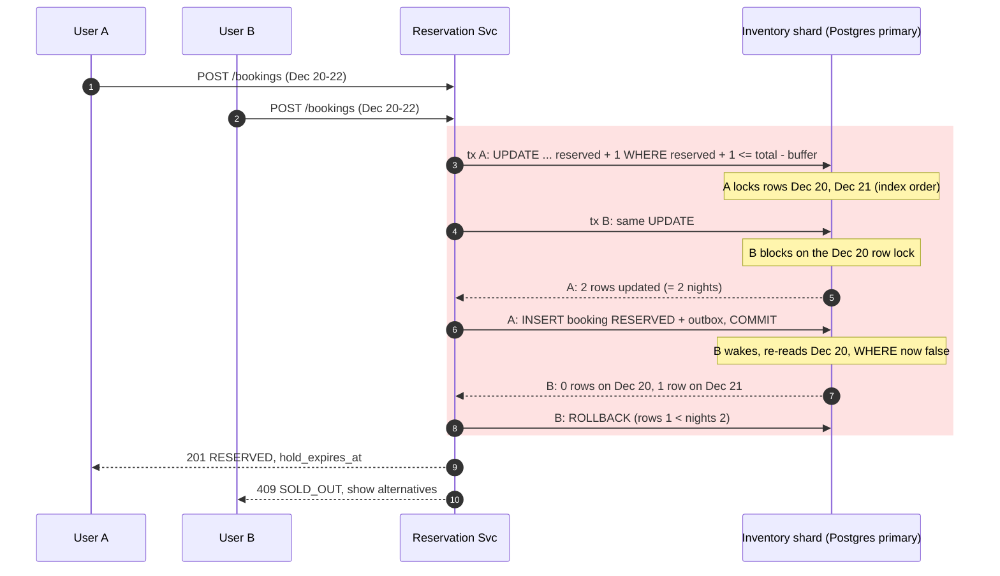
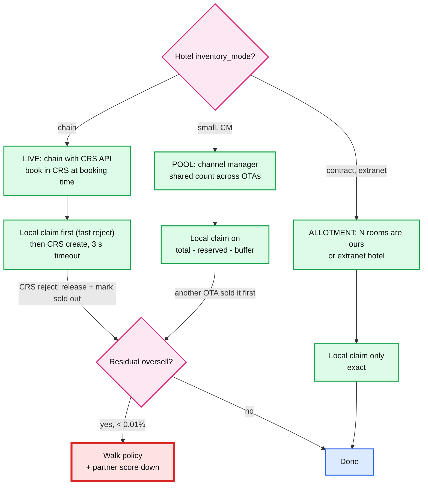

# Deep dive: Last room and inventory locking

> One-line answer: one transaction on the hotel's shard runs `UPDATE inventory SET reserved = reserved + qty WHERE <every night of the stay> AND reserved + qty <= total - buffer`. If the affected row count is less than the number of nights, roll back and return `SOLD_OUT`. Across other OTAs the last room is protected by the partner CRS (chains) or by an in-flight overlay, a buffer and reconciliation (small hotels).

Back to [solution](../solution.md).

## 1. Two users, one room, same instant



- Why B sees the fresh value: in Postgres `READ COMMITTED`, an `UPDATE` that waits on a row lock re-reads the newest committed version and re-checks the `WHERE` before writing. So check and write are atomic per row.
- Why the row count check matters: each night is checked independently. B could win Dec 21 and lose Dec 20. Counting rows turns "all nights or nothing" into one rule.
- Missing rows count as unavailable. A night with no inventory row (hotel closed, not loaded yet) gives fewer rows, so the stay is rejected.

## 2. Schema

```sql
CREATE TABLE inventory (
  hotel_id      BIGINT  NOT NULL,
  room_type_id  INT     NOT NULL,
  stay_date     DATE    NOT NULL,
  total         INT     NOT NULL,            -- allotment, or partner-reported available count
  reserved      INT     NOT NULL DEFAULT 0,  -- our holds + sales not yet reflected in total
  buffer        INT     NOT NULL DEFAULT 0,  -- > 0 hold back rooms, < 0 hotel-approved overbook
  stop_sell     BOOLEAN NOT NULL DEFAULT false,
  ari_seq       BIGINT  NOT NULL DEFAULT 0,  -- last partner sequence applied to this night
  version       BIGINT  NOT NULL DEFAULT 0,  -- bumped on every write; CDC consumers drop older versions
  PRIMARY KEY (hotel_id, room_type_id, stay_date),
  CHECK (reserved >= 0)
);

CREATE TABLE booking (
  booking_id       BIGINT PRIMARY KEY,         -- high bits = logical shard id
  hotel_id         BIGINT NOT NULL,
  user_id          BIGINT NOT NULL,
  idempotency_key  TEXT   NOT NULL,
  room_type_id     INT    NOT NULL,
  rate_plan_id     INT    NOT NULL,
  check_in         DATE   NOT NULL,
  check_out        DATE   NOT NULL,
  qty              SMALLINT NOT NULL DEFAULT 1,
  status           TEXT   NOT NULL,            -- RESERVED, PENDING, CONFIRMED, EXPIRED, FAILED, CANCELLED, COMPLETED
  hold_expires_at  TIMESTAMPTZ,
  total_minor      BIGINT NOT NULL,
  partner_conf_no  TEXT,
  created_at       TIMESTAMPTZ NOT NULL DEFAULT now(),
  updated_at       TIMESTAMPTZ NOT NULL DEFAULT now(),
  UNIQUE (user_id, idempotency_key)
);

-- Only live holds are indexed, so the sweeper index stays tiny (<= 60k rows).
CREATE INDEX booking_live_holds ON booking (hold_expires_at) WHERE status = 'RESERVED';
```

- `user_id` + `idempotency_key` is unique per shard. A retry carries the same `hotel_id`, so it lands on the same shard.
- `version` is not used for locking. It orders CDC events so the Redis cache never applies an older value over a newer one.

## 3. Three ways to take the room

### 3.1 Conditional update (chosen)

```sql
BEGIN;

-- 1. Idempotency. A replay of the same request inserts nothing.
INSERT INTO booking (booking_id, hotel_id, user_id, idempotency_key, room_type_id, rate_plan_id,
                     check_in, check_out, qty, status, hold_expires_at, total_minor)
VALUES (:bid, :hid, :uid, :idem, :rt, :rp, :in, :out, :qty,
        'RESERVED', now() + interval '12 minutes', :amount)
ON CONFLICT (user_id, idempotency_key) DO NOTHING;
-- 0 rows inserted -> ROLLBACK, SELECT the existing booking, return it with 201.

-- 2. Claim qty units on every night. Check and write are one statement per row.
UPDATE inventory
SET    reserved = reserved + :qty,
       version  = version + 1
WHERE  hotel_id = :hid
  AND  room_type_id = :rt
  AND  stay_date >= :in AND stay_date < :out
  AND  NOT stop_sell
  AND  reserved + :qty <= total - buffer;
-- affected rows < (:out - :in) -> ROLLBACK, return 409 SOLD_OUT.

-- 3. Outbox row in the same transaction. CDC publishes it to Kafka.
INSERT INTO outbox (aggregate_id, type, payload)
VALUES (:bid, 'BOOKING_RESERVED', :json);

COMMIT;
```

- One round trip for the claim. Row locks are held only until `COMMIT` (~5 ms).
- Conflicts happen only when capacity is actually short.
- Retries are not needed. If it fails, the room is genuinely gone.

### 3.2 Pessimistic: `SELECT ... FOR UPDATE`

```sql
BEGIN;
SELECT stay_date, total, reserved, buffer, stop_sell
FROM   inventory
WHERE  hotel_id = :hid AND room_type_id = :rt
  AND  stay_date >= :in AND stay_date < :out
ORDER  BY stay_date          -- fixed lock order, avoids deadlocks
FOR UPDATE;
-- App checks: row count = nights, and every row has reserved + qty <= total - buffer.

UPDATE inventory SET reserved = reserved + :qty, version = version + 1
WHERE  hotel_id = :hid AND room_type_id = :rt AND stay_date >= :in AND stay_date < :out;
INSERT INTO booking (...) VALUES (...);
COMMIT;
```

- Correct, and the check logic lives in Java where it is easy to extend (min length of stay, closed-to-arrival).
- Cost: two round trips with locks held across the app's check. Lock hold time doubles or triples.
- Use it if the rule becomes too complex for one `WHERE`.

### 3.3 Optimistic: version check

```sql
-- Read without locks.
SELECT stay_date, total, reserved, buffer, version
FROM   inventory
WHERE  hotel_id = :hid AND room_type_id = :rt AND stay_date >= :in AND stay_date < :out;
-- App checks capacity, then:

BEGIN;
UPDATE inventory SET reserved = reserved + :qty, version = version + 1
WHERE  hotel_id = :hid AND room_type_id = :rt AND stay_date = :d AND version = :v;  -- once per night
-- Any 0-row result -> ROLLBACK, re-read, retry (max 3).
INSERT INTO booking (...) VALUES (...);
COMMIT;
```

- No locks while the user thinks. Good when conflicts are rare.
- **The trap here:** ARI writes bump `version` too. A popular hotel gets price updates every few seconds, so bookings fail on version mismatch even with 50 rooms free. Retries pile up exactly when demand is high.

### 3.4 Comparison

| | Conditional update | Pessimistic `FOR UPDATE` | Optimistic version |
|---|---|---|---|
| Round trips | 1 | 2 | 2 + retries |
| Lock hold | statement + commit | across app logic | commit only |
| Conflicts on | real capacity | real capacity | any write, incl. ARI price changes |
| Retry storm risk | none | none | high on hot hotels |
| Complex rules | hard in SQL | easy in app | easy in app |
| **Use when** | **default** | rules outgrow SQL | low contention, no other writers |

### 3.5 Deadlocks and hot rows

- Every claim scans the same PK in date order, so locks are taken in the same order. Two overlapping stays cannot deadlock on each other.
- The ARI applier writes the same rows. It also writes in PK order. If the planner ever chooses another path, Postgres detects the deadlock after `deadlock_timeout` (1 s) and aborts one. The app retries once.
- Hot row: one row with a ~5 ms lock handles ~200 claims/s. Global peak is ~60 bookings/s. Not a bottleneck. A flash sale needs a waiting room, not a new lock design.

## 4. Hold expiry

```sql
-- Runs every 15 s on each shard. SKIP LOCKED lets several workers share the work.
WITH expired AS (
  UPDATE booking b
  SET    status = 'EXPIRED', updated_at = now()
  WHERE  b.booking_id IN (
           SELECT booking_id FROM booking
           WHERE  status = 'RESERVED' AND hold_expires_at < now()
           ORDER  BY hold_expires_at
           LIMIT  500
           FOR UPDATE SKIP LOCKED)
    AND  b.status = 'RESERVED'                 -- loses cleanly to a payment that just moved it to PENDING
  RETURNING b.hotel_id, b.room_type_id, b.check_in, b.check_out, b.qty
),
nights AS (                                    -- aggregate first: two expired holds can share a night
  SELECT e.hotel_id, e.room_type_id, d::date AS stay_date, sum(e.qty) AS n
  FROM   expired e,
         generate_series(e.check_in, e.check_out - 1, interval '1 day') AS d
  GROUP  BY 1, 2, 3
)
UPDATE inventory i
SET    reserved = i.reserved - n.n, version = i.version + 1
FROM   nights n
WHERE  i.hotel_id = n.hotel_id AND i.room_type_id = n.room_type_id AND i.stay_date = n.stay_date;
```

- The `nights` aggregation is not optional. `UPDATE ... FROM` with two join rows for one target row updates it only once. Without `sum`, two expired holds on the same night would release only one unit. That is a silent inventory leak.
- Why a DB sweeper and not Redis TTL or a delay queue: the hold lives in Postgres, so its timer should too. A lost Redis key would leak a room forever.
- `hold_expires_at` is set to 12 min. The user sees 10 min.

## 5. The last room across platforms

We are one of many channels. The same room is also on the hotel's own site, other OTAs, and the front desk.



### 5.1 LIVE (large chains)

- The CRS is the source of truth. Our inventory row is a cache for search and a fast reject.
- Flow: local conditional claim (rejects most sold-out attempts in ~5 ms) → CRS create with our `booking_id` as the partner reference → on success `PENDING → CONFIRMED`.
- CRS says no: release locally and set `total = reserved` for those nights so search stops showing it. This is the freshest ARI signal we will ever get.
- CRS times out: outcome unknown. Query the CRS by our reference before retrying. Never create twice.

### 5.2 POOL (small hotels on a channel manager)

The channel manager (CM) pushes "rooms left across all channels". The race: we sell at t=0, the CM learns at t=2 s, but an update the CM built at t=1 s arrives at t=3 s still showing our room as free. If we blindly set `total` from it, we re-open a room we already sold.

**In-flight overlay.** Keep our bookings the partner has not yet reflected.

```sql
CREATE TABLE inflight_reservation (
  booking_id    BIGINT PRIMARY KEY,
  hotel_id      BIGINT NOT NULL,
  room_type_id  INT    NOT NULL,
  check_in      DATE   NOT NULL,
  check_out     DATE   NOT NULL,
  qty           SMALLINT NOT NULL,
  acked_at      TIMESTAMPTZ          -- partner acknowledged our reservation
);
```

- On each ARI update with partner timestamp `T`, set `total` from the partner, then recompute `reserved` for those nights as: our live holds + inflight rows where `acked_at IS NULL OR acked_at > T`.
- An inflight row is deleted once an ARI update with `T > acked_at` has been applied. That update already counts our booking.
- The table holds only the last few minutes of bookings per hotel, so the recount is cheap and runs only for POOL hotels.

What remains: another OTA sells the room in the seconds before the CM tells us. No design on our side closes that gap. We narrow it and pay for the rest:

| Lever | Effect | Cost |
|---|---|---|
| `buffer = 1` on the last room for POOL hotels | We stop selling when 1 is left | Lost revenue on that room through us |
| Fresher push (CM webhooks over polling) | Gap drops from minutes to seconds | Integration work |
| Nightly reconciliation | Drift fixed within 24 h | Partner API quota |
| Partner quality score | Bad partners get larger buffers, lower ranking | Needs history |

### 5.3 The buffer is two different knobs

- **Hold-back (`buffer > 0`).** Ours. "Stop selling through us when N are left." Auto-tune per hotel from its 30-day oversell history: oversold more than twice → `buffer = 1`.
- **Overbook (`buffer < 0`).** The hotel's revenue-management decision, based on its no-show rate. Only enabled when the hotel contractually asks for it.
- Default is 0. An OTA should not overbook on the hotel's behalf.

### 5.4 Walk policy (when oversell still happens)

- Detect early: partner rejects our delivery, or reconciliation finds `reserved > total`. Alert ops and the guest before arrival, not at the front desk.
- Relocate to an equal or better hotel within ~5 km. We pay the price difference and transport. Free first night if found on arrival day.
- Charge the cost back to the hotel when its stale ARI caused it (contract term).
- Track `walk_rate` per partner. It feeds the quality score and the buffer.

## 6. Trade-offs

| Decision | Chose | Gave up |
|---|---|---|
| Conditional update over `FOR UPDATE` | 1 round trip, short locks | Complex rules must fit in SQL |
| Conditional update over optimistic version | No false conflicts from ARI writes | Nothing important |
| Count by room type, not physical room | 200x fewer rows, one row per night to lock | Cannot sell "room 412". Assigned at check-in. |
| Hold reserved in the same counter | One `WHERE` checks holds and sales | Need separate metrics query for "held vs sold" |
| DB sweeper for expiry | Hold and its timer are durable together | Up to 15 s late release |
| Hold-back buffer on POOL | Fewer walks | A few unsold last rooms |

## 7. Follow-ups
- "A stay crosses a month boundary and you partition by month." → Keep partitions on the same shard. A local transaction spans partitions fine.
- "Group booking of 20 rooms." → same SQL with `qty = 20`. Or block allotments, contracted separately.
- "Why not a distributed lock in Redis?" → the lock must live with the count. A Redis lock plus a DB write is two systems that can disagree on failover.
- "How do you test this?" → a concurrency test: 100 threads, 1 room, assert exactly 1 `RESERVED`. Plus a nightly invariant job: `reserved = count(live holds and unreflected sales)` per row.
