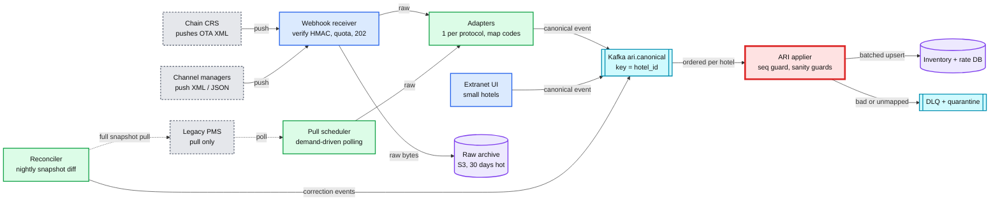
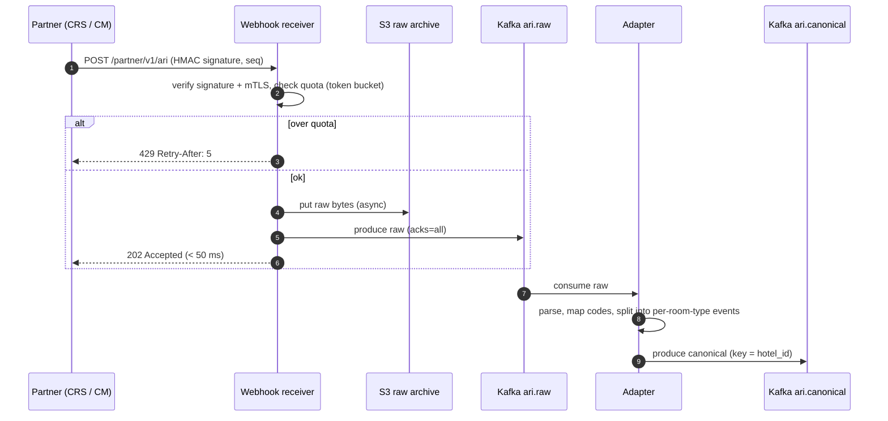
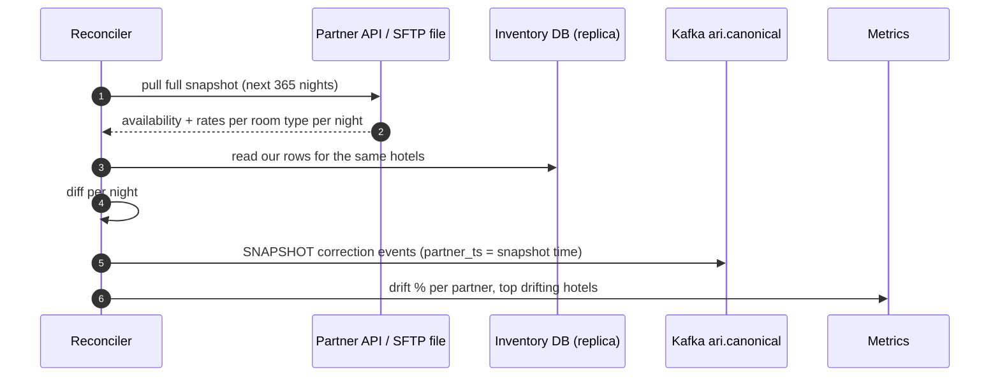

# Deep dive: Partner ingestion, push vs pull

> One-line answer: every partner protocol (chain webhooks, channel-manager pushes, legacy PMS polling, our extranet) goes through an adapter that emits one canonical ARI event onto Kafka keyed by `hotel_id`. A single applier writes inventory and rates, skips any night whose stored `ari_seq` is newer, and a nightly snapshot reconciliation fixes whatever drift is left.

Back to [solution](../solution.md).

ARI = availability, rates, inventory. CRS = central reservation system (chains). CM = channel manager (one tool a small hotel uses to sell on many OTAs). PMS = property management system (the hotel's front-desk software).

## 1. Pipeline



- **Red: the applier.** It is where partner data becomes truth. Out-of-order or garbage data here means wrong prices or false sold-outs. It also carries the ~35k row writes/s peak.
- Reconciler pulls from every partner type that offers a snapshot, not only legacy PMS. The arrow is drawn once to keep the diagram small.
- Corrections go back through Kafka, not straight to the DB. One writer path keeps ordering and guards in one place.

## 2. Canonical ARI event

```json
{
  "event_id": "8c1f0e6a-...",
  "partner_id": 42,
  "hotel_id": 123456,
  "room_type_id": 7,
  "rate_plan_id": 2,
  "date_from": "2026-12-20",
  "date_to": "2026-12-27",
  "kind": "DELTA",
  "availability": 3,
  "price": { "amount_minor": 18900, "currency": "EUR" },
  "restrictions": { "min_los": 2, "closed_to_arrival": false, "stop_sell": false },
  "partner_seq": 99812,
  "partner_ts": "2026-10-21T08:15:02Z",
  "received_at": "2026-10-21T08:15:03Z"
}
```

- `date_to` is exclusive. Money is in minor units (cents). No floats.
- `kind` is `DELTA` (change these nights) or `SNAPSHOT` (this is the full truth for the range).
- The adapter maps partner codes to our ids through `partner_hotel_map`. Unmapped codes go to the DLQ, not dropped.

## 3. Push vs pull

| | Push (webhooks) | Pull (we poll) |
|---|---|---|
| Who uses it | Chains, most channel managers | Legacy PMS, partners without webhooks, reconciliation |
| Freshness | Seconds | Interval-bound: minutes to hours |
| Who controls load | The partner. Morning rate pushes spike 10x. | Us |
| Failure we inherit | Partner bursts, retries, duplicates, out-of-order | Partner rate limits, we miss changes between polls |
| Our cost | Always-on receivers, quota enforcement | Scheduler, quota budgeting, wasted no-change polls |
| Completeness | We only see what they send. Lost webhook = silent drift. | A snapshot pull is complete |

**Chose both, behind one adapter layer.** Push wherever the partner supports it, because freshness drives oversell and price mismatch. Pull for the rest and for reconciliation on everyone. The rest of the system never knows which one an event came from.

### 3.1 Push path



- `202` only after Kafka acks. Then a crash cannot lose an update the partner thinks we have.
- Quota per partner (e.g. 200 msgs/s, burst 1,000). A partner bug cannot starve the others.
- Receivers are stateless. At ~1.2k msgs/s peak, 3 pods with headroom.

### 3.2 Pull path: demand-driven polling

Partner APIs have rate limits (say 10 req/s per partner). Spend that budget where users look.

| Date bucket | Hotels with demand (top 20% by search volume) | Others |
|---|---|---|
| Next 7 days | every 1 min | every 15 min |
| 8-30 days | every 5 min | every 1 h |
| 31-365 days | every 1 h | every 6 h |

- Plus on-demand refresh: when a user opens a hotel page for a pull partner and our data is > 5 min old, trigger a priority pull for those dates.
- Each poll result is diffed against our state. Only changed nights become events. This cuts write load a lot.

## 4. Ordering and duplicates

Kafka keyed by `hotel_id` keeps one hotel's events in order **within our pipeline**. It cannot fix a partner that sends out of order, or a retry of an old message. So the guard lives on each row.

```sql
-- Apply one canonical DELTA event. Nights already at a newer seq are skipped individually.
INSERT INTO inventory (hotel_id, room_type_id, stay_date, total, stop_sell, ari_seq)
SELECT :hid, :rt, d::date, :availability, :stop_sell, :seq
FROM   generate_series(:from::date, :to::date - 1, interval '1 day') AS d
ON CONFLICT (hotel_id, room_type_id, stay_date) DO UPDATE
SET    total     = EXCLUDED.total,
       stop_sell = EXCLUDED.stop_sell,
       ari_seq   = EXCLUDED.ari_seq,
       version   = inventory.version + 1
WHERE  inventory.ari_seq < EXCLUDED.ari_seq
  AND  (inventory.total, inventory.stop_sell) IS DISTINCT FROM (EXCLUDED.total, EXCLUDED.stop_sell);
```

- Per-night guard, not per-message. Ranges overlap: seq 10 covers Dec 1-31, seq 11 covers Dec 15. A late seq 10 must still not overwrite Dec 15.
- The `IS DISTINCT FROM` line skips no-op writes. No WAL, no CDC event, no cache churn.
- Same message twice: second one has `ari_seq` equal, so it is skipped. Idempotent for free.
- **Partner has no sequence number.** Use `partner_ts` (event time) as the seq. If it has neither, use `received_at` and rely on snapshots for repair.
- **Hotel switches channel manager.** The new partner's seq starts at 1, so every update would be rejected. On a mapping change, reset `ari_seq` to 0 for that hotel in the same transaction as the mapping update.
- For POOL hotels, the applier also recomputes `reserved` from the in-flight overlay. See [last room §5.2](last-room-and-inventory-locking.md).

## 5. Sanity guards (data is wrong, not just late)

Partners send bad data: a decimal shifted, all nights set to 0 after a PMS restart, the wrong currency.

| Guard | Rule (defaults, per-partner tunable) | Action |
|---|---|---|
| Price jump | > 70% change vs current for the same night | Quarantine, alert partner ops |
| Mass close | One message closes > 80% of a hotel's next 90 nights | Quarantine. Confirm with a snapshot pull. |
| Currency | Differs from hotel's contracted currency | Reject to DLQ |
| Unknown code | Room type or rate plan not mapped | DLQ, auto-ticket to connectivity team |
| Past dates | `date_from` < today in hotel time zone | Drop and count |

Quarantined events wait for a snapshot pull or a human. A false sold-out costs a few hours of bookings. A price 10x too low costs real money.

## 6. Reconciliation



- Corrections carry the snapshot's time as their seq, so they never overwrite a newer delta that arrived during the run.
- Drift % feeds the **partner quality score**: high drift → larger buffer, more frequent polling, lower ranking weight, and a call from partner management.
- Also reconcile **reservations**: list our CONFIRMED bookings per hotel vs the partner's list. A booking the partner does not have is a future walk. Fix it before the guest arrives.

## 7. Outbound: delivering our bookings

- Reservation Svc writes `BOOKING_PENDING` to the outbox. Partner Gateway sends `create` (OpenTravel `OTA_HotelResNotifRQ` style) with our `booking_id` as the reference.
- Retries with backoff for up to 24 h. The reference makes retries safe.
- Undeliverable after N tries: alert, email the hotel directly, and keep the booking in `PENDING` until a human resolves it.

## 8. Freshness: how we measure "is our data right"

| Metric | How | Target |
|---|---|---|
| ARI lag | `applied_at - partner_ts`, p99 per partner | < 10 s push, < poll interval + 30 s pull |
| Search staleness | `indexed_at - applied_at` | < 2 min |
| Price mismatch at booking | quoted price vs live CRS price for LIVE hotels | < 1% |
| Sold-out at booking | holds rejected after search showed available | < 2% |
| Reconciliation drift | nights differing / nights compared | < 0.5% |
| Walk rate | walks / bookings, per partner | < 0.01% |

These turn "data from partners is inaccurate" into numbers per partner. Then it becomes a partner-management conversation, not a guess.

## 9. Trade-offs

| Decision | Chose | Gave up |
|---|---|---|
| Push and pull behind one canonical event | Downstream sees one format | An adapter per protocol to maintain (the Connectivity team's main toil) |
| Kafka between receiver and applier | Absorbs 10x bursts, replay | Seconds of extra lag |
| Per-night `ari_seq` guard | Correct with overlapping ranges | One extra column on 180M rows (~1.5 GB) |
| Quarantine on suspicious data | Avoids catastrophic prices | Some real changes delayed by hours |
| Corrections through Kafka | One writer, one ordering rule | Repairs wait behind live traffic |
| Demand-driven polling | Freshness where it matters within quota | Long-tail hotels and far dates stay staler |

## 10. Follow-ups
- "A partner floods you with 50k msgs/s after an outage." → `429` + quota. Kafka absorbs what we accept. Snapshot pull afterward instead of replaying every delta.
- "How do you onboard a new chain in a week?" → new adapter only. Contract test with recorded payloads from S3.
- "A partner's webhooks silently stop." → per-partner heartbeat alert: zero events for > 2x their normal gap. Trigger a snapshot pull.
- "Rates and availability come in separate messages." → separate tables, separate seq per table. Same guard.
