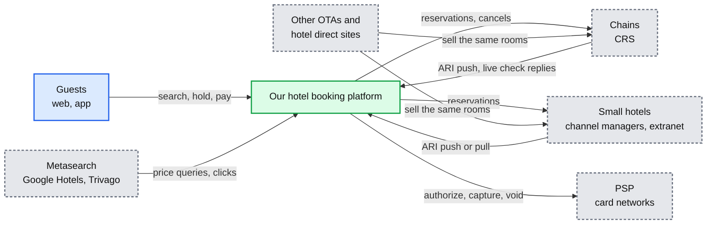
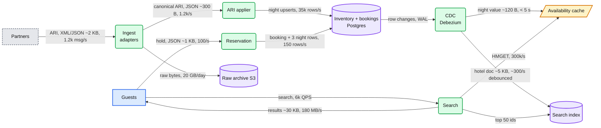
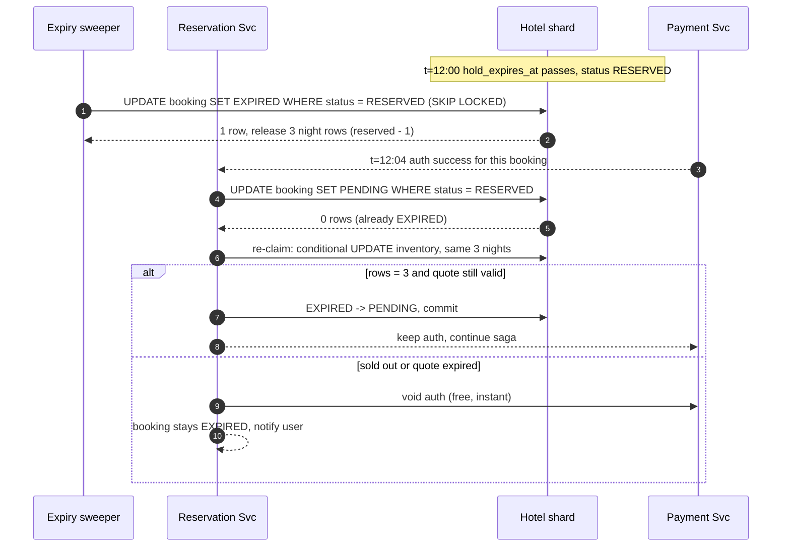
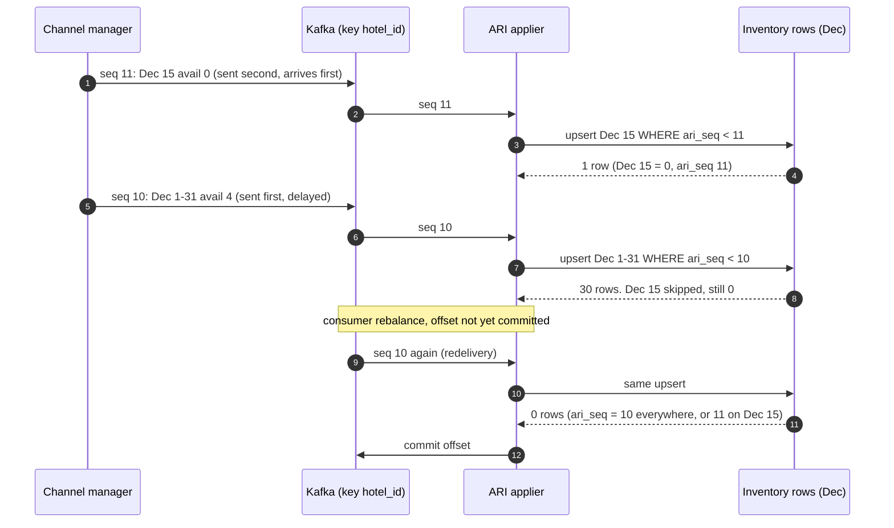
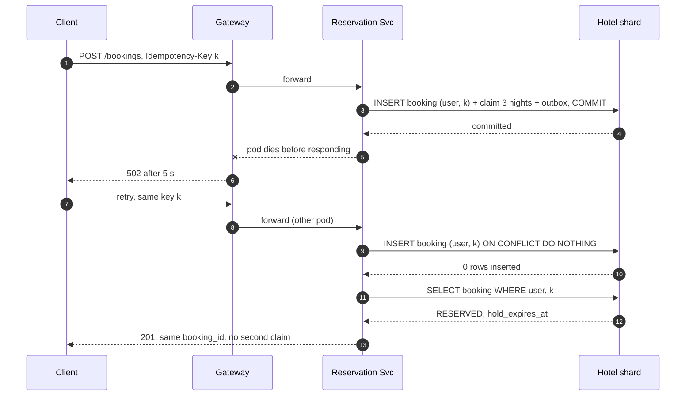
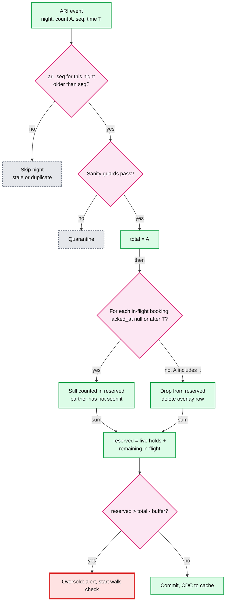
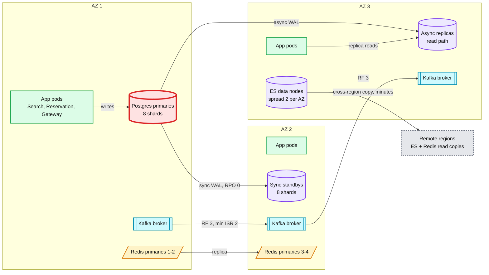
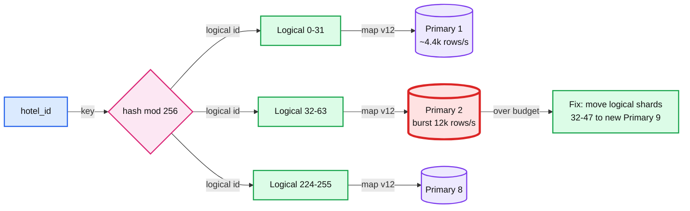
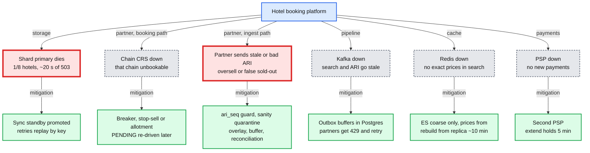
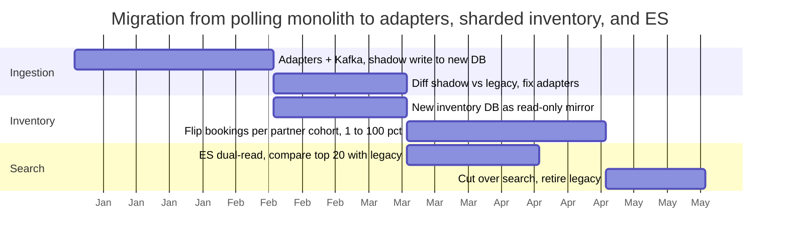

# Diagrams: Hotel booking (search, reserve, partner ARI, last room)

The D1 to D12 set for [`solution.md`](solution.md). Each diagram appears once in the repo: the ones embedded in `solution.md` are linked from here, not repeated. Deep-dive diagrams live in [`deep-dives/`](deep-dives/) and are linked where relevant. Colors per root `CLAUDE.md` §3. Red is used only for the Postgres primary under ARI write load, the partner CRS on the booking path, and the residual oversell gap.

Legend reminder: 🔵 client / edge, 🟢 stateless compute, 🟣 durable storage, 🟡 cache or losable, 🔷 queue, 🔴 bottleneck or SPOF, ⚪ external, 🩷 decision.

---

## D1. Context (zoom-out)

Our system is one box. Guests, hotels, card networks, and other sales channels sit around it, and the other channels are why the last room is contested.

## D2. Data flow (DFD)

Inputs to outputs with format, size, and peak rate from [`solution.md` §2](solution.md#2-back-of-envelope). ARI is the biggest write flow by far.

## D3. Component architecture

Embedded in [`solution.md` §6](solution.md#6-final-design). Not repeated here.

## D4. Sequence, happy path, one per FR

All five are embedded in `solution.md`, one at the end of each FR section:
- D4a search: [§4.1](solution.md#41-search-hotels-near-a-place-for-given-dates)
- D4b hotel page: [§4.2](solution.md#42-show-room-types-and-exact-prices-for-the-stay)
- D4c hold: [§4.3](solution.md#43-hold-a-room-type-for-every-night-without-overselling)
- D4d pay and confirm: [§4.4](solution.md#44-pay-confirm-with-the-hotel-and-cancel)
- D4e ARI push: [§4.5](solution.md#45-ingest-partner-ari-and-deliver-bookings-back)

## D5. Sequence, failure path

Two timelines are in [`solution.md` §10.4](solution.md#104-failure-timeline): a shard primary dies mid-hold, and a chain CRS goes down on New Year's Eve. Three more below.

**D5a. The hold-expiry sweeper races a late card authorization.** Conditional status updates decide the winner. Neither path can double-count inventory.

**D5b. A partner's ARI arrives out of order, then a duplicate is redelivered.** The per-night `ari_seq` guard skips older and repeated writes night by night.

**D5c. The client retries `POST /bookings` after a timeout.** The unique idempotency key on the booking row turns the retry into a read.

## D6. Activity / decision flow

Two are embedded in `solution.md`: the claim decision D6a in [§4.3](solution.md#43-hold-a-room-type-for-every-night-without-overselling) and the late-auth decision in [§5.5](solution.md#55-the-card-is-authorized-but-the-hold-expired-or-the-request-is-retried-what-happens). The partner-type strategy flow is in the [last room deep dive §5](deep-dives/last-room-and-inventory-locking.md#5-the-last-room-across-platforms).

**D6b. ARI apply for a POOL hotel.** The partner's count already includes some of our bookings and not others. The applier recomputes `reserved` from the in-flight overlay so a stale count cannot re-open a room we sold. Background: [last room §5.2](deep-dives/last-room-and-inventory-locking.md#52-pool-small-hotels-on-a-channel-manager), [ingestion §4](deep-dives/partner-ingestion-push-vs-pull.md#4-ordering-and-duplicates).

## D7. Entity relationship

Embedded in [`solution.md` §3.3](solution.md#33-data-model).

## D8. State machine

Booking lifecycle (RESERVED, PENDING, CONFIRMED and exits) embedded in [`solution.md` §4.4](solution.md#44-pay-confirm-with-the-hotel-and-cancel).

## D9. Deployment / topology

One home region, three AZs. Synchronous replication stays inside the region. Only async replicas and search copies cross regions.

- Remote regions serve search locally and forward holds to the home region (~100 ms extra on booking only). See [`solution.md` §10.11](solution.md#1011-evolution).

## D10. Scaling / partitioning

`hash(hotel_id)` picks one of 256 fixed logical shards. Logical shards map to 8 physical primaries. The hot spot is a physical primary during the morning ARI burst, not a hot hotel-night.

- A hot hotel-night (New Year's Eve) is one row with ~5 ms locks, so ~200 claims/s. Global peak is 60/s. Not the bottleneck.
- Before moving shards, cheaper fixes: drop no-op ARI writes, batch per hotel, rate-limit one partner's burst at the receiver. See [sharding](../../concepts/sharding.md).

## D11. Failure mode map

Component, what fails, blast radius, mitigation. Red marks the two failures that can create an oversell or lose a booking.

## D12. Rollout / migration

Applicable: assume today is a monolith that polls partners and writes availability straight to one database. Every phase is a per-partner flag.

Rollback points:
- Ingestion shadow and diff: turn the shadow consumer off. Nothing reads the new DB yet.
- Read-only mirror: drop it and rebuild. Legacy is still the source of truth.
- Flip bookings per cohort: flip the cohort's flag back. Legacy keeps receiving ARI, so no backfill. Bookings made on the new path are copied back by the outbox consumer that feeds legacy.
- ES dual-read: switch reads back. No data change.
- Cut over: the only irreversible step. Legacy is retired only after the last cohort runs clean for 2 weeks.
