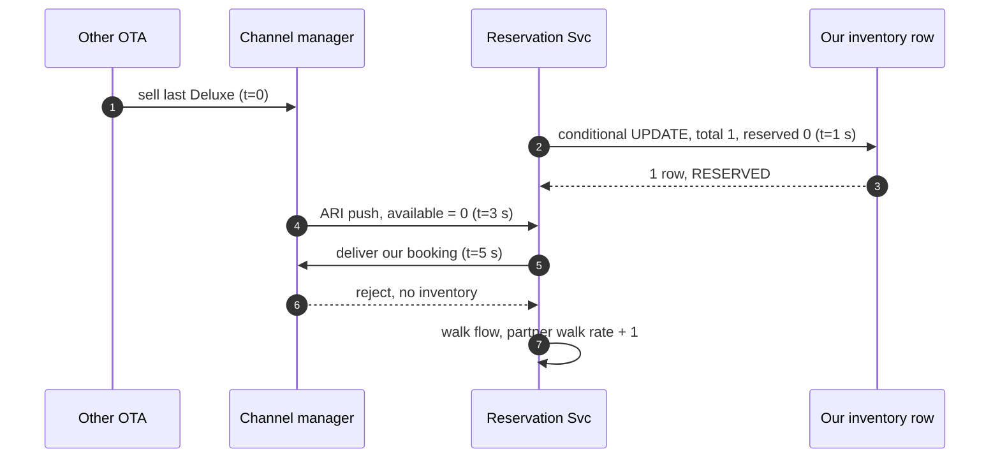

# Edge cases: Hotel booking (search, reserve, partner ARI, last room)

Every entry must be answerable out loud in under 60 seconds. Mark confidence after each study pass. Categories per `hld/CLAUDE.md` §5: failure, consistency, scale, data, operations, security.

Design recap for context: inventory is one row per `(hotel_id, room_type_id, stay_date)` with `total, reserved, buffer, stop_sell, ari_seq, version`, in Postgres sharded by `hotel_id` (256 logical shards on 8 primaries, sync standby). A hold is one local transaction: insert the booking `RESERVED` (unique `user_id + idempotency_key`), one conditional `UPDATE ... WHERE reserved + qty <= total - buffer` over every night, rows must equal nights, plus an outbox row. Hold TTL is 10 min shown, 12 min on the server. The saga is hold, authorize, partner confirm (pivot), capture. Every status change is `WHERE status = <expected>`. Partner ARI goes adapter, canonical event on Kafka keyed by `hotel_id`, one applier with a per-night `ari_seq` guard and sanity guards, nightly reconciliation. Search is ES coarse (`sold_out_dates`, ≤ 2 min) then a CDC-fed Redis cache (≤ 5 s), and the hold re-checks. Hotels are `LIVE` (chain CRS), `POOL` (channel manager, in-flight overlay), or `ALLOTMENT`. Details in [`solution.md`](solution.md).

---

## 1. Failure

## Edge case: One inventory shard primary dies mid-hold
- **Trigger:** the host for shard 5's primary dies while hold transactions are in flight.
- **Symptom:** ~1/8 of hotels return 503 on hold for ~20 s. Clients do not know if their hold committed.
- **Answer:**
  - Commit waits for the sync standby, so every committed hold is on the standby. RPO 0.
  - Patroni promotes the standby in ~15 s. Routers pick up the new primary in ~20 s.
  - The client retries with the same `Idempotency-Key`. `INSERT ... ON CONFLICT DO NOTHING` returns the committed hold if it landed, or runs the claim fresh if it did not. No double hold.
  - Search keeps working (ES and Redis). On-call is paged on 5xx rate for that shard and rebuilds a standby.
- **Diagram:** [`solution.md` §10.4](solution.md#104-failure-timeline).
- **Confidence:** [ ] shaky  [ ] ok  [ ] confident

## Edge case: A chain CRS is down on New Year's Eve
- **Trigger:** a top chain's reservation system times out at 20:00 on Dec 31.
- **Symptom:** bookings for that chain sit in `PENDING`. CRS calls time out after 3 s.
- **Answer:**
  - The user already has `202 PENDING`. The CRS call runs in a saga worker with a per-partner bulkhead, so other hotels are unaffected.
  - Timeout means "unknown". Retrieve by our `booking_id` reference before any retry. Never create twice.
  - Breaker opens at 50% errors over 30 s. We stop-sell that chain in search and hotel pages, or fall back to an allotment if the contract has one. Connectivity on-call and partner ops are paged.
  - Half-open probe every 30 s. On recovery, workers retrieve then create each `PENDING` booking. Hotel says no: `FAILED`, void the auth, release.
- **Diagram:** [`solution.md` §5.4](solution.md#54-a-chains-crs-takes-3-s-or-is-down-how-does-booking-stay-at-9995), [§10.4](solution.md#104-failure-timeline).
- **Confidence:** [ ] shaky  [ ] ok  [ ] confident

## Edge case: Kafka is down for 20 minutes
- **Trigger:** broker outage or a bad config push.
- **Symptom:** ARI lag climbs, search and price cache stop updating. Saga steps after the hold stall.
- **Answer:**
  - Holds still commit. The outbox rows wait in Postgres. CDC resumes from its WAL position when Kafka returns, so no event is lost. Watch WAL disk on the primaries.
  - Webhook receivers cannot get `acks=all`, so they return `429 Retry-After`. Partners retry. We never `202` an update we did not persist.
  - Search serves slightly stale data. Holds re-check against the primary, so staleness causes "just sold out", not oversell.
  - Bookings stay `RESERVED` or `PENDING` longer. Extend hold TTLs by the outage length so users are not punished.
- **Confidence:** [ ] shaky  [ ] ok  [ ] confident

## Edge case: Redis availability cache is lost or cold
- **Trigger:** cluster failure, or a new cluster with no data.
- **Symptom:** search cannot get exact remaining counts and prices for the top 50.
- **Answer:**
  - Fall back to ES coarse results with `min_price_30d` labelled "prices from". The hotel page reads shard replicas.
  - Rebuild from a replica scan of ~180M rows in ~10 min, then CDC catches up. The `version` guard stops older CDC events overwriting the rebuild.
  - `maxmemory-policy noeviction`, so a full node rejects writes loudly instead of silently evicting fields that would read as "unknown".
  - Correctness is unaffected. The hold never reads Redis.
- **Confidence:** [ ] shaky  [ ] ok  [ ] confident

## Edge case: PSP is down during the evening peak
- **Trigger:** the card processor returns 5xx or times out.
- **Symptom:** authorizations fail. Holds approach expiry with no payment.
- **Answer:**
  - Payment Svc fails over to a second PSP behind the same interface. Idempotency keys are per PSP, so a retry on PSP B cannot double-charge via PSP A.
  - Extend live holds by 5 min while the PSP is degraded.
  - An auth that timed out is "unknown". Query PSP A by `booking_id:auth` before trying PSP B, or void it later if it shows up.
- **Confidence:** [ ] shaky  [ ] ok  [ ] confident

## Edge case: Hold expiry sweeper stops running
- **Trigger:** the sweeper job crashes or its deploy is broken.
- **Symptom:** expired holds keep `reserved` high. Hotels look sold out when rooms are free.
- **Answer:**
  - The sweeper is stateless and idempotent (`FOR UPDATE SKIP LOCKED`, `WHERE status = 'RESERVED'`). Any replica can run it. Restarting catches up in batches of 500.
  - Alert on "oldest `RESERVED` hold past expiry > 2 min" per shard.
  - The release query aggregates nights before decrementing. Without the `sum`, two holds on the same night would release only one room.
- **Diagram:** [last room §4](deep-dives/last-room-and-inventory-locking.md#4-hold-expiry).
- **Confidence:** [ ] shaky  [ ] ok  [ ] confident

---

## 2. Consistency

## Edge case: Two OTAs sell the last room seconds apart
- **Trigger:** a `POOL` hotel on a channel manager. Another OTA sells the last Deluxe at t=0. Our user claims it at t=1 s, before the channel manager tells us.
- **Symptom:** both OTAs confirm. The hotel has one room and two guests.
- **Answer:**
  - No design on our side closes the propagation gap. We narrow it and price the rest.
  - Narrow it: push over polling, `buffer = 1` on hotels with oversell history, and the in-flight overlay so a stale update cannot re-open a room we already sold.
  - Detect early: the channel manager rejects our delivery, or reconciliation finds `reserved > total`. Alert the guest before arrival.
  - Walk policy: equal or better hotel nearby, we pay the difference and transport, charge back to the hotel if its stale ARI caused it. Walk rate feeds the partner score.
- **Diagram:**

- **Confidence:** [ ] shaky  [ ] ok  [ ] confident

## Edge case: Payment succeeds after the hold expired
- **Trigger:** a 3DS challenge takes 13 min. The sweeper moved the booking to `EXPIRED` and released the nights.
- **Symptom:** an authorization arrives for an `EXPIRED` booking.
- **Answer:**
  - Re-run the conditional claim for the same nights and check the quote. Rows = nights and price unchanged: `EXPIRED -> PENDING`, continue the saga.
  - Otherwise void the auth (free, instant, because we only authorized) and offer alternatives.
  - Sweeper and callback cannot both win. Each transition is `WHERE status = <expected>`.
  - Made rare by design: 2 min server grace after the 10 min timer.
- **Diagram:** [`solution.md` §5.5](solution.md#55-the-card-is-authorized-but-the-hold-expired-or-the-request-is-retried-what-happens).
- **Confidence:** [ ] shaky  [ ] ok  [ ] confident

## Edge case: Client retries POST /bookings after a timeout
- **Trigger:** mobile network drop. The app retries with the same `Idempotency-Key`.
- **Symptom:** two identical requests, possibly concurrent.
- **Answer:**
  - `UNIQUE (user_id, idempotency_key)` on the booking row, in the same transaction as the claim. The second insert hits the conflict.
  - Concurrent: the second waits on the first's uncommitted insert. If the first commits, the second gets the conflict and returns the same booking. If the first rolls back (sold out), the second runs the claim itself.
  - The key routes to the same shard because the request carries the same `hotel_id`.
  - Same idea downstream: PSP key `booking_id:auth`, partner reference `booking_id`.
- **Confidence:** [ ] shaky  [ ] ok  [ ] confident

## Edge case: Partner sends ARI updates out of order
- **Trigger:** seq 10 (Dec 1-31, 5 rooms) arrives after seq 11 (Dec 15, 0 rooms), from a partner retry or our redelivery.
- **Symptom:** without a guard, Dec 15 re-opens with 5 rooms.
- **Answer:**
  - The guard is per night, not per message: upsert `WHERE inventory.ari_seq < EXCLUDED.ari_seq`. Seq 10 updates Dec 1-14 and 16-31 and skips Dec 15.
  - A duplicate of the same seq is a no-op. A no-op value change never writes WAL, CDC, or cache.
  - No sequence number from the partner: use `partner_ts`. Neither: `received_at` and rely on snapshot reconciliation.
- **Diagram:** [ingestion §4](deep-dives/partner-ingestion-push-vs-pull.md#4-ordering-and-duplicates).
- **Confidence:** [ ] shaky  [ ] ok  [ ] confident

## Edge case: A hold and an ARI write deadlock on the same nights
- **Trigger:** a hold for Dec 20-23 and an ARI upsert for Dec 20-31 on the same room type run concurrently.
- **Symptom:** possible lock wait or deadlock.
- **Answer:**
  - Both scan the PK in date order, so both take row locks in the same order. Normally one just waits ~5 ms.
  - If a plan ever differs, Postgres detects the deadlock after `deadlock_timeout` (1 s) and aborts one. The app retries once.
  - The ARI write changes `total`, the hold changes `reserved`. The hold's `WHERE` re-checks the new `total` after the wait, so the result is correct either way.
- **Confidence:** [ ] shaky  [ ] ok  [ ] confident

## Edge case: Price changed between quote and booking
- **Trigger:** the user saw €189 per night. An ARI rate push raised it to €229 before they clicked Book.
- **Symptom:** which price do we charge?
- **Answer:**
  - The hotel page returned a `quote_id`: HMAC over hotel, room type, rate plan, dates, total, expiry 15 min. The booking verifies the HMAC and expiry.
  - Product rule: honor a valid quote for 15 min. Expired quote: `409 PRICE_CHANGED` with the new price.
  - For `LIVE` chains the CRS may reject our price. Track "price mismatch at booking" per partner (target < 1%).
- **Confidence:** [ ] shaky  [ ] ok  [ ] confident

## Edge case: Capture fails after the hotel confirmed
- **Trigger:** PSP error on capture after the booking is `CONFIRMED`.
- **Symptom:** the hotel holds a room we have not been paid for.
- **Answer:**
  - Capture is after the pivot, so it is retriable, never compensated. Retry with backoff and key `booking_id:capture`.
  - The auth stays valid for days (typically ~7), so there is time. Alert after 6 h.
  - The booking stays `CONFIRMED`. The guest is not affected.
- **Confidence:** [ ] shaky  [ ] ok  [ ] confident

---

## 3. Scale

## Edge case: Traffic goes 10x tomorrow
- **Trigger:** a marketing campaign or a metasearch deal.
- **Symptom:** search 60k QPS, ~600 bookings/s.
- **Answer:**
  - Search: more ES replicas and more Redis nodes. Both scale horizontally. The 60 s result cache absorbs popular cities.
  - Bookings at 600/s are still small against 8 primaries. Inventory writes are dominated by ARI, which does not grow with our traffic.
  - The closest limit is the primaries under ARI load (~4.4k rows/s each). Move logical shards to new primaries (8 to 16) with seconds of write pause per shard.
  - Gateway rate limits and load shedding protect the booking path first. Shed search before holds.
- **Diagram:** [`solution.md` §10.3](solution.md#103-capacity-math-per-component).
- **Confidence:** [ ] shaky  [ ] ok  [ ] confident

## Edge case: Flash sale on one hotel-night
- **Trigger:** a concert announcement. Thousands of users try to book the same hotel for the same night within a minute.
- **Symptom:** lock waits on a handful of inventory rows.
- **Answer:**
  - One row with a ~5 ms lock handles ~200 claims/s. Most attempts fail fast with `SOLD_OUT` once `reserved` hits the limit.
  - Beyond that, put a waiting room in front of that hotel, admitting users at a fixed rate.
  - Hold hoarding matters more here: hold caps per user, device, and card BIN, and a shorter TTL for that night.
- **Confidence:** [ ] shaky  [ ] ok  [ ] confident

## Edge case: Metasearch partners send 50k availability queries per second
- **Trigger:** we start feeding a metasearch site that queries prices per user search.
- **Symptom:** look-to-book jumps from 100:1 to 10,000:1. User search slows.
- **Answer:**
  - Separate authenticated API with its own quota and its own Redis read replicas, so metasearch cannot starve users.
  - Serve only from the availability cache. Never ES, never the DB.
  - Prefer pushing price changes to them (they accept ARI push) over answering every query.
- **Confidence:** [ ] shaky  [ ] ok  [ ] confident

## Edge case: Search shows hotels that are already sold out
- **Trigger:** heavy demand. ES `sold_out_dates` lags up to 2 min, Redis up to 5 s.
- **Symptom:** users click Book and get `409 SOLD_OUT`.
- **Answer:**
  - Expected and bounded. The hold is the only exact check, so this costs a retry, never an oversell.
  - The precise Redis check drops most of these before the page renders.
  - Metric "sold-out at booking" (target < 2%). If it rises, look at CDC lag first.
  - On `409`, show alternatives from the same search. Do not re-run the full search.
- **Confidence:** [ ] shaky  [ ] ok  [ ] confident

---

## 4. Data

## Edge case: Partner sends garbage: every night closed or prices 10x off
- **Trigger:** a PMS restart sends "0 rooms" for every night, or a decimal shift sends €18,900 instead of €189.
- **Symptom:** a hotel vanishes from search, or shows absurd prices.
- **Answer:**
  - Sanity guards in the applier: a price jump over 70%, or one message closing over 80% of the next 90 nights, goes to quarantine. It is not applied.
  - Quarantine triggers a snapshot pull to confirm. Real change: apply. Garbage: drop and ticket the partner.
  - Wrong currency or unmapped room code goes to the DLQ.
  - Asymmetric cost: a false sold-out loses hours of bookings. A price 10x too low loses real money. So guard prices harder.
- **Diagram:** [`solution.md` §5.2](solution.md#52-partner-data-arrives-late-out-of-order-or-wrong-how-fresh-and-how-right-is-it).
- **Confidence:** [ ] shaky  [ ] ok  [ ] confident

## Edge case: Hotel switches channel manager and sequence numbers reset
- **Trigger:** the hotel moves from CM A (seq at 99,812) to CM B (starts at 1).
- **Symptom:** every update from CM B is skipped by the `ari_seq` guard. The hotel freezes.
- **Answer:**
  - The mapping change is an event. In the same transaction as the `partner_hotel_map` update, reset `ari_seq` to 0 for that hotel's rows.
  - Then force a snapshot pull from CM B so the first state is complete.
  - Messages from CM A after the switch are rejected by the adapter, because the hotel no longer maps to A.
- **Confidence:** [ ] shaky  [ ] ok  [ ] confident

## Edge case: An adapter bug writes wrong prices for 2 hours
- **Trigger:** a release mis-parses one partner's tax-inclusive flag.
- **Symptom:** that partner's prices are 20% low. Some bookings were made at them.
- **Answer:**
  - Roll back the adapter. Replay that partner's raw messages from Kafka (7 days) or the S3 archive through the fixed adapter. The `ari_seq` guard would skip them, so replay as a `SNAPSHOT` correction with a fresh seq.
  - Bookings already made: honor them (the quote was valid). Cost goes to us, not the guest.
  - Prevent: canary a new adapter on one partner, shadow-compare applied rows for 24 h.
- **Confidence:** [ ] shaky  [ ] ok  [ ] confident

## Edge case: A stay hits a night with no inventory row
- **Trigger:** a 3-night stay where night 2 has no row (hotel closed, not loaded yet, or beyond the 365-day window).
- **Symptom:** the conditional update touches 2 rows, not 3.
- **Answer:**
  - Rows < nights means rollback and `SOLD_OUT`. A missing row is unavailable by construction.
  - Rolling the window: ARI upserts create new nights. For `ALLOTMENT` hotels a nightly job per shard inserts night 366 from the contract allotment.
  - Search agrees: no row means no Redis field, which the search service reads as unavailable.
- **Confidence:** [ ] shaky  [ ] ok  [ ] confident

## Edge case: Hotel local date versus UTC
- **Trigger:** a Tokyo hotel, a user in New York, a partner sending timestamps in UTC.
- **Symptom:** off-by-one nights. A booking lands on the wrong `stay_date`.
- **Answer:**
  - `stay_date`, `check_in`, `check_out` are `DATE`s in the hotel's local calendar. Never timestamps.
  - Hold expiry, ARI `partner_ts`, and audit columns are `TIMESTAMPTZ` in UTC.
  - The adapter converts partner dates to hotel-local. The "past dates" guard uses the hotel's time zone.
- **Confidence:** [ ] shaky  [ ] ok  [ ] confident

## Edge case: Schema change on the 180M-row inventory table
- **Trigger:** add a `closed_to_departure` column and an index.
- **Symptom:** risk of a table rewrite or long locks on the hot path.
- **Answer:**
  - Expand, migrate, contract. Add the column with a constant default (metadata-only in modern Postgres). Build indexes `CONCURRENTLY`. Deploy code that tolerates both shapes.
  - Run per logical shard with an idempotent runner and a dashboard of shard schema versions. Canary on one shard first.
  - Contract (drop old paths) only after every shard is migrated.
- **Confidence:** [ ] shaky  [ ] ok  [ ] confident

## Edge case: A user asks for GDPR deletion
- **Trigger:** a deletion request under GDPR.
- **Symptom:** the user's data lives in bookings on many hotel shards, in Kafka, in S3, and in the `user_bookings` view.
- **Answer:**
  - `user_bookings` (sharded by `user_id`) lists every booking and shard.
  - Guest fields are encrypted per field with a per-user key. Crypto-shred the key, so copies in Kafka and backups become unreadable.
  - Finance keeps a pseudonymized booking (amounts, dates, hotel) for 7 years. That is a legal basis, not a loophole.
- **Confidence:** [ ] shaky  [ ] ok  [ ] confident

---

## 5. Operations

## Edge case: Oversell rate spikes for one partner
- **Trigger:** one channel manager's push latency jumps from seconds to 20 minutes.
- **Symptom:** walks for that partner's hotels rise from ~0 to dozens per day.
- **Answer:**
  - This is a ticket, not a 3 am page. The page is "ARI lag > 5 min for a top-50 partner", which fires first and explains the cause.
  - Automatic response: the partner score drops, so buffers rise to 1 and polling for that partner's hot hotels tightens.
  - Partner ops escalate with the per-partner dashboard: ARI lag, drift, walk rate.
- **Confidence:** [ ] shaky  [ ] ok  [ ] confident

## Edge case: CDC lag spikes to 10 minutes
- **Trigger:** Debezium connector restart, a large backfill, or a Kafka slowdown.
- **Symptom:** Redis and ES go stale. "Sold-out at booking" rises.
- **Answer:**
  - Correctness holds: holds read the primary.
  - Page Platform at CDC lag > 60 s. Watch WAL retention on the primaries: a stuck replication slot fills the disk.
  - If lag stays high, run backfills at lower priority, or rebuild Redis from a replica scan and resume CDC.
- **Confidence:** [ ] shaky  [ ] ok  [ ] confident

## Edge case: Migration cohort goes bad and must roll back
- **Trigger:** during the move from the polling monolith, the 10% partner cohort shows booking failures on the new path.
- **Symptom:** accept rate for that cohort drops below 98%.
- **Answer:**
  - Each phase is a per-partner flag. Flip the cohort back to legacy.
  - Legacy kept receiving ARI the whole time, so its inventory is current.
  - Holds created on the new path: either finish them on the new path (drain) or replay them into legacy before the flip. Decide this before starting the cohort.
- **Diagram:** [`diagrams.md` D12](diagrams.md#d12-rollout--migration).
- **Confidence:** [ ] shaky  [ ] ok  [ ] confident

---

## 6. Security and abuse

## Edge case: Bots hold every room for a sold-out night
- **Trigger:** a bot creates holds across 500 hotels for New Year's Eve and renews them every 12 min.
- **Symptom:** the city looks sold out. Real users cannot book. Rooms free up only to be held again.
- **Answer:**
  - Holds cost identity: login required, at most 3 live holds per user, device fingerprint, and card BIN.
  - Per hotel-night signal: a spike in holds-to-confirmations triggers CAPTCHA and a shorter TTL for that night.
  - Gateway bot scoring and rate limits on `POST /bookings`.
- **Diagram:** [`solution.md` §5.6](solution.md#56-bots-hold-every-room-for-new-years-eve-and-scrapers-hammer-search-what-stops-them).
- **Confidence:** [ ] shaky  [ ] ok  [ ] confident

## Edge case: Competitors scrape prices from search
- **Trigger:** a scraper runs thousands of searches per minute from rotating IPs.
- **Symptom:** search load up, our prices mirrored elsewhere.
- **Answer:**
  - WAF and bot score at the gateway. Per-IP and per-session rate limits on `/search`.
  - Legitimate bulk consumers get the separate metasearch API with keys and quotas.
  - Scrapers cannot hurt correctness. Search never touches the primary.
- **Confidence:** [ ] shaky  [ ] ok  [ ] confident

## Edge case: Someone forges a partner webhook
- **Trigger:** an attacker posts ARI to `/partner/v1/ari` claiming to be a channel manager.
- **Symptom:** they could close or reprice another party's hotels.
- **Answer:**
  - mTLS or HMAC signature with a per-partner key, plus an IP allow-list. Unsigned or bad signatures are rejected before Kafka.
  - Even a valid partner can only touch hotels mapped to it in `partner_hotel_map`. The adapter drops other codes.
  - Sanity guards still apply to authenticated traffic.
- **Confidence:** [ ] shaky  [ ] ok  [ ] confident

## Edge case: A client tampers with the price
- **Trigger:** a modified app sends a lower total, or edits the `quote_id`.
- **Symptom:** booking at a price we never offered.
- **Answer:**
  - The amount is always taken from the server-side booking row, which is computed from the verified quote. The client never sends money amounts.
  - `quote_id` is HMAC-signed. Any edit fails verification.
  - An extranet user is scoped to their own hotel ids, so they cannot edit another hotel's inventory or rates.
- **Confidence:** [ ] shaky  [ ] ok  [ ] confident

## Edge case: Card testing through the payment endpoint
- **Trigger:** fraudsters use our checkout to test stolen card numbers.
- **Symptom:** many small auths, high decline rate, chargebacks later.
- **Answer:**
  - Each payment attempt needs a live hold, which needs a login and is capped. That slows testing a lot.
  - Fraud score before authorize: velocity per card, per BIN, per device, country mismatches.
  - Card fields are PSP-hosted, so card numbers never touch our servers. PCI scope stays minimal.
- **Confidence:** [ ] shaky  [ ] ok  [ ] confident
