# HLD: Hotel booking (search, reserve, partner ARI, last room)

> One-line answer: search is a funnel. Elasticsearch filters 100k hotels by `geo_point`, filters, and a coarse `sold_out_dates` signal (≤ 2 min stale). A CDC-fed Redis cache gives exact remaining count and price for the top 50 (≤ 5 s stale). Only the booking touches the source of truth. Inventory is one row per **room type per night** in Postgres sharded by `hotel_id`, and one conditional `UPDATE ... WHERE reserved + qty <= total - buffer` across every night of the stay decides the last room in a local transaction. Partner ARI (availability, rates, inventory) arrives by push, pull, or extranet, becomes one canonical event on Kafka keyed by `hotel_id`, and a single applier writes it with a per-night sequence guard. Across other sales channels the last room is protected by a live check at the chain's CRS, or by an in-flight overlay, a hold-back buffer, and nightly reconciliation for small hotels. Booking is an orchestrated saga: hold, authorize, partner confirms (the pivot), capture.

Problem source: [Hello Interview: Hotel Booking System](https://www.hellointerview.com/community/questions/hotel-booking-system/cm80nptng04jg2pu4cq8rpxzm) (statement only is public). Requirements and probes: [`README.md`](README.md). Diagrams D1 to D12: [`diagrams.md`](diagrams.md). Edge cases: [`edge-cases.md`](edge-cases.md). Building blocks: [sharding](../../concepts/sharding.md), [distributed transactions](../../concepts/distributed-transactions.md), [exactly-once](../../concepts/exactly-once.md), [geospatial index](../../concepts/geospatial-index.md), [caching patterns](../../concepts/caching-patterns.md), [MVCC and isolation](../../concepts/mvcc-and-isolation.md).

---

## 1. Understanding the problem

**Clarifying questions, and the assumption I state if there is no answer**

| Question | Assumption |
|---|---|
| Are we an OTA (online travel agency) or a chain's own site? | OTA. We are one sales channel among many. That is why the last room is contested. |
| Who takes the money? | We do (merchant model, pay now). Pay-at-hotel is a subset. |
| Inventory granularity? | Room type (Deluxe, Suite, AC). Physical room assigned at check-in. |
| Horizon and max stay? | 365 days ahead. Max 30 nights. |
| Partner mix? | ~20% of hotels are chains with a CRS (central reservation system) API, bringing ~50% of bookings. ~80% are small hotels on channel managers or our extranet. |
| Multiple rooms per booking? | Yes, `qty` of one room type. Same SQL with `+ qty`. |

### 1.1 Functional requirements

Core:
1. Search hotels near a place for given dates and guests, with filters.
2. Show room types and exact prices for the stay.
3. Hold a room type for every night without overselling.
4. Pay, confirm with the hotel, and cancel.
5. Ingest partner ARI and deliver bookings back.

Below the line: reviews, loyalty, ML ranking, revenue management, packages, physical room assignment, onboarding and KYC.

### 1.2 Non-functional requirements

Scale first: 100k hotels, ~5 room types each, 500k bookings/day.

| Dimension | Target |
|---|---|
| Peak QPS | ~6k search, ~100 holds/s, ~60 bookings/s, ~1.2k ARI messages/s (~35k row writes/s) |
| Latency | Search p99 < 500 ms. Hotel page p99 < 300 ms. Hold p99 < 300 ms local, < 3 s with a chain live check |
| Availability | Booking path 99.95% (~22 min/month). Search 99.9%. Ingestion lags but never drops |
| Consistency | Strong for the hold. Eventual for search (≤ 2 min) and price cache (≤ 5 s). Read-your-writes for a booking by id |
| Correctness | Oversell < 0.01% of bookings (< 50/day) |
| Freshness | Partner change to bookable p99 < 10 s for push partners |
| Durability | Zero confirmed-booking loss, RPO 0 (synchronous replica). RTO 15 min per shard |
| Security | No card data stored. Signed partner traffic. Hold hoarding and scraping contained |

Below the line: multi-region active-active writes, sub-second search freshness.

## 2. Back-of-envelope

```
Hotels                 = 100k, ~5 room types each      -> 500k room types
Physical rooms         = 100k x 1,000                  -> 100M rooms

Inventory rows         = 500k room types x 365 nights  -> ~180M rows
  row size             ~ 120 B incl. tuple header + PK  -> ~22 GB. Fits one box.
  per physical room    = 100M x 365 = 36.5B rows (~4 TB) -> 200x worse. Room type wins.
Rate rows              = 500k x 3 rate plans x 365      -> ~550M rows, ~55 GB

Bookings               = 500k/day / 86,400 s           -> ~6/s avg, ~60/s peak (10x)
  nights per booking   ~ 2.5                            -> ~150 inventory row writes/s peak
  holds (60% convert)  ~ 830k/day                       -> ~100 holds/s peak, <= 60k live holds
  booking row ~ 1 KB                                    -> ~0.5 GB/day, ~180 GB/yr

Search                 = 100 searches per booking      -> 50M/day, ~600 QPS avg, ~6k QPS peak
  precise check, top 50 hotels per search              -> 6k x 50 = 300k hotel lookups/s

ARI ingestion          = 500k room types x ~20 changes/day -> 10M msgs/day, ~115/s avg
  peak (morning revenue-management batches, 10x)        -> ~1.2k msgs/s
  each covers ~30 nights                                -> ~35k inventory/rate row writes/s peak
  raw payload ~ 2 KB, archived                          -> ~20 GB/day, ~7 TB/yr in S3

Images                 = 100k hotels x 50 x 300 KB      -> ~1.5 TB in S3, served by CDN
Search egress          = 6k QPS x 30 KB                 -> ~180 MB/s peak (images excluded)
```

**What the numbers say**
- User level is 100:1 read-heavy. Reads go to ES and Redis, never the primary.
- At the inventory DB, partner ARI (~35k rows/s) is **~200x** booking writes (~150 rows/s). Size the DB for ingestion.
- 180M rows is small. Shard for ARI write throughput and blast radius, not size: 256 logical shards on 8 primaries (~4-5k row writes/s each). See [sharding](../../concepts/sharding.md).
- 100M rooms against 500k bookings x 2.5 nights = 1.25M room-nights/day is ~2% of capacity. We are one channel. The rest of each hotel is sold elsewhere.
- OTAs and metasearch see look-to-book of 1,000:1 to 10,000:1+ (IATA, §10.8), far above our 100:1 user ratio. Keep 10x headroom on the read path. That is a cache-sizing problem.

## 3. The set-up

### 3.1 Core entities

| Entity | What it is | Owner |
|---|---|---|
| Hotel, RoomType, RatePlan | Catalog. ~1 GB. Read-mostly. | Catalog Svc |
| Inventory | `(hotel, room_type, night) -> total, reserved, buffer, ari_seq` | Reservation Svc |
| Rate | `(hotel, rate_plan, room_type, night) -> price, restrictions` | Reservation Svc |
| Booking | One stay of one room type, `qty` rooms, with a lifecycle | Reservation Svc |
| Payment | Auth, capture, void, refund records | Payment Svc |
| Partner, PartnerHotelMap | Who sends ARI for which hotel, by which protocol | Partner Gateway |

### 3.2 API

| Method | Path | Body / Params | Returns |
|---|---|---|---|
| GET | `/v1/search` | `lat, lng, radius_km` or `bbox` or `city_id`, `check_in, check_out, guests, filters, cursor` | `[{hotel_id, name, distance, min_total_price, available}]`, `next_cursor` |
| GET | `/v1/hotels/{id}/availability` | `check_in, check_out, guests` | `[{room_type, rate_plan, nightly_prices[], total, remaining, quote_id}]` |
| POST | `/v1/bookings` | `Idempotency-Key`. `{quote_id, room_type_id, rate_plan_id, check_in, check_out, qty, guest}` | `201 {booking_id, status: RESERVED, hold_expires_at}`, `409 SOLD_OUT`, `409 PRICE_CHANGED` |
| POST | `/v1/bookings/{id}/payment` | `Idempotency-Key`. `{payment_token}` (PSP token, never a card number) | `202 {status: PENDING}` |
| GET | `/v1/bookings/{id}` | | `{status, partner_conf_no, ...}` |
| POST | `/v1/bookings/{id}/cancel` | `{reason}` | `{status: CANCELLED, refund}` |
| GET | `/v1/users/me/bookings` | `cursor` | list |
| POST | `/partner/v1/ari` | Signed webhook `{partner_id, hotel_code, seq, messages[]}` | `202`, or `429 Retry-After` |
| PUT | `/extranet/v1/hotels/{id}/inventory` | `{room_type_id, date_from, date_to, available, price}` | `200` |
| outbound | Partner CRS / channel manager | create, modify, cancel reservation (OpenTravel `OTA_HotelResNotifRQ` style) | ack + partner confirmation number |

- `quote_id` is an HMAC-signed price quote, valid 15 min. The booking honors it or returns `409 PRICE_CHANGED`.
- `booking_id` embeds the logical shard id in its high bits, so a lookup by id routes without a directory.

### 3.3 Data model

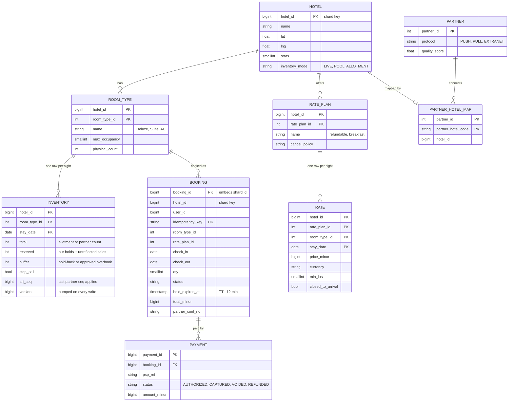

**Access patterns**
- Hold: `UPDATE inventory WHERE hotel_id, room_type_id, stay_date in [in, out)`. One PK range on one shard.
- Hotel page: inventory + rate for one hotel, 1-30 nights. Redis, replica on miss.
- ARI apply: upsert a date range for one `(hotel_id, room_type_id)`. One shard.
- Hold expiry: `booking WHERE status = 'RESERVED' AND hold_expires_at < now()`. Partial index, ≤ 60k rows.
- My bookings: by `user_id`, from a CDC-fed `user_bookings` table sharded by `user_id`.

**Partition key: `hotel_id`.** Inventory, rates, and bookings for one hotel share a shard, so the hold is a local ACID transaction. No 2PC, no saga for the critical step. The price is an async `user_id` view.

**Per-service storage (SQL vs NoSQL per service)**

| Service | Store | Key | Why this store, and why not the other |
|---|---|---|---|
| Reservation (inventory, rates, bookings, outbox) | Postgres, sharded | `hotel_id` | Multi-row conditional writes in one transaction. DynamoDB `TransactWriteItems` (≤ 100 items, condition expressions) could do it too. Cassandra LWT is single-partition, so a 3-night stay across rows is awkward. |
| Catalog | Postgres + Redis | `hotel_id` | ~1 GB, relational edits from the extranet. Any store works. Fewer technologies wins. |
| Search | Elasticsearch | `hotel_id` | Geo + facets + text + ranking. Derived, rebuildable. |
| Availability cache | Redis cluster | `hotel_id` | ~4 GB, 300k lookups/s. Losable. |
| Payment | Postgres | `booking_id` | Money needs ACID and an audit trail. |
| Partner Gateway | Postgres + S3 + Kafka | `partner_id` | Config is relational. Raw payloads are cheap blobs. |
| My bookings view | DynamoDB or Postgres | `user_id` | Key lookups only, async projection. |

## 4. High-level design

### 4.1 Search hotels near a place for given dates

**Bad: one SQL query over inventory.**
- Approach: `SELECT ... FROM hotel JOIN inventory WHERE lat BETWEEN .. AND lng BETWEEN .. AND stay_date IN (...) GROUP BY hotel HAVING min(total - reserved) > 0`.
- Why it breaks: 6k QPS of geo + join + group-by on the same primary that takes holds and 35k ARI row writes/s. A busy city box covers thousands of hotels x 5 room types x N nights. Search load would page the booking path.

**Good: Elasticsearch with full availability inside each hotel document.**
- Approach: index each hotel with `geo_point` plus a nested `availability[room_type][night] = remaining, price`.
- Cost: every ARI change (~35k row writes/s) becomes a partial update, and an ES update is a full document reindex. 1,825 nested entries per doc, rewritten hundreds of times a minute. Indexing would cost more than serving.

**Great: coarse in ES, precise in Redis, exact at booking.**
- Approach: the ES doc carries only `sold_out_dates` (nights where **every** room type is sold out) and `min_price_30d`, reindexed at most once a minute per hotel. Query: `geo_distance` + filters + `must_not sold_out_dates in [check_in, check_out)`, top 50. Then one pipelined `HMGET` per hotel against Redis for exact remaining and price per night. Drop hotels where no single room type is free on every night. Rank and return 20.
- Challenges: two sources to keep in sync. A hotel that became free 30 s ago stays hidden until the next reindex (lost sale, small). A shown hotel may sell out before the click, so the hold must re-check. Details: [geo search and availability](deep-dives/geo-search-and-availability.md).

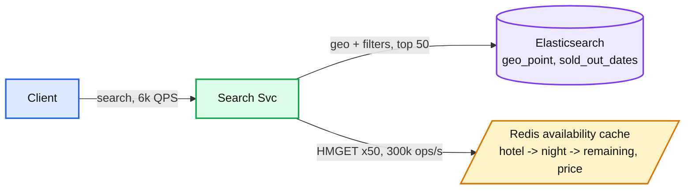

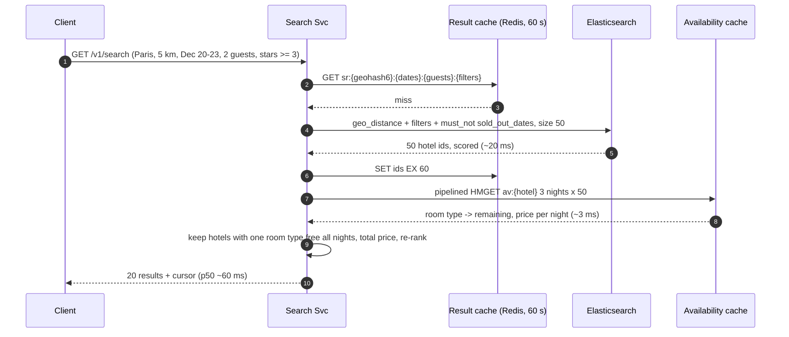

### 4.2 Show room types and exact prices for the stay

**Bad: read the inventory primary.**
- Approach: hotel page queries `inventory JOIN rate` on the shard primary.
- Why it breaks: hotel pages run at roughly 10-20% of search QPS (~1k/s). Fine for load, but it couples page views to the booking primary's health, and a slow page query holds no lock yet still competes for CPU during the morning ARI peak.

**Good: read replicas.**
- Approach: same query on a shard replica.
- Cost: replica lag spikes during ARI bursts (seconds). Every hotel page still costs a 3-table range query.

**Great: Redis first, replica on miss, signed quote.**
- Approach: the availability cache already holds per-night remaining and best price. Rate-plan detail comes from a replica only for the clicked hotel. The response carries a `quote_id` (HMAC over hotel, room type, rate plan, dates, total, expiry 15 min), so the booking can verify the price without trusting the client.
- Challenges: the cache may be ~5 s behind. That is fine because the hold re-checks capacity and the quote pins price. A quote may be honored at a price that just went up. That is a product decision: honor for 15 min.

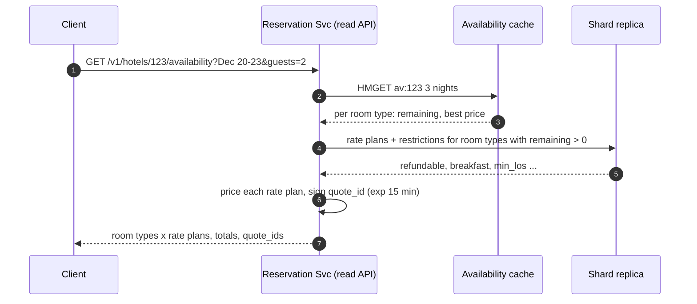

### 4.3 Hold a room type for every night without overselling

**Bad: read, check in the app, then write. Or a Redis lock.**
- Approach: `SELECT remaining`, if > 0 then `UPDATE reserved = reserved + 1`. Or `SETNX lock:hotel:night` in Redis around it.
- Why it breaks: two requests both read 1 remaining and both write. Classic lost update. A Redis lock lives in a different system from the count. On Redis failover the lock is gone while the DB write is in flight, so two holders run at once.

**Good: pessimistic lock in the DB.**
- Approach: `SELECT ... FOR UPDATE ORDER BY stay_date`, check every night in the app, then update. Correct.
- Cost: two round trips with row locks held across app logic. Lock hold time 2-3x. An optimistic `version` check is worse here: ARI price writes bump the version every few seconds on popular hotels, so bookings fail and retry even with 50 rooms free.

**Great: one conditional `UPDATE` across all nights, count the rows.**
- Approach, in one transaction on the hotel's shard:

```sql
INSERT INTO booking (..., status, hold_expires_at)
VALUES (..., 'RESERVED', now() + interval '12 minutes')
ON CONFLICT (user_id, idempotency_key) DO NOTHING;      -- replay: return existing booking

UPDATE inventory
SET    reserved = reserved + :qty, version = version + 1
WHERE  hotel_id = :hid AND room_type_id = :rt
  AND  stay_date >= :in AND stay_date < :out
  AND  NOT stop_sell
  AND  reserved + :qty <= total - buffer;
-- affected rows < nights -> ROLLBACK, 409 SOLD_OUT

INSERT INTO outbox (...) VALUES (... 'BOOKING_RESERVED' ...);
COMMIT;
```

- Why it is correct: in Postgres `READ COMMITTED`, an `UPDATE` that waited on a row lock re-reads the newest committed row and re-checks `WHERE` before writing. Check and write are atomic per row. Counting rows makes it all-or-nothing across nights. A missing night row counts as unavailable.
- Challenges: the capacity rule must fit in one `WHERE`. Rate restrictions (min stay, closed-to-arrival) are a plain read of `rate` earlier in the same transaction, with no lock, because rate rows are not contended by bookings. If the capacity rule itself outgrows SQL, switch to `FOR UPDATE` (deep dive §3.2). Holds lock inventory for 12 min, so abandoned checkouts block real buyers on the last room (§5.6). Full comparison, deadlock analysis, expiry sweeper: [last room and inventory locking](deep-dives/last-room-and-inventory-locking.md).

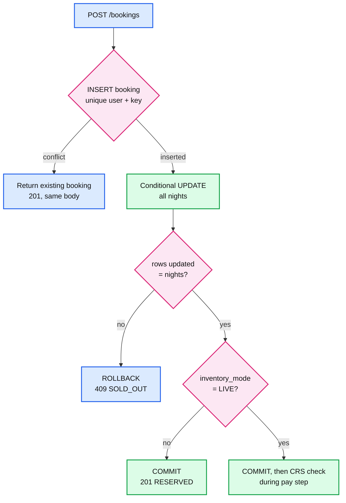

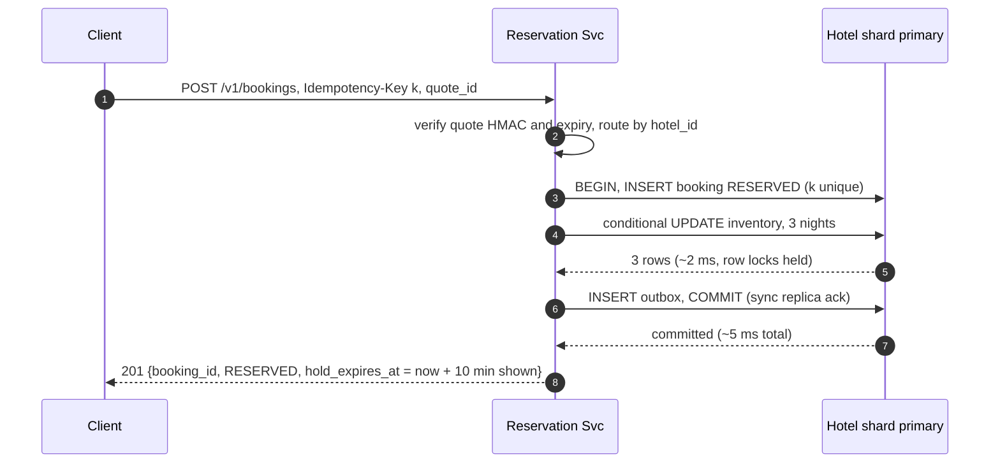

### 4.4 Pay, confirm with the hotel, and cancel

The recruiter's three states map one to one. **Reserved** = inventory held, no money. **Pending** = card authorized, waiting for the hotel. **Confirmed** = hotel confirmation number received.

**Bad: charge first, then ask the hotel.**
- Approach: capture the card, then call the CRS or channel manager.
- Why it breaks: on the last room the hotel rejects a few percent of the time. Each reject becomes a refund: PSP fees often not returned, 5-10 days to the card, a support ticket, sometimes a chargeback.

**Good: hold first, then charge, then confirm.**
- Approach: our hold guarantees our count. Charge, then confirm.
- Cost: our count is not the hotel's count for chains and shared pools. Partner rejects still turn into refunds.

**Great: hold, authorize, partner confirm (pivot), capture.**
- Approach: orchestrated saga driven from the booking row and the outbox. Before the pivot every step has a free undo (release hold, void auth). After it every step is retried until it succeeds. Every step carries an idempotency key. Late payment after hold expiry: re-run the claim; honor if it succeeds, else void. Cancel: release future nights in one transaction, then cancel at partner and refund per policy, both retried.
- Challenges: the booking sits in `PENDING` for seconds to minutes while a chain answers, so the client polls or gets a push. Card auths expire (typically ~7 days), so capture must not lag. Pushback on the textbook answer: the charge is **not** the pivot. Authorize, then capture after the hotel says yes. Details: [booking saga and payment](deep-dives/booking-saga-and-payment.md), background in [distributed transactions](../../concepts/distributed-transactions.md).

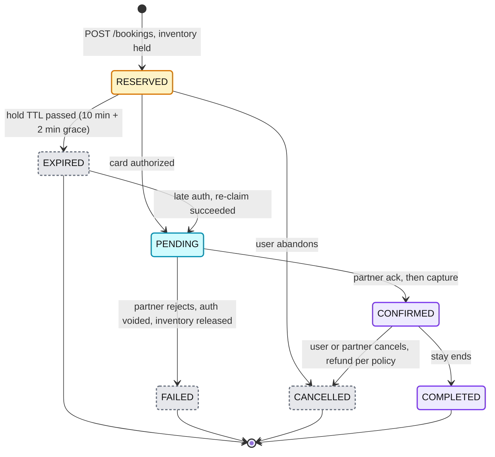

- Every transition is `UPDATE booking SET status = 'X' WHERE booking_id = ? AND status = 'Y'`. The expiry sweeper and a late payment cannot both win.

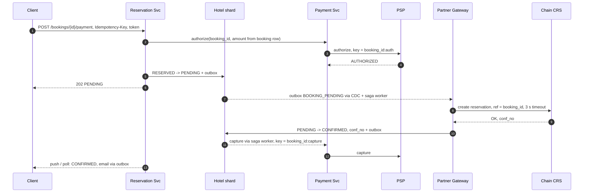

### 4.5 Ingest partner ARI and deliver bookings back

**Bad: poll every partner on a timer and overwrite our rows.**
- Approach: every 15 min, pull 365 nights for every hotel and write the results.
- Why it breaks: 100k hotels x 365 nights every 15 min is ~40k rows/s of mostly unchanged writes, partner rate limits block it, and 15 min staleness drives oversell and price mismatch. Last-writer-wins overwrites newer data with older poll results.

**Good: accept webhooks and write them straight to the DB.**
- Approach: each partner push is parsed and applied in the request.
- Cost: partner bursts (10x at morning rate pushes) hit the inventory primary directly. Out-of-order or duplicate messages overwrite newer state. One partner's bug becomes our outage. Every protocol leaks into the core.

**Great: adapters, one canonical event, one ordered writer, reconciliation.**
- Approach: webhook receiver verifies signature and quota, archives raw bytes to S3, produces to Kafka, returns `202`. Pull scheduler polls only partners without push, prioritized by demand. Adapters map every protocol to one canonical ARI event keyed by `hotel_id`. One applier per shard batches upserts with a per-night `ari_seq` guard, skips no-op writes, and quarantines suspicious changes. A nightly reconciler pulls full snapshots and sends corrections through the same pipe. Outbound: our bookings go to the partner via the outbox with our `booking_id` as reference.
- Challenges: an adapter per protocol is permanent toil for the Connectivity team. Kafka adds seconds. Partners without sequence numbers need timestamps or snapshots. Details: [partner ingestion push vs pull](deep-dives/partner-ingestion-push-vs-pull.md).

```mermaid
%% Great rung for ingestion: many protocols in, one canonical event, one writer
flowchart LR
    P["Partners<br/>CRS, channel managers, PMS"]
    W["Receiver + pull scheduler<br/>signature, quota"]
    A["Adapters<br/>one per protocol"]
    K[["Kafka ari.canonical<br/>key = hotel_id"]]
    AP["ARI applier<br/>seq guard, sanity guards"]
    DB[("Inventory DB")]
    P -->|"push or pull, raw"| W
    W -->|"raw, 202 after ack"| A
    A -->|"canonical event"| K
    K -->|"ordered per hotel"| AP
    AP -->|"batched upsert"| DB

    class P external
    class W client
    class A,AP service
    class K queue
    class DB store
    classDef client   fill:#dbeafe,stroke:#2563eb,stroke-width:2px,color:#111
    classDef service  fill:#dcfce7,stroke:#16a34a,stroke-width:2px,color:#111
    classDef store    fill:#ede9fe,stroke:#7c3aed,stroke-width:2px,color:#111
    classDef queue    fill:#cffafe,stroke:#0891b2,stroke-width:2px,color:#111
    classDef external fill:#e5e7eb,stroke:#6b7280,stroke-width:2px,color:#111,stroke-dasharray:4 3
```

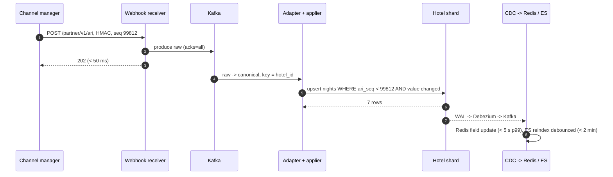

## 5. Deep dives

### 5.1 "The same last room is on three other sites. How do you keep oversell under 0.01%?"

**Bad: trust our local count.**
- Our conditional update is exact for **our** sales. Another OTA sells the room 2 s earlier and we never hear in time. At a few percent of last-room sales this blows the 0.01% target by 100x.

**Good: live check with the partner for every booking.**
- Exact, because the partner is the source of truth. But most small hotels have no API, and a chain CRS adds 1-3 s p99 and an outage dependency on every booking.

**Great: pick the mechanism per hotel `inventory_mode`, then pay for the residual.**
- `LIVE` (chains with a CRS API): book in the CRS during the pay step. Local claim first as a fast reject. A CRS "no" also marks those nights sold out locally, the freshest ARI we ever get.
- `POOL` (small hotels on a channel manager): `total` is the partner's count across all channels. `reserved` covers our holds plus our bookings the partner has not reflected yet (the in-flight overlay), so a stale partner update cannot re-open a room we sold. A per-hotel hold-back `buffer = 1` kicks in for hotels with oversell history.
- `ALLOTMENT` / extranet: the rooms are ours. Local claim only, exact.
- Residual: walk policy (relocate to an equal or better hotel nearby, we pay the difference, charge back to the hotel if its stale ARI caused it). Walk rate per partner feeds its quality score, buffer, and polling frequency.
- Pushback on the textbook answer: "add an overbooking buffer" is two knobs. A hold-back (stop selling the last N through us) is ours. Real overbooking (sell beyond capacity for no-shows) is the hotel's revenue decision, off by default.

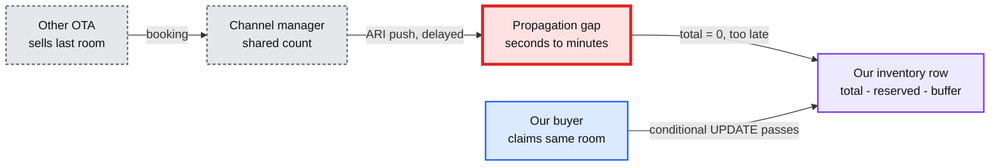

Details and SQL: [last room §5](deep-dives/last-room-and-inventory-locking.md#5-the-last-room-across-platforms).

### 5.2 "Partner data arrives late, out of order, or wrong. How fresh and how right is it?"

**Bad: last write wins on arrival order.**
- A retried old message or a slow poll overwrites a newer update. A PMS restart that sends "0 rooms everywhere" closes the hotel for a day.

**Good: per-message sequence check.**
- Reject messages older than the last seen seq for the hotel. But ranges overlap: seq 10 covers Dec 1-31, seq 11 covers Dec 15. A late seq 10 is rejected entirely, so Dec 1-14 never updates.

**Great: per-night `ari_seq` guard, sanity guards, reconciliation, and metrics per partner.**
- Guard each night: `ON CONFLICT DO UPDATE ... WHERE inventory.ari_seq < EXCLUDED.ari_seq AND value IS DISTINCT FROM`. Duplicates are no-ops. No-op writes never hit WAL, CDC, or cache.
- Sanity guards quarantine price jumps > 70%, "close > 80% of next 90 nights" in one message, currency mismatch, unmapped codes.
- Nightly snapshot reconciliation sends corrections through Kafka (one writer). Drift % per partner is a metric.
- Freshness becomes numbers per partner: ARI lag, price mismatch at booking, sold-out-at-booking rate, drift, walk rate. "Partner data is inaccurate" turns into a partner-management conversation backed by data.
- Pushback: most small hotels push too, through channel managers. Pull is for legacy PMS, demand-driven refresh of hotels users are looking at, and reconciliation.

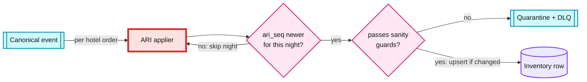

### 5.3 "6k searches/s, each wants exact prices for 50 hotels. How do you hit p99 500 ms?"

**Bad: verify the top 50 against the inventory DB.** This is a common answer and it is wrong at this scale. 6k x 50 = 300k range lookups/s on the shard replicas, competing with ARI replay. Replica lag makes them stale anyway.

**Good: read-through cache in front of the DB with a TTL.** Misses after every ARI change stampede the replicas. TTL means prices are up to TTL old.

**Great: CDC-fed availability cache, never read-through.** Redis hash `av:{hotel_id}`, field per night, value per room type `[remaining, best price]`. ~4.4 GB, ~6 primaries at ~50-80k pipelined ops/s each. Updated from the WAL via Debezium within 5 s p99. Each event carries `version`, so reordering cannot roll it back. Plus a 60 s result cache of ES hit ids per (geohash6, dates, guests, filters) so popular cities skip ES. Ids only, never prices.
- Challenges: a cold Redis needs a ~10 min rebuild from a replica scan. Search falls back to ES coarse only, labelled "prices from".

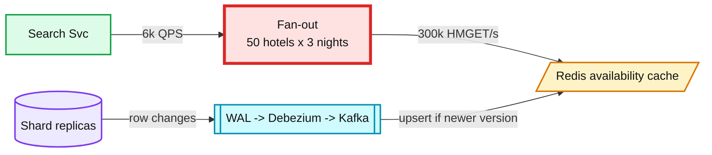

### 5.4 "A chain's CRS takes 3 s or is down. How does booking stay at 99.95%?"

**Bad: call the CRS synchronously inside `POST /bookings`.** The user's request hangs for the CRS p99. A CRS outage turns into our 5xx, and threads pile up until the pool is exhausted for all hotels.

**Good: timeout and retry.** 3 s timeout, 2 retries. Bounded, but the user still waits up to 9 s, and retries hammer a struggling partner.

**Great: async pivot with a breaker per partner.** The hold commits locally first. The CRS call runs in a saga worker after the user has `202 PENDING`. 3 s timeout, circuit breaker per partner (open at 50% errors over 30 s), bulkhead (separate worker pool per top-20 partner). On timeout the outcome is unknown: query the CRS by our reference before retrying, never create twice. Breaker open: stop-sell that chain in search, or fall back to an allotment if the contract has one. Stuck `PENDING` > 15 min is re-driven, > 24 h goes to a human.
- Pushback: "99.95% booking availability" cannot include the partner. Define the SLO as "we accept and durably record the booking"; partner confirmation latency is a separate SLI per partner.

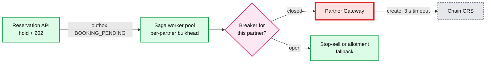

### 5.5 "The card is authorized but the hold expired, or the request is retried. What happens?"

**Bad: whichever arrives last wins.** The sweeper releases the room and a late payment confirms a booking with no inventory. Or a double click creates two holds.

**Good: always refund late payments, dedupe requests in Redis.** Correct for inventory, but throws away a paying customer whose room is often still free. Redis dedupe is not in the same transaction as the booking, so a crash between them re-creates the hold. See [exactly-once](../../concepts/exactly-once.md).

**Great: conditional state transitions, re-claim and honor, keys in the same transaction.**
- Status moves only with `WHERE status = <expected>`. Sweeper and payment callback race safely.
- Late auth on an `EXPIRED` booking: re-run the conditional claim for the same nights and check the quote. Rows = nights: `EXPIRED -> PENDING`, honor. Else void the auth (free, because we only authorized).
- `UNIQUE (user_id, idempotency_key)` on the booking row, PSP keys `booking_id:auth` / `booking_id:capture`, `booking_id` as the partner reference, `event_id` dedupe at consumers.
- Server TTL 12 min vs 10 min shown absorbs 3DS redirects and clock skew.

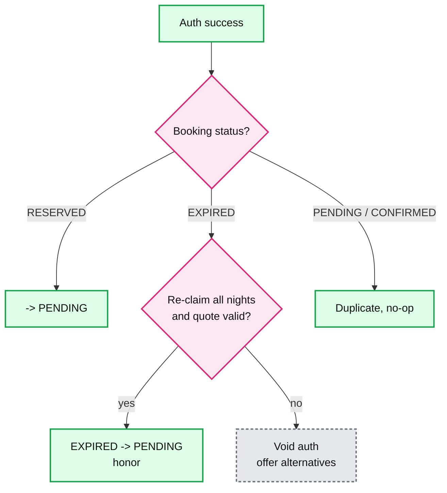

### 5.6 "Bots hold every room for New Year's Eve, and scrapers hammer search. What stops them?"

**Bad: nothing beyond a global rate limit.** Holds are free, so a bot holding 1 room x 500 hotels for 12 min, renewed forever, makes a city look sold out.

**Good: CAPTCHA on checkout.** Raises the cost of each hold but solved-CAPTCHA farms are cheap.

**Great: holds cost identity and are capped.**
- Login required to hold. ≤ 3 live holds per user, per device fingerprint, and per card BIN (first digits of a card).
- Per-hotel-night signal: holds/confirmations ratio spikes trigger CAPTCHA and shorter TTL for that night.
- Scraping: WAF + bot score at the gateway, per-IP and per-session rate limits on `/search`, metasearch partners get a separate authenticated API with their own quota. See [rate limiting and load shedding](../../concepts/rate-limiting-and-load-shedding.md).

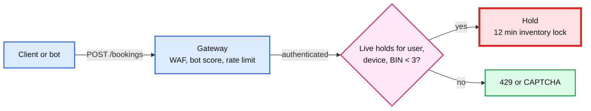

## 6. Final design

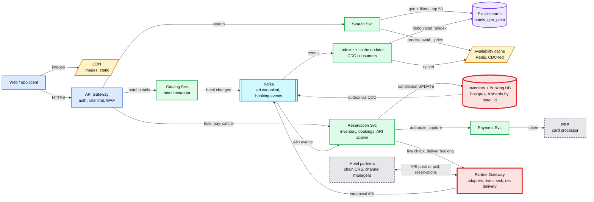

- **Red `DB`:** the consistency risk (last room) and the ~35k ARI row writes/s. §5.1, §5.2, §7.
- **Red `Partner Gateway`:** third-party latency and unknown outcomes on the booking path. §5.4.
- Zoom-ins: context D1, data flow D2, deployment D9, partitioning D10, failure map D11 in [`diagrams.md`](diagrams.md).

## 7. Trade-offs

| Decision | Option A | Option B | Chose | Why |
|---|---|---|---|---|
| Inventory + bookings store | SQL (sharded Postgres) | NoSQL (DynamoDB / Cassandra) | **A** | Multi-night atomic hold is a multi-row conditional transaction. DynamoDB transactions also work. Cassandra LWT is single-partition. Postgres gives ad-hoc SQL for ops and finance. |
| Search store | Elasticsearch | PostGIS | **A** | Geo is easy at 100k rows. Facets, text, and ranking at 6k QPS are the hard part. |
| Catalog store | Postgres + Redis | Document DB | **A** | 1 GB, read-mostly. Fewer technologies. |
| Partner ingestion | Push (webhooks) | Pull (polling) | **Both, one adapter layer** | Push is fresh but we inherit partner bursts and bugs. Pull gives control but is stale and burns partner quota. |
| Last room across OTAs | Allotment | Live check at partner | **Live for chains, pool/allotment for small** | Live is exact but adds 1-3 s and a dependency. Small hotels have no API. |
| Inventory concurrency | Pessimistic `FOR UPDATE` / optimistic `version` | Conditional `UPDATE` | **Conditional** | One round trip, short locks, conflicts only on real capacity, no false conflicts from ARI writes. |
| Search freshness | Real-time availability in ES | Coarse ES + precise cache | **Coarse + precise** | Real-time ES means reindexing docs at ARI speed. Cache gives seconds of staleness for a fraction of the cost. |
| Booking order | Hold, then pay | Pay, then confirm | **Hold, then pay** | Never take money for a room we do not have. Cost: 12 min holds, capped per user. |
| Oversell policy | Strict (hold-back buffer > 0) | Allow small overbook (buffer < 0) | **Per hotel, default 0, auto-tuned** | Hold-back on shared pools cuts walks, costs a few unsold rooms. Only the hotel may overbook. |
| Bookings shard key | `hotel_id` | `user_id` | **`hotel_id`** | Local transaction with inventory. "My bookings" is an async view. |
| Saga pivot | Capture the charge | Partner confirmation | **Partner confirmation** | Auth before, capture after. A void is free, a refund is not. |
| Saga engine | DB state machine + outbox | Temporal | **DB state machine** | ~60 bookings/s. No new stateful system unless one already runs. See [Temporal](../../concepts/temporal-durable-execution.md). |

**Refused to build:** per-physical-room inventory, 2PC, real-time availability in ES, a custom geo index, multi-region active-active inventory writes, our own overbooking model.

## 8. Staff-level notes

**Failure modes and blast radius**

| Failure | Blast radius | Behavior |
|---|---|---|
| One Postgres shard primary down | ~1/8 of hotels cannot be booked | Search still works. Holds return 503. Failover to sync replica < 1 min. |
| Kafka down | ARI and search freshness | Bookings still work. Outbox rows queue in Postgres. Partners get `429` and retry. |
| Redis down | Exact prices in search | ES coarse only, "prices from". Hotel page reads replicas. |
| PSP down | New payments | Second PSP behind Payment Svc. Live holds +5 min. |
| One chain's CRS down | That chain | Breaker, stop-sell or allotment fallback, partner paged. |
| Partner sends garbage | That partner's hotels | Sanity guards quarantine. Snapshot pull to confirm. |

**Migration from today** (assume a monolith that polls partners): adapters + Kafka in shadow, diff shadow vs legacy, new inventory DB as read-only mirror, flip bookings per partner cohort 1% to 100%, then search. Every phase is a per-partner flag. Rollback is a flag flip while legacy keeps receiving ARI. Timeline: [D12](diagrams.md#d12-rollout--migration).

**Operability.** SLOs and pages:

| Metric | SLO | Pages when |
|---|---|---|
| Booking accept rate (hold to durable PENDING or CONFIRMED, excluding declines and abandons) | 99.5% | < 98% for 5 min |
| Hold latency p99 | < 300 ms | 2x for 10 min |
| ARI lag p99 (partner event to bookable) | < 10 s push | > 5 min for a top-50 partner |
| Search staleness p99 | < 2 min | > 10 min |
| Oversell rate | < 0.01% | 3x baseline in a day (ticket) |
| Reconciliation drift per partner | < 0.5% | > 2% (ticket, lower partner score) |

**Cost.** ~24 Postgres instances, ~6 ES nodes, ~6 Redis nodes, a small Kafka: roughly **$40-60k/month**. Revenue is ~500k bookings x ~$150 x ~15% commission ≈ **$11M/day**. The real cost is oversell: at 0.1%, 500 walks/day x ~$300 ≈ $55M/yr. Eng-time on freshness and reconciliation pays back fast.

**Team boundaries.** Search team (ES, ranking, result cache). Reservation team (inventory, bookings, applier, saga, owns the shards). Connectivity team (adapters, onboarding, reconciliation, partner scorecards; most toil). Payments platform (PSPs, refunds, fraud). Trust and safety (bots, hoarding).

## 9. What is expected at each level

**Mid (80/20 breadth/depth).** Draws search, booking, payment, a SQL database, and a cache. Stores inventory per room per night or per room type. Knows the last room needs a lock and says "use a transaction" or `SELECT FOR UPDATE`. Puts availability in ES or a cache without saying how it stays fresh. Treats partners as "an API we call".

**Senior (60/40).** Models inventory per room type per night and shows the row count. Writes the conditional `UPDATE` or `FOR UPDATE` and explains why optimistic retries hurt. Separates coarse search from booking-time re-check. Defines RESERVED / PENDING / CONFIRMED with a hold TTL and a sweeper. Idempotency key on booking create. Picks push for chains and pull for others, and mentions sequence numbers. States strong consistency for the hold and eventual for search.

**Staff+ (40/60).** Says unprompted that we are one channel among many, so the last room is a cross-system problem with a residual that is priced, not eliminated: per-hotel inventory mode, in-flight overlay, hold-back buffer, reconciliation, walk policy, partner quality score. Notices that ARI writes, not bookings, dominate the DB, and shards for that. Refuses to check the DB for search. Makes partner confirmation the saga pivot and captures after it. Defines the booking SLO so a partner outage does not burn it. Turns "partner data is inaccurate" into per-partner metrics. Names the migration flags, the 3 am pages, the cost of oversell in dollars, and which team owns adapters.

---

## 10. Nitty-gritty (past interview scope)

### 10.1 Internals of each chosen technology

**Postgres: the conditional update and CDC.**
- MVCC: an `UPDATE` writes a new row version and takes a row lock until commit. A second updater blocks on that lock. Under `READ COMMITTED`, when it wakes it re-evaluates `WHERE` against the newest committed version (EvalPlanQual). That is why the conditional claim needs no explicit lock.
- Logical decoding reads the WAL (write-ahead log) and Debezium turns row changes and outbox rows into Kafka events in commit order per shard.

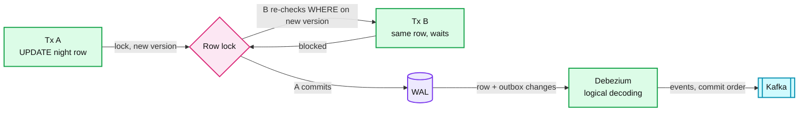

**Elasticsearch: geo and filters.**
- `geo_point` is indexed in a BKD tree (block k-d tree), so `geo_distance` and `geo_bounding_box` prune whole cells. Clauses in `filter` skip scoring and are cached as bitsets per segment.
- An "update" is a delete plus a reindex of the whole document. New docs are searchable after the next refresh (default 1 s). This is why availability does not live in ES at full resolution.

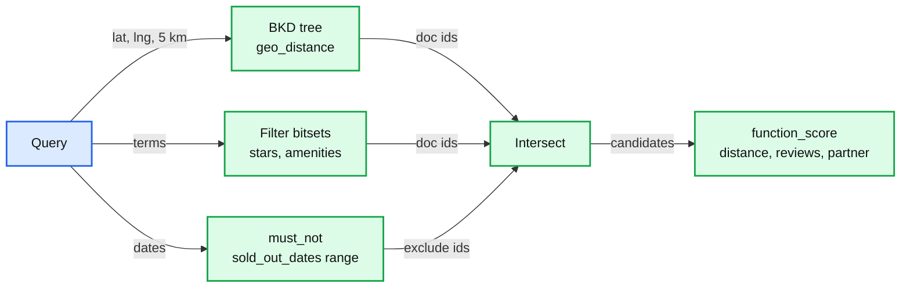

**Redis: availability cache.**
- Single-threaded command execution per node, so an `HSET` of one field is atomic. Cluster mode hashes keys onto 16,384 slots. All fields of `av:{hotel_id}` sit on one node, so one hotel is one network hop.
- Pipelining 50 `HMGET`s amortizes round trips. Each value stores `version`. The updater writes with a small Lua script: set only if the incoming version is newer.

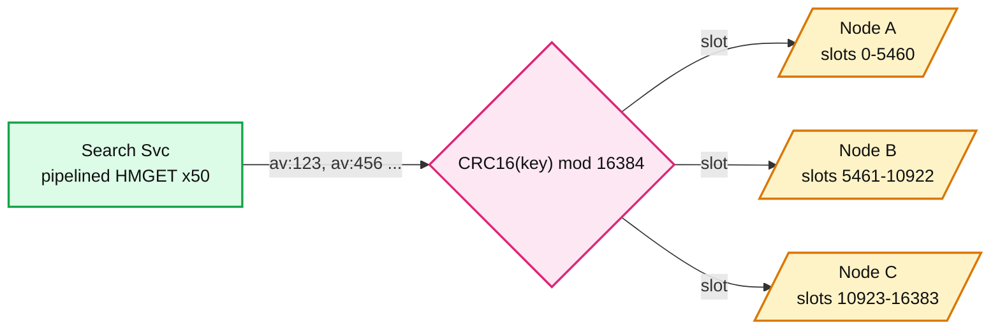

**Kafka: ordered per hotel.**
- `ari.canonical` keyed by `hotel_id`, so one hotel's events land on one partition in order. One applier consumer per partition group, aligned to shards, batches writes per hotel. Offsets are committed after the DB commit, so a crash replays a batch, and the `ari_seq` guard makes replay a no-op. See [Kafka deep dive](../../popular_systems_deepdive/kafka/).

```mermaid
%% Kafka: key = hotel_id keeps per-hotel order; offset commit after DB commit makes replay safe
flowchart LR
    A["Adapters"]
    P0[["Partition 0"]]
    P1[["Partition 1"]]
    C0["Applier, shard group 0"]
    C1["Applier, shard group 1"]
    D[("Shards")]
    A -->|"key hotel 123"| P0
    A -->|"key hotel 456"| P1
    P0 -->|"in order"| C0
    P1 -->|"in order"| C1
    C0 -->|"batch upsert, then commit offset"| D
    C1 -->|"batch upsert, then commit offset"| D

    class A,C0,C1 service
    class P0,P1 queue
    class D store
    classDef service  fill:#dcfce7,stroke:#16a34a,stroke-width:2px,color:#111
    classDef store    fill:#ede9fe,stroke:#7c3aed,stroke-width:2px,color:#111
    classDef queue    fill:#cffafe,stroke:#0891b2,stroke-width:2px,color:#111
```

### 10.2 Configuration knobs that matter

| Component | Knob | Value | Why |
|---|---|---|---|
| Postgres | `synchronous_commit` + 1 sync standby | `on`, `ANY 1 (replica_a, replica_b)` | RPO 0 for confirmed bookings |
| Postgres | `default_transaction_isolation` | `read committed` | Conditional update re-checks under it. `SERIALIZABLE` would add aborts for no gain. |
| Postgres | `deadlock_timeout` | `1s` | Rare ARI vs hold lock-order inversions resolve fast |
| Postgres | `max_prepared_transactions` | `0` | We never use 2PC. Fail loudly if someone tries. |
| Kafka | `acks`, `min.insync.replicas` | `all`, `2` (RF 3) | `202` to a partner means the event is durable |
| Kafka | `ari.canonical` partitions | 256 (one per logical shard) | Aligns consumers with shards, room to add appliers |
| Kafka | retention | 7 days raw, 3 days canonical | Replay window for adapter bugs |
| ES | `number_of_shards`, `number_of_replicas` | 1, 5 | 500 MB index fits in memory. Replicas for QPS. |
| ES | `refresh_interval` | `30s` | Writes are debounced to 1/min per hotel anyway |
| Redis | `maxmemory-policy` | `noeviction` | An evicted field reads as "unknown", not "sold out". Size for it instead. |
| App | hold TTL | 10 min shown, 12 min server | 3DS and skew grace |
| App | CRS timeout, breaker | 3 s, open at 50% errors over 30 s | Bound user-visible latency, protect partner |

### 10.3 Capacity math per component

| Component | Load at peak | Per unit | Headroom | Closest to limit? |
|---|---|---|---|---|
| Postgres primary (x8) | 35k ARI rows/s + 150 hold rows/s | ~4.4k rows/s per primary | ~2x at ~10k/s per primary | **Yes. First to add nodes.** |
| Postgres storage | 22 GB inventory + 55 GB rates + 180 GB/yr bookings | ~10 GB + 22 GB/yr per shard | years | No |
| Redis (6 primaries) | 300k HMGET/s, 4.4 GB | 50k ops/s, ~0.7 GB per node | ~1.5x ops | Second. Add nodes for metasearch. |
| ES (6 data nodes) | 6k QPS, ~300 doc updates/s | ~1k QPS per node | ~1.5x | Third |
| Kafka | 1.2k msgs/s x 2 KB = 2.4 MB/s in | trivial per broker | > 10x | No |
| Webhook receivers | 1.2k req/s | ~1k req/s per pod | 3 pods | No |
| S3 raw archive | 20 GB/day | | | No. Lifecycle to cold after 30 days. |

### 10.4 Failure timeline

```mermaid
%% Shard primary dies during the evening booking peak
sequenceDiagram
    autonumber
    participant U as Users (shard 5 hotels)
    participant R as Reservation Svc
    participant P as Shard 5 primary
    participant S as Sync standby
    participant O as Orchestrator (Patroni)
    participant OC as On-call
    Note over P: t=0 primary host dies
    R->>P: hold tx
    P--xR: connection reset (t=0-2 s, in-flight txs unknown)
    R-->>U: 503 "try again", retry with same Idempotency-Key
    O->>P: health check fails x3 (t=10 s)
    O->>S: promote (t=15 s), standby had every committed tx (sync)
    O->>R: new primary via DNS / service discovery (t=20 s)
    U->>R: retry same key
    R->>S: INSERT booking ON CONFLICT: replay returns the committed hold if it landed
    OC->>OC: paged at t=30 s on 5xx rate for shard 5, acks, rebuilds a new standby
    Note over U,S: Data at risk: 0. User-visible: ~20 s of 503 for 1/8 of hotels.
```

```mermaid
%% A top chain's CRS goes down at 20:00 on New Year's Eve
sequenceDiagram
    autonumber
    participant U as User
    participant R as Reservation Svc
    participant W as Saga worker
    participant B as Breaker (chain X)
    participant H as Chain X CRS
    participant OC as On-call / partner ops
    U->>R: hold + pay (t=0)
    R-->>U: 202 PENDING
    W->>H: create, 3 s timeout
    H--xW: timeout (t=3 s), outcome unknown
    W->>H: retrieve by ref = booking_id
    H--xW: timeout
    B->>B: 50% errors over 30 s, OPEN (t=30 s)
    B->>R: stop-sell chain X in search and hotel pages (t=35 s)
    OC->>OC: paged: breaker open on top-10 partner (t=1 min)
    W->>H: half-open probe every 30 s
    H-->>W: OK (t=12 min)
    W->>H: retrieve, then create for each PENDING (idempotent by ref)
    R-->>U: CONFIRMED, or FAILED + void if hotel says no
```

### 10.5 Exactly-once and idempotency end to end

| Hop | Duplicates enter because | Dedup key | Where stored | Lifetime |
|---|---|---|---|---|
| Client to create booking | Double click, mobile retry | `Idempotency-Key` | `UNIQUE (user_id, idempotency_key)` on booking | Forever (it is the booking) |
| Client to pay | Retry after timeout | `Idempotency-Key` | Payment Svc idempotency table, response cached | 24 h |
| Us to PSP | Network retry | `booking_id:auth`, `booking_id:capture` | PSP | PSP's window (typically 24 h+) |
| Us to partner | Timeout retry | `booking_id` as reservation reference | Partner + our `partner_conf_no` | Life of booking |
| Partner to us (ARI) | Partner retry, our redelivery | `ari_seq` per night | `inventory.ari_seq` | Forever, monotonic |
| Outbox to consumers | Kafka at-least-once | `event_id` | Consumer dedupe table or idempotent upsert | 7 days |
| CDC to Redis | Reordering on rebalance | `version` | Stored with the field | Forever, monotonic |

Background: [exactly-once](../../concepts/exactly-once.md).

### 10.6 Consistency model per edge

| Edge in §6 | Model | Notes |
|---|---|---|
| Client -> Gateway -> Reservation (hold) | Strong | Shard primary, sync replica |
| Reservation -> DB | Strong, linearizable per row | Conditional update |
| Reservation -> Partner Gateway -> CRS | Strong at the CRS, unknown on timeout | Resolve by retrieve |
| Partner -> Partner Gateway (ARI) | Eventual, ordered per night by `ari_seq` | Seconds (push), minutes (pull) |
| Kafka -> Reservation (applier) | Eventual, per-hotel order | |
| DB -> Kafka (CDC) | Eventual, commit order per shard | < 1 s typical |
| Kafka -> Indexer -> Redis | Eventual, version-guarded | ≤ 5 s p99 |
| Kafka -> Indexer -> ES | Eventual, debounced | ≤ 2 min |
| Search -> ES / Redis | Eventual | Re-checked at hold |
| Client -> GET booking by id | Read-your-writes | Routed to shard primary by id |
| Client -> my bookings list | Eventual + client merge | `user_bookings` view |
| Reservation -> Payment -> PSP | Strong per PSP call, idempotent | |

### 10.7 Alternatives rejected

| Alternative | Why it looked attractive | Why rejected |
|---|---|---|
| Per-physical-room inventory | Mirrors reality, "room 412" | 200x rows, and the claim becomes "find any free room among 1,000" |
| DynamoDB for inventory | Managed, scales writes, conditional transactions | Works. Rejected for SQL ops and finance queries and team skills, not correctness. |
| Cassandra for inventory | Write throughput | LWT is per partition, a multi-night stay spans rows, Paxos round trips per LWT |
| Redis as the inventory source of truth (`DECR`) | Fast atomic counters | Not durable enough for money. Multi-night needs Lua and still loses on failover. |
| 2PC across inventory and payments | "Atomic booking" | PSPs and CRSs never join it. Blocking coordinator. |
| Temporal for the saga | Timers, visibility | New stateful system for 60 bookings/s |
| PostGIS for search | One less system | Facets and ranking at 6k QPS |
| Real-time availability in ES | One query answers everything | Reindex at ARI speed |
| Pull-only ingestion | Simple, we control load | Minutes stale, partner quotas |
| Optimistic `version` locking | No locks | False conflicts from ARI writes on hot hotels |

### 10.8 How the big companies do it

- **Google Hotel Center (metasearch) uses both directions.** Partners push ARI as OpenTravel messages (`OTA_HotelRateAmountNotifRQ` for rates, `OTA_HotelAvailNotifRQ` for availability and restrictions) "when pricing data changes". Google targets prices visible "within 15 to 20 minutes" of receipt. Other partners are pulled, and Google can also issue Live Pricing Queries at auction time for one fresh price. Same split as ours: push for freshness, pull plus a live check for accuracy on the request that matters. Sources: [ARI overview](https://developers.google.com/hotels/hotel-prices/dev-guide/ari-overview), [delivery modes](https://developers.google.com/hotels/hotel-prices/dev-guide/delivery-mode).
- **Expedia Rapid re-validates price before booking.** Its Price Check API "confirms the price returned by the Shop response ... to verify a previously-selected rate is still valid before booking", and the returned booking link is a short-lived token. That is our `quote_id`: a signed, expiring quote checked at booking time. Source: [Rapid Shopping API](https://developers.expediagroup.com/rapid/lodging/shopping/about-shopping-api).
- **Booking.com runs on relational databases at very large scale.** Its engineering blog describes migrating backups for 250+ MySQL clusters (Feb 2026). Evidence that sharded SQL is a normal answer for a top OTA's transactional core, not a compromise. Source: [Booking.com engineering](https://medium.com/booking-com-development/breaking-the-loop-how-we-migrated-our-backup-catalog-for-250-mysql-clusters-to-aws-6f5a53a519b9).
- **Look-to-book really is that high.** IATA's NDC scalability report puts OTAs and metasearch at 1,000:1 at best and often above 10,000:1 (airline data, but the same distribution channels sell hotels). That is why the read path is a cache funnel and the DB only sees bookings. Source: [IATA NDC scalability report](https://www.iata.org/contentassets/6de4dce5f38b45ce82b0db42acd23d1c/ndc-scalability-report.pdf).
- Not found in any published source: a measured channel-manager propagation delay. Vendors say "seconds". Treat the oversell window as a per-partner metric you measure, not a constant you quote.

### 10.9 Operational runbook

- **Dashboards (the 5 metrics):** booking accept rate, hold p99 per shard, ARI lag p99 per partner, oversell / walk rate per partner, search p99 with Redis hit rate.
- **Alerts:** accept rate < 98% for 5 min (page Reservation on-call). Shard 5xx > 1% (page). Breaker open on a top-50 partner (page Connectivity). ARI lag > 5 min for a top-50 partner (page Connectivity). Drift > 2% (ticket). CDC lag > 60 s (page Platform).
- **Rollout:** canary one logical shard (1/256 of hotels), then 1 physical node, then all. For adapters: canary one partner, compare shadow-applied rows with production for 24 h.
- **Rollback:** app rollback is stateless. Schema changes are expand-then-contract, so old code still runs. A bad adapter release: stop its consumer, fix, replay from Kafka (7 days) or force a snapshot pull. No backfill needed for bookings.

### 10.10 Security and abuse

- **Auth boundary:** users via OAuth tokens at the gateway. Partners via mTLS or HMAC-signed webhooks with per-partner keys and IP allow-lists. Extranet users scoped to their hotel ids. See [OAuth](../../concepts/oauth.md).
- **Money:** PSP-hosted card fields, PCI DSS scope stays minimal. Amount always from the server-side booking row. Fraud score before authorize.
- **Signed tokens:** `quote_id` HMAC stops a client from editing the price. `booking_id` is not a secret: every read checks ownership.
- **Abuse:** hold caps per user, device, card BIN. Bot scoring and rate limits on search. Separate metasearch API with its own quota.
- **PII:** guest names and documents encrypted per field. GDPR delete via `user_bookings`, finance keeps a pseudonymized booking for 7 years.
- **What a malicious partner can do:** corrupt its own hotels' ARI. Guards quarantine extremes, and it cannot touch other partners' hotels because the adapter maps only its own codes.

### 10.11 Evolution

- **10x traffic:** search and Redis scale horizontally. Inventory shards from 8 to 16+ by moving logical shards. Metasearch gets its own cache cluster.
- **Vacation rentals (10M listings, inventory of 1):** ES needs real sharding by region. Availability becomes a per-listing night bitmap. The claim is the same SQL with `total = 1`.
- **Multi-region:** each hotel shard has a home region near the hotel. Remote regions serve search from local replicas and forward holds to the home region (one extra ~100 ms hop on booking only).
- **GDPR delete:** seam is `user_bookings` plus per-field encryption keys. Crypto-shred the user's key.
- **Dynamic packaging (hotel + flight):** a new saga with two pivots is a smell. Make the flight the pivot (least reversible), the hotel a compensatable hold.

## 11. Follow-up questions to expect

Ranked by how often they come up.

1. "Two OTAs sell the last room seconds apart. Walk me through it." → [edge case](edge-cases.md#edge-case-two-otas-sell-the-last-room-seconds-apart), §5.1.
2. "Show me the SQL for the last room." → §4.3, [last room deep dive](deep-dives/last-room-and-inventory-locking.md).
3. "Payment succeeds after the hold expired." → [edge case](edge-cases.md#edge-case-payment-succeeds-after-the-hold-expired), §5.5.
4. "The client retries `POST /bookings` after a timeout." → [edge case](edge-cases.md#edge-case-client-retries-post-bookings-after-a-timeout).
5. "Partner sends updates out of order." → [edge case](edge-cases.md#edge-case-partner-sends-ari-updates-out-of-order), §5.2.
6. "Partner sends garbage." → [edge case](edge-cases.md#edge-case-partner-sends-garbage-every-night-closed-or-prices-10x-off).
7. "A chain's CRS is down on New Year's Eve." → [edge case](edge-cases.md#edge-case-a-chain-crs-is-down-on-new-years-eve), §5.4, §10.4.
8. "A shard primary dies mid-hold." → [edge case](edge-cases.md#edge-case-one-inventory-shard-primary-dies-mid-hold), §10.4.
9. "Bots hold every room for a sold-out night." → [edge case](edge-cases.md#edge-case-bots-hold-every-room-for-a-sold-out-night), §5.6.
10. "A hotel switches channel manager." → [edge case](edge-cases.md#edge-case-hotel-switches-channel-manager-and-sequence-numbers-reset).
11. "Traffic goes 10x tomorrow." → [edge case](edge-cases.md#edge-case-traffic-goes-10x-tomorrow), §10.11.
12. "Why not Redis locks / DynamoDB / 2PC?" → §10.7.
