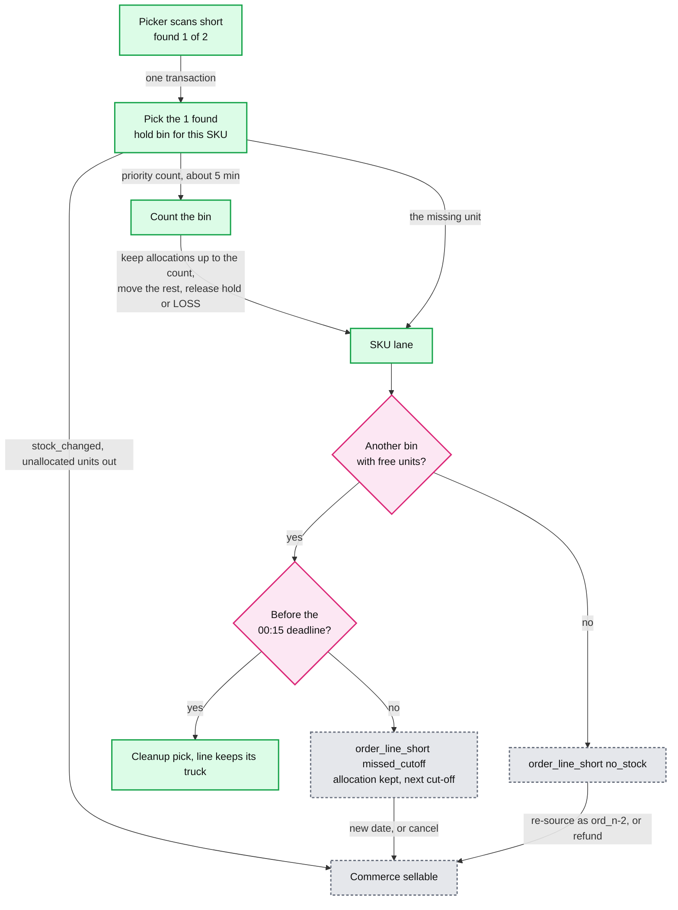

# Deep dive: allocation, waves and short picks

> One-line answer: allocation is serialized **per SKU in one lane** (16 lanes per cell by SKU hash): every second a lane takes all waiting lines of one SKU, sorts them by truck, and allocates them in **one ~10 to 20 ms transaction** (FEFO for expiry-controlled SKUs, else smallest quantity first, then walk order), so a burst of 2,000 lines on one SKU costs one transaction instead of a 6-second lock queue that stalls every other SKU. Work is released **continuously by deadline slack**, not in waves. A **short pick** puts that bin's balance on hold (its unallocated units leave `available_qty` at once), re-allocates **only the shorted line** right away, and lets a **priority count within ~5 minutes** decide how many of the bin's other allocations to move. Moving every allocation off a suspect bin at once looks safer and is not: in the simulation below it strands 1,900 lines a night, against 22.

Zoom-in on [`../solution.md`](../solution.md) §4.3 (outbound), §5.1 (contention) and §5.4 (short picks). Reusable blocks: [`../../../concepts/mvcc-and-isolation.md`](../../../concepts/mvcc-and-isolation.md), [`../../../concepts/leases-fencing-clocks.md`](../../../concepts/leases-fencing-clocks.md) (the lane owner's epoch). Related: [`../../ticket-booking/`](../../ticket-booking/) (hot-row conditional updates), [`../../ecommerce-platform/`](../../ecommerce-platform/) (what commerce does with `order_line_short`). Siblings: [`inventory-ledger-and-bin-model.md`](inventory-ledger-and-bin-model.md), [`cutoff-and-capacity.md`](cutoff-and-capacity.md) (the release deadline).

Acronyms: SKU (stock keeping unit), FC (fulfillment center), FEFO (first expiry, first out), UPH (units picked per hour per worker), WMS (warehouse management system).

---

## 1. What a lane does in one batch

1. Take every waiting line of SKU `S`: lines of new fulfillments (`order_confirmed`, idempotent on `fulfillment_id`), lines released by a short or a count, and cleanup picks. Sort by truck departure.
2. Read `S`'s candidate balances: `ACTIVE` bins, not held, `on_hand − allocated > 0`. Order them FEFO (skip lots short of their minimum remaining life), else quantity ascending to empty bins, then walk order near the line's zone: orderings Oracle WMS Cloud also offers (survey row 6a).
3. One transaction: fence check on the lane (below), `allocated + q WHERE on_hand − allocated >= q` per bin in `location_id` order, allocation rows, lines `RECEIVED → ALLOCATED WHERE state = 'RECEIVED'`, `available_qty − Σq`, one `stock_version` bump and one `capacity_version` bump for the cut-off, then the outbox: `stock_changed vN` first, then one `order_allocated vN` per fulfillment (carrying the `capacity_version`, C3.3), then any `order_line_short vN` (C3.2).
4. A line with no bin left gets `order_line_short(..., no_stock)`; after the release deadline, `missed_cutoff` (§5).

**Fencing the lane owner.** Lanes are threads in the cell's allocation service; a lane moves to another instance on failover. A paused old owner (a long garbage-collection pause) must not allocate the same lines again, because a double allocation hides units forever: they sit as `allocated` with no pick coming. Each batch therefore starts with `UPDATE lane SET last_batch = now() WHERE lane_id = :l AND epoch = :e`; zero rows aborts the batch. The conditional line transition is the second guard, and the nightly check "`allocated` equals the sum of `OPEN` allocation rows" is the third ([`inventory-ledger-and-bin-model.md`](inventory-ledger-and-bin-model.md) §3).

## 2. Simulation: when lanes matter

A hot SKU on 3 bins. Each per-line transaction holds its locks ~3 ms (statement plus a synchronous commit); a lane batch costs 2 ms plus 0.01 ms per line. Three arrival shapes for 2,000 lines: spread over 20 s (a flash deal's checkout wave), over 2 s (intake catching up after a 5-minute Kafka stall), and all at once (a wave sweep).

```python
# Hot SKU S-9000 on 3 bins; every allocation also updates the SKU's availability row.
# Picks on its bins (2/s) use the scan API's 40 connections and lock_timeout 200 ms.
# Other SKUs' lines (10/s) share the allocation service's 20 connections.
import heapq, random

class Sim:
    def __init__(s): s.t, s.q, s.n = 0.0, [], 0
    def at(s, t, fn): s.n += 1; heapq.heappush(s.q, (t, s.n, fn))

class Lock:                                        # FIFO; cap > 1 makes it a connection pool
    def __init__(s, sim, cap=1): s.sim, s.free, s.wait, s.peak = sim, cap, [], 0
    def acquire(s, cb, timeout=None):
        if s.free and not s.wait: s.free -= 1; s.sim.at(s.sim.t, lambda: cb(True)); return
        s.wait.append(cb); s.peak = max(s.peak, len(s.wait))
        if timeout:
            s.sim.at(s.sim.t + timeout, lambda: cb in s.wait and (s.wait.remove(cb), cb(False)))
    def release(s):
        if s.wait: s.sim.at(s.sim.t, lambda cb=s.wait.pop(0): cb(True))
        else: s.free += 1

def proc(sim, gen):                                # steps: ("acq", lock[, timeout]) or ("wait", dt)
    def step(ok=None):
        try: op = gen.send(ok)
        except StopIteration: return
        if op[0] == "wait": sim.at(sim.t + op[1], step)
        else: op[1].acquire(step, op[2] if len(op) > 2 else None)
    step()

def p(xs, q): xs = sorted(xs); return xs[min(len(xs) - 1, int(q * len(xs)))] * 1000

def run(mode, lines, secs, seed=3):
    rng, sim = random.Random(seed), Sim()
    pool, spool, avail = Lock(sim, 20), Lock(sim, 40), Lock(sim)
    bins, free = [Lock(sim) for _ in range(3)], [900, 900, 1200]
    hot, pick, other, timeouts, waiting = [], [], [], [0], []
    def pick_bin(): return min((i for i in range(3) if free[i] > 0), key=lambda i: free[i])
    def line(t0):                                  # one transaction per line
        yield ("acq", pool); b = pick_bin(); free[b] -= 1
        a, c = (bins[b], avail) if mode == "line, bin first" else (avail, bins[b])
        yield ("acq", a); yield ("wait", 0.0005); yield ("acq", c); yield ("wait", 0.0025)
        c.release(); a.release(); pool.release(); hot.append(sim.t - t0)
    def lane():                                    # one transaction per SKU per second
        if waiting:
            batch = waiting[:]; waiting.clear()
            def g():
                yield ("acq", pool); yield ("acq", avail); used = set()
                for _ in batch: b = pick_bin(); free[b] -= 1; used.add(b)
                for b in sorted(used): yield ("acq", bins[b])
                yield ("wait", 0.002 + 0.00001 * len(batch))
                for b in used: bins[b].release()
                avail.release(); pool.release(); hot.extend(sim.t - t0 for t0 in batch)
            proc(sim, g())
        if sim.t < 60: sim.at(sim.t + 1, lane)
    def picker(t0, b):
        while True:
            yield ("acq", spool); ok = yield ("acq", bins[b], 0.2)
            if ok: break
            spool.release(); timeouts[0] += 1; yield ("wait", 1.0)
        yield ("wait", 0.0025); bins[b].release(); spool.release(); pick.append(sim.t - t0)
    def bg(t0):
        yield ("acq", pool); yield ("wait", 0.003); pool.release(); other.append(sim.t - t0)
    for _ in range(lines):
        t = 5 + rng.random() * secs
        sim.at(t, (lambda t=t: waiting.append(t)) if mode == "lane" else (lambda t=t: proc(sim, line(t))))
    for rate, mk in ((2, lambda t: picker(t, rng.randrange(3))), (10, bg)):
        t = 0.0
        while t < 60: t += rng.expovariate(rate); sim.at(t, lambda t=t, mk=mk: proc(sim, mk(t)))
    if mode == "lane": sim.at(1, lane)
    while sim.q: sim.t, _, fn = heapq.heappop(sim.q); fn()
    return p(hot, .5), p(hot, .99), p(pick, .99), timeouts[0], p(other, .99), pool.peak

print("hot lines arriving   variant            line p50 line p99 hot-bin pick p99 pick timeouts"
      " other-SKU line p99 alloc pool queue")
for lines, secs in ((2000, 20.0), (2000, 2.0), (2000, 0.01)):
    for mode in ("line, bin first", "line, avail first", "lane"):
        r = run(mode, lines, secs); when = f"{lines} in {secs:g} s"
        print(f"{when:<20} {mode:<17} {r[0]:>7.0f}ms {r[1]:>6.0f}ms {r[2]:>14.0f}ms {r[3]:>13}"
              f" {r[4]:>16.0f}ms {r[5]:>16}")
```

Output:

```
hot lines arriving   variant            line p50 line p99 hot-bin pick p99 pick timeouts other-SKU line p99 alloc pool queue
2000 in 20 s         line, bin first         3ms      8ms              4ms             0                3ms                0
2000 in 20 s         line, avail first       3ms      8ms              4ms             0                3ms                0
2000 in 20 s         lane                  493ms    995ms              3ms             0                3ms                0
2000 in 2 s          line, bin first      2017ms   3944ms             62ms             0             3593ms             1327
2000 in 2 s          line, avail first    2033ms   3978ms              5ms             0             3627ms             1327
2000 in 2 s          lane                  509ms   1003ms              3ms             0                3ms                0
2000 in 0.01 s       line, bin first      2992ms   5914ms             62ms             0             5462ms             1977
2000 in 0.01 s       line, avail first    3009ms   5948ms              5ms             0             5496ms             1977
2000 in 0.01 s       lane                 1017ms   1022ms              3ms             0                3ms                0
```

What it shows:
- **At 100 lines a second, one transaction per line is fine.** 3 ms p50, 8 ms p99, and the lane is *worse*: it adds its 1 s batch interval. Lanes are insurance against bursts, not a steady-state speed-up. Say this before the interviewer does.
- **In a burst, per-line work serializes on the SKU's availability row:** `2,000 × 3 ms = 6 s`. The allocation service's 20 connections all wait on that row, so **every other SKU's** allocations queue behind it: 5.5 s p99. That, not the hot bin, is the blast radius.
- **Picks barely suffer, because the pool caps the lock queue.** With bin-first lock order a pick waits behind at most ~20 holders: 62 ms p99, under the 200 ms `lock_timeout`, which never fires. With the availability row locked first, 5 ms.
- **The lane is flat in every shape:** one 12 to 22 ms transaction per second, 3 ms for everyone else, ≤ 1 s added to the hot SKU.

## 3. Waves versus continuous release

| | Hourly waves | 15-minute waves | Continuous by slack (chosen) |
|---|---|---|---|
| Wait before release | up to 59 min | up to 15 min | until a picker in the zone frees up |
| Allocation shape | one huge transaction | bursts every 15 min | one batch per SKU per second |
| Idle tail per wave | ~10 to 15% of the floor [estimate] | same, 4x as often | none |
| Batch density | highest | high | lower early; the planner holds slack-rich lines up to 30 min to fill carts |

Coupang's newsroom says its centers process each order as it arrives rather than batching by the hour (survey row 2a, secondary). The release deadline for the 02:00 truck is **00:15** ([`cutoff-and-capacity.md`](cutoff-and-capacity.md)); in the last hour before it the planner releases everything.

## 4. Short picks: hold, re-allocate the one line, let a count move the rest



- **Hold, not zero.** The picker may be wrong (cartons pushed to the back). Zeroing writes a `LOSS` and later a `GAIN`, and commerce shows "sold out" then "in stock". The hold takes the bin's unallocated units out of `available_qty` just as fast and touches the ledger once, at the count.
- **Pickers already heading to the bin keep their allocations.** If they short too, each re-allocates only its own line. The count (by the zone's problem solver, priority over scheduled counts) keeps as many allocations as it finds units, earliest truck first, and moves the rest.
- **`no_stock` versus `missed_cutoff`.** `no_stock`: no bin in this FC can serve the line; commerce re-sources it to another FC as a new fulfillment (`ord_5512-2`) or refunds. `missed_cutoff`: stock exists but the 00:15 deadline has passed; the WMS **keeps the allocation** and plans it into the next cut-off, and commerce gives the buyer the new date or sends a cancel. A commerce re-source after `missed_cutoff` must wait for `order_cancel_result(cancelled)` on the first fulfillment, or both FCs ship.

## 5. Simulation: what each short-pick policy costs a night

```python
# Short picks in the busiest FC from 22:30 to the 00:15 release deadline (minute 105):
# 65k one-unit lines over 6,000 SKUs (Zipf), 3 bins each, stocked for ~1.5x the night.
# 1.5% of bins hold fewer units than the books say; 0.1% of picks are false shorts (the
# units are there, behind other cartons) [estimates]. A pick happens 10 to 25 min after
# allocation. A cleanup pick takes a runner 10 min and must start before minute 105.
import heapq, random

def night(policy, seed=11, skus=6000, lines=65000):
    rng = random.Random(seed)
    w = [1 / (i + 1) ** 0.9 for i in range(skus)]; tw = sum(w)
    book, shelf, pend, held = {}, {}, {}, set()
    for s in range(skus):
        for b in range(3):
            q = int(lines * w[s] / tw / 2) + rng.randint(2, 12); book[s, b] = q; pend[s, b] = []
            shelf[s, b] = rng.randint(0, q - 1) if rng.random() < 0.015 else q
    ev, n, moved = [], [0], set()
    m = dict(walks=0, missed=0, silent=0, rows=0, flaps=0, moved=0)
    def at(t, *e): n[0] += 1; heapq.heappush(ev, (t, n[0]) + e)
    def allocate(t, s, cleanup=False):
        ok = [b for b in range(3) if (s, b) not in held and book[s, b] > len(pend[s, b])]
        if not ok or (cleanup and t > 105): m["missed"] += 1; return
        b = min(ok, key=lambda x: book[s, x] - len(pend[s, x])); n[0] += 1
        pend[s, b].append(n[0]); at(t + (10 if cleanup else rng.uniform(10, 25)), "pick", s, b, n[0])
    def move_off(t, s, b, keep):                       # send allocations beyond `keep` back to the lane
        for lid in pend[s, b][keep:]: moved.add(lid); m["moved"] += 1; allocate(t, s, cleanup=True)
        pend[s, b] = pend[s, b][:keep]
    for s in rng.choices(range(skus), w, k=lines): at(rng.uniform(0, 100), "line", s, None, None)
    while ev:
        t, _, kind, s, b, lid = heapq.heappop(ev)
        if kind == "line": allocate(t, s); continue
        if kind == "count":
            if policy == "hold, count first": move_off(t, s, b, shelf[s, b])
            if shelf[s, b] != book[s, b]: m["rows"] += 1
            if policy == "zero" and shelf[s, b]: m["flaps"] += 1
            book[s, b] = shelf[s, b]; held.discard((s, b)); continue
        if lid in moved: continue
        pend[s, b].remove(lid)
        hidden = shelf[s, b] > 0 and rng.random() < 0.001
        if shelf[s, b] > 0 and not hidden:
            shelf[s, b] -= 1; book[s, b] -= 1; continue
        m["walks"] += 1                                  # a picker at an empty-looking bin
        if policy == "skip": m["silent"] += 1; m["missed"] += 1; continue
        if policy == "cancel": m["missed"] += 1; continue
        if policy == "zero":
            m["rows"] += 1; book[s, b] = 0; move_off(t, s, b, 0)
        if policy == "hold, move all":
            held.add((s, b)); move_off(t, s, b, 0)
        if policy == "hold, count first":                # keep allocations until a 5 min priority count
            if (s, b) not in held: held.add((s, b)); at(t + 5, "count", s, b, None)
        else:
            at(t + 30, "count", s, b, None)
        allocate(t, s, cleanup=True)
    return m

print("policy              walks to an   lines that miss   buyer not   allocations   LOSS or GAIN   sold out, then")
print("                    empty bin     tonight's truck   told        moved         rows           back in stock")
for p in ("skip", "cancel", "zero", "hold, move all", "hold, count first"):
    m = night(p)
    print(f"{p:<19} {m['walks']:>9} {m['missed']:>17} {m['silent']:>11} {m['moved']:>13}"
          f" {m['rows']:>14} {m['flaps']:>14}")
```

Output:

```
policy              walks to an   lines that miss   buyer not   allocations   LOSS or GAIN   sold out, then
                    empty bin     tonight's truck   told        moved         rows           back in stock
skip                      490               490         490             0              0              0
cancel                    490               490           0             0              0              0
zero                      118              1900           0          6026            178             60
hold, move all            118              1900           0          6026             58              0
hold, count first         136                22           0            95             58              0
```

What it shows:
- **Skip and cancel walk to the same empty bins all night:** 490 walks, because the books never change; skip also ships 490 incomplete orders without telling anyone.
- **Moving every allocation off a suspect bin is the expensive mistake.** 6,026 allocations moved; 1,208 lines then find no other bin with free units (they become `no_stock` shorts for units that were on the shelf) and 692 more are moved after 00:15 and miss the truck. Most triggers are hot bins: one false short at 23:50 moves a few hundred lines.
- **Hold plus a 5-minute count** walks 136 times (18 more than moving everything, the pickers already en route), moves 95 allocations and misses **22** lines. Same 58 ledger corrections, no availability flaps.
- **Zeroing** adds 120 extra `LOSS`/`GAIN` rows and 60 "sold out, then back in stock" flaps on the website.

## 6. What an interviewer pushes on

1. **"Why not optimistic concurrency with retries?"** At a 2,000-line burst most attempts fail and re-read: a retry storm on the same row. One writer per SKU needs no retries.
2. **"Doesn't a lane add latency?"** ≤ 1 s per line, against a 16-minute window between the last order and the release deadline.
3. **"What if a lane owner pauses for 30 s?"** Its lease expires, another instance takes the lane with `epoch + 1`, and the old owner's next batch fails the fence check.
4. **"A picker shorts on purpose to skip a far bin."** Shorts per worker are tracked; 5x the zone average triggers review (solution §10.10). The count tells you who was right.
5. **"The short is at 01:30, after the truck plan is fixed."** `missed_cutoff`, allocation kept; the line rides the next cut-off. Commerce owns the buyer conversation.
6. **"Why FEFO and not FIFO?"** Fresh goods expire; FEFO ships the earliest expiry first and skips lots below the minimum remaining life. Oracle flags FEFO combined with LEFO as invalid, and FEFO "can be compromised" when one container holds mixed expiry dates (survey rows 6c, 6d), which is why put-away avoids mixing lots in a bin.

## 7. Trade-offs

| Decision | Chose | Gave up |
|---|---|---|
| Serialization | One lane per SKU, 1 s batches | ≤ 1 s per line; a lane service to fence |
| Release | Continuous by slack | Less dense batches early; a hold-back policy to tune |
| Short pick, the bin | Hold, count within ~5 min | A problem solver's minutes per short; a few repeat walks |
| Short pick, other allocations | Keep until the count | Pickers en route may short again (18 extra walks a night) |
| After the deadline | `missed_cutoff`, keep the allocation | Tomorrow's capacity carries tonight's miss |

## 8. Numbers to say out loud

- 16 lanes per cell, ~31k SKUs each, one transaction per SKU per second, ~10 ms; 2,000 lines in one ~22 ms batch.
- Per line: `2,000 × 3 ms = 6 s` serialized; other SKUs wait 5.5 s p99 in a burst. At 100 lines/s it is fine.
- Release deadline 00:15 for the 02:00 truck.
- Shorts in the busiest FC's last 105 minutes: hold plus count misses 22 lines; moving everything misses 1,900; skipping walks 490 times.
