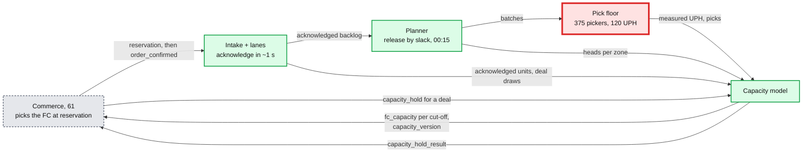

# Deep dive: cut-off and capacity

> One-line answer: the dawn promise (order by midnight, at the door by 7 am, Coupang FY2024 10-K) works backwards to a **02:00 last trailer, a 00:40 last pick and a 00:15 last release**. Between 23:00 and midnight ~45k units arrive and ~375 pickers at ~120 UPH pick exactly 45k an hour, so the floor, not any machine, is what breaks first: on plan the backlog clears at 00:23, 17 minutes of slack, and a promo plus 10% absence spends 14 of them. The WMS turns that into a live, per-cut-off **`fc_capacity`** so commerce stops sending dawn orders to a building that cannot make its truck. The signal is only as good as its bookkeeping: commerce must keep counting a fulfillment until an `fc_capacity` covers it (the C3.3 `capacity_version`), must subtract its **live reservations** as well as its open holds, and a flash deal must book its **future work** (`max(granted, drawn) − picked`), not its grant. Without the reservations, 151 nights in 1,000 still miss the truck; with them, none do.

Zoom-in on [`../solution.md`](../solution.md) §5.5 (the 23:59 order) and §5.7 (capacity 0 when cut off). The other side: [`../../ecommerce-platform/`](../../ecommerce-platform/) (#61 picks the FC at reservation). Reusable block: [`../../../concepts/rate-limiting-and-load-shedding.md`](../../../concepts/rate-limiting-and-load-shedding.md) (shedding upstream). Siblings: [`allocation-waves-and-short-picks.md`](allocation-waves-and-short-picks.md) (the 00:15 deadline in the short-pick path), [`realtime-sync-to-commerce.md`](realtime-sync-to-commerce.md) (the hold rule this mirrors).

Acronyms: UPH (units picked per hour per worker), FC (fulfillment center), WMS (warehouse management system), WAN (wide area network).

---

## 1. Working back from 7 am

| Step (one large dawn FC, every duration `[estimate]`) | Takes | Must end by |
|---|---|---|
| Last-mile routes | ~4 h | 07:00 |
| Camp sort | ~30 min | 03:00 |
| Line haul to the camp | ~30 min | 02:30 |
| Last trailer leaves the FC | | **02:00** |
| Buffer before the trailer leaves | 15 min | 02:00 |
| Loading | ~30 min | 01:45 |
| Sort to camp lane | ~15 min | 01:15 |
| Conveyor and packing | ~20 min | 01:00 |
| Last pick | | **00:40** |
| Pick batch walk | ~25 min | released by **00:15** |

The 23:59 order has 16 minutes to be taken in, allocated and put in a batch; the machines need ~2 s of that (picture: the gantt in solution §5.5). Coupang's engineering post says an FC that has met its daily outbound capacity "cannot take any new customer orders" (survey row 2b, verified). `fc_capacity` is that rule, live and per cut-off.

## 2. The red node and the loop around it



Why not the database: the busiest cell allocates ~10 order lines a second at the peak and is ~7% busy at its 300 scans/s design load. Picking labor is ~$180M a year network-wide; 1% more UPH is worth ~$1.8M, about half the cloud bill for all 100 cells.

## 3. Simulation: surprises, and what the capacity signal must count

Part 1 runs single nights without any signal. Part 2 draws 1,000 nights (absence 0 to 15%, a +5 to +25% promo on 3 nights in 10, UPH around 120) and compares bookkeeping rules. Commerce chooses the FC at reservation; checkout then takes 30 s to 4 min before the order is confirmed [estimate]; the WMS acknowledges within a second.

```python
# The dawn cut-off in the busiest FC, 20:40 to 00:40, in 10 s steps. Dawn demand per hour:
# 30k at 21:00, 38k at 22:00, 45k at 23:00, none after midnight [estimates]. A unit can
# be picked 20 min after its order is confirmed (batch building and the walk), and the
# last pick is at 00:40. Pickers: 300 until 22:00, then 375, at ~120 UPH.
import random

def night(absent=0.0, promo=0.0, uph=120.0, mode="none", publish=60, seed=0):
    rng = random.Random(seed); dt = 10
    steps = range(int(300 * 60 / dt))                 # 20:40 = 0 ... 00:40 = 240 min ... 01:40
    cum, picked, waiting, total = [0.0] * len(steps), 0.0, 0.0, 0.0   # cum: confirmed units so far
    pipe = [0.0] * len(steps)                         # confirmations due per step
    holds = shed = acked = inflight = acked_since = 0.0; pub = None; last_pick = None
    for i in steps:
        t = i * dt / 60                               # minutes after 20:40
        hour = 30 if t < 80 else 38 if t < 140 else 45 if t < 200 else 0     # thousand units an hour
        demand = hour * 1000 * (1 + promo) / 3600 * dt
        heads = (300 if t < 80 else 375) * (1 - absent)
        cap_per_s = heads * uph / 3600
        true_rem = cap_per_s * 60 * max(0, 240 - t) - waiting - 0.02 * cap_per_s * 60 * max(0, 240 - t)
        if pub is None or i % (publish // dt) == 0:   # fc_capacity is published every 60 s and
            pub = true_rem; acked_since = 0.0         # covers every unit acknowledged before it
        if mode == "none": take = demand
        elif mode == "c2.4":                          # holds only: an acked unit drops out of the holds
            take = demand if pub - holds > 0 else 0.0 # and is counted nowhere until the next publish
        elif mode == "versioned only":                # C3.3: acked units stay counted until a covering publish
            take = demand if pub - holds - acked_since > 0 else 0.0
        else:                                         # versioned, plus live reservations counted
            take = max(0.0, min(demand, pub - holds - acked_since - inflight))
        shed += demand - take
        for _ in range(3):                            # checkout takes 30 s to 4 min: thirds
            j = i + int(rng.uniform(30, 240) / dt)
            if j < len(steps): pipe[j] += take / 3
        inflight += take
        conf = pipe[i]; inflight -= conf; holds += conf; total += conf; cum[i] = total
        acked = conf; holds -= acked; waiting += acked   # the WMS acknowledges within a second
        acked_since += acked
        ready = (cum[i - 120] if i >= 120 else 0.0) - picked          # confirmed 20 min ago or more
        p = min(ready, cap_per_s * dt); picked += p; waiting -= p
        if p > 0: last_pick = t
        if t <= 240: missed = total - picked
    hh, mm = divmod(int(20 * 60 + 40 + (last_pick or 0)), 60)
    return missed, shed, f"{hh % 24:02d}:{mm:02d}"

print("Part 1: no capacity signal")
print("night                         backlog clear   units missing the 00:40 last pick")
for name, kw in (("plan", {}), ("promo +10%", {"promo": .10}), ("10% of pickers absent", {"absent": .10}),
                 ("both", {"promo": .10, "absent": .10}), ("both, and UPH 110", {"promo": .10, "absent": .10, "uph": 110})):
    m, s, lp = night(**kw)
    print(f"{name:<29} {lp:>13} {m:>20,.0f}")

print("\nPart 2: 1,000 random nights: absence 0 to 15%, a promo (+5 to +25%) on 3 nights in 10")
print("capacity signal                         nights missing   units missing   units sent elsewhere")
rng = random.Random(42)
nights = [(rng.uniform(0, .15), rng.uniform(.05, .25) if rng.random() < .3 else 0.0, rng.gauss(120, 5))
          for _ in range(1000)]
for mode, label in (("none", "none"), ("c2.4", "minus open holds, published every 60 s"),
                    ("versioned only", "plus C3.3 capacity version"),
                    ("versioned", "plus live reservations")):
    r = [night(a, p, u, mode=mode, seed=k) for k, (a, p, u) in enumerate(nights)]
    bad = sum(1 for x in r if x[0] > 1)
    print(f"{label:<39} {bad:>14} {sum(x[0] for x in r) / 1000:>15,.0f} {sum(x[1] for x in r) / 1000:>22,.0f}")
```

Output:

```
Part 1: no capacity signal
night                         backlog clear   units missing the 00:40 last pick
plan                                  00:23                    0
promo +10%                            00:28                    0
10% of pickers absent                 00:29                    0
both                                  00:37                    0
both, and UPH 110                     00:52                7,640

Part 2: 1,000 random nights: absence 0 to 15%, a promo (+5 to +25%) on 3 nights in 10
capacity signal                         nights missing   units missing   units sent elsewhere
none                                               151           1,257                      0
minus open holds, published every 60 s             151             217                  1,040
plus C3.3 capacity version                         151             168                  1,088
plus live reservations                               0               0                  1,358
```

What it shows:
- **The slack is ~17 minutes and two ordinary surprises spend 14 of them.** A promo of +10% costs 5 minutes, 10% absence 6, both 14 (00:37). Add a slow night (110 UPH) and 7,640 units miss the truck. That is the red node, in numbers.
- **"Remaining minus open holds" sheds load but still misses on the same 151 nights.** Two gaps let orders through after the building is full. Holds drop when the WMS acknowledges a fulfillment, but a `fc_capacity` published every 60 s does not yet include it, so for up to a minute commerce counts those units nowhere. The C3.3 `capacity_version` closes that gap: with `fc_capacity` still published only every 60 s, commerce keeps each acknowledged unit counted until a publish covers it (217 → 168 units missed a night). The bigger gap is reservations: an order chooses FC-07 at reservation and is confirmed up to 4 minutes later, so at 12.5 units/s and a mean checkout of ~2.3 minutes ~1.7k units are in flight, invisible to both sides, at the moment the building fills.
- **Counting live reservations against capacity removes every miss**, at the price of ~1,358 units a night (on average) sent to another FC or to next-day.

## 4. The capacity rule, per cut-off

```
pick_remaining = Σ zones (pickers on shift × measured UPH, last 30 min × hours to the last pick)
                 − unpicked units of acknowledged fulfillments without a deal_id
                 − Σ open deals (max(granted, drawn) − picked deal units)
pack_remaining = packers on shift × measured units packed an hour × hours to the last pack (01:00)
                 − unpacked units of acknowledged fulfillments without a deal_id
                 − Σ open deals (max(granted, drawn) − packed deal units)
remaining(fc, cutoff) = min(pick_remaining, pack_remaining) − 2% reserve for cleanup picks
```

- **The binding stage wins.** Pick and pack each subtract their own backlog from their own labor plan and deadline; the smaller remainder is what the building can promise. The simulation in §3 models pick only, because on a normal night pick binds (~375 pickers against ~200 packers at ~225 units an hour); a packer shortage flips it and the same rule follows.
- **Each unit is counted once, by one side.** The WMS counts what it has acknowledged. Commerce subtracts, before it picks the FC, its open holds at that FC **and its live reservations** there (part of the shared contract, C4.1). Deal holds are left out of commerce's subtraction: the grant already covers them.
- **Versioned (C3.3).** The allocation transaction bumps a per-(FC, cut-off) `capacity_version` and `order_allocated` carries it. Commerce keeps subtracting a fulfillment's units until it has applied an `fc_capacity` at or above that version: the hold rule of [`realtime-sync-to-commerce.md`](realtime-sync-to-commerce.md), applied to capacity. `fc_capacity` is still published every 60 s or on a 5% change; the version makes the cadence a freshness choice, not a correctness one.
- **A stale signal means zero.** In the last hour before a cut-off, an `fc_capacity` with no update for 2 minutes is treated as 0 for that cut-off (part of the shared contract, C4.7): a Kafka outage must not keep promising a building's last minutes.
- **Cut off from the floor.** After 5 minutes without its building, the cell publishes 0 for the dawn cut-off (solution §5.7); a 30-second blip does not reroute orders.

## 5. Flash deals book capacity ahead

At deal setup commerce sends `capacity_hold(deal, fc, date, cutoff, units)` on `orders.fc-<fc>`; the cell grants `min(requested, remaining)`, keeping all open grants under 30% of the cut-off's planned capacity [estimate], and answers `capacity_hold_result(deal, granted_units)`. Deal orders carry `deal_id` and raise the hold's `drawn_units`. Release is two-step: at deal end `capacity_release` returns `granted − drawn − (claims not yet terminal)`, so a claim behind a payment still in flight keeps its capacity; a final `capacity_release`, when the last claim resolves (at most 30 minutes later), sets the grant to 0.
- **Idempotent on `(deal_id, fc, cutoff)`.** A repeated hold returns the same grant; it never adds a second grant and never re-opens a released hold.
- **Order independence.** Booking `max(granted, drawn)` gives the same answer whether 20 deal orders overtake the hold or the release overtakes 10 late orders; after the final `capacity_release` the grant is 0, so a late deal fulfillment counts as regular work (C3.5).
- **Book future work, not the grant.** A deal that sells out at 22:05 is picked through the evening. Subtracting the full grant until the deal closes hides the capacity its picks already used:

```python
# Flash deal d77 in FC-07, dawn cut-off: granted 4,000 units at 18:00, sold out by 22:05,
# final capacity_release at 00:00 (no claims open). Deal units are picked with the backlog from 22:20,
# ~650 every 20 minutes [estimate]. How much capacity does each rule still book for it?
# "granted while open": subtract granted_units until release, then unpicked drawn units.
# "future work": subtract max(granted, drawn) - picked deal units, open or not.
granted, rows = 4000, []
for k in range(9):                                   # 22:00, 22:20, ..., 00:40
    t = 22 * 60 + 20 * k
    drawn = 4000 if t >= 22 * 60 + 5 else 3200
    picked = min(drawn, max(0, (t - (22 * 60 + 20)) // 20 * 650))
    is_open = t < 24 * 60
    by_grant = granted if is_open else drawn - picked
    by_work = max(granted, drawn) - picked
    rows.append((f"{t // 60 % 24:02d}:{t % 60:02d}", drawn, picked, by_grant, by_work, by_grant - by_work))
print("time   drawn  picked  booked: granted while open  future work  capacity hidden")
for r in rows:
    print(f"{r[0]}  {r[1]:>5} {r[2]:>7} {r[3]:>27} {r[4]:>12} {r[5]:>16}")
print(f"hidden at 23:40 = {rows[5][5]:,} units = {rows[5][5] / 750:.1f} min of a 375-picker floor at 120 UPH")
```

Output:

```
time   drawn  picked  booked: granted while open  future work  capacity hidden
22:00   3200       0                        4000         4000                0
22:20   4000       0                        4000         4000                0
22:40   4000     650                        4000         3350              650
23:00   4000    1300                        4000         2700             1300
23:20   4000    1950                        4000         2050             1950
23:40   4000    2600                        4000         1400             2600
00:00   4000    3250                         750          750                0
00:20   4000    3900                         100          100                0
00:40   4000    4000                           0            0                0
hidden at 23:40 = 2,600 units = 3.5 min of a 375-picker floor at 120 UPH
```

2,600 hidden units at 23:40 are 2,600 dawn orders sent elsewhere in the building's last 20 minutes of intake, for capacity it has.

## 6. The other levers on the red node

1. **Raise UPH.** Travel is 50% (Swisslog) to up to 70% (Dematic) of a picker's time (vendor claims, survey rows 6h, 6i). If travel is 60% and denser batches plus walk-order sequencing cut it by 20%, time per unit is `0.6 × 0.8 + 0.4 = 0.88`: **+14% UPH**, ~50 pickers in the 23:00 hour.
2. **Spend slack in deadline order.** Release by slack, cleanup picks first, pack stations take totes by truck, and supervisors move people between zones by backlog. The dashboard shows minutes of slack to 00:40 per zone from 21:00.
3. **Pack is next.** ~200 packers at ~75 parcels an hour; the same model runs for pack stations, and the binding one of the two sets `remaining`.

## 7. What an interviewer pushes on

1. **"Shard the database for the midnight spike."** The spike is ~10 order lines a second. The spike that matters is 375 people.
2. **"Why not just add a bigger reserve?"** The in-flight volume is rate × checkout time: ~1.5k units at 12.5 units/s and 2 minutes, double in a promo. A fixed 2% (~1.2k at 23:00) is too small on bad nights and wasteful on good ones. Counting reservations is exact.
3. **"Who decides what to shed?"** Commerce: another FC with stock and capacity, or next-day. The WMS only says how much it can still do.
4. **"A deal oversells its grant?"** Commerce carves at most the grant per FC; a re-sourced deal line can push `drawn` past it, and `max(granted, drawn)` counts the excess as ordinary work at once.
5. **"Next-day orders use the same pickers."** Each cut-off has its own `remaining`; labor hours spent on next-day work before 00:40 are subtracted from dawn's.

## 8. Trade-offs

| Decision | Chose | Gave up |
|---|---|---|
| Shed point | Commerce at reservation, from `fc_capacity` | Some dawn orders go to a farther FC or next-day |
| Freshness | `capacity_version` on `order_allocated`, publish every 60 s | Commerce tracks one more version per (FC, cut-off) |
| In-flight orders | Commerce counts live reservations | A reservation counter per (FC, cut-off) in commerce |
| Deals | Book `max(granted, drawn) − picked` | A picked-units counter per deal |
| Stale signal | Zero after 2 min in the last hour | A Kafka blip near midnight sheds orders that would have fit |

## 9. Numbers to say out loud

- 02:00 truck, 00:40 last pick, 00:15 last release. 45k units in the 23:00 hour, 375 pickers × 120 UPH.
- Slack on plan ~17 min; promo +10% costs 5, 10% absence 6, both 14.
- 1,000 nights: no signal 151 miss; holds and C3.3, still 151 miss; plus live reservations, 0 miss, ~1.4k units a night shed.
- A sold-out deal booked by its grant hides 2,600 units at 23:40, 3.5 minutes of the floor.
- +14% UPH from cutting travel 20% is worth ~50 pickers in the peak hour.
