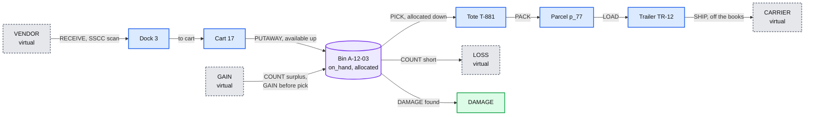
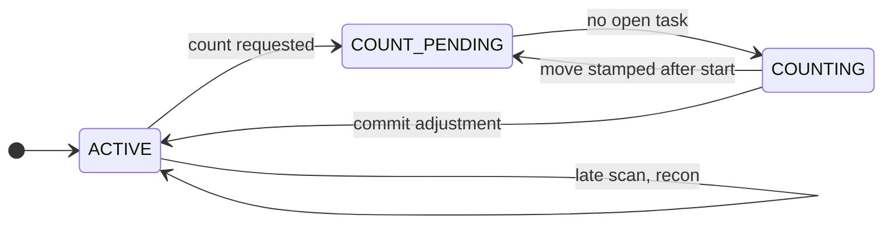

# Deep dive: inventory ledger and bin model

> One-line answer: a unit is always at exactly one **location** (a bin, a tote, a parcel, a trailer, or a virtual `VENDOR`, `LOSS`, `GAIN`, `DAMAGE`, `CARRIER`), so every state change is a **double-entry movement** that leaves one location and enters another, written in the **same transaction** as the two balances it changes, each guarded by a conditional `UPDATE` so `on_hand` never goes negative and `allocated` never exceeds `on_hand`. A scan is a physical fact: when the books disagree with it, the transaction books a `GAIN` first and raises a count, never a rejection. Counts are exact because a count waits for open tasks, **any movement stamped after the count started voids it**, and a late scan stamped before it is reconciled as already counted. A nightly job proves that yesterday's balances plus yesterday's movements equal today's, for every `(location, SKU, lot)`.

Zoom-in on [`../solution.md`](../solution.md) §3.3 (data model), §4.1 (track inventory) and §5.1 (two waves and a count on one bin). Reusable blocks: [`../../../concepts/mvcc-and-isolation.md`](../../../concepts/mvcc-and-isolation.md) (why the guard re-checks the newest row), [`../../../concepts/exactly-once.md`](../../../concepts/exactly-once.md). Related problems: [`../../payments-ledger/`](../../payments-ledger/) (double entry for money), [`../../ticket-booking/`](../../ticket-booking/) (the last-room conditional update). Siblings: [`allocation-waves-and-short-picks.md`](allocation-waves-and-short-picks.md) (who changes `allocated`), [`scanners-offline-and-idempotency.md`](scanners-offline-and-idempotency.md) (how late scans arrive), [`workflow-orchestration-and-tasks.md`](workflow-orchestration-and-tasks.md) (leases on the tasks a count waits for).

Acronyms: WMS (warehouse management system), FC (fulfillment center), SKU (stock keeping unit), LPN (license plate number, a container id), FEFO (first expiry, first out), MDM (mobile device management), NTP (Network Time Protocol), CDC (change data capture).

---

## 1. States are locations

| State the business asks about | Where the units are | Counted in `available_qty`? |
|---|---|---|
| Available | `on_hand − allocated` in `ACTIVE` storage bins, balance not held | Yes |
| Allocated | the `allocated` column of a bin balance | No |
| Held after a short pick | the bin balance carries `held = true` until its count ends | No |
| Picked | `on_hand` of a tote or cart (an LPN) | No |
| Packed, loaded | `on_hand` of a parcel (an SSCC, Serial Shipping Container Code), then of a trailer | No |
| Shipped | moved to virtual `CARRIER`, off our books | No |
| Damaged, quarantined | their own locations | No |
| Lost or found by a count | virtual `LOSS` and `GAIN` | No |

One mechanism explains every state change, so no "status" column can drift from the units. Key `(location, SKU, lot)`: ~1.2M rows of ~150 B in the busiest FC, **180 MB**, in memory.



## 2. One movement, one transaction

A pick of 2 cartons from `A-12-03` into `T-881` is one transaction:
1. Advance the stream: `last_applied_seq` from `seq − 1` to `seq` on `DEVICE_STREAM`, only if it is at `seq − 1`. Zero rows means a duplicate (return the reply stored in `SCAN_RESULT`) or a gap (ask for a resend). Both tables are unpartitioned; the ledger is partitioned by day with primary key `(day, movement_id)`.
2. `UPDATE balance SET on_hand = on_hand − 2, allocated = allocated − 2 WHERE (location, sku, lot) = (...) AND on_hand >= 2 AND allocated >= 2`, then `on_hand + 2` on the tote's row.
3. Insert the movement (from, to, SKU, lot, qty, reason, task, device sequence, device time); allocation `PICKED`, task `DONE`.
4. If `available_qty` changed (not for an allocated pick), bump `stock_version` and write `stock_changed` to the outbox. Commit; the synchronous standby acknowledges.

- **Why a guard and not a lock in application code.** Under `READ COMMITTED`, an `UPDATE` that waited for a row lock re-evaluates its `WHERE` against the newest committed row, so the guard sees the value another picker just wrote. Zero rows updated means "not as the books say": go to §4. No `SELECT ... FOR UPDATE`, no retry loop, no read-modify-write anywhere.
- **Lock order and cost.** The SKU's `SKU_AVAILABILITY` row first (a lane batch, or any scan that may change available: short, damage, over-pick, count), then balance rows in `location_id` order, so picks, allocations and counts cannot deadlock. 4 to 6 rows per scan at 300 scans/s is ~1,800 row writes a second, a few percent of one primary.

## 3. Invariants and the proof

| Invariant | Enforced where | Checked where |
|---|---|---|
| `on_hand ≥ 0` for every real location | the guard in every `UPDATE` | nightly job, pages on a violation |
| `0 ≤ allocated ≤ on_hand` for bins | the guard, plus §4's release rule | nightly job |
| per SKU, the sum over all locations, virtual included, is 0 | every movement has two sides | nightly job |
| opening balance + the day's movements = closing balance, per `(location, SKU, lot)` | the movement and the balances commit together | nightly job, from the day's partition and the snapshot |
| `allocated` equals the sum of `OPEN` allocation rows on that balance | the lane writes both in one transaction | nightly job; catches a double allocation by a stale lane owner |
| no `UPDATE` or `DELETE` on `MOVEMENT` | grants | daily partition hash, chained to the previous day's |

The ledger grows ~1.5M rows a day in the busiest FC (~3 rows per unit shipped) × ~250 B = **375 MB a day**. Partitioned by day: 90 days hot (~34 GB), then archived to object storage for 2 years (~270 GB per busiest FC, ~2.7 TB network-wide before compression). Retention is a partition drop, never a mass delete.

## 4. Physical facts first

The system never refuses what a person already did. It records it and turns the disagreement into a recount.

- **The guard fails on a pick.** The books say 0, the picker holds a carton from that bin. Same transaction: `GAIN → bin` for the difference, then the pick, then a priority count task. The balance never goes negative and the ledger says why.
- **A late scan on a re-leased task (an over-pick).** The units really left the bin. The movement goes `bin → PROBLEM` tote, not into the order's tote, and a problem solver puts them back (`PROBLEM → bin`, a second movement).
- **`on_hand` would fall below `allocated`.** An over-pick, a count loss or damage takes unallocated units that are no longer there. The same transaction releases the newest allocations on that balance (latest truck first) back to the SKU's lane until `allocated ≤ on_hand`. Without this rule the bin promises units it does not have, and each extra promise becomes a short pick later.

## 5. The count protocol

A count is exact only if no movement on the bin happens between "the counter looked" and "the adjustment committed" without the system knowing which side of the look it fell on.



1. **`COUNT_PENDING`.** No new pick or put-away task is released to the bin. Allocation may continue: it changes `allocated`, not `on_hand`.
2. **`COUNTING`** starts when no task on the bin is `ASSIGNED`, `IN_PROGRESS` or `UNCONFIRMED` (the same gate everywhere: an `UNCONFIRMED` task may still have a scan in a pocket). The count records `started_at` (server time). Counts on high-value SKUs are blind: the counter does not see the expected quantity.
3. **During the count**, any movement on the bin whose device time is at or after `started_at` (a stray put-away, an over-pick put-back) marks the count dirty. A dirty count is voided and redone: the counter may or may not have seen those units. The active count's own adjustment (`bin → LOSS` or `GAIN → bin`, reason `COUNT`) is excluded from this rule, or every count would void itself.
4. **Commit.** `adjustment = counted − on_hand` at commit time, booked as `bin → LOSS` or `GAIN → bin` with the count as the reason. Then excess allocations are released (§4) and the bin goes back to `ACTIVE`.
5. **After the count**, a scan that arrives late but carries a device time **before** `started_at` describes a unit that had already left when the counter looked. The count booked it as a loss. The scan is applied as `GAIN → bin` (reason `COUNT_RECON`) and then its pick: net zero on the bin, the tote gains the unit, and the phantom loss is reversed. A late scan stamped inside the count window (between start and commit) triggers a recount.

**Why device time is safe enough.** Handhelds are MDM-managed with NTP, skew well under a second [estimate]; scans within 5 s of `started_at` count as inside the window, so skew costs a recount, never a wrong number.

**Why waiting for open tasks is not enough.** A picker whose battery dies after taking a carton holds a scan the cell has not seen. After up to 20 minutes as `UNCONFIRMED`, the lease logic in [`workflow-orchestration-and-tasks.md`](workflow-orchestration-and-tasks.md) re-releases the step and the bin has no open task, the count starts, the counter sees the bin without the carton and books a loss, and then the battery is swapped and the pick arrives: the unit is subtracted twice. §5 rule 5 removes exactly that case.

## 6. Simulation: counts racing late scans and stray put-aways

One SKU in 20 bins over a 4-hour night, 200 nights. Physical shelf and books are separate. 89.5% of picks are scanned at once, 10% after a 10 s to 4 min dead zone, 0.5% after an 11 to 30 minute battery swap, late enough for the task to be re-leased and picked again by someone else (a deliberately pessimistic setting [estimate]). One put-away in ten goes to a bin other than the one directed. Shrink nobody scanned happens every ~5 minutes. Rule A is §5 steps 1 to 4 without the device-time rules; rule B is all of §5. "Release" is §4's rule for `on_hand` below `allocated`.

```python
# Shelf (truth) and books kept apart; every change is a double-entry movement.
# Rule A: a count waits for open tasks, then books what the counter saw.
# Rule B: A, plus device time against the count window (section 5, rules 3 and 5).
import heapq, random
from collections import defaultdict

def night(rule, release, seed, bins=20, T=4 * 3600):
    rng = random.Random(seed)
    shelf = {b: 40 for b in range(bins)}
    bal, alloc, ledger = defaultdict(int), defaultdict(int), []
    st = defaultdict(int)
    def move(frm, to, q, why):
        ledger.append((frm, to, q, why)); bal[frm] -= q; bal[to] += q
        st["neg"] += any(bal[x] < 0 for x in (frm, to) if isinstance(x, int))
    for b in range(bins): move("VENDOR", b, 40, "RECEIVE")
    status, waiting, tasks, cnt = {b: "ACTIVE" for b in range(bins)}, defaultdict(list), {}, {}
    unrec, last, ev, n = defaultdict(int), {}, [], [0]
    def at(t, kind, *a): n[0] += 1; heapq.heappush(ev, (t, n[0], kind, a))
    def new_task(t, q):
        ok = [b for b in range(bins) if bal[b] - alloc[b] >= q]
        if not ok: st["no_stock"] += 1; return
        b = min(ok, key=lambda x: bal[x] - alloc[x]); alloc[b] += q
        tasks[len(tasks)] = {"bin": b, "q": q, "epoch": 1, "state": "CREATED"}
        at(t + rng.uniform(0, 120), "release", len(tasks) - 1)
    def fix_alloc(t, b):                       # on_hand fell below allocated
        while release and alloc[b] > bal[b]:
            k = max((i for i, x in tasks.items() if x["bin"] == b and x["state"] in ("CREATED", "ASSIGNED")))
            tasks[k]["state"] = "MOVED"; alloc[b] -= tasks[k]["q"]; st["moved"] += 1
            new_task(t, tasks[k]["q"])
    def try_count(t, b):
        if status[b] == "PENDING" and not any(x["bin"] == b and x["state"] == "ASSIGNED" for x in tasks.values()):
            status[b] = "COUNTING"; cnt[b] = {"t0": t, "miss": 0, "dirty": False}
            at(t + rng.uniform(60, 120), "count_done", b)
    def touch(t, b, dev_t, q):                 # rule B: judge a movement by its device time
        if rule != "B": return
        if status[b] == "COUNTING" and dev_t >= cnt[b]["t0"]: cnt[b]["dirty"] = True
        elif b in last and status[b] != "COUNTING":
            if dev_t < last[b][0]: move("GAIN", b, q, "COUNT_RECON"); st["recon"] += 1
            elif dev_t <= last[b][1]: st["recount"] += 1; status[b] = "PENDING"; try_count(t, b)
    for t in range(0, T, 20): at(t + rng.random() * 20, "order")
    for t in range(0, T, 400): at(t + rng.random() * 400, "putaway")
    for t in range(0, T, 300): at(t + rng.random() * 300, "shrink")
    for t in range(0, T, 360): at(t + rng.random() * 360, "count_req", rng.randrange(bins))
    while ev:
        t, _, kind, a = heapq.heappop(ev)
        if kind == "order" and t < T:
            new_task(t, rng.choice((1, 1, 2)))
        elif kind == "release":
            k = tasks[a[0]]
            if k["state"] != "CREATED": continue
            if status[k["bin"]] != "ACTIVE": waiting[k["bin"]].append(a[0]); continue
            k["state"] = "ASSIGNED"; at(t + rng.uniform(60, 480), "pick", a[0], k["epoch"])
        elif kind == "pick":                   # a person takes units off the shelf
            k = tasks[a[0]]; b = k["bin"]
            if k["state"] != "ASSIGNED" or k["epoch"] != a[1]: continue
            take = min(k["q"], shelf[b]); shelf[b] -= take; r = rng.random()
            delay = 0.3 if r < 0.895 else rng.uniform(10, 240) if r < 0.995 else rng.uniform(660, 1800)
            at(t + delay, "scan", a[0], a[1], t, take)
            if delay > 600: at(t + 600, "lease", a[0], a[1])
        elif kind == "lease":                  # 10 min without a scan: re-release, epoch + 1
            k = tasks[a[0]]
            if k["state"] == "ASSIGNED" and k["epoch"] == a[1]:
                k["epoch"] += 1; k["state"] = "CREATED"; at(t + rng.uniform(30, 120), "release", a[0])
                try_count(t, k["bin"])
        elif kind == "scan":
            tk, ep, dev_t, q = a; k = tasks[tk]; b = k["bin"]; touch(t, b, dev_t, q)
            if bal[b] < q: move("GAIN", b, q - bal[b], "GAIN_BEFORE_PICK"); st["gain_guard"] += 1
            if ep == k["epoch"] and k["state"] == "ASSIGNED":
                move(b, "TOTE", q, "PICK"); alloc[b] -= k["q"]; k["state"] = "DONE"
            else:                              # late scan on a re-leased task: over-pick
                st["overpick"] += 1; move(b, "PROBLEM", q, "OVERPICK")
                at(t + rng.uniform(600, 2400), "putback", b, q)
            fix_alloc(t, b); try_count(t, b)
        elif kind == "putback":
            b, q = a; shelf[b] += q; touch(t, b, t, q); move("PROBLEM", b, q, "PUTBACK")
        elif kind == "putaway" and t < T:      # 1 in 10 lands in a bin other than directed
            stray = rng.random() < 0.1
            b = rng.randrange(bins) if stray else min(range(bins), key=lambda x: bal[x])
            if not stray and status[b] != "ACTIVE": continue
            shelf[b] += 12
            if status[b] == "COUNTING" and rng.random() < 0.5: cnt[b]["miss"] += 12
            at(t + 1, "putaway_scan", b, t)
        elif kind == "putaway_scan":
            b, dev_t = a; touch(t, b, dev_t, 12); move("VENDOR", b, 12, "PUTAWAY")
        elif kind == "shrink" and t < T:
            b = rng.randrange(bins)
            if shelf[b] > 0: shelf[b] -= 1; unrec[b] += 1
        elif kind == "count_req" and t < T:
            if status[a[0]] == "ACTIVE": status[a[0]] = "PENDING"; try_count(t, a[0])
        elif kind == "count_done":
            b = a[0]; c = cnt[b]
            if c["dirty"]: st["void"] += 1; status[b] = "PENDING"; try_count(t, b); continue
            adj = shelf[b] - c["miss"] - bal[b]
            if adj: move(b, "LOSS", -adj, "COUNT") if adj < 0 else move("GAIN", b, adj, "COUNT")
            st["counts"] += 1; unrec[b] = 0; last[b] = (c["t0"], t); status[b] = "ACTIVE"
            fix_alloc(t, b)
            for w in waiting.pop(b, []): at(t, "release", w)
        st["alloc>on_hand"] += any(alloc[b] > bal[b] for b in range(bins))
    replay = defaultdict(int)
    for frm, to, q, _ in ledger: replay[frm] -= q; replay[to] += q
    st["unbalanced"] = int(any(replay[k] != bal[k] for k in set(replay) | set(bal)) or sum(bal.values()) != 0)
    st["phantom"] = sum(abs(bal[b] - shelf[b] - unrec[b]) for b in range(bins))
    st["rows"] = len(ledger)
    return st

rows = [("ledger rows", "rows"), ("counts booked", "counts"), ("over-picks", "overpick"),
        ("allocations moved off a bin", "moved"), ("counts voided, recounted", "void"),
        ("late scans reconciled", "recon"), ("GAIN before a pick", "gain_guard"),
        ("phantom units, books vs shelf", "phantom"), ("negative balances", "neg"),
        ("steps with allocated > on_hand", "alloc>on_hand"), ("nights the ledger fails replay", "unbalanced")]
runs = {}
for rule, release in (("A", False), ("A", True), ("B", True)):
    tot = defaultdict(int)
    for seed in range(200):
        for k, v in night(rule, release, seed).items(): tot[k] += v
    runs[(rule, release)] = tot
print("200 nights x 20 bins, totals".ljust(32) + "".join(f"{h:>15}" for h in ("A, no release", "A, release", "B, release")))
for label, k in rows:
    print(label.ljust(32) + "".join(f"{runs[v][k]:>15}" for v in runs))
```

Output:

```
200 nights x 20 bins, totals      A, no release     A, release     B, release
ledger rows                              159864         159790         159831
counts booked                              7951           7960           7962
over-picks                                  745            751            744
allocations moved off a bin                   0           1685           1637
counts voided, recounted                      0              0             13
late scans reconciled                         0              0             99
GAIN before a pick                           94             55              3
phantom units, books vs shelf                22             51              0
negative balances                             0              0              0
steps with allocated > on_hand            71656              0              0
nights the ledger fails replay                0              0              0
```

What it shows:
- **The guard and double entry hold in every variant.** Zero negative balances and the ledger replays to the balance table on every night, ~160k rows a variant. The structure is not where errors come from.
- **Without the release rule, `allocated > on_hand` is the normal state.** 71,656 event steps in 200 nights: every count loss and over-pick leaves promises the bin cannot keep. With the rule, 0, at the cost of ~8 allocations moved a night per 20 bins.
- **Waiting for open tasks alone books wrong counts.** Rule A ends 22 to 51 units away from the shelf after shrink is accounted for: about 1 count in 160 books a phantom loss or gain, which later shows up as a needless short pick or a unit nobody can sell. Rule B ends at **0**, for 13 recounts and 99 reconciled late scans in 200 nights.
- **"GAIN before a pick" is a symptom.** It falls from 55 to 3 once counts stop double-subtracting late picks: a cheap alarm for a broken count process.

## 7. What an interviewer pushes on

1. **"Why not event sourcing, balances as a projection?"** The never-negative check must read the current balance at write time. A projection is behind by definition. We keep the log (the ledger) and the balance in one transaction: the audit trail of event sourcing without the lag.
2. **"CRDT counters, so concurrent decrements never conflict?"** Merging concurrent decrements without coordination is exactly how a bin reaches −1. The invariant needs one serialization point per row, and at ~300 transactions a second a single primary is ~7% busy.
3. **"Why not freeze the zone for a count?"** It stops dozens of pickers at 23:00; the bin-level protocol costs one bin a few minutes.
4. **"What if the counter is wrong?"** A variance over 5 units or ~$200 needs a second count by another worker before it books; adjustments by worker are monitored for theft (solution §10.10).
5. **"How do you prove the books to an auditor?"** Opening plus movements equals closing every night, and each day's partition hash chains the previous day's, so a rewritten row is detectable.

## 8. Trade-offs

| Decision | Chose | Gave up |
|---|---|---|
| Stock model | Movement ledger + balances in one transaction | 4 to 6 row writes per scan; vacuum on short-lived tote rows |
| Impossible scans | `GAIN` first, then the movement, then a count | A `GAIN` row that looks like a find until the count confirms it |
| `on_hand` below `allocated` | Release the newest allocations in the same transaction | A re-walk for those lines |
| Count exactness | Device time against the count window | Trust in MDM-synced clocks, ~1 recount per 15 nights per 20 bins |

## 9. Numbers to say out loud

- ~1.2M balance rows, 180 MB, in memory. 4 to 6 row writes per scan.
- Ledger 375 MB a day in the busiest FC, 90 days hot (34 GB), 2 years archived (~270 GB).
- Guard `on_hand >= q`; release rule keeps `allocated ≤ on_hand`. Count: wait for open tasks, void on a movement stamped after the start, reconcile one stamped before it. Phantom units 51 → 0.
- Nightly proof: opening + movements = closing, per `(location, SKU, lot)`.
