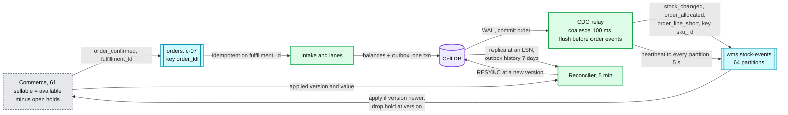

# Deep dive: real-time sync to commerce

> One-line answer: every change to available stock leaves the cell through an **outbox row written in the same transaction**, read by CDC in commit order, as an **absolute value with a per-(SKU, FC) `stock_version`** whose high bits are a failover epoch. Commerce applies a value only if its version is newer, and keeps a **hold per (fulfillment, SKU, FC)** for every confirmed fulfillment until it has applied a `stock_changed` at or above that fulfillment's `order_allocated` version. The relay may coalesce a hot SKU's values for 100 ms but **never lets an order event overtake a pending value of the same SKU**. After a DR promotion the cell takes its epoch from the promotion clock and holds a **recovery barrier** (no allocation, no publish, no heartbeat) until the floor's journals and the order intake have caught up. A reconciler compares commerce with the WMS **at commerce's own version**, so lag never looks like drift.

Zoom-in on [`../solution.md`](../solution.md) §4.4 (the feed), §5.6 (5 versus 3) and §10.4 (failover). The other side: [`../../ecommerce-platform/`](../../ecommerce-platform/) (#61, sellable stock and holds). Reusable blocks: [`../../../concepts/exactly-once.md`](../../../concepts/exactly-once.md), [`../../../concepts/stream-processing.md`](../../../concepts/stream-processing.md), [`../../../concepts/replication-and-quorums.md`](../../../concepts/replication-and-quorums.md), [`../../../concepts/merkle-tree.md`](../../../concepts/merkle-tree.md). Related: [`../../webhook-delivery/`](../../webhook-delivery/) (outbox and CDC relay), [`../../cdc-pipeline/`](../../cdc-pipeline/). Sibling: [`cutoff-and-capacity.md`](cutoff-and-capacity.md) (the capacity signal on the same boundary).

Acronyms: WMS (warehouse management system), FC (fulfillment center), SKU (stock keeping unit), CDC (change data capture), WAL (write-ahead log), LSN (log sequence number), DR (disaster recovery), AZ (availability zone), SLO (service level objective).

---

## 1. The pipe



- **Absolute values, versioned.** A duplicate or an older event is ignored; a lost one is repaired by the next event for that SKU. Deltas would count a re-delivered `+12` twice and keep a lost `−1` forever.
- **Coalescing with a flush.** A flash-sale SKU can change hundreds of times a second; the relay keeps only the newest `stock_changed` per (SKU, FC) for up to 100 ms. Before it publishes any `order_allocated`, `order_line_short` or other order event for that SKU, it publishes the pending value first, so per SKU the topic stays in commit order.
- **Heartbeat.** Every 5 s, to every one of the 64 partitions (~1.3k tiny records a second network-wide): a consumer judges staleness per (partition, FC). Stale for 30 s, commerce sells that FC's pool only beyond a safety margin. A building cut off from its cell does not stop the heartbeat (the cloud cell still sends it); `floor_contact_age` shows the cut at once, and `fc_capacity` goes to 0 after 5 minutes. The heartbeat also carries `floor_contact_age`, the seconds since the building's edge last reached the cell (part of the contract, C4.7), so commerce sees a cut-off building within seconds and can widen its margin or stop promising dawn from it.

## 2. The hold rule

Commerce's sellable for an FC pool = latest applied `available_qty` minus open holds. A hold is created at confirm, per `(fulfillment_id, sku, fc)` (`ord_1-1`, and `ord_1-2` after a re-source), and dropped only when commerce has applied a `stock_changed` whose version is at least the `stock_version` carried on that fulfillment's `order_allocated` (C1.3) or `order_line_short` (C3.2), or when `order_cancel_result(cancelled)` covers its lines. The lane writes, in one transaction, `stock_changed vN`, then each `order_allocated vN` (which also carries the per-(FC, cut-off) `capacity_version`, C3.3), then each `order_line_short vN`.

| Arrival at commerce (row at v41: available 120, one hold of 2) | Without the rule | With it |
|---|---|---|
| `stock_changed` v42 (118), then `order_allocated` v42 | correct | correct |
| `order_allocated` v42 first (a replay, coalescing without the flush) | hold gone, available still 120: **2 oversellable** | hold kept until v42: never over |
| `stock_changed` v41 replayed after v42 | 120 again: **2 over** | ignored, older |

## 3. Simulation: the hold rule, the flush, and a failover that loses versions

Part 1 stresses ordering on one hot SKU whose stock hovers near zero. Part 2 promotes the DR replica, which lost the last 2 s or 60 s of commits (async replication; 60 s is a DR replica still following a primary that had already failed over inside the region), with and without the barrier, and with the epoch taken from the database row or from the promotion clock.

```python
# One hot SKU, one FC, one hour. Buyers try 2 a second; commerce confirms if applied available
# minus open holds >= 1. WMS: a lane batch per second (stock_changed vN, then order_allocated vN,
# or order_line_short), +6 put away every ~6 s, -1 damage every ~20 s. A WMS short = commerce
# confirmed a unit the WMS did not have. The relay re-publishes its last 20 events every ~10 min.
import heapq, random

def run(rule, flush, failover=None, seed=1, T=3600.0):
    rng = random.Random(seed); ev, n = [], [0]
    def at(t, *e): n[0] += 1; heapq.heappush(ev, (t, n[0]) + e)
    W = {"A": 30, "v": (1, 0), "q": []}; log, hist = [], []     # intake log, snapshots
    C = {"A": 30, "v": (1, 0), "holds": {}, "hb": 0.0}; out = {"shorts": 0, "fids": 0, "ignored": 0}
    R = {"pend": None, "sent": [], "pause": -1.0, "rx": 0.0, "seen": set(), "gen": 0, "rd": 0.0}
    def deliver(t, e):                                  # one partition: order kept, lag 20 to 300 ms
        R["sent"].append(e); R["rx"] = max(R["rx"], t + rng.uniform(0.02, 0.3)); at(R["rx"], "apply", e)
    def publish(t, e):
        if e[0] == "stock":                             # coalesce: keep the newest for 100 ms
            if R["pend"] is None: at(t + 0.1, "flush")
            R["pend"] = e; return
        if flush and R["pend"]: deliver(t, R["pend"]); R["pend"] = None
        deliver(t, e)
    def commit(t, evs):
        hist.append((t, W["A"], W["v"], list(W["q"]), len(log)))
        R["rd"] = max(R["rd"], t + rng.uniform(0.01, 0.05), R["pause"])   # CDC reads in commit order
        for e in evs: at(R["rd"], "relay", e)
    def bump(): W["v"] = (W["v"][0], W["v"][1] + 1); return W["v"]
    for k in range(int(T)): at(k + 1.0, "lane")
    for rate, kind in ((2.0, "buy"), (1 / 6, "putaway"), (1 / 20, "damage"), (1 / 600, "restart"), (0.2, "hb")):
        t = rng.expovariate(rate)
        while t < T: at(t, kind); t += rng.expovariate(rate)
    if failover:
        at(failover["at"], "fail")
        if failover.get("az"): at(failover["az"], "az")
    down = False
    while ev:
        t, _, kind, *a = heapq.heappop(ev)
        if kind == "buy":
            margin = 2 if t - C["hb"] > 30 else 0       # C1.7: feed stale over 30 s, keep a margin
            if C["A"] - len(C["holds"]) - margin >= 1:
                out["fids"] += 1; C["holds"][out["fids"]] = None
                at(t + rng.uniform(0.05, 0.5), "intake", out["fids"])
        elif kind == "apply":
            e = a[0]
            if e[0] == "hb": C["hb"] = t
            if e[0] == "stock" and e[2] > C["v"]: C["A"], C["v"] = e[1], e[2]
            elif e[0] == "stock" and len(e) > 3 and e[2] not in R["seen"]:
                out["ignored"] += 1                     # a fresh event from the promoted cell, dropped as old
            if len(e) > 3: R["seen"].add(e[2])
            if e[0] in ("alloc", "short") and e[1] in C["holds"]:     # C1.3 and C3.2
                if rule == "drop on arrival" or C["v"] >= e[2]: del C["holds"][e[1]]
                else: C["holds"][e[1]] = e[2]
            if e[0] == "stock":
                for f in [f for f, hv in C["holds"].items() if hv is not None and C["v"] >= hv]: del C["holds"][f]
        elif kind == "flush" and R["pend"]: deliver(t, R["pend"]); R["pend"] = None
        elif kind == "relay": publish(t, a[0])
        elif kind == "restart":
            for e in R["sent"][-20:]: deliver(t, e)
        elif kind == "up": down = False
        elif down:                                      # the floor keeps working, the cell is gone
            if kind in ("putaway", "damage"): at(up + rng.uniform(0, 120), "replay_" + kind)
            if kind == "intake": at(up + 0.001, "intake", a[0])
        elif kind == "hb" and t >= R["pause"]: deliver(t, ("hb",))
        elif kind == "intake" and a[0] not in log: log.append(a[0]); W["q"].append(a[0])
        elif kind == "lane" and W["q"] and t >= R["pause"]:   # a barrier also holds allocation
            k = min(len(W["q"]), W["A"]); W["A"] -= k; v = bump()
            evs = [("stock", W["A"], v) + (("new",) if R["gen"] else ())] + [("alloc", f, v) for f in W["q"][:k]]
            for f in W["q"][k:]: evs.append(("short", f, v)); out["shorts"] += 1
            W["q"] = []; commit(t, evs)
        elif kind in ("putaway", "replay_putaway"):
            W["A"] += 6; commit(t, [("stock", W["A"], bump()) + (("new",) if R["gen"] else ())])
        elif kind in ("damage", "replay_damage") and W["A"] > 0:
            W["A"] -= 1; commit(t, [("stock", W["A"], bump()) + (("new",) if R["gen"] else ())])
        elif kind == "az": W["v"] = (2, W["v"][1])     # sync standby promoted, nothing lost, epoch 2
        elif kind == "fail":                            # DR promotion loses the last `lost` s of commits
            tf, lost, up, barrier = failover["at"], failover["lost"], failover["at"] + 60, failover["barrier"]
            s_t, s_A, s_v, s_q, s_n = max((h for h in hist if h[0] <= tf - lost), key=lambda h: h[0])
            relost = log[s_n:]; del log[s_n:]
            epoch = s_v[0] + 1 if failover["epoch"] == "db row" else 3      # 3: later than any epoch issued
            W.update(A=s_A, q=s_q, v=(epoch, 0)); down = True; at(up, "up"); R["gen"] = 1
            for f in relost: at(up + 0.001, "intake", f)     # intake re-reads from its stored offset
            for _ in range(sum(1 for h in hist if tf - lost < h[0] <= tf)):   # lost floor scans, journaled
                at(up + rng.uniform(0, 120), "replay_putaway" if rng.random() < 0.8 else "replay_damage")
            R["pause"] = up + (125 if barrier else 0)
    return out["shorts"], out["fids"], out["ignored"]

print("Part 1: one hour on a hot SKU, coalescing relay, restarts re-publish 20 events, mean of 20 hours")
print("hold rule                  order events vs the 100 ms window   orders   WMS shorts")
for rule in ("drop on arrival", "drop at applied version"):
    for flush in (False, True):
        r = [run(rule, flush, seed=k) for k in range(20)]
        how = "flush pending stock first" if flush else "published at once"
        print(f"{rule:<26} {how:<34} {sum(x[1] for x in r) / 20:>7.0f} {sum(x[0] for x in r) / 20:>12.1f}")

print("\nPart 2: DR promotion at minute 30, cell back at minute 31, mean of 40 hours")
cases = [("no failover", None)]
for lost in (2, 60):
    for barrier in (False, True):
        cases.append((f"lose {lost:>2} s, {'barrier for 125 s' if barrier else 'allocate, publish at once'}",
                      {"at": 1800.0, "lost": lost, "barrier": barrier, "epoch": "clock"}))
for ep in ("db row", "clock"):
    cases.append((f"AZ failover 29:00, DR 30:00, epoch from {ep}",
                  {"az": 1740.0, "at": 1800.0, "lost": 60, "barrier": True, "epoch": ep}))
print("case                                           WMS shorts   new-cell events ignored")
for name, fo in cases:
    r = [run("drop at applied version", True, failover=fo, seed=k) for k in range(40)]
    print(f"  {name:<47} {sum(x[0] for x in r) / 40:>6.1f} {sum(x[2] for x in r) / 40:>17.1f}")
```

Output:

```
Part 1: one hour on a hot SKU, coalescing relay, restarts re-publish 20 events, mean of 20 hours
hold rule                  order events vs the 100 ms window   orders   WMS shorts
drop on arrival            published at once                     3686         80.8
drop on arrival            flush pending stock first             3618         13.7
drop at applied version    published at once                     3619         14.3
drop at applied version    flush pending stock first             3618         13.7

Part 2: DR promotion at minute 30, cell back at minute 31, mean of 40 hours
case                                           WMS shorts   new-cell events ignored
  no failover                                       14.4               0.0
  lose  2 s, allocate, publish at once              16.1               0.0
  lose  2 s, barrier for 125 s                      12.5               0.0
  lose 60 s, allocate, publish at once              71.0               0.0
  lose 60 s, barrier for 125 s                      12.4               0.0
  AZ failover 29:00, DR 30:00, epoch from db row   442.5             834.1
  AZ failover 29:00, DR 30:00, epoch from clock     12.4               0.0
```

What it shows:
- **Reordering is the whole risk, and either fix removes it.** Dropping holds on arrival while order events overtake the 100 ms window sells ~81 units an hour the WMS cannot allocate; the version rule (for allocations and shorts) or the flush brings it to the ~14 that damage found on the shelf causes anyway (a physical fact nobody can sell ahead of). We keep both: the flush keeps the topic in commit order, the rule covers consumer replays and topic migrations.
- **A failover's damage is in the floor's lost events, not in the versions.** Losing 60 s of commits and publishing at promotion adds ~57 shorts: the cell re-allocates the re-read fulfillments against stock that is missing the put-aways still sitting in the edge journals. Holding allocation and publishing until the journals replay (the barrier) brings it back to baseline.
- **The epoch must not come from the database.** If the DR replica missed an earlier in-region failover, "epoch + 1" re-issues versions commerce has already seen: 834 fresh events dropped as old and ~443 shorts in the hour. An epoch from the promotion clock is always new.

## 4. After a DR promotion

1. **Fence the old region.** The DR cell takes the cell's leader lease in the DR region's consensus store and bumps the relay's Kafka producer epoch before it opens, so a zombie primary or relay in the old region can neither write nor publish; if the old region returns, its primary has no lease and demotes itself, and its old-timeline writes are rejected.
2. **Epoch.** `epoch = max(epoch in the DB + 1, promotion time in seconds)`, written before the cell opens. A version is `(epoch << 31) | counter`. Promotions are minutes apart and clocks are NTP-synced, so the clock alone is always ahead of any epoch already issued.
3. **Barrier.** No heartbeat (commerce applies its stale-feed margin after 30 s), no allocation, no outbox publishing.
4. **Catch up.** Intake re-reads `orders.fc-<fc>` (mirrored to the DR region) from the offset stored in the cell DB; edges replay their 24 h journals, which hold every floor command, scans and supervisor adjustments alike, by `(device_id, stream_id, seq)` (dedup drops what the replica has); a scan for a task the replica lost becomes an exception movement, never a blocked stream.
5. **Open.** Lanes run; then the relay publishes a fresh `stock_changed` for every SKU changed in the last hour, then heartbeats resume. ~2 to 3 minutes after promotion, inside the ~30-minute region RTO (recovery time objective). The only writes that can still be lost are cloud-only admin edits (ASNs from procurement, counts requested from an office): up to the async replication lag, a few seconds [estimate], re-sent by their callers with the same id.

## 5. The reconciler, at commerce's version

Every 5 minutes, per FC, for SKUs changed in the last 10 minutes plus a 1/288 slice (every SKU once a day). Not against the replica's latest snapshot: the replica is 1 to 5 s behind the primary and commerce ~0.1 to 1 s, so on a busy SKU commerce is *ahead* of it.
1. Ask commerce for its applied `(version, available)`.
2. Look up the WMS value **at that version** in the outbox history (daily partitions, 7 days). Different value at the same version: a commerce bug. Page and repair it as in step 3: commerce only applies a newer version, so a repair is never sent at the same one.
3. Commerce's version is still **below the WMS version the previous run saw**: an event was lost. Ask the cell to repair: it writes a controlled `RESYNC` movement for that SKU (no quantity change) that bumps `stock_version` and writes `stock_changed` with the current value through the outbox; the relay publishes it in commit order and commerce's strict newer-version rule accepts it. The reconciler never writes to `wms.*` itself (only cells' relays may, by Kafka ACL).
4. Commerce's version is **above anything the cell ever issued**: versions went backwards. Page.
5. A hold older than 10 minutes with no `order_allocated`, short or cancel: ask the cell about that `fulfillment_id`. Unknown: commerce re-drives the same `order_confirmed`. Allocated: the cell writes a fresh `order_allocated` through its outbox (a hold drop is idempotent, so this needs no new version; stock repairs always do, step 3).

```python
# The reconciler for one FC over a day: 288 runs. It reads the replica (1 to 5 s behind),
# then asks commerce 0.5 s later. Commerce applies 0.05 to 1 s after commit, 1 to 30 s in 1%
# of cases [estimates]. SKUs checked per run: 200 hot (an event every 5 s), 5,000 warm (every
# 2 min), ~5.2k cool (one a day). Three events on cool SKUs are really lost during the day.
import math, random
rng = random.Random(8)
def poisson(lam):
    k, p, L = 0, rng.random(), math.exp(-lam)
    while p > L: k += 1; p *= rng.random()
    return k
lost = sorted(rng.sample(range(1, 286), 3)); prev = {}
n = {"newer pages": 0, "naive lost alerts": 0, "naive found": 0, "version found": 0}
for run in range(288):
    now = {}
    for cls, count, lam in (("hot", 200, 1 / 5), ("warm", 5000, 1 / 120), ("cool", 5173, 1 / 86400)):
        for i in range(count):
            r, c = rng.uniform(1, 5), rng.uniform(0.05, 1) if rng.random() < 0.99 else rng.uniform(1, 30)
            gap = r + 0.5 - c                          # seconds commerce is ahead of the snapshot
            ahead = poisson(lam * gap) if gap > 0 else -poisson(-lam * gap)
            n["newer pages"] += ahead > 0              # naive: "versions went backwards"
            if ahead < 0:
                now[cls, i] = True; n["naive lost alerts"] += prev.get((cls, i), False)
    for k, lr in enumerate(lost):                      # commerce stuck one version behind
        if run in (lr + 1, lr + 2):
            now["lost", k] = True; n["naive found"] += prev.get(("lost", k), False)
            n["version found"] += run == lr + 2        # still below what the previous run saw
    prev = now
print("per FC per day                          naive rules   at commerce's version")
print(f"pages: commerce newer than the replica  {n['newer pages']:>11} {0:>23}")
print(f"lost-event alerts on healthy SKUs       {n['naive lost alerts']:>11} {0:>23}")
print(f"real lost events found within 10 min    {n['naive found']:>8} of 3 {n['version found']:>20} of 3")
```

Output:

```
per FC per day                          naive rules   at commerce's version
pages: commerce newer than the replica        59578                       0
lost-event alerts on healthy SKUs                 1                       0
real lost events found within 10 min           3 of 3                    3 of 3
```

"Commerce newer means versions went backwards" would page ~207 times a run. At commerce's version the rule cannot page on lag at all, and both find the 3 real losses within two runs.

## 6. Cancels, re-sources and duplicates across the boundary

- **Cancels are per fulfillment, optionally per line** (C3.1), and share `orders.fc-<fc>`, keyed by `order_id`, with that order's `order_confirmed`: the cell sees both in commerce's commit order. A cancel for a fulfillment the cell has not seen leaves a **tombstone**, so the late fulfillment is answered `cancelled` and never allocated. The dangerous race is upstream: a buyer cancels while commerce's re-source of a short line is in flight, commerce cancels the fulfillments it knows, and then publishes `ord_1-2`. Commerce must write a re-source only in a transaction that checks the order is not `CANCEL_REQUESTED` [requirement on #61].
- **A duplicate `order_line_short`** (a relay restart) must not create two re-sources. Commerce keys a re-source on the source fulfillment and line (`ord_1-1`, line 2), so a second short for it is a no-op [requirement on #61].
- **Re-source after `missed_cutoff`** only after `order_cancel_result(cancelled)` for the first fulfillment; the WMS keeps that allocation and would otherwise ship it tomorrow while another FC ships it today.

## 7. What an interviewer pushes on

1. **"Why not have checkout read the WMS synchronously?"** Checkout at 99.95% would depend on 100 cells and their WANs. Holds already make commerce safe against lag; the remaining risk is the shelf, which a synchronous read does not fix.
2. **"Why not exactly-once Kafka?"** Commerce applies `WHERE version < :v`; a re-delivery is a no-op. Idempotent apply is cheaper than transactions across two companies' teams.
3. **"Why can't the reconciler fix things itself?"** It can request a repair; the cell writes a `RESYNC` movement at a new version, so the value always comes from the cell's own outbox, in commit order, and is always newer than what commerce holds.
4. **"Gap detection on versions?"** Coalescing skips versions on purpose, so a gap means nothing. The reconciler finds lost events instead, within 10 minutes.

## 8. Trade-offs

| Decision | Chose | Gave up |
|---|---|---|
| Payload | Absolute value + version | Commerce cannot see deltas (it does not need them) |
| Ordering | Per-SKU commit order, flush before order events | Up to 100 ms more latency on an order event |
| Hold drop | At the applied version | A hold lingers milliseconds longer: the safe side |
| Failover | Clock epoch + barrier | 2 to 3 minutes of stale-feed margin after a DR promotion |
| Proof | Compare at commerce's version, every 5 min | 7 days of outbox history kept online |

## 9. Numbers to say out loud

- ~10M events a day network-wide, ~1.2k/s at peak, 300 B each; 64 partitions; heartbeat ~1.3k/s.
- Commit to applied ~0.1 s p50, ~1.1 s p99, SLO 2 s. Coalescing 100 ms.
- Without the hold rule and the flush: ~81 vs ~14 unsellable confirmations an hour on a hot SKU.
- DR losing 60 s: 71 shorts vs 12 with the barrier; DB-row epoch on a double failover ~443. Naive reconciler ~60k false pages a day per FC; at commerce's version 0.
