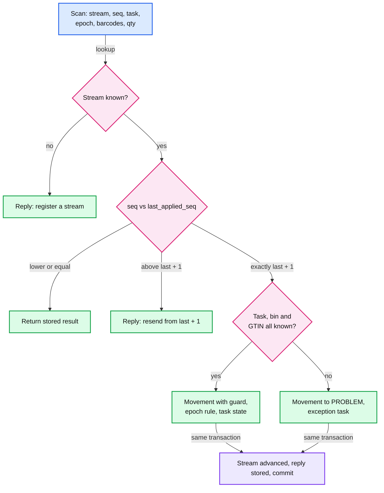

# Deep dive: scanners, offline work and idempotency

> One-line answer: the handheld confirms a **planned** step locally in under 100 ms and queues it; a **decision** scan (put-away bin, short, unknown barcode) goes to the server, p99 under 300 ms. Every scan carries `(device_id, stream_id, device_seq)`: the app writes "OK on screen" and the queued event in one local SQLite transaction, one sender loop drains the queue **in order**, and the cell applies a scan only if `seq = last + 1` for that stream, in the same transaction as the dedup row and the effect. A lower `seq` returns the stored result, a higher one gets "resend from `last + 1`". A wiped or replaced app opens a **new stream**, so its fresh sequence is never mistaken for duplicates. A scan the cell cannot apply is recorded as an exception and the sequence moves on; nothing blocks a device's stream. Offline work is capped at 8 minutes or 300 events.

Zoom-in on [`../solution.md`](../solution.md) §5.2 (30 late scans), §10.1 (handheld and edge internals) and §10.5 (idempotency end to end). Reusable blocks: [`../../../concepts/exactly-once.md`](../../../concepts/exactly-once.md), [`../../../concepts/leases-fencing-clocks.md`](../../../concepts/leases-fencing-clocks.md). Siblings: [`workflow-orchestration-and-tasks.md`](workflow-orchestration-and-tasks.md) (what the cell does with a silent device's tasks), [`inventory-ledger-and-bin-model.md`](inventory-ledger-and-bin-model.md) (device time and counts).

Acronyms: WMS (warehouse management system), FC (fulfillment center), AP (Wi-Fi access point), MDM (mobile device management), GTIN (Global Trade Item Number), SQLite (the embedded database on the handheld), WAN (wide area network).

---

## 1. Two kinds of scan

| | Planned step | Decision |
|---|---|---|
| Examples | right bin, right GTIN, right lot, qty within the task | put-away bin, short, damage, unknown barcode, a lot not on the task |
| Who answers | the handheld, from the batch it holds | the cell |
| Latency | under 100 ms on screen | p99 under 300 ms: Wi-Fi 150, edge 5, WAN 40, transaction 60 (a ceiling, p99s do not add) |
| Offline | queued, the worker keeps going | the item goes to an exception tote; the request is queued |

No source gives warehouse dead-zone or roaming numbers (survey row 7f, unverified); the MC3300 class supports 802.11r fast roaming (row 7a, verified). The design assumes drops of seconds to a few minutes a few times a shift [estimate]. A round trip on a planned step buys nothing: the device already has the task. One second on each of the ~90k pick scans of the peak hour would be 25 picker-hours.

## 2. The sequence and the gate

- **Stream.** At install, and after any loss of app data, the app registers a stream: the cell returns a new `stream_id` and `next_seq = 1`. `DEVICE_STREAM(device_id, stream_id, last_applied_seq)` replaces a single `last_seq` per device and decides duplicates on its own. A badge login on a device whose app reports an unknown stream forces registration.
- **Write-ahead on the device.** "OK" on screen and `(stream_id, seq, event, device_time)` in the queue are one SQLite transaction. A crash after the screen showed OK cannot lose the event; a crash before it shows nothing.
- **One sender, in order.** A single loop drains the queue over one connection through the edge. On a gap reply it rewinds to `last + 1`.
- **The gate**, in one cell transaction with the effect:



- **Why the exception branch matters.** In-order apply means one unappliable scan blocks every later scan of that device: the worker keeps getting "OK" locally while nothing lands. An unknown task (a task the cell lost in a DR promotion), an unknown bin label or a barcode for a SKU the cell does not stock becomes a movement into a `PROBLEM` location with an exception task, and the stream advances. A transient error (lock timeout, failover) is the only reason not to advance; the device retries the same `seq`.
- **Dedup lives with the effect, in unpartitioned tables.** The stream advances (`last_applied_seq` from `seq − 1` to `seq`) and the reply goes into `SCAN_RESULT(device_id, stream_id, seq)` in the same transaction as the movement, so "applied" and "recorded as applied" never disagree. Neither table is partitioned by day: Postgres requires a unique key on a partitioned table to include the partition column, so a day-partitioned dedup table could not enforce `(device, stream, seq)` uniqueness. `SCAN_RESULT` rows are purged after 7 days by small batched deletes; `last_applied_seq` per stream lives forever.

## 3. Who can send a scan twice

| Source | Example | Removed by |
|---|---|---|
| Lost reply | committed, reply lost in a roam | `seq ≤ last`: stored result |
| Device resend after reconnect | the queue is resent from the oldest unacknowledged | same |
| Edge journal replay | after a WAN cut or a region failover | same; the edge and the device may both send seq 414, the second waits on the stream row's lock, then sees `seq ≤ last_applied_seq` and returns the stored reply |
| A person doing it twice | a re-leased task picked by two people | not a duplicate: two movements, an over-pick ([`workflow-orchestration-and-tasks.md`](workflow-orchestration-and-tasks.md) §3) |

## 4. The offline cap and the lease

- After 8 minutes or 300 queued events offline, the app stops issuing new steps and sends the worker to a Wi-Fi zone. The cap bounds how stale the cell's picture of that worker can be and how much a lost device can hold.
- The cap alone does not protect the task lease. The 8 minutes start at the first failed send, which can be 30 s after the last contact, and the walk to Wi-Fi takes up to ~4 minutes [estimate], so "8 minutes under a 10-minute lease" leaves ~2 minutes for a walk that often takes longer. The cell therefore treats a **silent** device's tasks as `UNCONFIRMED` for up to 20 minutes after its last contact instead of re-releasing at 10 (part 3 below).

## 5. Simulation: order, duplicates, a wiped app, and the cap

Part 1 compares three senders over 2,000 handheld-shifts. Part 2 wipes the app halfway through a shift. Part 3 races 100k offline episodes against the re-release rule.

```python
# One handheld over a shift, 2,000 devices' worth of nights. Each cycle picks 1 to 3
# units bin -> tote, then scans the tote onto the pack conveyor (tote -> PACK, all units).
# 2% of replies are lost (applied, but the device does not know). 5% of scans start a
# dead zone of 10 s to 3 min; scans queue meanwhile [estimates].
# Bad: no id, resend the queue in parallel. Good: a random id per scan, server dedup,
# parallel resend. Great: per-device sequence, one sender in order, apply only last + 1.
import random

def shift(policy, rng, cycles=400):
    truth, book, gains, sent2, twice = {}, {}, 0, 0, 0
    def apply(frm, to, q):                                  # physical facts first: GAIN, never negative
        nonlocal gains
        if frm == "TOTE" and book.get(frm, 0) < q: gains += 1; book[frm] = q
        book[frm] = book.get(frm, 0) - q; book[to] = book.get(to, 0) + q
    scans, tote = [], 0
    for _ in range(cycles):
        for _ in range(rng.randint(1, 3)): scans.append(("BIN", "TOTE", 1)); tote += 1
        scans.append(("TOTE", "PACK", tote)); tote = 0
    for frm, to, q in scans: truth[frm] = truth.get(frm, 0) - q; truth[to] = truth.get(to, 0) + q
    queue, i = [], 0
    while i < len(scans) or queue:
        if i < len(scans):
            queue.append(i); i += 1
            if rng.random() < 0.05 and i < len(scans):     # dead zone: the next few scans queue up
                n = rng.randint(2, 30); queue += range(i, min(i + n, len(scans))); i = min(i + n, len(scans))
        batch, queue = queue, []
        if policy != "great": rng.shuffle(batch)           # parallel resend, any order
        for s in batch:
            apply(*scans[s])
            if rng.random() < 0.02:                         # reply lost: the device sends it again
                sent2 += 1
                if policy == "bad": apply(*scans[s]); twice += 1
    err = sum(abs(book.get(k, 0) - truth.get(k, 0)) for k in ("TOTE", "PACK"))
    return gains, err, sent2, twice

rng = random.Random(21)
print("Part 1: 2,000 handheld-shifts, 400 pick cycles each")
print("policy   resent after a lost reply   applied twice   GAIN rows from bad order   units wrong, totes and pack")
for p in ("bad", "good", "great"):
    t = [0, 0, 0, 0]
    for _ in range(2000):
        t = [x + y for x, y in zip(t, shift(p, rng))]
    print(f"  {p:<6} {t[2]:>20} {t[3]:>17} {t[0]:>23} {t[1]:>27}")

# Part 2: the app's data is wiped at scan 1,000 (re-provisioned by MDM) and its sequence
# restarts at 1. Keyed by device_id alone, the cell sees seq <= last_seq and answers
# "duplicate". Keyed by (device_id, stream_id), a new install opens a new stream.
print("\nPart 2: app data wiped after scan 1,000 of a 2,000-scan shift")
for key in ("device_id", "device_id + stream_id"):
    last, dropped = {}, 0
    for n in range(1, 2001):
        seq, stream = (n, 1) if n <= 1000 else (n - 1000, 2)
        k = "hh-0342" if key == "device_id" else ("hh-0342", stream)
        if seq <= last.get(k, 0): dropped += 1; continue   # "duplicate": stored result, no effect
        last[k] = seq
    print(f"  dedup key {key:<22} scans dropped as duplicates: {dropped}")

# Part 3: the offline cap against the task lease, 100k offline episodes. The first failed
# send comes 0 to 30 s after the last acknowledged contact. 90% of gaps last 6 s to 2 min,
# 8% 2 to 8 min, 2% 8 to 30 min [estimates]. At the 8 min cap the app sends the worker
# to Wi-Fi, a 0.5 to 4 min walk. The question: are the queued scans in before the cell
# re-releases the steps? A: re-release 10 min after the last contact. B: a silent device
# keeps its steps for 20 min after the last contact (a device that is online and idle
# with an empty queue is handled at 10 min, part 2 of the task dive).
rng = random.Random(4)
late = {"A": 0, "B": 0}
for _ in range(100_000):
    g, r = rng.uniform(0, 0.5), rng.random()
    d = rng.uniform(0.1, 2) if r < 0.9 else rng.uniform(2, 8) if r < 0.98 else rng.uniform(8, 30)
    back = g + d if d < 8 else g + 8 + rng.uniform(0.5, 4)
    late["A"] += back > 10; late["B"] += back > 20
print("\nPart 3: 100k offline episodes, 8 min cap")
for k, v in late.items():
    print(f"  {k}: steps re-released before the queued scans arrived: {v} ({v / 1000:.2f}%),"
          f" ~{v / 100_000 * 1500:.0f} a peak night at ~1,500 episodes")
```

Output:

```
Part 1: 2,000 handheld-shifts, 400 pick cycles each
policy   resent after a lost reply   applied twice   GAIN rows from bad order   units wrong, totes and pack
  bad                   47707             47707                   13167                       51910
  good                  47837                 0                   10514                       15632
  great                 47903                 0                       0                           0

Part 2: app data wiped after scan 1,000 of a 2,000-scan shift
  dedup key device_id              scans dropped as duplicates: 1000
  dedup key device_id + stream_id  scans dropped as duplicates: 0

Part 3: 100k offline episodes, 8 min cap
  A: steps re-released before the queued scans arrived: 1303 (1.30%), ~20 a peak night at ~1,500 episodes
  B: steps re-released before the queued scans arrived: 0 (0.00%), ~0 a peak night at ~1,500 episodes
```

What it shows:
- **Dedup alone fixes duplicates, not order.** With a random id per scan, nothing is applied twice, but a tote scanned onto the conveyor before its picks arrive makes the cell book a `GAIN` on the tote, then the late picks land in an empty tote: 10,514 phantom `GAIN` rows and 15,632 units misplaced across 2,000 shifts. The in-order gate makes both 0.
- **Without any id**, every one of the ~48k resends after a lost reply is applied twice.
- **A sequence keyed by device alone silently drops a wiped app's next 1,000 scans.** The worker sees "OK" on every one (local-first), the cell answers "duplicate" with an old stored result, and the stock never moves. A stream per install drops none.
- **8 minutes under a 10-minute lease is not enough margin.** 1.3% of offline episodes, ~20 on a peak night, come back after a 10-minute re-release; each is a potential double pick. Holding a silent device's steps for 20 minutes catches all 100k.

## 6. What an interviewer pushes on

1. **"Why not a thin client? State belongs on the server."** Right for decisions, wrong for confirmations of a step the device already holds. A thin client turns every dead zone into a stopped worker.
2. **"Why not let the server sort the scans by device time?"** Clocks skew and a queue can hold scans from before a reboot. The device's own sequence is the order it happened in, and it never repeats within a stream.
3. **"30 scans arrive at once. How long?"** Two are duplicates (stored results), 28 apply in order, ~5 ms each: ~140 ms.
4. **"A malicious device replays old scans."** Each device has an MDM certificate and mTLS (mutual TLS) to the edge; a replay of old `seq`s returns stored results and moves nothing. A forged new `seq` needs the device's key and is still limited to 5 scans a second per device.
5. **"The device is replaced mid-batch."** The new device registers a new stream; the old device's unsent queue is lost with it, so its open steps are `UNCONFIRMED` and handled as a silent device.

## 7. Trade-offs

| Decision | Chose | Gave up |
|---|---|---|
| Confirmation | Local-first for planned steps | An app with a queue and a sequence to get right |
| Ordering | One sender, gate on `last + 1` | A gap stalls a device until it resends (milliseconds) |
| Identity | `(device, stream, seq)`, a stream per install | One registration round trip at login |
| Bad scans | Exception movement, stream advances | A `PROBLEM` location to drain every shift |
| Offline cap | 8 min or 300 events, silent tasks held 20 min | Up to 20 min of delay for a dead handheld's lines |

## 8. Numbers to say out loud

- Planned step under 100 ms on device; decision scan p99 under 300 ms.
- Gate: apply only `seq = last + 1`, per stream. 30 late scans: ~140 ms.
- Stored replies 7 days; `last_applied_seq` per stream forever. Rate limit 5 scans/s per device.
- Offline cap 8 min or 300 events; a silent device's tasks wait 20 min. 1.3% of episodes beat a 10-minute re-release.
