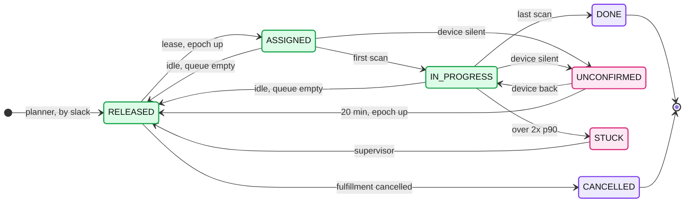

# Deep dive: workflow orchestration and tasks

> One-line answer: human work is **task rows in the cell database**, changed in the same transaction as the movements they cause, with a **10-minute progress lease** (renewed by scans, not by heartbeats), an **epoch** that fences a re-released task, and one **timer table** swept every 5 s. When a task stops making progress the cell asks one question: can a scan for it still be sitting in a pocket? If the handheld is online and its queue is empty, re-release the open steps at once; if it is silent, wait up to 20 minutes for it; if the whole building is cut off, **stop the clocks** and let the edge apply the same rule locally. A late scan with an old epoch is an over-pick only if someone else already scanned that step. Without these rules a 25-minute network cut at 23:30 turns into 7,500 false over-pick flags and 728 totes at problem solving at 23:57.

Zoom-in on [`../solution.md`](../solution.md) §5.3 (humans in the loop), §5.7 (survival mode) and §10.1 (timers). Reusable blocks: [`../../../concepts/leases-fencing-clocks.md`](../../../concepts/leases-fencing-clocks.md), [`../../../concepts/temporal-durable-execution.md`](../../../concepts/temporal-durable-execution.md) (what we chose not to run). Related problems: [`../../document-approval-system/`](../../document-approval-system/) (humans as the queue's consumers), [`../../distributed-job-scheduler/`](../../distributed-job-scheduler/) (timers). Siblings: [`scanners-offline-and-idempotency.md`](scanners-offline-and-idempotency.md) (the offline cap), [`inventory-ledger-and-bin-model.md`](inventory-ledger-and-bin-model.md) (over-pick movements).

Acronyms: WMS (warehouse management system), FC (fulfillment center), WAN (wide area network, the building's link), MDM (mobile device management), p90 (90th percentile).

---

## 1. Why tasks are rows, not workflows

A pick scan changes a balance, a movement, an allocation, a task and an order line. If the task lived in a workflow engine (one Temporal workflow per order) and the units in the cell database, every scan would be a dual write: one side commits, the other does not. Rows in the same database make it one transaction. What a workflow engine gives for free (durable timers, retries, history) is a timer table, a sweeper and the movement ledger here. At the night peak the busiest FC has ~375 pickers × ~20 open steps ≈ **7.5k open tasks** and as many timers; the load is nothing, the ownership rules are everything.

## 2. The lifecycle



## 3. The lease rules

| Situation at 10 minutes without a scan | What the cell knows | Action |
|---|---|---|
| Handheld online, heartbeat says `last_seq` = the cell's | Nothing physical is queued | Re-release the open steps, `epoch + 1`. Nudge the worker at 5 min |
| Handheld silent (no heartbeat for 60 s) | A scan may be in its queue | `UNCONFIRMED`. Wait up to 20 min after the last contact, then re-release flagged "possible over-pick" |
| The building's edge is disconnected | Nothing about any device | Clocks stop. The edge applies this table locally in survival mode |
| A task `IN_PROGRESS` past 2x its type's 7-day p90 | The worker is slow or lost | `STUCK`, on a supervisor's screen with the last bin and the tote |
| A line `PICKED` but not `PACKED` 30 min before its truck loads | The tote is lost | A "find tote" task for a problem solver |

- **Progress, not liveness, renews the lease.** If heartbeats renewed it, a picker on a 25-minute break with the handheld in a pocket would hold 18 lines for 25 minutes and no rule would fire: the task is `ASSIGNED`, not `IN_PROGRESS`, so the stuck rule never sees it. Heartbeats only tell the cell whether the device is reachable and what its queue holds.
- **A break button.** The app's "break" action releases the open steps at once. The 10-minute rule is for workers who forget.
- **Why 20 minutes for a silent device.** The device's offline cap is 8 minutes or 300 events, then the worker is sent to a Wi-Fi zone; a walk takes up to ~4 minutes. 20 minutes covers that with room; see part 3 of the simulation in [`scanners-offline-and-idempotency.md`](scanners-offline-and-idempotency.md). Inside the last 30 minutes before the release deadline the planner may cut it to 10, accepting a possible over-pick to save the truck.
- **The epoch rule for a late scan.** A scan whose epoch is older than the task's is applied as a movement in any case (it is a physical fact). It is flagged as an over-pick **only if the current epoch's holder has already scanned that step**. Otherwise the step returns to the original device and the re-released copy is withdrawn from whoever has it.

## 4. Timers

- One table `(due_at, kind, ref)`, indexed on `due_at`. A sweeper runs every 5 s: `SELECT ... WHERE due_at <= now() ORDER BY due_at LIMIT 100 FOR UPDATE SKIP LOCKED`, and fires each timer in the same transaction as the state change it causes. ~25 fires a second at the peak. Two sweepers can run; `SKIP LOCKED` keeps them off each other's rows.
- Timer kinds: lease check, nudge, `UNCONFIRMED` expiry, stuck check, find-tote, count due, release-deadline sweep at 00:15 (every unreleased dawn line becomes `missed_cutoff`).
- A sweeper stall delays timers, never loses them: rows stay until fired. After a 10-minute stall, ~15k timers are due at once; the sweeper takes them 100 at a time, oldest first, in under a minute.

## 5. Simulation: the WAN cut, and breaks on a normal evening

Part 1 is the building's network cut of solution Flow 5. Part 2 is an ordinary evening. A is the rule "lease renewed by any contact, expiry re-releases, any old epoch is an over-pick"; B is §3.

```python
# Part 1: the building's WAN is cut 23:30 to 23:55. 375 pickers each hold a 20-step batch
# (one step every 75 s) and the edge holds their next batch. During the cut they keep
# picking from both. Steps not scanned before the cut sit ASSIGNED in the cloud.
# A: leases keep ticking in the cloud (10 min, renewed only by contact), an expired step
#    is re-released with epoch + 1, and any scan with an old epoch is an over-pick.
# B: lease clocks stop while the edge is disconnected; journal replay runs first, and an
#    old-epoch scan is an over-pick only if the current holder already scanned that step.
import random

def wan_cut(policy, seed=5, pickers=375, cut=25.0):
    rng = random.Random(seed)
    released = flagged = totes = taken = 0
    for _ in range(pickers):
        k = rng.randrange(20)                          # steps of the current batch done before the cut
        steps = [(i - k) * 1.25 + rng.uniform(0, 1.25) for i in range(k, 40)]   # minutes after the cut
        if policy == "B": continue                     # nothing expires, replay applies as normal scans
        released += len(steps)                         # every step not scanned before the cut expired at minute 10
        done = [t for t in steps if t <= cut]          # picked during the cut, replayed with epoch 1
        flagged += len(done); taken += len(steps) - len(done)
        totes += (k < 20 and any(t <= cut for t in steps[:20 - k])) + any(t <= cut for t in steps[20 - k:])
    return released, flagged, totes, taken

print("Part 1: WAN cut of 25 min at 23:30, 375 pickers")
print("policy   steps re-released   scans flagged over-pick   totes sent to problem solving   steps taken from their picker")
for p in ("A", "B"):
    r, f, t, k = wan_cut(p)
    print(f"  {p}      {r:>13} {f:>21} {t:>27} {k:>31}")

# Part 2: a normal evening, 1,500 batches of 20 steps. 3% of batches: the picker takes a
# 10 to 30 min break mid-batch, handheld on and heartbeating. 1% of batches: the battery
# dies mid-batch for 3 to 23 min, with 0 to 3 steps already picked offline and unsent.
# A: the lease is renewed by heartbeats; an expired lease re-releases the open steps.
# B: the lease is renewed only by scans. At 10 min without progress: if the handheld is
#    online and its queue is empty (device last_seq equals the cell's), re-release the
#    open steps; if it is silent, wait up to 20 min for it, then re-release.
def evening(policy, seed=9, batches=1500):
    rng = random.Random(seed)
    late = double = 0; delays = []
    for _ in range(batches):
        r, open_steps, gap = rng.random(), rng.randint(4, 18), rng.uniform(10, 30)
        runner, queued = rng.uniform(3, 11), rng.randint(0, 3)   # reassign + walk; picks queued offline
        if r < 0.03:                                   # break, online
            delays += [gap if policy == "A" else min(gap, 10 + runner)] * open_steps
        elif r < 0.04:                                 # battery, silent, some picks queued
            gap = gap - 7                              # 3 to 23 min
            limit = 10 if policy == "A" else 20
            if gap > limit:                            # steps re-released to a runner
                double += queued
                delays += [limit + runner] * (open_steps - queued)
            else:
                delays += [gap] * open_steps
    late = sum(d > 15 for d in delays)
    return len(delays), sum(delays) / len(delays), late, double

print("\nPart 2: one evening, 1,500 batches")
print("policy   steps interrupted   mean delay   delayed over 15 min   real double picks")
for p in ("A", "B"):
    n, m, l, d = evening(p)
    print(f"  {p}      {n:>13} {m:>10.1f} min {l:>17} {d:>19}")
```

Output:

```
Part 1: WAN cut of 25 min at 23:30, 375 pickers
policy   steps re-released   scans flagged over-pick   totes sent to problem solving   steps taken from their picker
  A              11306                  7500                         728                            3806
  B                  0                     0                           0                               0

Part 2: one evening, 1,500 batches
policy   steps interrupted   mean delay   delayed over 15 min   real double picks
  A                589       20.0 min               425                  12
  B                598       15.1 min               300                   3
```

What it shows:
- **A network cut is a lease storm if the cloud keeps the clocks.** At minute 10 of the cut every open step in the building expires: 11,306 re-released. When the link returns, every scan made during the cut replays with epoch 1 and is flagged: 7,500 false over-picks and **728 totes sent to problem solving at ~23:57**, the worst moment of the night, plus 3,806 steps pulled from the pickers who were walking to them. B has none of this by construction: the clocks were stopped, so the replay applies as normal scans.
- **Heartbeat-renewed leases hold work for the whole break.** B cuts the mean delay of interrupted steps from 20.0 to 15.1 minutes and the steps delayed over 15 minutes from 425 to 300, by re-releasing safely at 10 minutes when the device is online and its queue is empty.
- **Waiting longer for a silent device prevents real double picks.** 12 → 3 an evening: re-releasing at 10 minutes sends a runner to units already in a dead handheld's tote.

## 6. Cancels and tasks

A cancel names one fulfillment and optionally some of its lines (`order_cancel_requested(order_id, fulfillment_id, lines?)` on `orders.fc-<fc>`, keyed by `order_id`, the same partition as that order's `order_confirmed`). The answer, `order_cancel_result(order_id, fulfillment_id, lines, cancelled | too_late)`, goes on `wms.order-status`. Per line:
- Tasks `CREATED` or `RELEASED`: `CANCELLED`, allocation released, `stock_changed`.
- `ASSIGNED` or `IN_PROGRESS`: the device is told; a step already scanned goes to a return-to-stock task.
- Picked: a return-to-stock task, answer `cancelled`. Packed or loaded: `too_late`.
- **A fulfillment the cell has not seen yet**: the cell stores a **tombstone** for that `fulfillment_id` and answers `cancelled`; if the fulfillment arrives later (a replay, or commerce wrote the cancel first) it is acknowledged as cancelled at once and never allocated. A buyer who declines one `missed_cutoff` line cancels only that line; the rest of the fulfillment ships tonight.

## 7. What an interviewer pushes on

1. **"Retry the task automatically on timeout."** For a robot, yes. For a person, a retry is a second person walking to the same bin. A timeout produces a decision: re-release when nothing physical can be pending, wait when it can, a supervisor when it is ambiguous.
2. **"Why not Temporal?"** Durable timers are attractive, but the order's state would live in workflow history and the units in the database: a dual write on every scan, and a second cluster per cell or a shared one that breaks cell isolation.
3. **"How do you know nothing physical is pending?"** The heartbeat carries the device's `last_seq` per stream. Equal to the cell's means the queue is empty.
4. **"The edge itself dies during the cut."** The standby edge takes the virtual IP and the journal (on both machines); leases stay frozen until the cell hears from the floor again.
5. **"A worker is reassigned to another zone mid-batch."** The supervisor's move is a scan-like event: open steps re-release immediately, `epoch + 1`, nothing physical pending.

## 8. Trade-offs

| Decision | Chose | Gave up |
|---|---|---|
| Where state lives | Rows in the cell DB | Built-in workflow history and tooling |
| Lease renewal | Scans only; heartbeats report liveness | More re-releases for slow but honest workers (nudge at 5 min) |
| Silent device | Wait up to 20 min | Up to 20 min of delay for its steps |
| Building cut off | Freeze clocks, edge decides | Lines held by a dead edge wait for the link |
| Late old-epoch scan | Over-pick only if the other holder scanned | Withdrawing a step from a runner mid-walk |

## 9. Numbers to say out loud

- ~7.5k open tasks and timers at the peak, ~25 timer fires a second, sweeper every 5 s.
- Lease 10 min, renewed by scans. Nudge at 5. Silent device: wait 20. Offline cap 8 min or 300 events.
- A 25-minute WAN cut with cloud-side clocks: 11,306 steps re-released, 7,500 false flags, 728 totes to problem solving. With frozen clocks: 0.
- Breaks: mean delay 20.0 → 15.1 min. Double picks 12 → 3 an evening.
