# Diagrams: Warehouse management system (WMS) for a fulfillment network

> One-line answer: twelve views of one design. Each fulfillment center (FC) is a cell: one Postgres cluster that is the single writer for its bins (a movement ledger plus balances changed by guarded updates), cell services (scan API, per-SKU allocation lanes, a planner that releases work by deadline slack, task leases and timers), a CDC relay that ships versioned stock events to commerce, and an edge gateway in the building that journals every scan and keeps the floor picking through a network cut. The pick floor, ~375 pickers before the dawn cut-off, is the one red box in the final design. Every view here matches the corrected design in the deep dives: streams per install, progress-based leases, the balance hold on a short, counts judged by device time, and a reconciler at commerce's version.

The D1 to D12 set from `hld/CLAUDE.md` §4, each with a one-line caption. A diagram already in [`solution.md`](solution.md) gets a heading, a caption and a link, never a second copy. Acronyms: SKU (stock keeping unit), ASN (advance shipping notice), SSCC (Serial Shipping Container Code, a case, pallet or parcel id), GTIN (Global Trade Item Number, a product id), CDC (change data capture), WAL (write-ahead log), LSN (log sequence number), AZ (availability zone), DR (disaster recovery), WAN (wide area network, the building's link), AP (Wi-Fi access point), LTE (cellular data), mTLS (mutual TLS), UPH (units picked per hour per worker), FEFO (first expiry, first out), MDM (mobile device management), RF (replication factor). All times are Korea Standard Time.

| # | Diagram | Where it lives |
|---|---|---|
| D1 | Context | below |
| D2 | Data flow | below |
| D3 | Component architecture (final design) | [solution §6](solution.md#6-final-design-and-the-six-core-flows) |
| D4 | Happy path per FR | FR1 pick confirmation: [solution §4.1](solution.md#41-track-inventory-per-bin-and-per-state-with-lots-expiry-cycle-counts-and-adjustments). FR1 cycle count: below. FR2 receive and put away: [solution §4.2](solution.md#42-receive-a-shipment-against-its-asn-inspect-it-and-put-each-unit-away-in-a-directed-bin). FR3 order to truck: [solution §4.3](solution.md#43-take-orders-from-commerce-allocate-stock-to-bins-release-picks-pack-label-and-hand-off). FR3 pack and ship: below. FR4 stock feed: [solution §4.4](solution.md#44-every-receipt-pick-short-pick-damage-and-shipment-reaches-commerce-within-seconds-and-dashboards-show-the-floor-live). FR4 capacity signal: below |
| D5 | Failure paths | Building WAN cut, over-pick after a lease expiry, duplicate order and a cancel during picking: below. 30 late scans: [solution §5.2](solution.md#52-a-handheld-loses-wi-fi-in-an-aisle-and-sends-30-scans-late-how-do-you-handle-duplicates-and-ordering-and-still-answer-in-300-ms). Cell primary failover: [solution §10.4](solution.md#104-failure-timeline). Lost stock event: [solution §5.6](solution.md#56-commerce-says-5-units-are-sellable-the-warehouse-says-3-who-is-right-how-fast-do-they-converge-and-how-do-you-prove-they-agree) |
| D6 | Decision flow | Scan apply, allocation bin choice: below. Short pick: [solution §5.4](solution.md#54-a-picker-reaches-a-bin-and-it-is-empty-what-happens-to-the-order-the-bin-record-and-availability-on-the-website). Handheld sequence gate: [solution §10.1](solution.md#101-internals-of-each-chosen-technology) |
| D7 | Entity relationship | [solution §3.3](solution.md#33-data-model) |
| D8 | State machines | Task: [solution §5.3](solution.md#53-a-picker-goes-on-break-mid-batch-a-tote-falls-off-a-conveyor-how-do-tasks-with-humans-in-the-loop-not-get-stuck-or-done-twice). Order line, bin status, balance hold, inbound container: below |
| D9 | Deployment / topology | below |
| D10 | Scaling / partitioning | below |
| D11 | Failure mode map | below, two trees |
| D12 | Rollout / migration | below |

## D1. Context (zoom-out)

The WMS network as one box: commerce sends orders and receives stock, vendors send ASNs and trucks, workers scan, parcels leave on trailers.

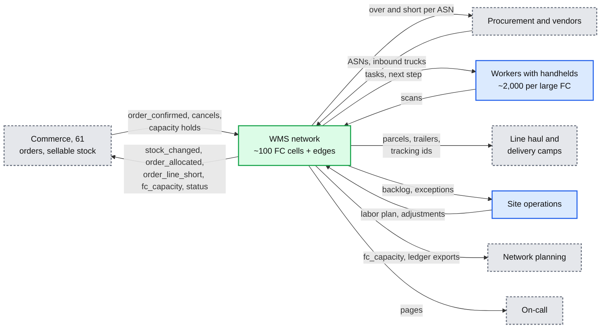

## D2. Data flow (DFD)

Inputs to outputs with format, size and rate. Network totals from solution §2 unless marked per FC; peak is ~10x average.

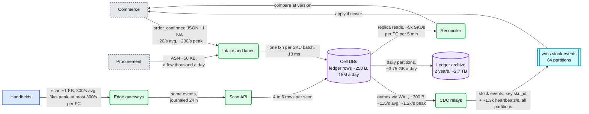

## D3. Component architecture

The final design, 12 nodes, the pick floor in red: [solution §6](solution.md#6-final-design-and-the-six-core-flows).

## D4. Happy paths, one per FR

**FR1, pick confirmation in one transaction:** [solution §4.1](solution.md#41-track-inventory-per-bin-and-per-state-with-lots-expiry-cycle-counts-and-adjustments).

**FR1, a scheduled cycle count on a quiet bin.** No open tasks on the bin, so it goes straight to counting; the variance is one adjustment movement and one `stock_changed`.

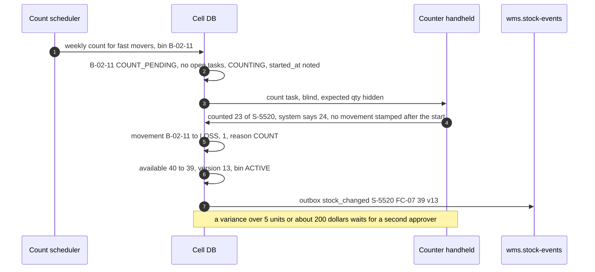

**FR2, receive a pallet and put a case away:** [solution §4.2](solution.md#42-receive-a-shipment-against-its-asn-inspect-it-and-put-each-unit-away-in-a-directed-bin).

**FR3, an order from confirmation to the truck:** [solution §4.3](solution.md#43-take-orders-from-commerce-allocate-stock-to-bins-release-picks-pack-label-and-hand-off).

**FR3, pack and ship in detail.** Packing and loading move units between containers; they never change available stock, only order status.

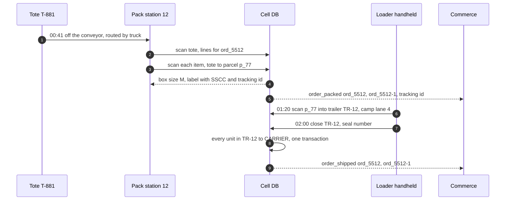

**FR4, the stock feed to commerce:** [solution §4.4](solution.md#44-every-receipt-pick-short-pick-damage-and-shipment-reaches-commerce-within-seconds-and-dashboards-show-the-floor-live).

**FR4, the capacity signal and a flash-deal hold.** The capacity model recomputes remaining dawn capacity every 60 s as the smaller of pick and pack remaining, counting only fulfillments the WMS has acknowledged and booking each open deal as `max(granted, drawn) − picked` (or `− packed`) deal units. Deal orders carry `deal_id` and draw on their hold instead of being counted twice. Commerce subtracts its own open non-deal holds **and its live reservations** at the FC and cut-off, keeps counting acknowledged units until it has applied the matching `capacity_version`, treats a signal silent for 2 minutes in the last hour as 0, and skips an FC at zero when it chooses a pool.

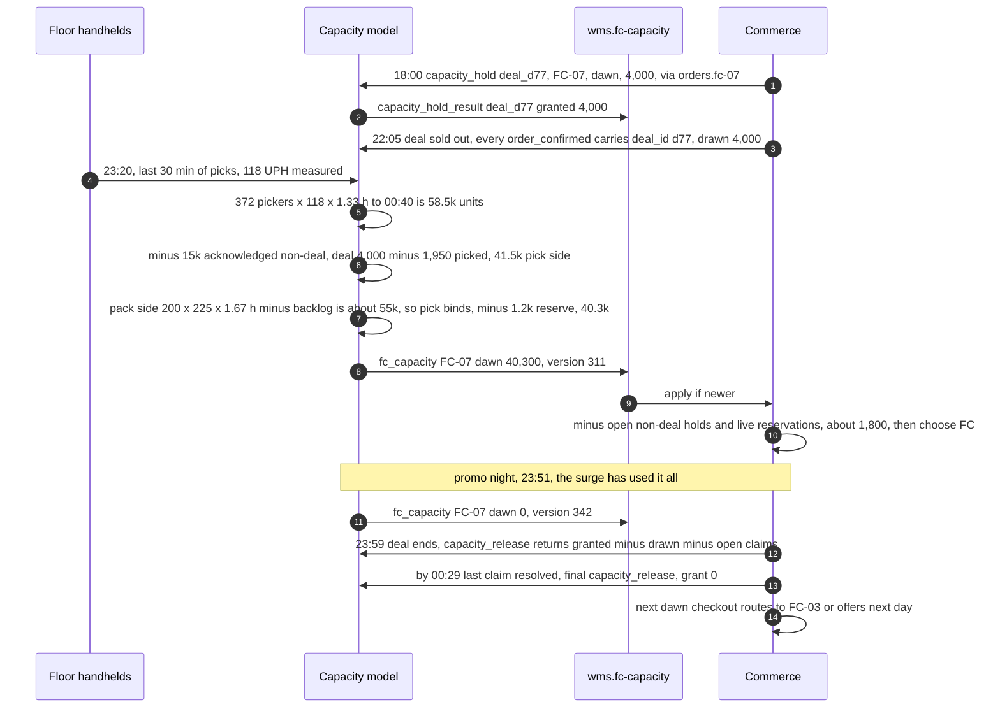

## D5. Failure paths

**The building's WAN is cut at 23:30 for 25 minutes (solution Flow 5).** The edge keeps the floor picking from leased batches and applies the lease rules locally; the cloud cell stops the building's lease clocks, reports `floor_contact_age` on its heartbeats and stops new dawn orders after 5 minutes; the journal replays on reconnect before any clock restarts.

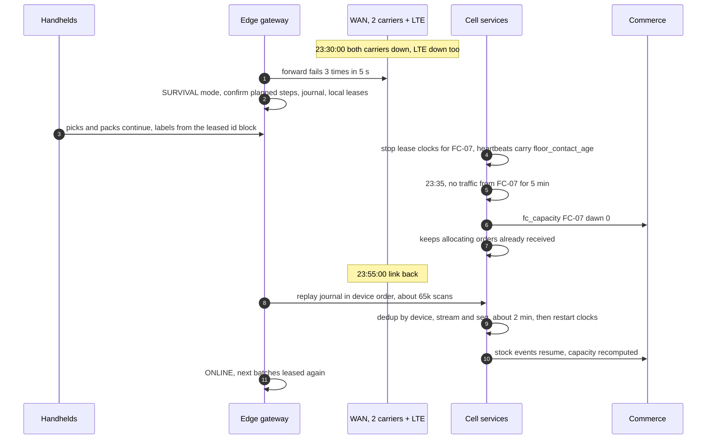

Detection ~5 s at the edge; commerce sees `floor_contact_age` grow within seconds; ~5 minutes for the capacity signal (so a 30-second blip does not reroute orders). With the cloud's clocks running instead, a simulated 25-minute cut re-releases 11,306 steps and sends 728 totes to problem solving at ~23:57. Data at risk: none, the journal is on two machines. Workers see nothing for planned steps; put-away decisions and re-allocation after a short wait for the link.

**A silent handheld returns after its step was re-issued and picked by someone else (an over-pick).** Both picks are physical facts. Because the new holder had already scanned that step, the late scan is an over-pick: its units go to a `PROBLEM` tote instead of being "deduplicated" away. Had the new holder not scanned yet, the step would go back to the original device and the re-released copy would be withdrawn.

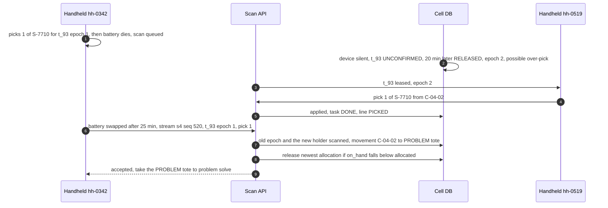

**A duplicate `order_confirmed`, then a cancel while the order is half picked.** Intake deduplicates on `fulfillment_id` (`<order_id>-<n>`), so a re-sent message is a no-op while a re-source would arrive as a new fulfillment. Cancels name a fulfillment and optionally its lines. The answer depends on how far each line's units got, and comes back per line as `order_cancel_result` on `wms.order-status` (solution §3.2). A cancel for a fulfillment the cell has not seen leaves a 7-day tombstone, so the fulfillment is refused if it arrives later.

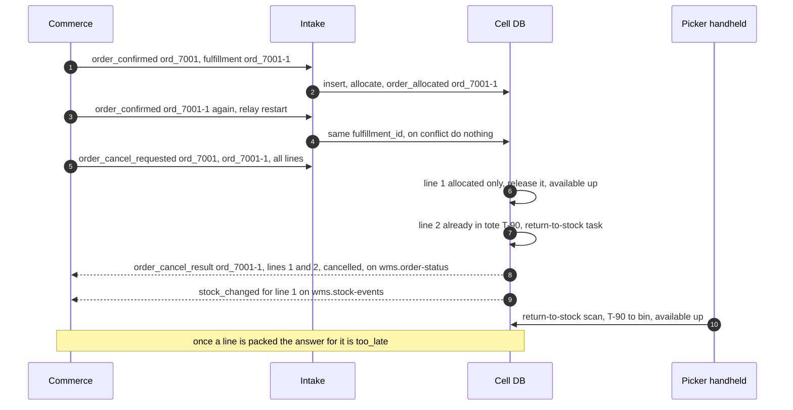

**Also in solution.md:** 30 late scans after a Wi-Fi gap ([§5.2](solution.md#52-a-handheld-loses-wi-fi-in-an-aisle-and-sends-30-scans-late-how-do-you-handle-duplicates-and-ordering-and-still-answer-in-300-ms)), the cell primary dying at 23:40 ([§10.4](solution.md#104-failure-timeline)), a lost stock event caught by the reconciler ([§5.6](solution.md#56-commerce-says-5-units-are-sellable-the-warehouse-says-3-who-is-right-how-fast-do-they-converge-and-how-do-you-prove-they-agree)).

## D6. Activity / decision flow

**Scan apply inside the cell.** Stream and sequence first, then whether the cell can apply it at all, then the task's epoch, then the physical guard. Nothing physical is ever rejected, and every path except a protocol reply ends in the same transaction that advances the stream and stores the reply, so the stream always advances.

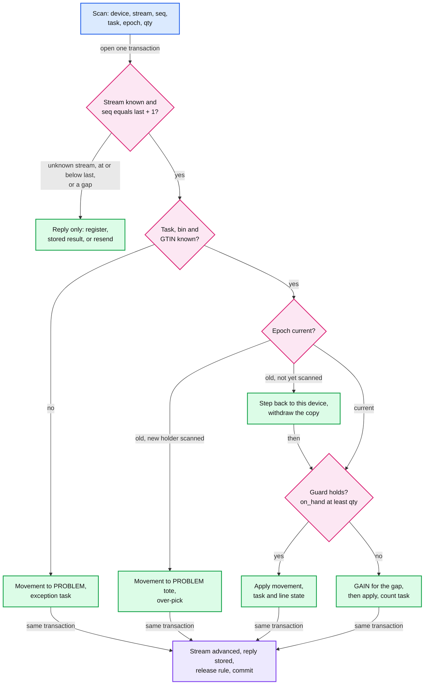

Only a transient error (lock timeout, failover) leaves the sequence where it is; the device retries the same `seq`. The release rule in the last box: if the movement drops `on_hand` below `allocated`, the newest allocations go back to the lane in the same transaction.

**Allocation bin choice inside a lane.** One SKU, all its waiting lines sorted by truck departure, one transaction that locks the SKU's availability row first and then bins in `location_id` order, after a fence check on the lane's epoch. The orderings are the ones Oracle WMS Cloud lists for allocation (FEFO, quantity ascending, location sequence; survey row 6a, verified). Minimum remaining life is checked at the line's **promise time**, not at allocation time.

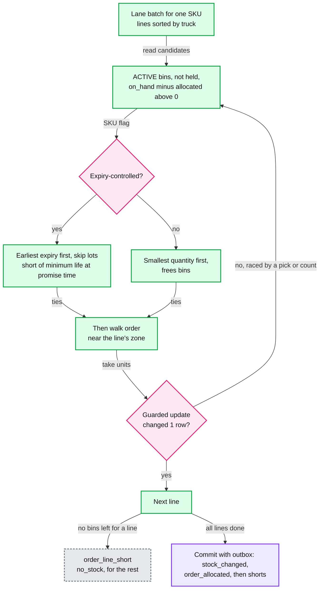

**Also in solution.md:** short-pick handling ([§5.4](solution.md#54-a-picker-reaches-a-bin-and-it-is-empty-what-happens-to-the-order-the-bin-record-and-availability-on-the-website)), the handheld sequence gate ([§10.1](solution.md#101-internals-of-each-chosen-technology)).

## D7. Entity relationship

Locations, balances, the movement ledger, availability, orders, allocations, tasks, devices and the outbox, with keys and retention: [solution §3.3](solution.md#33-data-model).

## D8. State machines

**Task:** [solution §5.3](solution.md#53-a-picker-goes-on-break-mid-batch-a-tote-falls-off-a-conveyor-how-do-tasks-with-humans-in-the-loop-not-get-stuck-or-done-twice).

**Order line, inside the WMS.** Lines belong to one fulfillment (`<order_id>-<n>`). `SHORT` (`no_stock`) is reported to commerce, which decides re-source or refund. `NEXT_CUTOFF` (`missed_cutoff`) keeps the allocation and waits for the next cut-off's work unless commerce cancels that line. Cancels are per line, so declining one line leaves the rest of the fulfillment on tonight's truck. A partial short splits the line.

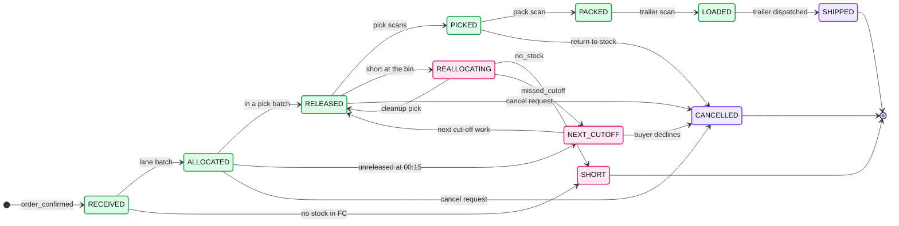

**Bin status.** The count protocol lives on the bin. Only `ACTIVE` bins receive new pick and put-away tasks. A bin in `COUNT_PENDING` or `COUNTING` keeps its units in available (they are still there) and may still be allocated, because allocation changes `allocated`, not `on_hand`. A movement stamped at or after the count's start voids the count.

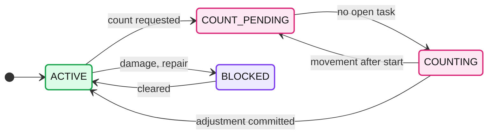

**Balance hold (one bin and SKU).** The short-pick hold lives on the `BALANCE` row (`held`), not on the bin: other SKUs in the same bin are untouched. While held, the balance's unallocated units are out of `available_qty`, its existing allocations stay, and only a count ends the hold.

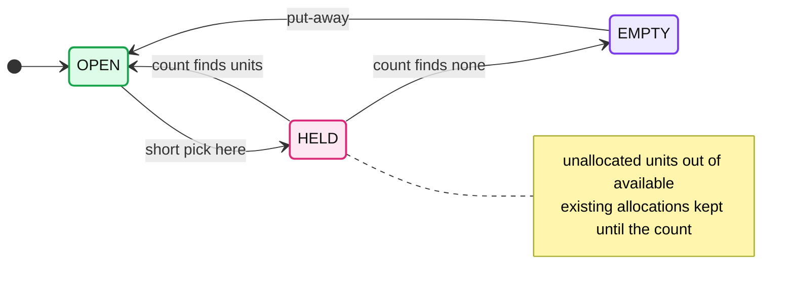

**Inbound container (a pallet or case on an ASN).** Units become available only at `PUT_AWAY`.

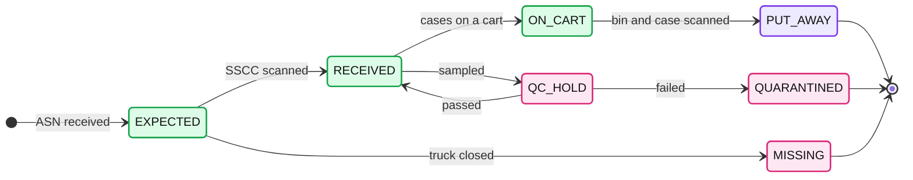

## D9. Deployment / topology

One building and its cell. The cell's database spans three AZs: a primary and two standbys, committing with `ANY 1 (az_b, az_c)`; the AZ c standby also serves reads, and failover promotes the more advanced standby. An async DR replica sits in a second region. Cell services run in two AZs; regional Kafka is shared by all cells.

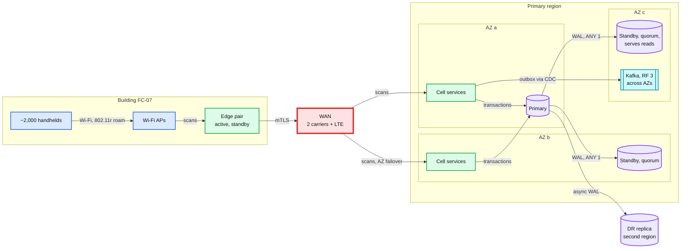

What crosses a boundary: scans over the WAN (~300 KB/s at most per building), WAL to the standbys in AZ b and AZ c (a commit waits for either, ~1 to 2 ms), async WAL to the DR region, outbox events to the shared Kafka. Nothing crosses from one cell to another: two buildings share only Kafka, device identity and the region. Losing AZ a promotes the more advanced of the two standbys (~30 s, solution §10.4); losing the region promotes the DR replica with a clock-based epoch, holds a recovery barrier until intake and the edge journals have replayed, and takes ~30 minutes in all (solution §5.7).

## D10. Scaling / partitioning

The network is partitioned by FC into cells. Inside a cell, allocation is partitioned by SKU hash into 16 lanes, one writer per SKU. The stock topic is keyed by `sku_id` across all FCs.

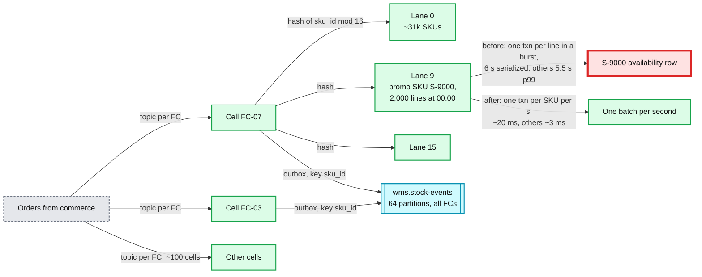

- At ~100 lines a second, one transaction per line is fine (~3 ms p50, ~8 ms p99); lanes are insurance against bursts, not a steady-state speed-up. In a burst (2,000 lines in 2 s, or at once), per-line transactions serialize on the SKU's availability row: `2,000 × ~3 ms` = ~6 s, and the allocation service's ~20 connections all wait on it, so **every other SKU's** allocations reach ~5.5 s p99. A pick on the hot bins waits behind at most ~20 holders, ~62 ms p99. One lock order (availability row first, then bins by `location_id`) prevents deadlocks. With the lane: one ~20 ms transaction per second, ~3 ms for everyone else. Solution §5.1.
- A lane holds ~500k ÷ 16 ≈ 31k SKUs. Lanes are threads in the cell's allocation service; a lane's SKUs move to another instance on failover, and because each batch is one transaction, a crash mid-batch leaves nothing half done.
- Heartbeats: because the topic is keyed by `sku_id`, each FC writes its 5 s heartbeat to all 64 partitions (`64 × 100 FCs ÷ 5 s ≈ 1.3k` tiny records a second network-wide), and a consumer judges staleness per (partition, FC).
- Kafka: a flash-sale SKU stocked in 10 FCs puts all 10 FCs' events on one partition of `wms.stock-events`. At ~1k events/s × 300 B = 300 KB/s, that partition is far under its limit, so keying by `sku_id` (which gives commerce all pools of a SKU in order on one consumer) costs nothing.
- The cell itself is the shard. The busiest cell is ~7% of one primary at its 300 scans/s design load (solution §10.3); a 10x FC would split into two cells by floor (solution §10.11).

## D11. Failure mode map

Component, what fails, blast radius, mitigation. Two trees to stay under 15 nodes. Matches solution §8.

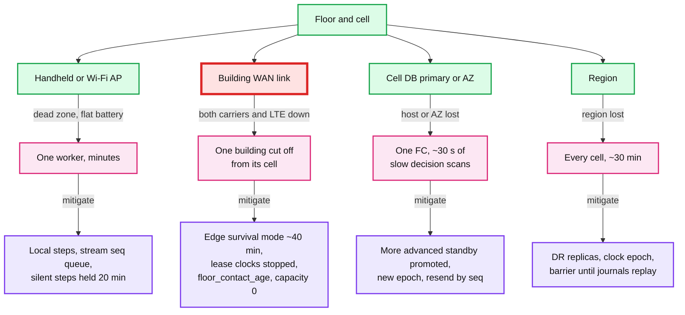

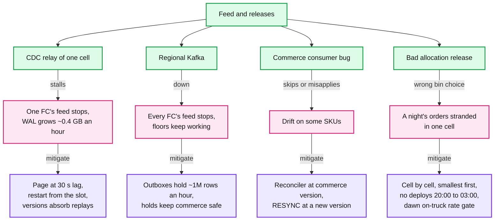

## D12. Rollout / migration

From a vendor WMS to cells, one FC at a time. The vendor emits movement events first, so the new ledger is proven in shadow before any building moves (the path Picnic describes, survey row 4a, secondary). Rollback for a cut-over FC is an export of the cell's balances back into the vendor WMS, made auditable by the `MIGRATION` movements, plus pointing the order topic back.

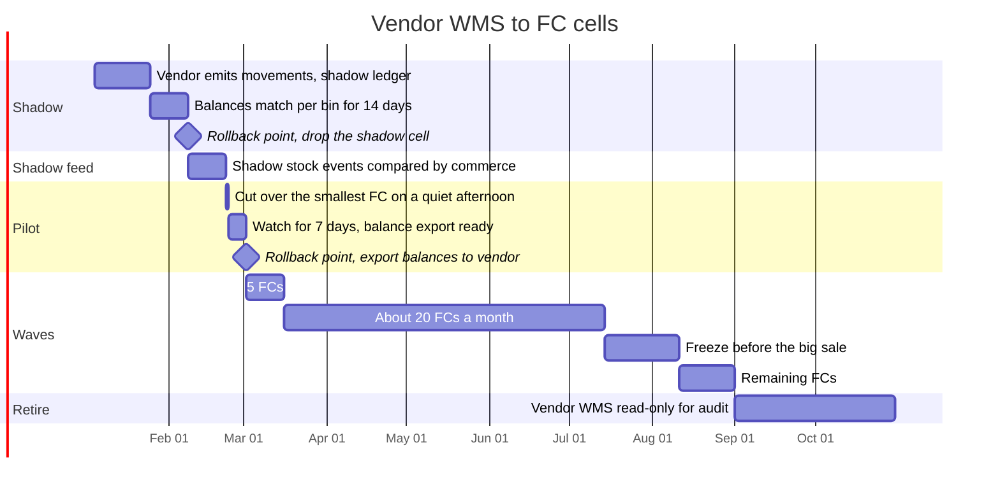

Gates between waves: zero reconciler drift at version for the moved FCs, the dawn on-truck rate within 0.2 points of the same FC's last month on the vendor WMS, decision-scan p99 under 300 ms, and exception rates (shorts, over-picks, count variances) within 10% of baseline.
