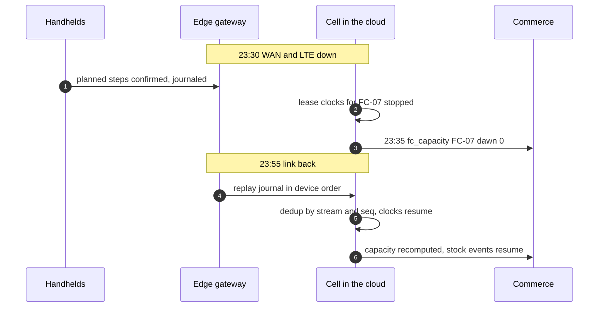
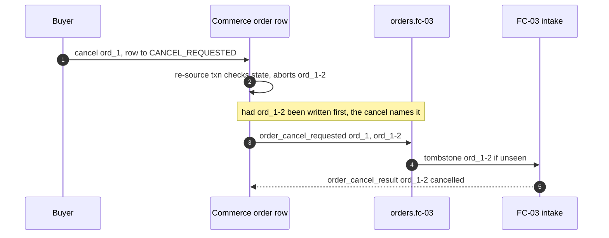

# Edge cases: Warehouse management system (WMS) for a fulfillment network

Every entry answerable in under 60 seconds out loud. Categories: failure, consistency, scale, data, operations, security / abuse. Design reference: [`solution.md`](solution.md); numbers and simulations live in the deep dives under [`deep-dives/`](deep-dives/). An answer bullet that starts with **Decision:** goes past what solution.md states or tightens it; the deep dive it names carries the evidence. Acronyms: FC (fulfillment center), SKU (stock keeping unit), CDC (change data capture), WAL (write-ahead log), WAN (wide area network, the building's link), AZ (availability zone), DR (disaster recovery), RTO (recovery time objective), AP (Wi-Fi access point), MDM (mobile device management), mTLS (mutual TLS), LSN (log sequence number), UPH (units picked per hour per worker), ASN (advance shipping notice), FEFO (first expiry, first out), GTIN (Global Trade Item Number), SLO (service level objective), GDPR (EU General Data Protection Regulation).

---

## Failure

## Edge case: the cell's primary database dies at 23:40
- **Trigger:** host or AZ loss of FC-07's Postgres primary at the night peak.
- **Symptom:** decision scans (put-away bins, shorts) wait ~30 s; commerce gets no `stock_changed` from FC-07 for ~30 s, then a burst.
- **Answer:**
  - The synchronous standby in another AZ holds every acknowledged commit: nothing acknowledged is lost. Detection ~10 s (the leader lease's TTL), promotion ~30 s; the promotion tool picks the standby with the highest flushed LSN.
  - **Decision:** fencing by a leader lease in a consensus store (Patroni on etcd style). A primary that loses its lease demotes itself, the write proxy routes only to the lease holder, and promotion waits for the old lease to expire: no split brain, even if the old primary was only partitioned away.
  - Handhelds keep confirming planned steps locally and resend by sequence; duplicates return stored results.
  - The new epoch keeps `stock_version` rising. The relay resumes from a failover slot, or restarts from the outbox by id and re-publishes a few seconds that versions make harmless.
  - Leases (10 min) do not expire in a 30-second gap; nothing is re-released.
- **Confidence:** [ ] shaky  [ ] ok  [ ] confident

## Edge case: the building's WAN is cut at 23:30 for 25 minutes
- **Trigger:** both carriers and the LTE backup down; or the active edge gateway dies at the same time.
- **Symptom:** the cell in the cloud hears nothing from FC-07; pickers notice nothing on planned steps.
- **Answer:**
  - The edge enters survival mode: it confirms planned steps for the batches it holds (~40 minutes of work, ~30k units), journals every scan on both edge machines, prints labels from a leased block. Put-away decisions and re-allocation after a short wait for the link. If the active edge dies, the standby takes the virtual IP and the journal.
  - After 5 minutes cut off the cell publishes `fc_capacity = 0` for the dawn cut-off; commerce routes new dawn orders elsewhere.
  - **Decision:** lease clocks for a building stop while its edge is disconnected, and the edge applies the lease rules locally. If the cloud kept the clocks, every open step would expire at minute 10: 11,306 steps re-released and 728 totes sent to problem solving at 23:57 ([workflow dive](deep-dives/workflow-orchestration-and-tasks.md) §5).
  - On reconnect the edge replays ~65k scans in device order (~2 minutes); dedup on `(device_id, stream_id, seq)` drops what the cell already has.
- **Diagram:**

- **Confidence:** [ ] shaky  [ ] ok  [ ] confident

## Edge case: the CDC relay of one cell stalls
- **Trigger:** a relay bug, a stuck Kafka producer, or a replication slot nobody is confirming.
- **Symptom:** FC-07's stock and order events stop; commerce's heartbeat for FC-07 goes stale on every partition.
- **Answer:**
  - Events wait in the WAL on the primary; ~0.4 GB an hour in the busiest FC, so a 6-hour stall holds ~3 GB. Slot lag alerts at 2 GB and pages at 5 GB; relay lag over 30 s pages first.
  - After 30 s without a heartbeat commerce sells FC-07's pool only beyond a safety margin; holds keep counting confirmed fulfillments, so nothing is double sold by lag.
  - On restart the relay resumes from its slot and re-publishes what it had not confirmed; versions make it harmless.
- **Confidence:** [ ] shaky  [ ] ok  [ ] confident

## Edge case: regional Kafka is down from 23:20 to 23:40
- **Trigger:** a cluster-wide outage of the shared brokers.
- **Symptom:** no orders reach any cell, no stock events reach commerce, `fc_capacity` freezes for every FC.
- **Answer:**
  - Floors keep picking what is already released. Outboxes hold ~1M rows an hour network-wide, nothing.
  - Commerce's confirmed orders wait in its own outbox; holds keep them counted against stock.
  - **Decision:** commerce treats an `fc_capacity` with no update for 2 minutes inside the last hour before a cut-off as 0 for that cut-off, so a frozen "20k remaining" cannot keep promising dawn delivery while confirmed orders pile up unseen ([cut-off dive](deep-dives/cutoff-and-capacity.md) §4). Orders that reach the cell after 00:15 get `missed_cutoff` and keep their allocation for the next cut-off.
- **Confidence:** [ ] shaky  [ ] ok  [ ] confident

## Edge case: the region is lost and the DR replica is promoted
- **Trigger:** the cloud region hosting the cells fails; each cell's async replica in a second region is promoted (~30 minutes RTO).
- **Symptom:** every edge in survival mode; the promoted cells are missing the last seconds (or, if the replica was lagging, a minute) of commits.
- **Answer:**
  - **Decision:** the new epoch is `max(epoch in the DB + 1, promotion time in seconds)`. A replica that missed an earlier in-region failover would otherwise re-issue an epoch commerce has already seen: in simulation, 834 fresh events dropped as old and ~443 bad confirmations in an hour ([sync dive](deep-dives/realtime-sync-to-commerce.md) §3).
  - **Decision:** a recovery barrier: no heartbeat, no allocation, no publishing until intake has re-read from its stored offset and edge journals have replayed, then a fresh `stock_changed` for every SKU changed in the last hour. Allocating at once against a cell missing 60 s of put-aways adds ~57 bad confirmations; the barrier brings it back to baseline.
  - **Decision:** fence the old region before reopening: the DR cell takes the lease in the DR region's consensus store and bumps the relay's Kafka producer epoch, so a zombie primary or relay cannot write or publish, and old-timeline writes are rejected.
  - Every floor command (scans and supervisor adjustments) is in an edge journal and commerce's commands are in the mirrored `orders.fc-<fc>`, so both replay. Only cloud-only admin edits (ASNs, counts requested from an office) can lose up to a few seconds; their callers re-send with the same id.
  - Commerce applies its stale-feed margin for the 2 to 3 minutes the barrier lasts.
- **Confidence:** [ ] shaky  [ ] ok  [ ] confident

## Edge case: a picker's handheld battery dies mid-batch with scans still queued
- **Trigger:** battery at 0% after 3 picks made in a dead zone; the device is silent for 3 to 23 minutes.
- **Symptom:** the cell sees the device's tasks stop making progress; it cannot know whether units are in the tote.
- **Answer:**
  - The queue is on flash in SQLite; it survives the battery swap and sends in order.
  - **Decision:** a silent device's tasks go to `UNCONFIRMED` and wait up to 20 minutes after its last contact before they are re-released. Re-releasing at 10 minutes sends a runner to units already in the dead device's tote: 12 double picks an evening against 3 ([workflow dive](deep-dives/workflow-orchestration-and-tasks.md) §5).
  - If the device returns after a re-release, its scans apply as movements; they are flagged over-picks only if the runner already scanned that step.
- **Confidence:** [ ] shaky  [ ] ok  [ ] confident

## Edge case: an allocation lane owner pauses for 40 s and wakes up
- **Trigger:** a long garbage-collection pause or a network partition of one allocation service instance.
- **Symptom:** another instance took the lane at `epoch + 1`; the old owner resumes with lines it read before the pause.
- **Answer:**
  - Each batch transaction starts with `UPDATE lane ... WHERE epoch = :mine`; zero rows aborts it. Lines move `RECEIVED → ALLOCATED WHERE state = 'RECEIVED'`, a second guard.
  - Why it matters: a double allocation hides units forever (allocated, never picked). The nightly check "`allocated` equals the sum of `OPEN` allocation rows" is the third net ([allocation dive](deep-dives/allocation-waves-and-short-picks.md) §1).
- **Confidence:** [ ] shaky  [ ] ok  [ ] confident

## Edge case: a fire destroys FC-07
- **Trigger:** Coupang's 10-K reports a June 2021 fire at its Deokpyeong FC "which caused extensive damage".
- **Symptom:** the building is gone; the cell in the cloud still has every record.
- **Answer:**
  - An operator marks every bin `BLOCKED`: `available_qty` goes to 0 for ~500k SKUs (~500k `stock_changed`, a few minutes of relay time), `fc_capacity` 0 for every cut-off.
  - Every open fulfillment gets `order_line_short(no_stock)`; commerce re-sources each as a new fulfillment to other FCs within minutes.
  - `LOSS` adjustments wait for the insurance survey; the ledger keeps the pre-fire position for it.
- **Confidence:** [ ] shaky  [ ] ok  [ ] confident

---

## Consistency

## Edge case: two allocation batches and a cycle count hit one bin at once
- **Trigger:** the S-4471 lane allocates twice in two seconds while a counter is sent to A-12-03.
- **Symptom:** none, if the design holds: counts and balances stay exact.
- **Answer:**
  - Allocation for one SKU is serialized in one lane, so the two batches never contend. Every change is a guarded `UPDATE` that re-checks the newest row.
  - The count waits in `COUNT_PENDING` until no task on the bin is open; allocation may continue, it changes `allocated`, not `on_hand`.
  - The adjustment is `counted − on_hand` at commit; if it leaves `on_hand` below `allocated`, the newest allocations go back to the lane in the same transaction.
- **Confidence:** [ ] shaky  [ ] ok  [ ] confident

## Edge case: a count runs while a pick is still sitting in a dead handheld
- **Trigger:** a picker takes a carton, the battery dies, the task's lease stops counting it as open, the count starts, then the battery is swapped.
- **Symptom:** without care, the unit is subtracted twice: once by the count, once by the late pick.
- **Answer:**
  - **Decision:** every movement carries device time. A late scan stamped before the count started was already seen by the counter: it is applied as `GAIN → bin` (reason `COUNT_RECON`) then the pick, net zero on the bin. Stamped inside the count window: recount ([ledger dive](deep-dives/inventory-ledger-and-bin-model.md) §5).
  - Clocks are MDM-synced; scans within 5 s of the count start count as inside the window, so skew costs a recount, never a wrong number. Simulated: phantom units 51 → 0 over 200 nights.
- **Confidence:** [ ] shaky  [ ] ok  [ ] confident

## Edge case: a worker stows a case into a bin while it is being counted
- **Trigger:** a put-away into a bin other than the one directed, which happens to be `COUNTING`.
- **Symptom:** the counter may or may not have seen the 12 units; booking the count would invent a loss of 12.
- **Answer:**
  - The put-away is a physical fact and is accepted.
  - **Decision:** any movement on a `COUNTING` bin stamped after the count started voids the count; it is redone. ~13 recounts in 200 simulated nights of 20 bins.
- **Confidence:** [ ] shaky  [ ] ok  [ ] confident

## Edge case: a late scan arrives for a task that was re-leased and picked by someone else
- **Trigger:** picker 1 picks offline, goes silent past the re-release; picker 2 picks the same line.
- **Symptom:** two units left the bin for one order line.
- **Answer:**
  - Both are movements; the late one goes `bin → PROBLEM` tote and a problem solver puts it back. Messages are deduplicated; people are not.
  - **Decision:** the late scan takes an unallocated unit, so if `on_hand` would drop below `allocated`, the newest allocations on that bin are released in the same transaction. Without that rule `allocated > on_hand` was the normal state in simulation (71,656 event steps in 200 nights).
- **Confidence:** [ ] shaky  [ ] ok  [ ] confident

## Edge case: 30 scans arrive late after a dead zone, two of them duplicates
- **Trigger:** seq 412 and 413 committed but their replies were lost; 414 to 441 were queued.
- **Symptom:** the cell receives 412 to 441 at once.
- **Answer:**
  - One sender per device sends in order; the cell applies only `seq = last + 1`. 412 and 413 return stored results; 414 to 441 apply in ~140 ms.
  - A random id per scan would remove duplicates but not reorder them: a tote scanned onto the conveyor before its picks books phantom gains (10,514 in 2,000 simulated shifts). The in-order gate gives 0 ([scanner dive](deep-dives/scanners-offline-and-idempotency.md) §5).
- **Confidence:** [ ] shaky  [ ] ok  [ ] confident

## Edge case: `order_allocated` reaches commerce before the matching `stock_changed`
- **Trigger:** a consumer replays from an old offset, or a relay coalesces stock values and lets the order event go first.
- **Symptom:** commerce drops the hold while still showing the higher, older available: one unit sold twice.
- **Answer:**
  - The hold rule: commerce drops the hold for `(fulfillment_id, sku, fc)` only once it has applied a `stock_changed` at or above the version on `order_allocated` (C1.3) or on `order_line_short` (C3.2); the WMS writes both after the `stock_changed` they cause, in one transaction.
  - **Decision:** the relay may coalesce a SKU's values for 100 ms but publishes the pending value before any order event of that SKU, so the topic stays in commit order. Either fix alone cut bad confirmations from ~81 to ~14 an hour on a hot SKU in simulation; we keep both.
- **Confidence:** [ ] shaky  [ ] ok  [ ] confident

## Edge case: the buyer cancels while commerce is re-sourcing a shorted line
- **Trigger:** at 23:58 FC-07 reports `order_line_short(ord_1, ord_1-1, ..., no_stock)`; commerce starts re-sourcing the line to FC-03 as `ord_1-2`; the buyer cancels the order at the same moment.
- **Symptom:** commerce cancels the fulfillments it knows (`ord_1-1`), then its re-source writes `ord_1-2`, which no cancel names: FC-03 picks and ships a cancelled order.
- **Answer:**
  - Cancels name a fulfillment and optionally lines (C3.1), so the WMS cannot guess that `ord_1-2` was meant. The guard is upstream: commerce writes a re-source only in a transaction that checks the order is not `CANCEL_REQUESTED`, and a cancel issued after a re-source names the new fulfillment [requirement on #61].
  - On the WMS side, cancels and confirms share `orders.fc-<fc>` keyed by `order_id`, so they arrive in commerce's commit order. **Decision:** a cancel for a fulfillment the cell has not seen leaves a tombstone, and that fulfillment is answered `cancelled` if it ever arrives.
- **Diagram:**

- **Confidence:** [ ] shaky  [ ] ok  [ ] confident

## Edge case: `order_line_short` is delivered twice
- **Trigger:** the relay restarts and re-publishes its last events, including `order_line_short(ord_1, ord_1-1, S-4471, FC-07, 1, no_stock)`.
- **Symptom:** commerce could re-source the line twice, as `ord_1-2` and `ord_1-3`, to two FCs: two shipments.
- **Answer:**
  - The WMS cannot dedupe this: `-2` and `-3` are different fulfillments by design.
  - **Decision:** commerce keys a re-source on the source fulfillment and line (`ord_1-1`, line 2), so a repeated short is a no-op [requirement on #61, [`../ecommerce-platform/`](../ecommerce-platform/)].
- **Confidence:** [ ] shaky  [ ] ok  [ ] confident

## Edge case: commerce re-sources a `missed_cutoff` line to another FC
- **Trigger:** the dawn truck is gone; the buyer wants it sooner from FC-03.
- **Symptom:** FC-07 still holds the allocation for its next cut-off; FC-03 picks it too.
- **Answer:**
  - `missed_cutoff` keeps the allocation and plans it into the next cut-off. A re-source therefore needs a line-level cancel first, `order_cancel_requested(ord_1, ord_1-1, [line 2])` (C3.1), and commerce sends `ord_1-2` only after `order_cancel_result(ord_1, ord_1-1, [line 2], cancelled)`. The other lines of `ord_1-1` still ship tonight.
  - If FC-07 answers `too_late` (already packed for the next truck), commerce keeps the original promise.
- **Confidence:** [ ] shaky  [ ] ok  [ ] confident

## Edge case: commerce says 5 sellable, the WMS says 3
- **Trigger:** lag, holds, a lost event, a commerce bug, or a shelf that differs from the books.
- **Symptom:** a support ticket or a reconciler alert.
- **Answer:**
  - Compare like with like: commerce's applied `available_qty` and version against the WMS value at the same version. Holds are a difference by design.
  - **Decision:** the reconciler looks up the WMS value at commerce's own version in the outbox history, and calls an event lost only if commerce is still below what the previous run saw. Comparing against the replica's latest snapshot pages ~200 times a run, because commerce is ahead of a replica that lags 1 to 5 s ([sync dive](deep-dives/realtime-sync-to-commerce.md) §5).
  - A lost event, or a value mismatch at the same version, is repaired within 10 minutes by a `RESYNC` movement (no quantity change) that bumps `stock_version` and emits `stock_changed` through the cell's outbox, so commerce's newer-version rule accepts it.
- **Confidence:** [ ] shaky  [ ] ok  [ ] confident

## Edge case: a short pick at 00:05 on a hot SKU's bin
- **Trigger:** the picker finds 1 of 2 at A-12-03; 300 other lines are allocated to that bin.
- **Symptom:** commerce is still selling the bin's units; the other 300 pickers are on their way.
- **Answer:**
  - One transaction: pick the 1 found, hold the bin's balance (its unallocated units leave `available_qty`, `stock_changed` within 2 s), re-allocate the missing unit at once.
  - **Decision:** the other allocations stay until a priority count within ~5 minutes, which keeps as many as it finds units and moves the rest. Moving all 300 at once, on what is often a false short, missed 1,900 lines a night in simulation against 22 ([allocation dive](deep-dives/allocation-waves-and-short-picks.md) §5).
  - No other bin: `no_stock` (commerce re-sources as `-2` or refunds). After 00:15: `missed_cutoff`, allocation kept.
- **Confidence:** [ ] shaky  [ ] ok  [ ] confident

---

## Scale

## Edge case: 2,000 lines for one flash-sale SKU arrive within 2 seconds
- **Trigger:** intake catches up after a 5-minute Kafka stall during a flash deal.
- **Symptom:** with one transaction per line, every allocation serializes on the SKU's availability row.
- **Answer:**
  - The SKU's lane allocates all 2,000 in one ~22 ms transaction per second. Per line it would be `2,000 × 3 ms = 6 s`, and the allocation service's 20 connections would all wait, so every other SKU's allocations stall: 5.5 s p99 in simulation.
  - At a steady 100 lines a second, per-line would be fine. The lane is insurance for bursts, at ≤ 1 s added latency.
- **Confidence:** [ ] shaky  [ ] ok  [ ] confident

## Edge case: a hot SKU changes available stock hundreds of times a second
- **Trigger:** a flash sale allocates continuously.
- **Symptom:** hundreds of `stock_changed` a second for one key.
- **Answer:**
  - Lane batching already makes it one version per SKU per second. The relay coalesces to the newest value per 100 ms on top, which absolute values make safe; it never coalesces order events and flushes the pending value before one.
  - One Kafka partition carries all FCs' events for that SKU: ~1k events/s × 300 B = 300 KB/s, far under a partition's limit.
- **Confidence:** [ ] shaky  [ ] ok  [ ] confident

## Edge case: 2,000 handhelds reconnect at once
- **Trigger:** a Wi-Fi controller reboot drops every AP in the building for 2 minutes.
- **Symptom:** every device sends its queue at once: ~2,000 × ~25 scans.
- **Answer:**
  - ~50k scans through the edge into the cell at ~500 transactions a second: ~100 s, one sender per device, in order. The cell's 5k transactions/s ceiling is far away.
  - The per-device limit (5 scans/s) and jittered reconnect in the app spread the first second. Planned steps were confirmed locally the whole time; only decision scans waited.
- **Confidence:** [ ] shaky  [ ] ok  [ ] confident

## Edge case: a big sale day doubles volume
- **Trigger:** ~1M units in the busiest FC instead of 500k.
- **Symptom:** machines barely notice; the floor is the limit.
- **Answer:**
  - The cell goes from ~7% to ~15% busy. Kafka from ~1.2k to ~2.4k events/s.
  - People: the labor plan scales heads, and `fc_capacity` sheds what cannot be picked by 00:40 to other FCs or next-day. Deals book capacity ahead with `capacity_hold`, capped at 30% of a cut-off's planned capacity.
  - No deploys in the week before; the night freeze is 20:00 to 03:00.
- **Confidence:** [ ] shaky  [ ] ok  [ ] confident

## Edge case: one mega-FC grows to 10x
- **Trigger:** a new 5M-units-a-day building.
- **Symptom:** ~3k scans/s at the design ceiling, ~60% of one primary.
- **Answer:**
  - Split the building into two cells by floor; moves between floors become transfers (outbound to `IN_TRANSIT`, inbound by a generated ASN). The cell boundary is the seam: it is the FC today and can be a floor tomorrow.
  - No global database: no unit is in two cells at once, so no cross-cell transaction is needed.
- **Confidence:** [ ] shaky  [ ] ok  [ ] confident

## Edge case: the timer sweeper stalls for 10 minutes
- **Trigger:** a bad deploy of the task service, or the sweeper's connection stuck.
- **Symptom:** leases, nudges, stuck checks and the 00:15 release-deadline sweep do not fire.
- **Answer:**
  - Timers are rows; nothing is lost. On restart ~15k due rows fire oldest first, 100 at a time with `FOR UPDATE SKIP LOCKED`: under a minute.
  - A sweeper lag over 30 s pages, because the 00:15 deadline sweep is what turns unreleased dawn lines into `missed_cutoff` and tells commerce.
- **Confidence:** [ ] shaky  [ ] ok  [ ] confident

---

## Data

## Edge case: a handheld's app data is wiped mid-shift
- **Trigger:** MDM re-provisions the device, or a replacement device takes over.
- **Symptom:** the app restarts its sequence at 1.
- **Answer:**
  - **Decision:** sequences are per `(device_id, stream_id)`; a fresh install registers a new stream at login. Keyed by device alone, the cell would answer "duplicate" to the next 1,000 scans while the worker sees "OK" on each ([scanner dive](deep-dives/scanners-offline-and-idempotency.md) §5).
  - The old stream's unsent queue is lost with the old data: its tasks are treated as a silent device's (`UNCONFIRMED`).
- **Confidence:** [ ] shaky  [ ] ok  [ ] confident

## Edge case: a scan the cell cannot apply
- **Trigger:** a barcode for a SKU this FC does not stock, a bin label not in the layout, a task the promoted DR replica never saw.
- **Symptom:** with strict in-order apply, one bad scan would block every later scan of that device.
- **Answer:**
  - **Decision:** the scan becomes a movement into a `PROBLEM` location with an exception task, and the stream advances. Only transient errors (lock timeout, failover) leave the sequence where it is for a retry.
- **Confidence:** [ ] shaky  [ ] ok  [ ] confident

## Edge case: a vendor's ASN is wrong
- **Trigger:** the pallet's cases carry lot L-1104, the ASN says L-1103; or 38 cases instead of 40.
- **Symptom:** container-level receiving would book the wrong lot or quantity.
- **Answer:**
  - QC samples 1 pallet in 20; a mismatch, or a lot scanned at put-away that differs from the ASN, sends that pallet to unit-level receiving.
  - Over and short quantities per ASN go back to procurement; a bad lot goes to `QUARANTINE`, invisible to commerce.
- **Confidence:** [ ] shaky  [ ] ok  [ ] confident

## Edge case: a lot expires while its units are allocated
- **Trigger:** milk allocated at 23:50 from lot L-1103 whose minimum remaining life ends at 00:00.
- **Symptom:** the order would ship product the buyer cannot use.
- **Answer:**
  - Allocation skips lots short of the minimum remaining life at the promise time, not at allocation time.
  - A timer at each lot's cut-off date moves its unpicked allocations back to the lane and the lot to `QUARANTINE`; FEFO picks the next lot.
- **Confidence:** [ ] shaky  [ ] ok  [ ] confident

## Edge case: a schema change on the balance or ledger tables
- **Trigger:** adding `held` to balances, or `stream_id` to movements.
- **Symptom:** a migration that locks a 1.2M-row table at 23:00 would stop the floor.
- **Answer:**
  - Expand, then contract: add nullable columns, deploy code that writes both, backfill in batches, switch reads, drop the old. Old code runs on the new schema throughout.
  - `MOVEMENT` is partitioned by day: a new column lands on new partitions; old ones are archived untouched. Never between 20:00 and 03:00; cell by cell, smallest FC first.
- **Confidence:** [ ] shaky  [ ] ok  [ ] confident

## Edge case: commerce's view of an FC must be rebuilt from scratch
- **Trigger:** commerce restores its inventory store from a backup, or onboards a new FC.
- **Symptom:** commerce has old or no values for ~500k SKUs.
- **Answer:**
  - Bootstrap from `GET /v1/fcs/{fc}/availability`, read from the replica at one LSN, with versions. Then consume the topic from a point before that LSN: newer events apply, older ones are ignored.
  - Holds are commerce's own data and come from its order store, not from the WMS.
- **Confidence:** [ ] shaky  [ ] ok  [ ] confident

## Edge case: an auditor asks what happened to lot L-1103 eighteen months ago
- **Trigger:** a recall or a tax audit.
- **Symptom:** the hot ledger holds 90 days.
- **Answer:**
  - Daily partitions older than 90 days are in object storage as compressed files, ~2.7 TB network-wide for 2 years. A query engine over the archive answers by `(sku, lot)` in minutes.
  - Each daily partition's hash chains the previous day's, so the auditor can verify nothing was rewritten.
- **Confidence:** [ ] shaky  [ ] ok  [ ] confident

## Edge case: a worker asks for their personal data to be erased
- **Trigger:** a GDPR-style erasure request from a former employee.
- **Symptom:** worker ids sit in millions of ledger rows that must stay for audit.
- **Answer:**
  - Ledger rows carry a worker id, not a name; the mapping lives in the HR system. After 90 days the archive holds a pseudonymized id.
  - Erasure deletes the mapping; the ledger rows stay intact and unlinkable. No buyer data beyond what a label needs is in the WMS.
- **Confidence:** [ ] shaky  [ ] ok  [ ] confident

---

## Operations

## Edge case: what pages at 3 am
- **Trigger:** any of the paging conditions.
- **Symptom:** a page, staffed most heavily 22:00 to 03:00.
- **Answer:**
  - Decision-scan p99 over 1 s for 5 minutes; a cell failover or standby lag over 10 s; CDC relay lag over 30 s, or an FC's heartbeat stale over 60 s on any partition.
  - Reconciler drift at the same version, or a SKU still behind the previous run; the nightly invariant job; any edge in survival mode; the timer sweeper behind by 30 s.
  - Not an engineering page: a projected dawn miss pages the site operations manager; one short, one offline device, one stuck task goes to a supervisor's screen.
- **Confidence:** [ ] shaky  [ ] ok  [ ] confident

## Edge case: at 23:20 the backlog will not clear by 00:40
- **Trigger:** 10% of pickers absent and a promo running.
- **Symptom:** slack on the dashboard falls under 5 minutes.
- **Answer:**
  - `fc_capacity` for dawn goes to 0 and commerce routes new dawn orders elsewhere. Simulated: without the signal 151 nights in 1,000 miss the truck.
  - The C3.3 `capacity_version` keeps an acknowledged fulfillment counted until an `fc_capacity` covers it. **Decision:** commerce also subtracts its live reservations at FC-07, not only its confirmed holds. With holds and C3.3 the same 151 nights still miss; with reservations, none do ([cut-off dive](deep-dives/cutoff-and-capacity.md) §3).
  - Site operations move pickers between zones by backlog; cleanup picks first.
- **Confidence:** [ ] shaky  [ ] ok  [ ] confident

## Edge case: a flash deal's capacity hold is booked, resent and closed
- **Trigger:** `capacity_hold(d77, FC-07, dawn, 4,000)` at 18:00, re-delivered at 21:00, sold out at 22:05, a first `capacity_release` at deal end (00:00) and the final one when its last claim resolves.
- **Symptom:** a naive counter subtracts twice, or keeps subtracting units already picked.
- **Answer:**
  - Idempotent on `(deal_id, fc, cutoff)`: a repeat returns the same grant and never re-opens a released hold. `max(granted, drawn)` makes order irrelevant; release is two-step: at deal end commerce returns `granted − drawn − (claims not yet terminal)`, and the final release, at most 30 minutes later when the last claim resolves, sets the grant to 0; only after it do late deal fulfillments count as regular work (C3.5).
  - **Decision:** book the deal's future work, `max(granted, drawn) − picked deal units`, not its grant. Subtracting the full grant until close hides 2,600 units at 23:40, 3.5 minutes of the floor, which commerce then sheds ([cut-off dive](deep-dives/cutoff-and-capacity.md) §5).
- **Confidence:** [ ] shaky  [ ] ok  [ ] confident

## Edge case: a release of the allocation code over-allocates at night
- **Trigger:** a bin-choice bug strands lines on unreachable bins.
- **Symptom:** the dawn on-truck rate drops in one cell.
- **Answer:**
  - Guards make negative stock impossible; the bug's blast radius is one cell's night, because deploys go cell by cell, smallest FC first, never 20:00 to 03:00, gated on the dawn on-truck rate.
  - Rollback: stop the lanes, deallocate open allocations tagged with the bad release id, re-run the lanes on the old version. The ledger is never rewritten.
- **Confidence:** [ ] shaky  [ ] ok  [ ] confident

## Edge case: a short-pick hold is still open three hours later
- **Trigger:** problem solvers are busy during the crunch; the priority count never happened.
- **Symptom:** units that may well exist are hidden from commerce for hours.
- **Answer:**
  - The count task is priority over scheduled counts and targets ~5 minutes; a hold older than 1 hour alerts the zone supervisor, older than 4 hours the site manager.
  - Hidden units are the safe direction (no oversell), but they cost sales; the dashboard shows held units per zone.
- **Confidence:** [ ] shaky  [ ] ok  [ ] confident

## Edge case: cutting one FC over from the vendor WMS
- **Trigger:** migration wave 1.
- **Symptom:** two systems claim the truth for one building.
- **Answer:**
  - Before: the vendor emits movements; a shadow cell matches balances per bin for 14 days; a shadow feed is compared by commerce.
  - Cutover on a quiet afternoon: stop release 13:00, drain tasks, snapshot vendor balances, load them as `MIGRATION → bin` movements, push the new app, point `orders.fc-07` at the cell, resume 14:00 with a new epoch.
  - Rollback for 7 days: export balances back to the vendor and flip the topic. Never in the four weeks before a big sale.
- **Confidence:** [ ] shaky  [ ] ok  [ ] confident

## Edge case: survival mode has never been used in anger
- **Trigger:** a rarely exercised code path on 200 edge machines.
- **Symptom:** the first real WAN cut finds the bug at 23:30.
- **Answer:**
  - A monthly drill in every building: WAN pulled at 15:00 for 10 minutes, with the replay checked against the journal.
  - The site platform team owns edges and Wi-Fi; any edge in survival mode pages them.
- **Confidence:** [ ] shaky  [ ] ok  [ ] confident

---

## Security / abuse

## Edge case: theft hidden as count adjustments or fake shorts
- **Trigger:** a worker takes units and books the gap as a count loss, or scans `short` to skip far bins.
- **Symptom:** shrink that looks like honest variance.
- **Answer:**
  - Adjustments over 5 units or ~$200 need a second approver. Counts on high-value SKUs are blind.
  - Adjustment and short rates per worker and per bin are monitored; 5x the zone average triggers review. The priority count after a short shows who was right.
  - No `UPDATE` or `DELETE` grants on `MOVEMENT`; daily partition hashes are chained.
- **Confidence:** [ ] shaky  [ ] ok  [ ] confident

## Edge case: a handheld is lost or stolen
- **Trigger:** a device leaves the building.
- **Symptom:** it holds a certificate and possibly a logged-in session.
- **Answer:**
  - Each device has an MDM-issued certificate; mTLS to the edge and the cell. Revocation takes minutes; the badge session expires at shift end.
  - Replaying its old scans returns stored results; new ones need its key and a badge session, and are limited to 5 scans a second.
- **Confidence:** [ ] shaky  [ ] ok  [ ] confident

## Edge case: a faulty scanner floods the cell
- **Trigger:** a stuck trigger sends the same barcode 50 times a second.
- **Symptom:** a burst of scans from one device.
- **Answer:**
  - The edge rate-limits to 5 scans a second per device; the device's sequence makes repeats of one event harmless and new events are validated against the task.
  - A device over its limit for a minute is quarantined by MDM and its worker is asked to swap it.
- **Confidence:** [ ] shaky  [ ] ok  [ ] confident

## Edge case: a buggy commerce release sends malformed orders, or a stranger writes to `wms.*`
- **Trigger:** `order_confirmed` with an unknown SKU, qty 10,000, the wrong FC; or a misconfigured service producing to `wms.stock-events`.
- **Symptom:** garbage orders or forged stock events.
- **Answer:**
  - Intake validates against the schema registry and the FC's catalog; a bad line is answered `order_line_short(no_stock)` and counted. A spike in rejected lines pages commerce's on-call, not ours.
  - Kafka ACLs: only each cell's relay writes `wms.*`, only commerce's relay writes `orders.*`. The reconciler asks a cell to repair with a `RESYNC` movement; it never writes the topic itself.
- **Confidence:** [ ] shaky  [ ] ok  [ ] confident
