# HLD: Warehouse management system (WMS) for a fulfillment network

> One-line answer: every fulfillment center (FC) is its own **cell**: one Postgres cluster in the cloud region that is the single writer for every bin in that building, plus a small edge gateway on site. Stock is a **double-entry movement ledger** (every unit is always at exactly one location: a bin, a tote, a parcel, a dock, or a virtual source or sink) plus per-bin balances changed by **conditional updates in the same transaction**, so a balance never goes negative and every unit has an audit trail. Handhelds send **sequence-numbered, idempotent scan events**, check each task step locally, and keep working through Wi-Fi gaps. Orders arrive from commerce through an outbox, are allocated in **per-SKU lanes** (one short transaction per SKU per second), released **continuously by deadline slack** instead of in hourly waves, and walked through receive, put away, pick, pack and ship as **task state machines with leases and timers** in the same database. Every change to available stock leaves through an outbox as an **absolute value with a per-(SKU, FC) version**, reaches commerce in under 2 s p99, and a reconciler compares the two sides **at commerce's own version** every 5 minutes. QPS is small: at most ~300 scans/s in the busiest center. The thing that breaks first is **pick labor before the dawn cut-off**: ~375 pickers at ~120 units an hour are exactly the ~45k units an hour that arrive between 23:00 and midnight, so the WMS publishes live outbound capacity and commerce stops routing dawn orders to a center that cannot make its last truck.

Sources: the contract in [`README.md`](README.md) and the survey [`research/facts-survey.md`](research/facts-survey.md). The prompt is reported at Coupang (Hello Interview community board). There is no published reference answer, so the ladders are ours. Load-bearing facts: "order cutoffs as late as midnight" and delivery "by 7 am the next morning" ([Coupang FY2024 10-K](https://www.sec.gov/Archives/edgar/data/1834584/000183458425000030/cpng-20241231.htm), verified); "if the daily outbound capacity of a fulfillment center (FC) is met, the FC cannot take any new customer orders", and stock "must be updated in a matter of seconds" while the read cache "provides minutes latency" ([Coupang engineering](https://web.archive.org/web/2025id_/https://medium.com/coupang-engineering/our-backend-strategy-to-handle-massive-traffic-d30cd6cc4fb2), verified); FEFO, FIFO and quantity-ordered allocation ([Oracle WMS Cloud 26B](https://docs.oracle.com/en/cloud/saas/warehouse-management/26b/owmol/secondary-allocation-method.html), verified); the GS1 [SSCC](https://www.gs1.org/standards/id-keys/sscc) and [GTIN](https://www.gs1.org/standards/id-keys/gtin) definitions (verified); the [Zebra MC3300](https://www.zebra.com/us/en/products/spec-sheets/mobile-computers/handheld/mc3300.html) fast-roam spec (verified). Coupang publishes no units-per-day figure (survey row 1i), so every volume number here is `[estimate]`. Reusable blocks: [`../../concepts/mvcc-and-isolation.md`](../../concepts/mvcc-and-isolation.md), [`../../concepts/exactly-once.md`](../../concepts/exactly-once.md), [`../../concepts/leases-fencing-clocks.md`](../../concepts/leases-fencing-clocks.md), [`../../concepts/temporal-durable-execution.md`](../../concepts/temporal-durable-execution.md), [`../../concepts/stream-processing.md`](../../concepts/stream-processing.md), [`../../concepts/sharding.md`](../../concepts/sharding.md), [`../../concepts/replication-and-quorums.md`](../../concepts/replication-and-quorums.md), [`../../concepts/merkle-tree.md`](../../concepts/merkle-tree.md). Related problems: [`../ecommerce-platform/`](../ecommerce-platform/) (#61, the other side of the stock contract), [`../payments-ledger/`](../payments-ledger/) (double entry), [`../ticket-booking/`](../ticket-booking/) (the last-room conditional update), [`../document-approval-system/`](../document-approval-system/) (humans as tasks with timeouts), [`../distributed-job-scheduler/`](../distributed-job-scheduler/) (timers), [`../webhook-delivery/`](../webhook-delivery/) (outbox and CDC relay), [`../cdc-pipeline/`](../cdc-pipeline/).

Written flow-first: §4 builds one diagram one functional requirement at a time, §5 breaks it one probe at a time, §6 shows the final design and the six flows to rehearse.

Acronyms used throughout: SKU (stock keeping unit), ASN (advance shipping notice), GTIN (Global Trade Item Number, names a product), SSCC (Serial Shipping Container Code, names a case, pallet or parcel), LPN (license plate number, a container id), FEFO (first expiry, first out), UPH (units picked per hour per worker), QC (quality check), CDC (change data capture), WAL (write-ahead log), LSN (log sequence number, a position in the WAL), AZ (availability zone), DR (disaster recovery), RPO and RTO (recovery point and recovery time objectives), SLO (service level objective), WAN (wide area network, the building's link to the cloud), AP (Wi-Fi access point), MDM (mobile device management), mTLS (mutual TLS), KST (Korea Standard Time; all clock times here are KST).

---

## 1. Understanding the problem

**Scoping questions to ask in the first 5 minutes**, with the answer we assume:

| Question | Answer we assume | What it changes |
|---|---|---|
| One warehouse or a network? | ~100 FCs (Coupang reports 100+ logistics centers in 30+ regions, survey row 1e, secondary). Each has its own staff, Wi-Fi and ~2,000 handhelds | A cell per FC. A failure or a bad deploy stays in one building |
| Who is the truth for stock? | WMS: physical units per bin and state. Commerce: sellable units and holds | Neither side writes the other's numbers. One event contract (§4.4) |
| What is the promise? | Dawn delivery: order by midnight, at the door by 7 am (10-K, verified). Next-day orders have later cut-offs | The deadline orders the work and drives the capacity signal (§5.5) |
| Who picks the FC for an order? | Commerce, at reservation, among FCs with stock and outbound capacity left | The WMS publishes `fc_capacity`. It never re-routes an order itself |
| Lots and expiry? | Yes, for fresh and food SKUs. FEFO | Balances keyed by lot. Allocation sorts by expiry |
| Waves? | Coupang's newsroom says centers process each order as it arrives, not by the hour (survey row 2a, secondary) | Continuous release by deadline slack (§4.3) |
| Robots, conveyors? | Out of scope. People with handhelds. Conveyors are dumb transport. A robot fleet would call the same task API | No warehouse control system in scope |
| What if the building loses its network? | Links drop for minutes. Picking must continue | Edge gateway and survival mode (§5.7) |

Then three facts shape every decision. Say all three in the first minute:

1. **The machines are idle. The people are not.** The busiest center scans at most ~300 times a second and allocates ~10 order lines a second at the midnight peak. One Postgres primary does thousands of short write transactions a second. What runs out is **picker-hours between the last order and the last truck**: ~375 pickers at ~120 UPH in the hour before midnight [estimate]. So the design keeps the database boring and spends its effort on deadlines, exceptions and the stock contract with commerce.
2. **A scan is a fact a human observed, not a command.** A picker who took two cartons from a bin took them, whatever the database thought. The system must never reject a physical fact, never let a count go negative, and must turn every disagreement into a recount, with a ledger that explains every unit for 2 years.
3. **Two truths, one boundary.** The WMS owns physical stock per bin. Commerce (#61) owns sellable stock and buyer holds per (SKU, pool). The reported round focused on keeping them in step in real time. That pipe needs seconds of lag, versioned values, and a reconciler that proves the two sides agree.

### 1.1 Functional requirements

Core (from the README):
1. **Track inventory.** Stock per bin location and per state (available, allocated, picked, packed, shipped, damaged), with lot and expiry where the product needs it. Cycle counts and adjustments.
2. **Inbound.** Receive a shipment against its ASN or purchase order, inspect it, and put each unit away in a directed bin.
3. **Outbound.** Take orders from commerce, allocate stock to bins, release picks to handhelds, confirm picks, pack, label and hand off to delivery.
4. **Real-time visibility.** Every receipt, pick, short pick, damage and shipment reaches commerce within seconds, and dashboards show work and exceptions live.

Below the line (say it out loud):
- **Robot fleet control** and conveyor control. They would consume the task API.
- **Labor management and payroll.** We consume a labor plan (heads per zone per hour). We do not schedule people.
- **Slotting optimization** (which SKU lives in which bin long term). We do directed put away into free bins, not re-slotting.
- **Last-mile routing, 3PL billing, demand forecasting.**
- **Transfers between centers and returns.** Named as seams (§10.11). Both are "inbound with a different source".

### 1.2 Non-functional requirements

Ask for scale first: number of centers, units shipped per day per center, bins and SKUs per center, handhelds per center, the cut-off and the truck times. Then:

| Dimension | Target | Why it matters |
|---|---|---|
| Scale | ~100 FCs. A large FC: ~1M bins, ~500k SKUs, ~500k units shipped on a peak day, ~2,000 handhelds. Network ~5M units a day [estimate] | Sizes one cell, not a global system |
| Event rate | ~25M scans a day, ~300/s network average, ~3k/s network peak, at most ~300/s in the busiest center [estimate] | Small. One Postgres primary per cell is ~7% busy |
| Scan latency | Scans that need a server decision: p99 under 300 ms. Scans that confirm a planned task step: confirmed on the device in under 100 ms | A worker waits on every scan. 1 s on each of the ~90k pick scans of the peak hour is 25 picker-hours, ~7% of that hour's labor |
| Freshness | A committed physical change reaches commerce's sellable stock in under 2 s, p99 | Coupang: stock "must be updated in a matter of seconds" |
| Correctness | A bin balance never goes negative. No unit is allocated twice. No scan is applied twice. Every movement is in an append-only ledger kept 2 years | Overselling and lost units are money; audits need the trail |
| Deadline | Every dawn order received by midnight is on its truck. Last truck leaves ~02:00. Target 99.5% of dawn units on their truck [estimate] | The promise is 7 am at the door |
| Availability | Scan API 99.95% per cell. One cell's failure never touches another. A building keeps picking through ~40 minutes of WAN loss | A stopped building at 23:30 misses the night |
| Consistency | Strong per bin (single writer per FC). Eventual to commerce, under 2 s, with per-(SKU, FC) versions. Reconciled at commerce's version every 5 min | Stated per edge in §10.6 |

Below the line for NFRs: transactions across centers (no unit is in two FCs at once, so none are needed), sub-100 ms freshness to commerce (the buyer cannot tell), five nines per cell (the floor runs on survival mode, not on nines).

---

## 2. Back-of-envelope

Only the numbers that change the design. Inputs marked `[estimate]` are assumptions to state out loud.

**Network volume.** ~5M units shipped a day [estimate]. ~3 units per order and ~1.2 units per line [estimate] give `5M ÷ 3 ≈ 1.7M` orders and `5M ÷ 1.2 ≈ 4.2M` order lines a day. (#61 assumes ~3M orders a day across all pools; the FC-fulfilled share here is ~1.7M.) In steady state inbound equals outbound: ~5M units received a day.

**Scans.** ~5 scans per unit shipped (receive at case level, put away bin plus item, pick bin plus item, pack, load) gives `5M × 5 = 25M` a day, `25M ÷ 86,400 = 289/s`, ~300/s network average, ~3k/s at a 10x peak.

**The busiest FC.** 500k units on a peak day, 2.5M scans. People bound the rate: ~1,200 handhelds in use on a shift [estimate], one scan every ~5 s when busy, ~240/s. We design each cell for **300 scans/s**. The real night peak is lower: 45k units an hour × ~3.5 outbound scans per unit ÷ 3,600 s ≈ **44 scans/s**.

**Allocations.** The 23:00 hour brings ~45k units [estimate] = 12.5 units/s, ~10 order lines/s. A hot SKU on 20% of lines is 2 lines/s. Allocated in per-SKU batches every second, that is at most a few dozen short transactions a second; a flash sale on one SKU adds one transaction a second, however many lines it brings.

**One cell database (busiest FC).**
- Transactions: ≤ 300/s scans + ~20/s allocation batches + ~5/s timers. A Postgres primary on 8 vCPU does ~5k short write transactions/s with synchronous replication [estimate]. **~7% busy.**
- Balance rows: 1M bins × ~1.2 (SKU, lot) pairs per bin = 1.2M rows × ~150 B = **180 MB**. Fits in memory.
- Availability rows: 500k SKUs × ~60 B = 30 MB.
- Ledger: ~3 movement rows per unit shipped (receipt and put-away rows carry many units; pick, pack and load rows are ~1 per line) = 1.5M rows/day × ~250 B = **375 MB/day**. 90 days hot = 34 GB. 2 years = ~270 GB, moved to object storage after 90 days. Network-wide: 15M rows/day, 3.75 GB/day, ~2.7 TB for 2 years before compression.

**Events to commerce.** `stock_changed` on every change of available units: allocations (~4.2M a day) + put aways (`5M ÷ ~5` units per put away = ~1M) + exceptions (~50k). Plus `order_allocated` (~4.2M) and `order_line_short` (~13k). About **10M events a day**, ~115/s average, ~1.2k/s at the network peak, ~300 B each, 3 GB a day. Heartbeats add a steady ~1.3k tiny records a second (§4.4). Kafka does not notice.

**Bandwidth per building.** 300 scans/s × ~1 KB = 300 KB/s. A 1 Gbps link is idle. What matters is that the link exists (§5.7).

**Labor, the numbers that matter.**
- Pick rate ~120 UPH with cart batch picking [estimate]. Vendors say travel is 50% (Swisslog) to up to 70% (Dematic) of a picker's time (survey rows 6h, 6i, secondary). No independent benchmark was found (row 6k).
- The 23:00 hour needs `45,000 ÷ 120 = 375` pickers. Packing at ~75 parcels/h with ~3 units per parcel needs `15,000 ÷ 75 = 200` packers [estimate].
- Network picking: `5M ÷ 120 ≈ 41.7k` picker-hours a day × ~$12 loaded cost [estimate] ≈ $500k a day ≈ **$180M a year**.

**What the numbers tell us.** Every machine is under 10% busy. The constraint is the ~375 pickers in the hour before midnight. 1% more UPH is worth ~$1.8M a year, about half of the cloud bill for all 100 cells (§8). The interesting engineering is: exact counts under concurrent humans, a deadline-driven release, honest exceptions (short picks), offline handhelds, and a provable stock feed to commerce.

---

## 3. The set-up

Product-style.

### 3.1 Core entities

- **FC cell**: one fulfillment center. Its own database, services and edge gateway. Has a cut-off schedule (dawn truck 02:00).
- **Location**: a storage bin (pickable), a dock or staging lane, a container (tote, cart, pallet, parcel), or a **virtual** location (`VENDOR`, `CARRIER`, `LOSS`, `GAIN`, `DAMAGE`, `QUARANTINE`). Bins have a status: `ACTIVE`, `COUNT_PENDING`, `COUNTING`, `BLOCKED`. Containers carry an LPN. Pallets, cases and parcels carry an SSCC, which GS1 defines as "a logistic unit ... for example a case, pallet or parcel" (verified).
- **SKU**: a product, mapped from its GTIN, which GS1 says can "uniquely identify all of its trade items" (verified). Flags: lot-controlled, expiry-controlled, temperature zone.
- **Lot**: a SKU's batch with an expiry date.
- **Balance**: `(location, SKU, lot) → on_hand, allocated, held`. The only mutable stock numbers. `0 ≤ allocated ≤ on_hand` for bins. `held` takes a balance's unallocated units out of available after a short pick, until a count ends it.
- **Movement**: one append-only ledger row. `from_location → to_location`, SKU, lot, qty, reason, task, device sequence. Double entry: a unit always leaves one location and enters another, so per SKU the balances over all locations, virtual ones included, sum to zero.
- **SKU availability**: per SKU in this FC: `available_qty` and `stock_version`. Exactly what commerce is told.
- **Order and order line**: from commerce, with `promised_by` and the truck it must leave on.
- **Allocation**: order line → (bin, lot, qty). A reservation on a balance, not a movement.
- **Task**: one unit of human work: receive, put away, pick, pack, load, count, cleanup. State, assignee, lease, epoch.
- **Device and stream**: a handheld, and one stream per app install. The cell keeps the last sequence it applied per stream, so a wiped and re-provisioned app starts a new stream instead of colliding with its old numbers.
- **ASN**: the containers and contents a vendor says are on the truck.

### 3.2 API

Handheld to cell (through the edge gateway; mTLS with a per-device certificate plus the worker's badge session):

| Call | Request | Response | Notes |
|---|---|---|---|
| `POST /v1/streams` | `device_id`, app install id | `stream_id`, `next_seq = 1` | At install, and after any loss of app data |
| `GET /v1/work` | `device_id`, `zone` | a pick batch: ordered steps with bin, GTIN, lot, qty, `task_id`, `epoch`, `lease_until` | Lease 10 min, renewed only by progress (scans) |
| `POST /v1/scans` | `device_id`, `stream_id`, `seq`, `task_id`, `epoch`, `kind` (bin, item, short, damage, count, container), barcodes, qty, `device_time` | `{seq, result, next}` | Idempotent on `(device_id, stream_id, seq)`. Applied only if `seq = last + 1` for the stream |
| `POST /v1/scans:batch` | up to 300 scans in sequence order | one result per seq | After a Wi-Fi gap |
| `POST /v1/decisions/putaway` | container, SKU, lot | directed bin, reserved space | Needs the server. p99 300 ms |
| `POST /v1/heartbeat` | `device_id`, `last_seq` per stream, open task ids | reachability noted | Every 30 s while online. Tells the cell whether anything is queued. Does not renew leases |
| `POST /v1/break` | `device_id` | open steps released | The break button |

Commerce contract (Kafka, from the shared commerce and warehouse boundary; outbox on both sides):

| Event | From, topic, key | Payload | Notes |
|---|---|---|---|
| `order_confirmed` | commerce, `orders.fc-<fc>`, `order_id` | `order_id`, `fulfillment_id`, lines, `fc`, `promised_by`, optional `deal_id` | `fulfillment_id = <order_id>-<n>`: `-1` on the first send, `-2` for a re-source after a short. An id shaped `ord_1-1` is always a fulfillment id (commerce's payment attempts are `ord_1-p1` and never reach the WMS). WMS intake is idempotent on `fulfillment_id`. With a `deal_id`, the units draw on that deal's capacity hold |
| `stock_changed` | WMS, `wms.stock-events`, `sku_id` | `sku`, `fc`, `available_qty`, `stock_version` | Absolute value. Commerce applies it only if the version is newer |
| `order_allocated` | WMS, `wms.stock-events`, `sku_id` | `order_id`, `fulfillment_id`, `sku`, `fc`, `qty`, `stock_version`, `capacity_version` | Commerce drops the hold for that (fulfillment, SKU, FC) once it has applied `stock_version`, and keeps counting the units against capacity until it has applied an `fc_capacity` at or above `capacity_version` |
| `order_line_short` | WMS, `wms.stock-events`, `sku_id` | `order_id`, `fulfillment_id`, `sku`, `fc`, `qty_short`, `reason`, `stock_version` | Written after the `stock_changed` it causes, in the same transaction. `no_stock`: commerce re-sources as a new fulfillment keyed on (source fulfillment, line), or cancels and refunds. `missed_cutoff`: the WMS keeps the allocation for the next cut-off (§5.4) |
| heartbeat | WMS, `wms.stock-events`, every partition | `fc`, highest outbox id shipped, `floor_contact_age` | Every 5 s to all 64 partitions. `floor_contact_age` is the seconds since the building's edge last reached the cell |
| `fc_capacity` | WMS, `wms.fc-capacity`, `fc` | `fc`, `date`, `cutoff`, `remaining_outbound_units`, `version` | Every 60 s or on a 5% change. Counts only fulfillments the WMS has acknowledged; commerce subtracts its own open holds and live reservations at that FC and cut-off, except holds that carry a `deal_id`. No update for 2 minutes in the last hour before a cut-off means 0 (§5.5) |
| `order_packed`, `order_shipped` | WMS, `wms.order-status`, `order_id` | `order_id`, `fulfillment_id`, parcels, carrier tracking ids | Status only, no stock effect |
| `order_cancel_requested` | commerce, `orders.fc-<fc>`, `order_id` | `order_id`, `fulfillment_id`, optional `lines` | No `lines` means the whole fulfillment. A fulfillment the cell has not seen leaves a 7-day tombstone, so if it arrives later it is answered `cancelled` and never allocated |
| `order_cancel_result` | WMS, `wms.order-status`, `order_id` | `order_id`, `fulfillment_id`, `lines`, `cancelled` or `too_late` | Per line. `too_late` once packed: commerce runs its return and refund flow |
| `capacity_hold` | commerce, `orders.fc-<fc>`, `deal_id` | `deal_id`, `fc`, `date`, `cutoff`, `units` | At flash-deal setup. Idempotent on `(deal_id, fc, cutoff)` |
| `capacity_hold_result` | WMS, `wms.fc-capacity`, `fc` | `deal_id`, `granted_units` | Commerce carves at most `granted_units` of the deal into this FC |
| `capacity_release` | commerce, `orders.fc-<fc>`, `deal_id` | `deal_id`, units returned, final flag | Two steps. At deal end commerce returns `granted − drawn − (claims not yet terminal)`; the open hold keeps covering those claims. The final release, when the last claim resolves (at most 30 minutes later), sets the grant to 0; after it, a late deal fulfillment counts as regular work |

Inbound and operations:

| Call | Request | Response | Notes |
|---|---|---|---|
| `POST /v1/asns` | `asn_id`, expected containers (SSCC, GTIN, qty, lot, expiry), dock appointment | `202` | From procurement or the vendor. Idempotent on `asn_id` |
| `POST /v1/cycle-counts` | bins or SKUs, priority | count tasks | Supervisor, schedule, or automatic triggers |
| `POST /v1/adjustments` | `request_id` (required), bin, SKU, lot, qty, reason | movement id | `request_id` is stored in `API_REQUEST` in the same transaction as the movement and balance update; a retry returns the original result. Sent from in-building supervisor devices through the edge journal. Above a value threshold needs a second approver (§10.10) |
| Any other stock-mutating call | `request_id` (required) | original result on a retry | The same `API_REQUEST` rule: one movement per request, however many retries |
| `GET /v1/fcs/{fc}/availability` | SKU list or cursor | `(sku, available_qty, stock_version)` | From a read replica. Commerce bootstrap and the reconciler |

### 3.3 Data model

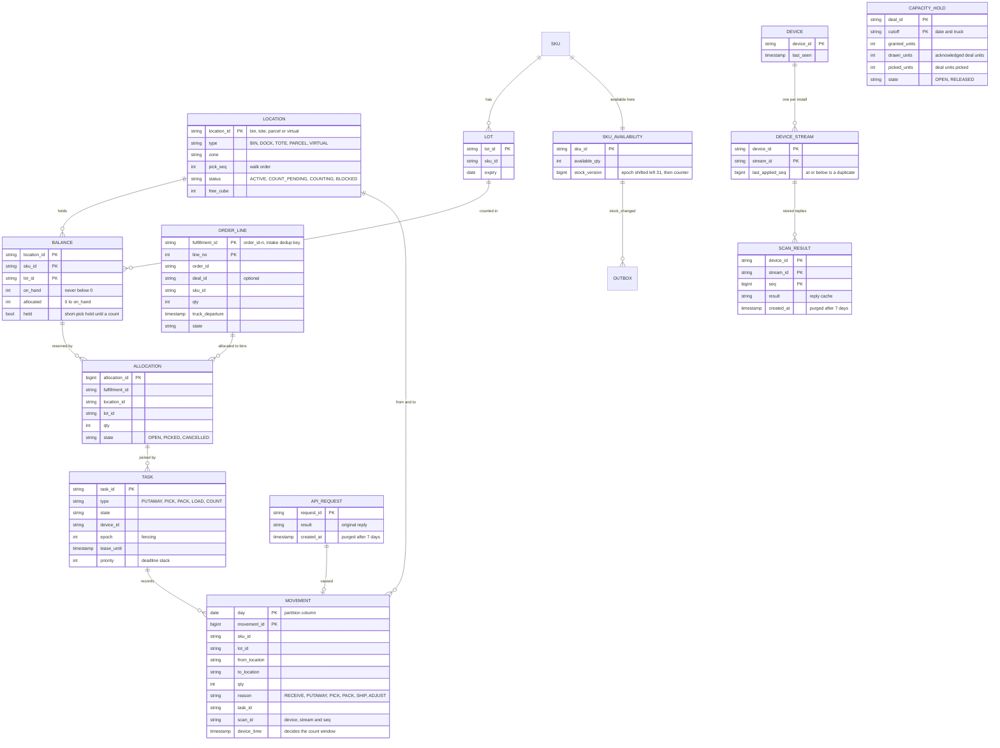

**Partition key.** The FC is the shard: one cell, one database, so no key inside the cell is needed for scale. Inside it, `MOVEMENT` and `OUTBOX` are partitioned by day so that retention is a partition drop, never a mass delete; `MOVEMENT`'s primary key is `(day, movement_id)`, because Postgres requires a unique key on a partitioned table to include the partition column. For the same reason idempotency does **not** live in a day-partitioned table: `DEVICE_STREAM` (one row per stream) decides duplicates, and `SCAN_RESULT` and `API_REQUEST` are unpartitioned, purged by small batched deletes of rows older than 7 days (~2.5M rows a day in the busiest FC, ~30 a second).

Access patterns and the key that serves each (busiest FC):

| Access pattern | Rate | Store and key |
|---|---|---|
| Apply a pick: change two balances, insert a movement, close the task | ≤ 300/s | `BALANCE` by PK `(location, sku, lot)`, conditional `UPDATE` |
| Allocate a SKU's waiting lines | ~10 lines/s, a few SKU batches/s | `BALANCE` index `(sku, lot)` filtered to `ACTIVE` bins, sorted by expiry, then walk order |
| Drop a duplicate scan | ≤ 300/s | `DEVICE_STREAM` PK `(device_id, stream_id)`: a seq at or below `last_applied_seq` is a duplicate; its reply from `SCAN_RESULT` PK `(device_id, stream_id, seq)` |
| Drop a duplicate `order_confirmed` | ~2/s per FC on average | `ORDER_LINE` PK `(fulfillment_id, line_no)` |
| Available units for SKU X | bootstrap, reconciler | `SKU_AVAILABILITY` PK `sku_id` |
| Next work for a picker in zone Z | ~6/s at the night peak | `TASK` partial index `(zone, priority) WHERE state = 'RELEASED'` |
| Leases and timers due | every 5 s | timer table, index on `due_at` |
| Everything that happened to bin B, or to lot L | audit, minutes | `MOVEMENT` indexes `(location, at)` and `(sku, lot, at)`; past 90 days, the archive |
| Ship the outbox to Kafka | ~115/s network | `OUTBOX`, read by CDC from the WAL |

---

## 4. High-level design

One subsection per functional requirement. Each traces one request, climbs a Bad, Good, Great ladder, adds boxes to one diagram, and ends with what is still missing. §5 then breaks it.

### 4.1 Track inventory per bin and per state, with lots, expiry, cycle counts and adjustments

**Flow: a picker confirms 2 cartons of SKU `S-4471` (1 L milk, lot `L-1103`, expiry 25 Nov) from bin `A-12-03` into tote `T-881` for order `ord_5512`.**

1. The handheld has the task on screen. The picker scans the bin label, then the carton. The app checks both barcodes against the task (bin `A-12-03`, GTIN of `S-4471`) on the device and shows "OK, 1 more" at once.
2. It sends scan `seq 418` on stream `s1` from device `hh-0342`: task `t_90`, epoch 1, kind `item`, qty 2, device time.
3. The scan API runs **one transaction**:
   - advance the stream: `UPDATE device_stream SET last_applied_seq = 418 WHERE device_id = 'hh-0342' AND stream_id = 's1' AND last_applied_seq = 417` (zero rows means a duplicate or a gap: answer from `SCAN_RESULT`, or ask for a resend, and stop);
   - `UPDATE balance SET on_hand = on_hand - 2, allocated = allocated - 2 WHERE location = 'A-12-03' AND sku = 'S-4471' AND lot = 'L-1103' AND on_hand >= 2 AND allocated >= 2` (one row);
   - add 2 to the tote's balance row `(T-881, S-4471, L-1103)`;
   - insert the movement `A-12-03 → T-881, 2, PICK, t_90, hh-0342/418`;
   - mark the allocation `PICKED`, the task `DONE`, the order line `qty_picked = 2`;
   - store the reply in `SCAN_RESULT (hh-0342, s1, 418)`;
   - commit, with one of the two standbys (in the other AZs) acknowledging.
4. Reply `{418, ok, next: A-12-07}`. Available units for `S-4471` did not change (allocated units left the bin), so no `stock_changed` is emitted.

**States are locations.** "Available" is `on_hand − allocated` over `ACTIVE` storage bins. "Allocated" is the `allocated` column. "Picked" is `on_hand` in totes and carts. "Packed" is `on_hand` in parcels. "Shipped" means the units moved to the virtual `CARRIER` location and left our books. "Damaged" and "quarantined" are their own locations. One mechanism, the movement, explains every state change. One rule keeps the promises honest: any decrement of `on_hand` that would go below `allocated` (an over-pick, a count loss, damage) releases the newest allocations on that balance back to the lane in the same transaction, and over-picked units go to a `PROBLEM` tote.

**Cycle counts and adjustments.** A count task asks a worker to count one bin. The result becomes an adjustment movement: `bin → LOSS` for a shortfall, `GAIN → bin` for a surplus, with the count task as the reason. Counts are triggered three ways: a schedule (fast movers weekly, the long tail quarterly [estimate]), a short pick on that bin (§5.4), and a bin reaching zero ("is it really empty?" is a 10-second check). §5.1 covers counts that race with picks.

**Bad: one quantity per SKU per FC, updated in place.** `UPDATE stock SET qty = qty - 2 WHERE sku = 'S-4471'`. The picker needs a bin, not a total. There is no answer to "where is the unit that was picked but not packed?". A read-modify-write in application code loses updates under concurrency. The 2-year audit requirement cannot be met.

**Good: a balance per (bin, SKU, lot), locked with `SELECT ... FOR UPDATE`, plus a history table the application also writes.** Correct counts per bin. Costs: the history is a second write that code can forget (a bug fixes a balance by hand and writes no history), so history and balance drift apart; units in totes and parcels are invisible; nothing can prove the balance from the history.

**Great: a double-entry movement ledger plus balances, written in one transaction by conditional updates.** Every physical step inserts movement rows and changes the two balances it touches, in the same transaction, guarded by `WHERE on_hand >= qty`. Every unit is always at exactly one location, virtual ones included, so the books balance per SKU (the idea behind [`../payments-ledger/`](../payments-ledger/)). A nightly job proves it: for every `(location, SKU, lot)`, yesterday's opening balance plus yesterday's movements equals today's opening balance (balances are snapshotted daily). **Challenges:** every scan writes 4 to 6 rows (fine at 300/s); totes and parcels create short-lived balance rows that need vacuum; the ledger grows 375 MB a day in the busiest FC, so it is partitioned by day and archived after 90 days; and the balance must be checked at write time, which rules out a lagging projection (§5.1).

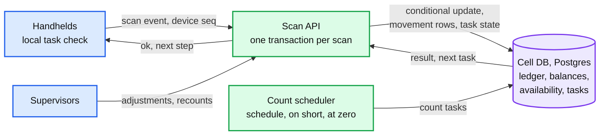

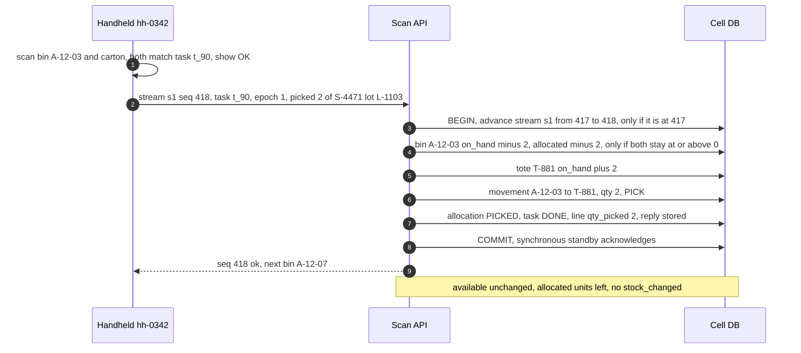

**What is still missing:** nothing comes into the building yet. §4.2.

### 4.2 Receive a shipment against its ASN, inspect it, and put each unit away in a directed bin

**Flow: a vendor truck with 26 pallets arrives at dock 3 at 14:05 against `asn_7781`.**

1. The day before, procurement sent `asn_7781` (by EDI or API): 26 pallets, each with its SSCC, the GTIN, quantity, lot and expiry of its cases. The WMS stored it and booked a dock slot.
2. The receiver scans a pallet's SSCC. The ASN says it holds 40 cases of `S-4471`, lot `L-1103`, 12 each. The seal is intact. **One scan receives 480 units**: movement `VENDOR → DOCK-3`, reason `RECEIVE`. Not available yet: a dock is not a pickable bin.
3. QC samples 1 pallet in 20 [estimate]: open a case, check the expiry has at least the minimum remaining life for fresh goods, count. A mismatch sends that pallet to unit-level receiving; a bad lot goes to `QUARANTINE`.
4. Cases go onto a put-away cart. For each case the worker asks for a bin (`POST /v1/decisions/putaway`). The director picks an `ACTIVE` bin in the right temperature zone with free space, preferring one that already holds the **same lot** (mixing lots in a bin makes FEFO picking unreliable), else any bin with space near the pick paths (random stow, as Amazon describes it, survey row 3e, secondary). It **reserves the space** on the bin in the same transaction, so two carts are never sent to fill the same gap.
5. At the bin the worker scans the bin label and the case. Movement `CART-17 → A-12-03`, 12 units. `SKU_AVAILABILITY` for `S-4471` goes from 3 to 15, `stock_version` 88 to 89, and an outbox row `stock_changed(S-4471, FC-07, 15, 89)` is written in the same transaction. Commerce can sell those 12 cartons within 2 s (§4.4).
6. When every container on `asn_7781` is received, the ASN closes. Over and short quantities against the ASN go back to procurement.

**Bad: blind receiving, and units sellable at the dock.** Every unit scanned one by one: 500k scans a day in the busiest FC instead of ~20k case and pallet scans. Worse, units count as available at the dock, but they are not pickable for 1 to 4 hours [estimate]; dawn orders allocated against them miss their trucks.

**Good: ASN-driven receiving, available only after put away, but the worker chooses the bin.** Fast dock. Costs: workers pick the nearest empty-looking bin, so fast movers end up far from pick paths, bins overflow, and lots mix in a bin, which breaks FEFO.

**Great: container-level receiving against the ASN, sampled QC, and directed put away with reserved space, available at the put-away scan.** **Challenges:** vendors send wrong ASNs, so every container has a slow path (unit-level receive) and an over/short report; units on the dock and on carts are invisible to commerce for 1 to 4 hours, which costs sales on fresh goods (a seam in §10.11); and a worker who puts a case in a different bin than directed is recording a physical fact: it is accepted if the bin is valid and in the right zone, and the director's reservation is released. If that bin is being counted, the put-away's device time is after the count's start, so the count is voided and redone (§5.1).

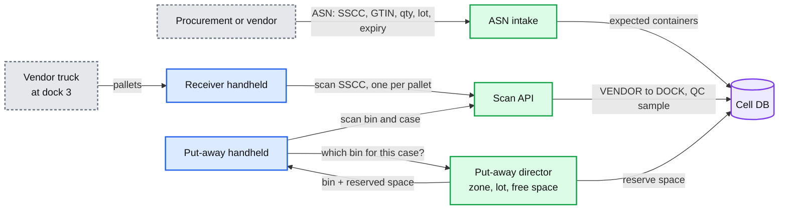

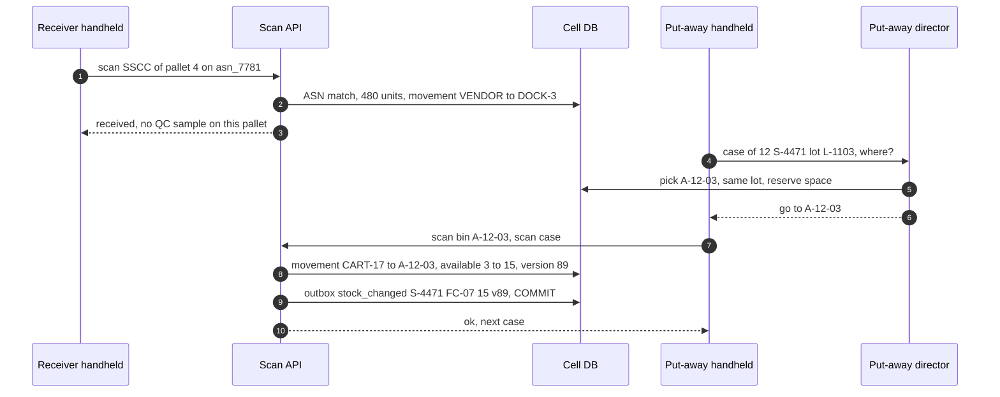

**What is still missing:** stock comes in and sits there. Nothing ships. §4.3.

### 4.3 Take orders from commerce, allocate stock to bins, release picks, pack, label and hand off

**Flow: order `ord_5512` (2 lines) is confirmed at 23:41 for dawn delivery. Its truck leaves at 02:00.**

1. Commerce's outbox publishes `order_confirmed(ord_5512, ord_5512-1, lines, FC-07, promised_by 07:00)` to `orders.fc-07`. `ord_5512-1` is the fulfillment id: the first time commerce sent these lines to an FC. The cell's intake inserts the lines with `ON CONFLICT (fulfillment_id, line_no) DO NOTHING` and stores its Kafka offset in the same transaction. A duplicate is a no-op; a later re-source of a short line arrives as `ord_5512-2`, a new fulfillment, and is not mistaken for a duplicate.
2. Each line goes to the **allocation lane** that owns its SKU (16 lanes per cell, by hash of SKU). Every second a lane takes all waiting lines for each SKU, sorts them by truck departure, and runs **one transaction per SKU**: read the SKU's `ACTIVE` bins with unallocated units, check the lane's epoch fence, choose bins (FEFO for expiry-controlled SKUs, skipping lots whose remaining life at the **promise time** is below the minimum, else smallest quantity first to free bins, then walk order: orderings Oracle WMS Cloud also offers, survey row 6a), conditionally increase `allocated`, insert allocation rows, move lines `RECEIVED → ALLOCATED WHERE state = 'RECEIVED'`, lower `available_qty`, bump `stock_version` and the per-(FC, cut-off) `capacity_version`, and write `stock_changed`, then `order_allocated`, then any `order_line_short` to the outbox. ~10 ms.
3. The **planner** computes each line's **slack**: `release_deadline − now − estimated pick time`, where the release deadline for the 02:00 truck is 00:15 (worked backwards in §5.5). When a picker in zone B finishes a batch, the planner builds the next one: the most urgent lines in that zone, plus nearby lines with more slack to fill the cart to ~20 lines. The batch is leased to that picker's handheld for 10 minutes.
4. The picker walks the batch in bin order and scans each pick (§4.1). Totes ride a conveyor to packing.
5. At a pack station the packer scans the tote, then each item (movement `T-881 → PARCEL p_77`), the system suggests a box size, the packer seals it, and the label printer prints the carrier label with the parcel's SSCC and tracking id. `order_packed` (both ids) goes to commerce.
6. A sorter routes the parcel to the lane of its delivery camp. The loader scans it into trailer `TR-12` (movement `p_77 → TR-12`).
7. At 02:00 the trailer is closed and dispatched: one transaction moves everything in `TR-12` to `CARRIER`, and `order_shipped` (both ids, tracking) goes to commerce.

**Bad: fixed hourly waves.** At 23:00 the wave job allocates the last hour's ~35k units in one transaction and releases them at once. That transaction locks ~20k balance rows for several seconds, and every pick confirmation on those rows waits behind it (scan p99 300 ms is gone). Pickers finish the wave at different times, so ~10 to 15% of the floor idles at each wave's tail [estimate]. An order at 23:01 waits 59 minutes for the next wave, which is most of the slack it has.

**Good: 15-minute waves, each line allocated on arrival.** The wait drops to ≤ 15 minutes and allocation is spread out. Still a release burst every 15 minutes, still idle tails, and in a burst, lines allocated one at a time serialize on the hot SKU's availability row and queue every other SKU behind it (§5.1).

**Great: continuous release by deadline slack, per-SKU allocation lanes, batches built when a picker frees up.** Allocation is serialized per SKU inside one process, so two "waves" never contend for the same rows, and each transaction is ~10 ms. Work goes to pickers when they are free, so there are no tails. **Challenges:** a smaller pool of released work makes batches less dense (more walking per unit). So early in the evening the planner holds lines with plenty of slack for up to 30 minutes to fill carts, and inside the last hour before the release deadline it releases everything. That trade (density against urgency) is a policy the site manager can tune.


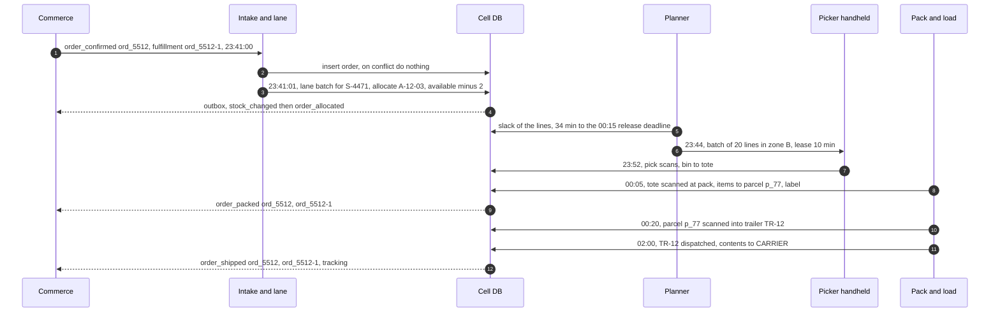

**What is still missing:** commerce hears about stock only through events nobody has designed yet, and supervisors cannot see the floor. §4.4.

### 4.4 Every receipt, pick, short pick, damage and shipment reaches commerce within seconds, and dashboards show the floor live

**Which events change sellable stock, and which do not.** Say this first, because the interviewer's "every update" hides it:

| Physical event | `available_qty` | What commerce gets |
|---|---|---|
| Put away into a pickable bin | up | `stock_changed` |
| Allocation of a confirmed order | down | `stock_changed`, then `order_allocated` (the hold is dropped) |
| Pick of allocated units | unchanged | nothing on the stock topic |
| Short pick | down (the bin's balance is held) | `stock_changed`, and `order_line_short` if no other bin has stock |
| Damage found in a bin | down if the unit was unallocated; a re-allocation if it was allocated | `stock_changed`, maybe `order_line_short` |
| Count adjustment | up or down | `stock_changed` |
| Pack, load, ship | unchanged | `order_packed`, `order_shipped` on the status topic |

The dangerous direction is **down**: shorts, damage and count losses. A missed "up" loses a sale; a missed "down" sells a unit we do not have.

**Flow: the put away of §4.2 at 21:10:00.000 reaches commerce.**
1. 21:10:00.000: the put-away transaction commits `available 15, version 89` and the outbox row, together.
2. ~0.05 s: the CDC relay reads the outbox insert from the WAL and publishes `stock_changed(S-4471, FC-07, 15, 89)` to `wms.stock-events`, key `S-4471`, `acks=all`.
3. ~0.1 s: commerce's inventory consumer applies it with `UPDATE pool SET available = 15, version = 89 WHERE sku = 'S-4471' AND fc = 'FC-07' AND version < 89`. Sellable for the FC pool = 15 minus holds for confirmed fulfillments not yet acknowledged by `order_allocated`.
4. ~0.2 s: commerce refreshes its product-page availability (its read model, its latency).
5. Every 5 s the relay also writes a heartbeat (FC, highest outbox id shipped, `floor_contact_age`) to **every** partition of `wms.stock-events`. The topic is keyed by `sku_id`, so a heartbeat on one partition would say nothing about the others: 64 partitions × 100 FCs ÷ 5 s ≈ 1.3k tiny records a second network-wide. Commerce judges staleness per (partition, FC), and so knows "nothing changed" from "the feed is down"; `floor_contact_age` tells it whether the building itself can still reach its cell.

**Bad: commerce polls the WMS, or a nightly batch.** A poll every minute is a minute stale and scans every SKU of every FC. Coupang's own post says the read-through cache "provides minutes latency" and that stock is the data that cannot wait.

**Bad, again: the WMS calls commerce's API after its commit.** A crash between commit and call loses the update forever. A commerce outage either blocks scans (if the call is in the transaction) or silently drops updates (if it is not).

**Good: an outbox read by a poller, carrying deltas (`-2`, `+12`).** No lost writes. But deltas are not idempotent: a re-delivered `+12` counts twice, a lost `-1` leaves commerce one unit high forever, and nobody can tell. At 10M events a day, a 0.0001% loss is 10 drifted SKUs a day, invisible.

**Great: outbox read by CDC, absolute values with a per-(SKU, FC) version, a heartbeat, and a reconciler.** An absolute value with a version is idempotent and order-proof: a duplicate or an older event is ignored, a lost event is repaired by the next one for that SKU. `stock_version` is gap-free per SKU because the cell is the single writer and bumps it under the `SKU_AVAILABILITY` row lock. The reconciler (§5.6) compares the two sides at commerce's own version. Supervisors' dashboards read a replica plus the task event stream, ~5 s behind. **Challenges:** a version must survive a database failover, so it carries a clock-based epoch in its high bits (§5.7); the hold arithmetic lives in commerce and must drop a hold only after it has applied the matching version (§5.6); and a hot SKU in a flash sale can emit hundreds of `stock_changed` a second, which the relay coalesces to the latest value per SKU for up to 100 ms (absolute values make that safe) and **flushes before any order event of that SKU**, so the topic stays in commit order per SKU.

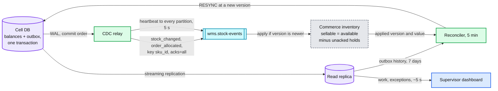

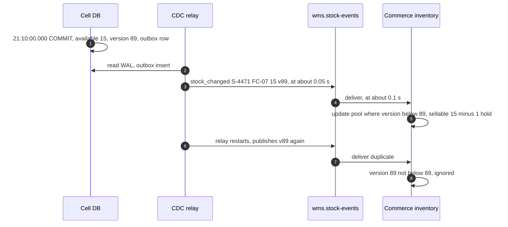

**What is still missing:** the §4 design works on a good day. It has not been tested against two waves and a count on one bin, a handheld that goes dark in an aisle, a picker who walks away, an empty bin, the midnight crunch, a commerce number that disagrees, or a building that loses its link. §5.

---

## 5. Deep dives

One per probe or non-functional requirement, phrased as the interviewer's question. Each names what breaks in the §4 design with a number, climbs the ladder, and lists what changed.

### 5.1 "Two pick waves and a cycle count touch the same bin at once. How do the counts stay exact?"

**What breaks in the current design.**
1. **Read-modify-write anywhere.** A supervisor tool reads 6, the user types 5, it writes 5. A pick committed in between is lost.
2. **A burst on one SKU.** At ~100 lines a second, one transaction per line is fine: ~3 ms p50, ~8 ms p99 in simulation. The trouble is a burst: 2,000 lines of a promo SKU arriving within 2 s (intake catching up after a Kafka stall) or all at once (a sweep). Every per-line transaction also updates the SKU's availability row, so they serialize on it: `2,000 × 3 ms = 6 s`. The allocation service's ~20 connections all wait on that one row, so **every other SKU's** allocations queue behind it: ~5.5 s p99. Picks on the hot bins barely suffer, because the connection pool caps the lock queue: a pick waits behind at most ~20 holders, ~62 ms p99, under the 200 ms `lock_timeout` ([allocation deep dive](deep-dives/allocation-waves-and-short-picks.md) §2).
3. **A count races an in-flight pick (the double decrement).** The bin holds 10. At 23:50:10 a picker takes 1, but her handheld's battery dies with the scan queued. The cell stops treating her task as open, a counter counts 9, the system had 10, so it books −1 to 9. The battery is swapped and the pick arrives: 8. The shelf has 9. Waiting for open tasks is not enough on its own, and a worker can also stow a case into a bin while it is being counted.
4. **Promises the bin cannot keep.** An over-pick, a count loss or damage takes units the books thought were unallocated. Then `allocated > on_hand`, and every extra promise becomes a short pick later. In a 200-night simulation of 20 bins with no rule for it, 71,656 steps ran with `allocated > on_hand`.

**Bad: optimistic compare-and-set in the application with retries.** Read the row's version, write if unchanged, else retry. In a 2,000-line burst most attempts fail and re-read: retry storms, seconds of p99.

**Good: `SELECT ... FOR UPDATE` per line in short transactions.** Correct for point 1, and fine at ~100 lines a second. In a burst it queues every other SKU behind the hot one (point 2), and it does nothing for points 3 and 4.

**Great: guarded updates, one lock order, allocation lanes as burst insurance, a count protocol on device time, and a release rule.**
- **Never read-modify-write a balance.** `UPDATE balance SET allocated = allocated + :q WHERE ... AND on_hand - allocated >= :q`. In Postgres under READ COMMITTED, an `UPDATE` that waited for a row lock re-checks its `WHERE` against the newest committed row version, so the guard sees the latest value, not a stale snapshot ([`../../concepts/mvcc-and-isolation.md`](../../concepts/mvcc-and-isolation.md)). Zero rows updated means "not enough here": try the next bin.
- **One global lock order.** The SKU's `SKU_AVAILABILITY` row first (a lane batch, or any scan that may change available: short, damage, over-pick, count), then balance rows in `location_id` order. Picks, allocations and counts cannot deadlock.
- **One allocation lane per SKU, as insurance against bursts.** A lane owns a hash range of SKUs and allocates **all** waiting lines of one SKU in one ~12 to 22 ms transaction per second. In steady state it is not faster (it adds up to 1 s per line); in a burst it keeps every other SKU at ~3 ms. Each batch starts with a fence check on the lane's epoch, so a paused old owner cannot allocate the same lines twice, and lines move `RECEIVED → ALLOCATED WHERE state = 'RECEIVED'`.
- **A count protocol on device time.** Every movement carries the handheld's device time.
  1. A count request sets the bin to `COUNT_PENDING`: no new pick or put-away task is released to it. Allocation may continue: it changes `allocated`, not `on_hand`.
  2. `COUNTING` starts when no task on the bin is `ASSIGNED`, `IN_PROGRESS` or `UNCONFIRMED`; the count records `started_at`.
  3. Any movement on the bin stamped at or after `started_at` (a stray put-away, a put-back) voids the count: recount. The active count's own adjustment (`bin → LOSS` or `GAIN → bin`) is excluded from this rule, or every count would void itself.
  4. The adjustment is `counted − on_hand` at commit, booked to `LOSS` or from `GAIN`.
  5. A scan that arrives after the count but is stamped **before** `started_at` describes a unit that was already gone when the counter looked: it is booked as `GAIN → bin` (reason `COUNT_RECON`) and then applied, net zero on the bin, reversing the phantom loss. One stamped inside the count window triggers a recount. Scans within 5 s of `started_at` count as inside, so clock skew costs a recount, never a wrong number.

  Simulated over 200 nights of 20 bins: waiting for open tasks alone leaves 51 units between books and shelf; with the device-time rules, 0, for 13 recounts and 99 reconciled late scans ([inventory deep dive](deep-dives/inventory-ledger-and-bin-model.md) §5 and §6).
- **`allocated ≤ on_hand`, always.** Any decrement of `on_hand` that would go below `allocated` releases the newest allocations on that balance (latest truck first) back to the lane in the same transaction. Over-picked units go to a `PROBLEM` tote, never into the order's tote.
- **Physical facts first.** If a pick's guard fails (the system says 0, but the picker holds a carton from that bin), the same transaction first records `GAIN → bin` for the difference, then the pick, then raises a count. The balance never goes negative, the scan is never rejected, and the ledger says why.
- **Proof.** The nightly job checks opening balance + movements = closing balance for every `(location, SKU, lot)`, that `0 ≤ allocated ≤ on_hand` everywhere, and that `allocated` equals the sum of `OPEN` allocation rows on each balance (which catches a double allocation by a stale lane owner). A violation pages.

**Push back on the textbook answer.** "Use event sourcing or CRDT counters so writes never conflict." The invariant is a constraint on one bin's number at one moment: never below zero, never a unit allocated twice. Conflict-free replicated counters exist to merge concurrent decrements without coordination, which is exactly how you get −1. You need one serialization point per bin, and in a single-writer cell at ~300 transactions a second it costs ~7% of one machine. Event sourcing makes the log the truth and builds balances afterwards, so the write-time check reads a lagging projection. Our ledger is the log and the balance changes in the same transaction: the audit trail without the lag.

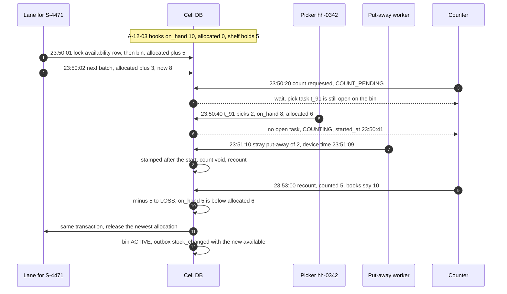

**What changed.** One lock order, availability row first. Lanes with an epoch fence, framed as burst insurance. The count protocol on device time with `COUNT_RECON`. The `allocated ≤ on_hand` release rule. "Gain, then pick" for impossible scans. The nightly invariant job. Deep dives: [`deep-dives/inventory-ledger-and-bin-model.md`](deep-dives/inventory-ledger-and-bin-model.md), [`deep-dives/allocation-waves-and-short-picks.md`](deep-dives/allocation-waves-and-short-picks.md).

### 5.2 "A handheld loses Wi-Fi in an aisle and sends 30 scans late. How do you handle duplicates and ordering, and still answer in 300 ms?"

**What breaks in the current design.**
1. **Dead zones and roams.** Steel racks full of liquid block radio. The MC3300 class supports 802.11r fast roaming (verified), but no source gives dead-zone or roaming numbers for warehouses (survey row 7f, unverified). Assume a handheld in a busy aisle drops out for seconds to a few minutes a few times a shift [estimate].
2. **Lost replies make duplicates.** The scan committed, the reply was lost, the device resends.
3. **Reordering.** After a gap, a naive client sends its queue in parallel; the cell sees "tote at pack station" before "picked into tote".
4. **Waiting workers.** An online-only screen blocks the picker for the whole gap.
5. **A wiped app.** MDM re-provisions a handheld mid-shift and its sequence restarts at 1. Keyed by device alone, the cell answers "duplicate" to the next 1,000 scans while the worker sees "OK" on every one.
6. **One bad scan blocks the stream.** With in-order apply, a scan the cell cannot apply (a task it lost, an unknown bin label) would block every later scan of that device.

**Bad: online-only screens.** Every scan waits for the server. A 2-minute dead zone is a 2-minute stop. A few minutes per picker per night across 375 pickers is hours of labor. Retries without an id apply twice.

**Good: a random id per scan and server-side dedup.** Duplicates are gone. Order is not: in simulation, totes scanned onto the conveyor before their picks arrive book 10,514 phantom `GAIN` rows across 2,000 handheld-shifts. And the worker still waits for the server on every scan.

**Great: local-first steps, a stream per install, in-order apply, exceptions that advance the stream, and epochs judged by what happened.**
- **Local-first for planned steps.** The handheld holds its current batch. A scan that confirms a planned step (right bin, right GTIN, right lot, qty within the task) is checked on the device and confirmed on screen in under 100 ms, then queued. Scans that need a decision (put-away bin, unknown barcode, short, damage) go to the server synchronously, p99 300 ms. Offline, the app parks the item in an exception tote and queues the request.
- **A stream per install.** At install, and after any loss of app data, the app registers a stream: the cell returns a new `stream_id` and `next_seq = 1`. A scan's identity is `(device_id, stream_id, seq)`, and `DEVICE_STREAM(device_id, stream_id, last_seq)` holds the cell's position per stream. A wiped app opens a new stream, so it loses nothing (1,000 scans lost per wipe when keyed by device alone, in simulation).
- **Write-ahead on the device.** Before the app shows OK, it writes `(stream_id, seq, event, device_time)` to its local SQLite queue in one local transaction.
- **In-order apply.** One sender loop per device sends in order. The cell applies a scan only if `seq = last_applied_seq + 1` for its stream. `seq ≤ last_applied_seq` is a duplicate: return the stored reply from `SCAN_RESULT`. `seq > last_applied_seq + 1` is a gap: reply "resend from `last_applied_seq + 1`". The stream advance, the stored reply and the effect commit together, and none of them is in a day-partitioned table, so the uniqueness really holds.
- **Exceptions advance the stream.** A scan for an unknown task, bin label or GTIN becomes a movement into a `PROBLEM` location plus an exception task; the stream advances and the reply is stored. Only a transient error (lock timeout, failover) keeps the sequence, and the device retries the same `seq`.
- **The offline cap and the lease are separate rules.** After 8 minutes or 300 queued events offline, the app stops issuing new steps and sends the worker to a Wi-Fi zone; that bounds how stale the cell's picture of a worker can be. It does not protect the task lease: the cap starts at the first failed send, up to 30 s after the last contact, and the walk can take ~4 minutes. So the cell holds a **silent** device's steps as `UNCONFIRMED` for up to 20 minutes after its last contact (§5.3). Over 100k simulated offline episodes, re-releasing at 10 minutes would beat 1.3% of queues home (~20 a peak night); 20 minutes beats none.
- **Late scans are facts, and the epoch decides what they mean.** A scan carrying an older epoch than the task's is always applied as a movement. It is an **over-pick** (units to a `PROBLEM` tote, put back by a problem solver) only if the current epoch's holder has already scanned that step. Otherwise the step goes back to the original device and the re-released copy is withdrawn.

**The 30 late scans.** On reconnect the app sends `scans:batch` for stream `s1`, seq 412 to 441. The cell has `last_applied_seq = 413` for that stream (412 and 413 committed before the gap; their replies were lost). It returns the stored results for 412 and 413 and applies 414 to 441 in order, one short transaction each (`28 × 5 ms ≈ 140 ms`). Their freshness clock starts at commit, which is why the freshness SLO is measured from commit, not from the physical act.

**Latency budget for a decision scan, online.** Measured handheld to handheld.

| Hop | p50 | p99 | What sets it |
|---|---|---|---|
| Wi-Fi, including a roam | 10 ms | 150 ms | AP load, 802.11r roam |
| Edge gateway | 1 ms | 5 ms | Journal append |
| WAN to the region, both ways | 10 ms | 40 ms | Two carriers, ~5 ms each way |
| Scan API + transaction with a synchronous standby | 8 ms | 60 ms | Cross-AZ standby ack |
| **Sum** | **~30 ms** | **~255 ms** (p99s do not add, a ceiling) | |

**Push back on the textbook answer.** "Keep handhelds as thin clients; state belongs on the server." Right for decisions, wrong for confirmations. Confirming a planned step needs only the task, which the device already has. A round trip buys nothing and turns every dead zone into a stopped worker.

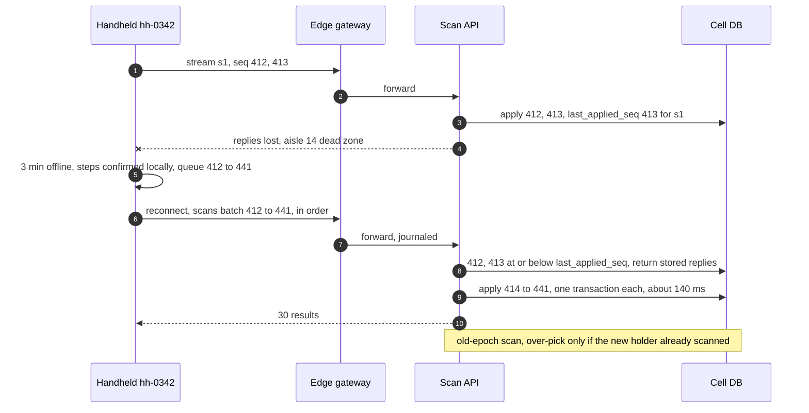

**What changed.** Streams per install (`DEVICE_STREAM`), the gate's exception branch, the offline cap decoupled from the lease (`UNCONFIRMED` for 20 minutes), the epoch rule for late scans. Deep dive: [`deep-dives/scanners-offline-and-idempotency.md`](deep-dives/scanners-offline-and-idempotency.md).

### 5.3 "A picker goes on break mid-batch, a tote falls off a conveyor. How do tasks with humans in the loop not get stuck or done twice?"

**What breaks in the current design.**
1. **People leave tasks.** Breaks, shift end, a flat battery, a supervisor moves someone to another zone.
2. **Containers get lost.** A tote misrouted, a parcel under a conveyor.
3. **Work done twice.** A task re-issued while the first person is still doing it, or while their scans sit in a dead handheld.
4. **Silent stalls.** A line `PICKED` but never `PACKED` blocks its truck and nobody notices until the trailer is loaded.
5. **A building cut off from its cell.** If the cloud keeps lease clocks running while the edge is disconnected, every open step in the building expires at minute 10.

At the night peak the busiest FC has ~375 pickers × ~20 open steps ≈ 7.5k open pick tasks [estimate] and as many timers. The load is nothing. The design question is ownership and timeouts.

**Bad: no timeouts.** Supervisors find stuck work by walking the floor, or by a report at 01:30, too late for the 02:00 truck.

**Good: a workflow engine, one durable workflow per order** (Temporal style: timers, retries, history, see [`../../concepts/temporal-durable-execution.md`](../../concepts/temporal-durable-execution.md)). Works. Costs: a second source of truth. The order's state lives in the workflow history, the units' state in the cell database, and a pick scan must change both. One commits and the other does not, and we are back to a dual write. It also adds a cluster per cell, or a shared one that breaks cell isolation.

**Great: tasks and order lines as rows in the cell database, changed in the same transaction as the movement, with progress-based leases, epochs and a timer table.**
- **Progress, not liveness, renews a lease.** A step's 10-minute lease is renewed only by scans. Heartbeats (every 30 s) tell the cell whether the device is reachable and its `last_seq` per stream, so whether anything is still queued. If heartbeats renewed the lease, a picker on a 25-minute break with the handheld in a pocket would hold 18 lines for 25 minutes, and no rule would fire.
- **At 10 minutes without progress.** Device online and its queue empty (the heartbeat's `last_seq` equals the cell's `last_applied_seq`): re-release the open steps with `epoch + 1`, after a nudge at 5 minutes. Device silent (no heartbeat for 60 s): the steps go `UNCONFIRMED`, because a scan may be in its queue; the cell waits up to 20 minutes after the last contact, then re-releases them flagged "possible over-pick". Inside the last 30 minutes before the release deadline the planner may cut 20 to 10, accepting a possible over-pick to save the truck. Fencing by epoch: [`../../concepts/leases-fencing-clocks.md`](../../concepts/leases-fencing-clocks.md).
- **A break button.** The app's "break" action releases the open steps at once. The 10-minute rule is for workers who forget.
- **Lease clocks stop for a cut-off building.** While a building's edge is disconnected, the cloud freezes every lease clock in that building and the edge applies the same rules locally in survival mode. On reconnect the journal replays first, then the clocks restart. A simulated 25-minute cut at 23:30 with running clocks re-releases 11,306 steps and flags 7,500 false over-picks, sending 728 totes to problem solving at ~23:57; with stopped clocks, none.
- **Stuck detection beyond leases.** Each task type has an expected duration (the last 7 days' p90). `IN_PROGRESS` past 2x goes `STUCK`, onto a supervisor's screen with the last bin scanned and the tote id. Per order line: `PICKED` but not `PACKED` 30 minutes before its truck's load start creates a "find tote" task for a problem solver.
- **Timers.** One table `(due_at, kind, ref)`, indexed on `due_at`. A sweeper polls every 5 s, takes due rows with `FOR UPDATE SKIP LOCKED`, and fires each in the same transaction as the state change. ~25 fires a second at the peak (the pattern of [`../distributed-job-scheduler/`](../distributed-job-scheduler/)).
- **People are the capacity.** The planner leases work only to devices with a logged-in worker in that zone, about one batch ahead, the same "humans are the queue's consumers" shape as [`../document-approval-system/`](../document-approval-system/).

On a simulated normal evening (1,500 batches, 3% with a mid-batch break, 1% with a dead battery), these rules cut the mean delay of interrupted steps from 20.0 to 15.1 minutes and real double picks from 12 to 3, against heartbeat-renewed leases ([workflow deep dive](deep-dives/workflow-orchestration-and-tasks.md) §5).

**Push back on the textbook answer.** "Retry the task automatically on timeout." For a robot, yes. For a person, an automatic retry is a second person walking to the same bin. A timeout here produces a decision: re-release if nothing physical can have happened, wait if a scan may still arrive, a supervisor if something is lost.

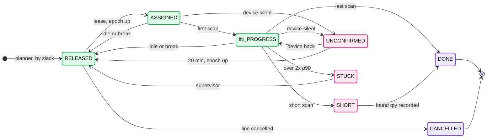

**What changed.** Task and line state in the cell database with the movements, leases renewed only by progress, `UNCONFIRMED` for silent devices, a break button, lease clocks stopped while a building is cut off, a timer sweeper, `STUCK` as a human decision. Deep dive: [`deep-dives/workflow-orchestration-and-tasks.md`](deep-dives/workflow-orchestration-and-tasks.md).

### 5.4 "A picker reaches a bin and it is empty. What happens to the order, the bin record, and availability on the website?"

A short pick rate of ~0.3% of picks [estimate] is ~1.3k shorts a day in the busiest FC and ~130 in the peak hour. Each one costs a wasted walk and puts a dawn promise at risk.

**What breaks in the current design.**
1. The bin record is wrong (theft, a mis-put-away, unrecorded damage, an old miscount), and other allocations still point at it.
2. The order line has fewer units than promised.
3. Commerce still counts that bin's units as available and keeps selling them.

The numbers below come from a simulation of the busiest FC's last 105 minutes before the 00:15 release deadline: 65k one-unit lines, 1.5% of bins holding fewer units than the books say, 0.1% false shorts [estimates] ([allocation deep dive](deep-dives/allocation-waves-and-short-picks.md) §5).

**Bad: the picker skips it.** The order ships incomplete, nobody tells commerce, and the books never change: 490 walks to empty bins that night, 490 incomplete orders nobody was told about.

**Good: mark the line short, cancel it, tell commerce.** The buyer is told. The bin is not fixed: the same 490 walks.

**Good, again: hold the bin and move every allocation off it at once.** The walks drop to 118, but 6,026 allocations move. 1,208 lines then find no other bin with free units (`no_stock` shorts for units that were on the shelf) and 692 more move after 00:15: **1,900 lines miss tonight's truck**. Most triggers are hot bins, and one false short at 23:50 moves a few hundred lines.

**Great: hold the balance, re-allocate only the shorted unit, and let a count within ~5 minutes decide the rest.**
1. The picker scans `short`, found 1 of 2. One transaction: the pick of the found unit; the `(A-12-03, S-4471)` balance is **held** (`held = true`), so its unallocated units leave `available_qty` and `stock_changed` goes out (commerce stops selling them within 2 s); only the missing unit goes to the front of the SKU's lane; the bin's other allocations **stay**, so pickers already on their way keep theirs, and if they short too, each re-allocates only its own line; a priority count task goes to the zone's problem solver, due within ~5 minutes.
2. The lane finds another `ACTIVE` bin in this FC: a cleanup pick at top priority, given to a runner in that zone or inserted into the same picker's path if the bin is ahead of them. The line keeps its truck.
3. No other bin: `order_line_short(ord_5512, ord_5512-1, S-4471, FC-07, 1, no_stock, v93)`, written in the same transaction as, and after, the `stock_changed v93` it causes. Commerce drops the hold only once it has applied v93. Commerce decides: re-source from another FC as fulfillment `ord_5512-2` (keyed on the source fulfillment and line, so a duplicate short never creates `-3`), or cancel the line and refund. The rest of the order ships. Partial-shipment policy belongs to commerce; our default is "ship what we have".
4. After the release deadline (00:15 for the 02:00 truck) a cleanup pick cannot make the truck. The WMS emits `order_line_short(..., missed_cutoff, vN)`, **keeps the allocation**, and plans the line into the next cut-off's work. Commerce tells the buyer the new date, or, if the buyer declines, sends a line-level cancel, `order_cancel_requested(ord_5512, ord_5512-1, lines [2])`, which releases that allocation and nothing else. If commerce wants another FC to keep the original promise instead, it first cancels that line and sends `ord_5512-2` only after `order_cancel_result(cancelled)`; otherwise both FCs ship. The same rule covers a dawn line still unreleased at 00:15 because the floor ran out of time.
5. The count keeps as many of the bin's allocations as it finds units (earliest truck first), releases the rest to the lane, and ends the hold: units found, available back up; units missing, `bin → LOSS`.

In the simulation this policy walks to an empty bin 136 times (18 more than moving everything: the pickers already en route), moves 95 allocations, and **misses the truck for 22 lines instead of 1,900**, with no "sold out, then back in stock" flaps on the website (zeroing the bin causes 60 a night).

**Push back on the textbook answer.** "Zero the bin immediately." The picker may be wrong: cartons pushed to the back, a different lot on the shelf above. Zeroing writes an irreversible `LOSS` and then a `GAIN` when the count finds them: two ledger entries, and an availability flap that commerce shows as "sold out" then "in stock". A hold removes the units from available just as fast, and the ledger changes once, when the count says what is true.

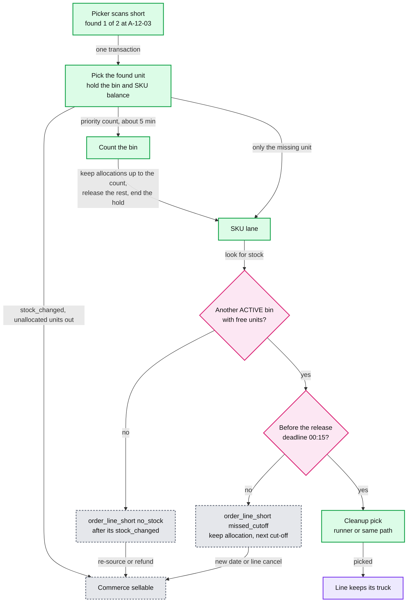

**What changed.** A hold on the `(bin, SKU)` balance instead of zeroing or moving every allocation, a count within ~5 minutes that decides the rest, cleanup picks with deadline priority, `no_stock` versus `missed_cutoff` (which keeps the allocation), shorts that carry a `stock_version`, line-level cancels. Deep dive: [`deep-dives/allocation-waves-and-short-picks.md`](deep-dives/allocation-waves-and-short-picks.md).

### 5.5 "An order is placed at 23:59 for 7 am. Walk it to the truck. Where is the time spent, and what is the real bottleneck?"

**Worked backwards from 7 am** (one large dawn FC, every duration `[estimate]`): the last route must leave its delivery camp by ~03:00 to finish ~4 hours of drops by 07:00; the camp needs ~30 minutes to sort; line haul is ~30 minutes; so the last trailer leaves the FC at **02:00**. Loading takes ~30 minutes with a 15-minute buffer, sorting ~15, conveyor and packing ~20, and a pick batch ~25 minutes of walking. So **the last pick must finish by 00:40 and the last batch must be released by 00:15**. The 23:59 order has 16 minutes to be taken in, allocated and put in a batch. The machines need about 2 seconds of that.

```mermaid
%% 5.5: the last dawn order, worked backwards from 7 am. Every duration is an estimate. The system steps take seconds, the floor takes about 2 hours.
gantt
    title Last dawn order, worked backwards from 7 am
    dateFormat HH:mm
    axisFormat %H:%M
    section System
    Intake and allocate, about 2 s :s1, 00:00, 1m
    Slack before release         :s2, after s1, 14m
    section Floor
    Pick batch walk              :f1, 00:15, 25m
    Conveyor and pack            :f2, after f1, 20m
    Sort to camp lane            :f3, after f2, 15m
    Load trailer                 :f4, after f3, 30m
    Buffer                       :f5, after f4, 15m
    section Road
    Line haul to camp            :r1, 02:00, 30m
    Camp sort                    :r2, after r1, 30m
    Last mile routes             :r3, after r2, 240m
```

**The two candidates, with numbers.**
- **Allocation contention on hot SKUs.** The 23:00 hour is 12.5 units/s. With per-SKU lanes, one ~10 ms transaction per SKU per second; the worst hot SKU's 2,000-line sweep is one ~20 ms transaction. The cell database is under 10% busy. It only becomes a problem if we build it wrong (one transaction per wave, or one lock queue per line, §5.1).
- **Pick labor.** The 23:00 hour brings ~45k units, which is `45,000 ÷ 120 = 375` picker-hours in that hour. With release keeping pace, ~20 minutes of arrivals (~15k units) are released but unpicked at midnight; 375 pickers clear them by ~00:20 to 00:25, against a last-pick limit of 00:40. **Slack: ~15 to 17 minutes.** In simulation a +10% promo costs ~5 minutes, 10% of pickers absent ~6, both together ~14, and a slow night (110 UPH) on top sends 7,640 units past the 00:40 last pick ([cut-off deep dive](deep-dives/cutoff-and-capacity.md) §3). **This is the red node.**

**Bad: a labor plan from last year's forecast and fixed waves.** The miss is discovered at 01:30 when trailers are half full.

**Good: a shift plan from the forecast plus a backlog dashboard.** People react, but late, and commerce keeps sending dawn orders to a center that is already behind.

**Great: three levers on the red node, all in software.**
1. **Shed demand upstream with `fc_capacity`, per cut-off.**

   ```
   pick_remaining = Σ zones (pickers on shift × measured UPH, last 30 min × hours to 00:40)
                    − unpicked units of acknowledged fulfillments without a deal_id
                    − Σ open deals (max(granted, drawn) − picked deal units)
   pack_remaining = packers on shift × measured units packed an hour × hours to 01:00
                    − unpacked units of acknowledged fulfillments without a deal_id
                    − Σ open deals (max(granted, drawn) − packed deal units)
   remaining(fc, cutoff) = min(pick_remaining, pack_remaining) − 2% reserve for cleanup picks
   ```

   - **The binding stage wins.** Pick and pack each have their own labor plan, rate, backlog and deadline (00:40 and 01:00); the smaller remainder is what the building can still promise. On a normal night pick binds (~375 pickers against ~200 packers at ~225 units an hour each); a packer shortage flips it.
   - **Each unit is counted once, by one side.** Acknowledged means the WMS has sent `order_allocated`. Before it picks the FC, commerce subtracts its own open holds **and its live reservations** at that FC and cut-off, leaving out holds that carry a `deal_id`. Reservations matter: an order chooses FC-07 at reservation and is confirmed up to ~4 minutes later, so at 12.5 units a second ~1.7k units are in flight, invisible to both sides, at the moment the building fills. Over 1,000 simulated nights (absence 0 to 15%, a promo on 3 nights in 10), subtracting only holds still misses the truck on 151 nights; adding live reservations, on 0, at the price of ~1.4k units a night sent to another FC or next-day ([cut-off deep dive](deep-dives/cutoff-and-capacity.md) §3). A bigger fixed reserve is not a substitute: in-flight volume is rate times checkout time.
   - **Versioned.** The allocation transaction bumps a per-(FC, cut-off) `capacity_version`, and `order_allocated` carries it. Commerce keeps subtracting a fulfillment's units until it has applied an `fc_capacity` at or above that version, which closes the up-to-60 s gap between a hold drop and the next publish.
   - **Published** every 60 s or on a 5% change. At `remaining ≤ 0` for the dawn cut-off, commerce stops choosing FC-07 for dawn and offers another FC or next-day. This is Coupang's rule, an FC at its daily outbound capacity "cannot take any new customer orders" (verified), made live and per cut-off.
   - **Stale means zero.** In the last hour before a cut-off, commerce treats an `fc_capacity` with no update for 2 minutes as 0. The cell publishes 0 itself after 5 minutes without its building (§5.7), and the stock heartbeat carries `floor_contact_age`, so commerce sees a cut-off building within seconds.

   **Flash deals book capacity ahead.** At deal setup commerce sends `capacity_hold(deal_d77, FC-07, date, dawn, 4,000)` on `orders.fc-07`. The cell grants `min(requested, remaining)`, keeps all open grants under 30% of the cut-off's planned capacity [estimate] so a deal cannot starve regular orders, and answers `capacity_hold_result(deal_d77, granted_units)` on `wms.fc-capacity`. Commerce carves at most the granted units into this FC and spreads a large deal across FCs. The deal's orders carry `deal_id`, so their acknowledged units raise the hold's `drawn_units` instead of being counted again. The cell books **future work, not the grant**: `max(granted, drawn) − picked deal units`. A deal that sold out at 22:05 and is picked through the evening would otherwise hide 2,600 units at 23:40, 3.5 minutes of the floor, in the building's last 20 minutes of intake. Release is two-step: at deal end `capacity_release` returns `granted − drawn − (claims not yet terminal)`, so claims behind a payment still in flight keep their capacity; the final `capacity_release`, when the last claim resolves (at most 30 minutes later), sets the grant to 0. The formula holds at every step, and only after the final release does a late deal fulfillment count as regular work.
2. **Raise UPH.** Travel is 50 to 70% of picking time (vendor claims, secondary). If travel is 60% and denser batches plus walk-order sequencing cut it by 20%, time per unit becomes `0.6 × 0.8 + 0.4 = 0.88`, **+14% UPH**, worth ~50 pickers in the 23:00 hour.
3. **Spend slack in deadline order.** Release by slack, cleanup picks first, pack stations take totes by truck, and labor moves between zones by backlog.

**Push back on the textbook answer.** "Shard the inventory database and scale the allocator for the midnight spike." The spike is about 10 order lines a second. Sharding buys nothing. The spike that matters is in people, and the software's job is to waste none of their minutes and to stop promising what they cannot do.

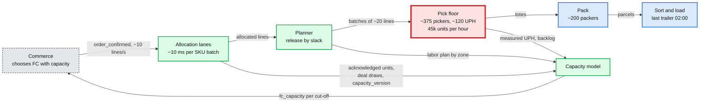

**What changed.** New: the capacity model and `fc_capacity` per cut-off, counting acknowledged work only, with commerce subtracting holds and live reservations, a `capacity_version`, stale-as-zero, deal holds booked as future work, the release deadline per truck, batch density as a tunable policy. Deep dive: [`deep-dives/cutoff-and-capacity.md`](deep-dives/cutoff-and-capacity.md).

### 5.6 "Commerce says 5 units are sellable, the warehouse says 3. Who is right, how fast do they converge, and how do you prove they agree?"

**Who is right.** They measure different things, so first compare like with like.
- The WMS `available_qty` (3) is units in pickable bins, not allocated, not held. It is the truth for physical stock.
- Commerce's sellable number is the latest `available_qty` it applied **minus holds** for confirmed fulfillments the WMS has not yet acknowledged. Holds are kept per (fulfillment_id, SKU, FC). It is the truth for holds.

The five ways they can differ:

| Cause | What you see | Converges? |
|---|---|---|
| Lag | Commerce applied v89, the WMS is at v91 | By itself, under 2 s |
| Holds | Sellable below available, by design | Each hold drops at its version |
| A lost or skipped event | Commerce stuck at v89 for minutes | Only by repair: the reconciler |
| A commerce-side bug | Same version, different value | Only by a `RESYNC` at a new version, and a page |
| The shelf differs from the WMS | Both numbers wrong | Only by a count (§4.1) |

**How fast.** Commit to commerce applied, healthy path: commit to relay read 20 ms p50 / 300 ms p99, Kafka publish with `acks=all` 10 / 100 ms, consumer poll and apply 30 / 500 ms, commerce's conditional update 10 / 200 ms. ~0.1 s p50, under ~1.1 s p99 as a ceiling, inside the 2 s SLO with room for a relay hiccup.

**The hold rule, and the flush that keeps it cheap.** Commerce drops a hold only once its applied `stock_version` for that (SKU, FC) is at least the version on the fulfillment's `order_allocated` or `order_line_short`, or when an `order_cancel_result(cancelled)` covers its lines. The lane writes `stock_changed vN`, then each `order_allocated vN`, then each `order_line_short vN`, in one transaction. The relay coalesces `stock_changed` per SKU for up to 100 ms, but **flushes a SKU's pending value before any order event of that SKU**, so per SKU the topic stays in commit order. Simulated on one hot SKU for an hour: dropping holds on arrival while order events overtake the coalescing window confirms ~81 units the WMS cannot allocate; either the version rule or the flush brings it to the ~14 that damage on the shelf causes anyway. We keep both: the flush keeps the topic in order, the rule covers consumer replays.

**Bad: a nightly full diff.** A drift found at 03:00 has sold wrong numbers for a day.

**Good: diff the replica's latest values against commerce's.** The replica is 1 to 5 s behind the primary and commerce only ~0.1 to 1 s, so on a busy SKU commerce is *ahead* of the snapshot. "Commerce newer" fires on lag: simulated, ~59.6k false pages a day per FC. People mute it.

**Great: compare at commerce's own version, every 5 minutes, per FC.**
1. Pick the SKUs whose version changed in the last 10 minutes, plus a 1/288 slice of all SKUs, so every SKU is checked once a day.
2. Ask commerce for its applied `(version, available)` for those SKUs in the FC-07 pool.
3. Look up the WMS value **at that version** in the outbox history (daily partitions, kept 7 days). Same version, different value: a commerce bug. Page, and repair with a `RESYNC` (step 4): commerce only applies a **newer** version, so a repair can never be sent at the same one.
4. **Lost event:** commerce's version is still **below the WMS version the previous run saw**. Ask the cell to repair: it writes a controlled `RESYNC` movement for that SKU (no quantity change), which bumps `stock_version` and writes `stock_changed` with the current value through the outbox, so the relay publishes it in commit order and commerce's strict newer-version rule accepts it. The reconciler never re-emits an old version. The reconciler never writes to `wms.*` itself; only each cell's relay may, by Kafka ACL.
5. **Backwards:** commerce's version is **above anything the cell ever issued**. Versions went backwards, which the clock-based epoch (§5.7) should make impossible. Page.
6. **Old holds:** a hold on FC-07 older than 10 minutes with no `order_allocated`, short or cancel. Ask the cell about that `fulfillment_id`: unknown, commerce re-drives the same `order_confirmed` (same fulfillment id, so a late original is still a duplicate); already allocated, the cell writes a fresh `order_allocated` through its outbox (dropping a hold is idempotent and keyed on the version it carries, so this is not a stock repair and needs no new version).

The output is two numbers per FC, **value mismatches at commerce's version** and **lost events**, both with target 0. Simulated for one FC over a day, this rule pages 0 times on lag and still finds all 3 real lost events within two runs ([sync deep dive](deep-dives/realtime-sync-to-commerce.md) §5). At 10x scale the slices become bucket hashes compared top-down ([`../../concepts/merkle-tree.md`](../../concepts/merkle-tree.md)).

**The single path.** Every event leaves a cell through one CDC relay reading one replication slot. If it stalls, the outbox waits in the WAL on the cell primary (~10 GB of WAL a day in the busiest FC at ~4 KB per scan transaction [estimate], so a 6-hour stall holds ~3 GB) and the cell's heartbeats stop. Relay lag over 30 s pages.

**Push back on the textbook answer.** "Have checkout read the WMS synchronously so they can never disagree." Then checkout (99.95% in #61) depends on 100 cell databases and every building's WAN, and a blip at one FC fails checkouts. Holds already make commerce safe against lag. The remaining risk is physical, and a synchronous read does not fix the shelf.

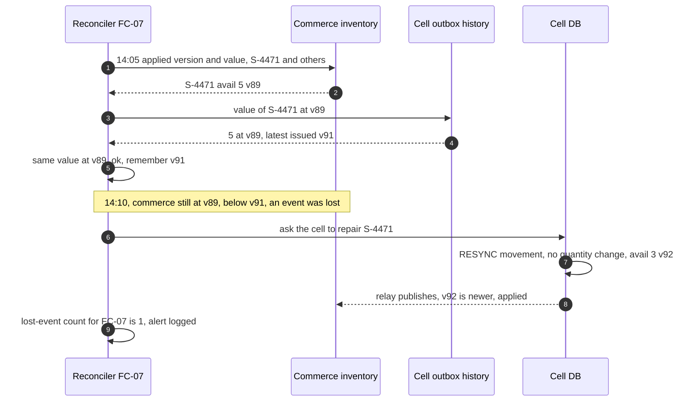

**What changed.** New: the reconciler at commerce's version with 7 days of outbox history, repairs through a `RESYNC` movement at a new version, the hold rule including shorts, the relay's flush before order events, heartbeats, relay-lag paging. Deep dive: [`deep-dives/realtime-sync-to-commerce.md`](deep-dives/realtime-sync-to-commerce.md).

### 5.7 "One center's database dies, or the building loses its network at 23:30. What keeps working, and what does a center do while it is cut off?"

**What breaks in the current design.**
1. **Anything shared on the write path.** One database or one deploy for all FCs means one bad migration stops 100 buildings.
2. **The building's WAN link.** Every scan crosses it. A fiber cut at 23:30 stops the night.
3. **The cell primary or its AZ.**
4. **The region.** Buildings do fail too: Coupang's 10-K reports "a fire at our Deokpyeong fulfillment center which caused extensive damage" in June 2021 (verified).

**Bad: one central WMS database for every FC.** Scale is fine (3k scans/s for the network). Blast radius is not: a bad schema change, a runaway query or a failover pauses every building at once, at whatever hour it happens.

**Good: run each cell on-premises in its building.** A WAN cut does not touch picking. Costs: 100 database clusters on hardware we must patch, back up and replace; a fire takes the stock record with the stock; and while cut off, the FC is still invisible to commerce, so order intake stops anyway.

**Great: one cell per FC in the cloud region, an edge gateway in each building, and a bounded survival mode.**
- **The cell.** One Postgres cluster plus its services: a primary and two standbys in the other two AZs, committing with `ANY 1` of the two (the AZ c standby also serves reads). On a primary loss the **more advanced** standby is promoted. **Fencing:** the primary holds a leader lease in a consensus store (Patroni on etcd style, one small etcd cluster per group of ~10 cells [estimate]); a primary that loses its lease demotes itself, the write proxy routes only to the lease holder, and promotion waits for the old lease to expire, so two primaries never accept writes at once. Cells share nothing on the write path. Deploys go cell by cell, so a bad release costs one building.
- **Shared pieces, with their blast radius stated.** Regional Kafka: the feed to commerce stops for every FC, floors keep working, and outboxes fill (1 hour at the network peak is ~1M rows, nothing). Device identity and MDM: new logins fail, open sessions continue.
- **The edge gateway.** Two small servers per building, active and standby. Every scan passes through it. It journals every scan for 24 h by `(device_id, stream_id, seq)`, holds the next batch for each active picker (the current one is on the handheld: ~2 batches, ~40 minutes of work), and holds a leased block of carrier label ids.
- **The WAN.** Two carriers on separate paths, plus an LTE or 5G backup sized for scans only (300 KB/s).
- **Survival mode** (every path down): the edge confirms planned steps for batches it holds, journals every scan, prints labels from its block, lets pack and load continue, and applies the lease rules of §5.3 locally. It refuses what needs the cell: allocation, new batches, put-away decisions (receiving goes to the dock only) and re-allocation after a short (the item goes to an exception tote). 375 pickers × 40 min × 120 UPH ÷ 60 = **30k units**, the whole midnight backlog.
- **In the cloud meanwhile.** The cell **stops the lease clocks** for every task in that building, so nothing expires behind the floor's back. It keeps taking and allocating orders but cannot release work to the building. Its stock heartbeat carries `floor_contact_age`, the seconds since the edge last reached it, so commerce sees the cut within seconds; after 5 minutes the cell also publishes `fc_capacity = 0` for the dawn cut-off, and commerce routes new dawn orders elsewhere. Commerce still gets allocation events from the cloud; only events from the floor (put aways, shorts, damage) are late, and the "down" ones are absorbed by the short-pick flow.
- **Reconnect.** The edge replays its journal in device order; `(device_id, stream_id, seq)` dedup drops what the cell already has. Only then do the lease clocks restart.
- **Region loss.** Each cell has an async replica in a second region.
  1. **Fence the old region first.** Before the DR cell reopens, it takes the cell's lease in the DR region's consensus store and bumps the relay's Kafka producer epoch, so a zombie relay from the old region cannot publish. If the old region comes back, its old primary has no lease, demotes itself, and its writes, on an old timeline with an old epoch, are rejected by the edge and ignored by commerce's newer-version rule.
  2. **Epoch from the clock.** `epoch = max(epoch in the DB + 1, promotion time in unix seconds)`, and `stock_version = (epoch << 31) | counter`. A DR replica that missed an earlier in-region failover would otherwise re-issue an epoch commerce has already applied: simulated, 834 fresh events dropped as old and ~443 shorts in the hour. An alert fires whenever the DR replica's timeline differs from the primary's.
  3. **A recovery barrier.** No heartbeat, no allocation and no publishing until intake has re-read `orders.fc-<fc>` from the offset stored in the cell DB (in the same transaction as each insert) and the edge journals have replayed. Then the lanes run, the relay publishes a fresh `stock_changed` for every SKU changed in the last hour, and heartbeats resume. Allocating before the journals replay re-allocates against stock that is missing the floor's put-aways: losing 60 s of commits costs ~71 shorts in the hour without the barrier, ~12 with it.
  4. **What can be lost.** Every stock-mutating command from the floor, scans and supervisor adjustments alike, passes through the building edge's journal (24 h), so the DR cell replays both; commands from commerce replay from `orders.fc-<fc>`, mirrored to the DR region, by the offset stored in the cell DB. Floor and commerce RPO is therefore 0. What remains is **cloud-only admin edits** (ASNs posted by procurement, counts requested from an office, configuration): those lose up to the async replication lag, a few seconds [estimate], and their callers re-send with the same `asn_id` or `request_id`. RTO ~30 minutes, inside the survival window; the barrier itself takes ~2 to 3 minutes.

**Challenges.** Survival mode is a second, rarely used code path: it is drilled monthly in every building (WAN pulled at 15:00 for 10 minutes). The edge is new hardware in 100 buildings, owned by a site platform team.

**Push back on the textbook answer.** "Make every building fully autonomous." It survives a WAN cut better and a fire worse, and the FC is invisible to commerce while cut off either way. The extra autonomy buys picking for orders we already hold, which survival mode already covers for the ~40 minutes that matter.

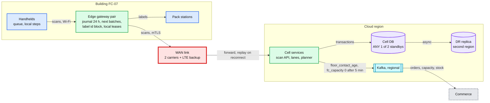

**What changed.** Cells per FC with per-cell deploys, an `ANY 1` quorum of two standbys, the edge gateway and journal, survival mode with local lease rules, lease clocks stopped in the cloud, `floor_contact_age` and capacity 0 when cut off, leader leases with fencing, DR promotion that fences the old region first, a clock-based epoch, a recovery barrier, and the edge journal for every floor command. The building-level timeline is [D5 in diagrams.md](diagrams.md#d5-failure-paths); edge cases: [WAN cut](edge-cases.md#edge-case-the-buildings-wan-is-cut-at-2330-for-25-minutes), [region loss](edge-cases.md#edge-case-the-region-is-lost-and-the-dr-replica-is-promoted).

---

## 6. Final design and the six core flows

Everything from §5 composed. 12 nodes; zoom-ins in [`diagrams.md`](diagrams.md).

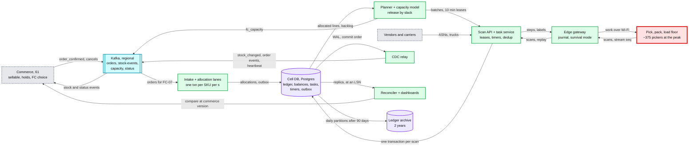

The six flows below are the ones to say from memory. Each is the final design, not the §4 version.

### Flow 1: a put away becomes sellable in ~0.2 s

1. 21:10:00.000: the worker scans bin `A-12-03` and a case of 12 `S-4471`. One transaction: movement `CART-17 → A-12-03`, balance +12, available 3 → 15, `stock_version` 89, outbox row.
2. ~0.05 s: the CDC relay publishes `stock_changed(S-4471, FC-07, 15, 89)`, key `S-4471`.
3. ~0.1 s: commerce applies it because 89 is newer than its 88. Sellable = 15 minus 1 unacknowledged hold.
4. If the relay restarts and sends v89 again, commerce ignores it. Picture: [FR4 sequence](#44-every-receipt-pick-short-pick-damage-and-shipment-reaches-commerce-within-seconds-and-dashboards-show-the-floor-live).

### Flow 2: the 23:59 dawn order makes the 02:00 truck

1. 23:59:00: `order_confirmed(ord_9001, ord_9001-1)` on `orders.fc-07`. Intake inserts it, idempotent on the fulfillment id.
2. 23:59:01: each line's lane allocates in its 1 s batch: available down, `stock_changed` then `order_allocated`. Commerce drops the hold once it has applied that version.
3. ~00:03: a zone B picker frees up; the planner puts the line in a 20-line batch (slack 12 minutes to the 00:15 release deadline) and leases it to her handheld.
4. ~00:25: picked. ~00:45: packed, labeled, `order_packed`. ~01:00: sorted. ~01:20: scanned into trailer `TR-12`.
5. 02:00: `TR-12` dispatched, contents to `CARRIER`, `order_shipped`. All night, the capacity model kept `fc_capacity` above zero only while ~375 pickers could clear the backlog by 00:40. Picture: [§5.5](#55-an-order-is-placed-at-2359-for-7-am-walk-it-to-the-truck-where-is-the-time-spent-and-what-is-the-real-bottleneck).

### Flow 3: a short pick at 00:05 on a hot SKU

1. The picker finds 1 of 2 at `A-12-03` and scans `short`.
2. One transaction: pick of 1; the `(A-12-03, S-4471)` balance is held (its unallocated units leave available, `stock_changed`); only the missing unit goes back to the lane; the 6 other open allocations on that bin stay; a priority count is due within ~5 minutes.
3. The lane re-allocates the missing unit from `A-14-01`; a runner picks it at top priority, inside the 00:15 release deadline.
4. 00:10: the count finds 4 units. It keeps 4 of the 6 allocations (earliest trucks first), releases 2 to the lane, which places them on `B-02-11` before 00:15, and books `A-12-03 → LOSS` for the rest. Hold ended. No `order_line_short` was needed. Picture: [§5.4](#54-a-picker-reaches-a-bin-and-it-is-empty-what-happens-to-the-order-the-bin-record-and-availability-on-the-website).

### Flow 4: 30 scans arrive late after a Wi-Fi gap

1. `hh-0342` enters aisle 14's dead zone after sending seq 412 and 413 on stream `s1`; their replies are lost.
2. For 3 minutes the picker keeps going: each step is checked on the device and queued (seq 414 to 441).
3. On reconnect: `scans:batch` 412 to 441. The cell returns stored results for 412 and 413 and applies 414 to 441 in order in ~140 ms.
4. No task was re-issued: her steps were never idle for 10 minutes, and had her handheld stayed silent longer, they would have waited as `UNCONFIRMED` for up to 20 minutes. Picture: [§5.2](#52-a-handheld-loses-wi-fi-in-an-aisle-and-sends-30-scans-late-how-do-you-handle-duplicates-and-ordering-and-still-answer-in-300-ms).

### Flow 5: the building's WAN is cut at 23:30 for 25 minutes

1. 23:30: both carriers drop; the LTE backup fails over in ~30 s [estimate] but, in the worst case, is down too. The edge enters survival mode.
2. Pickers keep working from their current and next batches; scans are journaled on the edge; packers print labels from the leased id block; the edge applies the lease rules locally.
3. In the cloud the cell stops every lease clock in FC-07, so no step expires behind the floor's back, and its heartbeats carry a growing `floor_contact_age`. 23:35: still taking orders, the cell has not heard from the building for 5 minutes and publishes `fc_capacity = 0` for the dawn cut-off. Commerce sends new dawn orders to other FCs.
4. 23:55: the link returns. The edge replays ~65k journaled scans (25 minutes × ~44/s) in device order, ~2 minutes at ~500 transactions/s; dedup drops nothing new; then the lease clocks restart, capacity is republished and release resumes. No step was re-released and no false over-pick was flagged. Picture: [D5 in diagrams.md](diagrams.md#d5-failure-paths).

### Flow 6: the reconciler catches a lost event

1. 14:00: a commerce consumer bug skips one record: `stock_changed(S-4471, FC-07, 3, v91)`. Commerce still shows v89, available 5.
2. 14:05: the reconciler asks commerce: v89, available 5. The outbox history says the WMS value at v89 was 5: consistent. It notes the latest version issued, v91.
3. 14:10: commerce is still at v89, below the v91 the previous run saw: an event was lost. The reconciler asks the cell to repair; the cell writes a `RESYNC` movement (no quantity change) that bumps the version and emits `stock_changed` (available 3, v92) through its outbox, and commerce applies it because it is newer. An alert records the lost event. At most 10 minutes of selling against 5 instead of 3, bounded further by holds. Picture: [§5.6](#56-commerce-says-5-units-are-sellable-the-warehouse-says-3-who-is-right-how-fast-do-they-converge-and-how-do-you-prove-they-agree).

---

## 7. Trade-offs

| Decision | Option A | Option B | Chose | Why |
|---|---|---|---|---|
| Stock model | Event-sourced log, balances as a projection | Movement ledger + balances in one transaction | Ledger + balances | Same audit trail; the never-negative check reads a current balance, not a lagging one |
| Concurrency on a bin | Optimistic retries, or per-line row locks | Conditional `UPDATE` guards, one lock order, per-SKU allocation lanes | Guards + lanes | Per-line is fine at ~100 lines/s; in a 2,000-line burst the lane keeps every other SKU at ~3 ms instead of ~5.5 s p99 |
| Counts vs picks | Freeze the zone, or count and hope | Wait for open tasks, then judge late movements by device time | Bin-level protocol on device time | Exact counts (51 phantom units to 0 in simulation) with a few minutes' wait per bin and a rare recount, no zone freeze |
| Release | Hourly or 15-minute waves | Continuous, by deadline slack | Continuous | No release bursts, no idle tails. Cost: less dense batches, tuned by a hold-back policy |
| Workflow | Temporal workflow per order | Task and line rows + timer table in the cell DB | Rows in the cell DB | One transaction for the movement and the state. No second source of truth |
| Handheld | Online thin client | Local-first steps, a sequence per stream, exceptions that advance it | Local-first | A dead zone does not stop a worker. Cost: an app with a queue and a sequence to get right |
| Task leases | Renewed by heartbeats | Renewed only by scans; silent devices `UNCONFIRMED` for 20 min; clocks stopped when a building is cut off | Progress-based | Breaks release work in 10 min; a WAN cut causes no lease storm (11,306 re-releases to 0) |
| Feed to commerce | Deltas, or commerce polls | Absolute values, per-(SKU, FC) version, outbox + CDC | Versioned absolutes | Duplicates and reordering are harmless; lost events are repaired by the next one or the reconciler |
| Proof of agreement | Diff against the replica's latest values | Compare at commerce's own version every 5 min, from 7 days of outbox history | At commerce's version | ~59.6k false pages a day per FC to 0, and every real loss found within two runs |
| Short pick | Zero the bin, or move every allocation off it | Hold the balance, re-allocate only the shorted unit, count within ~5 min | Hold + count | 22 lines miss the truck instead of 1,900; no flapping availability |
| Isolation | One WMS for all FCs, or on-prem cells | Cloud cell per FC + edge survival mode | Cloud cell + edge | One building per failure or deploy; survives a WAN cut ~40 min and a fire keeps the record |
| Bottleneck | Scale machines for midnight | Capacity model publishing `fc_capacity`, UPH work | Capacity + UPH | The midnight spike is ~10 lines/s and 375 people; only the second is scarce |
| Refused to build | A global inventory database across FCs, cross-FC transactions, synchronous stock reads from checkout, a workflow engine per order, hourly waves, zeroing bins on a short, a full on-prem stack per building, robot control | | | Each costs more than it returns here, or promises what the floor cannot keep |

**Consistency model, stated once.** Scan to cell DB: strong, single writer per FC, idempotent per `(device_id, stream_id, seq)`. Handheld queue to cell: at-least-once, in order per stream, deduplicated. Cell DB to commerce: at-least-once, commit-ordered per SKU, eventual under 2 s p99, applied only if the version is newer. Commerce to WMS orders: at-least-once, idempotent on `fulfillment_id`, with tombstones for cancels that arrive first. `fc_capacity`: eventual, ~60 s, counting only acknowledged fulfillments. Capacity holds: at-least-once, idempotent on `(deal_id, fc, cutoff)`. Dashboards: eventual, ~5 s. Edge survival mode: eventual, bounded by the outage. Reconciler: a proof every 5 minutes. **It changes in two places:** at the outbox (strong inside the cell, eventual after it) and on the handheld (local-first for planned steps, strong for decisions). Details per edge in §10.6.

---

## 8. Staff-level notes

- **Simplest thing that meets the requirement.** One Postgres cluster per FC, a CDC relay, a shared Kafka, a planner, a handheld app with a queue, and a two-box edge per building. We refused a global inventory database, a workflow engine, a cache in front of balances, and synchronous reads from checkout (§7). The cleverness is in the release policy, the exception paths and the contract.
- **Failure modes and blast radius.**
  - A cell primary: its leader lease expires (10 s), it demotes itself if it is still alive, and the more advanced of its two standbys takes the lease and is promoted in ~30 s; handhelds keep confirming planned steps locally and resend by sequence; one FC, ~30 s of slower decision scans, no lost scans (§10.4).
  - A building's WAN: survival mode for ~40 minutes; capacity 0 for new dawn orders after 5 minutes (§5.7).
  - Regional Kafka: commerce's view of all FCs freezes, heartbeats go stale, floors keep working, outboxes hold ~1M rows an hour. Commerce keeps selling against holds; only physical "down" events are late.
  - The CDC relay of one cell: that FC's feed stops; WAL grows ~0.4 GB an hour; relay lag pages at 30 s.
  - The region: every cell fails over to its DR replica in ~30 minutes, inside the survival window: the old region's cell is fenced first (lease and Kafka producer epoch), then a clock-based epoch and a recovery barrier; edge journals replay every floor command, Kafka replays commerce's; only cloud-only admin edits can lose seconds.
  - The consensus store: losing an etcd cluster would stop lease renewals for its ~10 cells. Patroni-style failsafe mode keeps a primary that can still reach all its standbys, so an etcd outage alone does not demote anyone.
  - A building: the Deokpyeong fire of June 2021 (10-K) is the model. The record survives in the cloud. An operator marks every bin in FC-07 `BLOCKED`: available goes to 0 for its ~500k SKUs (~500k `stock_changed`, a few minutes of relay time), and every open order gets `order_line_short`, so commerce re-sources within minutes. `LOSS` adjustments wait for the insurance survey.
  - **Biggest blast radius:** a bad release of the allocation code that over-allocates. Guards make a negative balance impossible, but a bug in bin choice could strand a night's orders. Hence deploys go cell by cell, the smallest FC first, never between 20:00 and 03:00, with the dawn on-truck rate as the gate.
- **Migration from an existing vendor WMS** (Picnic did this by having the vendor emit events and rebuilding feature by feature, survey row 4a, secondary):
  1. Event tap: the vendor WMS emits movements; a shadow cell builds a ledger from them. Balances are compared per bin daily until they match for 14 days.
  2. Shadow feed: the shadow cell emits `stock_changed` to a shadow topic; commerce compares it with the current feed. No traffic moves.
  3. Cutover per FC on a quiet afternoon: stop release at 13:00, let open tasks finish (≤ 30 minutes), snapshot vendor balances, load them as `MIGRATION → bin` movements, push the new handheld app by MDM, point `orders.fc-07` at the cell, resume at 14:00. A new epoch starts `stock_version`.
  4. Rollback for 7 days: export the cell's balances back into the vendor WMS (the migration movements make it auditable) and flip the order topic back.
  5. Order: 1 FC, then 5, then ~20 a month, never in the four weeks before a big sale event. [D12](diagrams.md#d12-rollout--migration).
- **Operability.** SLOs over 28 days:
  - decision-scan p99 under 300 ms per cell, in 99.9% of 5-minute windows;
  - commit to commerce applied p99 under 2 s;
  - zero value mismatches at commerce's version; zero lost events left unrepaired after two reconciler runs;
  - ≥ 99.5% of dawn units on their truck;
  - scan API availability 99.95% per cell.

  Pages at 3 am (on-call is staffed most heavily 22:00 to 03:00, the dawn crunch):
  - decision-scan p99 over 1 s for 5 minutes in any cell;
  - a cell failover, or standby lag over 10 s;
  - CDC relay lag over 30 s, or an FC's heartbeat stale over 60 s on any partition of the stock topic;
  - a value mismatch at commerce's version, a SKU still below the version the previous run saw, or commerce above anything the cell ever issued;
  - the DR replica's timeline differs from the primary's;
  - any edge in survival mode (site platform and network on-call);
  - the nightly invariant job finds a violation.

  Not an engineering page: a projected dawn miss (backlog over capacity before 00:40) pages the site operations manager; one short pick, one offline device or one stuck task goes to a supervisor's screen.
- **Cost** [estimate, list prices]:
  - ~20 large cells at ~$6k/month (3 database nodes of 8 vCPU, a DR replica, services) and ~80 small ones at ~$2k: ~$280k/month;
  - regional Kafka ~$10k/month; edge servers 200 × ~$6k over 4 years ~$25k/month; ledger archive, a few TB, negligible.

  About **$0.32M a month, ~$3.8M a year**. The handheld fleet (~100k devices × ~$1,500 over 4 years) is ~$37M a year, ten times the servers, and picking labor is ~$180M. So software spend is justified by UPH: 1% is ~$1.8M a year.
- **Team boundaries.**
  - Inventory core: ledger, balances, availability, the commerce contract, the reconciler.
  - Fulfillment execution: allocation lanes, planner, capacity model, tasks and timers, the handheld app.
  - Inbound: ASNs, receiving, the put-away director.
  - Site platform: edge gateways, the device fleet and MDM, Wi-Fi with facilities.
  - Commerce availability (#61): holds, sellable stock, FC choice. The contract is the event schemas plus the version and hold rules, in a schema registry.
  - Network planning: consumes `fc_capacity` and ledger exports; owns transfers between FCs.
  - Site operations (not engineering): labor plans and supervisors. They own the capacity model's inputs.
- **Explicit trade-off.** We accept a few minutes' wait for counts, less dense batches early in the evening, a second code path for survival mode, and up to one reconciler period of drift after a lost event. In return, counts are exact, the floor never waits on the network for a planned step, commerce is never more than seconds behind, and a center that cannot make its truck stops promising.

---

## 9. What is expected at each level

**Mid (80/20 breadth/depth).** Tables for inventory per bin, orders and tasks. Decrement stock on pick in a transaction. Receive and put away, pick, pack, ship as steps. Publish stock changes to a queue for the website. Hourly waves. May decrement a single quantity per SKU, may use deltas on the feed, and may not notice that a count can race a pick.

**Senior (60/40).** Per-bin balances with conditional updates or row locks, a movement history, an outbox to Kafka, idempotent scans with request ids, short picks that re-allocate, task timeouts, lots with FEFO. A cell or shard per FC. Goes deep on one of concurrency, the stock feed or scanners.

**Staff+ (40/60).** Everything above, plus:
- says early that QPS is tiny and the constraint is picker-hours before the cut-off, with the 375-picker arithmetic, and picks that as the red node;
- works the dawn deadline backwards into a release deadline and turns it into a live `fc_capacity` that sheds demand to other FCs;
- double-entry ledger with balances in the same transaction, and pushes back on event sourcing and CRDT counters for a never-negative invariant;
- serializes allocation per SKU instead of tuning locks, and gives the count protocol that prevents the double decrement;
- treats scans as facts: local-first steps, a sequence per install stream, leases renewed only by progress, over-picks judged by who scanned first;
- versioned absolute values to commerce, the hold rule, a flush before order events, and a reconciler that compares at commerce's own version;
- holds the (bin, SKU) balance on a short and lets a count decide, instead of zeroing it or moving every allocation;
- cell per FC with an edge survival mode, the blast radius of each shared piece, and per-cell deploys with a night freeze;
- migrates FC by FC from the vendor WMS with an event tap and a rollback.

---

## 10. Nitty-gritty (past interview scope)

### 10.1 Internals of each chosen technology

**Postgres, as the cell uses it.**
- **The guard.** `UPDATE balance SET on_hand = on_hand - 2 ... WHERE ... AND on_hand >= 2` takes a row lock. If another transaction holds it, this one waits; when that commits, Postgres re-reads the newest version of the row and re-evaluates the `WHERE` before updating (the "EvalPlanQual" re-check under READ COMMITTED). So the guard is checked against the committed value, without SERIALIZABLE and without retries.
- **Durability.** `synchronous_commit = on` with `synchronous_standby_names = 'ANY 1 (az_b, az_c)'`: a commit returns once one of the two standbys, in the other two AZs, has the WAL flushed. ~1 to 2 ms more per commit. Because either standby may be the one that acknowledged, failover promotes the **more advanced** of the two (highest replayed LSN), and a failover loses nothing acknowledged. The primary holds a leader lease in etcd (Patroni style): it demotes itself when the lease lapses, the write proxy sends writes only to the lease holder, and a standby is promoted only after the old lease has expired. The AZ c standby also serves the dashboards' and the reconciler's reads.
- **Outbox by logical decoding.** The relay reads a logical replication slot (`pgoutput`). The slot remembers the last position the relay confirmed, and the primary keeps WAL after it. The relay confirms only after Kafka acknowledged, so a crash re-publishes, which versions make harmless. Debezium's outbox router does this off the shelf.
- **Retention by partition.** `MOVEMENT` (primary key `(day, movement_id)`) and `OUTBOX` are range-partitioned by day. Retention drops a partition: no mass delete, no vacuum storm. Idempotency tables (`DEVICE_STREAM`, `SCAN_RESULT`, `API_REQUEST`) are deliberately not partitioned, because a unique key on a partitioned table must include the partition column.
- **Timers.** `SELECT ... FROM timer WHERE due_at <= now() ORDER BY due_at LIMIT 100 FOR UPDATE SKIP LOCKED`, fired in the same transaction as the state change.

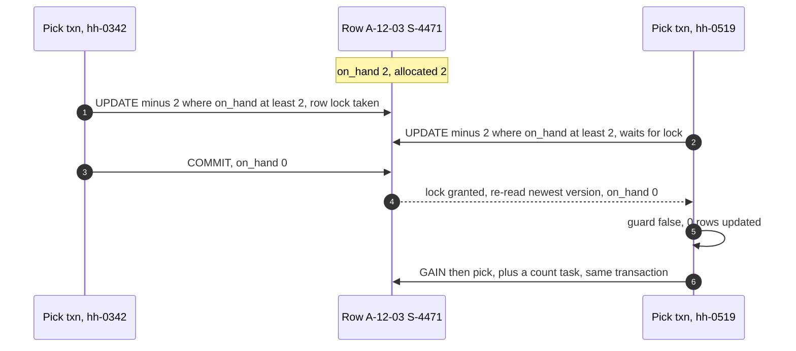

**Kafka, as the contract uses it.** `wms.stock-events` has 64 partitions keyed by `sku_id`, replication 3 across AZs, `acks=all`, `min.insync.replicas=2`, idempotent producer. Ordering is per partition, so per SKU: `stock_changed vN`, then `order_allocated vN`, then `order_line_short vN` arrive in commit order. The relay coalesces `stock_changed` per SKU for up to 100 ms but flushes a SKU's pending value before any order event of that SKU, so coalescing never reorders them. Commerce does not need exactly-once: it applies `WHERE version < :v`, so a re-delivery or a replay after a consumer reset is a no-op. Each relay writes its FC's heartbeat to all 64 partitions every 5 s, and a consumer tracks the last heartbeat per (partition, FC). `orders.fc-<fc>` has 4 partitions per FC keyed by `order_id` (deal messages by `deal_id`), so each cell consumes only its own topic; intake dedups on `fulfillment_id`.

**The handheld app.** Android on an MC3300-class device. A local SQLite database holds the current batch and an outbound queue. The app registers a stream at install and after any loss of app data. Showing "OK" and appending `(stream_id, seq, event, device_time)` to the queue are one local transaction. A sender loop drains the queue in order over one connection, through the edge; on a gap reply it rewinds. Wi-Fi roaming uses 802.11r fast transition (verified on the spec page); the app treats any send that has not been acknowledged within 2 s as "offline" and keeps the worker moving.

**The edge gateway.** Two servers with a virtual IP. Every scan is appended to a local journal (segment files plus an index by `(device_id, stream_id, seq)`) before it is forwarded. It caches the next leased batch per active picker and a block of 10k carrier label ids leased from the cell. In survival mode it answers handhelds itself for planned steps, using the same checks as the app, and applies the lease rules of §5.3 locally while the cloud's clocks for the building are stopped.

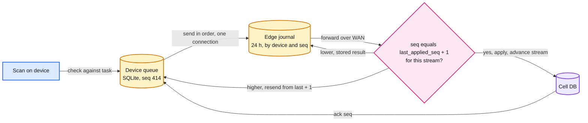

### 10.2 Configuration knobs that matter

| Component | Knob | Value | Why |
|---|---|---|---|
| Postgres | `synchronous_standby_names` | `ANY 1 (az_b, az_c)` | No acknowledged loss on an AZ failure, ~1 to 2 ms per commit; failover promotes the more advanced standby |
| Postgres | `lock_timeout` on scan transactions, `statement_timeout` | 200 ms, 2 s | A scan never waits seconds behind a lock; it fails fast and the device retries by sequence |
| Postgres | replication slot lag alert, page | 2 GB, 5 GB | Relay stalls show up long before disk is at risk |
| Allocation | lanes per cell, batch interval | 16, 1 s | ≤ 1 s added to allocation; one writer per SKU |
| Planner | release deadline for the 02:00 truck, hold-back for slack-rich lines | 00:15, up to 30 min | Batch density early, everything released in the last hour |
| Tasks | lease, renewed by | 10 min, scans only | A break with the handheld in a pocket must not hold work |
| Tasks | heartbeat, silent after, silent device's steps held | 30 s, 60 s without one, `UNCONFIRMED` up to 20 min after the last contact | 1.3% of offline queues come home after 10 minutes; 20 catches them all |
| Tasks | device offline cap | 8 min or 300 events, then the worker walks to Wi-Fi | Bounds how stale the cell's picture is; it no longer protects the lease |
| Tasks | stuck threshold | 2x the 7-day p90 per task type | Catches silent stalls before trucks load |
| Kafka | partitions on `wms.stock-events`, `acks`, `min.insync.replicas` | 64, `all`, 2 | Per-SKU order, no acknowledged loss |
| Relay | coalescing window for `stock_changed` per SKU | 100 ms, flushed before any order event of that SKU | Safe for absolute values; never coalesce order events, never let them overtake the pending value |
| Capacity | publish interval, change threshold, reserve | 60 s, 5%, 2% | Fresh enough for commerce's FC choice, not noisy; `capacity_version` makes the cadence a freshness choice, not a correctness one |
| Capacity | stale signal in the last hour before a cut-off | no update for 2 min means 0 | A Kafka outage must not keep promising a building's last minutes |
| Capacity | ceiling on open flash-deal holds per cut-off | 30% of planned capacity [estimate] | A deal cannot starve regular orders |
| Relay | heartbeat interval, partitions written | 5 s, all 64 | Staleness is judged per (partition, FC) |
| Reconciler | interval, full-sweep slice, outbox history kept | 5 min, 1/288 per run, 7 days | Each SKU checked daily, at commerce's version; a lost event caught within two runs |
| Edge | journal retention, label id block | 24 h, 10k ids | Covers a region failover and a night of survival mode |

### 10.3 Capacity math per component

| Component | Per unit | Busiest FC at the night peak | At 300 scans/s design | Closest to its limit? |
|---|---|---|---|---|
| Cell DB primary | ~5k short write txns/s (8 vCPU) | ~70 txn/s | ~330 txn/s, ~7% | No |
| Cell DB memory | 64 GB | balances 180 MB, availability 30 MB, 90-day ledger indexes ~10 GB | same | No |
| Allocation lane | ~100 SKU batches/s each | a few batches/s per lane | ~10x that at 10x volume | No |
| Edge gateway | ~5k scans/s, 1 TB disk | 44 scans/s | 300 scans/s, 26 GB journal/day | No |
| WAN link | 1 Gbps per carrier | ~50 KB/s | ~300 KB/s | No, but it is a single path without the backup |
| Kafka cluster | ~100 MB/s per broker | network ~1.2k events/s × 300 B = 0.36 MB/s, plus ~1.3k heartbeats/s × ~50 B | same | No |
| Reconciler | one outbox-history read per FC per 5 min | ~5k SKUs per run | ~10k | No |
| **Pick floor** | ~120 UPH per picker | **45k units/h needs 375 pickers, ~15 min slack** | n/a | **Yes. The red node** |
| Pack floor | ~75 parcels/h per packer | 15k parcels/h needs 200 packers | n/a | Next after picking; same capacity model |

### 10.4 Failure timeline

**(1) The cell primary dies at 23:40, at the peak.**

```mermaid
%% Cell DB primary failure at 23:40. Planned steps keep confirming on the handhelds. Decision scans stall about 30 s. No acknowledged scan is lost because every commit waited for one of the two standbys.
sequenceDiagram
    autonumber
    participant H as Handhelds
    participant A as Scan API
    participant P as Primary, AZ a
    participant S as Standby, AZ b, more advanced
    participant O as On-call
    Note over P: 23:40:00 primary host fails, its leader lease stops renewing
    H->>H: planned steps confirmed locally, queued by seq
    A->>P: decision scans time out after 2 s
    S->>S: 23:40:10 old lease expired, the more advanced standby takes it and promotes
    S->>S: epoch is max of db epoch plus 1 and promotion time, versions keep rising
    A->>S: 23:40:30 write proxy routes only to the lease holder
    H->>A: queued scans resent by seq, duplicates dropped
    A->>O: page, cell FC-07 failover, no data lost
    Note over H,A: 23:40:40 decision scans normal, relay resumes from its slot
```

Detection ~10 s (the lease TTL), failover ~30 s. Data at risk: none acknowledged (each commit waited for one of two standbys, and the more advanced one is promoted). Split brain: none, because a primary without the lease demotes itself and the proxy writes only to the lease holder. Workers see ~30 s of "waiting" on decision scans only. Commerce sees ~30 s without `stock_changed` from FC-07, then a burst. The new primary needs the relay's slot: it is created on standbys in advance (a failover slot), or the relay restarts from the outbox table by id, re-publishing a few seconds of events that versions make harmless.

**(2) The building's WAN is cut at 23:30.** Survival mode, capacity 0 after 5 minutes, journal replay on reconnect: [D5 in diagrams.md](diagrams.md#d5-failure-paths).

**(3) The region is lost.** Edges enter survival mode at once. Operators declare the region down (~10 minutes), and each cell's DR replica is promoted (~20 minutes, scripted per cell, 100 cells in parallel). The old region's cell is fenced first: the DR cell takes the lease in the DR region's consensus store and bumps the relay's Kafka producer epoch, and writes from the old timeline are rejected. The epoch is `max(epoch in the DB + 1, promotion time in unix seconds)`, so a replica that missed an earlier in-region failover cannot re-issue an epoch commerce has applied. Then the **recovery barrier**: no heartbeat, allocation or publishing until intake has re-read `orders.fc-<fc>` from its stored offset and the edges have replayed their journals (`(device_id, stream_id, seq)` dedup drops what the replica already had; a scan for a task the replica lost becomes an exception movement, never a blocked stream). Then lanes run, the relay publishes a fresh `stock_changed` for every SKU changed in the last hour, and heartbeats resume, ~2 to 3 minutes after promotion. Commerce, if it is in the same region, is down too; if not, it applies its stale-feed margin and then sees a version jump. Data at risk: none for floor commands (scans and supervisor adjustments both pass through the edge journal) or commerce commands (replayed from the mirrored `orders.fc-<fc>` by stored offset); up to a few seconds of cloud-only admin edits, re-sent by their callers with the same id. RTO ~30 minutes, inside the ~40-minute survival window.

### 10.5 Exactly-once and idempotency end to end

| Hop | Duplicates can enter? | Removed where | Key | Lives |
|---|---|---|---|---|
| Handheld to edge to cell | Yes: lost replies, reconnects, journal replay | Cell, in the same transaction as the effect: the stream advances only from `seq − 1` | `(device_id, stream_id, seq)` | `DEVICE_STREAM.last_applied_seq` forever; replies in `SCAN_RESULT`, 7 days |
| Commerce `order_confirmed` to intake | Yes: commerce's relay re-publishes | Intake | `fulfillment_id`, `ON CONFLICT DO NOTHING`; a re-source is a new fulfillment id | Order line rows, 2 years |
| Supervisor adjustments and other stock-mutating API calls | Yes: client retries, edge replay | Cell, in the same transaction as the movement and balance update | `request_id` in `API_REQUEST` | 7 days |
| Commerce `capacity_hold` to the cell | Yes | Cell | `(deal_id, fc, cutoff)`; a duplicate returns the same `granted_units` | Hold row until release |
| Allocation lane crash or pause mid-batch | Yes: a paused old owner wakes after its lane moved | Cell: each batch starts with a fence check on the lane epoch, lines move `RECEIVED → ALLOCATED WHERE state = 'RECEIVED'`, and a crash rolls the batch back | lane epoch, line state | Nightly check that `allocated` equals the sum of `OPEN` allocation rows |
| `order_cancel_requested` before its fulfillment | Yes: a cancel overtakes a re-sent or late `order_confirmed` | Cell | tombstone on `fulfillment_id` | 7 days |
| Cell outbox to Kafka | Yes: relay restart re-reads from its slot | Commerce consumer | `(sku, fc, stock_version)`, apply only if newer | Commerce pool row |
| `order_allocated` to commerce | Yes | Commerce: dropping an absent hold is a no-op | `(fulfillment_id, sku, stock_version)` | Hold table |
| `order_line_short` to commerce | Yes: relay restart | Commerce: a re-source is keyed on (source `fulfillment_id`, line), so a second short never creates `-3` | `(fulfillment_id, line)` | Re-source record |
| Edge journal replay after a region failover | Yes, by design | Cell | `(device_id, stream_id, seq)` | as above |
| Reconciler repair | Yes, by design: a `RESYNC` movement at a new version, through the cell's outbox | Commerce version check | `stock_version` | as above |
| Physical double pick (late scan on a re-leased task) | Yes, only if the new holder already scanned that step | Problem-solve station: units go to a `PROBLEM` tote and are put back | Over-pick flag | Until resolved |

The physical row matters: idempotency removes duplicate **messages**. A duplicate **action** by a person is a real movement and is handled as an exception, not deduplicated away.

### 10.6 Consistency model per edge

| Edge (final design) | Model | Notes |
|---|---|---|
| Handheld to cell, decision scan | Strong, synchronous | p99 300 ms |
| Handheld to cell, planned step | Local first, then at-least-once in device order | Server apply within seconds, or after a gap |
| Scan API to cell DB | Strong (single writer, guards, synchronous standby) | The truth for physical stock |
| Commerce to intake | At-least-once, idempotent on `fulfillment_id`; tombstones for cancels that arrive first | ~1 s |
| Intake to allocation lanes | In order per SKU | ≤ 1 s batches |
| Cell DB to CDC relay to Kafka | At-least-once, commit order per SKU | ~50 ms |
| Kafka to commerce | Eventual, p99 under 2 s, newer-version-wins | Hold rule on top |
| Planner to `fc_capacity` | Eventual, ~60 s, acknowledged fulfillments only, versioned by `capacity_version` | The smaller of pick and pack remaining. Deal holds booked as `max(granted, drawn) − picked` (pack: `− packed`). Commerce subtracts its open non-deal holds and live reservations; stale for 2 min in the last hour means 0 |
| Cell DB to read replica, dashboards, reconciler | Eventual, ~1 to 5 s | The reconciler compares at commerce's version from outbox history, so replica lag cannot look like drift |
| Edge in survival mode | Eventual, bounded by the outage | Replayed in device order |
| Cell DB to DR replica | Async, seconds | Edge journals cover the gap for scans |
| Cell DB to ledger archive | Daily | Audit only |

### 10.7 Alternatives rejected

| Alternative | Why it looked attractive | Why rejected |
|---|---|---|
| One global inventory database (Spanner or CockroachDB style) for all FCs | One place to query, global transactions | No unit is in two FCs, so global transactions buy nothing; every scan pays a quorum round trip; one bad change stops every building |
| Event sourcing with balances as a projection | Perfect audit, replay | The write-time check reads a lagging projection (§5.1). Walmart's write-up proposes it for availability (survey row 4j, a design proposal) |
| Redis for balances | Fast | 300 writes/s need no cache; durability and the ledger need the database anyway |
| DynamoDB per cell with conditional writes | Managed, has conditional updates | A scan touches 5 to 6 items; multi-item transactions cost more and CDC is per item, not per transaction |
| Kafka as the truth, a stream processor holding balances | One log | The never-negative check needs one serialization point per bin, and the ledger, task and order changes must commit together |
| Temporal workflow per order | Durable timers built in | A second source of truth next to the inventory (§5.3) |
| Hourly or 15-minute waves | Every vendor WMS does it | Bursts, idle tails, lost slack (§4.3) |
| Synchronous stock reads from checkout | Never disagree | Couples checkout to 100 cells and their WANs (§5.6) |
| Full on-prem stack per building | Survives a WAN cut | Hardware ops at 100 sites, fire risk, still invisible to commerce (§5.7) |
| Buy a vendor WMS (Oracle WMS Cloud, SAP EWM and others) | Mature features: FEFO, waves, counts | A good answer below ~10 FCs. At 100 FCs the seconds-level stock contract, live FC capacity and deadline release are the differentiators Coupang chose to build (newsroom, secondary) |

### 10.8 How the big companies do it

- **Coupang.** Built its WMS in-house, from inbound receiving to outbound shipping; it picks the shipping FC when the customer pays and processes each order as it arrives rather than batching by the hour (newsroom, survey row 2a, secondary). Its backend separates stock and delivery-date data into a "Stock and Fulfillment" service, treats an FC at daily outbound capacity as closed to new orders, and needs stock fresh in seconds while other data can be minutes stale (engineering post, verified). Our `fc_capacity` and versioned feed are that design made explicit.
- **Amazon.** Stows inventory randomly into fabric pods, ~10 items per compartment on average (tour article, secondary), and runs more than 1 million robots (verified). Robots that bring shelves to people attack the same red node, walking time, with hardware.
- **Picnic.** Started on a vendor WMS and migrated by having the vendor emit events, rebuilding feature by feature; chose Postgres for transactions; later split a warehouse control system for conveyors from the WMS (survey rows 4a to 4c, secondary). Our migration plan (§8) follows the same shape.
- **Oracle WMS Cloud.** Allocation methods on the wave template: FEFO and LEFO, FIFO and LIFO, location sequence, quantity ascending or descending, with secondary ordering as a tie-break (verified). Its 23D notes say FEFO "can be compromised" when one container holds the same SKU with different expiry dates (secondary), which is why our put away does not mix lots in a bin.

### 10.9 Operational runbook

**Dashboards, the 5 metrics.**
1. Decision-scan latency p50 and p99 per cell, and the share of planned steps confirmed offline.
2. Release backlog against capacity per zone, with the minutes of slack to 00:40, live from 21:00.
3. Commit-to-applied freshness to commerce, relay lag and heartbeat age per FC.
4. Reconciler: value mismatches at commerce's version, lost events, old holds.
5. Exceptions per hour: shorts, over-picks, stuck tasks, count variances, adjustments by worker.

**Alerts.** As in §8. Owners: fulfillment execution on-call for the cell services, inventory core for the feed and reconciler, site platform for edges and Wi-Fi, site operations for capacity.

**Rollout.** Cell by cell: the smallest FC first, a day of normal operation, then 10% of cells, then the rest over a week. Never between 20:00 and 03:00, never in the week before a big sale. Gates: decision-scan p99, the dawn on-truck rate, zero reconciler drift, the exception rates within 10% of the previous week. The handheld app ships by MDM in the same rings, with the previous version kept installed.

**Rollback.** Services are stateless code: redeploy the previous version for that cell. Schema changes are expand-then-contract, so the old code runs on the new schema. A bad allocation release: stop the lanes, deallocate the night's open allocations made by the bad version (they are tagged with the release id), re-run the lanes on the old version. Nothing physical needs backfill; the ledger is never rewritten.

### 10.10 Security and abuse

- **Devices.** Each handheld has a certificate issued by MDM; mTLS to the edge and the cell. A lost device is revoked in minutes. Per-device rate limit of 5 scans/s stops a faulty scanner from flooding a cell.
- **Workers.** Badge login per session; every scan carries the worker id; roles limit actions (a picker cannot adjust, a counter cannot pick).
- **Adjustments are the theft vector.** Any adjustment above 5 units or ~$200 needs a second approver. Adjustment and short rates per worker and per bin are monitored; a worker whose shorts are 5x the zone average is reviewed. Counts on high-value SKUs are blind: the counter does not see the expected quantity.
- **Tamper evidence.** No `UPDATE` or `DELETE` grants on `MOVEMENT`. Each daily partition is hashed when exported, and each hash includes the previous day's, so a rewritten history is detectable.
- **The contract.** Only each cell's relay may write `wms.*` topics, only commerce's relay may write `orders.*` (Kafka ACLs); schemas are registered and versioned.
- **Personal data.** No buyer data in the WMS beyond what a shipping label needs; worker ids in the ledger are employee data, pseudonymized in the archive after 90 days.

### 10.11 Evolution

- **10x volume per FC.** A cell at 3k scans/s is still ~60% of one primary. Past that, split a mega-FC into two cells by floor, with moves between them as transfers. The seam: the cell boundary is the FC today and could be a floor tomorrow.
- **Robots and goods-to-person stations.** Vendors claim up to 1,000 picks an hour per station (secondary). They consume the task API; the red node moves from walking pickers to station throughput, and the capacity model's inputs change, not its shape.
- **Transfers between FCs.** Outbound at A to a virtual `IN_TRANSIT` location, plus an ASN generated for B; inbound at B as usual. The seam: the ASN.
- **Returns.** Inbound with source `CUSTOMER`, a QC grade decides `ACTIVE` bin or `DAMAGE`.
- **Selling stock that is still on the dock.** Publish a second number, `inbound_available(sku, fc, eta)`, so commerce can promise later delivery dates against it. The seam: a new event, not a change to `available_qty`.
- **Multi-region.** Cells already live in one region with a DR replica in another; a cell can be placed in whichever region is nearest its building.

---

## 11. Follow-up questions to expect

Ranked by how likely an interviewer asks them. The answers live in this file, [`edge-cases.md`](edge-cases.md) and the deep dives under `deep-dives/`.

1. **Commerce says 5, the warehouse says 3. Who is right and how do you prove they agree?** §5.6, Flow 6, [`deep-dives/realtime-sync-to-commerce.md`](deep-dives/realtime-sync-to-commerce.md), [edge case](edge-cases.md#edge-case-commerce-says-5-sellable-the-wms-says-3).
2. **Every receipt, pick, short pick, damage and shipment must update stock right away. Walk me through it.** §4.4, Flow 1.
3. **Two pick waves and a cycle count on one bin.** §5.1, [`deep-dives/inventory-ledger-and-bin-model.md`](deep-dives/inventory-ledger-and-bin-model.md), [edge case](edge-cases.md#edge-case-two-allocation-batches-and-a-cycle-count-hit-one-bin-at-once).
4. **The 23:59 order. Where is the time, what is the bottleneck?** §5.5, Flow 2, [`deep-dives/cutoff-and-capacity.md`](deep-dives/cutoff-and-capacity.md), [edge case](edge-cases.md#edge-case-at-2320-the-backlog-will-not-clear-by-0040).
5. **A picker finds the bin empty.** §5.4, Flow 3, [`deep-dives/allocation-waves-and-short-picks.md`](deep-dives/allocation-waves-and-short-picks.md), [edge case](edge-cases.md#edge-case-a-short-pick-at-0005-on-a-hot-skus-bin).
6. **A handheld sends 30 scans late.** §5.2, Flow 4, [`deep-dives/scanners-offline-and-idempotency.md`](deep-dives/scanners-offline-and-idempotency.md), [edge case](edge-cases.md#edge-case-30-scans-arrive-late-after-a-dead-zone-two-of-them-duplicates).
7. **A picker walks away mid-task, a tote gets lost.** §5.3, [`deep-dives/workflow-orchestration-and-tasks.md`](deep-dives/workflow-orchestration-and-tasks.md), [edge case](edge-cases.md#edge-case-a-pickers-handheld-battery-dies-mid-batch-with-scans-still-queued).
8. **The building loses its network, or the region goes down.** §5.7, Flow 5, §10.4, edge cases [WAN cut](edge-cases.md#edge-case-the-buildings-wan-is-cut-at-2330-for-25-minutes) and [region loss](edge-cases.md#edge-case-the-region-is-lost-and-the-dr-replica-is-promoted).
9. **Why not event sourcing, or CRDT counters?** §5.1 push back, §10.7.
10. **Waves or waveless?** §4.3.
11. **How does commerce know an FC is full, and how does a flash deal book capacity?** §5.5, `fc_capacity`, `capacity_hold`, [edge case](edge-cases.md#edge-case-a-flash-deals-capacity-hold-is-booked-resent-and-closed).
12. **How would you migrate from a vendor WMS?** §8, [D12](diagrams.md#d12-rollout--migration), [edge case](edge-cases.md#edge-case-cutting-one-fc-over-from-the-vendor-wms).
13. **How do you stop theft through adjustments?** §10.10, [edge case](edge-cases.md#edge-case-theft-hidden-as-count-adjustments-or-fake-shorts).
14. **What changes with robots?** §10.11.
