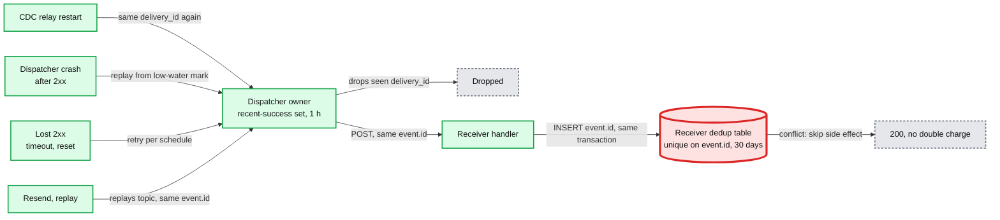
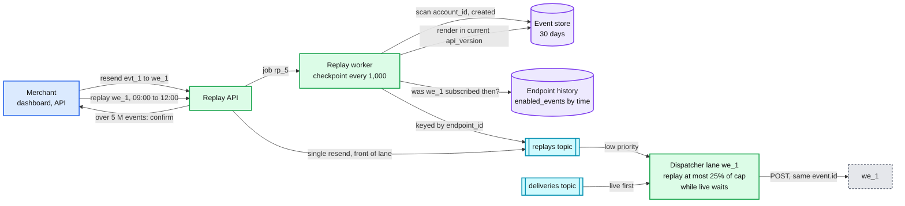

# Deep dive: delivery semantics and replay

> One-line answer: we promise that every event that matches an endpoint is delivered to it **at least once within 3 days of our availability, in no particular order, each copy carrying the same event id, signed fresh per attempt**. Duplicates enter at five places and only two of them are worth removing on our side; the rest are removed by the receiver, with one rule: insert `event.id` into a unique table in the same transaction as the side effect. Ordering is refused because strict order caps a merchant at ~2.5 deliveries/s and lets one poison event block an endpoint for 3 days. Every attempt lands in a 30-day columnar log that powers the dashboard. Resend and range replay re-send the **same event ids** through a co-partitioned `replays` topic that the endpoint's owner serves at no more than 25% of the endpoint's cap while live traffic waits.

Zoom-in on [`../solution.md`](../solution.md) §4.4 (attempt log, resend, replay), §5.5 (duplicates and ordering) and §10.5 (idempotency end to end). Reusable blocks: [`../../../concepts/exactly-once.md`](../../../concepts/exactly-once.md), [`../../../concepts/columnar-db.md`](../../../concepts/columnar-db.md), [`../../../concepts/stream-processing.md`](../../../concepts/stream-processing.md). Related problem: [`../../payments-ledger/`](../../payments-ledger/) (idempotency keys). Siblings: [`outbox-and-event-fan-out.md`](outbox-and-event-fan-out.md) (where `delivery_id` is minted), [`per-endpoint-isolation-and-scheduling.md`](per-endpoint-isolation-and-scheduling.md) (the lane that serves replays), [`signing-and-secret-rotation.md`](signing-and-secret-rotation.md) (the verify step in the receiver below). Facts: [`../research/facts-survey.md`](../research/facts-survey.md).

Acronyms: HMAC (hash-based message authentication code), TTL (time to live), CDC (change data capture), PII (personally identifiable information), API (application programming interface).

---

## 1. The contract, in one sentence each

| Property | What we promise | What we do not promise |
|---|---|---|
| Delivery | At least once per (event, endpoint), while the endpoint is enabled | Exactly once |
| Window | Up to 3 days of **our** availability (deadlines extend during a declared platform fault) | Delivery to an endpoint that has been failing for 72 h |
| Order | None | Order by `created`, per endpoint, or per object |
| Identity | Every copy (retry, resend, replay) carries the same `event.id` | A new id per attempt |
| Authenticity | Every attempt signed with a fresh timestamp | A signature that stays valid for a retry days later |
| Payload | The event as rendered in the endpoint's API version at creation (snapshot) or a thin reference | That the payload is still the current state when it arrives |

Stripe's own wording backs each line: "Webhook endpoints might occasionally receive the same event more than once", "Stripe doesn't guarantee the delivery of events in the order that they're generated", and "Don't use `created` to determine event order" because it is in seconds ([Stripe webhooks](https://docs.stripe.com/webhooks)).

## 2. Where duplicates come from, with rough rates

At ~500 M deliveries a day [estimate]:

| # | Source | Mechanism | Rough rate [estimate] | Removed by us? |
|---|---|---|---|---|
| 1 | Lost 2xx | Receiver committed, response lost or arrived after our 30 s timeout | ~0.5% of attempts time out or reset, maybe half of those were processed: **~1.3 M a day**, ~0.25% of deliveries | No. We cannot know |
| 2 | Dispatcher crash | 2xx received, crash before the low-water mark moved past it | ≤ ~1,800 per crash at peak (30 s of one partition), typically dozens. A few crashes a week | No on a crash. Yes on a graceful handoff: the recent-success set moves with the partition |
| 3 | CDC relay restart | Relay re-reads from `confirmed_flush_lsn` and re-publishes | Seconds of one product DB per restart; minutes after a slot loss | Mostly: same `delivery_id`, dropped by the owner's recent-success set (1 h, in memory) |
| 4 | Resend and replay | On request | Whatever the merchant asks for | No, on purpose |
| 5 | Region failover | Mirrored offsets are approximate | Minutes of a region, rare | No |

Source 1 dominates by three orders of magnitude. That is why the work goes into the receiver contract, not into a cleverer dedup on our side.



**Why the recent-success set is only 1 hour and only in memory.** It exists for source 3, whose duplicates arrive seconds to minutes after the original. A durable, longer set would be a 500 M-a-day write path to remove a source that is already rare, and it still could not touch source 1.

## 3. The receiver reference implementation

What we ship in docs and SDKs. Verify, dedup in the same transaction as the side effect, answer 2xx. Runnable as is with Python 3.9+ (sqlite3 is in the standard library):

```python
import hashlib, hmac, json, sqlite3, time

SECRET = b"whsec_test_secret"
TOLERANCE_S = 300  # 5 minutes, the Stripe library default

def verify(raw: bytes, header: str, secret: bytes, now: int) -> bool:
    parts = [p.split("=", 1) for p in header.split(",")]
    t = next((int(v) for k, v in parts if k == "t"), None)
    sigs = [v for k, v in parts if k == "v1"]          # ignore v0 and unknown schemes
    if t is None or not sigs or abs(now - t) > TOLERANCE_S:
        return False
    expected = hmac.new(secret, f"{t}.".encode() + raw, hashlib.sha256).hexdigest()
    return any(hmac.compare_digest(expected, s) for s in sigs)

def handle(db: sqlite3.Connection, raw: bytes, header: str) -> int:
    if not verify(raw, header, SECRET, int(time.time())):
        return 400
    event = json.loads(raw)
    with db:  # one transaction: dedup row and side effect commit together
        cur = db.execute(
            "INSERT INTO processed_events (id, received_at) VALUES (?, ?) "
            "ON CONFLICT (id) DO NOTHING", (event["id"], int(time.time())))
        if cur.rowcount == 0:
            return 200  # duplicate: already applied, still answer 2xx
        if event["type"] == "payment_intent.succeeded":
            db.execute("UPDATE orders SET paid = 1 WHERE pi = ?",
                       (event["data"]["object"]["id"],))
    return 200

def sign(raw: bytes, secret: bytes, t: int) -> str:
    return f"t={t},v1=" + hmac.new(secret, f"{t}.".encode() + raw, hashlib.sha256).hexdigest()

if __name__ == "__main__":
    db = sqlite3.connect(":memory:")
    db.execute("CREATE TABLE processed_events (id TEXT PRIMARY KEY, received_at INT)")
    db.execute("CREATE TABLE orders (pi TEXT PRIMARY KEY, paid INT)")
    db.execute("INSERT INTO orders VALUES ('pi_123', 0)")
    body = json.dumps({"id": "evt_1", "type": "payment_intent.succeeded",
                       "data": {"object": {"id": "pi_123"}}}).encode()
    for attempt in (1, 2):  # the second POST is the retry after a lost 200
        print(attempt, handle(db, body, sign(body, SECRET, int(time.time()))))
    print(db.execute("SELECT COUNT(*) FROM processed_events").fetchone())  # (1,)
```

Three rules hide in it:
- **Answer 2xx to a duplicate.** A 4xx would make us retry it for 3 days.
- **The dedup row and the side effect share one transaction.** Dedup first and crash before the side effect, and the event is lost; side effect first and crash before the dedup row, and the retry applies it twice.
- **Keep ids for 30 days**, the replay window. Stripe's own API idempotency keys can be pruned "after they're at least 24 hours old" ([idempotent requests](https://docs.stripe.com/api/idempotent_requests)). That is fine for an API retry, which happens in seconds; a webhook replay can come 30 days later.

At scale the handler should only verify and enqueue, and a worker runs the transaction. Stripe: return 2xx "before any complex logic that might cause a timeout". Every second the handler spends is a second of our timeout and a bigger window for source 1.

## 4. Why ordering is refused

- **Strict order per endpoint** needs one delivery in flight. At a 400 ms mean response that is `1 ÷ 0.4 s = 2.5` deliveries/s per endpoint. A top merchant needs 900/s. It would fall behind by ~897 deliveries every second.
- **A poison event blocks everything.** One payload that crashes the receiver's handler is retried for 72 h. With order, every later event for that endpoint waits behind it for 3 days.
- **Order per object** (`pi_123`'s events in order, different objects in parallel) is possible: lane key `(endpoint_id, object_id)` with a cap of 1 per key. It adds per-key state for ~1 M endpoints times their active objects, and it still does not survive replay, which re-sends old events after new ones. Kept as an opt-in seam (solution §10.11), not a default.
- **What receivers do instead.** Treat the payload as a hint. Read the object from the API for its current state, or compare a version on the object and drop older ones. Or use thin events, where there is nothing stale to apply.

## 5. Thin versus snapshot events

| | Snapshot | Thin |
|---|---|---|
| Body | Full object in the endpoint's API version | Event id, type, related object id |
| Size | ~3 KB [estimate] | ~300 B |
| Stale on arrival | Yes, after a retry days later | Nothing to be stale: the receiver fetches current state |
| Order matters | Yes, an older snapshot can overwrite a newer one | No |
| API reads | None extra | One per delivery: ~500 M a day if every endpoint switched |
| PII in receivers' logs | Customer names, emails, addresses | Ids only |
| Rendering | Per API version at fan-out, stored as `EVENT_RENDER` | One render for all versions |
| Our cost | Kafka bytes (~1.65 TB/day on `deliveries`) | Moves to the read API, which is cacheable per object |

Stripe recommends thin events for new integrations. We keep snapshots as the default for existing receivers and recommend thin in every new-endpoint flow.

## 6. The attempt log

One row per attempt, plus terminal-state rows and the fan-out record that lists expected delivery ids (the reconciler's input). ~530 M attempt rows a day at ~500 B is ~265 GB/day raw, ~8 TB for 30 days, ~4 TB after ~4x compression and 2 replicas.

```sql
CREATE TABLE attempts (
    account_id       String,
    endpoint_id      String,
    at               DateTime64(3),
    delivery_id      String,
    attempt_no       UInt8,
    event_id         String,
    event_type       LowCardinality(String),
    replay_id        Nullable(String),
    status_code      UInt16,          -- 0 when there was no HTTP response
    error_class      LowCardinality(String), -- timeout, connect_refused, tls, dns, ssrf_blocked, redirect
    fault            Enum8('endpoint' = 1, 'platform' = 2),
    latency_ms       UInt32,
    response_excerpt String,          -- first 2 KB, escaped on display
    PROJECTION by_event (SELECT * ORDER BY event_id, at)
)
ENGINE = ReplacingMergeTree
ORDER BY (account_id, endpoint_id, at, delivery_id, attempt_no)
TTL toDateTime(at) + INTERVAL 30 DAY;
```

- **Dedup on `(delivery_id, attempt_no)`.** A dispatcher crash can re-send attempt records. The record carries the dispatcher's `at`, so a re-sent copy has the same sort key, and `ReplacingMergeTree` collapses it at merge time. Queries that must be exact (counts on the dashboard) use `FINAL` or `uniqExact(delivery_id, attempt_no)`.
- **The sort key matches the commonest query**: one account's endpoint, newest first. The `by_event` projection serves "what happened to `evt_1`" without a full scan.
- **Lag** is the Kafka sink's batch: 2 to 5 s. The dashboard says "updated a few seconds ago" and never pretends to be live.

Queries it serves:

```sql
-- Endpoint page: last 50 failed attempts
SELECT at, event_type, status_code, error_class, latency_ms, response_excerpt
FROM attempts
WHERE account_id = 'acct_9' AND endpoint_id = 'we_1' AND status_code NOT BETWEEN 200 AND 299
ORDER BY at DESC LIMIT 50;

-- Health chart: success rate per hour, endpoint faults only
SELECT toStartOfHour(at) AS h, countIf(status_code BETWEEN 200 AND 299) / count() AS ok
FROM attempts
WHERE account_id = 'acct_9' AND endpoint_id = 'we_1' AND fault = 'endpoint'
  AND at > now() - INTERVAL 7 DAY
GROUP BY h ORDER BY h;

-- Support: every endpoint's attempts for one event (uses the projection)
SELECT endpoint_id, attempt_no, at, status_code, error_class
FROM attempts WHERE event_id = 'evt_1' ORDER BY endpoint_id, attempt_no;
```

## 7. Resend and range replay



| | Single resend | Range replay |
|---|---|---|
| Call | `POST /v1/events/{id}/resend {endpoint}` | `POST /v1/webhook_endpoints/{id}/replays {from, to, event_types?}` |
| Window | Up to 30 days after creation (Stripe: 15 days in the Dashboard, 30 via the CLI) | Within the event store's 30 days |
| Path | Straight onto `replays`, front of the lane | Replay worker scans, filters, produces |
| Automatic retries of the original | Not cancelled (as at Stripe) | Not cancelled |
| `delivery_id` | `hash(event_id, endpoint_id, replay_id)`: new, so the reconciler tracks it on its own | Same rule |
| Rate | One delivery | The endpoint's catch-up bucket, `max(3x p99 rate, 5/s)`, and at most 25% of its cap while live deliveries wait |
| Guard | None | Over 5 M events needs a confirmation; one active replay per endpoint |

**What "was the endpoint subscribed then" means.** The endpoint DB keeps a small history of `enabled_events` changes per endpoint (one row per change, from the same CDC stream). By default a replay includes an event if, at `event.created`, the endpoint existed and its `enabled_events` matched the type, **whatever its status**: the main use is filling the gap after a `DISABLED_FAILING` period, when matching events were recorded as `SKIPPED`. Two other modes: `match: current` (today's `enabled_events`, for a merchant who just subscribed to a new type and wants its history) and an explicit `event_types` list, which overrides both.

**Which bytes.** A replay renders in the endpoint's **current** API version, rendering and storing it if missing. The receiver's code today expects today's shape; the version an event had on day 0 is the one that broke it.

**Checkpoint and restart.** The worker records `(replay_id, last created, last event_id)` every 1,000 events. A crash resumes from the checkpoint and re-produces at most 1,000 events, which the new `delivery_id` rule makes harmless to the reconciler and the receiver's dedup makes harmless to the merchant.

**How long.** A 3-hour replay of ~18k events at a small endpoint's 5/s floor is ~1 hour; at a top merchant's rate it is seconds. A 30-day replay of 50 M events at ~2k/s is ~7 hours, and it never takes more than 25% of the endpoint's cap while live events wait.

## 8. What an interviewer pushes on

1. **"Just dedup on your side and promise exactly-once."** Our dedup can only see what we sent, not what the receiver applied. Source 1 is ~1.3 M a day and invisible to us.
2. **"Why answer 200 to a duplicate?"** Because any non-2xx is a failure and we would retry it for 3 days.
3. **"Why not order by `created`?"** It is in seconds, distinct events share it, and a retry of an old event arrives after a new one.
4. **"Replays are duplicates on purpose. Do they break the receiver?"** Not if it dedups on `event.id`. That is why the id never changes, and why the dedup table keeps 30 days.
5. **"A replay of 50 M events: does it hurt live traffic?"** No. Same lane, live first, replay at most 25% of the cap under load, and the endpoint's catch-up bucket on top.
6. **"The dashboard says failed but the merchant got it."** Source 1. The attempt shows `timeout`; the merchant's dedup table shows the id. Both are true.

## 9. Trade-offs

| Decision | Chose | Gave up |
|---|---|---|
| Delivery guarantee | At-least-once with a stable event id | Exactly-once, which HTTP cannot give |
| Our dedup | Recent-success set, 1 h, in memory | Duplicates from a crash; a durable set would be a 500 M-a-day write path |
| Ordering | None | Receivers that want order must read current state |
| Default payload | Snapshot, thin recommended | Staleness and PII in receivers' logs, for compatibility |
| Replay identity | Same `event.id`, new `delivery_id` | Receivers must dedup, but the reconciler can track replays |
| Replay version | Current API version | Byte-identical to the original |
| Replay priority | ≤ 25% of cap under live load | A big replay can take hours |
| Attempt log | Columnar, eventual 2 to 5 s, 30 days | Real-time accuracy on the dashboard |

## 10. Numbers to say out loud

- At least once, no order, same `event.id` on every copy.
- Lost 2xx: ~1.3 M duplicates a day, ~0.25% of deliveries. Everything else is noise next to it.
- Strict order: `1 ÷ 0.4 s = 2.5/s` per endpoint against 900/s. One poison event blocks 3 days.
- Receiver keeps event ids 30 days. Stripe's API idempotency keys may go after 24 h.
- Attempt log: ~530 M rows a day, ~4 TB stored, 30-day TTL, 2 to 5 s lag.
- Replay: 30-day window, ≤ 25% of cap under load, checkpoint every 1,000, confirm over 5 M.
