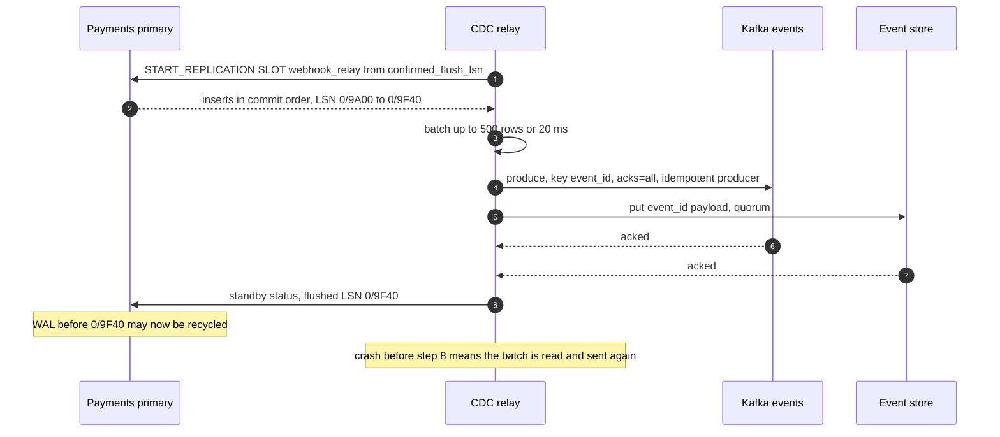
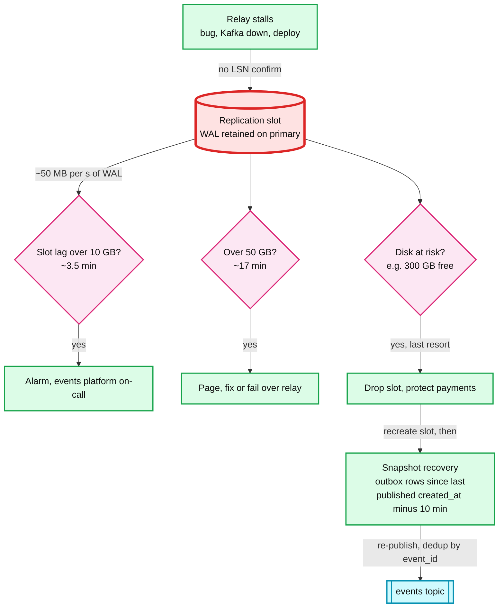
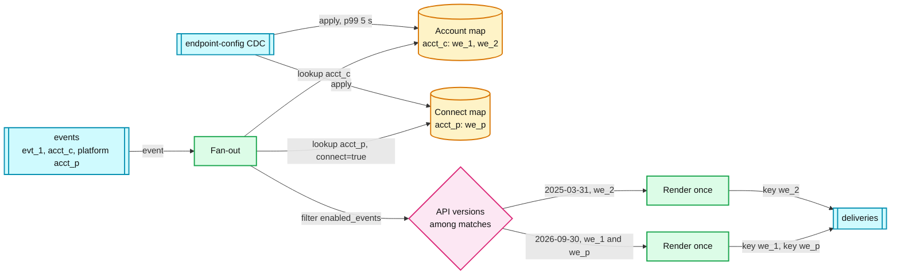

# Deep dive: outbox and event fan-out

> One-line answer: the product service writes the event into an **outbox table in the same transaction** as the business row, so an event exists if and only if the payment does. A CDC (change data capture) relay reads the outbox from the WAL (write-ahead log) in commit order, publishes to Kafka `events` keyed by `event_id`, and confirms its WAL position only after Kafka and the event store both acknowledged. Fan-out matches each event against an in-memory copy of every subscription (the account's own endpoints plus its Connect platform's), renders the body once per API version, and produces one delivery per endpoint keyed by `endpoint_id`, inside a **Kafka transaction** that also commits its consumed offset. A reconciler joins outbox counts to `events`, and fan-out records to outcomes, every hour. The weak point is not Kafka. It is the **replication slot** on the product DB, because a relay that stops reading makes the payments primary keep WAL until its disk fills.

Zoom-in on [`../solution.md`](../solution.md) §4.2 (outbox, CDC, fan-out), §5.1 (durability and the reconciler), §10.1 (Kafka and CDC internals) and §10.5 (idempotency end to end). Reusable blocks: [`../../../concepts/exactly-once.md`](../../../concepts/exactly-once.md), [`../../../concepts/fan-out-fan-in.md`](../../../concepts/fan-out-fan-in.md), [`../../../concepts/stream-processing.md`](../../../concepts/stream-processing.md). Related problem: [`../../cdc-pipeline/`](../../cdc-pipeline/). Siblings: [`per-endpoint-isolation-and-scheduling.md`](per-endpoint-isolation-and-scheduling.md) (what consumes `deliveries`), [`delivery-semantics-and-replay.md`](delivery-semantics-and-replay.md) (duplicates and replay), [`retry-policy-and-storms.md`](retry-policy-and-storms.md).

Other acronyms: LSN (log sequence number, a position in the Postgres WAL), DDL (data definition language), TTL (time to live), EOS (Kafka exactly-once semantics), LSO (last stable offset).

---

## 1. Why the outbox, in one table

| Approach | Crash between commit and publish | Crash between publish and commit | Verdict |
|---|---|---|---|
| Publish after commit (dual write) | Event lost | n/a | At 250 M events a day, a 0.001% gap is 2,500 lost webhooks a day |
| Publish before commit | n/a | Webhook for a payment that never happened | Worse: a merchant ships goods for a rolled-back charge |
| 2PC (two-phase commit) across DB and Kafka | n/a | n/a | Kafka is not an XA resource. Not available |
| **Outbox row in the same transaction** | Row is in the WAL, relay sends it later | Cannot happen, the row is the event | Chosen |

The outbox moves the problem from "two systems must agree" to "one log must be read to the end". That second problem is easy to make reliable and easy to measure.

## 2. The outbox table and the publication

```sql
-- One per product DB (payments, billing, ...). Insert-only.
CREATE TABLE webhook_outbox (
    event_id     text        PRIMARY KEY,          -- evt_..., minted in the transaction
    account_id   text        NOT NULL,
    platform_id  text,                             -- Connect platform, if any
    type         text        NOT NULL,             -- payment_intent.succeeded
    payload      jsonb       NOT NULL,             -- object snapshot, version-neutral
    created_at   timestamptz NOT NULL DEFAULT now()
);
CREATE INDEX webhook_outbox_created ON webhook_outbox (created_at);

-- Only inserts are published. The TTL job's deletes never reach the relay.
CREATE PUBLICATION webhook_outbox_pub FOR TABLE webhook_outbox WITH (publish = 'insert');
SELECT pg_create_logical_replication_slot('webhook_relay', 'pgoutput');
```

- **The write.** `BEGIN; UPDATE payment_intents ...; INSERT INTO webhook_outbox ...; COMMIT;` One extra row per event, ~3 KB. On a payments primary doing ~3k events/s at peak that is ~9 MB/s more WAL [estimate]. The outbox library in every product service hides the insert behind `emit(event)`.
- **No "sent" flag.** Marking rows sent would double the write load and add a hot update. Rows are deleted by a TTL job in batches of 10k where `created_at < now() − 7 days`. Seven days covers any relay outage we would survive, plus the slot-loss recovery in §4.
- **`created_at` index.** Used only by the TTL job and by snapshot recovery. Never by the hot path.

## 3. The relay loop, and when the LSN is confirmed

The relay is one process per product DB (with a standby that takes over on a lease). It streams from the slot, batches, and confirms a position only after **both** downstream writes are durable.



- **Commit order is the point.** Logical decoding emits a transaction only when it commits, in commit order. The id-gap bug of a poller (§5) cannot happen.
- **Duplicates on restart.** A crash after step 6 and before step 8 re-publishes the batch: up to 500 events or 20 ms of traffic. They carry the same `event_id`, so fan-out produces the same `delivery_id`s (§6), and receivers deduplicate on `event.id` anyway.
- **Failover of the relay.** The standby takes the lease (a fencing token in the relay registry) and starts from `confirmed_flush_lsn`. Two relays never stream one slot: Postgres allows one active consumer per slot.

## 4. The red node: the replication slot

A slot is a promise from the primary: "I keep every WAL segment after `confirmed_flush_lsn` until you confirm it." If the relay stops confirming, WAL accumulates on the **payments primary's** disk.



- **The numbers.** At ~50 MB/s of total WAL on a busy primary [estimate], 10 GB is ~3.5 minutes of stall, 50 GB ~17 minutes, 360 GB 2 hours. The thresholds are per DB, set from its WAL rate.
- **Dropping the slot is safe because of the 7-day outbox.** Recreate the slot first (so nothing new is missed), then re-read outbox rows with `created_at ≥ last_published_created_at − 10 min`. The 10 minutes covers transactions that were open across the boundary. Everything re-sent is deduplicated by `event_id` at fan-out and at the receiver.
- **Primary failover.** If the new primary does not have the slot, the same recovery runs: create the slot on the new primary, snapshot from the outbox, carry on. Minutes of duplicates, zero loss.

## 5. Why not a poller: the id-gap bug

A poller that reads `WHERE id > last_seen ORDER BY id` assumes ids commit in order. They do not.

| Time | Transaction T1 | Transaction T2 | Poller |
|---|---|---|---|
| 12:00:00.000 | `BEGIN`, insert takes id 1001 | | |
| 12:00:00.010 | (still open) | `BEGIN`, insert takes id 1002, `COMMIT` | |
| 12:00:00.020 | (still open) | | `id > 1000` sees only 1002. Mark moves to 1002 |
| 12:00:00.050 | `COMMIT` | | |
| 12:00:01.000 | | | `id > 1002` sees nothing. **1001 is never sent** |

A long transaction makes the window seconds wide. The usual fix (re-scan `created_at > mark − 10 min` and deduplicate) works, but costs a wide scan of a hot table every second on every product DB. CDC reads commit order and pays nothing per poll.

## 6. Fan-out: match, render, produce, atomically

Fan-out is a consume-transform-produce loop inside a Kafka transaction. The deliveries it produced and the `events` offset it consumed commit together or not at all.

```java
producer.initTransactions();                      // fences any older instance with the same transactional.id
while (running) {
    ConsumerRecords<String, Event> batch = consumer.poll(Duration.ofMillis(100));
    producer.beginTransaction();
    try {
        for (ConsumerRecord<String, Event> rec : batch) {
            Event e = rec.value();
            List<Endpoint> eps = subs.match(e.accountId(), e.platformId(), e.type());
            Map<String, byte[]> renders = new HashMap<>();
            List<String> ids = new ArrayList<>();
            for (Endpoint ep : eps) {
                byte[] body = renders.computeIfAbsent(ep.apiVersion(), v -> renderer.render(e, v));
                eventStore.putRenderIfAbsent(e.id(), ep.apiVersion(), body);   // idempotent, for retries and replays
                String dlv = DeliveryId.of(e.id(), ep.id());                    // hash, deterministic
                producer.send(new ProducerRecord<>("deliveries", ep.id(), Delivery.of(dlv, e, ep, body)));
                ids.add(dlv);
            }
            producer.send(new ProducerRecord<>("attempts", e.id(), FanoutRecord.of(e, ids)));  // for the reconciler
        }
        producer.sendOffsetsToTransaction(offsetsOf(batch), consumer.groupMetadata());
        producer.commitTransaction();               // every 100 ms or so
    } catch (KafkaException ex) {
        producer.abortTransaction();                // nothing visible to read_committed consumers
        rewind(consumer, batch);
    }
}
```

- **Exactly-once inside Kafka only.** Dispatchers read with `isolation.level=read_committed`, so they see records only up to the LSO and never see an aborted batch. A crashed fan-out instance is fenced by the producer epoch when its replacement calls `initTransactions()`.
- **The render-store write is outside the transaction.** It is an idempotent put keyed by `(event_id, api_version)`, so a retried batch rewrites the same bytes. Harmless.
- **Cost.** The 100 ms commit interval is ~60 ms of p50 and ~300 ms of p99 in the latency budget (solution §5.2).

## 7. The subscription match, Connect, and API versions



- **Two maps, both in memory.** `account_id → endpoints` and `platform_id → Connect endpoints`. 1 M endpoints × ~200 B = 200 MB per fan-out node, fed by CDC from the endpoint DB. A lookup is two hash reads. Up to 16 endpoints per account ([Stripe](https://docs.stripe.com/webhooks)), ~2 on average.
- **Connect is the hot fan-out.** A platform with 1 M connected accounts has one or two endpoints that receive every connected account's events. That endpoint is the hot key the dispatcher salts (see [`per-endpoint-isolation-and-scheduling.md`](per-endpoint-isolation-and-scheduling.md) §6).
- **Render once per API version, at fan-out.** The endpoint's pinned `api_version` decides the shape. Stripe fixes the event shape at creation. Rendering at fan-out and storing the bytes means every retry sends **the same body**, and only the signature header changes per attempt. Rendering at send time instead would let a deploy of the renderer change a body between attempt 1 and attempt 2, and a receiver that hashes bodies would see two different events with one id.
- **Why `events` is keyed by `event_id`, not account.** A platform's billing run makes ~5 M invoices in 10 minutes, 8.3k/s [estimate]. Keyed by account it would land on a few of the 128 partitions. Nothing needs per-account order, so the even spread is free.
- **New endpoints.** A row reaches the maps in ~1 s, p99 5 s. Events created in that window are not delivered to it. Documented, and the merchant can replay from the creation time.

## 8. The reconciler: proving nothing was dropped

Two joins, hourly, each answering one question. A dispatcher that spills a delivery also writes a `QUEUED` record to `attempts`, so "waiting" is visible without querying the queue store.

**(a) Did every outbox row reach `events`?** Counts per minute, plus a sampled id check.

```sql
-- relay_counters: per DB per minute, rows read from the slot and rows acked by Kafka
SELECT r.db, r.minute, r.rows_read, k.events_seen
FROM relay_counters r
JOIN events_minute_counts k ON k.db = r.db AND k.minute = r.minute
WHERE r.minute BETWEEN :h AND :h + interval '1 hour'
  AND k.events_seen < r.rows_read;                 -- any shortfall pages

-- plus: 1 in 10,000 outbox event_ids read from a replica must exist in the event store
```

**(b) Did every fan-out delivery reach an outcome?**

```sql
WITH expected AS (
    SELECT delivery_id, endpoint_id FROM fanout_records WHERE event_hour = :h
), latest AS (
    SELECT delivery_id, arg_max(state, at) AS state FROM attempts
    WHERE delivery_id IN (SELECT delivery_id FROM expected) GROUP BY delivery_id
)
SELECT e.delivery_id, e.endpoint_id, l.state
FROM expected e LEFT JOIN latest l USING (delivery_id)
WHERE (now() > :h + interval '1 hour'  AND l.state IS NULL)                     -- never attempted, never queued
   OR (now() > :h + interval '73 hours' + platform_fault_minutes(e.endpoint_id)
       AND l.state NOT IN ('SUCCEEDED', 'FAILED', 'SKIPPED'));                    -- no terminal state
```

- Any row returned is re-driven from the event store onto `deliveries` and pages. The SLO is **zero**.
- Deadlines extend by platform-fault time (see [`retry-policy-and-storms.md`](retry-policy-and-storms.md) §5), so the 73 h check does too.
- The reconciler reads the attempt log and fan-out records, not the hot path. It cannot slow delivery down.

## 9. What an interviewer pushes on

1. **"Why not write to Kafka directly from the payments service?"** Dual write. A crash between commit and publish loses the event (§1).
2. **"Why not Kafka exactly-once end to end?"** Transactions cover the fan-out hop. The POST to a merchant is outside anything we can make transactional (solution §5.1 push back).
3. **"The relay is down for an hour. What happens to the payments DB?"** WAL grows ~180 GB. Alarm at 10 GB, page at 50 GB, last resort drop the slot and recover from the 7-day outbox (§4).
4. **"Why not a poller? It is simpler."** The id-gap bug (§5) and a hot scan per second per DB.
5. **"Does the outbox slow down payments?"** One ~3 KB insert per event in a transaction that already writes several rows, ~9 MB/s more WAL at peak. Measured, not free, but small.
6. **"How do you know nothing was lost?"** Two reconciler joins with an SLO of zero (§8).

## 10. Trade-offs

| Decision | Chose | Gave up |
|---|---|---|
| Event capture | Outbox row in the business transaction | ~3 KB more per transaction on the product DB |
| Reading the outbox | CDC from the WAL | A replication slot that can fill the primary's disk (red node) |
| Outbox cleanup | Insert-only, 7-day TTL delete | 7 days of outbox rows on every product DB |
| LSN confirm | After Kafka and event store both acked | Up to one batch of duplicates per relay restart |
| `events` key | `event_id` | Any per-account order on `events` |
| Fan-out | Kafka transaction, 100 ms commits | ~60 ms of p50 latency |
| Render | Once per (event, API version) at fan-out | ~10% more event-store bytes for second versions |
| Proof | Hourly reconciler with an SLO of zero | A second consumer of `attempts` and a fan-out record per event |

## 11. Numbers to say out loud

- 250 M events a day, ~2 endpoints each, 500 M deliveries. ~3 KB payload.
- Relay batch 500 rows or 20 ms. Confirm the LSN after Kafka and the event store ack.
- Slot lag: alarm 10 GB (~3.5 min at 50 MB/s), page 50 GB (~17 min).
- Outbox kept 7 days. Snapshot recovery re-reads from `last published − 10 min`.
- Fan-out commits every 100 ms. `read_committed` downstream.
- Subscription maps: 1 M endpoints, 200 MB per node, p99 5 s behind the endpoint DB.
- Reconciler: unresolved at `H + 1 h` and non-terminal at `H + 73 h` must both be zero.
