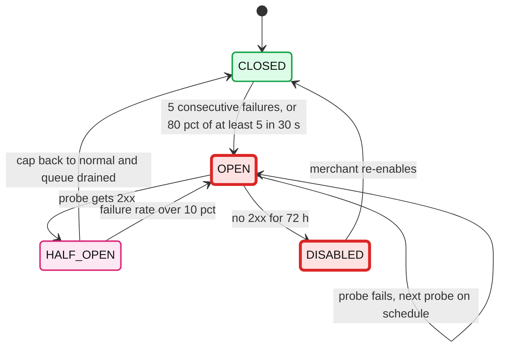
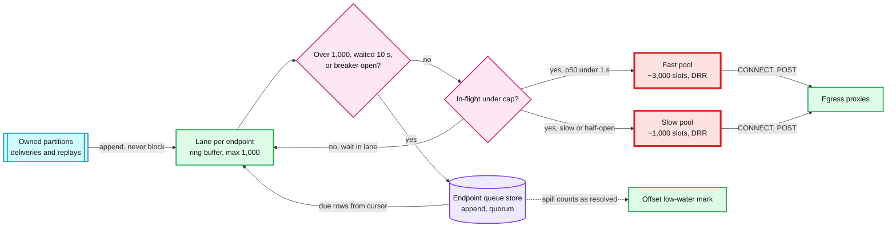
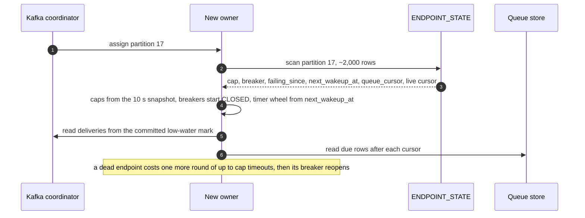

# Deep dive: per-endpoint isolation and scheduling

> One-line answer: the scarce resource is **connection slots held by slow receivers**, so every endpoint gets an owner, a budget and a way out. `deliveries` is keyed by `endpoint_id`, so one dispatcher owns each endpoint and keeps its cap, in-flight count, latency baseline and breaker as plain memory. The partition reader never blocks: it appends to the endpoint's lane. A lane sends only under an AIMD (additive increase, multiplicative decrease) concurrency cap that starts at 10 and lives between 2 and 1,000, only while its breaker is closed, and only from the fast slot pool if it is fast. Anything that cannot go (over 1,000 buffered, waited 10 s, breaker open, or a failed attempt waiting for backoff) **spills** to the endpoint's append-only durable queue and counts as resolved for the Kafka offset. A hung top merchant costs its own ~720 slots for 30 s, then one probe, and the other ~2,000 endpoints on its partition never notice.

Zoom-in on [`../solution.md`](../solution.md) §2 (Little's law), §5.3 (isolation), §10.1 (dispatcher and queue store internals) and §10.3 (capacity per component). Reusable blocks: [`../../../concepts/rate-limiting-and-load-shedding.md`](../../../concepts/rate-limiting-and-load-shedding.md), [`../../../concepts/sharding.md`](../../../concepts/sharding.md), [`../../../concepts/lsm-tree.md`](../../../concepts/lsm-tree.md). Related problem: [`../../email-campaign-sending/`](../../email-campaign-sending/) (per (IP, provider) queues with AIMD on replies, the same shape). Siblings: [`retry-policy-and-storms.md`](retry-policy-and-storms.md) (what happens to spilled deliveries), [`outbox-and-event-fan-out.md`](outbox-and-event-fan-out.md) (what produces `deliveries`), [`ssrf-and-egress.md`](ssrf-and-egress.md) (the proxies every slot goes through).

Other acronyms: DRR (deficit round robin), EWMA (exponentially weighted moving average), TLS (Transport Layer Security), LSM (log-structured merge tree), TTL (time to live).

---

## 1. Little's law decides everything

`connections in flight = arrival rate × time each is held`.

| Case | Rate | Held | In flight |
|---|---|---|---|
| Billing peak, healthy | 30k/s | 0.4 s mean | 12,000 |
| Design capacity | 60k/s | 0.4 s | 24,000 |
| One top merchant (3%) hangs, no isolation | 900/s | 30 s timeout | **27,000** |
| 2,000 small endpoints hang, no isolation | 400/s | 30 s | 12,000 |
| Same top merchant, adaptive cap ~720 | capped | 30 s | 720, then 1 probe |

The fleet is 24 nodes × ~4,000 slots. CPU and bandwidth are nowhere near a limit (solution §2). The only thing a bad merchant can exhaust is slots, and it exhausts them on **one node first**, because partitioning puts all of its deliveries on its owner.

## 2. Simulation: a top merchant hangs at t = 0

One dispatcher node owns `we_big` (900/s, normal need `900 × 0.4 = 360` slots, settled cap ~720) and ~21 partitions with ~42k other endpoints whose traffic needs ~500 slots. The node has 4,000 slots. Timeout 30 s. "Others" is how many slots the other endpoints can get.

| t (s) | No isolation: `we_big` holds | No isolation: others get | Isolation: `we_big` holds | Isolation: others get | What happens (isolated) |
|---|---|---|---|---|---|
| 0 | 360 | 500 | 360 | 500 | Hang starts |
| 1 | 1,260 | 500 | 720 | 500 | Cap reached at ~0.4 s, lane buffers |
| 2 | 2,160 | 500 | 720 | 500 | Lane at 1,000, new deliveries spill |
| 4 | 3,960 | 40 | 720 | 500 | |
| 5 | 4,000 | **0** | 720 | 500 | Unisolated node is full |
| 10 | 4,000 | 0 | 720 | 500 | |
| 20 | 4,000 | 0 | 720 | 500 | |
| 30 | 4,000 | ~0 | 720 to 0 | 500 | First 720 time out, breaker opens, they spill with retry times |
| 31 | 4,000 | ~0 | 0 | 500 | Breaker open, nothing sent |
| 40 | 4,000 | ~0 | 0 | 500 | Probe due at t = 90 s |

Without isolation the node never recovers on its own: every slot freed at t ≥ 30 s is refilled from a queue that is still ~42% `we_big`, and each of those holds 30 s while the others hold 0.4 s. The steady state is "`we_big` owns the node". With isolation the cost is 720 slots for 30 s, then 1. The ~3,000 slots of headroom per node (§5) are what the 720 comes out of.

## 3. The adaptive cap (AIMD)

```go
// Called once per second per endpoint with that second's window.
func (e *Endpoint) adjustCap(w Window) {
    failRate := float64(w.Timeouts+w.Status5xx+w.ConnectErrs+w.Status429) / float64(max(w.Attempts, 1))
    switch {
    case w.Attempts > 0 && failRate > 0.10:
        e.Cap = max(2, e.Cap/2)                         // multiplicative decrease
    case w.InFlightPeak >= e.Cap && w.P90 < 2*e.BaselineP50:
        e.Cap = min(1000, e.Cap+max(1, e.Cap/10))       // additive-ish increase, +10%
    }
    e.BaselineP50 = ewma(e.BaselineP50, w.P50, 7*24*time.Hour) // 7-day baseline
}
```

- **Only grow when the cap was the limit.** An endpoint that never fills its cap keeps it. That stops a quiet endpoint from drifting up to 1,000 and then dumping 1,000 connections on itself after an outage.
- **Shrink on what the receiver says.** Timeouts, 5xx, connect errors and `429` cut the cap in half. A struggling merchant is backed off before it falls over, the same move TCP makes on loss.
- **Where it settles.** A healthy top merchant converges near 2x its need (~720 for 900/s at 0.4 s): it fills its cap only in bursts, which is when it grows.
- **The ceiling.** 1,000 per endpoint. Above ~2,000/s an endpoint needs more than one partition (§6).

## 4. The breaker, and why it is separate from the cap

The cap prices a slow endpoint. The breaker stops paying for a dead one.



- **Open:** every new delivery for the endpoint spills straight to its queue. One probe at a time on the probe schedule (1, 2, 5, 10, 20, 30 minutes, then every 30 minutes). About 150 probes over 3 days instead of one timeout per delivery.
- **Half-open:** cap 2, doubling each clean second up to the stored normal cap. The endpoint draws from the slow pool until its p50 is back under 1 s.
- Red here means "costing slots without delivering", not the system bottleneck. The bottleneck is the slot pool (§5).

## 5. Lanes, spill, two slot pools



- **Spill and the low-water mark.** The committed Kafka offset is the lowest unresolved offset of the partition (solution §10.1). A delivery is resolved by a recorded 2xx, a quorum spill, or a terminal state. Buffered and in-flight deliveries hold the mark back. The spill rule (1,000 buffered or 10 s waited) plus the 30 s timeout means nothing stays unresolved more than ~30 s, so the mark lags seconds and a crash replays seconds. Without spill, one hung endpoint would hold the mark of its whole partition for as long as it is down, and a crash would re-send hours.
- **Memory.** A lane holds references plus inline bodies: 1,000 × ~3.3 KB ≈ 3.3 MB at most. With ~5,000 active lanes per node at a time [estimate] and most of them a handful deep, a node holds tens of MB.
- **Two pools.** 75% fast, 25% slow per node. An endpoint whose 5-minute p50 is over 1 s, or that is half-open, draws only from the slow pool. 5,000 medium-slow endpoints at p50 4 s can fill the slow pool; they cannot touch the fast one.
- **DRR inside a pool.** When a pool is full, the next free slot goes to the endpoint with the highest deficit counter, refilled each round by a quantum proportional to its cap. A 900/s merchant gets more slots than a 0.1/s one, but the 0.1/s one is never starved.

## 6. Hot endpoints: salting

One endpoint lives on one partition and one dispatcher. A Connect platform at 2% of traffic is 600/s at peak: fine. The limits:

- One partition comfortably moves ~10 MB/s. At 3.3 KB a delivery that is ~3,000/s, and the dispatcher's cap ceiling is 1,000 slots at 0.4 s, ~2,500/s.
- **Rule:** above ~2,000/s sustained, split the endpoint into `k = ceil(rate ÷ 1,000)` sub-keys `(endpoint_id, n)` with `n = hash(event_id) mod k`. Fan-out keys deliveries by the sub-key, so they spread over k partitions, usually on different dispatchers.
- **Example:** an endpoint at 5,000/s gets `k = 5`, 1,000/s and 3.3 MB/s per partition. Each sub-key gets `cap ÷ k`, so the merchant still sees one total cap.
- **Cost:** the breaker and cap are per sub-key, so a dead endpoint trips k breakers, each in its own ~30 s. They share `failing_since` through `ENDPOINT_STATE`, so the disable clock is per endpoint. Salting is a per-endpoint config flag set by the platform team, not automatic: changing k moves in-flight work, so it is done at a quiet hour.

## 7. The durable queue and failover

**Row layout** (wide-column LSM store, every row TTL 4 days):

| Part | Value |
|---|---|
| Partition key | `(endpoint_id, due_bucket_10min)` |
| Clustering key | `(due_minute, delivery_id)` |
| Columns | `event_id`, `api_version`, `attempts`, `deadline_at`, `fault_minutes`, `replay_id?` |
| Size | ~300 B. The body is not here; retries read `EVENT_RENDER` by `(event_id, api_version)` |

A partition holds at most 10 minutes of one endpoint's spill: a 900/s endpoint spilling for 10 minutes is 540k rows × 300 B ≈ 160 MB, the worst case; a 100/s one ~18 MB.

**Append, then advance the cursor.** The queue is append-only, read from `ENDPOINT_STATE.queue_cursor = (bucket, due_minute, delivery_id)`.
1. Read the next due rows after the cursor.
2. Attempt them.
3. A failure is written **again**, into its new due bucket (quorum). The old row is never deleted.
4. Only then advance the cursor past the old row.

A crash between 3 and 4 re-reads the old row: one duplicate attempt, never a loss. No deletes means no tombstones for reads to skip, and time-window compaction drops whole expired files. That is why this shape and not a mutable `next_attempt_at` index.



**What a crash loses, and what it costs.**

| State | Persisted? | After failover |
|---|---|---|
| In-flight requests (~500 per node) | No | Re-sent from the low-water mark: duplicates |
| Lane buffers | No | Re-read from Kafka |
| Caps, latency baselines | Every 10 s | At most 10 s stale |
| Breakers | Every 10 s, but start `CLOSED` | A dead endpoint pays ~30 s of its cap once more |
| `failing_since`, disable clock | Yes | Exact |
| Timer wheel | From `next_wakeup_at` | Exact to the second |
| Recent-success set | No (passed along only on a graceful handoff) | A few seconds of resolved deliveries re-sent |

## 8. What an interviewer pushes on

1. **"Why not a semaphore per endpoint in Redis?"** A network call per send and per completion (12k/s each way), counters that leak when a worker dies holding a slot, and Redis on every send's path. Ownership gives the same isolation as local memory.
2. **"Why not a queue per endpoint?"** A million queues to poll and monitor, mostly idle (solution §10.7). Partition ownership is 512 partitions with per-endpoint lanes inside.
3. **"Why not just lower the timeout?"** With a cap and a breaker it only prices the first 30 s, once (solution §5.3 push back).
4. **"What if many endpoints are slow but none is dead?"** The slow pool (§5). They share 25% of slots by DRR.
5. **"What if the slow one is your biggest merchant?"** Its cap is ~720 and comes out of reserved headroom. If it is slow and alive, it gets the slow pool and drains at whatever it accepts; its own latency rises, nobody else's.
6. **"How do you handle one endpoint at 10k/s?"** Salting, `k = 10` (§6).

## 9. Trade-offs

| Decision | Chose | Gave up |
|---|---|---|
| Isolation unit | Endpoint, owned by one dispatcher via partitioning | Hot endpoints need salting; failover loses soft state |
| Cap | AIMD, 2 to 1,000, start 10 | ~10 s to grow a new big endpoint from 10 to its need |
| Dead endpoints | Breaker with one probe | A dead endpoint pays one more cap of timeouts after each failover |
| Lane overflow | Spill to a durable queue | A quorum write per spilled delivery (~50k/s burst after an outage) |
| Pools | 75% fast, 25% slow | Slow endpoints can wait on each other |
| Queue shape | Append-only, cursor, TTL | Up to 4 days of dead rows on disk until TTL drops them |
| State durability | Snapshot every 10 s | Up to 10 s of cap and breaker history lost on a crash |

## 10. Numbers to say out loud

- 12k in flight at the 30k/s peak, 24k at the 60k/s design point. One hung top merchant would need 27k.
- 24 nodes × ~4,000 slots. 75% fast, 25% slow. ~3,000 reserved for the top caps.
- Cap: start 10, floor 2, ceiling 1,000, +10% when it was the limit, halve above 10% failures.
- Breaker: 5 consecutive, or 80% of ≥ 5 in 30 s. ~150 probes over 3 days.
- Spill at 1,000 buffered or 10 s waited. Nothing unresolved past ~30 s.
- Salt above ~2,000/s: `k = ceil(rate ÷ 1,000)`.
- Queue rows ~300 B, TTL 4 days, partition per endpoint per 10 minutes.
