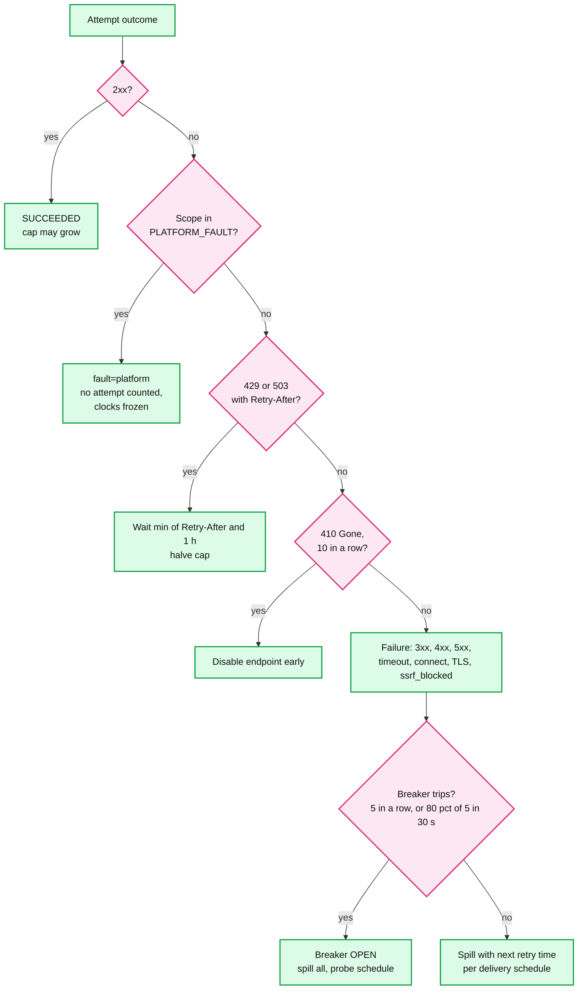
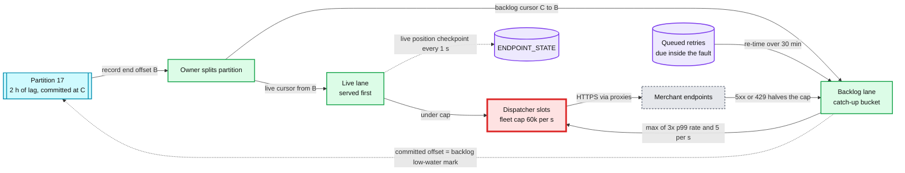

# Deep dive: retry policy and storms

> One-line answer: retries live at **two levels**. A delivery that fails while its endpoint is healthy backs off on its own schedule (1 m, 5 m, 30 m, 1 h, 2 h, 4 h, 8 h, then every 12 h, a last try at the 72 h deadline, with jitter). An endpoint that is failing as a whole gets a **breaker** and one probe at a time, so a dead endpoint costs ~150 probes over 3 days instead of hundreds of millions of timeouts. `429` and `503` with `Retry-After` are honoured up to 1 h. An endpoint with no 2xx for 72 h is disabled after emails at 1 h, 24 h and 48 h. The storm problem is mostly **ours**: a **platform-fault detector** tells our outage from theirs and freezes every clock, and recovery splits each lagging partition at offset `B` so live events go first while the backlog drains at most 3x each endpoint's normal rate. Every endpoint above ~1.7/s catches up from a 2-hour outage in about 1 hour.

Zoom-in on [`../solution.md`](../solution.md) §4.3 (retries, breaker, disable), §5.4 (storms) and §10.4 (the platform-fault timeline). Reusable blocks: [`../../../concepts/rate-limiting-and-load-shedding.md`](../../../concepts/rate-limiting-and-load-shedding.md), [`../../../concepts/exactly-once.md`](../../../concepts/exactly-once.md). Siblings: [`per-endpoint-isolation-and-scheduling.md`](per-endpoint-isolation-and-scheduling.md) (caps, breaker states, the queue store), [`delivery-semantics-and-replay.md`](delivery-semantics-and-replay.md) (why retries make duplicates), [`outbox-and-event-fan-out.md`](outbox-and-event-fan-out.md) (the reconciler's 73 h check).

Other acronyms: ASN (autonomous system number), AZ (availability zone), NAT (network address translation), DNS (Domain Name System), TLS (Transport Layer Security).

---

## 1. The per-delivery schedule

Used only while the endpoint's breaker is closed. Waits 1 and 2 use **full jitter** (uniform over [0, 2x]); the rest use ±20%.

| Attempt | Wait before it | Jitter range | Cumulative (nominal) |
|---|---|---|---|
| 1 | n/a | n/a | 0 |
| 2 | 1 min | 0 to 2 min | 1 min |
| 3 | 5 min | 0 to 10 min | 6 min |
| 4 | 30 min | 24 to 36 min | 36 min |
| 5 | 1 h | 48 to 72 min | 1 h 36 |
| 6 | 2 h | 1 h 36 to 2 h 24 | 3 h 36 |
| 7 | 4 h | 3 h 12 to 4 h 48 | 7 h 36 |
| 8 | 8 h | 6 h 24 to 9 h 36 | 15 h 36 |
| 9 | 12 h | 9 h 36 to 14 h 24 | 27 h 36 |
| 10 | 12 h | same | 39 h 36 |
| 11 | 12 h | same | 51 h 36 |
| 12 | 12 h | same | 63 h 36 |
| 13 | at the deadline | none | 72 h |

That is the first attempt plus 12 retries. After attempt 13 the delivery is `FAILED`. The deadline is `created + 72 h + platform-fault minutes` (§5).

**Why full jitter early.** The first two waits are where correlated failures cluster: a merchant's deploy fails every request in the same 30 seconds. With ±20% on a 1-minute wait, all of them come back inside a 24-second window, still a spike. Full jitter spreads them over 2 minutes. The analysis is in Marc Brooker's "Exponential Backoff And Jitter" on the AWS Architecture Blog (2015): full jitter cut total work and completion time compared with no jitter and with "equal jitter". For the long waits the spread is already hours wide, and ±20% keeps the schedule predictable enough to print in the docs.

## 2. Classifying an outcome

- **Every non-2xx is retried**, a `400` included. A receiver's `400` is usually its own handler bug, fixed and redeployed within hours. A 3xx is a failure, never followed, as at Stripe.
- **`Retry-After`.** Honoured up to 1 h, for that delivery, and the cap halves. A `429` does not count toward the breaker: the endpoint is alive and talking. A `503` does.
- **`410 Gone`** ten times in a row disables early: the merchant is telling us the URL is retired.
- **`ssrf_blocked`** is retried on schedule (the DNS might be fixed) and shown to the merchant as such.

## 3. Delivery backoff vs endpoint probes

| | Per-delivery backoff | Endpoint probe |
|---|---|---|
| When | Breaker closed, one delivery failed | Breaker open |
| Schedule | §1, 13 attempts | 1, 2, 5, 10, 20, 30 min between probes, then every 30 min |
| What is sent | That delivery | The oldest due delivery (a real one, so success is real progress) |
| Attempts on day 1 for a dead endpoint at 100/s | 8.64 M deliveries × up to 8 attempts each, roughly 50 M timeouts | ~50 probes |
| Attempt counter | Increments | Only the probed delivery's increments. The others wait without spending their schedule |

Over 3 days the probe schedule is 6 probes in the first 68 minutes, then `(4,320 − 68) ÷ 30 ≈ 141` more: **~147 probes**, against the ~300 M timeouts of per-delivery retries for the same dead endpoint (solution §4.3).

When a probe succeeds the breaker half-opens and the queue drains oldest first. Deliveries that waited under the open breaker are due "now" and keep their unspent attempts.

## 4. Disable rule and the email timeline

| Time since the breaker opened | Action |
|---|---|
| 0 | Breaker open, probes start. Dashboard shows "failing" |
| 1 h | Email to the account's developers: "`we_7` failing since 12:00, 4,312 events waiting". Top-100 accounts also open a ticket for their account manager |
| 24 h | Reminder email, with the error class mix (timeouts, `5xx`, TLS) |
| 48 h | Final warning: "disabled in 24 h" |
| 72 h with no 2xx | `DISABLED_FAILING`. Waiting deliveries reach their deadlines and become `FAILED`. New events are recorded as `SKIPPED`. Email with a one-click re-enable and a replay offer |

The clock is **no 2xx for 72 h**, measured by `failing_since` in `ENDPOINT_STATE`, which survives failover. A single 2xx resets it. During a platform fault the clock is frozen (§5). Stripe does not publish its disable rule; Svix disables after 5 days of all attempts failing; Shopify deletes the subscription after 8 consecutive failures over 4 h; Slack disables if over 95% of attempts fail within 60 minutes (§8).

## 5. The platform-fault detector

Our outage looks like every endpoint failing at once. Counting it would open a million breakers, email a million developers and, after 3 days, disable them all.

**Scopes.** AZ, region, and proxy pool, because that is how egress is built (one proxy pool per AZ). A NAT failure in one AZ is a fault of that scope only.

**Enter `PLATFORM_FAULT` for a scope** when, in a 10 s window, either:
- attempts fail with connect, DNS, TLS or timeout errors across **≥ 1,000 distinct endpoints in ≥ 50 distinct destination ASNs**, at more than **5x** the scope's 7-day baseline failure rate, or
- our **synthetic endpoints** (receivers we run outside our network, in three clouds) stop answering from that scope.

A real merchant outage is one endpoint, one host, or at worst one cloud's ASN. Fifty ASNs failing together is us.

**Leave** after 2 minutes below 2x baseline with the synthetic endpoints green (hysteresis, so a flapping route does not toggle it every 10 s).

**While in it:** dispatchers in the scope stop attempting, so deliveries wait in Kafka and nothing spills; attempts already made are tagged `fault=platform` and do not count for breakers, attempt numbers or the disable clock; each delivery's `fault_minutes` grows, extending its deadline; failing emails are held; on-call is paged; if only one AZ is affected, its dispatchers send through another AZ's proxies.

## 6. Recovery: split cursor, live first, bounded catch-up

- **When.** A partition whose lag is over 10 minutes at recovery. Below that, plain catch-up is fast enough.
- **Two cursors, one owner.** The Kafka committed offset stays the backlog cursor's low-water mark. The live cursor's position is checkpointed in `ENDPOINT_STATE` every second. A crash re-reads both from their marks: duplicates, no gaps. When the backlog cursor reaches `B`, the two merge.
- **Catch-up bucket per endpoint.** `max(3x its 7-day p99 per-second rate, 5/s)`, still under the adaptive cap, which halves on the merchant's `5xx` or `429`.

**Drain times after a 2-hour outage** (backlog = `7,200 s × rate`; live is served first, so the backlog drains at `bucket − rate`; taking the p99 rate as roughly the normal rate):

| Endpoint rate | Backlog | Catch-up bucket | Net drain | Time to catch up |
|---|---|---|---|---|
| 0.01/s | 72 | 5/s (floor) | ~5/s | ~15 s |
| 1/s | 7,200 | 5/s (floor) | 4/s | 30 min |
| 100/s | 720k | 300/s | 200/s | 1 h |
| 900/s | 6.48 M | 2,700/s | 1,800/s | 1 h |

The general form is `drain time = outage × rate ÷ (bucket − rate)`. Once 3x dominates the floor (above ~1.7/s), it is `outage ÷ (3 − 1)`: **half the outage, for every large endpoint**, whatever its size. The floor is the knob for small ones: at 20/s instead of 5/s the 1/s endpoint would finish in ~6 minutes. 5/s is the conservative choice for a small merchant on a small server.

**Fleet view.** ~50 M deliveries, mostly to small endpoints that finish in seconds. The spill burst (~50k writes/s for ~5 minutes, as big endpoints' backlogs exceed their buckets) is what the queue store is sized for (solution §10.3).

## 7. What an interviewer pushes on

1. **"Exponential backoff with jitter prevents storms, right?"** It de-synchronizes one client's retries. Our storm is first attempts of a backlog plus our fault charged to merchants (solution §5.4 push back).
2. **"How do you know it is your outage?"** ≥ 1,000 endpoints in ≥ 50 ASNs at 5x baseline, or the synthetic endpoints (§5).
3. **"A merchant really was down during your outage. Do they get a free pass?"** For those hours, yes. Erring toward not disabling is the right side.
4. **"Why 3 days and not 1?"** Stripe's documented contract, and it covers a weekend outage at a small merchant. Svix runs ~27.5 h, Shopify 4 h (§8).
5. **"Why not deliver the backlog as fast as possible?"** A 10x surge in a minute knocks over the merchant's database and pages them for our outage. 3x drains every large endpoint in half the outage time.
6. **"Fresh or old first?"** Fresh first, via the split cursor. Order is not promised, and a new payment matters more to a merchant than one 2 hours old that will arrive within the hour anyway.

## 8. How others retry

| Provider | Timeout | Retries | Disable rule |
|---|---|---|---|
| Stripe | not published | up to 3 days, exponential (live); 3 over a few hours (sandbox) | not published |
| Svix | 30 s | immediate, 5 s, 5 m, 30 m, 2 h, 5 h, 10 h, 10 h (~27.5 h) | all attempts failing for 5 days |
| Shopify | 1 s connect, 5 s total | 8 times over 4 h | subscription deleted after 8 consecutive failures (Admin API) |
| Slack Events API | 3 s | 3: immediate, 1 min, 5 min | disabled if over 95% fail within 60 min |
| EventBridge API destinations | 5 s | 24 h, 185 attempts; retries only 401, 407, 409, 429, 5xx | n/a |
| **This design** | 5 s connect, 30 s total | 13 attempts over 72 h, jitter | no 2xx for 72 h, or 10 consecutive `410` |

Sources: [`../research/facts-survey.md`](../research/facts-survey.md).

## 9. Trade-offs

| Decision | Chose | Gave up |
|---|---|---|
| Window | 72 h, 13 attempts | 3 days of queued rows for dead endpoints (small: ~300 B each) |
| Early jitter | Full jitter on waits 1 and 2 | A less predictable second attempt (0 to 2 min) |
| Which errors retry | Every non-2xx, `410` disables after 10 | Retrying a true `400` 12 times |
| Dead endpoints | Breaker and ~147 probes | Up to 30 min between probes, so recovery is noticed up to 30 min late |
| `Retry-After` | Honoured up to 1 h | A merchant cannot push us out longer than 1 h per delivery |
| Platform faults | Detect and freeze clocks | A merchant down during our fault gets extra time |
| Drain | Live first, backlog at ≤ 3x | Large endpoints take half the outage again to catch up |
| Floor | 5/s | A 1/s endpoint takes 30 min after a 2 h outage |

## 10. Numbers to say out loud

- 1 m, 5 m, 30 m, 1 h, 2 h, 4 h, 8 h, then 12 h, last at 72 h. 13 attempts. Full jitter on the first two, ±20% after.
- Breaker: 5 in a row or 80% of ≥ 5 in 30 s. Probes 1, 2, 5, 10, 20, 30 min, then every 30 min: ~147 in 3 days.
- `Retry-After` up to 1 h, cap halves. `410` × 10 disables.
- Emails at 1 h, 24 h, 48 h. Disabled at 72 h with no 2xx.
- Platform fault: ≥ 1,000 endpoints, ≥ 50 ASNs, 5x baseline, or synthetics down. Leave after 2 min under 2x.
- Catch-up: `max(3x p99 rate, 5/s)`. Big endpoints catch up in half the outage. 2 h outage, 1 h drain.
