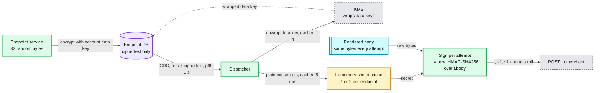
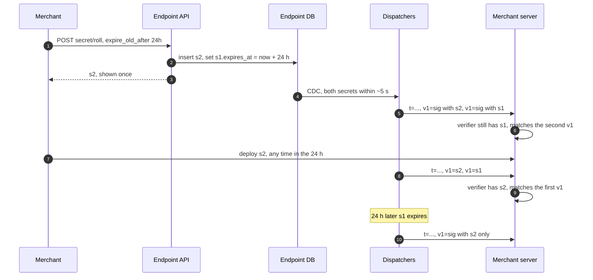

# Deep dive: signing and secret rotation

> One-line answer: every attempt carries `Stripe-Signature: t=<unix seconds>,v1=<hex HMAC-SHA256(secret, t + "." + raw_body)>`, computed **at send time** with the attempt's own timestamp, so a retry 2 days later still passes the receiver's 5-minute tolerance. The receiver recomputes over the **raw** body, compares in constant time, ignores every scheme that is not `v1`, and rejects a timestamp more than 5 minutes off. A roll creates a new secret and keeps the old one for up to 24 h; during the overlap each attempt carries two `v1=` values, one per secret, so the merchant can deploy at leisure. Secrets are 32 random bytes, envelope-encrypted under a per-account data key wrapped by KMS, decrypted only in dispatcher memory and cached 5 minutes. HMAC costs ~2 µs per attempt. Asymmetric signatures (Ed25519) are the evolution, not the launch.

Zoom-in on [`../solution.md`](../solution.md) §3.2 (wire format), §5.6 (the signature half) and §6 Flow 4. Reusable blocks: [`../../../concepts/signed-url.md`](../../../concepts/signed-url.md) (the same HMAC-over-a-timestamp idea), [`../../../concepts/exactly-once.md`](../../../concepts/exactly-once.md) (why a replay inside 5 minutes is dedup's job). Siblings: [`ssrf-and-egress.md`](ssrf-and-egress.md) (the other half of §5.6), [`delivery-semantics-and-replay.md`](delivery-semantics-and-replay.md) (the receiver that verifies), [`retry-policy-and-storms.md`](retry-policy-and-storms.md) (why attempts can be days apart). Facts: [`../research/facts-survey.md`](../research/facts-survey.md).

Acronyms: HMAC (hash-based message authentication code), KMS (key management service), CDC (change data capture), JSON (JavaScript Object Notation), NTP (Network Time Protocol), API (application programming interface).

---

## 1. The wire format, exactly

```
Stripe-Signature: t=1792656000,v1=5257a869e7ecebeda32affa62cdca3fa51cad7e77a0e56ff536d0ce8e108d8bd
```

| Part | Value | Rule |
|---|---|---|
| `t` | Unix seconds when **this attempt** was signed | New on every attempt. Stripe: "we generate a new signature and timestamp for the new delivery attempt" |
| Signed content | `t` as ASCII, then `.`, then the raw body bytes | The exact bytes we send. Not re-serialized JSON |
| `v1` | Lowercase hex of HMAC-SHA256 with the endpoint secret | One `v1` per active secret. Stripe: "You can have multiple signatures with the same scheme-secret pair when you roll an endpoint's secret, and keep the previous secret active for up to 24 hours" |
| `v0` | Present on test events only | Receivers must ignore it. Stripe: "To prevent downgrade attacks, ignore all schemes that aren't `v1`" |
| Tolerance | 5 minutes at the receiver | Stripe: "Our libraries have a default tolerance of 5 minutes between the timestamp and the current time." A tolerance of 0 disables the check, which the docs say not to do |

The body is rendered once per (event, API version) at fan-out, so every retry sends **the same bytes**, and only `t` and `v1` change between attempts.



## 2. Why the timestamp is signed, and why it is fresh

- **Signed, so a captured request expires.** Someone who records one request (a proxy log, a leaked debug dump) can re-send it. Without `t` inside the MAC, it verifies forever. With `t` inside, it verifies for 5 minutes. Inside those 5 minutes, the receiver's dedup on `event.id` makes the replay a no-op. Signature and dedup together close the window; neither does alone.
- **Fresh, because retries are days apart.** The schedule's waits run 1 min to 12 h and the window is 72 h ([retry dive](retry-policy-and-storms.md)). Sign once at fan-out and attempt 2 is already outside 5 minutes. So signing happens in the dispatcher, per attempt, with the attempt's own `t`.
- **Clock skew.** The receiver compares `t` to its own clock. Our dispatchers run NTP-disciplined clocks (skew well under 1 s). A receiver whose clock is more than 5 minutes off fails every attempt; the attempt log shows a `400` storm starting at no deploy of ours, and the dashboard hint says "check your server's clock".
- **The raw body.** Frameworks that parse JSON and re-serialize it change whitespace and key order, and the MAC no longer matches. Stripe's docs say the signature check needs the unmodified raw body. This is the commonest real-world verification bug.

## 3. Sign and verify, runnable

Python 3.9+, standard library only:

```python
import hashlib, hmac, time

TOLERANCE_S = 300

def sign(body: bytes, secrets: list, t: int) -> str:
    """Dispatcher side. One v1 per active secret: two during a roll."""
    sigs = [hmac.new(s, f"{t}.".encode() + body, hashlib.sha256).hexdigest() for s in secrets]
    return ",".join([f"t={t}"] + [f"v1={sig}" for sig in sigs])

def verify(body: bytes, header: str, secret: bytes, now: int = None) -> bool:
    """Receiver side. Raw body, v1 only, constant-time, 5 minute tolerance."""
    now = int(time.time()) if now is None else now
    t, v1 = None, []
    for item in header.split(","):
        k, _, v = item.partition("=")
        if k == "t" and v.isdigit():
            t = int(v)
        elif k == "v1":
            v1.append(v)          # v0 and unknown schemes are ignored on purpose
    if t is None or not v1 or abs(now - t) > TOLERANCE_S:
        return False
    expected = hmac.new(secret, f"{t}.".encode() + body, hashlib.sha256).hexdigest()
    return any(hmac.compare_digest(expected, sig) for sig in v1)

if __name__ == "__main__":
    old, new = b"whsec_old_secret", b"whsec_new_secret"
    body, now = b'{"id":"evt_1","type":"invoice.paid"}', int(time.time())
    during_roll = sign(body, [new, old], now)
    print("old verifier, during roll:", verify(body, during_roll, old, now))     # True
    print("new verifier, during roll:", verify(body, during_roll, new, now))     # True
    print("tampered body:            ", verify(body + b" ", during_roll, new, now))  # False
    print("replayed after 6 minutes: ", verify(body, during_roll, new, now + 360))  # False
    v0_only = f"t={now},v0=" + hmac.new(old, f"{now}.".encode() + body, hashlib.sha256).hexdigest()
    print("downgrade to v0 only:     ", verify(body, v0_only, old, now))         # False
```

What the demo shows: both the old and the new verifier accept an attempt signed during a roll; one byte of change fails; the same request 6 minutes later fails; a header that carries only a non-`v1` scheme fails even with a correct MAC.

## 4. Rolling a secret



Details that matter:
- **The overlap is the merchant's to choose,** 0 to 24 h. Planned rolls use hours. A leak uses 0.
- **The CDC lag (≤ 5 s) is harmless on a planned roll,** because the old secret stays valid through it.
- **On an emergency roll with `expire_old_after = 0`,** dispatchers keep signing with the old secret only for up to ~5 s. If the merchant's verifier already switched, those attempts fail and are retried with the new secret a minute later. A few retries, no loss.
- **The merchant forgot to deploy.** At expiry every attempt fails verification. The dashboard shows `400`s starting exactly at `s1.expires_at` and says so. Nothing is lost: deliveries keep retrying for 3 days, each re-signed with the current secret, so the first attempt after the merchant deploys `s2` succeeds.
- **At most two secrets.** A second roll inside the overlap expires the oldest immediately. Two `v1` values is the most a header carries.

## 5. Storing secrets

- **Generation.** 32 bytes from the OS random source, shown as `whsec_` plus an encoding. Returned once by the create or roll call, never again; the dashboard can only roll.
- **Envelope encryption.** Each account has a data key, stored wrapped by a KMS key. The endpoint DB holds only the secret's ciphertext under that data key. A DB dump without KMS access reveals nothing.
- **Where plaintext exists.** Only in dispatcher memory: data keys cached 1 h, decrypted secrets 5 minutes, both evicted on a roll event. Never in logs, attempt records, metrics or crash dumps (the cache lives in a region excluded from core dumps).
- **KMS load.** Each of 24 dispatchers owns ~1/24 of the endpoints, ~42k, belonging to ~25k accounts [estimate]. With data keys cached 1 h: `25k ÷ 3,600 s ≈ 7` unwraps/s per node, ~170/s fleet-wide. KMS is off the per-attempt path; a KMS outage is felt only for accounts whose data key leaves the cache, after an hour.
- **Cost of signing.** HMAC-SHA256 over ~3 KB is ~2 µs [estimate]. At the 60k/s design rate with two secrets during a roll: `60k × 2 × 2 µs = 0.24` of one core, fleet-wide. There is no reason to sign anywhere but in the dispatcher.

## 6. The Standard Webhooks variant

For receivers that use generic libraries, the same secret can sign the [Standard Webhooks](https://github.com/standard-webhooks/standard-webhooks/blob/main/spec/standard-webhooks.md) form:

```
webhook-id: evt_1Q...
webhook-timestamp: 1792656000
webhook-signature: v1,K5oZfzN95Z9UVu1EsfQmfVNQhnkZ2pj9o9NDN/H/pI4= v1,9u3...
```

| | Stripe form | Standard Webhooks |
|---|---|---|
| Signed content | `t.body` | `msg_id.timestamp.body` |
| Encoding | hex | base64 |
| Several signatures | comma-separated `v1=` | space-delimited `v1,<sig>` |
| Tolerance | 5 min in Stripe's libraries | "some allowable tolerance", no value in the spec |
| Id bound into the MAC | Indirectly: the id is in the body | Directly, as a header |

The id is the same event id in both, stable across retries, resends and replays. Signing the id directly is slightly better hygiene (the header a receiver dedups on cannot be swapped), but with the id inside the body the Stripe form already binds it.

```python
import base64, hashlib, hmac

def standard_webhooks_sig(secret: bytes, msg_id: str, ts: int, body: bytes) -> str:
    mac = hmac.new(secret, f"{msg_id}.{ts}.".encode() + body, hashlib.sha256).digest()
    return "v1," + base64.b64encode(mac).decode()

print(standard_webhooks_sig(b"secret", "evt_1", 1792656000, b"{}"))
```

## 7. HMAC versus Ed25519

| | HMAC-SHA256 (chosen) | Ed25519 (evolution) |
|---|---|---|
| Key on the receiver | The shared secret | Our public key |
| We store | Secrets, reversibly (we must sign) | Private keys only, ours |
| Receiver can forge "our" signature | Yes, to itself (harmless), and so can anyone who steals it | No |
| Rotation | A roll per endpoint, merchant deploys | We rotate our key and publish it at a well-known URL; merchants fetch, nothing to deploy |
| Cost per attempt | ~2 µs [estimate] | ~50 µs to sign [estimate], still under a few cores at 60k/s |
| Library support | Everywhere, one stdlib call | Needs a crypto library; Standard Webhooks defines `v1a` for it |
| What a leak exposes | One endpoint's integrity | Our private key: every endpoint. So it lives in an HSM-backed signer |

HMAC wins today on support and simplicity. Ed25519 can be added beside it (both signatures in the header) without breaking anyone.

## 8. What a leaked secret allows, and the response

- **What it allows.** Forging requests **to that one endpoint** that pass verification. The real danger: a forged `payment_intent.succeeded` that makes the merchant ship goods for a payment that never happened. It does not let anyone read our data, call our API, or impersonate us to any other endpoint, because each endpoint has its own secret.
- **Why receivers should still fetch.** A receiver that treats the event as a hint and reads the payment from the API (or uses thin events) is immune: the forged id does not exist, or its real state is not "succeeded". This is the second reason, after ordering, that the receiver contract says "the payload is a hint".
- **The response.** Roll with `expire_old_after = 0`. Our side: search the attempt log for that endpoint's recent `400`s (a sign of forgeries rejected after the roll, or of the merchant not yet deployed); audit who viewed or rolled the secret; nothing to re-send, since our real deliveries keep retrying under the new secret.

## 9. What an interviewer pushes on

1. **"Why not sign once at fan-out?"** Attempt 2 is a minute later and attempt 12 is 72 h later. The receiver's 5-minute tolerance would reject them.
2. **"Why include a timestamp at all?"** Without it a captured request verifies forever. With it, 5 minutes, and dedup covers those.
3. **"How do you rotate without downtime?"** Two `v1` values during an overlap of up to 24 h.
4. **"Why HMAC and not public-key signatures?"** Support and simplicity. Ed25519 is the evolution, added beside HMAC.
5. **"The merchant says every signature fails."** Raw body re-serialized, the wrong secret (test vs live), a clock more than 5 minutes off, or an expired old secret. The attempt log's first failure time tells which.
6. **"Does the proxy see the secret?"** No. TLS is end to end through the CONNECT tunnel, and the secret never leaves the dispatcher.

## 10. Trade-offs

| Decision | Chose | Gave up |
|---|---|---|
| Algorithm | HMAC-SHA256 | We hold secrets reversibly; receivers can forge to themselves |
| When to sign | Per attempt, in the dispatcher | Plaintext secrets in dispatcher memory |
| Tolerance | 5 minutes at the receiver | Receivers with bad clocks fail |
| Rotation | Up to 24 h overlap, two `v1` values | Headers carry two signatures during a roll |
| Storage | Envelope encryption under KMS, 5 min plaintext cache | Up to 5 minutes for a revoked secret to leave memory without a roll event |
| Formats | Stripe form, Standard Webhooks offered | Two code paths to keep in sync |

## 11. Numbers to say out loud

- `v1 = HMAC_SHA256(secret, t + "." + raw_body)`, hex. New `t` on every attempt.
- 5-minute tolerance. Ignore everything that is not `v1`.
- Roll overlap 0 to 24 h, at most 2 secrets, CDC to dispatchers ≤ 5 s.
- ~2 µs per HMAC: 0.24 of a core at 60k/s with two secrets.
- Data keys cached 1 h, secrets 5 min, ~170 KMS unwraps/s fleet-wide.
- A leak forges to one endpoint only. Response: roll with 0 overlap.
