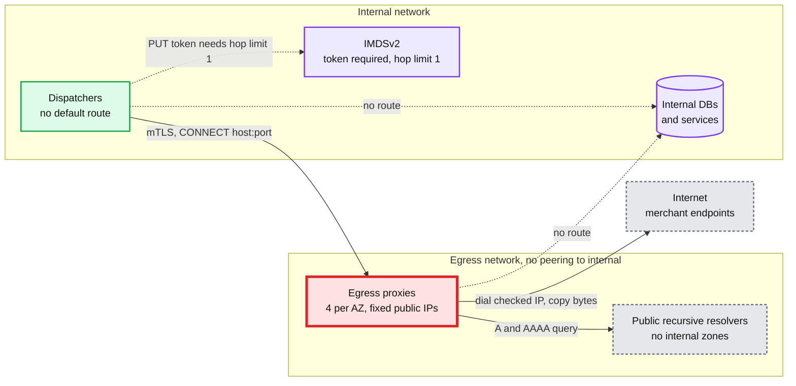
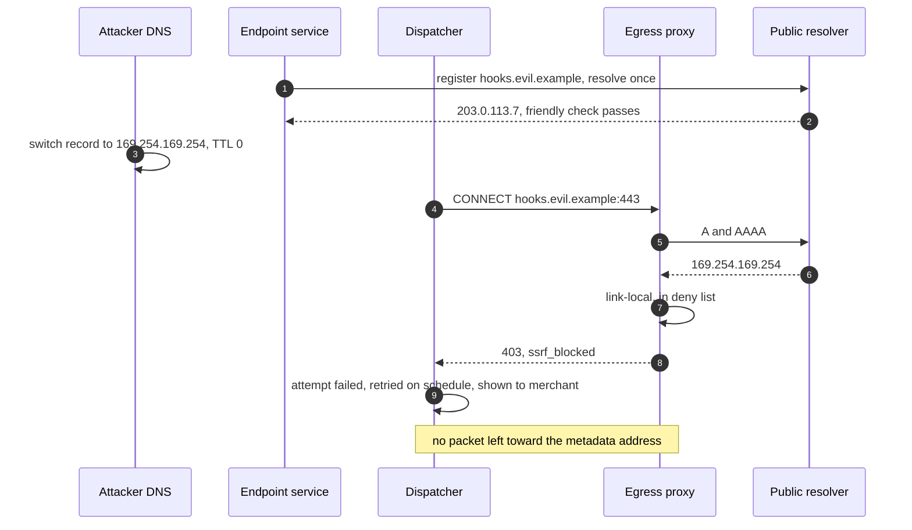

# Deep dive: SSRF and egress

> One-line answer: a merchant's URL is attacker-controlled input that we turn into a socket inside our network, for years, with retries, so the control cannot be a URL validator. Dispatchers have **no route to the internet**. Every delivery leaves through an **egress proxy** (Stripe's open-source Smokescreen is one) on a separate network with no peering to anything internal. For each CONNECT the proxy resolves the host with **public** resolvers only, rejects the request if **any** answer is in a deny list or not globally routable, and **dials that exact IP**, so there is no second lookup to rebind. Redirects are failures, not followed. IMDSv2 with a hop limit of 1 is defence in depth. The proxies are on every delivery's path, so they are the single point of failure to build N per AZ and to fail **closed**, with the platform-fault detector stopping the retry clock while they are down.

Zoom-in on [`../solution.md`](../solution.md) §5.6 (the SSRF half), §10.1 (the egress proxy), §10.10 (security and abuse) and §6 Flow 6. Reusable blocks: [`../../../concepts/rate-limiting-and-load-shedding.md`](../../../concepts/rate-limiting-and-load-shedding.md) (the per-host cap). Siblings: [`signing-and-secret-rotation.md`](signing-and-secret-rotation.md) (the other half of §5.6), [`retry-policy-and-storms.md`](retry-policy-and-storms.md) (the platform-fault detector), [`per-endpoint-isolation-and-scheduling.md`](per-endpoint-isolation-and-scheduling.md) (the dispatcher that opens the tunnel). Facts: [`../research/facts-survey.md`](../research/facts-survey.md).

Acronyms: SSRF (server-side request forgery), IMDS (instance metadata service), DNS (Domain Name System), CIDR (an IP range), TLS (Transport Layer Security), SNI (Server Name Indication, the host name sent in the TLS hello), NAT (network address translation), AZ (availability zone), VPC (virtual private cloud network), TTL (time to live).

---

## 1. Threat model: what one URL can do

A merchant (or an attacker with a free account) controls three things: the URL string, the DNS answers for its host, and what its server replies. With no controls, that buys:

| Goal | How | Damage |
|---|---|---|
| Steal cloud credentials | `http://169.254.169.254/latest/meta-data/iam/security-credentials/...` | The dispatcher's role credentials. The worst case |
| Reach internal services | `http://payments-db.internal:5432`, `http://10.0.4.12:9200/_cat/indices` | Reads and writes to anything that trusts the internal network |
| Scan our network | Register 10,000 endpoints at internal IPs and ports; read `timeout` vs `connect_refused` and latency from the attempt log | A map of what is listening inside |
| Use us as a cannon | Point endpoints at a victim | Load on someone else, from our IPs |
| Exfiltrate via responses | A response body stored and shown in the dashboard | Stored XSS (cross-site scripting) if rendered as HTML |

Stripe's position, from its own proxy: Smokescreen "resolves each domain name that is requested, and ensures that it is a publicly routable IP address" ([Smokescreen](https://github.com/stripe/smokescreen)). OWASP's: "ensure the HTTP client connects only to validated addresses" ([OWASP SSRF cheat sheet](https://cheatsheetseries.owasp.org/cheatsheets/Server_Side_Request_Forgery_Prevention_Cheat_Sheet.html)).

## 2. The layers



| Layer | What it stops | Why it is not enough alone |
|---|---|---|
| 1. Registration check | Honest mistakes (`http://localhost`), a friendly early error | DNS can change after the check |
| 2. Proxy resolve, check, dial | Rebinding, encodings, internal names, IPv6 tricks | A bug in the proxy |
| 3. Network: no route from dispatchers or proxies to internal ranges | Anything layer 2 missed | A misconfigured route table |
| 4. IMDSv2, hop limit 1 | Credential theft even if a request reached the metadata service | Only protects metadata |
| 5. No redirects | `302` to an internal address | n/a |
| 6. Uniform `ssrf_blocked` errors | Scanning through the attempt log | n/a |

The proxy identifies the calling service by its client certificate and applies that service's policy, so the webhook dispatchers get the strict "public internet only" policy and nothing else shares it by accident. TLS is end to end between the dispatcher and the merchant: the proxy sees the host name and port in the CONNECT line, never the payload, the signature or the secret.

## 3. The deny list

Checked against **every** A and AAAA answer. One bad answer rejects the whole request: a host that resolves to both a public IP and `10.0.0.5` is an attack, not a load balancer.

| CIDR | What it is | Why deny |
|---|---|---|
| `0.0.0.0/8` | "This network" | `0.0.0.0` reaches localhost on many stacks |
| `10.0.0.0/8`, `172.16.0.0/12`, `192.168.0.0/16` | Private (RFC 1918) | Our VPCs |
| `100.64.0.0/10` | Carrier-grade NAT | Used inside some clouds and for internal load balancers |
| `127.0.0.0/8` | Loopback | Sidecars, admin ports |
| `169.254.0.0/16` | Link-local | `169.254.169.254` is the metadata service |
| `192.0.0.0/24`, `192.0.2.0/24`, `198.18.0.0/15`, `198.51.100.0/24`, `203.0.113.0/24` | Protocol assignments, benchmarking, documentation | Never a real endpoint |
| `224.0.0.0/4`, `240.0.0.0/4`, `255.255.255.255/32` | Multicast, reserved, broadcast | Never a real endpoint |
| `::/128`, `::1/128` | Unspecified, loopback | IPv6 localhost |
| `fc00::/7` | Unique local | IPv6 private. The AWS IPv6 metadata address `fd00:ec2::254` sits here |
| `fe80::/10` | Link-local | IPv6 link-local, the IPv6 twin of `169.254/16` |
| `::ffff:0:0/96` | IPv4-mapped | Unwrapped and re-checked as IPv4 |
| `64:ff9b::/96`, `2002::/16` | NAT64, 6to4 | Embed an IPv4 address; deny unless unwrapped and re-checked |
| Our own public ranges | Our load balancers, our API | A request to our own front door from inside, with our egress IPs, may be trusted |

Ports: 443 by default; other ports above 1024 are allowed, except well-known service ports (3306, 5432, 6379, 9200, 11211, 27017 and similar). Never 22 or 25.

## 4. The bypass catalogue

| Technique | Example | Stopped by |
|---|---|---|
| DNS rebinding | Public at registration, `169.254.169.254` with TTL 0 at send time | Layer 2: resolve at send, dial that IP. OWASP: "Domain allowlisting alone does not prevent DNS rebinding" |
| Check, then a second lookup | Validator resolves, HTTP client resolves again | Layer 2: the proxy dials the checked IP; there is no second lookup. OWASP: "A second, unchecked DNS lookup between validation and connection can bypass these checks" |
| Redirect | `302 Location: http://169.254.169.254/` | Layer 5. Stripe: "We consider redirect responses to webhook requests as failures" |
| Decimal IP | `http://2852039166/` | Layer 2: the resolver library turns it into `169.254.169.254`, then the check runs on the result |
| Hex and octal | `http://0xA9FEA9FE/`, `http://0251.0376.0251.0376/`, `http://0x7f.1/` | Same: check the parsed address, never the string |
| IPv4-mapped IPv6 | `http://[::ffff:169.254.169.254]/` | Layer 2: unwrap `ipv4_mapped`, re-check |
| Unspecified address | `http://0.0.0.0:8080/` | Deny list (`0.0.0.0/8`) |
| Internal DNS names | `http://payments-db.internal/` | Layer 2: public resolvers have no internal zones, so `NXDOMAIN`; layer 3 if not |
| Our own public range | `https://api.ourco.com/internal-only` | Deny list includes our ranges |
| A host with two answers | `A 93.184.216.34` and `A 10.0.0.5` | "Any answer bad rejects all" |
| Userinfo confusion | `https://good.com@10.0.0.5/` | Layer 1 rejects userinfo; layer 2 sees the real host anyway |
| Port scan via errors | Many endpoints on internal IPs | Layer 6: blocked requests never dial, all report `ssrf_blocked` with no latency signal |

## 5. Resolve once, check every answer, return the IP to dial

What layer 2 does, in a few lines. Runnable with Python 3.9+; the demo uses IP literals, so it needs no network.

```python
import ipaddress, socket

DENY = [ipaddress.ip_network(c) for c in (
    "0.0.0.0/8", "10.0.0.0/8", "100.64.0.0/10", "127.0.0.0/8", "169.254.0.0/16",
    "172.16.0.0/12", "192.168.0.0/16", "224.0.0.0/4", "240.0.0.0/4",
    "::/128", "::1/128", "fc00::/7", "fe80::/10", "64:ff9b::/96", "2002::/16",
    "198.51.100.0/24",  # stand-in for "our own public ranges"
)]
BLOCKED_PORTS = {22, 25, 3306, 5432, 6379, 9200, 11211, 27017}

class Blocked(Exception):
    pass

def check_ip(ip):
    if isinstance(ip, ipaddress.IPv6Address) and ip.ipv4_mapped:
        ip = ip.ipv4_mapped                           # ::ffff:a.b.c.d -> a.b.c.d
    if any(ip in net for net in DENY if net.version == ip.version) or not ip.is_global:
        raise Blocked(str(ip))
    return ip

def resolve_for_dial(host: str, port: int) -> str:
    if port in BLOCKED_PORTS or (port != 443 and port < 1024):
        raise Blocked(f"port {port}")
    infos = socket.getaddrinfo(host.strip("[]"), port, proto=socket.IPPROTO_TCP)
    ips = {ipaddress.ip_address(info[4][0].split("%")[0]) for info in infos}
    checked = [check_ip(ip) for ip in ips]            # one bad answer rejects all
    return str(sorted(checked, key=lambda a: a.version)[0])  # dial THIS ip, never re-resolve

if __name__ == "__main__":
    for h in ["8.8.8.8", "169.254.169.254", "2852039166", "0x7f.1",
              "[::ffff:169.254.169.254]", "0.0.0.0", "[fd00:ec2::254]"]:
        try:
            print(f"{h:28} dial {resolve_for_dial(h, 443)}")
        except (Blocked, socket.gaierror) as e:
            print(f"{h:28} ssrf_blocked ({e})")
```

The two lines that matter: the check runs on **parsed addresses from the resolver**, not on the URL string, and the function **returns the IP**, which the proxy dials while sending the original host name as the TLS SNI and `Host` header, so the merchant's certificate still validates.



(`203.0.113.7` is a documentation address used only for illustration; the code above would block it too.)

## 6. Abuse: using us as a cannon

- **Bounded by events.** An endpoint gets one POST per matching event. An account has at most 16 endpoints (Stripe's limit on event destinations). Test mode, where events are cheap to create, has a rate limit on event-creating API calls.
- **Many accounts, one victim.** 1,000 free accounts each register an endpoint at `victim.example`. Each is under its own cap. So the proxies also enforce a **per destination host cap across all accounts**: 500 open tunnels per host name and per resolved IP. Each of the ~12 proxies enforces `500 ÷ 12 ≈ 42` locally; no coordination, approximate, and errs low.
- **Verified hosts.** A large receiver that hosts many merchants' endpoints (a platform at `hooks.saas.example`) proves control by serving a token we issue at a well-known path, and its cap is raised. Verification is per host and re-checked monthly.
- **Signals.** 20 `ssrf_blocked` in a row on one account, or endpoints pointing at many distinct hosts that all refuse connections, flags the account for the security team. The dispatcher does not disable on `ssrf_blocked` alone; DNS mistakes happen.
- **Response bodies are hostile.** Read at most 64 KB, keep a 2 KB excerpt, store it escaped, render it as text.

## 7. Failure behaviour and the published IP list

**Fail closed.** If a dispatcher cannot reach a healthy proxy in its AZ, it uses another AZ's proxies (cross-AZ traffic costs a little). If none are healthy, nothing is sent. There is no fallback to direct egress, because there is no route. The platform-fault detector sees connect failures across thousands of endpoints and many destination ASNs, declares `PLATFORM_FAULT`, and freezes breakers, attempt counts and the disable clock ([retry dive](retry-policy-and-storms.md)). A proxy outage becomes delay, never data loss or a merchant penalty.

**Sizing.** ~12 nodes, 4 per AZ, ~10k tunnels each: 1k each at the 30k/s peak, 2k at the 60k/s design, 3k with an AZ lost. Stateless, so a node is replaced in seconds.

**The IP list.** Each proxy node owns one fixed public IP. Merchants allowlist these. Stripe publishes 15 webhook IPs and says "We provide seven days' notice through that mailing list before making changes" ([Stripe IPs](https://docs.stripe.com/ips)). So:
- Keep **spare IPs already published**: 12 in use, 3 spare, 15 listed. Replacing a node reuses a listed IP; no notice needed.
- To grow, publish the new IPs **at least 7 days before** any traffic leaves from them.
- To retire, stop sending from an IP first, then remove it from the list.
- At 10x, publish a CIDR block instead of single addresses.

## 8. What an interviewer pushes on

1. **"Just block private IPs in the URL validator."** Rebinding, redirects and encodings walk past it. The check has to sit where the socket opens.
2. **"Resolve in the dispatcher and check the IP."** Works only if every HTTP client in every code path dials the checked IP. A proxy makes that true by construction, and the network makes a miss harmless.
3. **"Isn't the proxy a single point of failure?"** Yes, which is why it is N per AZ, stateless, health-checked and fails closed, and why the fault detector stops the clock.
4. **"What about IPv6?"** Same check on AAAA answers, mapped and embedded IPv4 unwrapped, `fc00::/7` and `fe80::/10` denied.
5. **"The attacker uses the error messages to scan."** Blocked requests never dial and all report the same `ssrf_blocked`.
6. **"IMDSv2, why bother if the proxy works?"** Defence in depth. IMDSv2 needs a `PUT` to `/latest/api/token` first, the default response hop limit is 1, and a `PUT` with `X-Forwarded-For` is rejected ([AWS IMDS](https://docs.aws.amazon.com/AWSEC2/latest/UserGuide/configuring-instance-metadata-service.html)), so a forwarded request cannot get a token.

## 9. Trade-offs

| Decision | Chose | Gave up |
|---|---|---|
| Where the check runs | Egress proxy at CONNECT | One more hop and one more fleet on every delivery |
| Proxy failure | Fail closed | Deliveries pause during a proxy outage |
| Multiple answers | One bad answer rejects all | A merchant with a broken split-horizon DNS gets `ssrf_blocked` |
| Resolvers | Public only | Merchants cannot use private DNS for public endpoints |
| Redirects | Failure, never followed | Merchants who moved a URL must update it |
| Ports | 443 and above 1024 minus service ports | Some unusual setups need a URL change |
| Cross-account host cap | ~42 tunnels per host per proxy, verify to raise | Big shared receivers must verify once |
| IP list | 15 published, 3 spare | Grow only with 7 days' notice |

## 10. Numbers to say out loud

- Dispatchers: no internet route. Proxies: ~12, 4 per AZ, ~10k tunnels each, 3k worst case.
- Deny `10/8`, `172.16/12`, `192.168/16`, `127/8`, `169.254/16`, `100.64/10`, `0/8`, `fc00::/7`, `fe80::/10`, mapped IPv4, our own ranges.
- Resolve once, check every answer, dial that IP. Redirects are failures.
- `2852039166` is `169.254.169.254`. Check addresses, not strings.
- 500 tunnels per destination host across all accounts, ~42 per proxy.
- 15 published IPs, 7 days' notice, 3 spares.
