# Diagrams: Webhook delivery service (Stripe style)

> One-line answer: twelve views of one design. A capture path (outbox, CDC relay, Kafka `events`, fan-out in a Kafka transaction) turns a committed business write into one delivery per subscribed endpoint, keyed by `endpoint_id`. A delivery path (dispatchers that own partitions, with lanes, AIMD caps, breakers and fast and slow slot pools, a spill to the endpoint queue store, egress proxies on an isolated network) sends each attempt signed and isolated per endpoint. A control path (fault detector, reconciler, notifier, replay worker, attempt log) decides whose fault a failure is, proves nothing was dropped, and lets merchants see and replay. The dispatcher's in-flight connection slots are the one red box.

The D1 to D12 set from `hld/CLAUDE.md` §4, each with a one-line caption. A diagram already in [`solution.md`](solution.md) gets a heading, a caption and a link, never a second copy. Acronyms: CDC (change data capture), WAL (write-ahead log), HMAC (hash-based message authentication code), SSRF (server-side request forgery), AIMD (additive increase, multiplicative decrease), DRR (deficit round robin), AZ (availability zone), ASN (autonomous system number), RF (replication factor), KMS (key management service), TTL (time to live), DNS (Domain Name System), TLS (Transport Layer Security).

| # | Diagram | Where it lives |
|---|---|---|
| D1 | Context | below |
| D2 | Data flow | below |
| D3 | Component architecture (final design) | [solution §6](solution.md#6-final-design-and-the-six-core-flows) |
| D4 | Happy path per FR | FR1 registration: [solution §4.1](solution.md#41-merchants-register-endpoints-and-choose-event-types). FR1 secret roll: below. FR2 deliver: [solution §4.2](solution.md#42-every-matching-event-is-delivered-to-every-subscribed-endpoint-at-least-once-signed). FR3 retry, breaker, drain: [solution §4.3](solution.md#43-failed-deliveries-are-retried-for-up-to-3-days-failing-endpoints-are-disabled-and-the-merchant-is-told). FR3 disable and notify: below. FR4 range replay: [solution §4.4](solution.md#44-merchants-see-delivery-attempts-and-replay-one-event-or-a-time-range). FR4 single resend: below |
| D5 | Failure paths | Hung top merchant, queue store down while spilling, duplicate after a relay restart: below. Dispatcher crash and platform fault: [solution §10.4](solution.md#104-failure-timeline). Lost 200 and receiver dedup: [solution §5.5](solution.md#55-receivers-see-duplicates-and-out-of-order-events-what-do-you-promise-and-what-do-you-tell-them-to-do) |
| D6 | Decision flow | Attempt outcome classifier: below. Platform fault detector: [solution §5.4](solution.md#54-after-a-2-hour-outage-on-our-side-50-m-deliveries-are-due-at-once-how-do-you-avoid-a-retry-storm-against-merchants-and-against-ourselves). Dispatcher gate: [solution §5.3](solution.md#53-one-merchants-endpoint-hangs-for-30-s-on-every-call-how-do-you-stop-it-from-eating-every-worker). SSRF check: [solution §5.6](solution.md#56-a-merchant-registers-http169254169254latestmeta-data-what-happens-and-how-does-a-receiver-know-a-request-is-really-from-us) |
| D7 | Entity relationship | [solution §3.3](solution.md#33-data-model) |
| D8 | State machines | Delivery, endpoint, breaker: below |
| D9 | Deployment / topology | below |
| D10 | Scaling / partitioning | below. Offset low-water mark: [solution §10.1](solution.md#101-internals-of-each-chosen-technology) |
| D11 | Failure mode map | below, two trees |
| D12 | Rollout / migration | below |

## D1. Context (zoom-out)

Our system as one box: product services commit events in, signed HTTPS POSTs go out to merchant endpoints, and merchants manage endpoints and read the log.

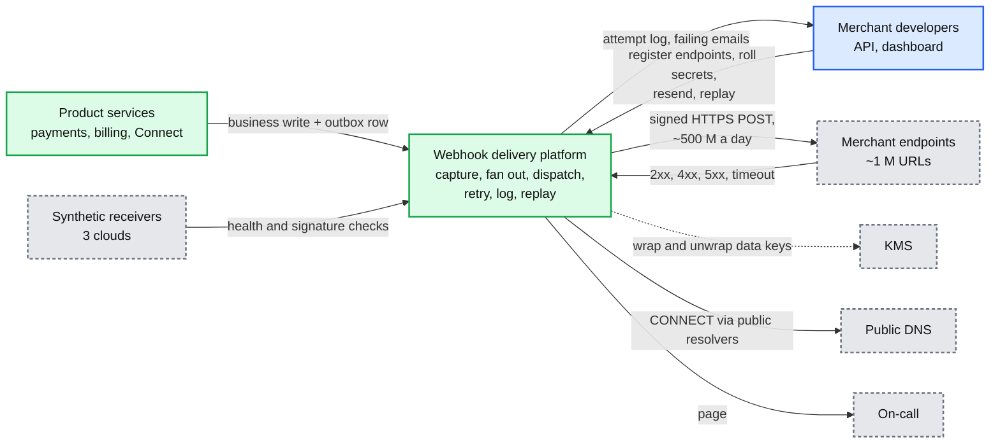

## D2. Data flow (DFD)

Inputs to outputs with format, size and rate. Averages from solution §2; peak is the first-of-month billing run.

```mermaid
%% D2: data flow. Stores are cylinders, processes are rounded. Rates are averages with the billing-run peak where it matters.
flowchart LR
    PDB[(Product DBs<br/>outbox rows)] -->|"WAL change, ~3 KB,<br/>2.9k/s avg, ~15k/s peak"| RL(CDC relay)
    RL -->|"event JSON ~3 KB,<br/>2.9k/s, 750 GB/day"| EV[[events topic<br/>7 days]]
    RL -->|"payload ~3 KB, 30 days,<br/>~25 TB with replicas"| EST[(Event store)]
    EDB[(Endpoint DB)] -->|"endpoint rows ~200 B,<br/>a few per s"| FO(Fan-out)
    EV -->|"event, 2.9k/s"| FO
    FO -->|"delivery + render ~3.3 KB,<br/>5.8k/s avg, 30k/s peak"| DL[[deliveries topic<br/>512 partitions, 3 days]]
    DL -->|"delivery, 59/s per partition at peak"| DS(Dispatchers)
    DS -->|"signed POST ~3.3 KB,<br/>6.1k/s, ~99 MB/s peak"| ME[Merchant endpoints]
    ME -->|"status + body, read 64 KB max"| DS
    DS -->|"queued row ~300 B, ~200/s,<br/>50k/s burst after an outage"| QS[(Endpoint queue store<br/>TTL 4 days)]
    DS -->|"attempt record ~500 B,<br/>6.1k/s, 265 GB/day"| AT[[attempts topic]]
    AT -->|"rows, 2 to 5 s lag"| AL[(Attempt log<br/>30 days, ~4 TB)]
    AT -->|"fanout ids + outcomes, hourly"| RC(Reconciler)

    class RL,FO,DS,RC service
    class PDB,EST,EDB,QS,AL store
    class EV,DL,AT queue
    class ME external

    classDef service  fill:#dcfce7,stroke:#16a34a,stroke-width:2px,color:#111
    classDef store    fill:#ede9fe,stroke:#7c3aed,stroke-width:2px,color:#111
    classDef queue    fill:#cffafe,stroke:#0891b2,stroke-width:2px,color:#111
    classDef external fill:#e5e7eb,stroke:#6b7280,stroke-width:2px,color:#111,stroke-dasharray:4 3
```

## D3. Component architecture

The final design, 15 nodes, dispatcher fleet in red: [solution §6](solution.md#6-final-design-and-the-six-core-flows).

## D4. Happy paths, one per FR

**FR1, register an endpoint:** [solution §4.1](solution.md#41-merchants-register-endpoints-and-choose-event-types).

**FR1, roll a signing secret with a 24 h overlap (Flow 4).** Both secrets sign every attempt until the old one expires.

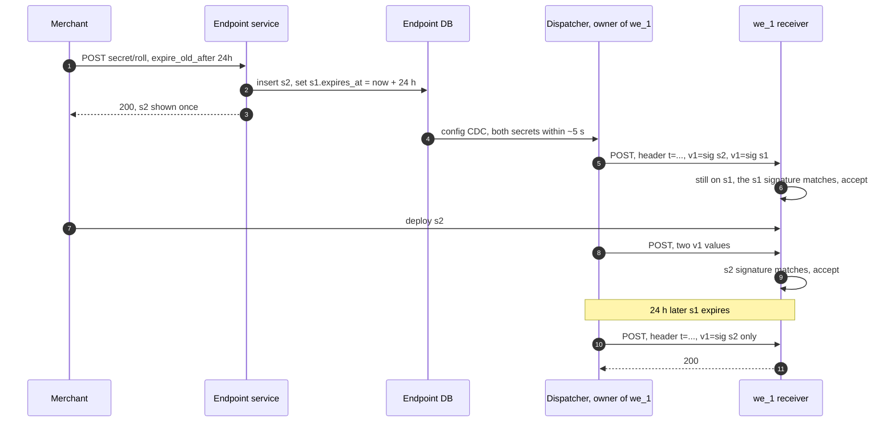

**FR2, deliver one event:** [solution §4.2](solution.md#42-every-matching-event-is-delivered-to-every-subscribed-endpoint-at-least-once-signed).

**FR3, retry, breaker and drain:** [solution §4.3](solution.md#43-failed-deliveries-are-retried-for-up-to-3-days-failing-endpoints-are-disabled-and-the-merchant-is-told).

**FR3, an endpoint dead for good is disabled and the merchant is told (Flow 5, days 0 to 3).**

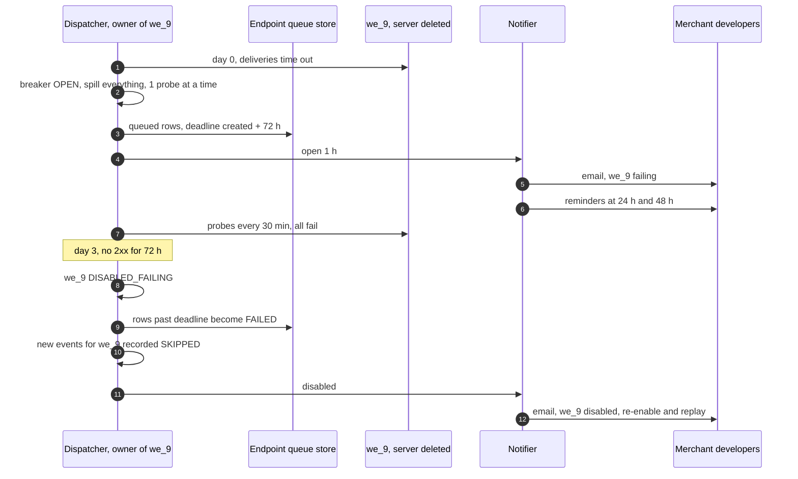

**FR4, replay a time range:** [solution §4.4](solution.md#44-merchants-see-delivery-attempts-and-replay-one-event-or-a-time-range).

**FR4, resend one event.** Goes to the front of the endpoint's replay lane; the original delivery keeps its own retries.

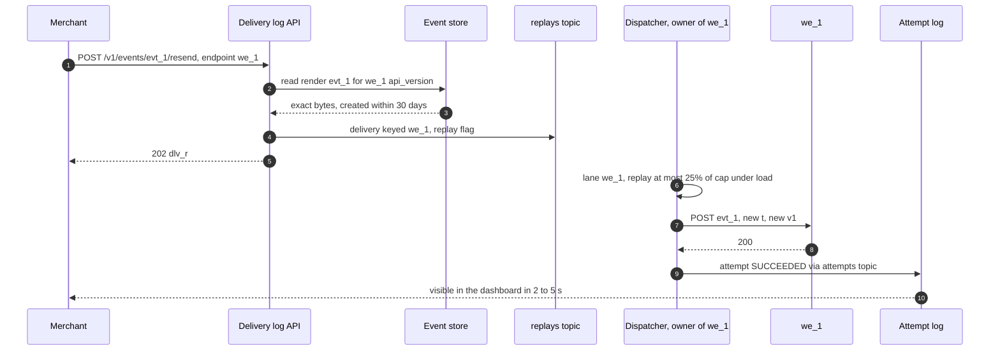

## D5. Failure paths

**The top merchant's endpoint hangs (Flow 2).** It costs its own cap for one timeout, then one probe.

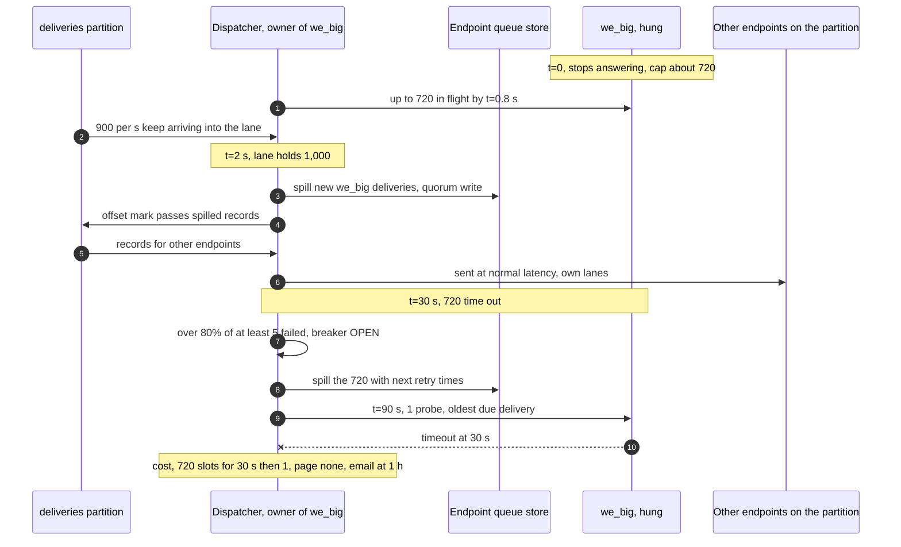

**The endpoint queue store is unavailable while endpoints need to spill.** Work stays in Kafka; only spilling endpoints slow down.

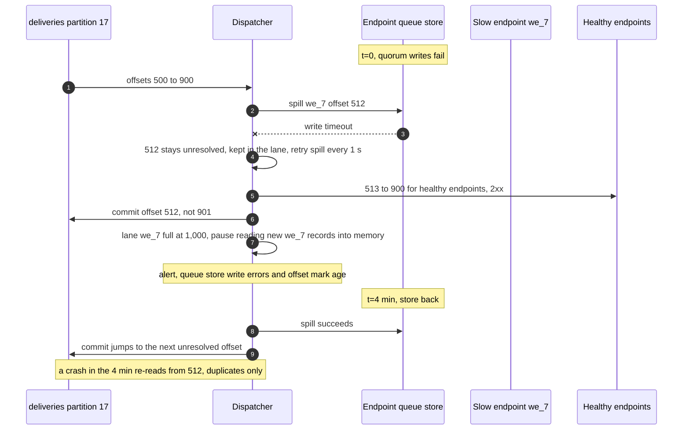

**A duplicate enters after a CDC relay restart.** Removed by the recent-success set when it can be; otherwise by the receiver.

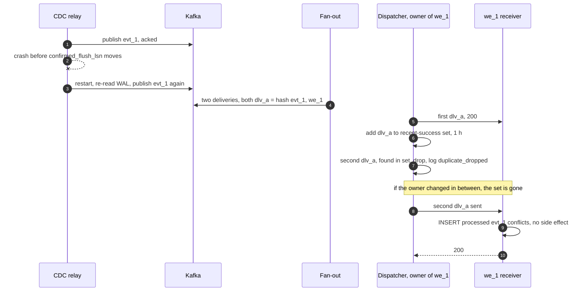

**A dispatcher crashes at peak** and **egress breaks for the region:** [solution §10.4](solution.md#104-failure-timeline). **A lost 200 and receiver dedup:** [solution §5.5](solution.md#55-receivers-see-duplicates-and-out-of-order-events-what-do-you-promise-and-what-do-you-tell-them-to-do).

## D6. Activity / decision flow

The attempt outcome classifier inside the dispatcher. Platform faults are checked first, so our outage never counts against a merchant. Only timeouts, connect, TLS, DNS errors and 5xx count toward the breaker.

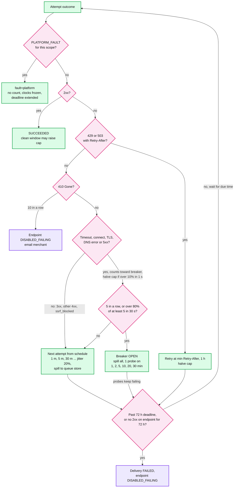

The 410 rung and the final fail node both write `DISABLED_FAILING`; it is shown twice only to keep the tree readable.

## D7. Entity relationship

Endpoint DB, event store, endpoint queue store and attempt log entities with keys and TTLs: [solution §3.3](solution.md#33-data-model).

## D8. State machines

**Delivery.** Exists as a Kafka record on the hot path; gets a queue row only in `QUEUED`.

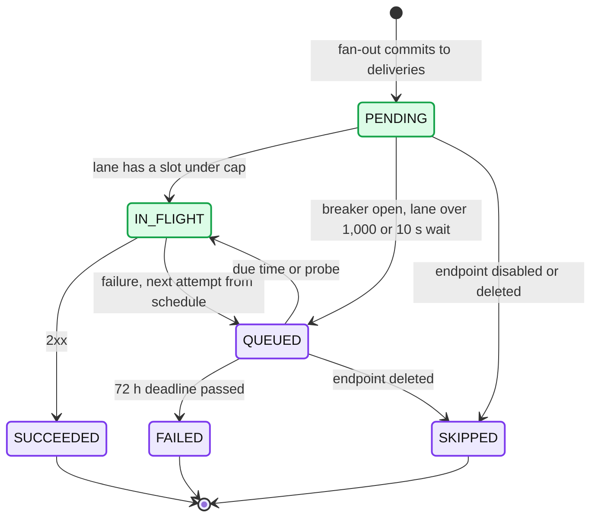

**Endpoint.**

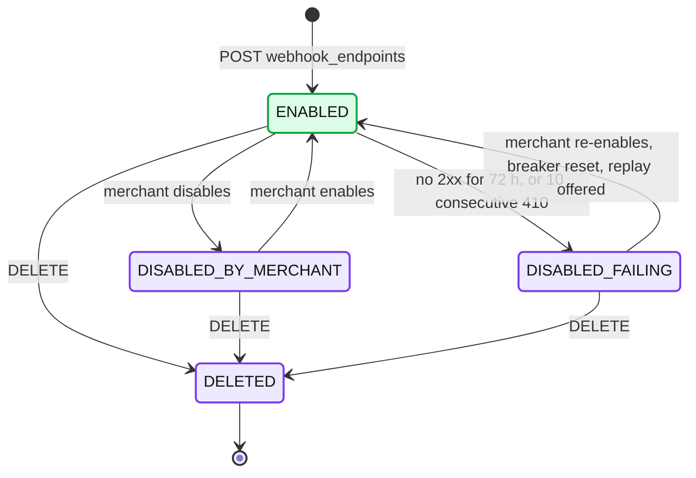

**Breaker (per endpoint, in the owning dispatcher's memory, snapshotted every 10 s).** Frozen while `PLATFORM_FAULT` is declared.

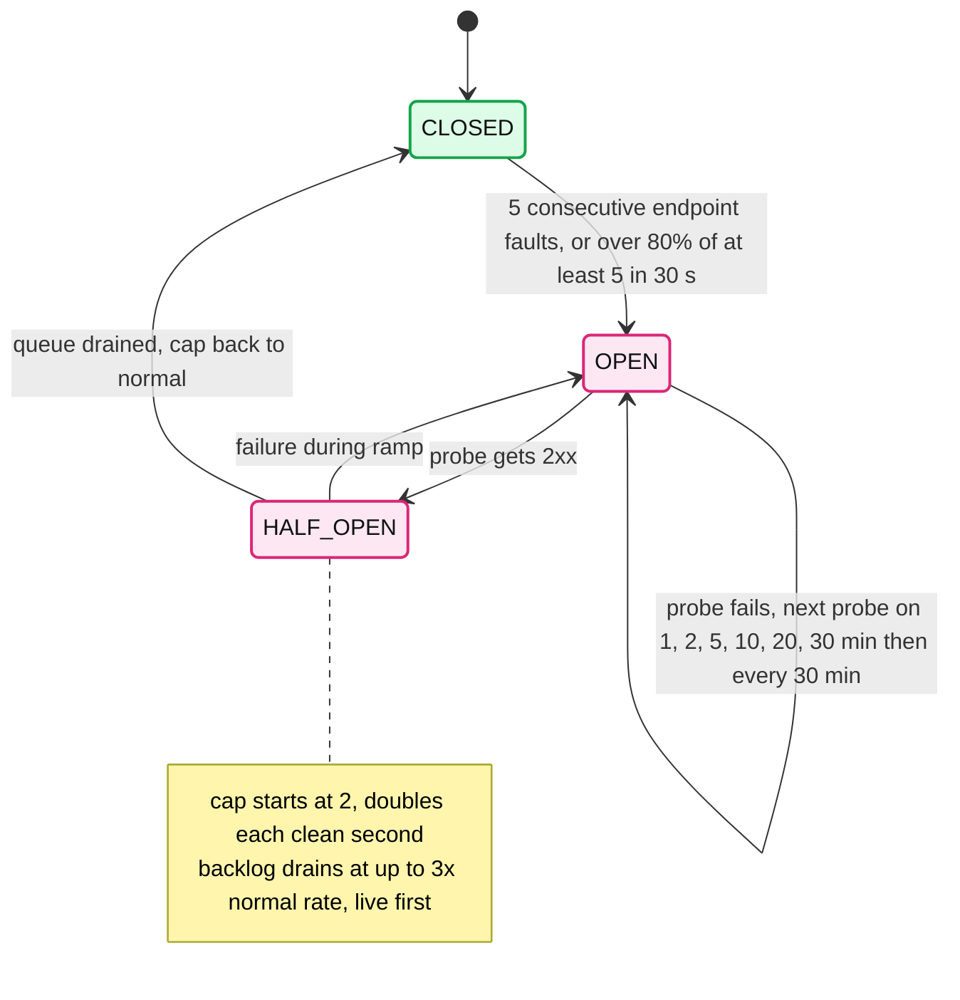

## D9. Deployment / topology

Three AZs in one region. Every tier is N+1 per AZ, so one AZ can be lost. Proxies sit in a separate egress network in each AZ, with no peering to internal networks.

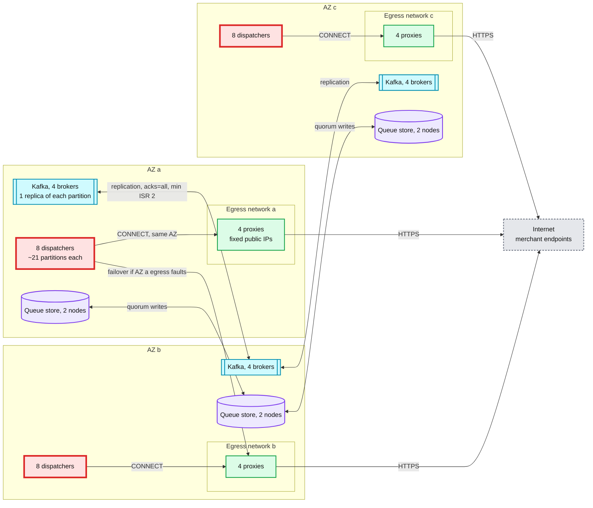

What crosses an AZ boundary: Kafka replication, queue store quorum writes, consumer reads from a partition leader in another AZ, and egress failover when one AZ's proxies are in fault. Fan-out, the CDC relays, the event store and the control plane are spread the same way and left out to stay under 15 nodes. Losing one AZ leaves 16 dispatchers at ~1,500 in flight each at design capacity, under the ~4,000 per node (solution §10.3).

## D10. Scaling / partitioning

`deliveries` has 512 partitions keyed by `endpoint_id`, ~2,000 endpoints each, one owner dispatcher per partition. Average load is ~59 deliveries/s per partition at peak. The problem is one endpoint, not one partition.

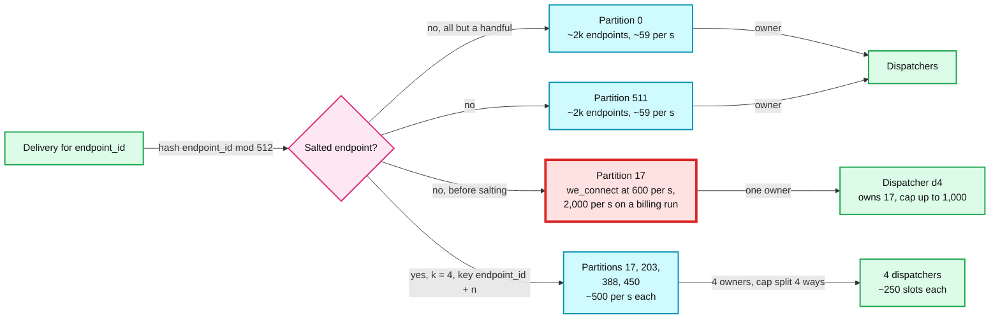

- Without salting, partition 17 carries 2,000/s × 3.3 KB = 6.6 MB/s and one dispatcher holds `2,000 × 0.4 s = 800` slots for one endpoint. That is the 2,000/s salting line in solution §5.3 and §10.3.
- Salting gives up per-endpoint state in one process: four owners each run a quarter of the cap and their own breaker. A dead salted endpoint costs four breakers' worth of timeouts, not one.
- The offset low-water mark per partition: [solution §10.1](solution.md#101-internals-of-each-chosen-technology).

## D11. Failure mode map

Component, what fails, blast radius, mitigation. Two trees to stay under 15 nodes. Matches solution §8.

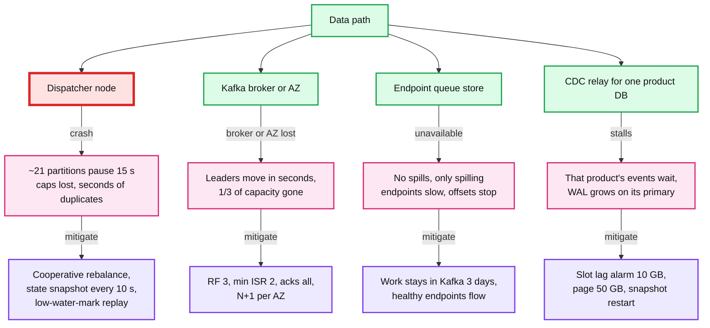

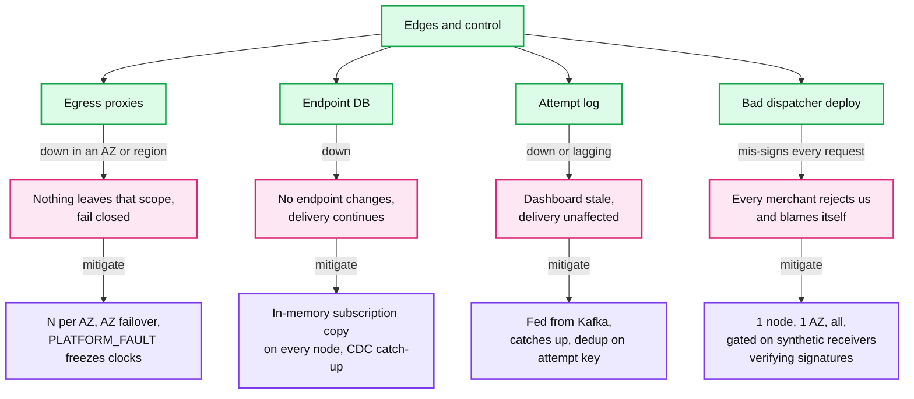

## D12. Rollout / migration

From a legacy path (the payments service enqueues webhook jobs, workers POST them) to this design. Each endpoint has an `owner` flag with an `effective_from` a minute ahead; both paths compare `event.created` to it, so every event has exactly one sender. Rollback at any phase is a new `effective_from` back to legacy; deliveries already queued in the new path finish there.

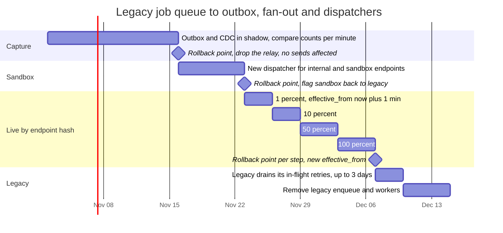

Gates between live steps: synthetic receivers verify 100% of signatures, the commit-to-first-attempt p99 stays under 5 s, the reconciler reports zero gaps, and per-endpoint success rates on the new path match legacy's within 0.5 points.
