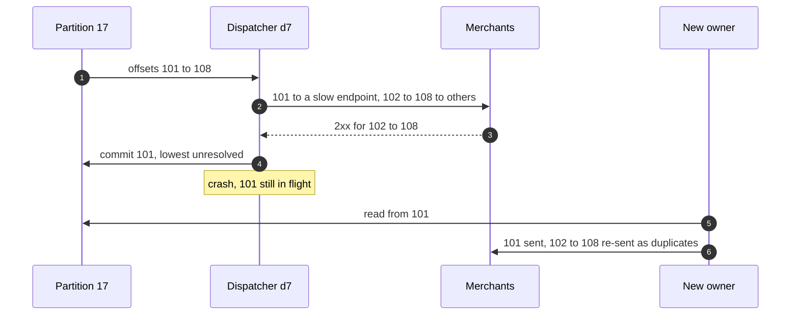
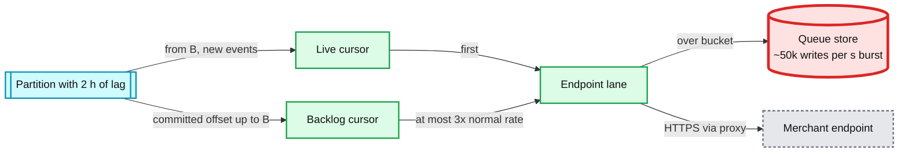
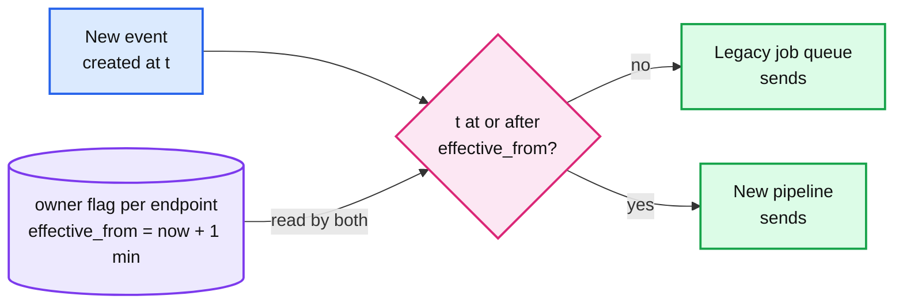
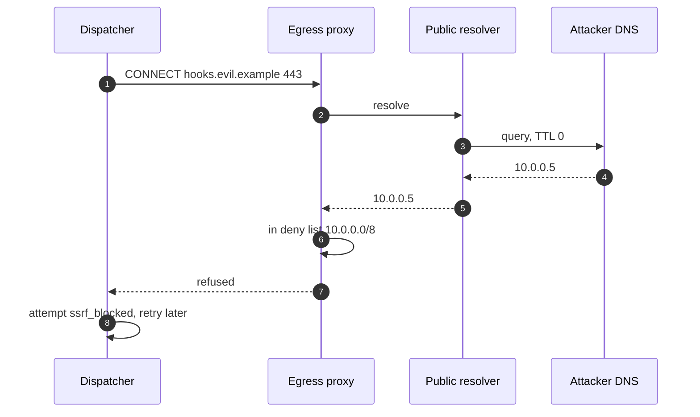

# Edge cases: Webhook delivery service (Stripe style)

Every entry answerable in under 60 seconds out loud. Categories: failure, consistency, scale, data, operations, security / abuse. Design reference: [`solution.md`](solution.md). An answer bullet that starts with **Decision:** goes past what solution.md states or changes it; the deep dives carry the numbers. Acronyms: CDC (change data capture), WAL (write-ahead log), AZ (availability zone), ISR (in-sync replicas), LSN (log sequence number), HMAC (hash-based message authentication code), SSRF (server-side request forgery), IMDS (cloud instance metadata service), DNS (Domain Name System), TLS (Transport Layer Security), TTL (time to live), AIMD (additive increase, multiplicative decrease), ASN (autonomous system number), NTP (Network Time Protocol), KMS (key management service), GDPR (EU General Data Protection Regulation), PII (personally identifiable information).

---

## Failure

## Edge case: a dispatcher node crashes at peak
- **Trigger:** OOM (out of memory) kill or host loss on one of 24 dispatchers, ~21 partitions, ~500 deliveries in flight.
- **Symptom:** ~500 sockets reset at merchants; a lag blip on ~4% of partitions; a rebalance metric. No page.
- **Answer:**
  - The group coordinator evicts it after `session.timeout.ms = 15 s`. Cooperative-sticky moves only its partitions; the other ~490 never pause.
  - New owners load `ENDPOINT_STATE` for those partitions (~2,000 rows each), rebuild caps and timer wheels, start breakers closed, and read from the committed low-water marks.
  - Nothing is lost: an offset only passes a record once it got a 2xx, spilled with a quorum write, or reached a terminal state. Cost: duplicates for the ~500 in flight plus records resolved after the mark (typically dozens per partition, at most ~1,800 at peak).
  - A dead endpoint on those partitions costs one more round of up to its cap of timeouts, because breakers restart closed.
- **Confidence:** [ ] shaky  [ ] ok  [ ] confident

## Edge case: a Kafka broker dies, or a whole AZ goes
- **Trigger:** one of 12 brokers lost; or an AZ with 1/3 of brokers, 8 dispatchers and 1/3 of the proxies.
- **Symptom:** leader elections for ~1/12 (or 1/3) of partitions; seconds of produce and consume stalls.
- **Answer:**
  - Replication 3 across AZs, `acks=all`, `min.insync.replicas=2`, `unclean.leader.election.enable=false`: an acknowledged write is on two AZs, so no acknowledged delivery is lost.
  - With one AZ gone, partitions still have 2 in-sync replicas and keep accepting writes.
  - Dispatchers are sized so 16 nodes carry design load: 24k in flight ÷ 16 = 1,500 per node against a ~4,000 limit. Proxies are N+1 per AZ, so the other AZs absorb the tunnels.
  - Latency SLO is at risk for the ~15 s of rebalance, not the durability SLO.
- **Confidence:** [ ] shaky  [ ] ok  [ ] confident

## Edge case: the endpoint queue store is down
- **Trigger:** the wide-column cluster that holds spilled deliveries and `ENDPOINT_STATE` loses quorum.
- **Symptom:** spill writes fail; failing endpoints cannot park their work.
- **Answer:**
  - Records that cannot spill stay unresolved, so the low-water mark does not pass them. The work stays in Kafka, which keeps `deliveries` for 3 days.
  - Only partitions that hold a failing or backed-up endpoint stop advancing their committed offset. Healthy endpoints on those partitions keep sending from the lanes, so merchants see no delay; we see consumer lag on those partitions.
  - The lane buffer is capped at 1,000 per endpoint, so a failing endpoint's lane fills and its newest records stay unread until the store returns. Memory stays bounded.
  - Due retries already in the store wait. When it returns, the backlog is read from cursors; a crash in that window re-sends, never drops.
- **Confidence:** [ ] shaky  [ ] ok  [ ] confident

## Edge case: the CDC relay for the payments DB stalls
- **Trigger:** a relay bug or a stuck Kafka producer; the replication slot is not being confirmed.
- **Symptom:** payments events stop flowing; WAL piles up on the payments primary at ~50 MB/s [estimate].
- **Answer:**
  - Payments events wait safely in the WAL; other products' relays are unaffected.
  - Slot lag alarms at 10 GB (~3 minutes), pages at 50 GB (~17 minutes), long before the primary's disk is at risk (~360 GB in 2 hours).
  - On restart the relay resumes from `confirmed_flush_lsn` and re-publishes the batch it had not confirmed. Duplicates carry the same `event_id`, so deliveries get the same `delivery_id`.
  - This is the one place our pipeline can hurt the payments DB, so it is the red node of §5.1 and the tightest alert we own.
- **Confidence:** [ ] shaky  [ ] ok  [ ] confident

## Edge case: the replication slot is lost in a payments DB failover
- **Trigger:** the payments primary fails over to a replica that does not carry the logical slot, or an operator drops the slot to save disk.
- **Symptom:** the relay cannot resume from its LSN. Without care, every event committed since the last confirm is missed.
- **Answer:**
  - Outbox rows are insert-only and kept 7 days, never marked sent, so the source of truth is still there.
  - The relay restarts from a snapshot: every outbox row with `created_at ≥ last published created_at − 10 min`, then switches to a new slot on the new primary. The 10 minutes covers transactions that took their timestamp early and committed late.
  - The overlap re-publishes a few minutes of events. Deterministic delivery ids and receiver dedup absorb them.
  - The reconciler's source-to-stream check (outbox counts per minute vs `events` counts) proves the gap was closed.
- **Confidence:** [ ] shaky  [ ] ok  [ ] confident

## Edge case: every egress proxy in the region is down
- **Trigger:** a bad proxy config push, or the NAT or route in front of them fails.
- **Symptom:** every attempt fails with connect errors; dispatchers keep running.
- **Answer:**
  - Proxies fail closed: no proxy, no send. Dispatchers have no other route out.
  - Within ~20 s the fault detector sees failures across ≥ 1,000 endpoints in ≥ 50 ASNs at over 5x baseline, and the synthetic receivers are down. It declares `PLATFORM_FAULT`, stops attempts, freezes breakers, attempt counts and the 72 h clocks, holds failing emails, and pages.
  - Deliveries wait in Kafka as lag. On recovery: split cursor, live first, catch-up at 3x per endpoint (Flow 3).
  - If only one AZ's proxies are bad, the scope is that AZ and dispatchers fail over to the other AZs' proxies.
- **Confidence:** [ ] shaky  [ ] ok  [ ] confident

## Edge case: the endpoint DB is down
- **Trigger:** the sharded endpoint DB loses its primary for one or all shards.
- **Symptom:** merchants cannot create, update or roll endpoints; the dashboard's endpoint pages fail.
- **Answer:**
  - Delivery continues. Fan-out and dispatchers use their in-memory copy of all 1 M endpoints (~200 MB), fed by CDC.
  - Config changes queue behind the outage. When CDC resumes, maps catch up within seconds.
  - A secret roll in progress keeps both secrets valid, because expiry is a timestamp already in memory.
  - Endpoint API availability (99.95%) is what burns, not delivery.
- **Confidence:** [ ] shaky  [ ] ok  [ ] confident

## Edge case: the event store is slow when retries need it
- **Trigger:** compaction storm or a hot node in the 30-day event store.
- **Symptom:** retried and replayed deliveries wait on reads of `EVENT_RENDER`.
- **Answer:**
  - First attempts never touch the event store: the rendered bytes travel inline on `deliveries`. ~97% of deliveries are unaffected.
  - Retries and probes (~500 reads/s) slow down; their lane waits and the spill rule keeps them out of the offset mark.
  - Replays are throttled first; their checkpoint resumes them.
  - **Decision:** an LRU of recent renders in each dispatcher (1 h, ~1 GB) serves most early retries (1 min, 5 min, 30 min) without the store.
- **Confidence:** [ ] shaky  [ ] ok  [ ] confident

## Edge case: the region fails over
- **Trigger:** the whole primary region is lost; payments fail over to the standby region.
- **Symptom:** the pipeline restarts in the standby with mirrored Kafka and translated offsets.
- **Answer:**
  - Kafka is mirrored; consumer offsets are translated approximately, so the standby resumes slightly before where the primary stopped. That re-sends minutes of deliveries: at-least-once again, deduplicated by receivers on `event.id`.
  - The standby's proxies use their own public IPs, already on the published list, so merchants' allowlists keep working.
  - Events committed in the lost region but not yet mirrored are as lost as the payments themselves; the outbox follows the payments DB's own replication.
  - The fault detector treats the failover window as a platform fault: no breakers, no disable clock.
- **Confidence:** [ ] shaky  [ ] ok  [ ] confident

---

## Consistency

## Edge case: deliveries finish out of order and the node crashes
- **Trigger:** on partition 17, offset 101 is in flight to a slow endpoint while 102 to 108 already got 2xx or spilled.
- **Symptom:** naive "commit after the batch" would commit 109 and lose 101 on a crash.
- **Answer:**
  - The dispatcher commits the lowest unresolved offset: 101. Resolved means a 2xx recorded, a quorum spill, or a terminal state.
  - A crash replays 101 to 108. 102 to 108 are duplicates, never gaps.
  - The spill rule (1,000 buffered or 10 s waited) means no record stays unresolved longer than one 30 s timeout, so the mark trails by seconds.
- **Diagram:**

- **Confidence:** [ ] shaky  [ ] ok  [ ] confident

## Edge case: a fan-out transaction aborts halfway
- **Trigger:** a fan-out node produced 3 of 5 deliveries for `evt_1`, then died before commit.
- **Symptom:** without transactions, 3 deliveries would go out now and all 5 again after the retry.
- **Answer:**
  - Fan-out produces deliveries and its `events` offset in one Kafka transaction. A dead instance's transaction is aborted when a new instance with the same `transactional.id` bumps the producer epoch.
  - Dispatchers read with `read_committed`, so they never see the 3 aborted records.
  - The new instance re-reads `evt_1` and commits all 5. One send each.
  - Cost: ~100 ms commit interval on the latency path.
- **Confidence:** [ ] shaky  [ ] ok  [ ] confident

## Edge case: an endpoint is created and an event fires 2 s later
- **Trigger:** a merchant registers `we_1` at 12:00:00 and a payment succeeds at 12:00:02.
- **Symptom:** the event may not be delivered to `we_1`.
- **Answer:**
  - Config reaches fan-out by CDC with p99 5 s. A fan-out node that has not applied `we_1` yet does not match it.
  - Documented: "events created after registration are delivered, within a few seconds."
  - The merchant can replay from the registration time; the event store has the event for 30 days.
  - **Decision:** the dashboard offers a one-click "replay since creation" for the first hour of a new endpoint's life.
- **Confidence:** [ ] shaky  [ ] ok  [ ] confident

## Edge case: an endpoint is disabled or deleted while deliveries are in flight
- **Trigger:** the merchant disables `we_1` with 40 deliveries in flight and 2,000 queued.
- **Symptom:** the merchant expects the requests to stop now.
- **Answer:**
  - The disable reaches the owning dispatcher in p99 5 s. In-flight requests finish (at most 30 s); nothing new starts after the config arrives.
  - Queued deliveries become `SKIPPED` when their lane is next read, recorded on `attempts` so a later replay can find them.
  - New events for `we_1` are recorded as `SKIPPED` at fan-out.
  - Worst case: a few seconds of extra requests. Stated as eventual consistency on config.
- **Confidence:** [ ] shaky  [ ] ok  [ ] confident

## Edge case: the URL is changed in the middle of a retry sequence
- **Trigger:** `we_1` is failing because its old host is gone; the merchant changes the URL to a new host.
- **Symptom:** queued deliveries hold attempt counts against the old URL.
- **Answer:**
  - The URL is read from the endpoint config at send time, not stored in the delivery. The next attempt goes to the new host.
  - The new URL is re-validated at registration and by the proxy at every connect.
  - **Decision:** a URL change resets the endpoint's breaker to closed with cap 10 and probes the queue immediately, so the backlog drains without waiting for the next probe slot. Delivery deadlines (72 h) do not reset.
- **Confidence:** [ ] shaky  [ ] ok  [ ] confident

## Edge case: the enabled event types change
- **Trigger:** the merchant removes `charge.refunded` from `we_1` while 500 such deliveries are queued.
- **Symptom:** does the merchant still receive them?
- **Answer:**
  - Matching happens at fan-out, at event time. Deliveries already created are delivered: the merchant subscribed when the event happened.
  - New `charge.refunded` events stop matching within p99 5 s.
  - **Decision:** the dashboard offers "drop queued deliveries of removed types" as an explicit action, recorded as `SKIPPED`.
- **Confidence:** [ ] shaky  [ ] ok  [ ] confident

## Edge case: the secret is rolled during a retry sequence
- **Trigger:** `dlv_c` failed at 12:00; the merchant rolls the secret at 12:30 with a 24 h overlap; the next attempt is at 13:36.
- **Symptom:** which secret signs the 13:36 attempt?
- **Answer:**
  - Signatures are computed per attempt, at send time, never stored. The 13:36 attempt carries `t=13:36` and two `v1=` values, one per secret.
  - After the overlap expires, only the new secret signs. An attempt at day 2 uses whatever is active then.
  - A roll with `expire_old_after = 0` (leaked secret) signs only with the new one from p99 5 s later.
- **Confidence:** [ ] shaky  [ ] ok  [ ] confident

## Edge case: the merchant clicks resend while the automatic retry is still pending
- **Trigger:** `dlv_c` is waiting for its +2 h retry; the merchant fixed the bug and resends `evt_1` now.
- **Symptom:** the receiver gets `evt_1` now and again at +2 h.
- **Answer:**
  - Resend creates a delivery on the `replays` lane with the same event id. As at Stripe, it does not cancel the automatic retry.
  - The receiver's dedup on `event.id` turns the second copy into a no-op.
  - **Decision:** if the resend gets a 2xx, the dispatcher pulls the original's next attempt forward to now. Duplicates are fine; an endpoint that just proved healthy should not wait 2 h either way.
- **Confidence:** [ ] shaky  [ ] ok  [ ] confident

## Edge case: the receiver returns 200 but never processed the event
- **Trigger:** the receiver queues the body in memory, answers 200, then crashes.
- **Symptom:** the merchant says "you never sent `evt_1`". Our log shows `SUCCEEDED`.
- **Answer:**
  - A 2xx is the receiver taking responsibility. We do not retry it.
  - The attempt log shows the time, status and a 2 KB response excerpt for 30 days, which settles the dispute.
  - Recovery is theirs and easy: resend (30 days), replay a range, or `GET /v1/events` to list what they missed.
  - The receiver contract says: put the raw body on a durable queue before answering 2xx.
- **Confidence:** [ ] shaky  [ ] ok  [ ] confident

## Edge case: the receiver's clock is 7 minutes off
- **Trigger:** a merchant server without NTP drifts 7 minutes.
- **Symptom:** every request fails signature verification on the 5-minute tolerance; the merchant answers 400; retries pile up.
- **Answer:**
  - We sign with `t` at send time from NTP-synced clocks, so the skew is theirs. The tolerance is a client-library default, so they can widen it, but should fix NTP.
  - We only see 400s. Any non-2xx counts as a failure, so the breaker opens within seconds and the queue holds the backlog for 72 h. Once NTP is fixed, the next probe succeeds and the backlog drains.
  - **Decision:** if a 400 response excerpt contains a timestamp or tolerance message from our SDKs, the dashboard labels it "clock skew suspected" and the failing email says so.
- **Confidence:** [ ] shaky  [ ] ok  [ ] confident

---

## Scale

## Edge case: the first-of-month billing run
- **Trigger:** subscriptions renew at 00:00 UTC on the 1st. ~30k deliveries/s for about an hour, 5x average.
- **Symptom:** without preparation, consumer lag and the 5 s p99 blown at 00:05.
- **Answer:**
  - Fleets pre-scale on the calendar at 23:30 UTC, not on lag. Design capacity is 60k/s, so 30k/s is half.
  - In flight at peak: `30k × 0.4 s = 12k`, ~500 per dispatcher node against ~4,000.
  - `events` is keyed by `event_id`, so one platform's run spreads over all 128 partitions instead of a few.
  - Merchants' own endpoints are what slow down; their AIMD caps back off before they fall over.
- **Confidence:** [ ] shaky  [ ] ok  [ ] confident

## Edge case: a Connect platform's endpoint gets 2% of all traffic
- **Trigger:** one platform receives events for all its connected accounts on one endpoint: ~600/s at peak.
- **Symptom:** one partition and one dispatcher carry it.
- **Answer:**
  - 600/s × 3.3 KB is ~2 MB/s on one partition, fine. Its cap settles near `2 × 600 × 0.4 = 480`.
  - Above ~2,000/s per endpoint, salt it: key `(endpoint_id, n)` over k partitions, cap split k ways.
  - If it hangs, it holds its cap (~480 to 720) for 30 s, then 1 probe. That is why the top 5 caps (~3,000) are reserved headroom.
- **Confidence:** [ ] shaky  [ ] ok  [ ] confident

## Edge case: 10x tomorrow
- **Trigger:** a new product line pushes deliveries to 5 B/day, ~58k/s average.
- **Symptom:** the fleet sized for 60k/s is at its ceiling on an average day.
- **Answer:**
  - Partitions 512 to 4,096 (a re-key is a new topic with a cutover, since moving keys between partitions breaks ownership).
  - Dispatchers ~200 nodes, proxies ~100, the published IP list becomes a CIDR block.
  - Cells by account (~8), each with its own Kafka, dispatchers and proxies; the seam is account to cell at the relay. Caps a bad deploy at 1/8 of merchants.
- **Confidence:** [ ] shaky  [ ] ok  [ ] confident

## Edge case: many endpoints get slow at once, but none hang
- **Trigger:** a popular hosting provider degrades; 5,000 endpoints go from p50 150 ms to 4 s.
- **Symptom:** slots fill with slow requests that will eventually succeed.
- **Answer:**
  - Endpoints with p50 over 1 s draw only from the slow pool (25% of slots, ~1,000 per node). The fast pool (~3,000 per node) keeps serving everyone else.
  - Inside the slow pool, endpoints share by DRR weighted by cap; each one's AIMD cap halves on timeouts.
  - Their own deliveries queue and spill. Their latency is theirs; the 5 s SLO excludes endpoints over their cap.
- **Confidence:** [ ] shaky  [ ] ok  [ ] confident

## Edge case: one merchant registers 16 endpoints on the same host
- **Trigger:** 16 endpoints, 16 paths, one server.
- **Symptom:** caps are per endpoint, so the host sees 16 caps' worth of connections.
- **Answer:**
  - Each endpoint's AIMD cap reacts to the shared host's latency and 5xx, so all 16 back off together.
  - The proxies' per destination host cap (500 tunnels across all accounts unless the host is verified) bounds the total.
  - Fan-out is at most 16 per event per account, by the destination limit.
- **Confidence:** [ ] shaky  [ ] ok  [ ] confident

## Edge case: draining 50 M deliveries after a 2-hour outage
- **Trigger:** the pipeline was stopped 2 hours at a busy-hour ~7k/s.
- **Symptom:** 50 M in Kafka lag; big merchants would see 10x surges; live events stuck behind old ones.
- **Answer:**
  - Each lagging partition (over 10 minutes) is split at offset `B`: live cursor from `B` first, backlog cursor up to `B`.
  - Per endpoint catch-up bucket `max(3x its p99 rate, 5/s)`: a 100/s merchant drains 720k at net 200/s in ~1 h; a 0.01/s endpoint drains 72 in seconds.
  - Big endpoints exceed their bucket and spill: ~15 M rows, ~50k writes/s for ~5 minutes, which is what the queue store is sized for (~8.3k per node on 6 nodes).
- **Diagram:**

- **Confidence:** [ ] shaky  [ ] ok  [ ] confident

## Edge case: an event with a 2 MB payload
- **Trigger:** an invoice with thousands of line items; the snapshot is far over the ~3 KB average.
- **Symptom:** big Kafka records, big POSTs, slow receivers.
- **Answer:**
  - **Decision:** snapshot payloads are capped at 256 KB. Above that, nested lists are truncated with a `has_more` flag and a URL to page the rest through the API, as list objects already do.
  - Thin events avoid the problem entirely (~300 B).
  - Kafka `max.message.bytes` is set above the cap; at 1 in 100k events this size, partition throughput is unaffected.
- **Confidence:** [ ] shaky  [ ] ok  [ ] confident

---

## Data

## Edge case: an endpoint's API version is upgraded mid-retry
- **Trigger:** `we_1` moves from 2025-03-31 to 2026-09-30 while 3,000 deliveries are queued.
- **Symptom:** which shape do the queued ones get?
- **Answer:**
  - Each delivery was rendered once at fan-out, in the version pinned then, and carries `(event_id, api_version)`. Retries send exactly those bytes. Stripe: the event shape is fixed at creation.
  - New events render in the new version within p99 5 s.
  - The receiver must accept both shapes during the switch; `api_version` is in every body.
- **Confidence:** [ ] shaky  [ ] ok  [ ] confident

## Edge case: a merchant replays 30 days, 50 M events
- **Trigger:** a large merchant lost its database and replays everything the event store still has.
- **Symptom:** 50 M deliveries competing with live traffic.
- **Answer:**
  - Replays over 5 M events need a confirmation. The worker scans the event store by `(account_id, created)`, checkpoints every 1,000, and produces to `replays`.
  - The lane gives replay at most 25% of the endpoint's cap while live deliveries wait, all of it when they do not.
  - At ~2k/s it takes ~7 h; the replay reports progress and resumes from its checkpoint after any crash.
- **Confidence:** [ ] shaky  [ ] ok  [ ] confident

## Edge case: a merchant asks to replay an event from 45 days ago
- **Trigger:** a reconciliation finds a gap in March; it is now May.
- **Symptom:** the replay API rejects the range.
- **Answer:**
  - The event store keeps 30 days, matching Stripe's listing window. Older events are gone from the pipeline.
  - The answer is the API: the objects themselves (payments, invoices) are still readable, so the merchant reconciles from current state.
  - The replay reports `skipped` counts for anything outside the window, never a silent partial result.
- **Confidence:** [ ] shaky  [ ] ok  [ ] confident

## Edge case: a GDPR erasure request for a customer
- **Trigger:** a merchant's customer asks to be erased.
- **Symptom:** PII sits in events, renders, queued rows and attempt logs.
- **Answer:**
  - Everything expires on its own: outbox 7 days, queue rows 4 days, events and attempt logs 30 days.
  - Inside 30 days, the erasure deletes that account's matching events from the event store by `(account_id, created)` and blocks their replay.
  - Attempt logs store only our metadata and a 2 KB excerpt of the merchant's response, never our request bodies.
  - What merchants stored on their side is theirs to erase.
- **Confidence:** [ ] shaky  [ ] ok  [ ] confident

## Edge case: a product team changes an event's schema
- **Trigger:** the billing team adds a field to `invoice.paid` and renames another.
- **Symptom:** receivers parsing the old shape break.
- **Answer:**
  - Additive changes ship to every version. A rename or removal ships only in a new API version; endpoints pinned to old versions keep getting the old shape, rendered by the versioning layer at fan-out.
  - The schema registry rejects a breaking change to an existing version at build time.
  - The webhooks team never edits payloads; it renders what the product team's schema says.
- **Confidence:** [ ] shaky  [ ] ok  [ ] confident

## Edge case: the attempt log grows for three years
- **Trigger:** attempts grow with volume; dashboards query them.
- **Symptom:** storage and query cost growth.
- **Answer:**
  - TTL is 30 days, so size tracks volume, not time: ~265 GB/day raw, ~8 TB raw at steady state, ~4 TB after compression and replication 2.
  - Ordered by `(account_id, endpoint_id, at)` for the dashboard, plus a projection by `event_id` for support.
  - Long-term delivery metrics are rolled up to per endpoint per hour counts and kept a year. Raw rows are not.
- **Confidence:** [ ] shaky  [ ] ok  [ ] confident

---

## Operations

## Edge case: what pages at 3 AM
- **Trigger:** any of the alerts in solution §8.
- **Symptom:** the webhooks on-call is woken.
- **Answer:**
  - Pages: `deliveries` lag over 60 s on more than 5% of partitions for 5 minutes; `PLATFORM_FAULT` declared; any reconciler gap; CDC slot lag over 50 GB or relay lag over 60 s; healthy proxies below N−1 in an AZ; synthetic receivers seeing bad signatures; queue store write p99 over 100 ms while spilling.
  - Not pages: one merchant's endpoint failing. That is an email to the merchant, and a ticket for the account manager of a top-100 account.
  - CDC and Kafka alerts route to the events platform on-call.
- **Confidence:** [ ] shaky  [ ] ok  [ ] confident

## Edge case: a dispatcher deploy mis-signs every request
- **Trigger:** a bug signs `body` instead of `t + "." + body`.
- **Symptom:** every receiver's verification fails; each merchant thinks it is their bug. The biggest blast radius in the design.
- **Answer:**
  - Rollout is 1 node for 30 minutes, then 1 AZ, then all, gated on our synthetic receivers verifying signatures at 100% and the fleet 4xx rate within 0.5 points of baseline. The canary node's ~4% of traffic trips the gate in minutes.
  - Rollback is redeploying the old version. Failed attempts are already queued for retry with correct signatures; nothing to backfill.
  - Affected merchants see a few retried 400s, explained on the status page.
- **Confidence:** [ ] shaky  [ ] ok  [ ] confident

## Edge case: rolling out a new retry schedule
- **Trigger:** product wants faster early retries (30 s instead of 1 min).
- **Symptom:** risk of more load on failing merchants and a change in how fast endpoints get disabled.
- **Answer:**
  - The schedule is configuration read at the moment a next attempt is computed, so queued deliveries keep their already computed due times.
  - **Decision:** roll out by endpoint hash (1%, 10%, 100%), compare attempts per delivery and time to success per cohort for a week.
  - The 72 h deadline and the disable rule do not change with the schedule; they are the contract.
- **Confidence:** [ ] shaky  [ ] ok  [ ] confident

## Edge case: migrating from the legacy job-queue sender
- **Trigger:** today the payments service enqueues webhook jobs and workers POST them.
- **Symptom:** a cutover risks events sent twice or by nobody.
- **Answer:**
  - Phases: outbox and CDC in shadow (counts compared per minute), then internal and sandbox endpoints, then live by endpoint hash 1%, 10%, 50%, 100%.
  - Each endpoint has an `owner` flag with `effective_from` a minute in the future. Both paths compare `event.created` to it, so each event has exactly one sender: no gap, no overlap.
  - Legacy retries in flight finish in legacy (up to 3 days). Rollback is the flag with a new `effective_from`.
- **Diagram:**

- **Confidence:** [ ] shaky  [ ] ok  [ ] confident

## Edge case: a top merchant complains about duplicates
- **Trigger:** "we received `evt_1` three times and shipped three orders."
- **Symptom:** an escalation.
- **Answer:**
  - The attempt log shows each attempt and why: a timeout after 30 s, a dispatcher failover, a manual resend. Usually the first: their handler took over 30 s, did the work, and we never saw the 200.
  - The contract is at-least-once with a stable `event.id`; the fix is their dedup table, written in the same transaction as the side effect, kept 30 days.
  - We help: show their p99 latency, and suggest answering 2xx before processing.
- **Confidence:** [ ] shaky  [ ] ok  [ ] confident

## Edge case: the fault detector fires on a real merchant-side event
- **Trigger:** a large cloud provider has an outage; thousands of merchant endpoints hosted there fail at once.
- **Symptom:** the detector might call it ours and freeze clocks.
- **Answer:**
  - The detector needs ≥ 50 distinct destination ASNs, not just ≥ 1,000 endpoints. One cloud is a handful of ASNs. Our synthetic receivers in three clouds stay up.
  - If it still fires wrongly, the cost is mild: clocks freeze for those hours, merchants get benefit of the doubt. That is the right side to err on.
  - **Decision:** each false positive is reviewed; thresholds are tuned against a replay of the last 90 days of attempt outcomes before changing.
- **Confidence:** [ ] shaky  [ ] ok  [ ] confident

---

## Security / abuse

## Edge case: a merchant registers `http://169.254.169.254/latest/meta-data/`
- **Trigger:** an attacker probes for the cloud metadata service.
- **Symptom:** none, if the design holds.
- **Answer:**
  - Registration rejects it at once: live mode needs `https`, and the IP is link-local. A friendly error, not the control.
  - The control is the proxy: it refuses any resolved IP in the deny list, including `169.254/16`.
  - Dispatchers have no route to anything but the proxies. IMDSv2 with hop limit 1 would refuse a token anyway.
- **Confidence:** [ ] shaky  [ ] ok  [ ] confident

## Edge case: DNS rebinding
- **Trigger:** `hooks.evil.example` resolves to `203.0.113.7` at registration, then to `10.0.0.5` with TTL 0.
- **Symptom:** a validator that checked once is bypassed.
- **Answer:**
  - The proxy resolves at every CONNECT with public resolvers, checks every answer, and dials that exact IP. There is no second lookup to race.
  - The attempt is `ssrf_blocked`. 20 in a row flag the account for security review.
- **Diagram:**

- **Confidence:** [ ] shaky  [ ] ok  [ ] confident

## Edge case: a public endpoint redirects to an internal address
- **Trigger:** the endpoint answers `302 Location: http://169.254.169.254/...`.
- **Symptom:** a client that follows redirects would make the internal request.
- **Answer:**
  - We never follow redirects. Any 3xx is a failed attempt, as at Stripe.
  - The attempt log shows `redirect` so an honest merchant sees why (often `http` to `https` or a trailing slash) and fixes the URL.
- **Confidence:** [ ] shaky  [ ] ok  [ ] confident

## Edge case: odd IP encodings
- **Trigger:** `https://2852039166/`, `https://0xA9FEA9FE/`, `https://[::ffff:169.254.169.254]/`, `https://[fd00::1]/`, `https://0.0.0.0/`.
- **Symptom:** a string-matching validator misses them.
- **Answer:**
  - The proxy checks parsed addresses, not strings: the deny list covers IPv4-mapped IPv6 of every private range, `fc00::/7`, `fe80::/10`, `::1`, `0/8`, and our own public ranges.
  - Registration parses with the same library, so the friendly error matches the real control.
- **Confidence:** [ ] shaky  [ ] ok  [ ] confident

## Edge case: attackers use us to flood a victim's host
- **Trigger:** many accounts register endpoints on `victim.example` and generate events.
- **Symptom:** we become a reflector.
- **Answer:**
  - Volume per endpoint is bounded by the events its account causes, at most 16 endpoints per account, and test-mode event creation is rate-limited.
  - The proxies cap tunnels per destination host across all accounts (500) unless the host proves control with a challenge at a well-known path.
  - The victim's failures open breakers fast: 1 probe per endpoint, and disable after 72 h.
- **Confidence:** [ ] shaky  [ ] ok  [ ] confident

## Edge case: an endpoint secret leaks
- **Trigger:** a merchant commits `whsec_` to a public repository.
- **Symptom:** anyone can forge requests to that endpoint that pass verification.
- **Answer:**
  - Roll with `expire_old_after = 0`: from p99 5 s later only the new secret signs.
  - Our side holds secrets envelope-encrypted under KMS, decrypted only in dispatcher memory; a leak of our storage alone yields ciphertext.
  - Receivers should still treat a webhook as a hint and read the object from the API, which a forger cannot fake.
- **Confidence:** [ ] shaky  [ ] ok  [ ] confident

## Edge case: someone replays a captured request
- **Trigger:** an attacker records one of our POSTs (for example from a merchant's proxy logs) and sends it again.
- **Symptom:** a valid signature on a repeated request.
- **Answer:**
  - After 5 minutes the receiver's tolerance rejects `t`.
  - Inside 5 minutes, the receiver's dedup on `event.id` makes it a no-op.
  - The signature covers `t` and the raw body, so changing either breaks it.
- **Confidence:** [ ] shaky  [ ] ok  [ ] confident

## Edge case: a hostile endpoint sends a huge or slow response
- **Trigger:** the endpoint streams 10 GB, or sends one byte every 20 s (slowloris against us).
- **Symptom:** a dispatcher connection, memory or slot tied up.
- **Answer:**
  - The total timeout is 30 s, covering connect, headers and body, so a slow drip cannot hold a slot longer than any hung endpoint.
  - We read at most 64 KB of body and store a 2 KB excerpt, escaped before display.
  - Repeated timeouts open its breaker: one slot, then one probe.
- **Confidence:** [ ] shaky  [ ] ok  [ ] confident

## Edge case: test-mode event spam
- **Trigger:** a free account loops on test-mode API calls that create events, to drive traffic to some endpoint.
- **Symptom:** a flood of test deliveries.
- **Answer:**
  - API calls that create events in test mode are rate-limited per account.
  - Test deliveries share the same caps, breakers, per-host limits and proxies, so they cannot exceed what a live endpoint could.
  - **Decision:** test-mode deliveries run on a separate dispatcher slot budget (10% of the fleet), so a test flood can never take slots from live mode.
- **Confidence:** [ ] shaky  [ ] ok  [ ] confident
