# HLD: Webhook delivery service (Stripe style)

> One-line answer: an event is written to an **outbox** in the same transaction as the payment that caused it, a CDC (change data capture) relay publishes it to Kafka, and a **fan-out** service turns it into one delivery per subscribed endpoint, rendered once in that endpoint's pinned API version, on a `deliveries` topic **partitioned by endpoint id**. Each partition is owned by one **dispatcher**, so everything about one endpoint (its in-flight count, its adaptive concurrency cap, its circuit breaker, its retry timers) lives in one process's memory. A dispatcher sends over async HTTP through an **SSRF-safe egress proxy**, signs each attempt fresh with HMAC-SHA256 over `timestamp.payload`, and never lets one endpoint hold more than its cap of connections. Whatever cannot be sent right now (a failed attempt waiting for its backoff, an endpoint whose breaker is open, an endpoint slower than its arrival rate) **spills to that endpoint's durable queue** and the Kafka offset moves on, so a hung endpoint costs its own cap and nothing else. Retries back off with jitter for up to 3 days, a dead endpoint gets one probe at a time instead of one timeout per event, an outage on our side is detected as ours and does not count against merchants, and every attempt lands in a 30-day log that powers the dashboard and replay. The thing that breaks first is the dispatcher's pool of in-flight connections, because merchants' slowness, not our CPU, decides how long each one is held.

Sources: the problem statement and requirements in [`README.md`](README.md); the agent survey [`research/facts-survey.md`](research/facts-survey.md). Primary pages behind the numbers that carry the design: Stripe's [webhooks guide](https://docs.stripe.com/webhooks), [manage webhook endpoints](https://docs.stripe.com/events/manage-webhook-endpoints), [IP addresses](https://docs.stripe.com/ips) and [idempotent requests](https://docs.stripe.com/api/idempotent_requests); Stripe's [Smokescreen](https://github.com/stripe/smokescreen) egress proxy; the [Standard Webhooks spec](https://github.com/standard-webhooks/standard-webhooks/blob/main/spec/standard-webhooks.md); [Svix retries](https://docs.svix.com/retries); [GitHub failed deliveries](https://docs.github.com/en/webhooks/using-webhooks/handling-failed-webhook-deliveries); [Shopify HTTPS webhooks](https://shopify.dev/docs/apps/build/webhooks/subscribe/https); the [Slack Events API](https://docs.slack.dev/apis/events-api/); [EventBridge API destinations](https://docs.aws.amazon.com/eventbridge/latest/userguide/eb-api-destinations.html); the [OWASP SSRF prevention cheat sheet](https://cheatsheetseries.owasp.org/cheatsheets/Server_Side_Request_Forgery_Prevention_Cheat_Sheet.html); the [AWS instance metadata docs](https://docs.aws.amazon.com/AWSEC2/latest/UserGuide/configuring-instance-metadata-service.html). Stripe publishes no volume, no timeout value and no endpoint-disable rule, so every scale number here is `[estimate]` and the timeout and disable rule are our own choices. Reusable blocks: [`../../concepts/exactly-once.md`](../../concepts/exactly-once.md), [`../../concepts/rate-limiting-and-load-shedding.md`](../../concepts/rate-limiting-and-load-shedding.md), [`../../concepts/fan-out-fan-in.md`](../../concepts/fan-out-fan-in.md), [`../../concepts/stream-processing.md`](../../concepts/stream-processing.md), [`../../concepts/sharding.md`](../../concepts/sharding.md), [`../../concepts/leases-fencing-clocks.md`](../../concepts/leases-fencing-clocks.md), [`../../concepts/lsm-tree.md`](../../concepts/lsm-tree.md). Related problems: [`../payments-ledger/`](../payments-ledger/) (idempotency), [`../email-campaign-sending/`](../email-campaign-sending/) (a receiver we do not control sets the speed), [`../integration-platform/`](../integration-platform/) (the inbound side of webhooks), [`../cdc-pipeline/`](../cdc-pipeline/) (the outbox relay).

Written flow-first: §4 builds one diagram one functional requirement at a time, §5 breaks and mutates it one non-functional requirement at a time, §6 shows the final design and the six flows to rehearse.

Acronyms used throughout: CDC (change data capture), HMAC (hash-based message authentication code), SSRF (server-side request forgery), IMDS (cloud instance metadata service), DNS (Domain Name System), TLS (Transport Layer Security), TTL (time to live), DRR (deficit round robin), AIMD (additive increase, multiplicative decrease), KMS (key management service), LRU (least recently used), WAL (write-ahead log), SLO (service level objective), AZ (availability zone), CIDR (an IP range, e.g. `10.0.0.0/8`), ASN (autonomous system number, a network operator), PII (personally identifiable information).

---

## 1. Understanding the problem

Three facts shape every decision. Say all three in the first minute:

1. **The receiver sets the cost, not us.** One delivery is a ~3 KB POST. The CPU is trivial. What costs is the **time a connection is held**, and that is set by a merchant's server we do not run. By Little's law, connections in flight = rate × time held. At our 30k/s peak and a ~0.4 s average response, that is ~12k connections. One large merchant at 3% of traffic whose endpoint starts hanging for the 30 s timeout holds `900/s × 30 s = 27,000` connections, more than every healthy endpoint combined. So isolation per endpoint is the core of the design, not an add-on.
2. **"Delivered" can only be at-least-once, and never ordered.** A 2xx that we do not read (a timeout, a crash) looks like a failure, so we send again. Stripe says so in its docs: "Webhook endpoints might occasionally receive the same event more than once", and "Stripe doesn't guarantee the delivery of events in the order that they're generated" ([Stripe webhooks](https://docs.stripe.com/webhooks)). The contract is: every event has a stable id to deduplicate on, and receivers should treat a webhook as a hint to read current state.
3. **The URL is attacker-controlled input to our network.** A merchant types a URL and we make an HTTPS request to it from inside our infrastructure, for years, with retries. `http://169.254.169.254/latest/meta-data/` is the cloud metadata service. A DNS name that resolves to a public IP at registration can resolve to `10.0.0.5` at send time. Egress has to be a security boundary, not a library call.

### 1.1 Functional requirements

Core (from the README):
1. **Register endpoints.** Merchants register HTTPS endpoints and choose the event types each one receives.
2. **Deliver.** Every matching event is delivered to every subscribed endpoint, at least once, signed.
3. **Retry and disable.** Failed deliveries are retried with backoff for up to 3 days, then marked failed. Endpoints that keep failing are disabled, and the merchant is notified.
4. **Observe and replay.** Merchants see every delivery attempt and can replay one event or a time range.

Below the line (say it out loud):
- **Per-merchant payload transforms** and filtering on payload fields. We filter on event type only.
- **Guaranteed ordering.** It would need one in-flight delivery per endpoint and head-of-line blocking. We refuse it and say why (§5.5).
- **Non-HTTP transports** (Amazon EventBridge, Google Pub/Sub, a merchant's queue). Stripe offers them as "event destinations". They plug into the dispatcher behind the same interface (§10.11).
- **Inbound webhooks** (receiving events from third parties). That is [`../integration-platform/`](../integration-platform/).
- **Event creation itself.** The payments, billing and other product services own their events. We own getting them out.

### 1.2 Non-functional requirements

Ask for scale first: events per day, endpoints, the largest merchant's share, how spiky the creation rate is (billing runs on the 1st of the month), the payload size. Then:

| Dimension | Target | Why it matters |
|---|---|---|
| Scale | ~1 M endpoints, ~500 M deliveries/day [estimate], ~5.8k/s average, ~30k/s at the first-of-month billing peak. Dispatch sized for 60k/s so a backlog can drain on top of a peak | Throughput is modest. Connections held by slow receivers are not (fact 1) |
| Latency | First attempt within 5 s of the event commit, p99, for endpoints whose breaker is closed | Merchants use webhooks to fulfil orders. "My order confirmation is 2 minutes late" is a support ticket |
| Isolation | An endpoint that hangs for the full 30 s timeout raises nobody else's p99. Worst case it holds its own cap of connections, and after ~30 s one probe | The 27k connections in fact 1 |
| Durability | An event committed in the source DB is never silently dropped. Each (event, endpoint) pair ends `SUCCEEDED`, `FAILED` after 3 days, or `SKIPPED` because the endpoint is disabled, and a reconciler proves it hourly | Merchants reconcile money with these. A silent drop is a lost order |
| Retry window | Up to 3 days with exponential backoff and jitter, 13 attempts | Stripe: "for up to three days with an exponential back off in live mode" |
| Availability | Endpoint management and the delivery log API 99.95%. The delivery pipeline may pause during an incident, but never loses accepted events, and an outage of ours never disables a merchant | A pipeline outage becomes delay. It must not become data loss or punishment |
| Consistency | At-least-once, unordered, per (event, endpoint). Endpoint config changes reach the pipeline within ~5 s | Fact 2. Stated, not hidden |
| Security | HMAC-SHA256 signature over a timestamp (5-minute tolerance in client libraries), secret rotation with up to 24 h overlap, HTTPS with TLS 1.2+ in live mode, no SSRF into our network, published egress IPs | Stripe's documented contract. The SSRF rule is ours and non-negotiable |

Below the line for NFRs: exactly-once delivery (impossible over HTTP without the receiver's help), a delivery SLA for endpoints that are failing (their own outage is their own latency).

---

## 2. Back-of-envelope

Only the numbers that change the design. Inputs marked `[estimate]` are assumptions to state out loud.

**Events and deliveries.** ~250 M events/day match at least one endpoint [estimate]. An account can register up to 16 event destinations ([Stripe](https://docs.stripe.com/webhooks)), and the average matching event goes to ~2 endpoints [estimate], so `250 M × 2 = 500 M` deliveries/day. `500 M ÷ 86,400 s = 5,787/s`, ~5.8k/s average. The default 10x heuristic says ~58k/s peak. The real shape is a daily peak near 3x (~17k/s) and a first-of-month billing run near 5x (~30k/s for about an hour) [estimate]. Dispatch is sized for **60k/s**, so a backlog can drain at ~30k/s on top of the worst live peak.

**Attempts.** First-attempt success ~97% [estimate]. The 3% that fail (15 M/day) mostly succeed on the first or second retry. Dead endpoints cost one probe at a time, not one attempt per delivery (§4.3). Total ~530 M attempts/day, ~6.1k/s average.

**Connections in flight (the number that matters).** Merchant response time [estimate]: p50 150 ms, mean 400 ms, p99 3 s, timeout 30 s. Little's law: `30k/s × 0.4 s = 12,000` in flight at the billing peak, `60k/s × 0.4 s = 24,000` at design capacity. Now the bad day:

| Who hangs | Their rate at peak | Held per second of hang | Connections held |
|---|---|---|---|
| One top merchant, 3% of traffic, no isolation | 900/s | 30 s each | **27,000**, more than all healthy traffic |
| 2,000 small endpoints at 0.2/s each, no isolation | 400/s | 30 s each | 12,000 |
| Same top merchant, adaptive cap ~720 (2x its normal need of `900 × 0.4 = 360`), breaker | capped | 30 s each | ≤ 720 for ~30 s, then 1 probe |
| 2,000 small endpoints, breaker per endpoint | capped | 30 s each | ≤ ~6 each for ~30 s, then 1 probe each: ≤ 2,000 |

Isolation turns "the merchants' worst day decides our capacity" into "each merchant's worst day costs its own cap". The cap cannot be small for a big merchant (it would throttle its healthy traffic), so the hung-endpoint budget is sized as the sum of the largest caps: ~3,000 connections for the top 5 endpoints hanging at once.

**Dispatch fleet.** An async HTTP client holds ~4,000 concurrent TLS connections per 8 vCPU node comfortably [estimate] (~50 KB of buffers each, ~200 MB). `24,000 ÷ 4,000 = 6` nodes for healthy traffic at design capacity, plus a budget for capped slow endpoints, doubled for headroom and spread over 3 AZs so one AZ can be lost: **24 nodes, 8 per AZ**. TLS handshakes: if half the attempts at 30k/s open a new connection (long-tail endpoints get one delivery a minute), that is 15k client handshakes/s at ~0.3 ms each, ~5 cores fleet-wide. Not a constraint.

**Egress bandwidth.** `30k/s × 3.3 KB = 99 MB/s`, under 1 Gbps at peak. Trivial. Egress goes through ~12 proxy nodes with fixed public IPs, so the published IP list stays short. Stripe publishes 15 webhook IPs ([Stripe IPs](https://docs.stripe.com/ips)).

**Kafka.** Payload ~3 KB [estimate] (snapshot events carry the full object; a thin event is ~300 B).
- `events`: `250 M × 3 KB = 750 GB/day`, 8.7 MB/s average. 7 days, replication 3: `0.75 × 7 × 3 = 15.75 TB`.
- `deliveries` (payload inline, rendered per API version): `500 M × 3.3 KB = 1.65 TB/day`, 19 MB/s average, ~100 MB/s at peak. 3 days, replication 3: `1.65 × 3 × 3 = 14.9 TB`.
- `attempts`: `530 M × 500 B = 265 GB/day`.
- ~31 TB in all: ~12 brokers with 4 TB usable each, ~65% full. 512 partitions on `deliveries`: `30k ÷ 512 = 59` deliveries/s per partition at peak.

**Event store (30 days, for replay and the events API).** Stripe "only returns events created in the last 30 days" ([manage endpoints](https://docs.stripe.com/events/manage-webhook-endpoints)). `750 GB/day × 30 = 22.5 TB` raw, ~3x compression, replication 3, ~10% extra for second API-version renders: **~25 TB**.

**Attempt log (30 days).** `265 GB/day × 30 = 8 TB` raw. Columnar, ~4x compression, replication 2: ~4 TB. Small.

**Endpoint queue store (the spill).** Normally only failing and backed-up endpoints hold rows. ~2% of traffic goes to endpoints that are failing at any moment [estimate], waiting on average ~1.5 days before success or deadline: `500 M × 2% × 1.5 = 15 M` rows × ~300 B (a reference, not the payload) = 4.5 GB. After our own 2-hour outage the burst is larger: big endpoints spill whatever exceeds their cap, ~15 M rows in ~5 minutes, **~50k writes/s**. That burst, not the steady state, picks the store (§10.1).

**Subscriptions.** 1 M endpoints × ~200 B = 200 MB. Every fan-out node and every dispatcher keeps a full copy in memory, fed by CDC.

**What the numbers tell us.** Bandwidth (~1 Gbps), CPU (a few dozen cores) and storage (~45 TB with replicas) are ordinary. The constraint is **connections held by slow receivers**: 12k in flight on a good day, and one bad merchant can more than double it in 30 seconds. The design is an isolation and scheduling system with an HTTP client attached.

---

## 3. The set-up

Product-style.

### 3.1 Core entities

- **Account**: one merchant (or a Connect platform, which also receives events for its connected accounts).
- **Endpoint**: a URL owned by an account, with `enabled_events` (a list of types or `*`), a pinned `api_version`, `status` (`ENABLED`, `DISABLED_BY_MERCHANT`, `DISABLED_FAILING`), and one or two signing secrets.
- **Endpoint secret**: `whsec_` + 32 random bytes. Envelope-encrypted. Has `expires_at` when it is the old half of a roll.
- **Event**: `evt_...`, created by a product service in its own transaction. Type, `created`, account, the object snapshot. Immutable.
- **Event render**: the event serialized in one API version. Exact bytes, so every retry sends and signs the same body.
- **Delivery**: one per (event, endpoint). Id `dlv_` = hash(event id, endpoint id), deterministic. State, attempt count, `next_attempt_at`, `deadline_at = created + 72 h`.
- **Attempt**: one HTTP try of a delivery. Time, status code or error class (`timeout`, `connect_refused`, `tls`, `dns`, `ssrf_blocked`, `redirect`), latency, a 2 KB response excerpt, and a fault flag (`endpoint` or `platform`).
- **Endpoint state**: soft and hard state of one endpoint in the pipeline: breaker (`CLOSED`, `OPEN`, `HALF_OPEN`), concurrency cap, `failing_since`, `next_wakeup_at`, the cursor into its durable queue.
- **Replay job**: an endpoint, a time range, optional event types, a checkpoint.

### 3.2 API

Merchant-facing (REST, account from the secret API key):

| Call | Request | Response | Notes |
|---|---|---|---|
| `POST /v1/webhook_endpoints` | `url`, `enabled_events[]`, `api_version?`, `description?` | `{id, secret}` | The secret is shown once. URL validated (§5.6). Live mode needs `https` |
| `POST /v1/webhook_endpoints/{id}` | `enabled_events?`, `url?`, `disabled?` | endpoint | A URL change is re-validated. Re-enabling a `DISABLED_FAILING` endpoint resets its breaker |
| `DELETE /v1/webhook_endpoints/{id}` | none | `{deleted: true}` | Undelivered deliveries become `SKIPPED` |
| `POST /v1/webhook_endpoints/{id}/secret/roll` | `expire_old_after` (0 to 24 h) | `{secret}` | Both secrets sign during the overlap. Stripe: "keep the previous secret active for up to 24 hours" |
| `GET /v1/webhook_endpoints/{id}/attempts` | `status?`, `event_type?`, `since?`, `cursor` | page of attempts | From the attempt log, eventual by a few seconds |
| `GET /v1/events/{id}/deliveries` | none | per endpoint: state, attempts | "What happened to this event?" |
| `POST /v1/events/{id}/resend` | `endpoint` | `202 {delivery_id}` | Up to 30 days after creation. Does not cancel the automatic retries, as at Stripe |
| `POST /v1/webhook_endpoints/{id}/replays` | `from`, `to` (within 30 days), `event_types?` | `202 {replay_id}`, later `{sent, skipped}` | Low-priority lane (§4.4) |
| `GET /v1/events` | `type?`, `created[gte]`, `cursor` | events of the last 30 days | The pull fallback when webhooks are not enough |

What we send (one attempt):

```
POST /webhooks/stripe HTTP/1.1
Host: shop.example.com
Content-Type: application/json; charset=utf-8
User-Agent: Stripe/1.0 (+https://stripe.com/docs/webhooks)
Stripe-Signature: t=1792656000,v1=5257a869e7ecebeda32affa62cdca3fa51cad7e77a0e56ff536d0ce8e108d8bd

{"id":"evt_1Q...","type":"payment_intent.succeeded","created":1792655999,
 "api_version":"2026-09-30","data":{"object":{...}},"livemode":true}
```

`v1` is `HMAC_SHA256(secret, "1792656000." + raw_body)` in hex. During a roll the header carries two `v1=` values, one per secret. Success is any 2xx. A 3xx is a failure and is not followed (Stripe: "We consider redirect responses to webhook requests as failures"). The header can also be offered in the [Standard Webhooks](https://github.com/standard-webhooks/standard-webhooks/blob/main/spec/standard-webhooks.md) form (`webhook-id`, `webhook-timestamp`, `webhook-signature` over `id.timestamp.payload`) for receivers that use generic libraries.

Internal:

| Call or topic | From, to | Payload | Notes |
|---|---|---|---|
| `outbox` table | product service, its own DB | `event_id`, type, account, payload | Same transaction as the business write |
| `events` topic | CDC relay to fan-out | the event | Keyed by `event_id` (not account: a billing run by one platform would be one hot partition, §5.2), 128 partitions |
| `deliveries` topic | fan-out to dispatchers | `delivery_id`, `event_id`, `endpoint_id`, render (inline bytes), `created`, `deadline_at` | Keyed by `endpoint_id`, 512 partitions |
| `replays` topic | replay job to dispatchers | as `deliveries`, plus `replay_id` | Same key and partition count, so the same dispatcher owns it |
| `attempts` topic | dispatchers to the attempt log and the reconciler | one record per attempt and per terminal state | Keyed by `endpoint_id` |
| `endpoint-config` CDC | endpoint DB to fan-out and dispatchers | endpoint rows, secrets as references | Full copy in memory, ≤ 5 s lag |

### 3.3 Data model

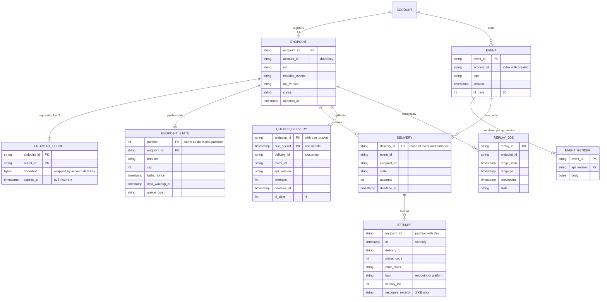

`DELIVERY` is a logical entity. It is never one mutable row: on the hot path it exists only as a Kafka record and its attempts, and it gets a `QUEUED_DELIVERY` row only if it has to wait. That is what keeps 500 M deliveries a day from becoming 500 M row updates a day.

Access patterns and the key that serves each:

| Access pattern | Rate | Store and key |
|---|---|---|
| Which endpoints want this event? | 250 M/day lookups | In-memory map on every fan-out node: `account_id → endpoints`, plus `platform_id → Connect endpoints`. Fed by CDC |
| Get the exact bytes to send | Once per delivery, inline on `deliveries` | Kafka record. Retries read `EVENT_RENDER` by `(event_id, api_version)` |
| Everything about one endpoint at send time | 6k/s | Dispatcher memory. One endpoint lives on one Kafka partition, so on one dispatcher |
| Wake up endpoints with due work | per dispatcher, every second | In-memory timer wheel per dispatcher, rebuilt from `ENDPOINT_STATE` by `partition` on takeover (~2k endpoints per partition) |
| Read an endpoint's waiting deliveries in due order | at the endpoint's drain rate | `QUEUED_DELIVERY` by `(endpoint_id, due_bucket)`, from `queue_cursor` |
| "Show me attempts for this endpoint" | dashboard, ~1k queries/s [estimate] | Attempt log ordered by `(account_id, endpoint_id, at)` |
| "What happened to event X?" | support, low | Attempt log projection by `event_id` |
| Replay a time range | rare, large | `EVENT` index `(account_id, created)` in the event store |

---

## 4. High-level design

One subsection per functional requirement. Each traces one request, climbs a Bad, Good, Great ladder, adds boxes to one diagram, and ends with what is still missing. §5 then breaks it.

### 4.1 Merchants register endpoints and choose event types

**Flow: a shop registers `https://shop.example.com/webhooks/stripe` for `payment_intent.succeeded` and `charge.refunded`.**

1. `POST /v1/webhook_endpoints`. The endpoint service validates the URL: `https` in live mode, a host name or a public IP literal, no userinfo, length ≤ 2,048. It resolves the host once and rejects private, loopback, link-local and metadata ranges as a **fast, friendly** error. This check is advisory; the real one runs at every connect (§5.6).
2. It generates a secret, encrypts it with the account's data key (wrapped by KMS), and writes `ENDPOINT` and `ENDPOINT_SECRET` in one transaction in the endpoint DB, sharded by `account_id`. It returns the secret once.
3. CDC publishes the endpoint row to `endpoint-config`. Every fan-out node and dispatcher applies it to its in-memory map within ~1 s, p99 5 s.
4. From then on, matching events fan out to it.

**Bad: look up subscriptions in the DB per event.** 250 M events a day is ~3k lookups/s average, ~15k/s at the billing peak, against a DB that also serves the merchant API. Every event pays a network round trip, and an endpoint DB blip stops all delivery.

**Good: a read-through cache (Redis) in front of the DB.** Works. But a cache miss storm after a flush still hits the DB at peak, and a stale entry after an update depends on invalidation that can be lost.

**Great: a full replica of the subscription table in memory on every consumer, fed by CDC.** 1 M endpoints × 200 B = 200 MB. Lookup is a hash map read. A DB outage freezes config changes but delivery continues. **Challenges:** a new endpoint misses events created in the ~1 to 5 s before its row arrives. We document "events created after registration are delivered, within a few seconds", and a merchant can replay from the registration time. A bootstrap on a fresh node loads a snapshot plus the CDC tail before it takes partitions.

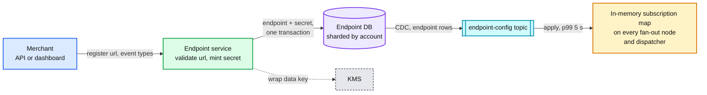

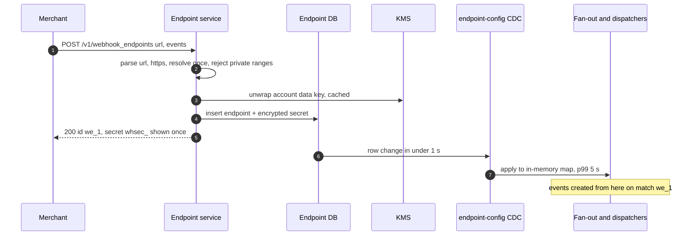

**What is still missing:** nothing delivers yet. §4.2.

### 4.2 Every matching event is delivered to every subscribed endpoint, at least once, signed

**Flow: a `payment_intent.succeeded` for account `acct_9` at 12:00:00.000.**

1. The payments service commits the payment and, **in the same transaction**, inserts `evt_1` into its `outbox` table.
2. A CDC relay tails the payments DB's WAL (or binlog), reads the outbox insert, and publishes `evt_1` to `events` keyed by `evt_1` (~100 to 300 ms after commit). It writes `evt_1` to the event store too.
3. A fan-out worker reads `evt_1`, looks up `acct_9` in its subscription map: two endpoints match, `we_1` (API version 2026-09-30) and `we_2` (2025-03-31). It renders the event once per version, and produces two records to `deliveries`, keyed by endpoint id: `dlv_a` for `we_1`, `dlv_b` for `we_2`.
4. The dispatcher that owns `we_1`'s partition reads `dlv_a`, puts it in `we_1`'s in-memory lane, sees `we_1` has a free slot (2 of 20 in flight), signs it with a fresh timestamp, and sends it through the egress proxy.
5. `shop.example.com` answers `200` in 140 ms at 12:00:00.6. The dispatcher writes an attempt record (`SUCCEEDED`) to `attempts`, and later commits the partition offset past `dlv_a`.

**Bad: the payments service POSTs to the merchant inside the API request.** A charge now takes as long as the merchant's server, a merchant outage fails payments, a crash after commit loses the webhook, and there is no retry. It is what a first version usually does.

**Bad, again: publish to a queue after the commit (dual write).** `commit; publish(evt)`. A crash, deploy or broker blip between the two loses the event. Publish first and roll back, and we sent an event for a payment that never happened. At 250 M events a day a 0.001% gap is 2,500 lost webhooks a day.

**Good: outbox table plus a poller.** A job selects unsent outbox rows every second and publishes them. Durable and simple. Costs: up to a second of added latency, an index scan on a hot table in every product DB, and "mark sent" updates that double the write load on the outbox.

**Good, for the delivery side: one shared queue and a worker pool.** Workers take any delivery and POST it. Works on a good day. Breaks on fact 1: a hung endpoint's deliveries occupy workers for 30 s each, and the pool fills with them (§5.3).

**Great: outbox read by CDC, fan-out per (event, endpoint), deliveries partitioned by endpoint.** CDC reads the WAL, so no polling and no "mark sent" writes; the outbox rows are deleted by a TTL job. Fan-out renders once per API version, so every retry sends the same bytes. Partitioning by endpoint gives one owner per endpoint, which is what makes per-endpoint caps and breakers cheap (§5.3). **Challenges:** the relay can publish an event twice after a crash (fixed by deterministic delivery ids and receiver dedup, §5.5); a CDC replication slot that stops being read fills the source DB's disk (an alarm on slot lag, §10.2); one Connect platform endpoint can be a hot partition (§10.3).

```mermaid
%% Incremental diagram, step 2 of 4: outbox, CDC relay, fan-out, deliveries partitioned by endpoint, dispatchers, egress proxy.
flowchart LR
    PS[Product services<br/>payments, billing] -->|"business write + outbox row,<br/>one transaction"| PDB[(Product DBs<br/>with outbox)]
    PDB -->|"WAL tail, ~200 ms"| RL[CDC relay]
    RL -->|"events by event_id"| EV[[events topic]]
    RL -->|"payload, 30 days"| EST[(Event store)]
    EV -->|"event"| FO[Fan-out<br/>match, render per version]
    FO -->|"one per endpoint,<br/>keyed by endpoint_id"| DL[[deliveries topic<br/>512 partitions]]
    DL -->|"partition owner"| DS[Dispatchers<br/>lane per endpoint, sign]
    DS -->|"CONNECT tunnel"| PX[Egress proxy<br/>public IPs only]
    PX -->|"HTTPS POST"| ME[Merchant endpoints]
    ME -->|"2xx or failure"| DS
    DS -->|"attempt records"| AT[[attempts topic]]

    class PS service
    class RL,FO,DS,PX service
    class PDB,EST store
    class EV,DL,AT queue
    class ME external

    classDef service  fill:#dcfce7,stroke:#16a34a,stroke-width:2px,color:#111
    classDef store    fill:#ede9fe,stroke:#7c3aed,stroke-width:2px,color:#111
    classDef queue    fill:#cffafe,stroke:#0891b2,stroke-width:2px,color:#111
    classDef external fill:#e5e7eb,stroke:#6b7280,stroke-width:2px,color:#111,stroke-dasharray:4 3
```

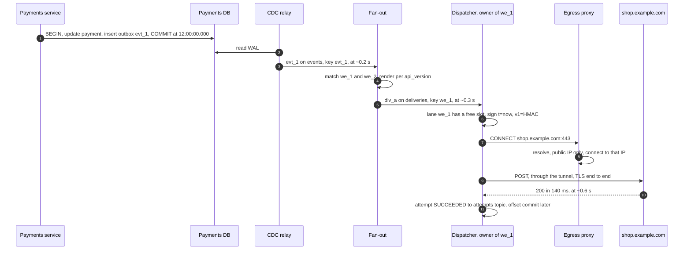

**What is still missing:** a non-2xx just disappears. And a hung endpoint will fill the dispatcher. §4.3 adds retries; §5.3 adds isolation.

### 4.3 Failed deliveries are retried for up to 3 days; failing endpoints are disabled and the merchant is told

**Flow: `we_7` answers `503` at 12:00, is down for 6 hours, and comes back.**

1. `dlv_c` gets `503`. The dispatcher computes the next attempt from the schedule (below), writes `dlv_c` to `we_7`'s durable queue (`QUEUED_DELIVERY`, due bucket 12:01), records the attempt, and moves the Kafka offset on. The delivery is now safe outside Kafka.
2. Five more deliveries to `we_7` fail within 20 s. The **breaker opens**: `we_7` is now failing as an endpoint, not just one delivery.
3. While open, new deliveries for `we_7` are not attempted. They go straight to its queue, due "when the endpoint recovers". The dispatcher sends **one probe**, the oldest due delivery, on the probe schedule: 1, 2, 5, 10, 20, 30 minutes, then every 30 minutes.
4. After 1 hour open: an email to the account's developers, "`we_7` is failing, 4,312 events waiting". After 24 h and 48 h: reminders.
5. At 18:00 a probe gets `200`. The breaker goes `HALF_OPEN`: the cap starts at 2 and doubles each clean second up to the endpoint's normal cap. The queue drains oldest first at up to 3x the endpoint's normal rate (§5.4). Then `CLOSED`.
6. Had it not recovered: when an endpoint has had **no 2xx for 72 h**, it becomes `DISABLED_FAILING`. Waiting deliveries reach their 72 h deadline and become `FAILED`. New events for it are `SKIPPED` (recorded, so a replay can find them). The merchant is emailed. Re-enabling is one click, plus an offer to replay the gap.

**The retry schedule (per delivery, while its endpoint is healthy).** Attempt 1 at t0, then waits of 1 min, 5 min, 30 min, 1 h, 2 h, 4 h, 8 h, then every 12 h, and a last attempt at the 72 h deadline. Cumulative: 1 m, 6 m, 36 m, 1 h 36, 3 h 36, 7 h 36, 15 h 36, 27 h 36, 39 h 36, 51 h 36, 63 h 36, 72 h. **13 attempts** (the first plus 12 retries). Each wait is multiplied by a random factor in [0.8, 1.2] (the first two use full jitter, [0, 2x]) so failures that happened together do not retry together. For comparison, Svix waits immediately, 5 s, 5 min, 30 min, 2 h, 5 h, 10 h, 10 h, about 27.5 h in all ([Svix](https://docs.svix.com/retries)). Stripe says only "up to three days with an exponential back off".

**What counts as a failure.** Any non-2xx, a 3xx included. Connect timeout 5 s, total timeout 30 s (Svix's value; GitHub uses 10 s, Shopify 5 s, Slack 3 s). `429` and `503` with `Retry-After` delay that delivery by `min(Retry-After, 1 h)` and cut the endpoint's cap. `410 Gone` on 10 consecutive attempts disables the endpoint early. Every other `4xx` is retried on the normal schedule, because a receiver's `400` is usually a bug in its handler that gets fixed and redeployed. A `ssrf_blocked` result is retried too (the DNS may be fixed), and is shown to the merchant as such.

**Bad: retry each failed delivery on its own timer, forever independent.** A dead endpoint that receives 100 events/s collects `100 × 86,400 × 3 = 26 M` deliveries over 3 days, and each one is tried up to 13 times before its deadline or the endpoint's disable cuts it short: on the order of **300 M timed-out attempts**, each holding a connection for 30 s. That is `300 M × 30 s ÷ 259,200 s ≈ 35k` connections held on average, for one dead endpoint.

**Good: per-delivery timers plus a per-endpoint failure counter that pauses the endpoint.** Fixes the ~300 M. Still keeps one timer per delivery in a global "due" index (a sorted set or a `next_attempt_at` index) that every scheduler scans, and that index is the hot spot after an outage.

**Great: two levels.** Per-delivery backoff only while the endpoint is healthy; an **endpoint breaker** with one probe when it is not; and timers kept **per endpoint, in the memory of the dispatcher that owns it**, not in a global index. The durable queue is per endpoint and read in due order from a cursor. **Challenges:** our own outage looks exactly like every endpoint failing at once. If we count it, we open a million breakers and, 3 days into a long incident, disable endpoints that did nothing wrong. §5.4 detects platform faults and stops the clock.

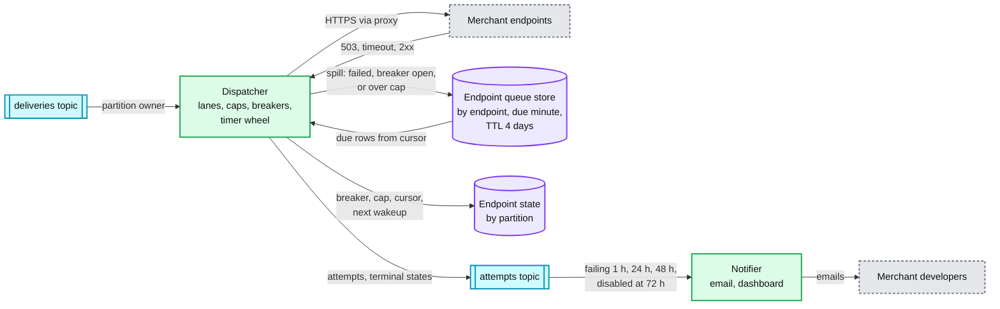

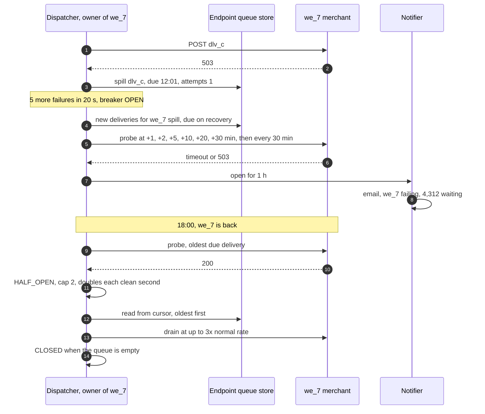

**What is still missing:** the merchant cannot see any of this, and cannot ask for an event again. §4.4.

### 4.4 Merchants see delivery attempts and replay one event or a time range

**Flow: a merchant fixes a bug that returned `500` for `charge.refunded` all morning, and replays 09:00 to 12:00.**

1. **The log.** Every attempt record on `attempts` is consumed into a columnar attempt log (ClickHouse-style), ordered by `(account_id, endpoint_id, at)`, TTL 30 days, plus a projection by `event_id`. The dashboard shows each attempt: time, status, latency, error class, the first 2 KB of the response. It lags the attempt by ~2 to 5 s.
2. **One event.** `POST /v1/events/evt_1/resend {endpoint: we_1}` puts a delivery at the front of `we_1`'s lane on the `replays` topic. It has the same event id, so the receiver's dedup still works. Like Stripe, it does not cancel the automatic retries of the original delivery.
3. **A range.** `POST /v1/webhook_endpoints/we_1/replays {from: 09:00, to: 12:00, event_types: [charge.refunded]}`. A replay worker scans the event store by `(acct_9, created)`, filters by type and by "was `we_1` subscribed then" (an endpoint-history table keeps every `enabled_events` change with its time, fed by the same CDC), reads the render for `we_1`'s current API version (rendering it if missing), and produces to `replays` with `replay_id`, checkpointing every 1,000 events. 
4. The dispatcher serves `replays` from the same per-endpoint lane at **low priority**: at most 25% of the endpoint's cap while live deliveries are waiting, all of it when they are not. Live traffic never waits behind a replay.
5. The replay reports progress: `sent 18,204, skipped 3 (outside 30 days)`.

**Bad: replay by re-running the original deliveries from the attempt log.** The log has metadata, not bodies, and lives for analytics. And a replay that writes straight onto `deliveries` puts 18k old events in front of the live ones on the same partition.

**Good: replay jobs that re-publish events onto `deliveries`.** Correct bytes, correct endpoint. Still competes with live traffic one for one.

**Great: a separate `replays` topic, co-partitioned with `deliveries`, served by the same lane at a weight.** The owner of an endpoint sees both its live and its replay work and decides the mix. **Challenges:** a replay of 30 days for a large merchant can be 50 M deliveries; it is rate-limited per endpoint and, past 5 M events, needs a confirmation. A replay can deliver an event that was already delivered: by design, receivers deduplicate on the event id.

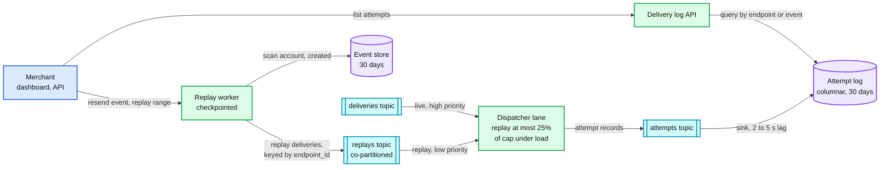

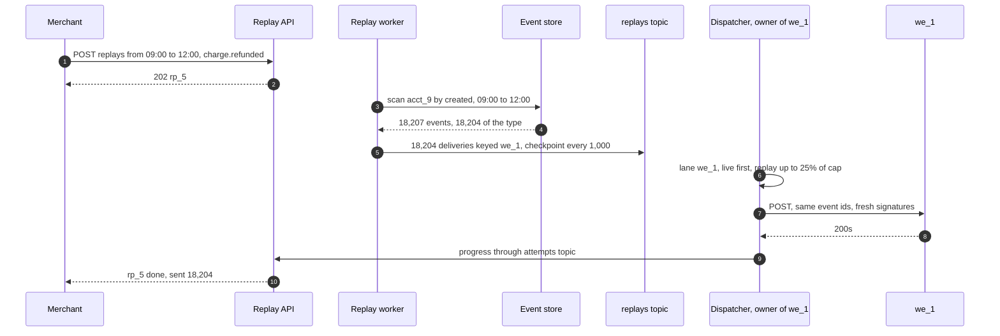

**What is still missing:** the §4 design works on a good day. It has not been tested against a hung endpoint, our own outage, duplicates, or a hostile URL. §5.

---

## 5. Deep dives

One per non-functional requirement, phrased as the interviewer's question. Each names what breaks in the §4 design with a number, climbs the ladder, and lists what changed.

### 5.1 "The event is in the payments DB, but the publish to the pipeline is lost. How is it still sent, and how do you prove nothing was dropped?"

**What breaks in the current design.** §4.2 already uses an outbox. The holes are at every hop after it:
1. **The CDC relay stalls or loses its place.** A logical replication slot that nobody reads keeps WAL on the payments DB's disk. At ~50 MB/s of WAL on a busy primary [estimate], a 2-hour stall is ~360 GB. If the slot is dropped to save the disk, or a primary failover lands on a replica without it, the relay has lost its position.
2. **Fan-out crashes between producing deliveries and committing its `events` offset.** It re-reads the events and produces their deliveries again. Duplicates, not loss, but avoidable.
3. **A dispatcher commits an offset past a delivery it has not finished.** It read `dlv_x`, spilled nothing yet, committed the batch offset because later records succeeded, then crashed. `dlv_x` is gone. This is the subtle one: with out-of-order completion, "commit after processing" is wrong.
4. **Nobody would notice.** A silent drop has no error to alert on.

**Bad: dual write in the product service.** `commit(); kafka.send(evt)`. Loses the event on any crash between the two. Rejected in §4.2.

**Good: outbox plus a poller.** No dual write. But a poller that selects `WHERE id > last_id` misses rows: ids come from a sequence at insert time, and a transaction that took id 1,001 can commit after the one that took 1,002. The poller sees 1,002, moves its mark, and 1,001 is never sent. The fix (scan by `created_at > mark − 10 min` and dedupe) works but costs a wide scan per second on every product DB.

**Great: CDC on the outbox, Kafka transactions in fan-out, a low-water-mark offset in dispatchers, and a reconciler.**
- **CDC reads in commit order**, so the gap above cannot happen. Outbox rows are kept 7 days and deleted by a TTL job, not marked sent. If the slot is lost, the relay restarts from a snapshot: every outbox row with `created_at ≥ last published created_at − 10 min`, deduplicated downstream by `event_id`. An alarm fires at 10 GB of slot lag, a page at 50 GB, long before the disk is at risk.
- **Fan-out is a Kafka consume-transform-produce transaction**: the deliveries it produced and the `events` offset it consumed commit atomically, and dispatchers read with `isolation.level=read_committed`. A fan-out crash re-does an aborted transaction, never a committed one. Cost: ~100 ms of commit interval on the latency path (§5.2).
- **Dispatchers commit a low-water mark.** Per partition, the committed offset is the lowest offset that is not yet **resolved**. Resolved means one of: a 2xx recorded on `attempts`, a durable spill to the endpoint queue store (quorum write acknowledged), or a terminal state recorded. In-flight and buffered records hold the mark back. The spill rule (§5.3) guarantees no record stays unresolved for more than ~30 s, so the mark lags by seconds, and a crash replays seconds.
- **Kafka is configured not to lose acknowledged writes**: replication 3 across AZs, `acks=all`, `min.insync.replicas=2`, `unclean.leader.election.enable=false`.
- **A reconciler proves it, hourly.** Two joins. (a) Source to stream: outbox row counts per DB per minute vs `events` counts per minute, from the relay's own counters plus a sampled id check. (b) Stream to outcome: fan-out writes one `fanout` record per event (the list of delivery ids) to `attempts`. For every delivery id of hour H, by `H + 73 h` there must be a terminal state (`SUCCEEDED`, `FAILED`, `SKIPPED`), and by `H + 1 h` there must be either a terminal state or a `QUEUED` record (every spill also writes one to `attempts`, so waiting work is visible without reading the queue store). A miss is re-driven from the event store and pages if more than 0. "Never silently dropped" is a measured number, not a hope.

**Push back on the textbook answer.** "Use Kafka exactly-once end to end." Kafka transactions cover what happens inside Kafka: the fan-out hop. The HTTP POST to the merchant is outside any transaction we can run, so the dispatcher hop is at-least-once whatever Kafka promises. We use transactions where they remove a real duplicate source cheaply (fan-out), and do not pretend they reach the merchant. Also "2PC between the DB and Kafka": Kafka is not an XA resource. The outbox is the standard answer because it makes the event part of the business transaction.

**What changed.** Fan-out is transactional. Dispatchers commit a low-water mark. New box: the reconciler. Outbox rows have a 7-day TTL. Two slot-lag alerts.

```mermaid
%% 5.1: the durability chain. Every hop either keeps the record or records that it finished it. The replication slot is red: if the relay stalls, WAL piles up on the payments primary, so our pipeline can hurt the payments DB.
flowchart LR
    TX[Payment + outbox row<br/>one transaction] -->|"commit"| WAL[(Payments WAL<br/>replication slot)]
    WAL -->|"commit order, slot lag alarm 10 GB"| RL[CDC relay]
    RL -->|"acks=all, RF 3"| EV[[events]]
    EV -->|"read"| FO[Fan-out<br/>Kafka transaction]
    FO -->|"deliveries + offset, atomic"| DL[[deliveries]]
    DL -->|"read_committed"| DS[Dispatcher<br/>low-water-mark commit]
    DS -->|"2xx recorded"| AT[[attempts]]
    DS -->|"or spill, quorum write"| QS[(Endpoint queue store)]
    FO -->|"fanout record, ids"| AT
    AT -->|"expected vs terminal, hourly"| RC[Reconciler<br/>re-drive, page on any gap]
    RC -.->|"re-drive from"| EST[(Event store)]

    class TX,RL,FO,DS,RC service
    class QS,EST store
    class EV,DL,AT queue
    class WAL critical

    classDef service  fill:#dcfce7,stroke:#16a34a,stroke-width:2px,color:#111
    classDef store    fill:#ede9fe,stroke:#7c3aed,stroke-width:2px,color:#111
    classDef queue    fill:#cffafe,stroke:#0891b2,stroke-width:2px,color:#111
    classDef critical fill:#fee2e2,stroke:#dc2626,stroke-width:4px,color:#111
```

[`deep-dives/outbox-and-event-fan-out.md`](deep-dives/outbox-and-event-fan-out.md).

### 5.2 "First attempt within 5 s of the commit, p99. Where do the seconds go, and what blows the budget?"

**The budget, healthy endpoint, breaker closed.** Measured from the payments commit to the first byte of our POST on the wire, not to the merchant's response (their handler is their latency).

| Hop | p50 | p99 | What sets it |
|---|---|---|---|
| Commit to relay read | 50 ms | 500 ms | WAL decode, relay batch |
| Relay to `events` | 10 ms | 100 ms | `acks=all`, `linger.ms=5` |
| Fan-out: match, render, transactional produce | 60 ms | 300 ms | Transaction commit every 100 ms |
| `deliveries` to the dispatcher | 10 ms | 200 ms | `read_committed` waits for the commit marker |
| Lane wait | 0 | 500 ms | Free slot under the endpoint's cap |
| Proxy CONNECT, DNS, TCP, TLS | 0 ms (reused) to 150 ms | 1,500 ms | A cold long-tail endpoint across an ocean |
| **Sum** | **~0.3 s** | **~3.1 s** (the p99s do not add, so this is a ceiling) | |

**What breaks in the current design.**
1. **Rebalance pauses.** An eager consumer-group rebalance on every dispatcher deploy stops all 512 partitions for 10 to 30 s. 24 nodes deployed one at a time is 24 pauses. That alone blows the p99 for every deploy window.
2. **A hot `events` partition.** A Connect platform's billing run creates ~5 M invoices for its connected accounts in 10 minutes [estimate], `5 M ÷ 600 s = 8.3k/s`. Keyed by account, that is a few partitions doing a quarter of the peak. Fixed in §3.2 by keying `events` by `event_id`; nothing downstream needs per-account order.
3. **The 1st of the month.** 30k/s for an hour. Fan-out and dispatch scale by partitions (128 and 512), so the fleets pre-scale on the calendar at 23:30 UTC, not on lag at 00:05.
4. **Cold connections to long-tail endpoints.** Half the endpoints get under one delivery a minute, so every attempt is a new TCP and TLS handshake (2 to 3 round trips, up to ~600 ms across an ocean).

**Bad: poll everything.** A poller on the outbox every 1 s and a scheduler that polls a deliveries table every 1 s: average added latency `0.5 + 0.5 = 1 s`, p99 2 s before any network. Fits, barely, and costs two hot scans.

**Good: CDC and push consumers.** Sub-second on a good day. Rebalances and deploys still blow it.

**Great: push all the way, plus the operational fixes.** Cooperative-sticky assignment with static membership (a restarting node gets its own partitions back within `session.timeout.ms = 15 s` without a group-wide pause, so a deploy restart must finish in under 15 s, which graceful handoff makes easy), graceful handoff on deploy (stop reading, finish or spill in-flight, commit, then leave), events keyed by `event_id`, calendar pre-scaling, and per-host connection pools with keep-alive plus TLS session resumption for endpoints with more than ~1 delivery a minute. **Challenges:** the SLO must exclude endpoints whose breaker is open or that are over their cap (that latency is theirs), and say so, or a few bad endpoints make the SLO meaningless. Define it as: p99 of `first_attempt_at − event.created` over deliveries to endpoints with breaker `CLOSED` and lane depth under the spill threshold.

**Push back on the textbook answer.** "Kafka adds latency; use Redis streams or direct RPC." Kafka hops are ~10 to 200 ms of a 3 s p99. The p99 is set by rebalances and by TLS to a merchant's server, and a faster queue fixes neither.

**What changed.** `events` keyed by `event_id`. Cooperative rebalancing, static membership, graceful handoff. Calendar pre-scaling. The SLO definition.

### 5.3 "One merchant's endpoint hangs for 30 s on every call. How do you stop it from eating every worker?"

This is the question the design is built around.

**What breaks in the current design.** §4.2 gives each dispatcher a set of partitions, but says nothing about how it spends its connections.
1. **Shared slots.** A top merchant at 900/s whose endpoint hangs fills `900 × 30 = 27,000` connection slots in 30 s. The fleet has ~24,000 for healthy traffic at design capacity. Everyone's latency goes up within seconds.
2. **Head-of-line blocking in a partition.** ~2,000 endpoints share each of the 512 partitions. A consumer that processes a partition in order is stuck behind the first hung delivery.
3. **Many medium-slow endpoints.** Not hung, just slow: 5,000 endpoints at p50 4 s. Each is under its cap, but together they hold `5,000 × rate × 4 s` slots that fast endpoints needed.

**Bad: a thread-per-request worker pool with a shared queue.** 2,000 threads per node, any worker takes any delivery. Fails exactly as in point 1: within 30 s every thread is waiting on the same merchant.

**Bad: one Kafka consumer per partition, in order.** Fails as in point 2: one hung endpoint stalls ~2,000 others.

**Good: async I/O plus a per-endpoint semaphore in Redis.** Workers take any delivery, `INCR` the endpoint's counter, send if under the cap, otherwise put the delivery back with a delay. It isolates. Costs: a Redis round trip per delivery and per completion (12k/s each way at peak), re-queue churn when a busy endpoint's deliveries keep coming back, counters that leak when a worker dies holding a slot (so they need TTLs and become approximate), and Redis becomes a hard dependency of every send.

**Great: one owner per endpoint, lanes in memory, adaptive caps, a breaker, and spill.**
- **Ownership.** `deliveries` is keyed by `endpoint_id`, so one dispatcher owns each endpoint. Its cap, in-flight count, latency baseline and breaker are plain fields in memory. No Redis, no leaked counters.
- **Lanes.** Each endpoint with work has a lane: a small in-memory buffer plus a cursor into its durable queue. The partition reader never waits on a lane. It appends and moves on.
- **Adaptive concurrency cap per endpoint** (AIMD, like TCP). Start at 10. In each 1 s window: if the endpoint used its whole cap, had no failures, and its p90 latency stayed under 2x its 7-day baseline, raise the cap by `max(1, 10%)`. If more than 10% of attempts timed out, failed with 5xx or connect errors, or got `429`, halve it (floor 2). Hard ceiling 1,000. A healthy top merchant settles at ~2x its need (~720 in §2); a struggling one is backed off before it falls over.
- **Breaker per endpoint.** Opens on 5 consecutive endpoint-fault failures, or ≥ 80% failures over ≥ 5 attempts in 30 s. A `429` halves the cap but does not count toward the breaker: the endpoint is alive and asking us to slow down. A `503` counts. Open means one probe at a time on the probe schedule (§4.3); everything else for that endpoint spills.
- **Spill.** If a lane holds more than 1,000 deliveries, or its oldest delivery has waited 10 s, new deliveries for it are written to the endpoint queue store and count as resolved for the offset mark (§5.1). Memory per dispatcher stays bounded, and no record holds the offset back for long.
- **Two slot pools per dispatcher.** Of ~4,000 slots per node, 75% are the **fast pool** and 25% the **slow pool**. An endpoint whose 5-minute p50 is over 1 s, or whose breaker is half-open, draws only from the slow pool. When a pool is full, endpoints share it by DRR (deficit round robin) weighted by cap. Medium-slow endpoints (point 3) can fill the slow pool; they cannot touch the fast one.

**Challenges.** (a) A hot endpoint: a Connect platform at 2% of traffic is 600/s on one partition and one dispatcher. Fine up to ~2,000/s per endpoint; beyond that, the endpoint is salted into k sub-keys `(endpoint_id, n)` on k partitions with the cap split k ways. (b) A dispatcher that dies loses its in-memory state: the new owner rebuilds caps from the endpoint state table (persisted every 10 s) and starts breakers closed, so a dead endpoint costs one more round of ~cap timeouts per failover. (c) The 30 s before a breaker opens still costs the endpoint's cap: the sum of the top 5 caps (~3,000) is reserved headroom.

**Push back on the textbook answer.** "Just lower the timeout to 5 s." With a cap and a breaker, the timeout only matters for the ~30 s before the breaker opens, and it bounds the cost to `cap × timeout` once. Lowering it does not protect anyone else further. It does turn slow-but-correct receivers (a serverless cold start, a handler that does the work inline) into failures, and failures into retries, which is more load, not less. We keep 30 s and tell merchants to answer fast.

**What changed.** Lanes, adaptive caps, breakers, spill, two slot pools. The endpoint state table persists caps and breakers every 10 s. Hot endpoints can be salted.

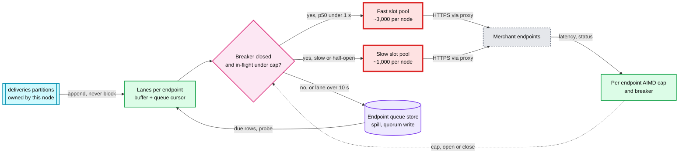

[`deep-dives/per-endpoint-isolation-and-scheduling.md`](deep-dives/per-endpoint-isolation-and-scheduling.md).

### 5.4 "After a 2-hour outage on our side, 50 M deliveries are due at once. How do you avoid a retry storm, against merchants and against ourselves?"

**Two different outages.** Say this first, because they need different answers.
- **(a) The pipeline stopped** (dispatchers down, a bad deploy, Kafka consumers stuck). Nothing was attempted. The backlog sits in Kafka as consumer lag: at a busy-hour ~7k/s, `7k × 7,200 s = 50 M` deliveries. No attempt failed, so no merchant was punished yet.
- **(b) Egress broke while dispatchers kept running** (proxy fleet, NAT, DNS, a routing change). Every attempt fails. Without care: a million breakers open, 50 M deliveries spill with retry timers clustered in the same 2 hours, and the 72 h disable clock starts on every endpoint. This is the dangerous one.

**What breaks in the current design.**
1. **Recovery from (a) at full speed.** The fleet can do 60k/s. A merchant that normally gets 100/s has `100 × 7,200 = 720k` waiting, and the adaptive cap lets it rise to whatever the merchant answers. Their autoscaler sees 10x in a minute; their database falls over; we get 5xx; they get paged for our outage.
2. **Clustered retries after (b).** Everything failed between 10:00 and 12:00, so the "+1 h", "+2 h" and "+4 h" waves land together. Jitter of ±20% spreads a wave over ~1 h but does not stop the waves.
3. **Our fault counted as theirs.** In (b), breakers open, attempt counts climb, failing emails go out to a million developers, and if the outage lasts 3 days, every endpoint is disabled.
4. **Fresh events stuck behind old ones.** After (a), a dispatcher reads its partitions from the committed offset: 2 hours of backlog before the first live event. New payments are confirmed 30+ minutes late, on top of the 2-hour outage.

**Bad: exponential backoff with jitter, and nothing else.** It de-synchronizes one client's retries. It does nothing for (a), where the backlog is first attempts, and nothing for point 3.

**Good: a global catch-up rate limit.** Drain at most N/s fleet-wide. Protects us, but a single global number is too much for a small merchant on a shared host and too little for a big one, and it still counts (b) against merchants.

**Great: detect platform faults, stop the clock, and drain per endpoint at a bounded multiple of its normal rate, live first.**
- **Platform-fault detector.** Every 10 s, per scope (AZ, region, proxy pool): if attempts are failing with connect, DNS, TLS or timeout errors across ≥ 1,000 distinct endpoints in ≥ 50 distinct destination ASNs, at more than 5x the 7-day baseline failure rate, or our **synthetic endpoints** (receivers we run outside our network, in three clouds) stop answering, the scope enters `PLATFORM_FAULT`. A real merchant outage is one endpoint, or one host, or one cloud's ASN. Ours is everyone at once.
- **In `PLATFORM_FAULT`:** dispatchers in that scope stop attempting (deliveries stay in Kafka, nothing spills); attempts already made are tagged `fault=platform` and do not count toward breakers, attempt numbers or the disable clock; deadlines extend by the fault's duration ("72 hours of our availability", not wall clock); failing emails are held; on-call is paged. Egress fails over to another AZ's proxies where only one AZ is affected.
- **Per-endpoint catch-up limit.** A token bucket per endpoint at `max(3x its 7-day p99 rate per second, 5/s)`, under the adaptive cap, which still halves on the merchant's 5xx or 429. The 100/s merchant drains at up to 300/s, net 200/s above live traffic: `720k ÷ 200 = 3,600 s`, about 1 hour. An endpoint at 0.01/s has 72 waiting and is done in seconds. Most endpoints are small, so most merchants are whole again in minutes.
- **Live first: split the partition at the recovery offset.** When a partition's lag is over 10 minutes at recovery, the owner records offset `B` (the current end) and runs two cursors on it: a **live** cursor from `B` and a **backlog** cursor from the committed offset up to `B`. Lanes serve live first and backlog with what the catch-up bucket allows. The committed Kafka offset stays the backlog cursor's low-water mark; the live cursor's position is checkpointed in the endpoint state table every second. A crash re-reads both from their marks.
- **Re-spread retry times.** On leaving `PLATFORM_FAULT`, every queued delivery whose `next_attempt_at` fell inside the fault window is re-timed uniformly over the next 30 minutes.
- **Fleet admission.** Dispatchers cap their own total at 60k/s. The spill burst (~50k writes/s for ~5 minutes, as big endpoints exceed their catch-up rate) is what the endpoint queue store is sized for (§10.3).

**Challenges.** A partial fault (one AZ's NAT) is not "everyone": the detector works per scope, so the scope has to match how egress is built (one proxy pool per AZ). A merchant who really did go down during our fault gets the benefit of the doubt for those hours; that is the right side to err on.

**Push back on the textbook answer.** "Exponential backoff with jitter prevents retry storms." It prevents synchronized retries from one client. Our storm is a backlog of first attempts plus our own fault being charged to a million endpoints. The fix is per-endpoint admission and knowing whose fault it was.

**What changed.** New: the platform-fault detector, synthetic endpoints, per-endpoint catch-up buckets, the split cursor, `fault` on attempts, deadline extension.

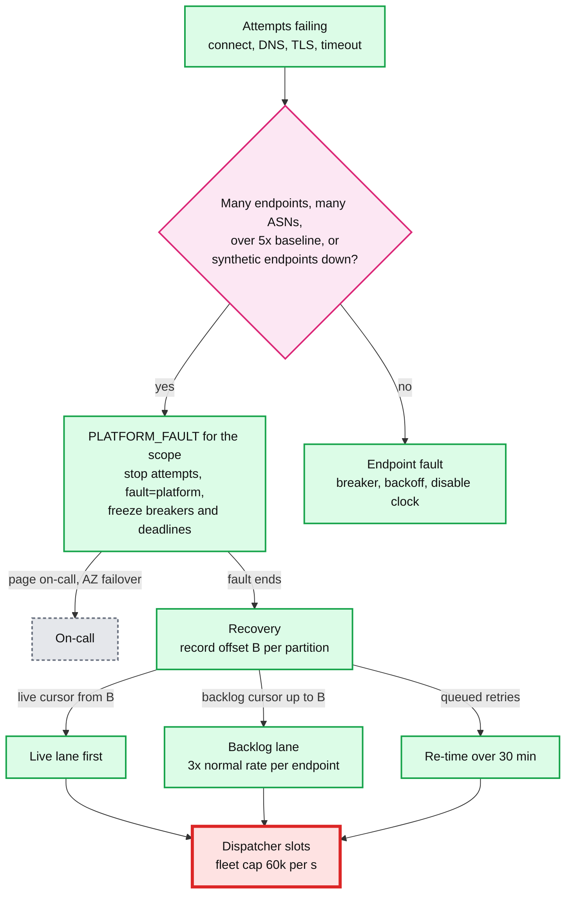

[`deep-dives/retry-policy-and-storms.md`](deep-dives/retry-policy-and-storms.md).

### 5.5 "Receivers see duplicates and out-of-order events. What do you promise, and what do you tell them to do?"

**What we promise, in one sentence:** every event that matches an endpoint is delivered to it at least once within 3 days of our availability, in no particular order, each copy carrying the same event id, signed fresh per attempt.

**Where duplicates come from** (each is unavoidable or not worth removing):

| Source | How often | Removed by us? |
|---|---|---|
| The receiver processed it but its 2xx did not reach us (timeout, reset) | the commonest case | No. We cannot know |
| Dispatcher crash after a 2xx, before the attempt record | seconds of one partition's traffic per crash | Partly: lost with the crash |
| CDC relay restarts and re-publishes | rare, minutes of one DB after a slot loss | Yes, mostly: deterministic `delivery_id`, recent-success set per endpoint in the owner's memory (1 h) |
| Manual resend and replay | on request | No, on purpose. Same event id |
| Region failover with mirrored offsets | rare | No. Offset translation is approximate |

**Why not ordering.** Strict order per endpoint means one delivery in flight per endpoint and a failed one blocking all the others. At 400 ms per response that is 2.5 deliveries/s per endpoint, against a top merchant's 900/s. And one poison event (a handler bug for one payload) would block the endpoint for the full 3 days. Order per object (all events for `pi_123` in order) is possible with per-key sequencing, but the cost lands on every merchant to help few. Stripe does not offer it either: "Don't use `created` to determine event order", since it is in seconds.

**Bad: promise exactly-once.** We would need to know whether the receiver applied the event. Only the receiver knows.

**Good: at-least-once with a stable event id.** Correct. Leaves each receiver to invent dedup and to cope with stale payloads.

**Great: at-least-once, plus a receiver contract that makes it easy.** Documented, with sample code in every SDK:
1. **Verify, then answer 2xx fast, then process.** Put the raw body on your own queue and return. Stripe: return 2xx "before any complex logic that might cause a timeout".
2. **Deduplicate on `event.id`**: `INSERT INTO processed_events (id) ... ON CONFLICT DO NOTHING` in the same transaction as the side effect. Keep ids for 30 days, the replay window. (Stripe's own idempotency keys may be pruned after 24 hours; a webhook dedup table needs longer, because replays go back 30 days.)
3. **Treat the payload as a hint, not the truth.** For state, read the object from the API, or compare a version on the object and drop older ones.
4. **Prefer thin events.** A thin event carries the event id, type and the related object's id, not a snapshot. The receiver fetches current state, so order and staleness stop mattering, payloads are ~300 B instead of ~3 KB, and less PII sits in merchants' logs. Stripe now recommends thin events for new integrations.

**Challenges.** Thin events move load to the API: each delivery becomes a delivery plus a read, ~500 M extra API reads a day if everyone switched. The API is built for that, and it is cacheable per object, but it is real.

**Push back on the textbook answer.** "Use idempotency keys and you get exactly-once." Idempotency is a property the **receiver** implements with our id. Our side can only make duplicates rarer and give them a stable key.

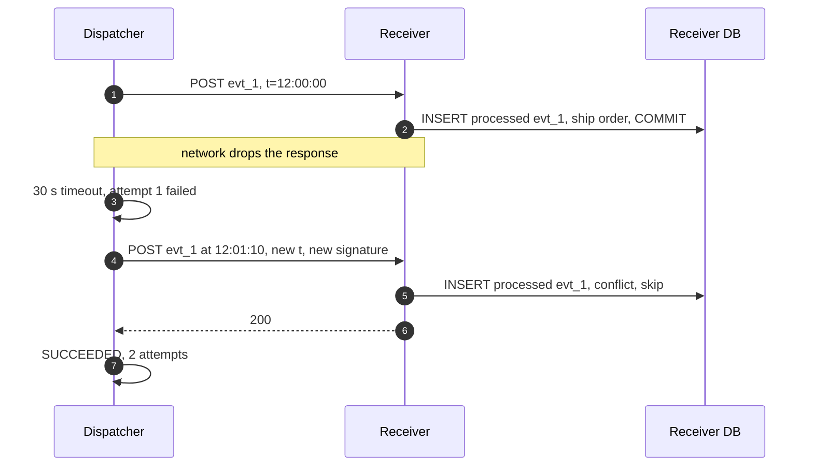

[`deep-dives/delivery-semantics-and-replay.md`](deep-dives/delivery-semantics-and-replay.md).

### 5.6 "A merchant registers `http://169.254.169.254/latest/meta-data/`. What happens? And how does a receiver know a request is really from us?"

**What breaks in the current design.** §4.1 checks the URL once at registration. That stops only the honest mistake.
1. **DNS rebinding.** `hooks.evil.example` resolves to a public IP at registration and to `10.0.0.5` (or `169.254.169.254`) a minute later, with a TTL of 0. OWASP: "Domain allowlisting alone does not prevent DNS rebinding."
2. **Check, then a second lookup.** A dispatcher that resolves, checks the IP, then hands the host name to an HTTP client that resolves again has a time-of-check to time-of-use gap. OWASP: "A second, unchecked DNS lookup between validation and connection can bypass these checks."
3. **Redirects.** A public endpoint answers `302 Location: http://169.254.169.254/...`.
4. **Encodings.** `http://2852039166/` is `169.254.169.254` as one decimal number. Also `0xA9FEA9FE`, `[::ffff:169.254.169.254]`, `[fd00::1]`, `0.0.0.0`, and our own public ranges that route back inside.
5. **Internal names.** A resolver that knows `payments-db.internal` will answer for it.

**Bad: validate at registration.** Points 1, 3, 4 and 5 bypass it.

**Good: validate the resolved IP in the dispatcher at send time.** Closes 1 if done right. Every client library and every code path must get point 2 right, forever, and dispatchers still have a network path to internal services if a check is missed.

**Great: egress is a network boundary, enforced by a proxy.**
- **Dispatchers have no route to the internet** and no route to anything except the proxies and their own dependencies.
- **Egress proxies** (Smokescreen is Stripe's open-source one: "a HTTP CONNECT proxy" that "resolves each domain name that is requested, and ensures that it is a publicly routable IP address") run in a separate network with no peering to internal ones. For each CONNECT: resolve with **public** recursive resolvers only (no internal zones), reject any answer in a deny list (`0/8`, `10/8`, `100.64/10`, `127/8`, `169.254/16`, `172.16/12`, `192.168/16`, `224/4`, `::1`, `fc00::/7`, `fe80::/10`, IPv4-mapped IPv6 of all of these, and our own public ranges), and **connect to that exact IP**. No second lookup exists.
- **No redirects.** A 3xx is a failed attempt, as at Stripe.
- **Ports.** 443 by default; other ports above 1024 allowed, never 22, 25, 3306, 5432, 6379, 9200 and other well-known service ports.
- **Defence in depth.** IMDSv2 required on every host, with a response hop limit of 1, so even a request that escaped could not get a metadata token. Response bodies are read to at most 64 KB and stored as a 2 KB excerpt, escaped before display.
- **Fixed, published egress IPs**, so merchants can allowlist us. Stripe lists 15 and gives "seven days' notice" before changing them.
- **The registration check stays** as a friendly early error, not as the control.

**And the receiver's side: signatures.**
- `Stripe-Signature: t=<unix seconds>,v1=<hex HMAC-SHA256(secret, t + "." + raw_body)>`. Computed **per attempt**, with the attempt's time, so a retry 2 days later is not rejected by the receiver's 5-minute tolerance. Stripe: "we generate a new signature and timestamp for the new delivery attempt."
- The receiver recomputes over the **raw** body (not re-serialized JSON), compares in constant time, and rejects `|now − t| > 5 min`. That stops a replay of a captured request after 5 minutes; dedup on event id stops one inside it.
- **Rotation without downtime.** Roll creates a new secret and keeps the old one for up to 24 h. During the overlap every attempt carries two `v1=` values, one per secret. The receiver deploys the new secret, then the old one expires. A leaked secret is rolled with `expire_old_after = 0`.
- Secrets are stored encrypted with a per-account data key wrapped by KMS, decrypted only in dispatcher memory, cached 5 minutes. HMAC costs ~2 µs per attempt; there is no reason to sign elsewhere.

**Challenges.** The proxies are on every delivery's path: a single point of failure if built as one. They run as N per AZ behind health checks, fail **closed** (no proxy, no send, and the platform-fault detector stops the clock), and are stateless, so a node is replaced in seconds. HMAC means a shared secret: the receiver can forge our signature to itself (harmless) and we must store secrets reversibly. Asymmetric signatures (Ed25519, offered by Standard Webhooks as `v1a`) remove both, at the cost of receivers handling public keys. A later option, not a launch requirement.

**Push back on the textbook answer.** "Block private IPs in the URL validator." It is the first thing everyone says and the first thing an attacker bypasses. The control has to sit where the socket is opened, on a network that cannot reach anything internal anyway.

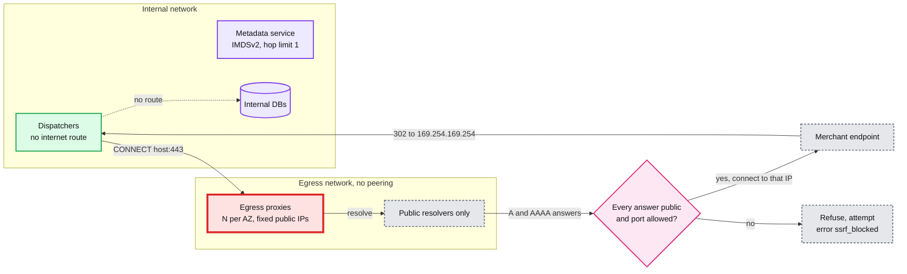

The `302` edge ends at the dispatcher on purpose: it records a failed attempt and never follows it. [`deep-dives/ssrf-and-egress.md`](deep-dives/ssrf-and-egress.md), [`deep-dives/signing-and-secret-rotation.md`](deep-dives/signing-and-secret-rotation.md).

---

## 6. Final design and the six core flows

Everything from §5 composed. 15 nodes; zoom-ins in [`diagrams.md`](diagrams.md).

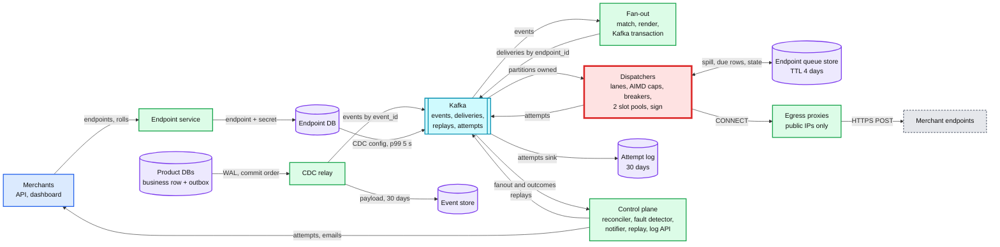

The six flows below are the ones to say from memory. Each is the final design, not the §4 version.

### Flow 1: one `payment_intent.succeeded`, commit to 200 in ~0.6 s

1. 12:00:00.000: the payments service commits the payment and outbox row `evt_1` in one transaction.
2. ~0.05 s: the CDC relay decodes it from the WAL, publishes to `events` (key `evt_1`, `acks=all`), and writes the payload to the event store.
3. ~0.2 s: fan-out matches `we_1` and `we_2` in its in-memory map, renders per API version, and commits `dlv_a` and `dlv_b` to `deliveries` in one Kafka transaction with its consumed offset.
4. ~0.3 s: the owner of `we_1`'s partition appends `dlv_a` to `we_1`'s lane. Breaker closed, 2 of 20 slots used, fast pool. It signs with `t=now` and sends CONNECT to a proxy in its AZ, which resolves, checks, and connects to that IP. The connection to `shop.example.com` was already open.
5. ~0.6 s: `200`. The dispatcher writes `SUCCEEDED` to `attempts`. The low-water mark passes `dlv_a` at the next commit. ~3 s later the attempt is in the dashboard. Picture: [FR2 sequence](#42-every-matching-event-is-delivered-to-every-subscribed-endpoint-at-least-once-signed).

### Flow 2: a top merchant's endpoint starts hanging

1. t = 0: `we_big` (900/s, cap ~720) stops answering. In-flight climbs to 720 in under a second; new deliveries buffer in its lane.
2. t ≈ 2 s: its lane holds 1,000 deliveries. New deliveries spill to the queue store and count as resolved for the offset mark. The partition's other ~2,000 endpoints never notice.
3. t = 30 s: the first 720 time out. ≥ 80% failures over ≥ 5 attempts: the breaker opens. The 720 spill with their next retry times. One probe at +1 min.
4. Other merchants: unchanged p99. Cost: 720 slots for 30 s, then 1.
5. t = 1 h: still open; the account's developers are emailed, and because it is a top-100 account, its account manager gets a ticket. Probes every 30 minutes.
6. t = 3 h 10 min: a probe gets `200`. Half-open: cap 2, doubling each clean second. The backlog of 3 h 10 min (`900 × 11,400 s ≈ 10.3 M`) drains at up to 3x its normal rate, live first: `10.3 M ÷ (2,700 − 900) = 5,700 s`, about 1.6 h. Picture: [D5 in diagrams.md](diagrams.md#d5-failure-paths).

### Flow 3: our egress breaks for 2 hours

1. 10:00: a bad route change on the egress network. Attempts across every endpoint fail with connect timeouts.
2. 10:00:20: the detector sees failures across thousands of endpoints in hundreds of ASNs at 30x baseline, and the synthetic endpoints are down. `PLATFORM_FAULT` for the region. On-call is paged. Dispatchers stop attempting; deliveries wait in Kafka as lag; breakers, attempt counts and the disable clock freeze; failing emails are held.
3. 12:00: route fixed; the detector clears. Each dispatcher records offset `B` per lagging partition and runs a live cursor from `B` and a backlog cursor up to `B`.
4. 12:00:05: live events flow at normal latency. The ~50 M backlog drains at up to 3x each endpoint's normal rate: small endpoints in seconds, the biggest in ~1 h. Retries that were queued before 10:00 are re-timed over 12:00 to 12:30.
5. No endpoint was disabled, no merchant was emailed, no deadline moved closer. The status page said "webhook delays". Picture: [§5.4](#54-after-a-2-hour-outage-on-our-side-50-m-deliveries-are-due-at-once-how-do-you-avoid-a-retry-storm-against-merchants-and-against-ourselves).

### Flow 4: a merchant rolls its signing secret

1. `POST /v1/webhook_endpoints/we_1/secret/roll {expire_old_after: 24h}` writes secret `s2`, sets `s1.expires_at = now + 24 h`, and returns `s2` once.
2. Within ~5 s the dispatchers see both. Every attempt now carries `t=...,v1=<sig with s2>,v1=<sig with s1>`.
3. The merchant deploys `s2`. Its verifier accepts any `v1` that matches.
4. 24 h later `s1` expires and only one `v1` is sent. If the merchant forgot to deploy, its verification fails from that moment; the attempt log shows `400`s and the dashboard says "signature failures began at the secret expiry". Picture: [D4 FR1, roll](diagrams.md#d4-happy-paths-one-per-fr).

### Flow 5: an endpoint dies for good, is disabled, comes back, replays

1. Day 0: `we_9`'s server is deleted. Breaker opens within a minute. Probes on schedule.
2. 1 h, 24 h, 48 h: emails. Deliveries wait in the queue store.
3. Day 3: no 2xx for 72 h. `we_9` becomes `DISABLED_FAILING`. Waiting deliveries reach their deadlines and become `FAILED`. New events for `we_9` are recorded as `SKIPPED`. A final email.
4. Day 10: the merchant redeploys, re-enables `we_9`, and accepts the dashboard's offer to replay day 0 to day 10. The replay worker reads the event store (it has 30 days) and sends on the `replays` lane at low priority. Picture: [FR4 sequence](#44-merchants-see-delivery-attempts-and-replay-one-event-or-a-time-range).

### Flow 6: a DNS rebinding attempt

1. A merchant registers `https://hooks.evil.example`. It resolves to `203.0.113.7`: accepted.
2. The attacker switches the record to `169.254.169.254` with TTL 0.
3. The next attempt: CONNECT `hooks.evil.example:443`. The proxy resolves with a public resolver, gets `169.254.169.254`, refuses. The attempt is `ssrf_blocked`. No packet left toward the metadata service. Even if it had, the dispatcher network has no route there and IMDSv2 would demand a token.
4. 20 `ssrf_blocked` in a row flag the account for the security team. Picture: [§5.6](#56-a-merchant-registers-http169254169254latestmeta-data-what-happens-and-how-does-a-receiver-know-a-request-is-really-from-us).

---

## 7. Trade-offs

| Decision | Option A | Option B | Chose | Why |
|---|---|---|---|---|
| Getting events out | Dual write from the product service | Outbox read by CDC | Outbox + CDC | No lost events on a crash between commit and publish. Commit order, no poller gaps. Cost: a replication slot on every product DB (the red node of §5.1) |
| Fan-out exactly-once | At-least-once fan-out, dedup later | Kafka transaction (deliveries + offset) | Transaction | Removes one duplicate source for ~100 ms of latency. Does not reach the merchant, and we say so |
| Payload | Snapshot rendered per API version, inline on `deliveries` | Thin event, receiver fetches | Snapshot by default, thin offered and recommended | Compatibility with existing receivers. Thin removes staleness and order problems at the cost of API reads |
| Where a delivery's work lives | One row per delivery in a DB, updated per attempt | Kafka record on the hot path, a queued row only if it must wait | Kafka + spill | 500 M rows/day of updates vs ~15 M queued rows. The DB is sized for the spill burst, not the whole stream |
| Isolation unit | Shared worker pool, or a semaphore in Redis | One owner per endpoint via partitioning, caps in memory | Ownership | No per-send network call, no leaked counters. Cost: hot endpoints need salting, and failover loses soft state |
| Concurrency cap | Fixed per endpoint | AIMD on latency and errors, 2 to 1,000 | AIMD | Big merchants need hundreds; a struggling one needs us to back off before it falls over |
| Dead endpoints | Each delivery retries on its own | Breaker plus one probe | Breaker | ~300 M timed-out attempts over 3 days for one dead endpoint at 100/s vs ~150 probes |
| Timeout | 5 to 10 s | 30 s | 30 s | With caps and a breaker, the timeout only prices the 30 s before the breaker opens. Shorter turns slow-but-correct receivers into retries |
| Retry window | ~1 day (Svix ~27.5 h, Shopify 4 h) | 3 days | 3 days, 13 attempts | Stripe's documented contract; covers a weekend outage at a small merchant |
| Our outages | Count like any failure | Detect platform faults, freeze the clock | Detect | Otherwise our incident disables a million endpoints and emails their developers |
| Backlog drain | As fast as the fleet can | ≤ 3x each endpoint's normal rate, live first via a split cursor | Bounded, live first | Protects merchants from a 10x surge caused by us. Big endpoints take ~1 h to catch up |
| Ordering | FIFO per endpoint, or per object | None, stated, with a receiver recipe | None | FIFO caps a merchant at ~2.5/s and lets one poison event block 3 days |
| SSRF control | URL validation | Egress proxy on an isolated network, connect to the checked IP | Proxy | Validation is bypassed by rebinding, redirects, encodings. Cost: the proxy is on every path, so N per AZ, fail closed |
| Signature | Asymmetric (Ed25519) | HMAC-SHA256 with a timestamp, two during a roll | HMAC | What every receiver library supports today; ~2 µs. Asymmetric is the evolution |
| Retry scheduling | A global due index (sorted set, `next_attempt_at` index) | Timer wheels in the owning dispatcher, durable queue per endpoint | Per owner | No global hot index to scan after an outage; rebuild per partition on takeover |
| Build or buy | A webhook vendor at ~$0.0001 per message (Svix list price, secondary source) | Build | Build at this volume | `500 M × $0.0001 = $50k/day`, ~$18 M/year vs ~$0.6 M/year of infrastructure plus a team. Buying is right below ~10 M a day |
| Refused to build | Exactly-once delivery, ordering, payload transforms, per-field filters, a per-delivery state table, synchronous attempt-log writes, a shorter timeout as the isolation mechanism | | | Each costs more than it returns, or promises what HTTP cannot deliver |

**Consistency model, stated once.** Business write to event: strong (same transaction). Event to deliveries: at-least-once, exactly-once inside Kafka for fan-out, ~0.3 s. Delivery to merchant: at-least-once, unordered, up to 3 days of our availability. Endpoint config to pipeline: eventual, p99 5 s (a new endpoint can miss events from its first seconds; a disabled one can receive a few more). Secret roll: read-your-writes in the API, eventual (≤ 5 s) in signing, which the 24 h overlap absorbs. Attempt log and dashboard: eventual, 2 to 5 s. Reconciler: hourly, and it is the proof of durability.

---

## 8. Staff-level notes

- **Simplest thing that meets the requirement.** One Kafka cluster, one relay per product DB, a stateless fan-out, a dispatcher whose isolation is plain memory because partitioning gives it ownership, a small spill store, a stock egress proxy. We refused a per-delivery database row, a global scheduler, ordering and exactly-once, and can say why for each (§7).
- **Failure modes and blast radius.**
  - A dispatcher node: its ~21 partitions move to others in ~15 s (session timeout, cooperative rebalance). Lost: in-memory caps and breakers (rebuilt from the 10 s snapshot), and the recent-success set, so a few seconds of its traffic is re-sent. Its in-flight requests are re-sent: duplicates, not loss.
  - A Kafka broker: leaders move in seconds; `min.insync.replicas=2` keeps writes safe. An AZ: 1/3 of brokers, dispatchers and proxies; the rest carry the load because each tier is sized N+1 per AZ.
  - The endpoint queue store: no spills possible. Dispatchers stop committing offsets past unresolved records, so work stays in Kafka (3 days of retention), and only endpoints that need to spill slow down. Healthy endpoints keep flowing.
  - The CDC relay for one product DB: that product's events wait in the WAL (alarms at 10 GB, page at 50 GB). Other products are unaffected. **This is the one place our pipeline can hurt the payments DB**, so slot lag has the tightest alert.
  - The egress proxies: nothing leaves (fail closed). The fault detector freezes the clock. Visible as delay, never as data loss or merchant penalty.
  - The endpoint DB: no endpoint changes; delivery continues on the in-memory copy.
  - The attempt log: the dashboard is stale; delivery is unaffected (the log is fed from Kafka and catches up).
  - **Biggest blast radius:** a bad dispatcher deploy that, say, mis-signs every request. Every merchant's verification fails, and they all see it as their bug. Hence a canary on our own synthetic receivers that verify signatures, and a deploy that goes 1 node, then 1 AZ, then all, each gated on the synthetic receivers' verification rate and the fleet's 4xx rate.
- **Migration from an existing system** (say, the payments service enqueues webhook jobs on a job queue and workers POST them):
  1. Outbox and CDC in shadow: `events` is filled and compared, per minute, to legacy enqueue counts. No sends.
  2. The new dispatcher sends for internal test endpoints and sandbox mode only.
  3. Live mode by endpoint hash: 1%, 10%, 50%, 100% over ~2 weeks. Each endpoint has an `owner` flag with an `effective_from` time a minute in the future; both paths compare `event.created` to it, so each event has exactly one sender, with no gap and no overlap at the switch.
  4. Legacy retries in flight finish in legacy (up to 3 days). Then legacy is removed.
  Rollback at any step is the flag with a new `effective_from`; deliveries already queued in the new path finish there. [D12](diagrams.md#d12-rollout--migration).
- **Operability.** SLOs over 28 days:
  - first attempt within 5 s of commit for 99% of deliveries to endpoints with a closed breaker;
  - zero unresolved deliveries at `H + 1 h` and zero without a terminal state at `H + 73 h` (reconciler);
  - endpoint and log API availability 99.95%;
  - zero endpoints disabled during a declared platform fault.

  Pages at 3 AM:
  - `deliveries` lag over 60 s on more than 5% of partitions for 5 minutes;
  - `PLATFORM_FAULT` declared;
  - a reconciler gap over 0;
  - CDC slot lag over 50 GB or relay lag over 60 s;
  - healthy proxies below N−1 in an AZ;
  - synthetic receivers seeing bad signatures;
  - queue store write p99 over 100 ms while spilling.

  Not a page: one merchant's endpoint failing. That is an email to the merchant, and a ticket for the account manager of a top-100 account.
- **Cost** [estimate, list prices]:
  - dispatchers, 24 × 8 vCPU: ~$6k/month;
  - proxies, 12 nodes with fixed IPs: ~$2k;
  - egress data, ~50 TB/month at ~$0.05/GB: ~$2.5k;
  - Kafka, 12 brokers: ~$12k;
  - event store, ~25 TB on ~15 nodes: ~$18k;
  - queue store, 6 nodes sized for the burst: ~$6k;
  - attempt log: ~$4k.

  About $50k/month, ~$0.6 M/year. The team costs more: a webhooks team of 5 to 6 (dispatch, egress, dashboard) and a share of the events platform team (relay, Kafka, fan-out).
- **Team boundaries.**
  - Product teams own their events and schemas. The contract is a schema registry plus API versioning.
  - The events platform team owns the outbox library, the relays, Kafka and fan-out. The contract is `deliveries` records.
  - The webhooks team owns dispatch, the queue store, the dashboard and the delivery log API.
  - Security owns the proxy policy (deny lists, ports) as configuration.
  - Developer experience owns the receiver contract: docs, and verification and dedup helpers in every SDK.
- **Explicit trade-off.** We accept duplicates, no ordering, a big merchant's ~1 h catch-up after an outage, and 30 s of a hung endpoint's cap before its breaker opens. In return, one merchant's slowness cannot reach another merchant, and our own failures show up as delay, never as loss or penalty.

---

## 9. What is expected at each level

**Mid (80/20 breadth/depth).** A queue between event creation and a worker pool that POSTs, retries with exponential backoff, a table of endpoints and subscriptions, HMAC signatures. Mentions idempotency at the receiver. May publish to the queue after the commit (dual write) and may not notice that a slow endpoint can exhaust the workers.

**Senior (60/40).** Outbox or CDC so events are not lost. At-least-once with event ids, and no ordering. Per-endpoint rate or concurrency limits and a circuit breaker. Retries with jitter, a disable rule, a dead-letter state, a delivery log, replay. Blocks private IPs. Goes deep on one of isolation, retries or signing.

**Staff+ (40/60).** Everything above, plus:
- says in the first minute that connections held, not throughput, is the constraint, and does the Little's law arithmetic (12k in flight, 27k for one hung merchant);
- partitions by endpoint so isolation is local state, and spills instead of blocking a partition;
- separates per-delivery backoff from per-endpoint health, so a dead endpoint costs one probe;
- tells our outage apart from theirs and freezes the clock;
- drains a backlog at a bounded multiple of each endpoint's normal rate, live first;
- commits Kafka offsets as a low-water mark, and proves durability with a reconciler;
- signs per attempt, and rotates with an overlap;
- treats egress as a network boundary (DNS rebinding, redirects, connect to the checked IP);
- pushes back on "lower the timeout" and on "exactly-once";
- gives the owner-flag migration with `effective_from`.

---

## 10. Nitty-gritty (past interview scope)

### 10.1 Internals of each chosen technology

**Kafka, as this design uses it.** `deliveries` has 512 partitions keyed by `endpoint_id`, replication 3 across AZs. Each partition has a leader and followers; the ISR (in-sync replicas) is the set that has caught up. With `acks=all` and `min.insync.replicas=2`, a write is acknowledged only once two replicas have it, so one broker loss loses nothing acknowledged. Dispatchers form one consumer group with the cooperative-sticky assignor: on a membership change only the moved partitions pause, not all 512. Static membership (`group.instance.id`) lets a restarting node come back within `session.timeout.ms` and keep its partitions with no rebalance at all. Fan-out uses transactions: a `transactional.id` per fan-out instance, a producer epoch that fences a zombie instance, and `sendOffsetsToTransaction` so the produced deliveries and the consumed `events` offset commit together. Consumers with `read_committed` read only up to the LSO (last stable offset), so they never see an aborted fan-out's records.

**The low-water-mark commit.** Records complete out of order (lanes, caps, spills). So the dispatcher tracks, per partition, the set of unresolved offsets, and commits the smallest one.

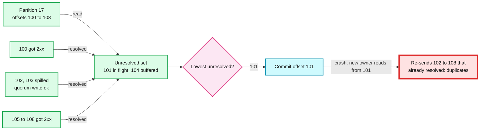

The spill rule bounds how far back the mark can sit: no record stays unresolved for more than ~30 s (one timeout), so a crash re-sends at most ~30 s of one partition, `59/s × 30 s ≈ 1,800` deliveries at peak, typically a few dozen, because most records resolve in under a second. The recent-success set (per endpoint, in memory) drops some of these on a graceful handoff, where the old owner passes it along; on a crash it is gone.

**The CDC relay.** On Postgres: logical decoding through a replication slot (the `pgoutput` plugin). The slot remembers `confirmed_flush_lsn`, the last WAL position the relay confirmed; the primary keeps all WAL after it. The relay confirms only after Kafka acknowledged the batch, so a crash re-reads and re-publishes (duplicates, removed later by deterministic delivery ids). Debezium's outbox event router does this shape off the shelf. On MySQL: the binlog with GTIDs (global transaction ids). The outbox table holds `event_id`, `type`, `account_id`, payload and `created_at`; it is insert-only, and a TTL job deletes rows older than 7 days.

**The dispatcher.** One process per node, an event loop per core (Netty or Go), non-blocking sockets, ~4,000 connections. Per endpoint: a lane (ring buffer of up to 1,000 references plus a queue-store cursor), a cap, an in-flight count, a latency EWMA (exponentially weighted moving average) baseline, a breaker, and a token bucket for catch-up. Timers (retry due times, probes, breaker transitions) live in a hashed timer wheel with 1 s ticks, O(1) per insert. Connection pools are per (host, port, resolved IP), with keep-alive of 60 s and TLS session resumption. The send path: pick the next endpoint by DRR among those with a free slot in their pool, take its next delivery, compute `HMAC_SHA256(secret, t + "." + body)` per active secret, open or reuse a tunnel through a proxy, write the request, and arm a 30 s timer.

**The endpoint queue store.** A wide-column LSM store (Cassandra or ScyllaDB; DynamoDB would also work). Rows: partition key `(endpoint_id, 10-minute bucket of due time)`, clustering `(due_minute, delivery_id)`, every row with a 4-day TTL. It is **append-only**: a retried delivery is written again into a later bucket, and the old copy is never deleted; the endpoint's cursor has moved past it, and the TTL removes it. That matters because queue-like delete patterns are the classic way to fill an LSM store with tombstones that every read must skip. Time-window compaction groups rows by write time, so expired data is dropped a whole file at a time. Order of operations for a failed queued delivery: write the new row (quorum), then advance the cursor; a crash between the two re-reads the row once (a duplicate attempt), never loses it. `ENDPOINT_STATE` lives here too, partitioned by Kafka partition number, so a new owner rebuilds its timer wheel with one partition scan of ~2,000 rows. [`../../concepts/lsm-tree.md`](../../concepts/lsm-tree.md).

**The egress proxy.** A CONNECT proxy (Smokescreen, or Envoy with an equivalent filter). It identifies the calling service by its client certificate and applies that service's policy. For each CONNECT it resolves the host with public resolvers, rejects the request if any answer is in the deny list or the port is not allowed, dials the exact checked IP, and then only copies bytes. TLS is end to end between the dispatcher and the merchant, so the proxy never sees payloads or secrets. Each node owns a fixed public IP; the published list is the set of proxy IPs.

### 10.2 Configuration knobs that matter

| Component | Knob | Value | Why |
|---|---|---|---|
| Kafka | `acks`, `min.insync.replicas`, `unclean.leader.election.enable` | `all`, 2, false | No acknowledged loss on one broker failure |
| Kafka | `deliveries` partitions, retention | 512, 3 days | ~2k endpoints per partition; 3 days covers any outage we would survive |
| Kafka | `events` retention | 7 days | Re-run fan-out after a bad fan-out deploy |
| Consumers | assignor, `group.instance.id`, `session.timeout.ms` | cooperative-sticky, static, 15 s | No group-wide pauses on deploys; a crash is detected in 15 s. Longer would hide crashes, shorter would rebalance on every slow restart |
| Fan-out | transaction commit interval | 100 ms | Latency vs commit overhead |
| CDC | slot lag alarm and page | 10 GB, 50 GB | Protect the product DB's disk long before it fills |
| Dispatcher | connect, total timeout | 5 s, 30 s | §5.3 push back |
| Dispatcher | initial cap, floor, ceiling | 10, 2, 1,000 | AIMD range |
| Dispatcher | breaker open rule | 5 consecutive, or ≥ 80% of ≥ 5 in 30 s | Fast on dead endpoints, ignores a single bad event |
| Dispatcher | spill threshold | 1,000 buffered, or oldest waited 10 s | Bounds memory (~3 MB per lane) and the offset mark's lag |
| Dispatcher | slot pools | 75% fast, 25% slow, slow if p50 over 1 s | Medium-slow endpoints cannot crowd fast ones |
| Dispatcher | response body read | 64 KB read, 2 KB stored | Bounded memory, bounded log |
| Retry | schedule, jitter | 1 m, 5 m, 30 m, 1 h, 2 h, 4 h, 8 h, then 12 h, last at 72 h; ±20% | 13 attempts over 3 days |
| Catch-up | per-endpoint bucket | `max(3x p99 rate, 5/s)` | Bounded surge to merchants after our outage |
| Queue store | TTL, compaction, consistency | 4 days, time-window, quorum | Append-only queue without tombstones |
| Proxy | resolver, deny list, ports | public only, §5.6 list, 443 and above 1024 minus service ports | The SSRF boundary |

### 10.3 Capacity math per component

| Component | Per unit | Load at 30k/s peak | Load at 60k/s design | Closest to its limit? |
|---|---|---|---|---|
| Dispatcher node | ~4,000 connections, 8 vCPU | 12k in flight ÷ 24 = 500 per node | 24k ÷ 24 = 1,000; one AZ lost: 1,500 | **Yes, on a bad day.** One hung top merchant adds 720 to one node. The fast/slow split and the 3,000 headroom are what keep it under 4,000 |
| `deliveries` partition | ~10 MB/s per partition comfortably | 59/s × 3.3 KB = 195 KB/s | 390 KB/s | No. A salted hot endpoint at 2,000/s is 6.6 MB/s on one partition, the reason for the 2,000/s salting line |
| Kafka broker | ~100 MB/s in | ~120 MB/s cluster-wide incl. replicas ÷ 12 | ~240 MB/s ÷ 12 = 20 MB/s | No |
| Fan-out node | ~5k events/s | 15k events/s ÷ 8 nodes = 1.9k | 3.8k | No |
| Proxy node | ~10k tunnels | 12k ÷ 12 = 1k | 2k; one AZ lost: 3k | No, but it is on every path |
| Queue store | ~15k writes/s per node at quorum | ~200/s steady | 50k/s burst for ~5 min ÷ 6 nodes ≈ 8.3k each | **Yes, during a post-outage drain.** Sized for the burst |
| Event store | reads for retries and replays | ~500/s | a 30-day replay of 50 M at 2k/s ≈ 7 h | No, replays are throttled |
| Attempt log | ~200k rows/s ingest per node | 33k/s | 66k/s | No |

### 10.4 Failure timeline

**(1) A dispatcher node dies at peak.**

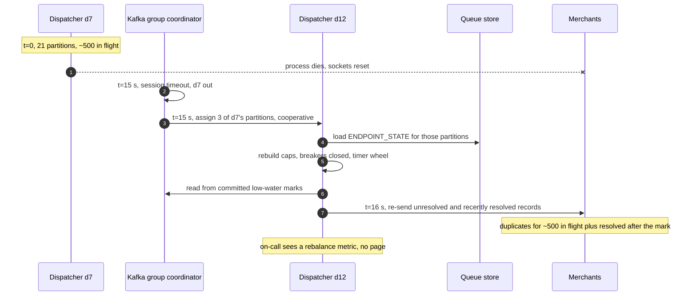

Detection 15 s (the session timeout; static membership means no faster heartbeat-based eviction). Data at risk: none. User sees: ~15 s of extra latency for the ~4% of endpoints on that node, and some duplicates. On-call sees a rebalance and a lag blip, no page.

**(2) A top merchant's endpoint hangs.** Flow 2 in §6, and [D5 in diagrams.md](diagrams.md#d5-failure-paths). Detection ~30 s (the timeout), cost 720 slots for 30 s, then 1.

**(3) Egress breaks for the region.**

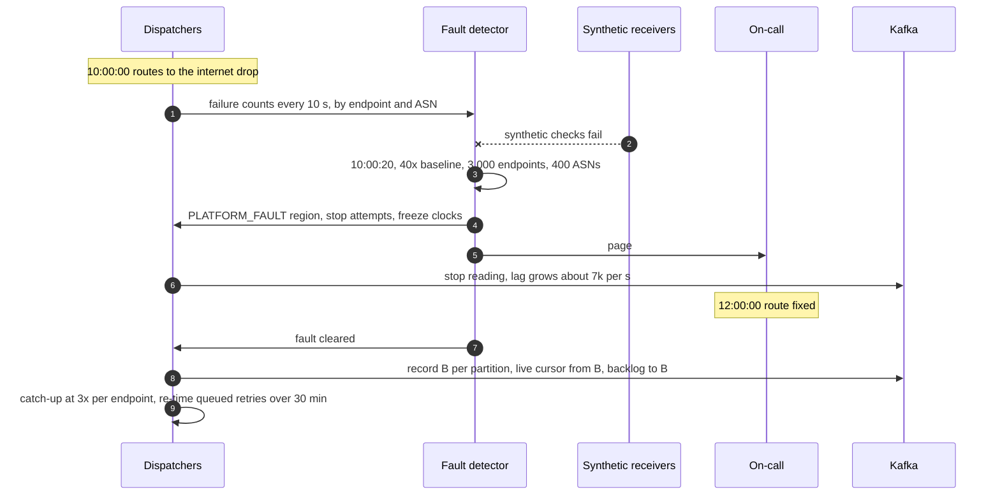

Detection ~20 s. Data at risk: none (Kafka holds 3 days). Merchants see: a 2-hour delay, then live events normal within seconds, backlog within ~1 h.

### 10.5 Exactly-once and idempotency end to end

| Hop | Duplicates can enter? | Removed where | Key | Lives |
|---|---|---|---|---|
| Business write to outbox | No. One transaction | n/a | `event_id` minted in the transaction | forever |
| Relay to `events` | Yes, on relay restart (re-reads from `confirmed_flush_lsn`) | Partly, at the dispatcher | `delivery_id = hash(event_id, endpoint_id)` | recent-success set, 1 h in memory |
| Fan-out to `deliveries` | No. Kafka transaction | n/a | transactional id + epoch | n/a |
| Dispatcher to merchant | Yes: lost 2xx, crash after 2xx, offset replay | At the receiver | `event.id` (same for every attempt, resend and replay) | receiver's table, 30 days |
| Attempt records | Yes, on the same replays | In the attempt log (dedup on `(delivery_id, attempt_no)`) | `(delivery_id, attempt_no)` | 30 days |
| Resend and replay | Yes, on purpose | At the receiver | `event.id` | 30 days |

The rule for the receiver is one line: **insert `event.id` into a unique table in the same transaction as the side effect.**

### 10.6 Consistency model per edge

| Edge (final design) | Model | Notes |
|---|---|---|
| Product service to product DB (business row + outbox) | Strong | One transaction |
| Product DB to CDC relay | Ordered, at-least-once | Commit order from the WAL |
| Relay to Kafka `events` and event store | At-least-once, eventual (~50 ms) | The event store can lag Kafka by seconds; retries read it seconds later at the earliest |
| Endpoint DB to in-memory subscription maps | Eventual, p99 5 s | New endpoints miss their first seconds; replay covers it |
| `events` to fan-out to `deliveries` | Exactly-once within Kafka | Transaction |
| `deliveries` to dispatcher | At-least-once | Low-water-mark commit |
| Dispatcher to queue store | Strong per write (quorum) | Required before the offset can pass the record |
| Dispatcher to merchant | At-least-once, unordered | The contract |
| Dispatcher to `attempts` to attempt log | At-least-once, eventual 2 to 5 s | Deduped by `(delivery_id, attempt_no)` |
| Endpoint API reads | Read-your-writes | Served from the endpoint DB primary for the writing account |
| Secret roll to signing | Eventual ≤ 5 s | Absorbed by the 24 h overlap |

### 10.7 Alternatives rejected

| Alternative | Why it looked attractive | Why rejected |
|---|---|---|
| A queue per endpoint (1 M SQS queues or RabbitMQ queues) | Isolation for free | 1 M queues to create, poll and monitor; idle endpoints still cost polls; the cap and breaker still need code. Partition ownership gives the same isolation with 512 partitions |
| A Kafka topic per endpoint | Same | Kafka is not built for a million topics or partitions; metadata and controller load explode |
| SQS with delay for retries | Managed, simple | Delay is at most 15 minutes, so a 3-day schedule needs re-enqueue chains; no per-endpoint concurrency |
| Retry topics with fixed delays (`retry-1m`, `retry-1h`, ...) | Common Kafka pattern | Every retry tier has its own head-of-line problem; still nothing per endpoint; dead endpoints still retry per delivery |
| Redis sorted set as the global retry index | Fast `ZRANGEBYSCORE` | Memory for 50 M members after an outage, durability depends on persistence settings, one hot key per shard |
| Postgres `SELECT ... FOR UPDATE SKIP LOCKED` as the queue | Simple, transactional, fine at small scale | A `next_attempt_at` index with 500 M updates a day and a 50k/s post-outage burst; vacuum pressure; the right choice below ~10 M a day |
| A durable workflow per delivery (Temporal) | Timers and retries built in | 500 M workflows a day; per-endpoint isolation still has to be built on top; the history store becomes the biggest system we run. [`../../concepts/temporal-durable-execution.md`](../../concepts/temporal-durable-execution.md) |
| Shorter timeout as the isolation mechanism | One config line | §5.3 push back |
| Ordered delivery per endpoint | Receivers ask for it | §5.5 |
| Validate URLs instead of an egress proxy | No new component | §5.6 |
| Buy (a webhook vendor, or EventBridge API destinations) | No team needed | Cost at 500 M a day (§7); EventBridge retries 24 h and 185 times with a 5 s timeout, not our 3-day contract |

### 10.8 How the big companies do it

| Provider | Timeout | Retries | Disable rule | Signing | What is different |
|---|---|---|---|---|---|
| Stripe | not published | up to 3 days, exponential (live); 3 over a few hours (sandbox) | not published | `t=`, `v1=` HMAC-SHA256, 5 min tolerance in libraries, up to 24 h overlap on roll | 3xx is a failure; up to 16 destinations per account; events listable for 30 days; resend 15 days in the dashboard, 30 via CLI; 15 published IPs; thin events recommended; Smokescreen for egress |
| Svix | 30 s | immediate, 5 s, 5 m, 30 m, 2 h, 5 h, 10 h, 10 h (~27.5 h) | all attempts failing for 5 days | Standard Webhooks | Open-source server; any non-2xx including 3xx fails |
| GitHub | 10 s | none automatic | n/a | HMAC-SHA256 header | Redelivery is manual or through the API |
| Shopify | 1 s connect, 5 s total | 8 times over 4 h | subscription deleted after 8 consecutive failures (Admin API) | HMAC | Also delivers to EventBridge and Pub/Sub |
| Slack Events API | 3 s | 3: immediate, 1 m, 5 m | disabled if over 95% of attempts fail in 60 min | signing secret | Very short timeout, the app is expected to queue |
| EventBridge API destinations | 5 s | 24 h, 185 attempts | n/a | connection auth | Retries only 401, 407, 409, 429 and 5xx |

Our numbers sit with Stripe's contract (3 days) and Svix's timeout (30 s). Sources in [`research/facts-survey.md`](research/facts-survey.md).

### 10.9 Operational runbook

**Dashboards, the 5 metrics.**
1. Commit to first attempt, p50 and p99, closed-breaker endpoints only.
2. `deliveries` consumer lag per partition (heat map).
3. Attempt outcome mix fleet-wide (2xx, 4xx, 5xx, timeout, connect, TLS, `ssrf_blocked`), against the 7-day baseline.
4. Slots in use per node, fast and slow pools, and the top 10 endpoints by slots held.
5. Endpoints by breaker state and by disable clock (count open more than 1 h, more than 24 h).
Plus: CDC slot lag per product DB, queue store write latency, reconciler gaps.

**Alerts.** As in §8. Owner: the webhooks on-call, with the events platform on-call for CDC and Kafka.

**Rollout.** Dispatchers: 1 node (canary) for 30 minutes, gated on the synthetic receivers' signature verification at 100%, the fleet 4xx rate within 0.5 points of baseline, and the canary's p99. Then 1 AZ, then all. Graceful handoff per node. Fan-out: same, plus a comparison of deliveries per event against the previous version. Proxy policy changes: shadow mode (log what would be blocked) for 24 h first.

**Rollback.** Dispatchers and fan-out are stateless code: redeploy the old version. A bad fan-out that produced wrong deliveries: replay `events` (7 days retention) from the bad deploy's start with the old version, and accept the duplicates. A bad dispatcher that mis-signed: the affected attempts failed at receivers and are already being retried; nothing to backfill.

### 10.10 Security and abuse

- **Auth boundary.** Merchants manage endpoints with their secret API key, scoped to their account; restricted keys can be limited to webhook management. Endpoint secrets are shown once and never returned again.
- **SSRF.** §5.6. The proxy network is the control.
- **Signed requests.** §5.6. Per attempt, two during a roll, 5-minute tolerance at the receiver.
- **Using us as a DDoS cannon.** Volume to an endpoint is bounded by the events its account causes, at most 16 endpoints per account, and in test mode by a rate limit on API calls that create events. Many accounts can point endpoints at one victim host, so the proxies also enforce a **per destination host cap across all accounts** (e.g., 500 tunnels) unless the host proves control (a challenge response at a well-known path). Large receivers that host many merchants' endpoints get verified once.
- **Payload privacy.** Snapshot events contain PII (customer names, emails). Endpoints must be HTTPS with TLS 1.2 or 1.3 in live mode. Thin events reduce exposure. Attempt logs store a 2 KB excerpt of the response, never our request bodies, and expire in 30 days.
- **Response bodies are hostile input.** Read at most 64 KB, stored escaped, rendered as text in the dashboard.
- **Secret handling.** Envelope encryption with KMS; decrypted only in dispatcher memory; the dashboard never shows a secret again after creation; every roll is audited.

### 10.11 Evolution

- **10x (5 B deliveries a day).** Kafka partitions 512 to 4,096, dispatchers to ~200 nodes, proxies to ~100 (and the published IP list becomes a CIDR block). Cells: split the pipeline into ~8 cells by account, each with its own Kafka, dispatchers and proxies, to cap the blast radius of a bad deploy at 1/8. The seam: account to cell is a lookup at the relay.
- **Multi-region.** Run the pipeline in the region where the events are created. Kafka is mirrored to a standby region; on failover the standby resumes from translated offsets, which re-sends minutes of deliveries (at-least-once again), and publishes its own egress IPs, already in the published list.
- **Event destinations (EventBridge, Pub/Sub, a merchant's queue).** A `Transport` interface in the dispatcher: `send(delivery) → outcome`. HTTP is one implementation. Caps, breakers and retries stay the same.
- **Ordering per object, as an opt-in.** If demand is real: an endpoint flag that routes by `(endpoint_id, object_id)` and caps each object key at 1 in flight. The seam is the lane key.
- **Asymmetric signatures.** Ed25519 alongside HMAC (Standard Webhooks `v1a`), keys published at a well-known URL, so receivers need no shared secret.
- **GDPR delete.** Events and attempts expire in 30 days; outbox rows in 7; queue rows in 4. An erasure request inside 30 days deletes the account's events from the event store by `(account_id, created)` and blocks their replay.
- **Payload transforms or field filters.** A per-endpoint function at fan-out. The seam is the render step, which already runs per endpoint version.

---

## 11. Follow-up questions to expect

Ranked by how likely an interviewer asks them. Answers in [`edge-cases.md`](edge-cases.md) and the deep dives.

1. **One endpoint hangs for 30 s. What happens to everyone else?** §5.3, Flow 2, [`deep-dives/per-endpoint-isolation-and-scheduling.md`](deep-dives/per-endpoint-isolation-and-scheduling.md).
2. **The event committed but the publish was lost. How is it sent?** §5.1, [`deep-dives/outbox-and-event-fan-out.md`](deep-dives/outbox-and-event-fan-out.md).
3. **Duplicates and ordering: what do you promise?** §5.5, [`deep-dives/delivery-semantics-and-replay.md`](deep-dives/delivery-semantics-and-replay.md).
4. **After our 2-hour outage, how do you avoid a storm?** §5.4, Flow 3, [`deep-dives/retry-policy-and-storms.md`](deep-dives/retry-policy-and-storms.md).
5. **`169.254.169.254` as an endpoint, or DNS rebinding?** §5.6, Flow 6, [`deep-dives/ssrf-and-egress.md`](deep-dives/ssrf-and-egress.md).
6. **How does the receiver verify us, and how do you rotate secrets?** §5.6, Flow 4, [`deep-dives/signing-and-secret-rotation.md`](deep-dives/signing-and-secret-rotation.md).
7. **What is your retry schedule, and when do you give up?** §4.3, [`deep-dives/retry-policy-and-storms.md`](deep-dives/retry-policy-and-storms.md).
8. **How do you commit Kafka offsets when deliveries finish out of order?** §5.1, §10.1.
9. **When do you disable an endpoint, and what about the events in between?** §4.3, Flow 5.
10. **Why not a queue per endpoint, or a DB row per delivery?** §7, §10.7.
11. **How do you prove nothing was dropped?** The reconciler, §5.1.
12. **A Connect platform's endpoint gets 2% of all traffic. Hot partition?** §5.3 challenges, §10.3.
13. **Build or buy?** §7.
14. **How would you migrate from the current job-queue system?** §8, [D12](diagrams.md#d12-rollout--migration).
