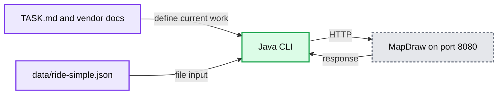

# BikeMap integration Java workspace

Read TASK.md, inspect the Java starter and vendor documentation, then implement the current stage with your own tests.



## Start

Open this folder's `pom.xml` as a Maven project in your IDE. Use JDK 21 or newer, Maven, and Python 3.11 or newer. Run commands from this folder so relative fixture paths resolve.

```bash
cd lld-practise/bikemap-integration/practice-version
mvn test
mvn -q compile exec:java -Dexec.args="part1"
```

Start the vendor in a second terminal when needed:

```bash
cd lld-practise/bikemap-integration/practice-version
python3 tools/mapdraw_server.py
```

The starter compiles and its smoke tests pass. The exercise behavior is deliberately unfinished, just as in the Python kit. Passing starter tests does not mean Part 1 is complete. Add behavioral tests for the requirements you implement.

## Build and test

```bash
./scripts/build.sh          # clean package, skipping test execution
./scripts/test.sh           # run tests
./scripts/test.sh -Dtest=RidemapSmokeTest
mvn -q compile exec:java -Dexec.args="--help"
```

The scripts work from any directory when invoked by path and forward arguments to Maven. Reports and build output are under `target/`.

For direct CLI execution without Maven's own output, build the executable Spring Boot JAR and use its launcher to select the plain Java entry point:

```bash
./scripts/build.sh
java -Dloader.main=com.practice.stripe.Practice \
  -cp target/stripe-bikemap-integration-0.0.1-SNAPSHOT.jar \
  org.springframework.boot.loader.launch.PropertiesLauncher part1
```

## Project layout

| Path | Purpose |
|---|---|
| `TASK.md` | Initial stage and required Java contract. |
| `src/main/java/com/practice/stripe/Practice.java` | Plain Java CLI entry point. |
| `src/main/java/com/practice/stripe/ridemap/` | Ride loader, connection settings, vendor client, and errors. |
| `src/main/java/com/practice/stripe/web/` | Optional Spring Boot wiring examples. |
| `src/test/java/com/practice/stripe/` | Starter smoke tests; add your exercise tests here. |
| `data/ride-simple.json` | Original recorded ride fixture. |
| `docs/MAPDRAW_API.md` | Original vendor contract. |
| `tools/mapdraw_server.py` | Original local vendor simulator; do not change it to pass the task. |
| `interviewer/` | Later-stage prompts and assets. Keep closed during a first attempt. |

## Configuration

| Setting | Default | Purpose |
|---|---|---|
| `MAPDRAW_URL` | `http://127.0.0.1:8080` | Vendor base URL. |
| `MAPDRAW_API_KEY` | `md_test_ridemap` | Local test credential. |
| `PORT` | `8097` | Optional Spring Boot server port. |

For a different vendor port, run `python3 tools/mapdraw_server.py --port 9000` and set `MAPDRAW_URL=http://127.0.0.1:9000` for the Java process. This is separate from the optional application server.

## Optional HTTP server

```bash
mvn spring-boot:run
```

Use `requests.http` for `GET /health`, a valid `POST /echo`, and a validation error. These examples verify Spring Web, Jackson, validation, and generated MapStruct mapping. They do not implement the BikeMap exercise.

Configured versions match the neighboring projects: Java 21 compilation, Spring Boot 3.5.16, MapStruct 1.6.3, JUnit 5, Mockito, AssertJ, and MockMvc. Outbound requests use Java's built-in HttpClient.

Verified on the installed JDK 27: all eight starter tests pass and the executable JAR builds. Mockito is loaded as a test JVM agent so the tests do not rely on dynamic self-attachment.

## Practice protocol

Start with Part 1 only. A coach can reveal the next numbered prompt when you are ready. There are five stages; finishing every stage in a timed session is not expected. The Python kit's hidden checks are not Java tests; this workspace includes environment smoke tests, and you write the Java exercise tests.

Practice without AI for your scheduled Integration interview, following the supplied Stripe guide. Read docs, explain your reasoning, and verify observable behavior. This is a rehearsal exercise, not a promise of the real interview prompt.

## Tradeoffs

The vendor remains Python so the Java exercise uses the same HTTP contract and simulator as the original. The Java starter uses the familiar Maven scaffold, while the CLI avoids requiring a web API for a task that primarily exercises outbound integration.

| Date | First working version in minutes | Stage reached | One thing to improve |
|---|---|---|---|
| | | | |
