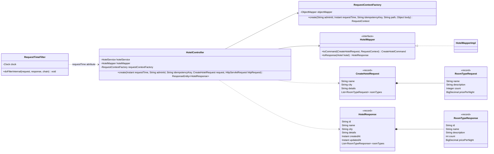
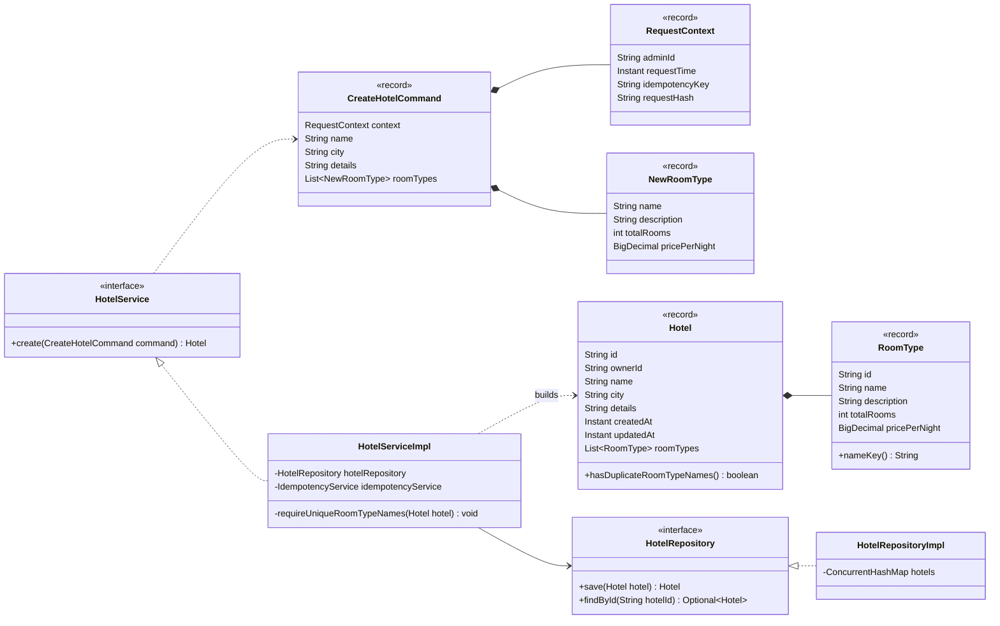
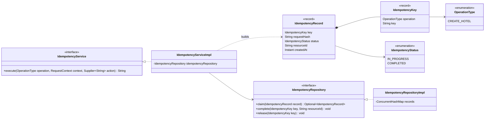
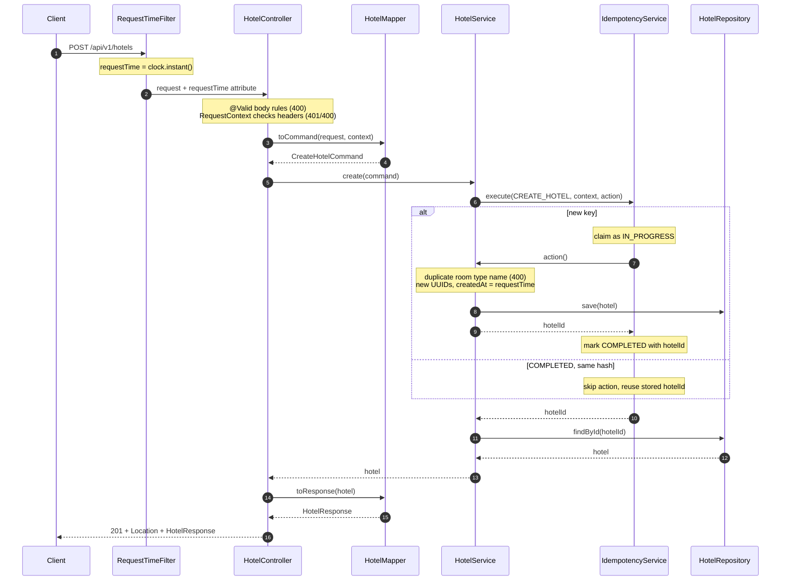

# Create Hotel

`POST /api/v1/hotels`: an admin creates a hotel and becomes its owner.

Shared conventions, packages and errors: [Overview.md](Overview.md).

- Each hotel defines its own room types: a name and a description of what it means.
- All rooms in a room type are identical, so a room type is a room count and a price, not individual rooms.
- The call is idempotent: retrying with the same `Idempotency-Key` never creates a second hotel.
- The server captures the request time once, on arrival, and uses that value everywhere after.

## Contract

```http
POST /api/v1/hotels
X-Admin-Id: admin-1
Idempotency-Key: 3f6c1a9e-58b2-4d0f-a7c1-2b9e4d8f6a10
Content-Type: application/json

{
  "name": "Taj",
  "city": "Mumbai",
  "details": "Sea-facing heritage hotel with a pool",
  "roomTypes": [
    { "name": "Sea View Deluxe", "description": "King bed, balcony facing the sea", "count": 10, "pricePerNight": 4500.00 },
    { "name": "Family Suite", "description": "Two bedrooms, sleeps 4", "count": 2, "pricePerNight": 12000.00 }
  ]
}
```

`201 Created`, `Location: /api/v1/hotels/{id}`

```json
{
  "id": "<uuid>",
  "name": "Taj",
  "city": "Mumbai",
  "details": "Sea-facing heritage hotel with a pool",
  "createdAt": "2026-10-24T09:15:02.123Z",
  "updatedAt": "2026-10-24T09:15:02.123Z",
  "roomTypes": [
    { "id": "<uuid>", "name": "Sea View Deluxe", "description": "King bed, balcony facing the sea", "count": 10, "pricePerNight": 4500.00 },
    { "id": "<uuid>", "name": "Family Suite", "description": "Two bedrooms, sleeps 4", "count": 2, "pricePerNight": 12000.00 }
  ]
}
```

## Input rules

| Input | Rule |
|---|---|
| `X-Admin-Id` header | required, not blank |
| `Idempotency-Key` header | required, not blank, at most 255 characters |
| `name`, `city` | not blank |
| `details` | optional free text; the mapper stores a missing value as `""` |
| `roomTypes` | at least one |
| `roomTypes[].name` | not blank, unique within the hotel ignoring case and surrounding spaces |
| `roomTypes[].description` | not blank |
| `roomTypes[].count` | a whole number ≥ 0; `2.9` is rejected, not cut to `2` |
| `roomTypes[].pricePerNight` | > 0 |

The mapper trims every text field it passes on.

## Errors

Every error returns `ErrorResponse { code, message }`, built by `GlobalExceptionHandler`. For a missing header, the handler picks 401 or 400 by the header's name.

| Status | `code` | When | Raised as |
|---|---|---|---|
| 401 | `UNAUTHORIZED` | `X-Admin-Id` missing or blank | `MissingRequestHeaderException` (Spring), `UnauthorizedException` (`RequestContext`) |
| 400 | `IDEMPOTENCY_KEY_INVALID` | `Idempotency-Key` missing, blank or too long | `MissingRequestHeaderException` (Spring), `InvalidIdempotencyKeyException` (`RequestContext`) |
| 400 | `MALFORMED_REQUEST` | body is missing or not valid JSON | `HttpMessageNotReadableException` (Spring) |
| 400 | `VALIDATION_FAILED` | a body rule fails, or a value has the wrong type (`"ten"` or `2.9` for `count`); the message names the field | `MethodArgumentNotValidException`, `HttpMessageNotReadableException` caused by `MismatchedInputException` (Spring) |
| 400 | `DUPLICATE_ROOM_TYPE` | two room types share a name | `DuplicateRoomTypeException` (`HotelService`) |
| 409 | `IDEMPOTENCY_IN_PROGRESS` | the first request with this key is still running | `IdempotencyInProgressException` (`IdempotencyService`) |
| 422 | `IDEMPOTENCY_KEY_REUSED` | same key sent with a different body or path, or by a different admin | `IdempotencyKeyReusedException` (`IdempotencyService`) |

## Request time

- `RequestTimeFilter` runs before everything else and stores `clock.instant()` as the `requestTime` request attribute.
- The controller puts it in `RequestContext`. From there on, code uses `context.requestTime()`.
- Nothing else calls `Instant.now()`, `LocalDate.now()` or the `Clock`. The `Clock` bean (`Clock.systemUTC()`, in `config`) is replaced by a fixed clock in tests.
- Used here for `Hotel.createdAt`, `Hotel.updatedAt` and `IdempotencyRecord.createdAt`.

## Idempotency

- A key is unique only within one operation, so the stored key is `IdempotencyKey(OperationType, key)`. The same key string can be used by different operations.
- `requestHash` is the SHA-256 of `adminId`, the request path and the request JSON, computed in the API layer by `RequestContextFactory`, which also builds the `RequestContext`. Including the path means the same key and body sent to a different hotel (in Update) can't replay the wrong result.
- `IdempotencyService.execute(...)` wraps the create:

| Stored record for `(CREATE_HOTEL, key)` | Result |
|---|---|
| none | claim it as `IN_PROGRESS`, create the hotel, mark it `COMPLETED` with the hotel id → 201 |
| `COMPLETED`, same hash | no new hotel → 201 with the stored hotel |
| `IN_PROGRESS`, same hash | 409 `IDEMPOTENCY_IN_PROGRESS` |
| different hash | 422 `IDEMPOTENCY_KEY_REUSED` |

- Claiming is atomic (`putIfAbsent`; in a database, an insert with a unique key on operation + key), so parallel retries create one hotel.
- If the create fails, the claim is released. Errors are not stored, so a retry runs again.
- A replay returns the hotel as it is now, not a copy of the first response.
- Records keep `createdAt`; expiring old records comes later.

## Packages

Packages and their dependencies are in [Overview.md](Overview.md#packages). Create introduces every class in the diagrams below.

## Classes

### API side



The controller passes `httpRequest.getRequestURI()` as `path`.

### Service, domain, repository



`requireUniqueRoomTypeNames` throws `DuplicateRoomTypeException` when `hotel.hasDuplicateRoomTypeNames()` is true. It checks the final list of room types, so Update reuses it after every room type change. `nameKey()` is the trimmed, `Locale.ROOT`-lowercased name.

`RequestContext` holds the request's metadata and `CreateHotelCommand` holds its payload. Its constructor rejects a blank `adminId` (401) and a blank or too-long `idempotencyKey` (400).

### Idempotency



`claim` stores the record and returns empty if the key is free. Otherwise it returns the existing record unchanged. `execute` returns the resource id (here the hotel id), so later operations can reuse it.

## Flow



The 409 and 422 cases are in the Idempotency table.

## Tests

Shared test rules: [Overview.md](Overview.md#tests).

**Functional: `CreateHotelFunctionalTest`**

| Test | Parameterized cases | Expect |
|---|---|---|
| `createsHotel` | | 201, `Location`, every field echoed, new ids, `createdAt` and `updatedAt` equal the fixed clock |
| `rejectsInvalidBody` | blank `name`, blank `city`, empty `roomTypes`, blank room type `name`, blank `description`, `count` -1, `pricePerNight` 0, body that isn't JSON | 400 `VALIDATION_FAILED`; `MALFORMED_REQUEST` for the last case |
| `rejectsValueOfWrongType` | `count` 2.9, `count` `"ten"` | 400 `VALIDATION_FAILED`, message `roomTypes[0].count has an invalid value` |
| `rejectsBadHeaders` | `X-Admin-Id` missing or blank; `Idempotency-Key` missing, blank or 256 characters | 401 `UNAUTHORIZED` or 400 `IDEMPOTENCY_KEY_INVALID` |
| `rejectsDuplicateRoomTypeNames` | | 400 `DUPLICATE_ROOM_TYPE` |
| `replaysSameKey` | | the second call returns 201 with the same hotel id |
| `rejectsReusedKey` | | same key with a different body gives 422 `IDEMPOTENCY_KEY_REUSED` |

**Unit**

| Class | Test | Parameterized cases | Expect |
|---|---|---|---|
| `HotelTest` | `detectsDuplicateRoomTypeNames` | `"Deluxe"`/`"Suite"`, `"Deluxe"`/`"deluxe"`, `"Deluxe"`/`" Deluxe "` | false, true, true |
| `HotelMapperImplTest` | `toCommandTrimsTextAndDefaultsDetails` | | text fields trimmed, missing `details` becomes `""`, `count` becomes `totalRooms` |
| `RequestContextFactoryTest` | `hashChangesWithEachInput` | change `adminId`, change `path`, change body | a different hash each time; identical input gives the same hash |
| `IdempotencyServiceImplTest` | `runsActionOnceForNewKey` | | action runs; record is `COMPLETED` with its id |
| | `replaysCompletedKey` | | action not run again; same id |
| | `rejectsDifferentHash` | | `IdempotencyKeyReusedException` |
| | `rejectsKeyInProgress` | | `IdempotencyInProgressException` |
| | `releasesKeyWhenActionFails` | a `RuntimeException`, an `Error` | a retry with the same key runs the action |
| | `scopesKeyByOperation` | | the same key under two `OperationType`s runs both actions |
| | `parallelCallsRunActionOnce` | | 20 threads, same key: the action runs once; every other call gets the id or 409 |

## Notes

- A room type's `totalRooms` and `pricePerNight` apply to every date. Create Reservation later adds per-date inventory rows for each room type ([CreateReservation.md](CreateReservation.md#inventory)).
- Domain objects are immutable records, so the `*RepositoryImpl` classes store them as they are.
- New storage means new `HotelRepository` and `IdempotencyRepository` implementations; nothing else changes. With a database, `save(hotel)` and `complete(...)` run in one transaction.
- MapStruct can replace the hand-written `HotelMapperImpl` later. It generates a class with the same name by default.
