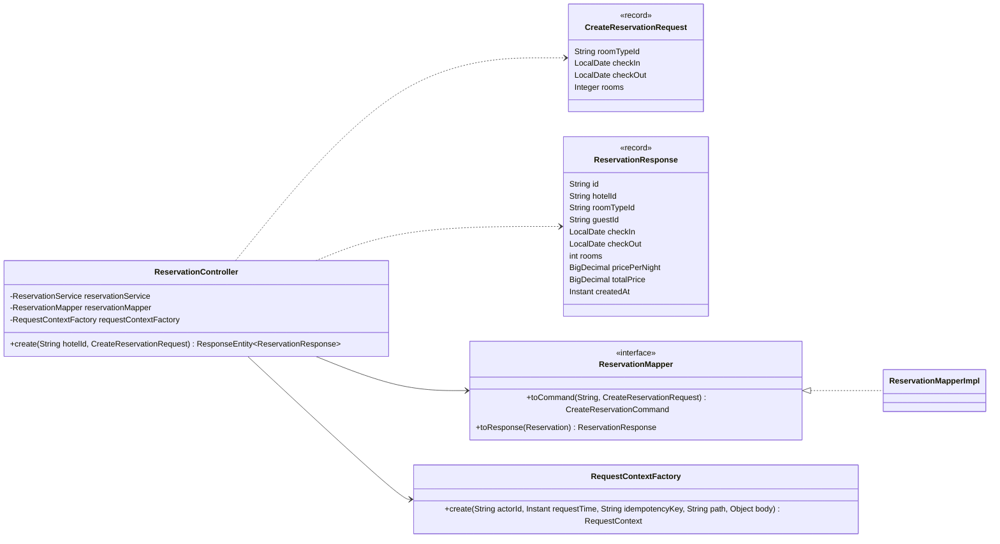
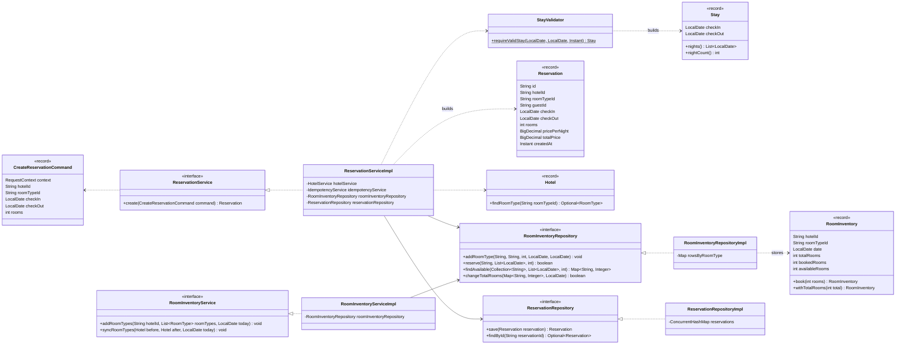
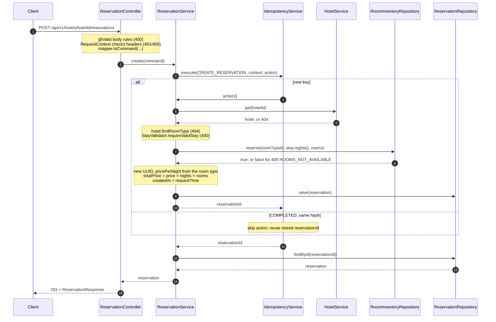

# Create Reservation

`POST /api/v1/hotels/{hotelId}/reservations`: a guest reserves rooms of one room type for a stay.

Shared conventions, packages and errors: [Overview.md](Overview.md).

- A guest is identified by the `X-Guest-Id` header. There are no guest accounts.
- One room type per reservation: `rooms` rooms of it, for every night of the stay.
- Nights run from `checkIn` (included) to `checkOut` (excluded). A stay from Nov 10 to Nov 13 is the nights of Nov 10, 11 and 12.
- Each room type has one inventory row per date, with `totalRooms`, `bookedRooms` and `availableRooms`. Rows are added with the room type, for every date a valid stay can include. A booking adds to `bookedRooms` and takes the same number off `availableRooms`.
- The price is fixed at booking time, so a later price change through Update Hotel doesn't change a reservation.
- Idempotent with `Idempotency-Key` and `OperationType.CREATE_RESERVATION`, as in [CreateHotel.md](CreateHotel.md#idempotency).

## Contract

```http
POST /api/v1/hotels/{hotelId}/reservations
X-Guest-Id: guest-1
Idempotency-Key: 5b1d7c3a-2e94-4f60-8a1b-9c3e7d2f4a58
Content-Type: application/json

{
  "roomTypeId": "<room type id>",
  "checkIn": "2026-11-10",
  "checkOut": "2026-11-13",
  "rooms": 2
}
```

`201 Created`

```json
{
  "id": "<uuid>",
  "hotelId": "<hotel id>",
  "roomTypeId": "<room type id>",
  "guestId": "guest-1",
  "checkIn": "2026-11-10",
  "checkOut": "2026-11-13",
  "rooms": 2,
  "pricePerNight": 4500.00,
  "totalPrice": 27000.00,
  "createdAt": "2026-10-24T09:15:02.123Z"
}
```

- `totalPrice = pricePerNight × nights × rooms`. Here that's 4500.00 × 3 × 2.
- There's no `Location` header, because there's no Get reservation API yet.

## Input rules

| Input | Rule | Checked by |
|---|---|---|
| `X-Guest-Id` header | required, not blank | Spring (missing), `RequestContext` (blank) |
| `Idempotency-Key` header | as in create hotel | as in create hotel |
| `roomTypeId` | not blank; a room type of this hotel | `@NotBlank`; `ReservationServiceImpl` (404) |
| `checkIn`, `checkOut` | required, as `yyyy-MM-dd` | `@NotNull`; Jackson, so a bad date gives `VALIDATION_FAILED` naming the field |
| `checkIn` and `checkOut` together | the stay rules below | `StayValidator` (400 `INVALID_STAY`) |
| `rooms` | required, ≥ 1, free on every night | `@NotNull @Positive`; `RoomInventoryRepository.reserve` (409) |

The mapper trims `roomTypeId`.

## Stay rules

All stay rules live in one place, `StayValidator.requireValidStay(checkIn, checkOut, requestTime)`. This API and the date filter in [SearchHotels.md](SearchHotels.md#availability) both call it. It returns a `Stay`, or throws `InvalidStayException` (400 `INVALID_STAY`).

| Rule | Fails when today is 2026-10-24 |
|---|---|
| both dates are sent | only `checkIn` (only search can get here, because reservations require both) |
| `checkOut` is after `checkIn` | `2026-11-10` to `2026-11-10` |
| at most 30 nights (`MAX_NIGHTS`) | `2026-11-01` to `2026-12-02` |
| `checkIn` is not before today | `2026-10-23` |
| `checkOut` is at most 365 days after today (`MAX_DAYS_AHEAD`), where the inventory rows end | `2027-10-24` to `2027-10-25` |

- Today is `LocalDate.ofInstant(requestTime, ZoneOffset.UTC)`, because hotels have no time zone yet.
- `Stay(checkIn, checkOut)` is a domain record and never throws. `nights()` lists the nights and `nightCount()` counts them.

## Errors

Header and body errors come first, in the [error order for writes](Overview.md#conventions). The rest are checked in table order:

| Status | `code` | When | Raised as |
|---|---|---|---|
| 401 | `UNAUTHORIZED` | `X-Guest-Id` missing or blank | `MissingRequestHeaderException` (Spring), `UnauthorizedException` (`RequestContext`) |
| 400 | `IDEMPOTENCY_KEY_INVALID`, `MALFORMED_REQUEST`, `VALIDATION_FAILED` | as in create hotel, plus the rules above | as in create hotel |
| 409, 422 | `IDEMPOTENCY_IN_PROGRESS`, `IDEMPOTENCY_KEY_REUSED` | as in create hotel | `IdempotencyService` |
| 404 | `HOTEL_NOT_FOUND` | no hotel with `hotelId` | `HotelNotFoundException` (`HotelService`) |
| 404 | `ROOM_TYPE_NOT_FOUND` | `roomTypeId` isn't in this hotel | `RoomTypeNotFoundException` (`ReservationService`) |
| 400 | `INVALID_STAY` | a stay rule fails | `InvalidStayException` (`StayValidator`) |
| 409 | `ROOMS_NOT_AVAILABLE` | a night of the stay has fewer than `rooms` rooms free | `RoomsNotAvailableException` (`ReservationService`) |

## Inventory

`RoomInventoryRepository` keeps one `RoomInventory` row per room type and date: `hotelId, roomTypeId, date, totalRooms, bookedRooms, availableRooms`. `availableRooms` is always `totalRooms − bookedRooms`. It's stored so search can filter on it directly.

| Method | What it does |
|---|---|
| `addRoomType(hotelId, roomTypeId, totalRooms, from, to)` | adds a row with every room available for each date from `from` (included) to `to` (excluded) |
| `reserve(roomTypeId, dates, rooms)` | if every date has a row with `availableRooms ≥ rooms`, adds `rooms` to `bookedRooms` and takes them off `availableRooms` on each date, then returns true; otherwise changes nothing and returns false |
| `findAvailable(roomTypeIds, dates, rooms)` | returns `roomTypeId → fewest availableRooms` over the dates, for the room types with `availableRooms ≥ rooms` on every date; a room type short on any date, or missing a row, is left out |
| `changeTotalRooms(totals, from)` | sets each room type's new total on its rows from `from` on, keeping `bookedRooms`; if a row has more booked than its new total, changes nothing and returns false |

- Rows are added through `RoomInventoryService` when Create Hotel or Update Hotel adds a room type. They run from today for `StayValidator.MAX_DAYS_AHEAD` (365) days. The stay rules hold `checkOut` to the same limit, so every night of a valid stay has a row.
- A date with no row counts as 0 available, so it can't be booked.
- Room type ids are UUIDs, unique across hotels. So `RoomInventoryRepositoryImpl` keys rows by room type id, then date: `Map<String, NavigableMap<LocalDate, RoomInventory>>`.
- Every method is `synchronized`. With one lock, a booking and a count change never interleave, and that's enough in memory.

Example: a room type has 5 Deluxe rooms. Booking A takes 2 rooms for Nov 10–13, and booking B takes 1 room for Nov 12–15.

| Date | 10 | 11 | 12 | 13 | 14 |
|---|---|---|---|---|---|
| bookedRooms | 2 | 2 | 3 | 1 | 1 |
| availableRooms | 3 | 3 | 2 | 4 | 4 |

For a stay from Nov 11 to Nov 13 with `rooms` 2, `findAvailable` gives 2, the fewest over Nov 11 and 12. With `rooms` 3, Deluxe is left out, because Nov 12 has only 2.

With a database, the same interface sits on a `room_inventory` table with the same columns, and primary key `(room_type_id, date)`:

```sql
-- findAvailable: a room type that is short on a date, or missing one, has fewer than :nights matching rows
SELECT room_type_id, MIN(available_rooms) FROM room_inventory
WHERE room_type_id IN (:ids) AND date >= :checkIn AND date < :checkOut AND available_rooms >= :rooms
GROUP BY room_type_id
HAVING COUNT(*) = :nights;

-- reserve, in one transaction: commit if :nights rows were updated, otherwise roll back
UPDATE room_inventory SET booked_rooms = booked_rooms + :rooms, available_rooms = available_rooms - :rooms
WHERE room_type_id = :id AND date >= :checkIn AND date < :checkOut AND available_rooms >= :rooms;

-- changeTotalRooms, per room type, in one transaction: roll back if a row from today on has booked_rooms > :total
UPDATE room_inventory SET total_rooms = :total, available_rooms = :total - booked_rooms
WHERE room_type_id = :id AND date >= :today;
```

## Idempotency

- The rules are the same as in create hotel, with `OperationType.CREATE_RESERVATION`. The stored `resourceId` is the reservation id.
- `requestHash` covers `X-Guest-Id`, the path (which includes the hotel id) and the body.
- A replay returns the stored reservation and reserves nothing again.
- If the action throws after `reserve` succeeds, nothing gives the rooms back. In memory, only `save` comes after `reserve`, and `save` can't fail. With a database, `reserve` and `save` run in one transaction.

## Packages

| Package | Classes |
|---|---|
| `api` | `ReservationController` |
| `api.dto` | `CreateReservationRequest`, `ReservationResponse` |
| `mapper` | `ReservationMapper`, `ReservationMapperImpl` |
| `service` | `ReservationService`, `ReservationServiceImpl`, `RoomInventoryService`, `RoomInventoryServiceImpl`, `CreateReservationCommand`, `StayValidator` |
| `domain` | `Reservation`, `Stay`, `RoomInventory` |
| `repository` | `ReservationRepository`, `ReservationRepositoryImpl`, `RoomInventoryRepository`, `RoomInventoryRepositoryImpl` |
| `error` | `InvalidStayException`, `RoomsNotAvailableException`, `RoomCountBelowReservedException` |

## Classes

### API side



- `ReservationController` is mapped to `/api/v1/hotels/{hotelId}/reservations`.
- `create` also takes `requestTime`, `guestId` (from `X-Guest-Id`), `idempotencyKey` and `HttpServletRequest`. It builds `RequestContext` with `RequestContextFactory.create`, like `HotelController`, with `actorId = guestId`.
- `toCommand` takes `hotelId` and the request, and also the `RequestContext`.

### Service, domain, repository



- The [Inventory](#inventory) table names the parameters of the `RoomInventoryRepository` methods.
- `RoomInventoryService` keeps the rows in step with a hotel's room types, for Create Hotel and Update Hotel. Bookings and search call `RoomInventoryRepository` directly.
- `StayValidator` is a final class with constants `MAX_NIGHTS = 30` and `MAX_DAYS_AHEAD = 365`, plus static methods `requireValidStay` and `today(requestTime)`. It has no state, so nothing injects it.
- `ReservationServiceImpl` calls `HotelService.get` and so gets `HOTEL_NOT_FOUND` for free.
- `Hotel.findRoomType` already exists; `HotelServiceImpl.requireRoomType` uses it too.

## Flow



## Changes to Update Hotel

- Lowering a room type's `count` below the rooms booked on any date from today on gives 409 `ROOM_COUNT_BELOW_RESERVED` (`RoomCountBelowReservedException`).
- `HotelServiceImpl.applyChanges` calls `RoomInventoryService.syncRoomTypes(before, after, today)` as its last step, after every other check has passed, while `HotelRepository.update` holds the hotel. `syncRoomTypes` puts the room types whose `count` changed into one `changeTotalRooms(totals, today)` call. If that returns false, it throws the 409, which aborts the hotel change too. Room types added by the update then get rows through `addRoomType`.
- Past dates don't count, so the count can drop once old stays are over.
- `HotelServiceImpl` gets `RoomInventoryService` as a new dependency. Create Hotel uses it too.
- A booking and a count change both take the inventory lock, so a booking never passes on an old total. With a database, both are conditional `UPDATE`s on the same rows (see [Inventory](#inventory)).

## Changes to existing code

- `HotelServiceImpl.create` calls `RoomInventoryService.addRoomTypes` for its room types before `save`.
- `RequestContext.adminId` becomes `actorId`. It holds the admin for hotel writes and the guest for reservations. `HotelServiceImpl` reads `context.actorId()` for `ownerId` and for the owner check.
- `RequestContextFactory.create`: the `adminId` parameter becomes `actorId`.
- `UnauthorizedException`'s message names both headers: "X-Admin-Id or X-Guest-Id header must not be blank".
- `GlobalExceptionHandler`: the missing-header switch maps both `"X-Admin-Id"` and `"X-Guest-Id"` to 401. It also maps the three new exceptions.
- `OperationType`: add `CREATE_RESERVATION`.

## Tests

Shared test rules: [Overview.md](Overview.md#tests). Header and idempotency rules are shared with create hotel and aren't tested again, except the new missing `X-Guest-Id` case. In functional tests today is 2026-10-24 (`TestClockConfig.NOW`). `HotelApiClient` gets `reserve(guestId, idempotencyKey, hotelId, body)`. Each test creates its own hotel, so its room types and their inventory are its own too.

**Functional: `CreateReservationFunctionalTest`**

| Test | Parameterized cases | Expect |
|---|---|---|
| `createsReservation` | | 201; every field echoed, `pricePerNight` from the room type, `totalPrice` = price × nights × rooms, `createdAt` = fixed clock |
| `rejectsInvalidBody` | missing `roomTypeId`, missing `checkIn`, missing `checkOut`, `rooms` 0, `checkIn` `"10-11-2026"` | 400 `VALIDATION_FAILED` |
| `rejectsMissingGuestId` | | 401 `UNAUTHORIZED` |
| `rejectsUnknownHotel` | | 404 `HOTEL_NOT_FOUND` |
| `rejectsRoomTypeOfAnotherHotel` | | 404 `ROOM_TYPE_NOT_FOUND` |
| `rejectsInvalidStay` | | `checkOut` equal to `checkIn` gives 400 `INVALID_STAY` |
| `reservesLastBookableNight` | | a 1-night stay with `checkOut` 365 days ahead gives 201, so rows reach the last night a valid stay can include |
| `rejectsWhenRoomsRunOut` | | room type with 2 rooms: reserve 2 for Nov 10–12, then 1 for Nov 11–13 gives 409 `ROOMS_NOT_AVAILABLE` |
| `replaysSameKey` | | room type with 2 rooms: the same key twice for 1 room returns the same reservation id, and a new key still gets the last room |

**Functional: `UpdateHotelFunctionalTest` (added)**

| Test | Parameterized cases | Expect |
|---|---|---|
| `rejectsCountBelowReserved` | | 3 rooms with 2 booked: `count` 1 gives 409 `ROOM_COUNT_BELOW_RESERVED`, `count` 2 gives 200, then 1 more room gives 409 `ROOMS_NOT_AVAILABLE` |
| `addedRoomTypeCanBeBooked` | | a room type added through Update can be booked (201) |

**Unit**

| Class | Test | Parameterized cases | Expect |
|---|---|---|---|
| `StayTest` | `nightsRunUpToCheckOut` | 1 night, 3 nights | `nights()` runs from `checkIn` to the day before `checkOut`; `nightCount()` matches |
| `StayValidatorTest` | `acceptsStay` | today to tomorrow, 30 nights, `checkOut` 365 days ahead | returns the `Stay` |
| | `rejectsStay` | only `checkIn`, only `checkOut`, `checkOut` equal to `checkIn`, `checkOut` before `checkIn`, 31 nights, `checkIn` yesterday, `checkOut` 366 days ahead | `InvalidStayException` |
| `RoomInventoryRepositoryImplTest` | `reserveIsAllOrNothing` | | 2 rooms with Nov 11 full: reserving Nov 10–12 returns false and leaves Nov 10 with 2 available |
| | `reserveNeedsRowForEveryDate` | | rows up to Nov 12 only: reserving Nov 12–14 returns false |
| | `findAvailableKeepsRoomTypesFreeOnEveryDate` | with Nov 10 at 1 available, Nov 11 at 0 and Nov 12 at 2: Nov 10 for 1 room, Nov 12 for 2, Nov 10–12 for 1, Nov 12–14 for 1 | 1, 2, left out (Nov 11 is full), left out (no Nov 13 row) |
| | `changeTotalRoomsRejectsTotalBelowBooked` | | 2 booked on Nov 11: a total of 1 returns false and changes nothing |
| | `changeTotalRoomsKeepsBookingsAndEarlierDates` | | 1 booked on Nov 11, then a total of 5 from Nov 11: Nov 10, 11 and 12 have 2, 4 and 5 available |
| | `parallelReservesNeverOverbook` | | 20 threads each reserve 1 of 2 rooms: exactly 2 return true, and none are left |

## Later

- Get reservation (`GET /api/v1/reservations/{id}`), plus a `Location` header on create.
- Cancel: adds a `status` to `Reservation`, and `RoomInventoryRepository.release(roomTypeId, nights, rooms)`.
- Listing a guest's reservations, and a view for the hotel owner.
- A daily job that adds the next date's rows and removes past ones. Until then, a room type's rows end 365 days after the day it was created.
- Several room types in one reservation.
