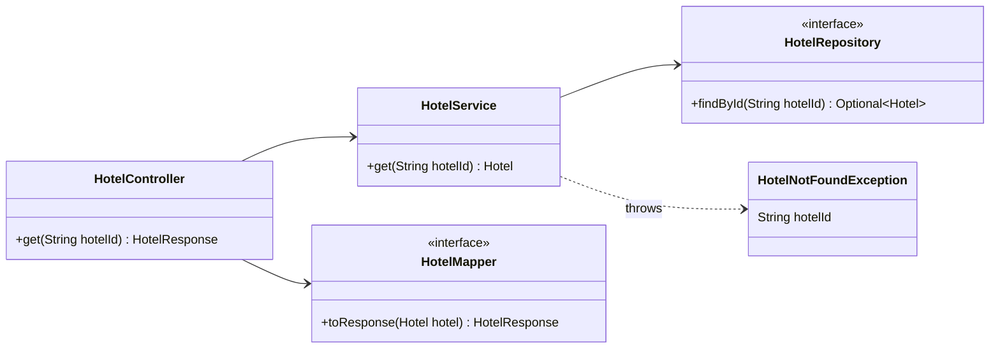
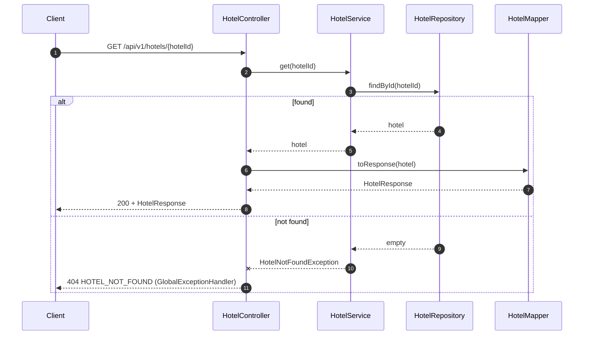

# Get Hotel

`GET /api/v1/hotels/{hotelId}`: anyone reads a hotel and its room types.

Shared conventions, packages and errors: [Overview.md](Overview.md).

- Public: no `X-Admin-Id`, no `Idempotency-Key`.
- Read-only, so repeating it has no side effects.

## Contract

```http
GET /api/v1/hotels/6b0e5a52-1d8f-4c39-9a57-3f2c8e1d7b40
```

`200 OK` with a `HotelResponse`, the same shape Create Hotel returns (see [CreateHotel.md](CreateHotel.md#contract)).

## Errors

Every error returns `ErrorResponse { code, message }`, built by `GlobalExceptionHandler`.

| Status | `code` | When | Raised as |
|---|---|---|---|
| 404 | `HOTEL_NOT_FOUND` | no hotel has this id | `HotelNotFoundException` (`HotelService`) |

Ids are opaque strings with no format check, so an id in an unexpected format is also a 404.

## Classes

Only what this API uses. New: `HotelController.get`, `HotelService.get`, `HotelNotFoundException`. The rest comes from Create Hotel.



## Flow



## Tests

Shared test rules: [Overview.md](Overview.md#tests).

**Functional: `GetHotelFunctionalTest`**

| Test | Parameterized cases | Expect |
|---|---|---|
| `returnsHotel` | | 200 with the same body Create returned |
| `returnsNotFound` | unknown UUID, id that isn't a UUID | 404 `HOTEL_NOT_FOUND` |

No unit tests: `HotelService.get` only wraps `findById`.

## Notes

- `RequestTimeFilter` still runs for this request, but Get doesn't use the time.
- The response doesn't include `ownerId`, the same as Create Hotel.

## Adds to shared classes

- `HotelController`: add `get(String hotelId) HotelResponse`.
- `HotelService`: add `get(String hotelId) Hotel`, which throws `HotelNotFoundException` when `findById` is empty.
- `error`: add `HotelNotFoundException`; `GlobalExceptionHandler` maps it to 404 `HOTEL_NOT_FOUND`.
- `HotelRepository.findById` and `HotelMapper.toResponse` are reused unchanged.
