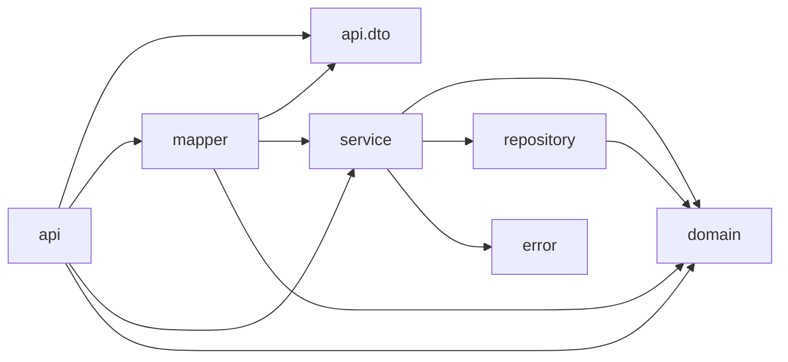
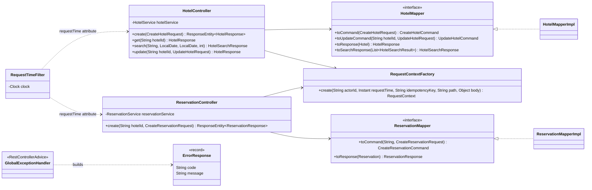
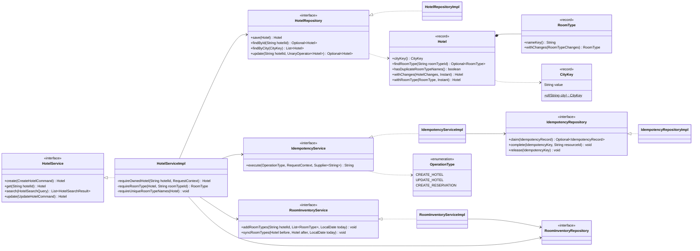
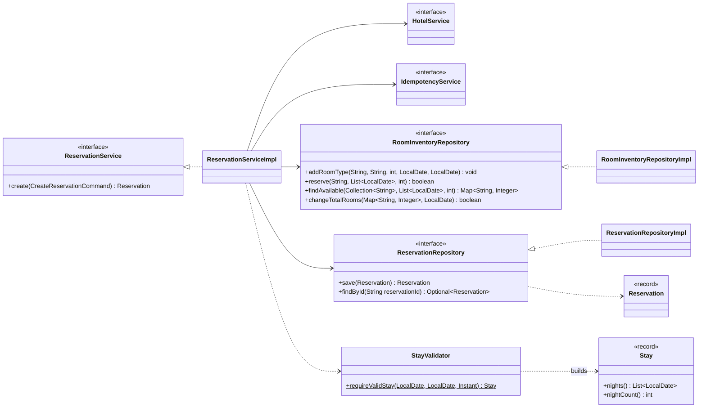

# Hotel API: overview

This doc holds the shared rules, packages, classes, errors and test rules for every hotel API. Each API doc shows the records it introduces and lists what it adds to the shared classes.

## APIs

Implement in this order:

| # | API | Endpoint | Doc |
|---|---|---|---|
| 1 | Create hotel | `POST /api/v1/hotels` | [CreateHotel.md](CreateHotel.md) |
| 2 | Get hotel | `GET /api/v1/hotels/{hotelId}` | [GetHotel.md](GetHotel.md) |
| 3 | Update hotel, including adding or changing room types | `PATCH /api/v1/hotels/{hotelId}` | [UpdateHotel.md](UpdateHotel.md) |
| 4 | Search by city; its date filter (step 2) lands after #5 | `GET /api/v1/hotels?city=` (step 2 adds `&checkIn=&checkOut=&rooms=`) | [SearchHotels.md](SearchHotels.md) |
| 5 | Create reservation | `POST /api/v1/hotels/{hotelId}/reservations` | [CreateReservation.md](CreateReservation.md) |

- Everything builds on Create.
- Get comes next because it's the smallest, and it adds `HOTEL_NOT_FOUND`, which Update reuses.
- Search's city part depends only on Create.
- Create reservation reuses `HOTEL_NOT_FOUND` from Get and `ROOM_TYPE_NOT_FOUND` from Update. It also adds the room count check to Update.
- Create reservation fills the inventory, and adds `Stay` and `StayValidator`. Search's date filter needs all three, so Search step 2 comes last.
- Once that shared piece exists (the inventory repository, `Stay`, `StayValidator`, the new exceptions and their handlers, and the `actorId` rename), #5 and Search step 2 can be built in parallel. They touch different methods of `HotelServiceImpl`.

## Conventions

- **Layers:** controllers see DTOs, services and repositories see domain objects, and mappers convert between them. Services, repositories and mappers are interfaces, each with one `Impl` class.
- **Reads** (get, search) are public, prices included.
- **Writes** need an actor header and `Idempotency-Key`, both carried in `RequestContext`. The actor header is `X-Admin-Id` for hotel writes and `X-Guest-Id` for reservations. `RequestContext.actorId` holds whichever one was sent.
- **Ownership:** an update needs `X-Admin-Id` to equal `Hotel.ownerId`. 404 is checked before 403.
- **Request time:** `RequestTimeFilter` reads the `Clock` once per request. Everything after uses `RequestContext.requestTime()`, or the request attribute in search. "Today" is `LocalDate.ofInstant(requestTime, ZoneOffset.UTC)`.
- **Idempotency:** `Idempotency-Key` is required on every write. There is one record per `(OperationType, key)`, and the request hash covers `actorId`, the path and the body. Details are in [CreateHotel.md](CreateHotel.md#idempotency).
- **Validation:** field rules are Bean Validation annotations and fail as `VALIDATION_FAILED`. Business rules (duplicate names, not found, not owner, stay rules, availability) live in `HotelServiceImpl`, `ReservationServiceImpl`, `RoomInventoryServiceImpl` and `StayValidator`, each with its own code. Domain methods never throw.
- **Wrong types:** a body value of the wrong type, such as `"ten"` or `2.9` for a count, fails as `VALIDATION_FAILED` and names the field. `spring.jackson.deserialization.accept-float-as-int=false` stops Jackson cutting `2.9` to `2`.
- **Error order for writes:**
  1. a missing header (401 or 400)
  2. the body (`MALFORMED_REQUEST`, `VALIDATION_FAILED`)
  3. a blank or too-long header (401 or 400)
  4. the service's checks

  Spring reads headers before the body, but the blank and length checks run in `RequestContext`, which the controller builds after the body.
- **Stays:** the nights run from `checkIn` (included) to `checkOut` (excluded). `StayValidator` is the only place the stay rules are checked.
- **Text:** mappers trim every text field they pass on. Case-insensitive comparisons trim and lowercase with `Locale.ROOT`: `CityKey.of` for cities, `RoomType.nameKey()` for room type names.
- **Responses:** a controller returns the DTO for 200, and a `ResponseEntity` only for 201.
- **Concurrency:**
  - Create uses `save`.
  - Update uses `HotelRepository.update`, which applies the change atomically to the latest hotel.
  - Bookings and count changes go through `RoomInventoryRepository`, whose methods share one lock, so they never interleave.

## Packages

Under `com.practice.hotel`. Services and repositories never import DTOs.

| Package | Classes |
|---|---|
| `api` | `HotelController`, `ReservationController`, `RequestTimeFilter`, `RequestContextFactory` |
| `api.dto` | `CreateHotelRequest`, `RoomTypeRequest`, `UpdateHotelRequest`, `RoomTypeChangeRequest`, `HotelResponse`, `RoomTypeResponse`, `HotelSearchResponse`, `HotelSummaryResponse`, `AvailableRoomTypeResponse`, `CreateReservationRequest`, `ReservationResponse` |
| `mapper` | `HotelMapper`, `HotelMapperImpl`, `ReservationMapper`, `ReservationMapperImpl` |
| `service` | `HotelService`, `HotelServiceImpl`, `ReservationService`, `ReservationServiceImpl`, `IdempotencyService`, `IdempotencyServiceImpl`, `RoomInventoryService`, `RoomInventoryServiceImpl`, `StayValidator`, `RequestContext`, `CreateHotelCommand`, `NewRoomType`, `UpdateHotelCommand`, `CreateReservationCommand`, `HotelSearchQuery`, `HotelSearchResult`, `AvailableRoomType` |
| `domain` | `Hotel`, `RoomType`, `CityKey`, `HotelChanges`, `RoomTypeChanges`, `Stay`, `Reservation`, `RoomInventory`, `IdempotencyKey`, `IdempotencyRecord`, `OperationType`, `IdempotencyStatus` |
| `repository` | `HotelRepository`, `HotelRepositoryImpl`, `ReservationRepository`, `ReservationRepositoryImpl`, `RoomInventoryRepository`, `RoomInventoryRepositoryImpl`, `IdempotencyRepository`, `IdempotencyRepositoryImpl` |
| `error` | `GlobalExceptionHandler`, `ErrorResponse`, and one exception per error code below |
| `config` | `ClockConfig` |

## Shared classes

These diagrams show the final shape once every API is built. Record fields are in the API doc that introduces each record. Some parameters are left out to keep each method on one line:
- The controllers' write methods also take `requestTime`, the actor header, `idempotencyKey` and `HttpServletRequest`.
- `search` also takes `requestTime`.
- The mappers' `to...Command` methods also take `RequestContext`.

### Web side

### Core: hotels

`HotelServiceImpl` calls `RoomInventoryService` to keep the inventory rows in step with the room types: `addRoomTypes` when Create adds them, and `syncRoomTypes` when Update adds room types or changes a count. Search's date filter checks the dates with `StayValidator`, then reads `RoomInventoryRepository.findAvailable` directly.

### Core: reservations

## Errors

Every error returns `ErrorResponse { code, message }`. For a missing header, `GlobalExceptionHandler` picks 401 or 400 by the header's name.

| Status | `code` | When | Raised as | APIs |
|---|---|---|---|---|
| 400 | `VALIDATION_FAILED` | a field rule fails, a body value has the wrong type (including a date that isn't `yyyy-MM-dd`), or a query parameter can't be parsed | `MethodArgumentNotValidException`, `HttpMessageNotReadableException` caused by `MismatchedInputException`, `HandlerMethodValidationException`, `MethodArgumentTypeMismatchException` (Spring) | Create, Update, Search, Reservation |
| 400 | `MALFORMED_REQUEST` | the body is missing or isn't valid JSON | `HttpMessageNotReadableException` (Spring) | Create, Update, Reservation |
| 400 | `IDEMPOTENCY_KEY_INVALID` | `Idempotency-Key` missing, blank or over 255 characters | `MissingRequestHeaderException` (Spring), `InvalidIdempotencyKeyException` (`RequestContext`) | Create, Update, Reservation |
| 400 | `DUPLICATE_ROOM_TYPE` | two room types in a hotel share a name | `DuplicateRoomTypeException` (`HotelService`) | Create, Update |
| 400 | `INVALID_STAY` | a stay rule fails, or search got only one date | `InvalidStayException` (`StayValidator`) | Search, Reservation |
| 401 | `UNAUTHORIZED` | `X-Admin-Id` or `X-Guest-Id` missing or blank | `MissingRequestHeaderException` (Spring), `UnauthorizedException` (`RequestContext`) | Create, Update, Reservation |
| 403 | `NOT_HOTEL_OWNER` | `X-Admin-Id` is not the hotel's owner | `NotHotelOwnerException` (`HotelService`) | Update |
| 404 | `HOTEL_NOT_FOUND` | no hotel with this id | `HotelNotFoundException` (`HotelService`) | Get, Update, Reservation |
| 404 | `ROOM_TYPE_NOT_FOUND` | a room type id isn't in the hotel | `RoomTypeNotFoundException` (`HotelService`, `ReservationService`) | Update, Reservation |
| 409 | `IDEMPOTENCY_IN_PROGRESS` | the first request with this key is still running | `IdempotencyInProgressException` (`IdempotencyService`) | Create, Update, Reservation |
| 409 | `ROOMS_NOT_AVAILABLE` | a night of the stay has fewer than `rooms` rooms free | `RoomsNotAvailableException` (`ReservationService`) | Reservation |
| 409 | `ROOM_COUNT_BELOW_RESERVED` | a room type's `count` would drop below the rooms booked on a date from today on | `RoomCountBelowReservedException` (`RoomInventoryService`) | Update |
| 422 | `IDEMPOTENCY_KEY_REUSED` | same key with a different body or path, or from a different actor | `IdempotencyKeyReusedException` (`IdempotencyService`) | Create, Update, Reservation |

## Tests

Each API doc has a Tests section listing its functional and unit tests.

- **Functional**: one class per API (`CreateHotelFunctionalTest`, ..., `CreateReservationFunctionalTest`). Each uses `@SpringBootTest` with `@AutoConfigureMockMvc`, like `HealthControllerTest`, with real beans and in-memory repositories. A `@Primary` fixed `Clock` comes from `TestClockConfig`, so today is 2026-10-24. Each HTTP outcome is checked once: status, `code` and the key fields.
- **User stories**: `UserStoriesFunctionalTest` chains the APIs the way an owner and guests use them. See [UserStories.md](UserStories.md).
- **Unit**: plain JUnit, only for classes with logic of their own: domain methods, `CityKey`, `Stay`, `StayValidator`, the mappers, `RequestContextFactory`, `IdempotencyServiceImpl`, `HotelRepositoryImpl` and `RoomInventoryRepositoryImpl`. They use real collaborators (the `*RepositoryImpl` classes are already in memory), so there's no Mockito.
- **No redundancy**: each behaviour is tested once, at the lowest level that can show it. Variants (case, spaces, each null field, each stay rule) go in unit tests, and functional tests use one case per outcome. Controllers, the `HotelServiceImpl`, `ReservationServiceImpl` and `RoomInventoryServiceImpl` orchestration, and `GlobalExceptionHandler` are covered by functional tests only.
- **Parameterized**: use `@ParameterizedTest` with `@MethodSource` or `@CsvSource` wherever cases differ only in input and expected result. Cases with different setup stay as separate tests.
- **Isolation**: functional tests share one Spring context and its in-memory data. So every test uses fresh idempotency keys, its own city names and its own hotels, and therefore its own room types and inventory. There's no `@DirtiesContext`.
- **Helper**: a small `HotelApiClient` wraps the MockMvc calls (create, get, update, search, reserve), so tests don't repeat request building.
- **Layout**: functional tests live in `com.practice.hotel.functional`; unit tests mirror the main package of the class they test.
- **Naming**: camelCase sentences, like `healthIsUp` in `HealthControllerTest`.
