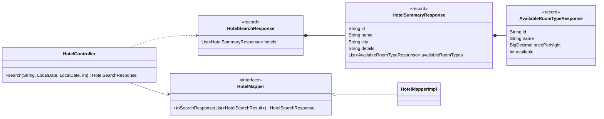
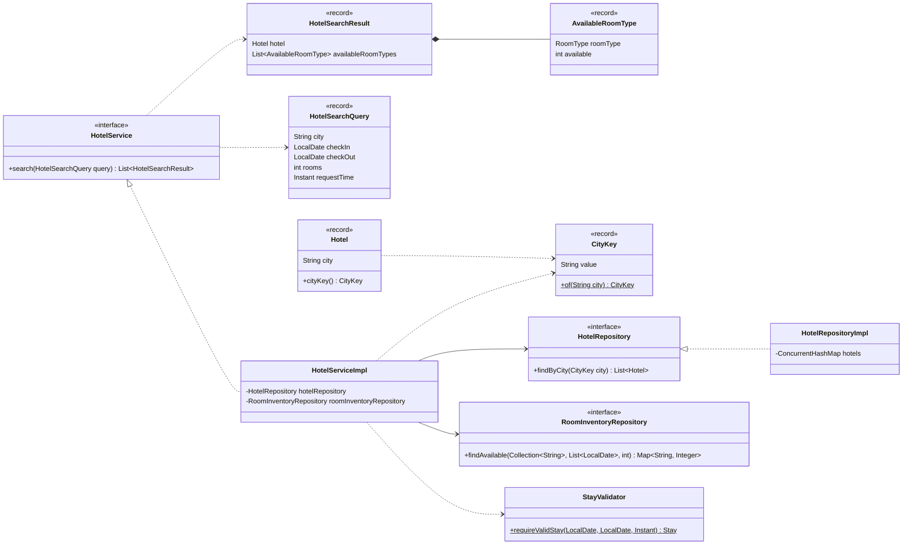
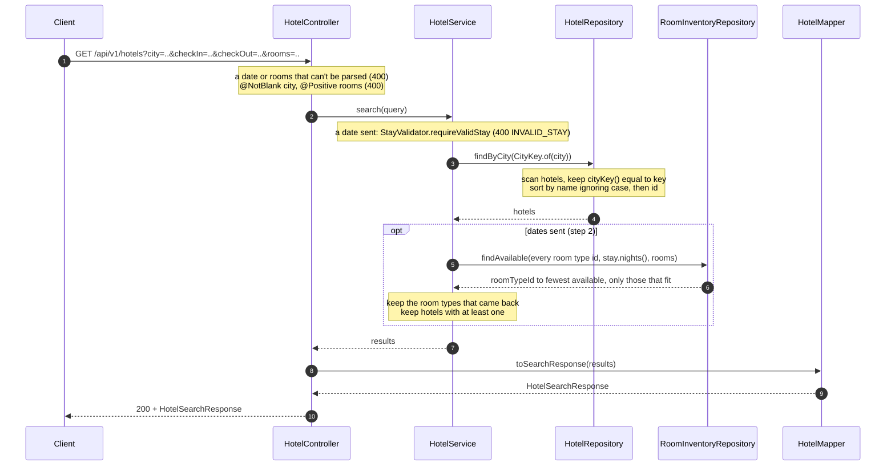

# Search Hotels

`GET /api/v1/hotels?city=Mumbai`: anyone lists the hotels in a city. Optional dates narrow the list to hotels that have rooms free for a stay.

Shared conventions, packages and errors: [Overview.md](Overview.md). Inventory and stay rules: [CreateReservation.md](CreateReservation.md).

Built in two steps:
- **Step 1, with the hotel APIs:** search by city.
- **Step 2, after Create Reservation:** optional `checkIn`, `checkOut` and `rooms`, plus `availableRoomTypes` in each result. It reads the inventory that reservations fill. Parts that belong to step 2 are marked *(step 2)*.

Rules:
- City is the only search field, and it is required.
- The city match is exact after trimming and ignoring case: `mumbai ` matches `Mumbai`, but `Mum` does not.
- Public and read-only: no `X-Admin-Id`, no `Idempotency-Key`.
- *(step 2)* `checkIn` and `checkOut` are optional but sent together. `rooms` defaults to 1. Without dates, the response is exactly the step 1 response.
- *(step 2)* A room type fits when every night of the stay has `availableRooms ≥ rooms`. A room type short on any night, or missing a row for one, is dropped, so the worst night decides.
- *(step 2)* A hotel is listed if at least one of its room types fits. One room type has to cover the whole request: 1 Deluxe plus 1 Suite doesn't count as 2 rooms.

## Contract

```http
GET /api/v1/hotels?city=mumbai
```

`200 OK`

```json
{
  "hotels": [
    { "id": "<uuid>", "name": "Harbour Inn", "city": "Mumbai", "details": "" },
    { "id": "<uuid>", "name": "Taj", "city": "Mumbai", "details": "Sea-facing heritage hotel with a pool" }
  ]
}
```

*(step 2)* With dates:

```http
GET /api/v1/hotels?city=mumbai&checkIn=2026-11-10&checkOut=2026-11-13&rooms=2
```

```json
{
  "hotels": [
    {
      "id": "<uuid>",
      "name": "Taj",
      "city": "Mumbai",
      "details": "Sea-facing heritage hotel with a pool",
      "availableRoomTypes": [
        { "id": "<uuid>", "name": "Sea View Deluxe", "pricePerNight": 4500.00, "available": 6 }
      ]
    }
  ]
}
```

- No match returns `200` with `"hotels": []`, not 404.
- Each item is a summary. The full room types come from `GET /api/v1/hotels/{id}`.
- *(step 2)* `availableRoomTypes` lists only the room types that fit, in the hotel's room type order. `available` is the number of rooms free on the worst night.
- *(step 2)* Without dates, `availableRoomTypes` is left out (`@JsonInclude(NON_NULL)`), every hotel in the city is listed, and `rooms` is ignored, though it's still validated.
- The list sits inside an object so that pagination (e.g. `nextCursor`) can be added later without breaking clients.

## Input rules

| Input | Rule | Checked by |
|---|---|---|
| `city` | required, not blank | `@RequestParam(required = false) @NotBlank` |
| `checkIn`, `checkOut` *(step 2)* | optional, as `yyyy-MM-dd` | `@RequestParam(required = false) @DateTimeFormat(iso = ISO.DATE) LocalDate` |
| `checkIn` and `checkOut` together *(step 2)* | both or neither, then the [stay rules](CreateReservation.md#stay-rules) | `StayValidator.requireValidStay` (400 `INVALID_STAY`) |
| `rooms` *(step 2)* | ≥ 1, default 1 | `@RequestParam(defaultValue = "1") @Positive int` |

- `required = false` lets a missing city reach `@NotBlank`, so a missing city and a blank one fail the same way. Spring's built-in method validation runs the check. Don't put `@Validated` on the controller: it switches to a different exception.
- *(step 2)* `@DateTimeFormat(iso = ISO.DATE)` is written out explicitly, so parsing doesn't depend on locale defaults. An empty value such as `checkIn=` counts as not sent.

## Errors

| Status | `code` | When | Raised as |
|---|---|---|---|
| 400 | `VALIDATION_FAILED` | `city` missing or blank; *(step 2)* `rooms` below 1 | `HandlerMethodValidationException` (Spring) |
| 400 | `VALIDATION_FAILED` | *(step 2)* `checkIn`, `checkOut` or `rooms` can't be parsed | `MethodArgumentTypeMismatchException` (Spring) |
| 400 | `INVALID_STAY` | *(step 2)* only one date sent, or a stay rule fails | `InvalidStayException` (`StayValidator`) |

Without a handler, Spring answers a type mismatch with 400 and its own body, which has no `code`. So `GlobalExceptionHandler` maps `MethodArgumentTypeMismatchException` to `VALIDATION_FAILED`, with a message that names the parameter.

## Search rules

- **Normalising:** `CityKey.of(city)` trims and lowercases with `Locale.ROOT`. It is the only place a city is normalised. `Hotel.cityKey()` uses it for stored hotels, and `HotelService.search` uses it for the query.
- **Order:** by `name` ignoring case, then by `id`, so results never shuffle between calls. This is part of the `findByCity` contract, so a database implementation does it with `ORDER BY`. Filtering by availability keeps this order.
- **Lookup:** `HotelRepositoryImpl` scans `hotels.values()` and keeps the hotels whose `cityKey()` equals the query key. It reads the current hotels, so a city change by Update Hotel shows up without an index to keep in sync.
- The scan stays inside `HotelRepositoryImpl`. A database implementation uses an indexed `city_key` column instead, and callers don't change.

### Availability

*(step 2)* `HotelServiceImpl.search(query)`:

1. If either date is sent, `StayValidator.requireValidStay(checkIn, checkOut, requestTime)` runs first.
2. `findByCity(CityKey.of(city))` runs.
3. Without dates, each hotel becomes a `HotelSearchResult` with `availableRoomTypes = null`.
4. With dates, one `findAvailable(roomTypeIds, stay.nights(), rooms)` call covers every room type of every hotel found. It returns only the room types that fit, each with its fewest `availableRooms` over the stay.
5. Each hotel keeps the room types that came back, in its own order. Hotels left with none are dropped.

The cost is one repository call doing hotels × room types × nights map lookups. With a database it's a single GROUP BY query (see [CreateReservation.md](CreateReservation.md#inventory)).

## Packages

New classes only. Package rules from CreateHotel.md still apply.

| Package | Classes |
|---|---|
| `api.dto` | `HotelSearchResponse`, `HotelSummaryResponse`; *(step 2)* `AvailableRoomTypeResponse` |
| `service` | *(step 2)* `HotelSearchQuery`, `HotelSearchResult`, `AvailableRoomType` |
| `domain` | `CityKey` |

*(step 2)* `Stay`, `StayValidator`, `RoomInventoryRepository` and `InvalidStayException` come from Create Reservation.

## Classes

These diagrams show the step 2 shape. Step 1 had `search(String city)` on the controller, `search(String city) List<Hotel>` on the service and `toSearchResponse(List<Hotel>)` on the mapper. Only the members this API adds or uses are shown. `Hotel` keeps all its fields from CreateHotel.md.

### API side



- `search` takes `city, checkIn, checkOut, rooms`, plus `requestTime` from the request attribute. It builds `HotelSearchQuery` itself, because there's no request DTO to map.
- `HotelSummaryResponse.availableRoomTypes` carries `@JsonInclude(JsonInclude.Include.NON_NULL)`. The mapper passes `null` on as `null`.

### Service, domain, repository



`HotelSearchResult.availableRoomTypes` is `null` when no dates were sent.

## Flow



In step 1, the controller sends only `city`, and the service returns the hotels as they are.

## Tests

Shared test rules: [Overview.md](Overview.md#tests).

**Functional: `SearchHotelsFunctionalTest`**

| Test | Parameterized cases | Expect |
|---|---|---|
| `findsHotelsInCity` | | two hotels in a test-only city and one elsewhere; querying the city in a different case with spaces returns exactly the two, as summaries. *(step 2)* `availableRoomTypes` is absent, and the `summary(...)` helper passes `null` for it |
| `returnsEmptyListForUnknownCity` | | 200 with `"hotels": []` |
| `rejectsMissingOrBlankCity` | no `city`, `city=`, `city=%20%20` | 400 `VALIDATION_FAILED` |
| `listsRoomTypesThatFit` *(step 2)* | `rooms` 1, `rooms` 2 | see the setup below. `rooms` 1: only A, with only Deluxe (`available` 1, its `pricePerNight`); `rooms` 2: `"hotels": []` |
| `rejectsInvalidAvailabilityQuery` *(step 2)* | only `checkIn`; `checkIn=2026-13-01`; `rooms=0` | 400 `INVALID_STAY`, `VALIDATION_FAILED`, `VALIDATION_FAILED` |

Setup for `listsRoomTypesThatFit`:
- A test-only city with hotel A, which has Deluxe (2 rooms) and Suite (1 room), and hotel B, which has Single (1 room).
- Reservations: A Suite ×1 for Nov 10–13, A Deluxe ×1 for Nov 12 only, and B Single ×1 for Nov 11 only.
- The search is for Nov 10–13. The Deluxe and Single bookings cover one night each, so the worst night decides.

**Unit**

| Class | Test | Parameterized cases | Expect |
|---|---|---|---|
| `CityKeyTest` | `normalises` | `"Mumbai"`, `" mumbai "`, `"MUMBAI"` | all equal `mumbai` |
| `HotelRepositoryImplTest` | `findByCityFiltersAndSorts` | | only matching hotels, sorted by name ignoring case, then id |

*(step 2)* No new unit tests. Stay rules are tested in `StayValidatorTest` and `findAvailable` in `RoomInventoryRepositoryImplTest` ([CreateReservation.md](CreateReservation.md#tests)). Filtering is `HotelServiceImpl` orchestration, so it's covered by the functional tests alone.

## Notes

- No `RequestContext`, because the call is public and has no idempotency key. *(step 2)* The controller reads `requestTime` from the request attribute, because the stay rules need today's date.
- *(step 2)* `search(HotelSearchQuery)` replaces `search(String city)`, so there's one search path.
- Later: pagination (`limit` plus `nextCursor` in `HotelSearchResponse`) and sorting by price.

## Adds to shared classes

Step 1:
- `domain`: new record `CityKey(String value)` with `static CityKey of(String city)`, which trims and lowercases with `Locale.ROOT`.
- `Hotel`: new method `cityKey()`. It is derived from `city`, not stored as a field.
- `HotelRepository`: new `findByCity(CityKey city) List<Hotel>`, sorted by name ignoring case, then id. `HotelRepositoryImpl` implements it with a scan.
- `HotelService`: new `search(String city) List<Hotel>`.
- `HotelController`: new `search(String city) HotelSearchResponse` on `GET /api/v1/hotels`, with `city` declared `@RequestParam(required = false) @NotBlank`.
- `HotelMapper` / `HotelMapperImpl`: new `toSearchResponse(List<Hotel> hotels) HotelSearchResponse`.
- `api.dto`: new records `HotelSearchResponse` and `HotelSummaryResponse`.
- `GlobalExceptionHandler`: also maps `HandlerMethodValidationException` to 400 `VALIDATION_FAILED`.

Step 2, after Create Reservation:
- `HotelController.search`: also takes `requestTime`, `checkIn`, `checkOut` and `rooms`.
- `HotelService.search(HotelSearchQuery) List<HotelSearchResult>` replaces `search(String city)`.
- `HotelServiceImpl`: gets `RoomInventoryRepository` as a new dependency, for `findAvailable`.
- `HotelMapper.toSearchResponse(List<HotelSearchResult>)` replaces the `List<Hotel>` version.
- `HotelSummaryResponse`: gains `availableRoomTypes`. New `AvailableRoomTypeResponse`.
- `service`: new records `HotelSearchQuery`, `HotelSearchResult` and `AvailableRoomType`.
- `GlobalExceptionHandler`: maps `MethodArgumentTypeMismatchException` to 400 `VALIDATION_FAILED`.
