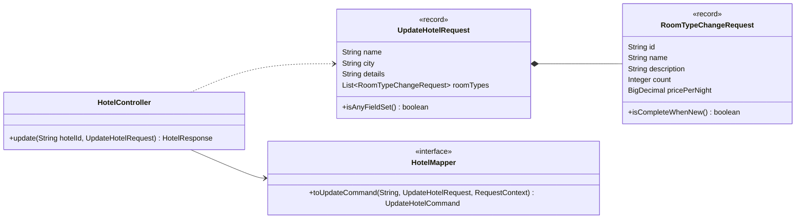
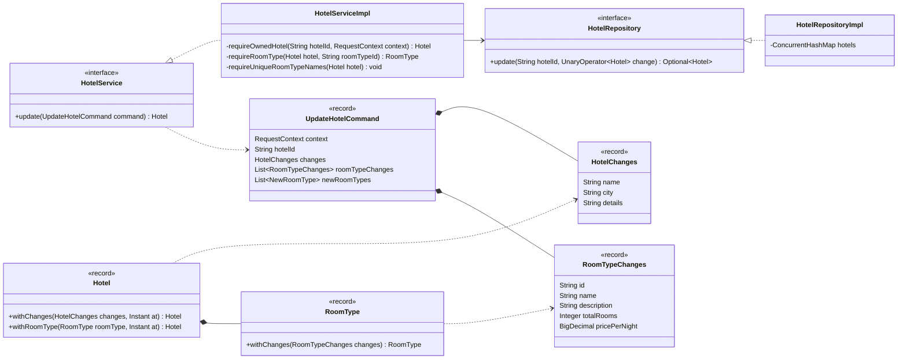
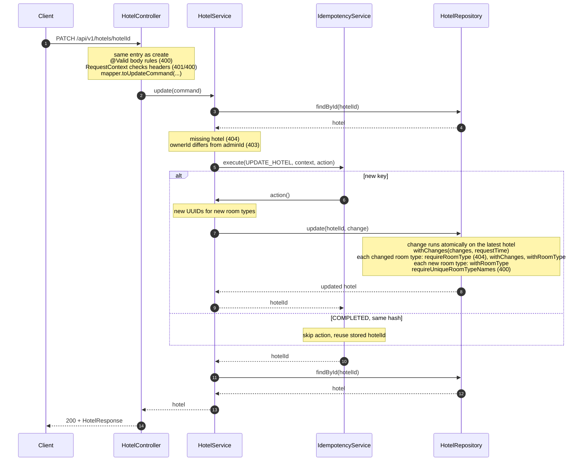

# Update Hotel

`PATCH /api/v1/hotels/{hotelId}`: in one call, the owner changes a hotel's details and adds or changes its room types.

Shared conventions, packages and errors: [Overview.md](Overview.md).

- Only the owner can update: `X-Admin-Id` must equal `Hotel.ownerId`.
- Send only what changes. A field that is absent or `null` stays as it is.
- A `roomTypes` entry with an `id` changes that room type. An entry without an `id` adds a new one. Room types left out of the list stay as they are.
- Idempotent with `Idempotency-Key` and `OperationType.UPDATE_HOTEL`, as in [CreateHotel.md](CreateHotel.md#idempotency).
- Sets `updatedAt = context.requestTime()`. `createdAt` never changes.

## Contract

```http
PATCH /api/v1/hotels/{hotelId}
X-Admin-Id: admin-1
Idempotency-Key: 8d2e4b17-0c6a-4f3e-b951-7a4c2e9d1f03
Content-Type: application/json

{
  "city": "Pune",
  "details": "",
  "roomTypes": [
    { "id": "<existing room type id>", "count": 8, "pricePerNight": 3500.00 },
    { "name": "Garden Twin", "description": "Two single beds, garden view", "count": 6, "pricePerNight": 3200.00 }
  ]
}
```

`200 OK` with the whole `HotelResponse`, the same shape create returns. A new room type's id appears in the response.

## Input rules

| Input | Rule | Checked by |
|---|---|---|
| headers | as in create | as in create |
| body | at least one of `name`, `city`, `details`, `roomTypes` | `@AssertTrue isAnyFieldSet()` on `UpdateHotelRequest` |
| `name`, `city` | if sent: not blank | `@Pattern(regexp = "(?s).*\\S.*")`, which lets `null` through |
| `details` | if sent: any text; `""` clears it | none |
| `roomTypes[].id` | if sent: a room type of this hotel | `HotelServiceImpl.requireRoomType` (404) |
| `roomTypes` | if sent: at least one entry | `@Size(min = 1)` |
| `roomTypes[]` without `id` | `name`, `description`, `count` and `pricePerNight` all required | `@AssertTrue isCompleteWhenNew()` on `RoomTypeChangeRequest` |
| `roomTypes[]` with `id` | at least one of `name`, `description`, `count`, `pricePerNight` | `@AssertTrue isAnyFieldSetWhenChanging()` on `RoomTypeChangeRequest` |
| `roomTypes[].name`, `roomTypes[].description` | if sent: not blank | `@Pattern` as above |
| `roomTypes[].count` | if sent: ≥ 0 | `@PositiveOrZero` |
| `roomTypes[].pricePerNight` | if sent: > 0 | `@Positive` |
| room type names | unique within the hotel after the change, ignoring case and surrounding spaces | `HotelServiceImpl.requireUniqueRoomTypeNames` |

As in create, the mapper trims every text field it passes on.

Once Create Reservation is built, a `count` below the rooms already booked gives 409 `ROOM_COUNT_BELOW_RESERVED`. See [CreateReservation.md](CreateReservation.md#changes-to-update-hotel).

## Errors

Same `ErrorResponse` and `GlobalExceptionHandler` as create. Header and body errors come first, in the [error order for writes](Overview.md#conventions). The rest are checked in table order:

| Status | `code` | When | Raised as |
|---|---|---|---|
| 401, 400 | `UNAUTHORIZED`, `IDEMPOTENCY_KEY_INVALID`, `MALFORMED_REQUEST`, `VALIDATION_FAILED` | as create, plus the rules above | as create |
| 404 | `HOTEL_NOT_FOUND` | no hotel with `hotelId` | `HotelNotFoundException` (`HotelService`) |
| 403 | `NOT_HOTEL_OWNER` | `X-Admin-Id` is not the hotel's owner | `NotHotelOwnerException` (`HotelService`) |
| 409, 422 | `IDEMPOTENCY_IN_PROGRESS`, `IDEMPOTENCY_KEY_REUSED` | as create | `IdempotencyService` |
| 409 | `ROOM_COUNT_BELOW_RESERVED` | a sent `count` is below the rooms booked on a date from today on ([CreateReservation.md](CreateReservation.md#changes-to-update-hotel)) | `RoomCountBelowReservedException` (`RoomInventoryService`) |
| 404 | `ROOM_TYPE_NOT_FOUND` | a `roomTypes[].id` isn't in this hotel | `RoomTypeNotFoundException` (`HotelService`) |
| 400 | `DUPLICATE_ROOM_TYPE` | after the change, two room types share a name | `DuplicateRoomTypeException` (`HotelService`) |

- 404 comes before 403. Hotels are public through GET, so confirming one exists reveals nothing.
- The owner check runs before the idempotency claim, so a non-owner never claims a key. This is safe because `ownerId` never changes.

## Idempotency

- Same rules as create, with `OperationType.UPDATE_HOTEL`. The stored `resourceId` is the hotel id.
- `requestHash` covers the path, so the same key and body sent for a different hotel gives 422.
- A replay returns the hotel as it is now.

## Concurrency

`HotelRepository.update(hotelId, change)` applies `change` to the latest stored hotel atomically: `computeIfPresent` in `HotelRepositoryImpl`, or a transaction with `SELECT ... FOR UPDATE` in a database. The room type and duplicate-name checks run inside `change` against the latest state. Concurrent updates therefore never lose writes, and there's no version check or retry loop.

Rules for `change`:
- It depends only on the hotel it receives. New room type ids are generated before the call.
- It is short, because it runs while the hotel is locked.
- To abort, it throws. A throw leaves the stored hotel unchanged.

City search scans the current hotels (see [SearchHotels.md](SearchHotels.md)), so a city change needs nothing extra.

## Packages

Package dependencies are the same as in create. New classes:

| Package | Classes |
|---|---|
| `api.dto` | `UpdateHotelRequest`, `RoomTypeChangeRequest` |
| `service` | `UpdateHotelCommand` |
| `domain` | `HotelChanges`, `RoomTypeChanges` |
| `error` | `NotHotelOwnerException`, `RoomTypeNotFoundException` (`HotelNotFoundException` comes from Get) |

## Classes

### API side



- The controller method also takes `requestTime`, `adminId`, `idempotencyKey` and `HttpServletRequest`, and builds a `RequestContext` as `create` does.
- `toUpdateCommand`'s `String` is the `hotelId`. It splits `roomTypes`: entries with an `id` become `RoomTypeChanges`, the rest become `NewRoomType`. It renames `count` to `totalRooms` and keeps `null` as "not sent".

### Service, domain, repository



- `NewRoomType` and `requireUniqueRoomTypeNames` come from create.
- `HotelChanges` and `RoomTypeChanges` use `null` to mean "keep the current value".
- `withChanges` and `withRoomType` return a new `Hotel` with `updatedAt = at`.
- `withRoomType` replaces the room type with the same id, or appends it if the id is new.
- Domain methods throw nothing. Checks that can fail live in `HotelServiceImpl`, which runs them inside `change`.

## Flow



## Tests

Shared test rules: [Overview.md](Overview.md#tests). Header rules aren't tested again here; Create's tests cover that shared code.

**Functional: `UpdateHotelFunctionalTest`**

| Test | Parameterized cases | Expect |
|---|---|---|
| `updatesHotelFields` | | 200; sent fields changed, others unchanged |
| `addsAndChangesRoomTypes` | | 200; the listed room type changed, the new one has an id, the rest unchanged |
| `rejectsNonOwner` | | 403 `NOT_HOTEL_OWNER` |
| `rejectsUnknownHotel` | | 404 `HOTEL_NOT_FOUND` |
| `rejectsUnknownRoomType` | | 404 `ROOM_TYPE_NOT_FOUND` |
| `rejectsInvalidBody` | empty body, empty `roomTypes`, a change with only an `id`, blank `name`, new room type without `pricePerNight`, `count` -1, `pricePerNight` 0 | 400 `VALIDATION_FAILED` |
| `rejectsDuplicateRoomTypeName` | add a name that exists in another case, rename to an existing name | 400 `DUPLICATE_ROOM_TYPE` |
| `replaysSameKey` | | same key twice when adding a room type: same response, and the hotel gains only one room type |
| `rejectsSameKeyForAnotherHotel` | | 422 `IDEMPOTENCY_KEY_REUSED` |

**Unit**

| Class | Test | Parameterized cases | Expect |
|---|---|---|---|
| `HotelTest` | `withChangesKeepsNullFields` | each of `name`, `city`, `details` set alone | only that field changes; `updatedAt` is the given time; `createdAt` unchanged |
| | `withRoomTypeReplacesOrAppends` | existing id, new id | replaced in place, or appended |
| | `findsRoomTypeById` | existing id, unknown id | the room type, or empty |
| `RoomTypeTest` | `withChangesKeepsNullFields` | each of `name`, `description`, `totalRooms`, `pricePerNight` set alone | only that field changes |
| `HotelMapperImplTest` | `toUpdateCommandSplitsRoomTypes` | | entries with an `id` become `RoomTypeChanges` and the rest `NewRoomType`; absent fields stay `null`; sent text is trimmed |
| `HotelRepositoryImplTest` | `parallelUpdatesAreAllKept` | | 20 threads each add a room type to one hotel: all 20 are there |

## Later

- Deleting hotels or room types. This has to account for existing reservations.

## Adds to shared classes

- `HotelController`: `update`.
- `HotelService`: `update`. `HotelServiceImpl` also gets `requireOwnedHotel` and `requireRoomType`.
- `HotelMapper`: `toUpdateCommand`.
- `HotelRepository`: `update(String hotelId, UnaryOperator<Hotel> change) Optional<Hotel>`; empty if the hotel does not exist.
- `Hotel`: `withChanges(HotelChanges, Instant)`, `withRoomType(RoomType, Instant)` and `findRoomType(String) Optional<RoomType>`, which `requireRoomType` uses. `RoomType`: `withChanges(RoomTypeChanges)`.
- `OperationType`: `UPDATE_HOTEL`.
- `GlobalExceptionHandler`: map `NOT_HOTEL_OWNER` (403) and `ROOM_TYPE_NOT_FOUND` (404). `HOTEL_NOT_FOUND` comes from Get.
