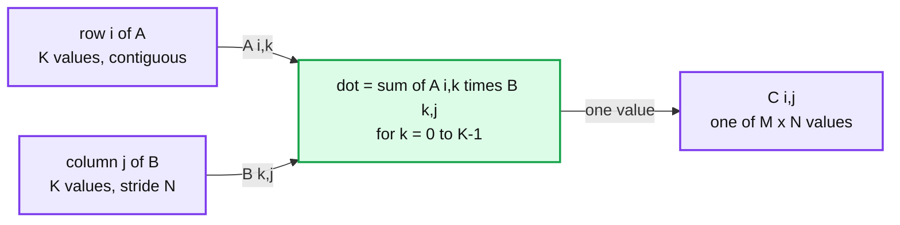
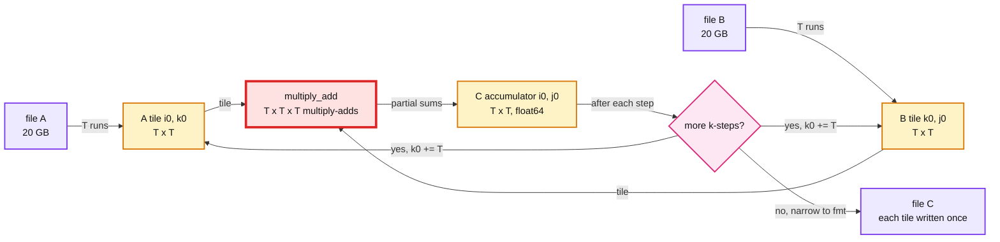

# Binary Matrix Multiply

> One-line answer: `C[i][j] = sum over k of A[i][k] * B[k][j]`, a hand-written triple loop over typed zero-copy views of the file bytes. For files bigger than RAM, use a blocked multiply: for each output tile, stream matching tiles of A and B, accumulate, and write the C tile exactly once.

```bash
cd lld-practise
python3 -m unittest matrix_multiply.tests.test_multiply -v       # stdlib only
```

```python
from matrix_multiply import multiply, multiply_tiled

multiply("a.bin", "b.bin", "c.bin")                                    # simple: all in RAM
multiply("a.bin", "b.bin", "c.bin", fmt="i")                           # int32 elements
multiply_tiled("a.bin", "b.bin", "c.bin", memory_budget=256 * 2**20)   # out of core
```

Same file format as the [transpose problem](../matrix_transpose/), shared via [`binary_matrix`](../binary_matrix/).

## 1. Clarifying questions (ask before coding)

- **Element type?** The header only has `elem_size`, no type. 4 bytes is not enough to tell float32 from int32. Default: 4 -> float32, 8 -> float64. Anything else needs `fmt` (`"i"`, `"q"`, `"h"`, ...).
- **Output type?** Same as the inputs. Partial sums are kept in float64 or int64, then narrowed once at the end.
- **Integer overflow?** Raise `OverflowError` rather than silently wrap. A test checks that `2**20 * 2**20` into int32 raises.
- **Incompatible shapes?** `A.cols != B.rows` raises `ValueError` before any output is written.
- **Dense or sparse?** Assumed dense. Mostly-zero matrices want CSR (compressed sparse row) and a different algorithm.

## 2. Simple version



- `memoryview(raw).cast("d")` turns file bytes into indexable numbers **without copying**. RAM is A + B + C, nothing more.
- The kernel `_multiply_add(a, b, c, rows, inner, cols)` does `c += a x b`. The simple version calls it once on whole matrices. The tiled version calls it once per tile triple. One piece of math, two drivers.
- Cost: M x K x N multiply-adds. Measured **19.5M multiply-adds/s** in pure Python (200 x 200 x 200 in 0.41 s).

## 3. Follow-up: two 20 GB matrices, 256 MiB of RAM

Two 50,000 x 50,000 float64 matrices (20 GB each).



**Tile size.** RAM holds an A tile, a B tile and a float64 accumulator: `T*T*(2s + 8) <= budget`. For float64 that is 24 bytes per element, so 256 MiB gives **T = 3,344**. Tracemalloc peak in the test: 27.7 KB on a 24 KiB budget.

**I/O math.** Each C tile reads a full row band of A and a full column band of B. So A is read `ceil(N/T)` times and B `ceil(M/T)` times.

| Budget | T | Tiles per side | Bytes read | At 2 GB/s |
|---|---|---|---|---|
| 256 MiB | 3,344 | 15 | 2 x 15 x 20 GB = 600 GB | ~5 min |
| 4 GiB | 13,377 | 4 | 2 x 4 x 20 GB = 160 GB | ~80 s |

Reads shrink as 1/T, so **give the tiles all the RAM you have**. This matches the Hong-Kung lower bound: any schedule needs on the order of n^3 / sqrt(RAM) I/O, and square tiles achieve it. A square tile does T^3 work per 2T^2 elements loaded, which is the best ratio any block shape gets.

**Compute math, the real red node.** 50,000^3 = 1.25 x 10^14 multiply-adds.

| Kernel | Rate | Time |
|---|---|---|
| This pure-Python loop (measured) | 19.5M/s | **~74 days** |
| One AVX2 core with BLAS (estimate, ~48 GFLOP/s) | ~24G/s | ~1.5 hours |
| 16 such cores | ~380G/s | ~5.5 min, the same as the I/O |

So in Python the kernel is 5 orders of magnitude slower than the disk. With a real kernel the two are about equal. The staff move then is **double buffering**: read tile k+1 on a background thread while computing on tile k, so I/O hides behind compute.

## 4. Why not the obvious out-of-core ideas

| Approach | Total I/O for 50k x 50k float64 | Verdict |
|---|---|---|
| Per C value, read row i of A and column j of B from disk | M x N x K random 8-byte reads = 1.25 x 10^14 seeks, ~40 years at 100k IOPS | No. The column read is the killer. |
| Pre-transpose B (the [transpose package](../matrix_transpose/)), then read two contiguous rows per C value | 50,000^3 x 8 B = 1 PB sequential, ~6 days | Better pattern, still no reuse. |
| Row bands: keep h rows of A and C, stream all of B per band | h = 335 rows, B read 150 times = 3 TB | Reuses A but not B. |
| **Square tiles (built)** | **600 GB** | Reuses both A and B. |

## 5. Scaling past one machine

- C tiles are independent. Each worker owns a set of (i0, j0) tiles and writes a disjoint region of C. With `os.pwrite` there is no shared seek pointer and no lock.
- Spark's `BlockMatrix.multiply` and the SUMMA algorithm (Scalable Universal Matrix Multiplication Algorithm) are this same blocking spread over a cluster. The cost moves from disk reads to network shuffle of A and B blocks.
- Strassen-style algorithms cut multiplies to O(n^2.81), but need more memory and lose numeric stability. Not worth it here.

## 6. Failure modes and operability

- **Crash mid-run:** each C tile is written once and never read back, so the job resumes from a log of finished (i0, j0) pairs. Write to `c.tmp` and `os.replace` at the end so no reader sees a half-built C.
- **Float results differ in the last bit between `multiply` and `multiply_tiled`:** the tiled version adds partial sums per k-step, a different addition order. Tests use integer-valued floats so both must match exactly. Real data needs a tolerance.
- **Big-endian host:** `memoryview.cast` reads native byte order. `_plan` refuses to run there instead of silently returning garbage.
- **Disk space:** C is M x N x s bytes. Check before starting.

## 7. Trade-offs

| Decision | Chose | Gave up |
|---|---|---|
| Typed view of bytes | `memoryview.cast`, zero copy | Native byte order only, guarded |
| Accumulator | float64 / int64, narrow once at the end | 8 bytes per element of RAM, even for float32 |
| Tile shape | Square, sized from the budget | Not tuned for disk run length (each run is T x s = 27 KB at T = 3,344) |
| Loop order in kernel | i, j, k: literal row-by-column dot product, as asked | i, k, j would stream B rows (cache friendly in C), but reads less like the spec |
| Element types | float32 and float64 by default, ints via `fmt` | No type field in the header, so the caller must know |
