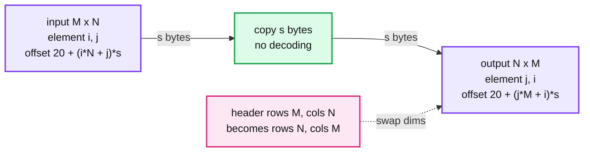
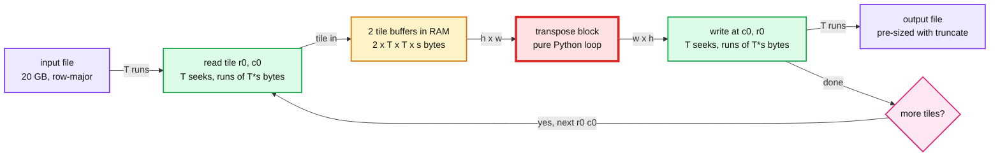

# Binary Matrix Transpose

> One-line answer: treat each element as opaque bytes, move element (i, j) from offset `(i*cols + j)*s` to `(j*rows + i)*s`. For files bigger than RAM, do it one square tile at a time and write each tile straight to its final offset.

```bash
cd lld-practise
python3 -m unittest matrix_transpose.tests.test_transpose -v     # stdlib only
```

```python
from matrix_transpose import transpose, transpose_tiled

transpose("m.bin")                                       # simple: whole file in RAM
transpose_tiled("big.bin", memory_budget=256 * 2**20)    # out of core: 256 MiB of RAM
```

The file format lives in the shared [`binary_matrix`](../binary_matrix/) package, because the [multiply problem](../matrix_multiply/) uses the same files.

## 1. Clarifying questions (ask before coding)

- **Header layout?** Assumed: 8-byte signature `MATRIX01`, then `rows`, `cols`, `elem_size` as little-endian uint32. 8 + 4 + 4 + 4 = 20 bytes.
- **Element type?** Does not matter. A transpose only moves bytes, so `elem_size` is all we need.
- **Row-major?** Assumed yes: element (i, j) is at `20 + (i*cols + j) * elem_size`.
- **Output name?** `m.bin` -> `m.transposed.bin` unless one is passed.
- **Malformed input?** Raise `ValueError` for a bad signature, `elem_size` of 0, or a data length that does not match the header.

## 2. The offset math (the whole problem)



- **Simple version** (`transpose`): read everything, double loop over (i, j), write header plus data. RAM needed is about 2x the data: measured 2.2 MB peak for 1 MiB of data.
- `_transpose_block` is the only transpose logic. The tiled version reuses it per tile.

## 3. Follow-up: a 20 GB matrix with 256 MiB of RAM

**Why the obvious streaming idea fails.** Reading the input row by row is sequential, but then every element goes to a different output row. That is one random 4-byte write per element: 5.4 billion writes. At ~100k random IOPS (I/O operations per second) on an NVMe SSD (solid state drive), that is ~15 hours. On a spinning disk it is months.

**Tiles fix both sides.** Cut the matrix into T x T squares. A tile is T contiguous runs on read and T contiguous runs on write.



**Back of the envelope** (73,000 x 73,000 float32 is about 20 GB, 256 MiB budget):

| Quantity | Math | Value |
|---|---|---|
| Tile side T | `isqrt(256 MiB / (2 * 4))` | 5,792 |
| Run length | 5,792 x 4 B | ~23 KB per seek |
| Tiles | `ceil(73,000 / 5,792)` = 13, squared | 169 |
| Seeks | 2 x 73,000 x 13 | ~1.9M, each ~23 KB |
| Bytes moved | 20 GB read + 20 GB write | 40 GB, ~20 s at 2 GB/s |
| Python kernel | 5.3B elements at 7.9M/s (measured) | **~11 minutes** |

So the red node is the **in-memory kernel, not the disk**. Fixes, in order:

1. Copy a whole column per output row with a strided `memoryview` slice, so the inner loop runs in C: `dst[j*h:(j+1)*h] = src[j::w]` where both are `memoryview(...).cast("I")`. Measured 175M elements/s for 4-byte elements (22x the loop), so ~30 s for 20 GB, the same as the disk time. Works when `elem_size` is 1, 2, 4 or 8 (`B`, `H`, `I`, `Q`).
2. In production, use a compiled kernel (numpy fancy indexing, C, Rust) on each tile. The interview bans `numpy.transpose`, not real tools at work.
3. Tiles are independent and write to disjoint regions. Run them in N processes with `os.pread` / `os.pwrite`, which take an offset and share no seek pointer. No locks needed.

## 4. Things that bit while building it

- **Buffered files are wrong for random access.** Python 3.14's default file buffer is 128 KiB. A seek plus a 4 KiB read pulled 128 KiB off disk (measured: 32x read amplification) and blew the memory test. Tile I/O opens files with `buffering=0`.
- **Loop variables keep the previous tile alive.** Peak was 1.5x the budget until `del block, flipped` at the end of each iteration. The `test_peak_memory_stays_within_budget` test guards both bugs with `tracemalloc`.

## 5. Failure modes and operability

- **Crash halfway:** the output is a half-written file that looks valid (pre-sized, correct header). Write to `out.tmp`, `fsync`, then `os.replace` to the final name, so readers never see a partial file.
- **Resume after crash:** log finished tile indexes. Tiles are idempotent, so rerunning one is safe.
- **Disk space:** check for 20 GB free before starting. `truncate` makes a sparse file and fails late. `posix_fallocate` fails early and avoids fragmentation.
- **Wrong header:** validated up front against the real file size, before writing anything.

## 6. Trade-offs

| Option | Memory | I/O pattern | Choice |
|---|---|---|---|
| Load everything | 2x file size | 2 sequential passes | Built as `transpose`. Correct, simplest, dies at 20 GB. |
| Stream rows, scatter writes | O(1) | 1 random write per element | Rejected. ~15 hours on SSD. |
| Square tiles | 2 x T x T x s | Runs of T*s bytes on both sides | Built as `transpose_tiled`. Balances read and write run length. |
| Row bands (K full rows) | 2 x K x N x s | One big read, but writes of only K*s bytes | Rejected. With N = 73,000 and 256 MiB, K = 459, so writes are 1.8 KB runs. |
| mmap the whole file | OS decides | Same random pattern unless you tile anyway | Fine on top of tiling. Alone it just moves the thrashing into the page cache. |
| Cache-oblivious recursion | Same as tiles | Same as tiles, no T to tune | Mention only. Halve the longer side until a block fits. |
