# 45-Minute Plan: typing the interview version

> One line: clarify for 3 minutes, type inside-out (domain, repository, service, web), run it by minute 32,
> test until 41, keep 4 minutes of buffer.

Target: [`interview-version/`](interview-version/). It is 202 lines of main code, not counting imports
(let the IDE add them with Alt+Enter or Cmd+Shift+O), `package` lines and blanks. Two test classes add about 80 more.

```mermaid
%% Time budget per phase. The red phase is where people overrun
gantt
    dateFormat mm
    axisFormat %M
    section Talk
    Clarify requirements          :a1, 00, 3m
    section Type
    Skeleton + domain + exceptions :a2, after a1, 6m
    Repositories (concurrency)     :crit, a3, after a2, 6m
    Service                        :a4, after a3, 7m
    DTOs + controller              :a5, after a4, 6m
    Exception handler              :a6, after a5, 4m
    section Prove
    Run + curl                     :a7, after a6, 2m
    Tests                          :a8, after a7, 7m
    Buffer + walkthrough           :a9, after a8, 4m
```



Repositories are marked critical because they hold the concurrency answer. Get them right before moving on.

---

## Clarify first (minutes 0 to 3)

Ask out loud. If they say "your call", state the default and move on.

1. **Auth:** "How do I know who the caller is? I'll take an `X-User-Id` header as a stand-in for JWT." (Default: header, 401 if missing.)
2. **Title and body rules:** "Any length limits?" (Default: title 15 to 150, body non-blank, max 30k.)
3. **Votes:** "Can a vote be undone? Downvotes? Can the author vote?" (Default: no undo, upvote only, author can't.)
4. **Duplicate vote response:** "Should a second vote be an error or a no-op?" (Default: 409.)
5. **List:** "Sort order? Paginated?" (Default: newest first, cursor, limit 20, max 100.)
6. **Setup:** "Is there a skeleton project, or do I start from Spring Initializr? IDE and docs allowed?"

Then say: *"I'll build three layers: controller, service, in-memory repositories. All rules go in the service. I'll make the vote store thread-safe, because two requests can vote at once."*

---

## Minute-by-minute

| Min | Type this | Say this while typing |
|---|---|---|
| 3 to 4 | Project: web + validation starters. Packages `domain`, `repository`, `service`, `exception`, `web` | "Packages mirror the layers so the dependency direction is obvious." |
| 4 to 6 | `Question` record, `QuestionView`, `QuestionPage` | "Records are immutable, so I can share them across threads with no locking." |
| 6 to 9 | 4 exceptions: `QuestionNotFound`, `DuplicateVote`, `SelfVote`, `InvalidCursor` | "Typed domain exceptions. The service never knows about HTTP status codes. The web layer maps them." |
| 9 to 11 | `VoteRepository` + `InMemoryVoteRepository` | **Key line:** `computeIfAbsent(q, id -> ConcurrentHashMap.newKeySet()).add(user)`. "`add` returns false if present. It is the check and the insert in one atomic step, so two concurrent votes by one user can't both succeed. The count is the set size, so it can't drift." |
| 11 to 15 | `QuestionRepository` + `InMemoryQuestionRepository` | "A `ConcurrentHashMap` for lookup by id, and a `ConcurrentSkipListSet` sorted newest first for listing. It's like a DB index: O(log n) seek to the cursor, and iteration never throws `ConcurrentModificationException`. Id breaks ties on equal timestamps." |
| 15 to 17 | `QuestionService` interface | "The controller depends on this interface, so the implementation can change." |
| 17 to 22 | `QuestionServiceImpl`: `create`, `get`, `list`, `upvote`, `findOrThrow`, `toView` | "Upvote order: does it exist (404), are you the author (403), then the atomic add (409 if already there). The author check needs no lock because `authorId` never changes." |
| 22 to 24 | `CreateQuestionRequest` with `@NotBlank @Size`, `QuestionResponse.from`, `PageResponse`, `UpvoteResponse` | "DTOs keep the API shape separate from the domain. Validation happens at the edge." |
| 24 to 28 | `QuestionController`: 4 endpoints | "POST returns 201 with a Location header. The upvote is a sub-resource, so it's POST `/questions/{id}/upvotes` returning 201. No business logic here, just mapping." |
| 28 to 32 | `GlobalExceptionHandler extends ResponseEntityExceptionHandler`, 5 handlers | "The parent class already turns validation and bad JSON into 400 ProblemDetail. I add 404, 409, 403, 400 for a bad cursor, and 401 for a missing user header." |
| 32 to 34 | Run the app, curl create, list, upvote twice | Debug out loud if anything fails (script below). |
| 34 to 38 | `QuestionApiTest` (MockMvc): 201 + Location, 400, upvote flow 201/409/403/404/401 | "One test per graded contract." |
| 38 to 41 | `VoteConcurrencyTest`: 100 threads, start gate latch | "A `CountDownLatch` releases all threads at once to maximize contention. 100 users give exactly 100. One user 100 times gives exactly 1." |
| 41 to 45 | Buffer. Walk through the code. List what's next | "Next I'd add an opaque cursor, an injected Clock for tests, PUT for idempotent votes, and a DB with a unique constraint." |

---

## The 6 lines you must not get wrong

```java
// 1. Thread-safe vote add, atomic per key, no explicit lock
return votersByQuestion.computeIfAbsent(questionId, id -> ConcurrentHashMap.newKeySet()).add(userId);

// 2. Derived count
return votersByQuestion.getOrDefault(questionId, Set.of()).size();

// 3. Sorted, tie-broken, thread-safe index
Comparator.comparing(Question::createdAt).thenComparing(Question::id).reversed();

// 4. Cursor seek
NavigableSet<Question> view = after == null ? byRecency : byRecency.tailSet(after, false);

// 5. 201 + Location
return ResponseEntity.created(URI.create("/api/v1/questions/" + id)).body(response);

// 6. Upvote rule order: 404, then 403, then atomic add (409)
```

## If you are running behind

Cut in this order. Each cut still leaves a correct, gradeable solution.

1. **At minute 25:** drop `GET /{id}` (the Location header still points at the right URL; mention it).
2. **At minute 28:** drop the cursor. Return `findNewestFirst(null, limit)` and say "cursor pagination is next".
3. **At minute 33:** drop the MockMvc test. Keep the concurrency test plus one curl run. The minimum bar is "at least 1 test case".
4. **Never cut:** the concurrent vote map, the exception handler, 201/400 codes, or the layer split. Those are graded.

## Debugging out loud (graded: "good debugging")

Say each step as you do it. The interviewer is grading the method, not the speed.

1. **Read the status and body first.** 400 with `errors` means validation. 415 means a missing `Content-Type`. 404 on a path you expect means the mapping or the URL is wrong. 500 means read the stack trace.
2. **Read the top of the stack trace,** then the first frame in `com.example.qabank`. That line is almost always the bug.
3. **Form one hypothesis, test it with one curl.** For example: "I think the header isn't reaching the controller", then curl with `-v` to see the request headers.
4. **Narrow the layer:** call the service from a unit test. If that passes, the bug is in the web mapping.
5. **Fix, rerun the same curl, then add a test** so it stays fixed.

## Common mistakes to avoid

- `if (!set.contains(u)) set.add(u)` is check-then-act. Use the return value of `add`.
- `new HashSet<>()` inside `computeIfAbsent` gives a thread-safe map holding non-thread-safe sets.
- `@Validated` on the controller class changes which exception Spring throws for `@Min/@Max` (it becomes `ConstraintViolationException`, a 500 unless handled). Leave it off. Spring 6.1+ validates `@Min/@Max` params without it.
- Forgetting `@Valid` on `@RequestBody` means validation silently doesn't run.
- `ResponseEntity.ok()` on create gives 200. The expected code is 201.
- Putting `@ResponseStatus` on domain exceptions couples the domain to HTTP. Map them in the advice.
